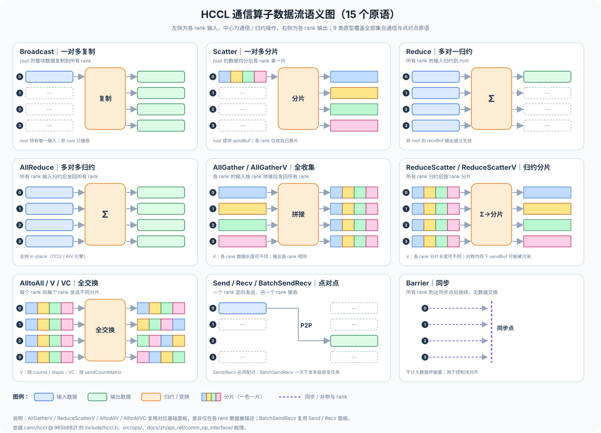

# my-cann

个人 CANN/HCCL 方向的双轨材料库：
`study/` 为当前岗位系统学习笔记，主要利用 AI 整理基础知识的心智模型。 
`design/` HCCL需求设计交付物

## 仓库结构

```text
my-cann/
├── study/      # 六大专栏课程（01-模型 → 02-训练推理 → 03-单卡 → 04-并行 → 05-集合通信 → 06-昇腾HCCL）
├── design/     # 需求交付物（SRS/SD、STC、评审记录、预调研、方法论、模板库）
│   ├── 00-模板库/
│   ├── 00-需求实验方法论参考.md
│   └── 26RP4/  # 按迭代组织的需求目录（01-/02-）
└── README.md
```

### 命名约定

- **需求目录**：`NN-需求简称`，`NN` 按立项顺序编号（当前 01、02）。
- **需求文档**：类型编号固定——`01-预调研`、`02-前置知识`、`03-SE设计`、`04-SRS_SD`、`05-STC`、`06-SRS_SD评审`、`07-代码评审`、`08-问题对齐`、`09-经验总结`；某需求没有的类型直接缺号，不为连续而重排。
- **模板库**：`NN-模板名` 只表示模板清单顺序，与需求文档的类型号无关。
- **study**：栏目统一 `01-06`；栏目内章节沿用 `00-...` 顺序，新增内容顺延。

`.obsidian/`、`.claude/` 为本地工具配置，不入库。

## study｜学习课程（入口：[study/index.md](study/index.md)）

| 专栏 | 主题 | 章节 |
| ---- | ---- | ---- |
| [模型全景](study/01-模型全景/index.md) | 模型在算什么？通信从哪来？ | 6 章 |
| [训练与推理系统](study/02-训练与推理系统/index.md) | 训练怎样运转？显存花在哪？ | 6 章 |
| [单卡执行系统](study/03-单卡执行系统/index.md) | 算子怎样在单卡上跑得快？ | 8 章 + 专题 |
| [并行策略](study/04-并行策略/index.md) | 并行为什么产生通信？多少字节？ | 9 章 |
| [集合通信](study/05-集合通信/index.md) | 语义、算法、代价模型与工程（岗位核心） | 5 章 |
| [昇腾与 HCCL](study/06-昇腾与HCCL/index.md) | 平台机制、调用链与源码落地 | 昇腾 / Ascend C / HCCL 三类 |

其中 [HCCL 与 HCOMM 源码学习](study/06-昇腾与HCCL/05-HCCL与HCOMM源码学习.md) 为 13 单元源码精读课程（架构分层 → 控制面/数据面 → 引擎算法调用链 → executor/template → 资源与 dlsym → 自定义算子），带 [总结地图](study/06-昇腾与HCCL/06-HCCL与HCOMM源码/13-总结-源码阅读地图.md)。

### 附：HCCL 通信算子原语总览



> 图注：AllGatherV / ReduceScatterV / AlltoAllV / AlltoAllVC 复用对应基础面板，差异在数据量描述；BatchSendRecv 复用 Send/Recv 面板。

| 原语 | 类别 | 通信语义 | 数据量 | 归约 | root | 结果位置 | 关键特征 |
| --- | --- | --- | --- | --- | --- | --- | --- |
| AllReduce | 集合·归约 | 全 rank 归约后广播 | 等长 count | sum/prod/max/min | 无 | 所有 rank | 支持 in-place（CCU/AIV） |
| Reduce | 集合·归约 | 全 rank 归约到 root | 等长 count | sum/prod/max/min | 有 | 仅 root | 支持 in-place（CCU/AIV） |
| ReduceScatter | 集合·归约 | 归约后按 rank 分片 | recvCount 等长 | sum/prod/max/min | 无 | 各 rank 分片 | 对称内存下 sendBuf 可能被污染 |
| ReduceScatterV | 集合·归约 | 变长归约 + 分片 | sendCounts / sendDispls | sum/prod/max/min | 无 | 各 rank 分片 | 不同 rank 同编号数据量须一致 |
| Broadcast | 集合·分发 | root 广播到所有 rank | 等长 count | 无 | 有 | 所有 rank | 单 buf，天然原地 |
| AllGather | 集合·收集 | 全 rank 输入按 rank 拼接 | sendCount 等长 | 无 | 无 | 所有 rank | 各 rank 输出相同 |
| AllGatherV | 集合·收集 | 变长收集 | recvCounts / recvDispls | 无 | 无 | 所有 rank | recvBuf≠sendBuf；displs 单调不重叠 |
| Scatter | 集合·分发 | root 数据均分散布 | recvCount 等长 | 无 | 有 | 各 rank | sendBuf 仅 root 有效 |
| AlltoAll | 集合·交换 | 等量全交换 | sendCount=recvCount | 无 | 无 | 所有 rank | 收发 buffer 不重叠 |
| AlltoAllV | 集合·交换 | 变长全交换 | send/recvCounts + Displs | 无 | 无 | 所有 rank | 收发 buffer 不重叠 |
| AlltoAllVC | 集合·交换 | 矩阵描述变长全交换 | sendCountMatrix | 无 | 无 | 所有 rank | 收发数据类型可不同 |
| Barrier | 集合·同步 | 全 rank 同步屏障 | 无数据 | 无 | 无 | 无 | 内部/兼容接口 |
| Send | P2P | 发往 destRank | count | 无 | — | 对端 | 与 Recv 配对、同步调用 |
| Recv | P2P | 从 srcRank 接收 | count | 无 | — | 本 rank | 与 Send 配对 |
| BatchSendRecv | P2P | 批量异步收发 | itemNum 项 | 无 | — | 各目标 | 一次下发多收发任务 |

> 依据 `cann/hccl` @ `965b682f` 的 `include/hccl.h`、`src/ops/`、`docs/zh/api_ref/comm_op_interface/` 梳理；Barrier 为内部/兼容接口。

## design｜需求材料

### 26RP4｜01-Reduce-64bit与特殊规约分级算法（[目录](design/26RP4/01-Reduce-64bit与特殊规约分级算法/)）

需求 AR20260930049502 全链路交付物（hccl 仓 `feature/reduce-64bit-prod-2level-hier`，PR #3755 已合入）：

| 材料 | 说明 |
| ---- | ---- |
| [02-前置知识.md](design/26RP4/01-Reduce-64bit与特殊规约分级算法/02-前置知识.md) | 小白版理论向导 |
| [03-SE设计.md](design/26RP4/01-Reduce-64bit与特殊规约分级算法/03-SE设计.md) | SE 串讲版设计 |
| [04-SRS_SD.md](design/26RP4/01-Reduce-64bit与特殊规约分级算法/04-SRS_SD.md) | SRS/SD 全文：决策记录、风险表、死锁排查扩展节、cost 三轮迭代与实测数据 |
| [05-STC.xlsx](design/26RP4/01-Reduce-64bit与特殊规约分级算法/05-STC.xlsx) | 用例台账 58 条（ST 15 / UT 6 / Checker 25 / NPU 12），执行情况已反填 |
| [06-SRS_SD评审.xlsx](design/26RP4/01-Reduce-64bit与特殊规约分级算法/06-SRS_SD评审.xlsx) | 设计评审记录 9 条（7 闭环 2 开放） |
| [07-代码评审-PR3755.xlsx](design/26RP4/01-Reduce-64bit与特殊规约分级算法/07-代码评审-PR3755.xlsx) | PR #3755 代码评审记录 20 条（人工 6 + AI 去重 14，处置按 14061870 核实） |
| [08-问题对齐-DPU-Reduce写非root用户输出buffer.md](design/26RP4/01-Reduce-64bit与特殊规约分级算法/08-问题对齐-DPU-Reduce写非root用户输出buffer.md) | ST 断言暴露的存量缺陷对齐材料 |
| [09-经验总结.md](design/26RP4/01-Reduce-64bit与特殊规约分级算法/09-经验总结.md) | 同行向知识分享（分级原理/架构注册/选路cost/两则实战案例） |
| [scripts/](design/26RP4/01-Reduce-64bit与特殊规约分级算法/scripts/README.md) | 一键执行六件套（NPU 真机 / ST / Checker / UT / 单用例 / 临界点实验） |

开放项追踪：芯片支持口径待 SE 确认（04-SRS_SD 1.5）；NPU_RD_TH_* 阈值实验真机结果待回填（04-SRS_SD 2.9）；STC TOPO/CHK 三条 GTEST_SKIP 待真机补验。

### 26RP4｜02-AllGatherV与Reduce零拷贝模式（[目录](design/26RP4/02-AllGatherV与Reduce零拷贝模式/)）

需求 AR20261029516478（AllGatherV）/ AR20261029517134（Reduce），事实基准 hccl 仓 `master@7585a50c`：

| 材料 | 说明 |
| ---- | ---- |
| [01-预调研.md](design/26RP4/02-AllGatherV与Reduce零拷贝模式/01-预调研.md) | 零拷贝机制现状摸底，`file:line` 事实与【待确认】判断分离，供 SE 串讲前对齐 |
| [02-前置知识.md](design/26RP4/02-AllGatherV与Reduce零拷贝模式/02-前置知识.md) | 小白版理论向导（集合通信 → 零拷贝/对称内存 → HCCL 结构 → 现有实现 → 目标算子差距） |
| [03-SE设计.md](design/26RP4/02-AllGatherV与Reduce零拷贝模式/03-SE设计.md) | SE 设计：对称内存扩展至 ReduceScatterV / Scatter / AllGatherV / Reduce，含算法级零拷贝判定与不支持根因 |
| [04-SRS_SD.md](design/26RP4/02-AllGatherV与Reduce零拷贝模式/04-SRS_SD.md) | SRS/SD 全文：判定标准、逐算法可行性、公共层扩展、AGV/Reduce 接入方案 |
| [05-STC.xlsx](design/26RP4/02-AllGatherV与Reduce零拷贝模式/05-STC.xlsx) | 用例台账 25 条（ST 20 / UT 3 / Checker 2），执行情况已反填，含 3 条真机待补验 |
| [09-经验总结.md](design/26RP4/02-AllGatherV与Reduce零拷贝模式/09-经验总结.md) | 同行向知识分享（零拷贝原理/门禁与探测/数据面取舍/三则实战与工程教训） |

开放项：NPU 真机 3 条（AGV 1 / Reduce 2）留待补验，部分 ST/UT 待补（见台账“用例执行情况”列）。

### 通用材料

- [00-需求实验方法论参考.md](design/00-需求实验方法论参考.md)——远程仿真实验全链路经验（环境/工具/构建/观测/实验设计/踩坑/交付，8 章）
- [00-模板库](design/00-模板库/)——SRS-SD 文档模板、SRS_SD_review / STC_review / code_review 评审记录模板、测试 STC 用例模板

## 关联仓库

上游 [cann/hccl](https://gitcode.com/cann/hccl)（fork：cassielee-tech/hccl）· [cann/hcomm](https://gitcode.com/cann/hcomm)

## 其他学习资料收集

[对称内存](https://gitcode.com/zhangzhuopan/hccl_work/blob/main/symmetric_memory/README.md)


