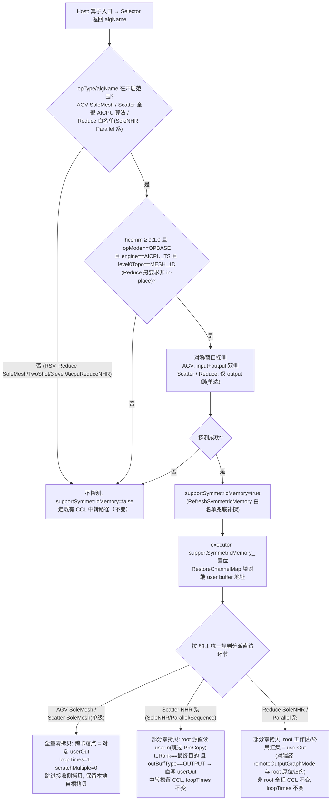

# AICPU 对称内存（零拷贝）扩展：ReduceScatterV / Scatter / AllGatherV / Reduce

## 1. 需求背景

超节点内大数据量通信是性能关键路径。当前 AICPU 非对称内存模式下，跨卡数据需经 CCL buffer 中转（跨卡写对端 CCL + 本地拷贝入 userOutput），两个痛点：

- **额外本地拷贝**：每条链路多一次 CCL 与 user buffer 间的拷贝，大数据量下 HBM 带宽浪费显著，且与跨卡传输串行。
- **循环切片**：CCL scratch 槽位与 UB 单次传输上限（256MB）共同约束单轮数据量，大数据被切成多轮 loop，每轮有编排与同步开销。

对称内存允许各 rank 经对称窗口直访对端 user buffer，数据一步落到最终位置。前一需求（`aicpu_symmetric_memory_all_ops_design.md`）已覆盖 AllGather / AllReduce / ReduceScatter / Broadcast，本需求扩展到 **ReduceScatterV、Scatter、AllGatherV、Reduce**，并逐算法分析"能否真正实现零拷贝、哪些环节可以零拷贝"。

当前代码行为（四算子一致）：

- 入口均不调用对称窗口探测，公共层 `RefreshSymmetricMemory` 白名单不含四算子（default 拒绝），`supportSymmetricMemory` 恒 false，一律走 CCL 中转；selector 全不匹配时入口返回 `HCCL_E_NOT_SUPPORT`，模板参数非法返回 `HCCL_E_INTERNAL`（本需求不改报错路径）。
- executor 均不置 `supportSymmetricMemory_` / `enableRemoteMemAccess`，模板残留对称分支全为死代码，且三处有缺陷：Scatter NHR 分支偏移公式错误（R 个中转槽重叠，误激活即写坏数据）；Scatter Mesh1D 分支漏 root 自槽拷贝；Reduce TwoShot 分支污染 sendBuf 且偏移仅整除时自洽。

**结论先行**（判定标准 §3.1，逐算法分析 §3.2）：

- **可支持的算法**：AllGatherV（SoleMesh）与 Scatter（SoleMesh）——**全量零拷贝**，跨卡数据全程直落对端 userOut，不经 CCL；Scatter NHR 系与 Reduce SoleNHR / Parallel 系——**部分零拷贝**，源头、末跳落点、root 侧工作区等可直访环节换成 user buffer，多跳中转与交换槽位因"无合法 user 落点"保留 CCL（根因见 §3.2）。
- **不支持的算法**：ReduceScatterV 全部算法，Reduce 的 SoleMesh / TwoShot / Sequence 3level / AicpuReduceNHR——确定性归约所需的"每源一槽"槽位与中间累加介质在 user buffer 中无处安放，且发送源直读、root 折叠目标直写等环节现状已达极限，无可直访的新环节，维持 CCL 中转。新算法能否突破见 §3.2.5：RSV 可新开发环形在途归约（MeshChunk V 版）达成全量零拷贝；Reduce 需环形归约新算法**配合污染/契约放松**；Scatter NHR 系新算法也无法突破（中转暂存是物理下界）。
- **允许污染输入时**（放开约束④）：Reduce SoleNHR（无条件）与 Reduce TwoShot、RS SoleMesh、AR TwoShot（仅整除时）可升级为全量零拷贝；RSV、Reduce SoleMesh、Scatter NHR 系仍不支持——污染场景判定**分开列于附录 A**，不在本需求实施范围。

## 2. 需求分解

子需求：

- **AllGatherV 对称接入（§3.5）**：零拷贝数据面已在图模式验证，本需求打通单算子（OPBASE）对称链路（探测、白名单、executor 接线、loopTimes=1、scratch 归零、防御），并修正 outputSize 统计口径。
- **Scatter 对称接入（§3.6）**：SoleMesh 直写对端 userOut（激活既有分支 + 修复 root 自槽拷贝缺口）；NHR 系把错误死分支重写为按环节直访——root 源直读 userIn、末跳直写目的 userOut、中转槽留 CCL。
- **Reduce 对称接入（§3.7）**：SoleNHR 与 Parallel 系的 root 侧工作区/终局汇集改 userOut，跳过 root 全量本地拷贝，归约顺序与非 root 路径不变；其余算法不开启。
- **公共层扩展（§3.4）**：白名单新增三 case（AGV、Scatter、Reduce 限白名单算法）、"仅 output 侧"单边探测、`IsReduceOpSymMemDeterministic` 白名单扩展。
- **ReduceScatterV 不开启**：不探测、不放行、零改动——发送源已直读 userIn、折叠目标已是 userOut、交换槽是确定性 + 空间下界，无可直访环节（§3.2.3）。

边界声明（不涉及）：

- CLOS / MESH_1D_CLOS / UBX / 2die 定制机型、OmniPipe、Z 轴绕行、Dpu* 系列、StrictOrdered、PCIe-mix AicpuReduce——与既有对称内存需求的排除清单一致。
- 图模式（OFFLOAD）新增改造：AGV 图模式已具备直写能力，仅回归；Scatter 图模式引导回老流程。
- 不新增算法、不改数据面（原语、交换模式、归约顺序不变，仅把源/落点/工作区在可行环节换成 user buffer，中转与交换槽保留 CCL）；不污染输入（仅用 output 侧窗口与 root 自身 userOut）；保留中转槽的路径不放开 loopTimes；不涉及跨 rank 对称标志协商（公共层既有缺口，§7）。
- "污染输入"、"非 root 输出当工作区"等放松路线不采纳（§3.2.4 / 附录 A）；RSV 与 Reduce 的 SoleMesh / TwoShot / 3level / AicpuReduceNHR 零功能改动，唯一例外是清理 Reduce TwoShot 危险死分支（§3.8）。

引擎影响范围：

| 引擎 | 是否涉及 | 原因 |
|---|---|---|
| AICPU（COMM_ENGINE_AICPU_TS） | ✅ | 唯一改造引擎：executor、AICPU 模板、公共层门禁 |
| CCU_MS / CCU_SCHED | ❌ | CCU 的 RSV/AGV mem2mem 本就是"直读对端 user buffer"的 pull 模型，不依赖对称窗口 |
| AIV | ❌ | AGV/RSV 无 AIV 算法；Reduce/Scatter 的 AIV 路径不在范围 |
| DPU / HOSTCPU | ❌ | Dpu* 为 host-DPU 机型专用，在排除清单内 |

## 3. 方案设计

### 3.1 判定标准与改造范式

统一记号：N = rank 数；D = 单 rank 全量数据；S_my = 本 rank 片大小（V 类各 rank 不等）；chunk = Scatter/Reduce 单 rank 数据量。硬约束：

- **① 归约确定性必须**（"每源一槽 + 固定序折叠"或"成对/环形归约"，不能并发融合累加）；**② fullmesh 链路同时使用**（不能串行化）；**③ 不改数据面**（只把 CCL 槽位原样搬进 user buffer，不新增算法）；**④ 不能污染输入**（userIn 只读，累加介质只能用合法 userOut）。

数据面拆成四类环节，满足四条约束的环节直访 user buffer，其余保留 CCL——**算法的支持范围 = 可替换环节的集合**：

| 环节 | 零拷贝处理 | 严格约束下的合法落点 |
|---|---|---|
| ① 源头（user→CCL 头拷贝） | 数据持有侧 SDMA 源直读 user buffer，跳过头拷贝 | userIn 只读即可 |
| ② 落点（"本跳接收方 == 数据最终目的 rank"的传输） | 直写接收方 userOut，跳过其 PostCopy | 接收方自身 userOut |
| ③ 工作区（归约累加介质） | 归约/汇集在合法 userOut 原位进行 | 仅 root 的 userOut（非 root output 语义无效；AR/RS 因输出全员有效可落各 rank userOut） |
| ④ 交换槽（每源一槽落地、多跳中转数据） | **保留 CCL**——确定性与空间下界（§3.2） | — |

三类结果：**全量零拷贝**——全部环节可替换（AGV、Scatter SoleMesh，单跳纯搬运、落点即最终位置），全程不经 CCL；**部分零拷贝**——仅部分可替换（Scatter NHR 系的①②、Reduce SoleNHR / Parallel 系的③root 侧），按环节替换、④留 CCL；**不支持**——无可替换环节（RSV、Reduce SoleMesh / TwoShot，①③现状已达极限或无合法落点），不开启。

模板统一分派规则（不新增开关，复用 `enableRemoteMemAccess` 与既有 inBuffType/outBuffType 语义）：

- 写落点：仅 `outBuffType == OUTPUT` 且本跳"接收方 == 槽位最终目的 rank（toRank==txId）"的传输取 `remoteOutputGraphMode.addr`，其余维持 `remoteCclMem`（防组合算法中转层误直写）。
- 源：`inBuffType == INPUT` 时数据持有侧（root）直接从 userIn 按槽位偏移取源，跳过 PreCopy。
- 全程不经 CCL 的路径 `loopTimes = 1`、scratchMultiple = 0（摆脱 256MB 与 scratch 双重约束）；保留中转槽的路径 loopTimes / scratchMultiple 不变（仍受 cclMem/R 约束），收益 = 本地拷贝消除。
- 部分零拷贝路径的多轮 loop 正确性：① 切片公式全 rank 统一不变——直访环节不减少槽位需求，root/接收端省下的 CCL 占用**不**用于放大单轮切片（避免破坏统一编排，收益仅 1/R 量级）；② 直写/原位归约地址必须叠加本轮 `outBuffBaseOff`——跳过 PostCopy/PreCopy 后，"本轮进度偏移"的职责从本地拷贝转移到跨卡落点与 root 工作区地址上，遗漏会导致多轮数据互踩；③ 保护 CCL 槽跨轮复用的 notify 握手（ACK/DATA_SIGNAL）不得随拷贝一起省略——直写环节跳过的是本地拷贝，不是同步（"拷贝可跳、握手不可跳"），否则对端下一轮写会提前覆盖。

仓内先例：AllGather 对称 = ②全落点直访；RS OmniPipe 对称 = ①源=user input + ③折叠目标=user input（污染版）+ ④交换落点仍 CCL；Reduce 3level = ③root 末段直写 userOut；Reduce TwoShot 阶段2 = ②root 直读对端槽拼装 userOut。

### 3.2 逐算法分析与结论总表

#### 3.2.0 结论总表

level0Topo == MESH_1D 时各算子可选的全部 AICPU 算法判定（定制机型/排除清单不列）：

| 算子 | 算法 | 支持（不允许污染，本需求；全量/部分） | 允许污染（附录 A） | 新算法路线（§3.2.5） | 原因 / 支持边界 |
|---|---|---|---|---|---|
| AllGatherV | `AicpuAllGatherVSoleMesh` | ✅ 全量零拷贝 | ✅（无需污染） | —（已全量） | 纯搬运，每 rank 贡献在对端 output 有专属 displs 区间，落点即最终位置 |
| Scatter | `AicpuScatterSoleMesh` | ✅ 全量零拷贝 | ✅（无需污染） | —（已全量） | 单跳星型纯搬运，root 直写对端 userOut |
| Scatter | `AicpuScatterSoleNHR` | ✅ 部分零拷贝：①root 源直读 + ②末跳直写，中转留 CCL | ❌（无输入可污染） | ❌ 无法突破（中转暂存是物理下界） | 中间节点暂存 R×chunk 中转数据，userOut 仅 1×chunk，④ 无合法落点 |
| Scatter | `AicpuScatterParallelMeshNHR` | ✅ 部分零拷贝：同机制（inter 层 root 源 + Step2 末跳） | ❌（无输入可污染） | ❌ 无法突破（同上） | 框级汇聚 L0×chunk、Step1 落点 L1×chunk 均为中转数据 |
| Scatter | `AicpuScatterSequenceMeshConcurNHR / NHRNHR` | ✅ 部分零拷贝：仅②末跳直写（L0 源头已达极限，收益边际） | ❌（无输入可污染） | ❌ 无法突破（同上） | L0 输出 L1×L2×chunk 为中转数据 |
| ReduceScatterV | `AicpuReduceScatterVSoleMesh` | ❌（各环节已达极限，无改造空间） | ❌（非均匀切分空间超限） | ✅ **MeshChunk V 版**（环形在途归约→全量零拷贝，不依赖污染） | 确定性折叠需 N×S_my 槽位：userOut 仅 S_my，userIn 只读且非均匀时 N×S_max 可超输入；①③现状已直访 |
| Reduce | `AicpuReduceSoleMesh` | ❌（①③已达极限） | ❌（root 槽位根本不足） | ❌ 星型形态数学无解（须换分片/树/环形归约形态） | root 需 N×D 槽位，userOut 仅 D、userIn 只读 |
| Reduce | `AicpuReduceSoleMeshTwoShot` | ❌（阶段2 已直写，阶段1 介质无合法落点） | ✅ 仅整除时 | ⚠️ **流水线环形归约**（需污染/契约放松，无整除限制） | 阶段1 每 rank 需 D 槽位：非 root userOut 无效、userIn 只读 |
| Reduce | `AicpuReduceSoleNHR` | ✅ 部分零拷贝：③root 工作区=userOut（非 root 与交换留 CCL） | ✅（无条件） | —（无需新算法，污染/契约放松下现有数据面即可） | 成对归约中间结果（1×D）落非 root，其 userOut 语义无效 → 仅 root 侧可替换（对比 AR NHR ✅ 输出全员有效） |
| Reduce | `AicpuReduceSoleNHRAicpuReduce` | ❌（数据类型门禁范围外） | ❌ | ❌（数据类型范围外） | 64bit/PROD 专用，被对称门禁排除 |
| Reduce | `AicpuReduceParallelMeshNHR / ParallelNHRNHR` | ✅ 部分零拷贝：③root 终局汇集直写 | 理论 ✅ 仅整除（不建议） | ⚠️ 环形归约新形态可替代（需放松，另行立项） | RS mesh 层槽位与 NHR 层中间结果均落非 root → 仅 root 侧可替换 |
| Reduce | `AicpuReduceSequenceMeshConcurNHR / NHRNHR` | —（root 直写已实现，无需改造） | 理论 ✅ 仅整除（不建议） | ⚠️ 同上（收益有限） | 各层部分归约结果只能落 CCL |

**总结论：AGV 与 Scatter SoleMesh 全量零拷贝；Scatter NHR 系与 Reduce SoleNHR / Parallel 系部分零拷贝（源头/末跳落点/root 侧工作区直访 user buffer，多跳中转与交换槽保留 CCL——确定性与空间的下界）；RSV 与 Reduce SoleMesh / TwoShot / 3level 无可直访环节，不开启。**

> "允许污染"与"新算法路线"两列均为本需求实施范围外的补充判定（分别放开约束④、约束③），详见附录 A 与 §3.2.5。

#### 3.2.1 AllGatherV —— ✅ 全量零拷贝

现状数据面：每 rank 先把自身贡献本地拷到 userOut 的 `displs[myRank]` 区间（兼作发送源），N-1 线程并发跨卡写入对端 CCL 的"以我为索引"槽位，对端再把各槽拷入自身 userOut 对应区间。

对称化核对：无归约且各源写入互不重叠的 displs 专属区间（①）；每对端一线程并发写（②）；同一 push-write 仅换落点（③）；sendBuf 只读本端（④）；output = Σ recvCounts 恰容纳 N 个区间，偏移由全 rank 一致的 recvDispls 本地可算，无需跨卡交换。

模板 `enableRemoteMemAccess` 分支已存在且被图模式验证，单算子模式只差对称窗口接线。**前置修复**：OPBASE 的 outputSize 现按 Σ recvCounts 统计，真实最大落点是 max(displs[i]+counts[i])——displs 带空洞时探测尺寸偏小、有越界写风险，须先修正口径（图模式路径已正确）。

#### 3.2.2 Scatter —— SoleMesh 全量零拷贝；NHR 系部分零拷贝

**SoleMesh ✅**：root 读自身 userIn（只读），每对端一线程把该对端的最终 chunk 直写对端 userOut（恰 chunk 大小、装的就是最终数据）；root 自槽保留一次本地拷贝（纯本地，非跨卡中转）。无归约、单跳、fullmesh 并发、输入只读——四条约束全满足；接收侧 CCL→userOut 拷贝消除，非 root 零本地拷贝。

**NHR 系（SoleNHR / ParallelMeshNHR / SequenceMeshConcurNHR(NHR)）——①② 环节可替换，④ 保留 CCL**：多跳 store-and-forward 按"最终目的 rank"编号，中间节点必须暂存"不属于自己"的中转数据（峰值 SoleNHR R×chunk、Parallel 框级 local root L0×chunk、Sequence 3level L1×L2×chunk），而其 userOut 仅 1×chunk 且中转数据并非最终输出——中转槽无合法 user 落点，只能留 CCL（与 AR/RS 组合算法判 ❌ 的根因同构），全量零拷贝不成立。可替换环节：root 的发送源本就是全量 userIn（①省 R×chunk 头拷贝）、"本跳接收方 == 最终目的"的传输可直写目的 userOut（②每 rank 省一次 PostCopy），改造见 §3.6；模板残留的错误对称死分支随之重写。

#### 3.2.3 ReduceScatterV —— ❌ 不支持（唯一算法）

现状：fullmesh push，每 rank 直接从自身 userIn（**发送侧已零拷贝，无 user→CCL 前拷贝**）把"属于对端 j 的片"SDMA 写到对端 CCL 槽 j（每源一槽）；接收端主线程按源升序折叠进 userOut。确定性已满足，**卡点是槽位空间**。零拷贝要求 N-1 个 S_my 落地槽搬进 user buffer，候选路线全部排除：

| 候选路线 | 排除原因 |
|---|---|
| 槽位落 userOut | userOut 仅 S_my（一个槽容量），差 N-1 个槽 |
| 槽位落 userIn | 违反④；发送侧并发读 userIn（WAR）；非均匀切分时大片 rank N×S_max > inputSize |
| 并发 WriteReduce 直落对端 userOut | N-1 写者对同一区域并发 RMW，累加顺序不定，违反① |
| 串行接收-折叠 | 确定性可行，但任一时刻仅一条入向链路活跃，违反② |
| 改 pull（读对端 userIn + ReadReduce） | 改数据面违反③；并发 read-reduce 同样不确定、按对端串行仍违反②（仓内 RS SoleMesh 同形态对称分支正被确定性门禁禁用） |
| 环形在途归约（MeshChunk 型） | RSV 仅一个 SoleMesh 算法，新增算法超出③范围 |

**结论：不开启，维持现状**（发送侧直读 userIn + 接收侧 CCL 每源一槽 + 固定序折叠，已是"半零拷贝"，接收侧 N 槽是确定性 + fullmesh 下的空间下界）。按环节核对同样无可替换项：①源头已达（源直读 userIn）、③工作区已达（折叠目标即 userOut）、折叠本身即归约本体、④交换槽是下界。允许污染也基本不解锁：非均匀切分下 N×S_max > inputSize 空间无解，仅全部 counts 相等的退化情形成立（附录 A.2）。**唯一突破路线是更换归约形态——新开发环形在途归约（MeshChunk V 版），见 §3.2.5。**

#### 3.2.4 Reduce —— SoleNHR / Parallel 系 root 侧可零拷贝；其余算法 ❌

语义前提：每 rank 输入全量 D、输出仅 root 有效——全网合法用户累加介质只有 root 的一份 D（对比 AllReduce 输出全员有效，NHR 判 ✅）。

| 算法 | 归约形态 | 判定与原因 |
|---|---|---|
| `SoleMesh` | 星型汇聚：N 份全量 D 并发落 root，每源一槽 + 升序折叠 | ❌：root 需 N×D 槽位，userOut 仅 D、userIn 只读；串行接收-折叠违反②。①③已达极限（发送源直读 userIn、root 折叠目标即 userOut） |
| `SoleMeshTwoShot` | 阶段1 分片折叠 + 阶段2 汇聚 root | ❌：阶段1 每 rank 需 D 槽位，非 root userOut 无效、userIn 只读；阶段2（root 直读对端槽拼装 userOut）现状已直写。模板死分支属"槽位=对端 userIn"污染路线，偏移仅整除自洽 + 输入 WAR 风险，不采纳、一并清理 |
| `SoleNHR` | 成对归约（halving+doubling），工作区 1×D/rank 原地累加 | ✅ 仅 root 侧（③）：中间步持有者是非 root，其 userOut 无效、userIn 只读 → 非 root 工作区与交换留 CCL；root 的介质可改自身 userOut（省 root 全量拷贝，§3.7） |
| `SoleNHRAicpuReduce` | 同上（64bit/PROD 变体） | ❌：数据类型被对称门禁排除，范围外 |
| `ParallelMeshNHR / ParallelNHRNHR` | RS 层 + AG 层组合流水 | ✅ 仅 root 侧（③）：RS mesh 层槽位、NHR 层中间结果均落非 root，无法替换；root 终局汇集可直写 userOut（§3.7） |
| `SequenceMeshConcurNHR / NHRNHR` | 6 段串行分层归约 | —：root AGL0 直写与 RSL0 源=INPUT 已实现，无可替换环节，不改造 |

**根因：Reduce 是"N 份全量 D → root 一份 D"的向心归约，确定性 + fullmesh 并发要求 N×D 落地槽位（或分布于非 root 的中间累加区），而合法介质只有 root 的 1×D——只有 root 侧环节可直访 user buffer。**

放松路线（均不采纳，供后续评估）：**路线一，允许污染输入**——解锁 SoleNHR（无条件）与 TwoShot（仅整除），见附录 A；**路线二，契约扩展"非 root recvBuf 可用作工作区"**——解锁集相同、数据面与 AR NHR 对称实现同构，但改变 API 跨卡契约（当前仅 root 输出有定义），需修订文档并强约束用户注册"自己永远不读"的 buffer。本需求实施的 root 侧改造（§3.7）不依赖任何放松路线。新算法路线（流水线环形归约等）见 §3.2.5。

#### 3.2.5 新算法路线展望（不支持算法能否通过开发新算法突破）

约束③（不改数据面、不新增算法）是本需求的范围约束，不是物理上限。对不支持的算法，评估"新增算法"能否实现零拷贝：

| 算法 | 新算法路线 | 结论与前提 |
|---|---|---|
| RSV SoleMesh | **MeshChunk（环形在途归约）V 版**：轮转固定序调度——第 k 步全网并发，rank i 从 rank (i-k) 接收"对 i 片的贡献"并 WriteReduce 进自身 userOut（累加区 = S_my 恰等于输出）；源 = 各源 rank 的 userIn（displs 全局一致，对端偏移本地可算）；先 LocalCopy 自贡献打底。确定性（固定环序、每步单写者）、fullmesh 并发（每步 N 对不同源并发）、空间（仅 userOut）全部满足 | **✅ 可行，可达全量零拷贝**。RS SoleMeshChunk（环形在途归约，累加区 = userOut）有同形态先例。前提：WriteReduce 的数据类型/reduceOp 硬件覆盖（64bit/PROD 需软件归约，该组合仍回退 CCL 或门禁排除）；V 不等长步长的编排与确定性门禁（固定环序）放行 |
| Reduce SoleMesh（星型汇聚） | root 单点 N×D 槽位是数学下界，星型形态内无新算法可解（除非串行化链路违反②或放弃确定性违反①） | **❌ 星型形态无解**，必须更换归约形态（分片/树/环形，即下面各行） |
| Reduce TwoShot / SoleNHR | 无需新算法：允许污染下 TwoShot ✅（仅整除）、SoleNHR ✅（无条件），见附录 A | —（附录 A 已覆盖） |
| Reduce（通用新形态） | **流水线环形在途归约**：D 按 chunk 分段沿环流动，每跳把在途数据累加进"1 个工作区槽"后转发，root 收尾落 userOut；环序固定确定、流水化后全链路同时忙；工作区仅每跳 1×chunk——**无整除限制**（优于 TwoShot 的 N 槽方案） | **⚠️ 有条件可行**：中间跳的工作区必须落非 root 的可写 user buffer——严格模式下非 root 无合法介质（output 语义无效、input 只读），仍不可行；允许污染落 userIn、或契约扩展落非 root userOut 时 → 全量零拷贝。**非 root 缺可写介质是 buffer 语义问题，算法无法凭空创造合法 buffer** |
| Scatter NHR 系 | 中间节点暂存"他人的中转数据"是 store-and-forward 的物理下界，全量零拷贝要求中转有合法 user 落点——非 root 的 output 仅 1×chunk、input 无效/可空，任何新算法都绕不开；改星型直发（root 出口 ×R）即等价于已支持的 SoleMesh，等于放弃 NHR 规避 root 出口瓶颈的存在意义 | **❌ 新算法无法突破**，现有环节直访（§3.6）已是收益上限 |

**小结：新算法的价值在于更换归约形态、重塑空间与顺序约束——RSV 可由 MeshChunk V 版彻底解决（全量零拷贝，不依赖污染）；Reduce 的环形/分片新形态必须配合污染或契约放松（非 root 无可写介质是语义下界）；Scatter NHR 系的中转暂存是物理下界，无突破空间。** 上述新算法均超出本需求"只适配现有算法"范围，作为后续立项依据。

### 3.3 总体框架

### 3.4 公共层 Host 改造

- **白名单**：`RefreshSymmetricMemory` 新增三个 case——`HCCL_CMD_ALLGATHER_V`（直接放行，无归约）、`HCCL_CMD_SCATTER`（放行，直访环节由模板规则分派）、`HCCL_CMD_REDUCE`（限 algName ∈ {`AicpuReduceSoleNHR`, `AicpuReduceParallelMeshNHR`, `AicpuReduceParallelNHRNHR`} 且 `inputPtr != outputPtr`）。RSV 维持 default 拒绝。AGV/Scatter 纯搬运全类型放行；Reduce 白名单算法 attrs 已排除 64bit/PROD，与归约类数据类型门禁天然一致。
- **单边探测**：为 Scatter / Reduce 提供"仅 output 侧"探测语义（按 opType 判定所需侧）。原因：Scatter 非 root sendBuf 可空且 inputSize 为虚值，双侧探测会在 root sendBuf 未注册时造成"root 关 / 非 root 开"的跨卡开关不一致；Reduce 对称路径只写 root 的 output 窗口，不应额外要求注册 sendBuf。开关仅取决于全 rank 必有的 recvBuf 注册状态。`FillChannelSymWinPeerAddrs` 已支持空侧跳过，无需改动。
- **确定性门禁**：`IsReduceOpSymMemDeterministic` 白名单加入 Reduce 白名单算法。root 侧直访不改归约顺序与交换模式（仅换 root 介质/落点），确定性与现状等价，扩展属防御性收口；checker 只校验 root output、对称路径不写非 root output，无冲突，需联动回归。
- **入口探测**：三算子单算子入口在 Selector 之后（algName 与 `param.hcclComm` 已就绪）、`HcclExecOp` 之前，按 AllGather 既有样式加门禁条件块调用探测。
- 版本兼容（9.1 `HcclSymWinGetPeerPointer` / 9.2.0+ `HcclSymWinGetRemoteAddr`，dlsym 运行期探测）与 task cache（对称已自动禁用、key 含该标志与 root）沿用公共层既有能力，无新增。

### 3.5 AllGatherV 改造

**支持范围：全量零拷贝**——跨卡数据全程不经 CCL（落点 = 对端 userOut 的 displs 专属区间），仅保留一次语义必需的自贡献本地拷贝（input→自身 output）。

#### Host 改造

- 入口门禁：hcomm ≥ 9.1.0、OPBASE、AICPU_TS、level0Topo==MESH_1D、algName==`AicpuAllGatherVSoleMesh`，双侧窗口探测。
- **outputSize 口径修复（前置必改）**：Σ recvCounts → max(recvDispls[i]+recvCounts[i])×类型大小（与图模式对齐），杜绝 displs 带空洞时越界写。
- sole executor：`RestoreChannelMap` 前置 `supportSymmetricMemory_` + `SetSymmetricMemoryInfo`；对称时 `enableRemoteMemAccess = true`、`loopTimes = 1`（摆脱 scratch 与 256MB 双重约束，与 AllGather/AllToAllV 对称路径同式）。

#### Kernel（AICPU 模板）改造

- `InsTempAllGatherVMesh1D`：对称分支已存在（远端地址取 `remoteOutputGraphMode.addr`、写 `displs[myAlgRank]` 区间、跳过 PostLocalCopy），本需求激活并加固：远端地址判空（为空返回 `HCCL_E_INTERNAL`）；对端窗口只回填地址不回填大小，用本地 outputSize 兜底越界校验；单侧 0 长度沿用既有握手退化、不得死锁；顺带修复 rx 切片偏移交叉赋值与 count 字段未填充两处遗留缺陷（现为死代码，激活前清理）。
- `CalcScratchMultiple` 对称时返回 0（与图模式一致）。

### 3.6 Scatter 改造

**支持范围**：`AicpuScatterSoleMesh`——**全量零拷贝**（root 直写对端 userOut，仅 root 保留一次自槽本地拷贝）；NHR 系（SoleNHR / ParallelMeshNHR / SequenceMeshConcurNHR(NHR)）——**部分零拷贝**（①root 源直读 userIn + ②末跳直写目的 userOut；④多跳中转槽保留 CCL）。

#### Host 改造

- 入口门禁：hcomm ≥ 9.1.0、OPBASE、AICPU_TS、level0Topo==MESH_1D，**仅 output 侧**探测；不限定 algName——各算法按 §3.1 统一规则分派直访环节，CLOS/UBX 算法被拓扑门禁自然排除。
- sole executor（SoleMesh）：同 §3.5 模式——`RestoreChannelMap` 前置 `supportSymmetricMemory_` + `SetSymmetricMemoryInfo`；对称时 `enableRemoteMemAccess = true`、`loopTimes = 1`、scratch 倍数按 0（现状为 1，对称后不占 CCL）。
- NHR 系与组合 executor（sole / parallel / 3level）：同样置 `supportSymmetricMemory_` + `SetSymmetricMemoryInfo` + `enableRemoteMemAccess`（传给各层模板，行为由统一规则分派）；loopTimes / scratchMultiple 维持现状（中转槽仍受 cclMem/R 约束）。

#### Kernel（AICPU 模板）改造

- `InsTempScatterMesh1D`（含 Z 轴绕行派生类，作为 Sequence L0 层随组合算法开启）：
  - **修复 root 自槽缺口（必改）**：既有对称分支整体跳过 PreCopy 导致 root 自己的 chunk 丢失。改为对称且 `outBuffType == OUTPUT` 时保留 root 自槽本地拷贝（源目相同则跳过），非 root 维持跳过；`HCCL_BUFFER` 中转层的 PreCopy 不受对称开关影响。
  - root 发送落点：对称且 `outBuffType == OUTPUT`（SoleMesh、Parallel Step2-intra）取 `remoteOutputGraphMode.addr + 本轮偏移`（既有公式在 sole 参数下正确，激活即可）；中转层（Parallel Step1-intra、Sequence L0）维持 `remoteCclMem`；非 root 维持纯 notify 接收。
  - PostCopy：落点已直写 userOut 时非 root 跳过（既有逻辑）；防御同 §3.5（判空 + outputSize 兜底越界校验）。
- `InsTempScatterNHR`：**重写错误对称死分支**（原偏移公式照抄 AllGather 等距布局，sole 参数下 R 个槽重叠），改为按角色/槽位编址：
  - root 源直读（①）：root 跳过 PreCopy，发送槽按 `txId×inputSliceStride + 本轮偏移` 直读 userIn——root 省 R×chunk 全量头拷贝、CCL 占用归零（分发型 NHR 中 root 只发不收；验证点：若步序存在 root 接收槽，该部分仍落 CCL）。
  - 末跳直写（②）：toRank==txId 且本层 `outBuffType == OUTPUT` 的传输直写目的 userOut，接收方跳过 PostCopy——每 rank 省 1×chunk。
  - 组合层防护：Parallel Step1（INPUT→HCCL）、Sequence L0/L1 的中转写维持 CCL，防误直写。
- in-place：root sendBuf/recvBuf 重叠时行为与非对称路径一致（仅影响 root 自槽本地拷贝，跨卡写均落对端 buffer），不新增限制；门禁条件全 rank 判定一致，无开关跨卡不一致风险。

### 3.7 Reduce 改造（SoleNHR / Parallel 系 root 侧）

**支持范围：部分零拷贝**——仅③root 侧工作区（root 的 PreCopy 目的、原位归约介质、终局汇集改自身 userOut）；非 root 的 PreCopy、工作区与全部交换槽保留 CCL。升级为全量零拷贝需污染/契约放松（附录 A）或环形归约新算法（§3.2.5）。

| 算法 | 改造点 | 收益 |
|---|---|---|
| `AicpuReduceSoleNHR` | root 介质改 userOut：PreCopy 目的 = userOut；halving/doubling 中对端经 `remoteOutputGraphMode` 对 root userOut 原位 write/read-reduce；root 跳过 PostCopy。非 root 全程不变（PreCopy + CCL） | root 省 1×D 全量拷贝及 CCL 往返 |
| `AicpuReduceParallelMeshNHR / ParallelNHRNHR` | AG 阶段 root 侧工作区/最终落点改 userOut（executor 按 isRootRank_ 编排，参照 3level AGL0 既有范式），跳过 root 终局 LocalCopy | root 省 1×D |

说明：不改归约顺序与交换模式；root 与对端间"本端读 / 对端写"的成对原位归约在已放行的 OmniPipe NHR 层对称实现中有同构先例（依赖原语既有握手次序），无新增时序卡点；NHR / Parallel 系 attrs 已排除 64bit/PROD；门禁加 `inputPtr != outputPtr`；不写非 root 的 userOut（其 recvBuf 仅作探测载体，内容语义仍无效）。

### 3.8 ReduceScatterV 与 Reduce 其余算法：不开启说明与死代码清理

- **支持范围：不支持**（全量与部分均无可直访环节，§3.2.3 / §3.2.4；新算法突破路线见 §3.2.5）。RSV 零改动；Reduce 的 SoleMesh / TwoShot / 3level / AicpuReduceNHR 零功能改动，路径与性能保持现状。
- 清理 Reduce `ReduceMesh1DTwoShot` 对称死分支（污染 sendBuf + 非整除偏移缺陷）；该分支现状不可达，清理不改变现有行为。
- 后续若接受放松路线（附录 A），Reduce SoleNHR 可由 root 侧直访升级为全量零拷贝，TwoShot（仅整除）按附录 A 接入，另行立项。

## 4. 规格约束

| 维度 | 约束 |
|---|---|
| 引擎 | 仅 `COMM_ENGINE_AICPU_TS` |
| 拓扑 | `level0Topo == MESH_1D`；AGV（单级全域直达）、Scatter 全算法（SoleMesh 单级 / NHR 系 1~3 级）、Reduce 白名单算法（SoleNHR / Parallel 系）；未开启算法自动走原 CCL 路径 |
| 模式 | 单算子 OPBASE；图模式 OFFLOAD 走既有注册 buffer 路径（AGV 仅回归） |
| 版本 | HCOMM ≥ 9.1.0（9.1 PeerPointer / 9.2.0+ RemoteAddr，dlsym 运行期探测） |
| 数据类型 | AGV / Scatter 全类型放行（无归约）；Reduce 白名单算法 attrs 已排除 64bit/PROD |
| rankSize / 数据量 | 无新增限制；全程不经 CCL 的路径（AGV、Scatter SoleMesh）无 256MB 上限、`loopTimes = 1`；保留中转槽的路径切片同现状（不放开） |
| 窗口注册契约 | 全 rank recvBuf（AGV 另含 sendBuf）全部注册或全不注册；探测失败即本 rank 回退原路径（框架暂无跨 rank 协商，§7） |
| V 类数组契约 | AGV 的 recvCounts/recvDispls 须全 rank 一致；入口新增 displs 合法性本地校验（单调不减、末段 ≤ outputSize） |
| Reduce 附加 | `inputPtr != outputPtr`（禁 in-place）；仅探测 output 侧；不写非 root output |

selector 阈值核对：各算子 AICPU 路径均无数据量/rankSize 阈值，对称门禁不引入新阈值、不与 selector 冲突；Scatter 多级阈值（Sequence 系 >4GB）与 Reduce 8MB TwoShot 阈值只影响算法选择，选中结果决定开启或回退。

## 5. 性能指标

- **AllGatherV**：每 rank 消除 1 次接收侧 CCL→userOut 拷贝（本地拷贝 2 次 → 1 次自贡献拷贝）；`loopTimes` 从 ceil(max counts / min(256MB, cclMem/N)) 降为 1；>256MB 端到端时延优于非对称路径。
- **Scatter SoleMesh**：非 root 本地拷贝 1 次 → 0 次，root 维持 1 次自槽拷贝；`loopTimes` → 1。
- **Scatter NHR 系**：root 消除 R×chunk 全量头拷贝及 CCL 往返（占用归零），每 rank 消除 1×chunk PostCopy；loopTimes 不变，收益为 HBM 流量下降与 root 侧瓶颈缓解。
- **Reduce SoleNHR / Parallel 系**：root 消除 1×D 全量本地拷贝及 CCL 往返；非 root 不变。
- **RSV、Reduce SoleMesh / TwoShot / 3level**：路径不变，性能无回退。
- 正确性基线：AGV / Scatter 纯搬运，结果与非对称路径逐 bit 一致；Reduce 不改归约顺序，root 输出与非对称路径逐 bit 一致。

## 6. 资源使用

- **CCL buffer**：AGV 与 Scatter SoleMesh 对称路径 scratchMultiple=0、不占用（AGV 非对称占用 ≈ N×槽宽近占满整块，Scatter SoleMesh 非对称 1×chunk）；Scatter NHR 系与 Reduce 对称路径预留不变、占用下降（Scatter root 槽归零、Reduce root 工作区移至 userOut，非 root 中转/交换槽同现状）。
- **ChannelInfo / 序列化**：复用 `remoteOutputGraphMode` 字段（对称与图模式在 opMode 上互斥），无新增字段与布局变更。
- **线程 / notify**：与现状一致，无新增。
- **探测开销**：每次调用每侧一次 `HcclCommSymWinGet`（`symMemChecked` 防重复），可忽略。
- **新增内存**：无。

## 7. 周边依赖

- **HCOMM**：`HcclCommSymWinGet`、`GetSymWinRemoteMem` 封装（9.1/9.2+ 版本兼容，公共层已具备）。
- **框架/用户侧**：对称堆注册能力，承担"全 rank 一致注册"契约。
- **公共层既有缺口（沿用现状，列为后续公共需求）**：`OpExchangeInfo` 不含对称标志（无跨 rank 协商，依赖注册契约）；`FillChannelSymWinPeerAddrs` 只回填地址不回填大小（模板以本地 outputSize 兜底校验）。
- **API 文档**：`HcclAllGatherV` / `HcclScatter` / `HcclReduce` 补充对称内存说明（无输入污染；注册契约：AGV 双侧、Scatter/Reduce 仅 recvBuf；Reduce 对称路径下非 root recvBuf 内容仍语义无效；探测失败自动回退）。无需"输入污染"类 caveat（区别于 RS/AR）。
- **门禁 / checker**：`IsReduceOpSymMemDeterministic` 白名单扩展与归约语义 checker 联动回归（§3.4）。
- task cache：对称已自动禁用，无改动；RSV：无依赖（不开启）。

## 8. 测试场景

| 维度 | 取值 |
|---|---|
| 算子 | AGV、Scatter 全算法、Reduce SoleNHR / Parallel 系（对称开启）；RSV、Reduce SoleMesh / TwoShot / 3level（回归，验证 supportSymmetricMemory 恒 false、路径与结果不变） |
| 对称内存 | 全 rank 注册（开启）/ 全不注册（回退原路径）/ 窗口查询失败注入（回退 + 无 ERROR 泄漏） |
| 引擎路径 | AICPU_TS（sole/parallel/3level）；CCU→AICPU 回退（验证白名单补探）；AclGraph/GE 图模式（AGV OFFLOAD 注册 buffer 路径回归） |
| 拓扑 | 单级 MESH_1D；Scatter 2/3 级（NHR 系）；Reduce 2/3 级（Parallel 系）；非白名单算法与 CLOS/UBX 机型（门禁拦截、走 CCL 原路径） |
| rankSize | {2, 4, 8, 16, 32} |
| 数据量 | {1KB, 1MB, 255MB, 256MB, 512MB, 1GB}（256MB 边界、loopTimes=1、保留中转路径的多轮 loop 槽位复用） |
| counts/displs（AGV） | 均匀 / 非均匀（含极端比例）/ 含 0 段 / displs 带空洞（验证口径修复与越界防御）/ 全 0（入口短路） |
| root | {0, rankSize/2, rankSize-1}；Scatter root in-place（与非对称行为一致）；Reduce root sendBuf==recvBuf（门禁拦截回退） |
| 数据类型 | int8/int16/int32/int64/uint64/float16/float32/bfp16/float64（AGV/Scatter 全类型；Reduce 白名单外类型回退） |
| 环节直访专项 | Scatter NHR root 只发不收验证（CCL 占用归零）；组合层中转写不误直写（Parallel Step1 / Sequence L0 落点仍 CCL）；Reduce 确定性门禁放行、非 root output 不被写入；**多轮 loop（数据量 > 单轮切片）下直写偏移叠加与握手保留验证（各轮数据不互踩、无提前覆盖）** |
| 正确性校验 | 结果与非对称逐 bit 一致；对端 output 非落点区域不被踩踏；RSV/Reduce 归约确定性（重复执行逐 bit 一致） |
| 异常/防御 | 对端地址为空注入（HCCL_E_INTERNAL）、AGV displs 非法（HCCL_E_PARA）、counts=0 握手退化无死锁、超时看护 |
| 回归 | Scatter NHR 分支重写 / Reduce TwoShot 死代码清理后全算法回归（多级拓扑、64bit/PROD、in-place 过滤、组合层中转路径） |

---

## 附录 A：允许污染输入时的支持情况与处理方式

> 放开约束④（userIn 可作槽位/累加介质，sendBuf 被就地覆盖、用后不可读）后的补充判定，①②③不变。**不属于本需求实施范围**（正文 = §3.5~§3.7 的严格模式改造），与正文判定分开维护，作为后续"Reduce / RS 系对称内存（污染契约）"需求的评估依据。

### A.1 放开后的判定变化

允许污染 = 合法工作区多出"每 rank 一份 D 大小的 userIn"。**解锁**：成对归约（NHR 系，无条件——工作区落自身 userIn，与 AR NHR 落 userOut 同构；严格模式下仅 root 侧可行，即正文 §3.7）；scatter+折叠**仅整除时**（N×(D/N)=D 恰铺进 userIn）。**仍不解锁**：星型汇聚/全量交换（root 需 N×D，input+output 合计 2D 不足）；多跳中转（Scatter 非 root 无输入可污染）；V 类非均匀（大片 rank N×S_max > inputSize）。

### A.2 四算子逐算法判定与处理方式

| 算法 | 允许污染 | 处理方式 |
|---|---|---|
| AGV / Scatter SoleMesh | ✅（无需污染） | 不变（正文已支持） |
| Scatter NHR 系 | ❌ | 非 root sendBuf 可空，无输入可污染；中转数据仍无合法落点。解锁需"全 rank 提供 N×chunk sendBuf"契约（每 rank 内存代价 = 全量消息），不合理 |
| RSV SoleMesh | ❌（仅均匀退化） | 槽位落 userIn 要求 S_my ≤ 平均片，非均匀时大片 rank 空间无解；counts 全相等时退化为标准 RS，按 A.3 处理 |
| Reduce SoleMesh | ❌ | root 需 N×D 槽位，input+output 合计 2D，N>2 根本不足 |
| Reduce TwoShot | **✅ 仅整除时** | 阶段1：槽 j = 自身 userIn 区域 j（N 个区域合计恰为 D），对端直写我方 input 槽（自贡献 = 区域 my 原地保留），主线程按源升序就地折叠进区域 my；阶段2：root 直读对端 input 区域 i → 拼装自身 userOut 区域 i（区间互斥、可并发、确定）。非整除时大片 rank N×S_max > D ❌；模板死分支即此路线，采纳前须修非整除偏移缺陷 |
| Reduce SoleNHR | **✅（无条件，最干净）** | 跳过 PreCopy（工作区 = 自身 userIn）；halving/doubling 成对原位累加（固定树序，与 OmniPipe NHR 层同构，无新增时序卡点）；结束 root 一次 LocalCopy input→output，非 root input 成为结果垃圾值（语义可接受）。正文 §3.7 的 root 侧改造是本路线的严格子集 |
| Reduce SoleNHRAicpuReduce | ❌（范围外） | 64bit/PROD 被数据类型门禁排除 |
| Reduce Parallel / Sequence 系 | 理论 ✅ 仅整除（不建议） | 连锁解锁（RS-mesh 层槽位落 input + NHR 层工作区落 input + AG 层落 root userOut），层间耦合复杂，需单独立项 |

### A.3 AllReduce / ReduceScatter 对应解锁

| 算法 | 允许污染 | 处理方式 |
|---|---|---|
| RS SoleNHR | **✅** | halving 工作区（起始 D/2、逐步收缩）落 userIn(D) 原位累加，最终拷贝 S_my 到 output |
| RS SoleMesh | **✅ 仅整除时** | 槽 j = userIn 区域 j，对端直写 + 固定序折叠，结果拷到 output——即 `aicpu_symmetric_memory_all_ops_design.md` 采用的路线 |
| AR SoleMeshTwoShot | **✅ 仅整除时** | scatter 阶段槽位落 input，折叠结果写 userOut，doubling 从 input 槽拼装 |
| AR SoleMeshOneShot | ❌ | N×D 槽位，input+output = 2D 不足 |
| AR/RS Parallel / Sequence 组合 | 理论 ✅ 仅整除 | 框内 mesh 层按上述解锁、框间 NHR 层工作区落 input；连锁复杂度高 |
| OmniPipe RS mesh 层 | **✅ 仅整除时** | 交换落点 CCL 槽 → userIn 槽，升级为全量零拷贝；需满足 A.4-2 WAR 前提 |

### A.4 工程前提

1. **文档契约**：sendBuf 就地覆盖、用后不可读——RS/AR 已有同类条款先例，Reduce 系需修订文档；图重放、重计算等复用 sendBuf 场景需评估。
2. **scatter+折叠的成对 WAR**："槽区 = 发送源区"，现有 SendRecvWrite 的 ACK 前置时序存在污染窗口（对端写可能先于本端读落地），需调整握手时序或成对方向定序（有带宽代价）；成对（NHR）原位归约无此卡点（OmniPipe NHR 层同构先例）。
3. **整除硬边界**：非整除时大片 rank N×S_max > D 任何介质无解；门禁须强制 `count % N == 0`，否则回退 CCL。
4. **in-place 禁用**：sendBuf/recvBuf 重叠时槽区与输出区互毁，门禁显式禁用（与 RS 对称的 inputPtr != outputPtr 同构）。
5. **门禁/checker 联动**：`IsReduceOpSymMemDeterministic` 白名单扩展，checker 联动"输入被污染"预期。

### A.5 优先级与正文改造的关系

立项顺序建议：**Reduce SoleNHR**（无条件、改造量最小）→ **Reduce TwoShot / RS SoleMesh / AR TwoShot**（整除限制 + 死分支修复 + WAR 时序）→ 组合类与 OmniPipe 升级。RSV、Reduce SoleMesh、Scatter NHR 系不在污染路线解锁范围。

与正文改造的关系：污染路线开启后，Reduce SoleNHR 由"root 侧直访"升级为全量零拷贝（非 root PreCopy 一并省去）；Scatter NHR 系的环节收益不受污染路线影响（非 root 无输入可污染），两者独立、可叠加。
