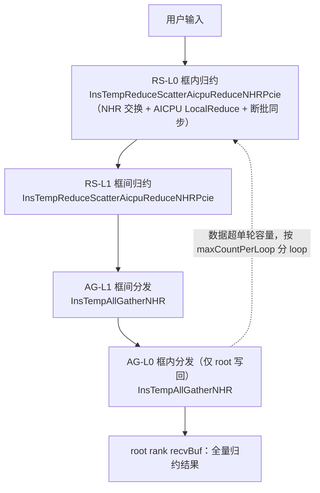
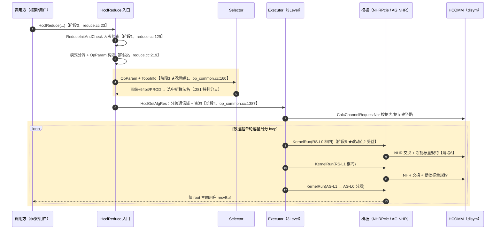
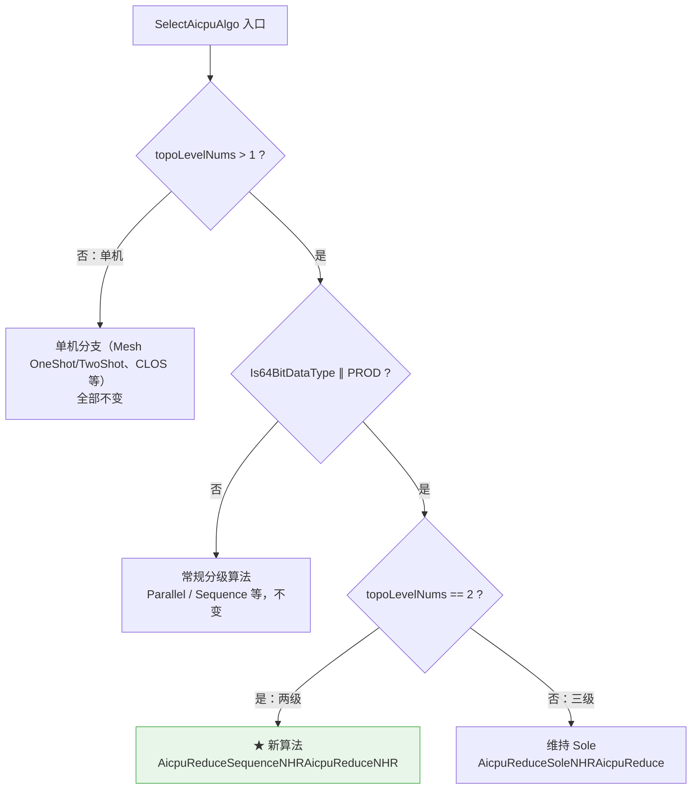
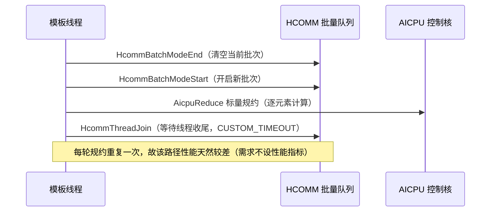

# 需求分析与软件设计（SRS/SD）：Reduce 算子 64bit/特殊规约两级分级算法

| 项目 | 内容 |
| ---- | ---- |
| 需求编号 | AR20260930049502 |
| 涉及算子 | Reduce（HcclReduce 单算子 / 图模式入口） |
| 引擎 / 拓扑 | aicpu（AICPU_TS）/ 两级拓扑（topoLevelNums == 2） |
| 文档模板 | `project_mgr/2026年10月迭代材料/srs_sd/SRS-SD文档模板.md` |
| 关联文档 | 同目录《reverse-walkthrough-64bit分级算子.md》（反串讲）、《前置知识.md》；SE 串讲文档《plan-64bit分级算子.md》 |
| 事实基准 | hccl 仓内代码（关键论断均带 文件:行号，经反串讲核实） |

---

# 1. AR20260930049502 【HCCL】Reduce算子支持64bit/特殊规约两级分级算法（SRS）

## 1.1 介绍

HCCL 是 CANN 的核心集合通信库，Reduce 算子（`HcclReduce`，`include/hccl.h:250`）将通信域内所有 rank 的同形状数据逐元素归约，结果仅落在 root rank，内部普遍拆解为 ReduceScatter + AllGather 两段组合实现。

**现状与问题**：aicpu 分级算法（Parallel/Sequence 家族）因层间模板采用在线归约原语（`HcommWriteReduceOnThread` 等，`ins_temp_reduce_scatter_nhr.cc:424-434`）而被 attrs 整体排除 64bit 类型与 PROD（`reduce_sequence_executor_aicpu_3level.cc:838`）；根因是 `LocalReduce` 对 64bit/PROD 分流至 AICPU 控制核标量规约（`alg_data_trans_wrapper.cc:905-908`），需 `HcommBatchModeEnd/Start + HcommThreadJoin` 断批同步，仅 aicpu_reduce 系列模板兼容该路径。因此两级及以上拓扑 + 64bit/PROD 场景只能回退扁平算法 `AicpuReduceSoleNHRAicpuReduce`（注册于 `reduce_sole_executor.cc:357`，路由于 `reduce_auto_selector.cc:281`）：整域扁平跑 NHR、gather 全量数据到本卡再标量算，通信量放大 rankSize 倍且不分框内/框间链路。

**本次需求目的**：为两级拓扑新增"nhr+nhr"两级 sequence 分级算法，框内/框间均复用 aicpu_reduce 系列分级模板，正确承接 64bit（INT64/UINT64/FP64 × SUM/PROD/MAX/MIN）与 PROD（任意支持 dtype）全组合；**正确性优先，不设性能指标**。

**责任边界**：本文档仅覆盖 Reduce。AllReduce / ReduceScatter 为同型兄弟需求（由他人负责），三算子 selector/executor 分文件、无共同改动点，仅交付节奏与验收口径需对齐。

根因与现状回退链：


## 1.2 输入

**API 入参**（与现状一致，无新增）：

| 参数 | 类型 | 说明 |
| ---- | ---- | ---- |
| sendBuf / recvBuf | void* | 发送/接收缓冲区 |
| count | uint64_t | 元素个数 |
| dataType | HcclDataType | 本需求关注 INT64/UINT64/FP64 |
| op | HcclReduceOp | SUM/PROD/MAX/MIN |
| root | uint32_t | 结果落地 rank |
| comm / stream | HcclComm / aclrtStream | 通信域与流 |

**新算法路由进入条件**（本次需求定义的核心输入条件）：

```
topoInfo->topoLevelNums == TOPO_LEVEL_NUM_2
且（ Is64BitDataType(dataType)            // INT64/UINT64/FP64，四类规约操作均承接
   ∥ reduceType == HCCL_REDUCE_PROD ）    // 任意支持 dtype（白名单 op_common.cc:3422）
```

非 64bit 的 min/max 不进入新算法（常规算法已支持且性能更优）——设计确认点，默认不改。环境输入：`HCCL_ALGO` 白名单可按算法名指定新算法。

## 1.3 处理

为完成本需求需要做的处理（概述，细节见第 2 章 SD）：

1. **新增两级 sequence 算法注册**：复用既有 `ReduceSequenceExecutorAicpu3Level` 编排框架与 aicpu_reduce 系列分级模板，"只加注册、不改框架"；
2. **selector 路由改造**：两级拓扑 + 64bit/PROD 场景由"回退 Sole"改判新算法；三级维持 Sole，单机分支不变；
3. **cost 隔离**：保证新算法不被 cost table 在常规场景误选（反串讲发现 3level executor 的 CalcCostCoeff 无空短路，处置方案待评审拍板）；
4. **兼容与回退**：保序拦截、`HCCL_ALGO` 指定、资源不足 FallbackOp 回退等既有机制全部沿用。

## 1.4 输出

- **功能输出**：root rank 的 recvBuf 得到全量归约结果（数值与参考实现逐位一致）；非 root rank 不写用户输出；
- **日志输出**：算法选中、资源分配、编排起止等既有格式日志（检索关键字见 2.7）；
- **测试输出**：UT（路由矩阵/注册完整性）与 ST（双机正确性矩阵）通过记录。

## 1.5 约束分析

| 支持的算子名称 | Reduce（HcclReduce / HcclReduceGraphMode） |
| -------------- | ---- |
| 支持的算法名称 | 新增 `AicpuReduceSequenceNHRAicpuReduceNHR`（命名尾段待评审确认）；兜底维持 `AicpuReduceSoleNHRAicpuReduce` |
| 支持的芯片类型 | 走新算子框架的设备（Ascend 950 系列，以入口 `IsOutPlaceDevice` 判定为准；非 95 设备转老流程，不涉及）。【口径需与 SE 确认】 |
| 支持的展开模式 | 默认展开（aicpu / AICPU_TS 引擎）；不涉及 AIV_ONLY 强制展开 |
| 支持的拓扑形态 | 两级拓扑（topoLevelNums == 2；level0 含 MESH_1D / MESH_1D_CLOS / CLOS，level1 为 NHR）；三级/单机不进入 |
| 支持的调用类型 | 单算子（OPBASE）与图模式（OFFLOAD）均生效（路由位于公共 Selector 阶段） |
| 支持的数据类型 | INT64 / UINT64 / FP64（四类规约全承接）+ PROD 白名单类型（int8/int32/int64/uint64/fp16/fp32/fp64）；非 64bit 的 SUM/MIN/MAX 不进入（设计确认点） |
| 支持的数据量 | 无新增数据量限制；受 scratch multiplier 相乘影响单轮容量变小、loop 增多，GB 级大数据量需 ST 验证分轮正确性 |
| 是否支持绕路 | 否（`enableDetour = false`，本需求不涉及绕路场景） |
| 是否支持确定性计算 | 不承载：保序场景由 DETERMINISTIC_STRICT 优先拦截，走 `*StrictOrderedMesh` 路径 |

**其他约束**：

- inplace：不支持（`op.isSupportInplace = false`，对齐现有 Reduce 分级算法）；
- task cache：64bit/PROD 维持既有禁用策略（`aicpu_task_cache_policy.cc:198-209`）；
- 对称内存：随现有 `AicpuReduceSequenceMeshConcurNHR` 行为（不特判，UT/ST 验证项）；
- 性能：无指标要求，正确性优先；
- 版本与结构：注册置于 `CANN_VERSION_NUM >= CANN_VERSION(9, 0, 0)` 宏区；模板均为 aicpu 引擎，无需 `#ifndef AICPU_COMPILE` 包裹（与同文件现有 aicpu 注册一致）；无新增文件，不改 CMakeLists.txt；符合仓内编码/静态检查/pre-commit 规范（C++17、`.clang-format`、OAT）；
- 架构：不新增跨仓依赖，HCOMM 仅使用既有 dlsym 符号。

---

# 2. AR20260930049502 【HCCL】Reduce算子支持64bit/特殊规约两级分级算法（SD）

## 2.1 功能描述

新增 aicpu 引擎、两级拓扑的 sequence 分级算法（复用 `ReduceSequenceExecutorAicpu3Level`，两级注册 + `skipLevel2_` 跳层，先例 `AicpuReduceSequenceMeshConcurNHR`，`reduce_sequence_executor_aicpu_3level.cc:841`）：



注册的 6 个模板位（L2 两位因 skipLevel2 不会被拉起，按现有惯例填同款占位）：

| 模板位 | 模板 | 说明 |
| ---- | ---- | ---- |
| T0（RS-L0） | InsTempReduceScatterAicpuReduceNHRPcie | 框内，首次作 L0 使用 |
| T1（RS-L1） | InsTempReduceScatterAicpuReduceNHRPcie | 框间 |
| T2（RS-L2） | InsTempReduceScatterAicpuReduceNHRPcie | 占位（skipLevel2） |
| T3（AG-L2） | InsTempAllGatherNHR | 占位（skipLevel2） |
| T4（AG-L1） | InsTempAllGatherNHR | 框间分发 |
| T5（AG-L0） | InsTempAllGatherNHR | 框内分发，root 输出 |

**关键选型——两级 RS 为何复用分级版 `InsTempReduceScatterAicpuReduceNHRPcie`**（而非 Sole 版）：分级 executor 以 `algHierarchyInfo.infos[level]`（框内如 `[0..7]`、框间如 `[0,8,16,24]`）构造模板，userRank 不等于算法内索引，Sole 版直接用于两级编排会错乱；分级版具备全部两级编排语义：

| 能力 | InsTempReduceScatterAicpuReduceNHR（Sole 版） | InsTempReduceScatterAicpuReduceNHRPcie（分级版） |
| ---- | ---- | ---- |
| 本 rank 定位 | `sliceIdx == myRank_`，假设 userRank==算法内索引 | `GetAlgRank`，支持任意 subCommRanks 映射 |
| 尾块处理 | 无（只认 sliceSize） | `tailSize` 支持（最后 rank 尾块） |
| 输出步长 | 无 | `outputSliceStride` 支持 |
| repeatNum 多轮 | 有 | 有（框内多框数据重复） |
| in/out 同 buffer | 无处理 | 自动后移 `hcclBuffBaseOff_`，避免读写冲突 |
| scratch 占用 | rankSize 倍 | rankSize×2 倍 |
| 静态 CalcCostCoeff | 有（固定 A=10） | 无（继承基类默认返回空） |

AllGather 阶段为纯数据搬运、不做规约，64bit 无障碍，复用 `InsTempAllGatherNHR`（具备 `GetAlgRank` 分级映射）。

**能力矩阵**：两级拓扑 × {INT64/UINT64/FP64} × {SUM/PROD/MAX/MIN} 全承接；PROD@任意白名单 dtype；非 64bit 的 SUM/MIN/MAX 维持常规算法。

## 2.2 流程描述

一次 `HcclReduce` 调用经过 7 个阶段，本需求改动位于阶段 3 与注册表（阶段定义详见《前置知识.md》3.1）：



**改动点 1——selector 路由**（`reduce_auto_selector.cc` `SelectAicpuAlgo` :281 附近），路由决策树：



对应代码修改：

```cpp
if (Is64BitDataType(dataType) || opParam.reduceType == HCCL_REDUCE_PROD) {
    if (topoInfo->topoLevelNums == TOPO_LEVEL_NUM_2) {
        selectAlgName = "AicpuReduceSequenceNHRAicpuReduceNHR";  // 新：两级分级
    } else {
        selectAlgName = "AicpuReduceSoleNHRAicpuReduce";         // 三级维持
    }
}
// 其余分支（单机 Mesh/CLOS、保序拦截、非 64bit 常规分级）一律不动
```

**改动点 2——注册表登记**（`reduce_sequence_executor_aicpu_3level.cc` 文件尾，置于 9.0.0 版本宏区；模板均为 aicpu 引擎，无需 `#ifndef AICPU_COMPILE` 包裹）：

```cpp
REGISTER_EXEC_V2_MULTI(HCCL_CMD_REDUCE, <新算法名>, ReduceSequenceExecutorAicpu3Level, TopoMatchTwoLevel,
    InsTempReduceScatterAicpuReduceNHRPcie,   // RS-L0 框内
    InsTempReduceScatterAicpuReduceNHRPcie,   // RS-L1 框间
    InsTempReduceScatterAicpuReduceNHRPcie,   // RS-L2 占位（skipLevel2）
    InsTempAllGatherNHR,                      // AG-L2 占位（skipLevel2）
    InsTempAllGatherNHR,                      // AG-L1 框间
    InsTempAllGatherNHR);                     // AG-L0 框内（root 输出）
REGISTER_ALG_ATTRS(<新算法名>, topo.minTopoLevelNum = TOPO_LEVEL_NUM_2;
    topo.maxTopoLevelNum = TOPO_LEVEL_NUM_2; op.isSupportInplace = false;)
#include "ins_temp_reduce_scatter_aicpu_reduce_nhr_pcie.h"       // 需补 include
```

**修改文件清单**：

| # | 文件 | 改动 |
| - | ---- | ---- |
| 1 | `src/ops/reduce/algorithm/executor/reduce_sequence_executor_aicpu_3level.cc` | 新增注册宏 ×2 + include |
| 2 | `src/ops/reduce/selector/reduce_auto_selector.cc` | :281 特判分支两级/三级分流 |

（若 cost 隔离处置选 executor 补短路，则追加同文件 `CalcCostCoeff` 短路逻辑，约 10 行。）

**排查确认、不修改**：

| 文件/模块 | 结论 |
| ---- | ---- |
| `cost_table.cc` / `cost_model.cc` | 不修改；新算法不应参与 cost 排序（依赖 2.9 风险 1 处置落地） |
| `alg_attrs_registry.*` / `algo_name_mapper.*` | 不修改，注册宏自动登记 |
| executor `GetAlgNetMeta` | 不修改；均已实现，随注册自动生效（与设计文档 2.6 排查结论一致） |
| template 层（aicpu 目录） | 不修改、不新增（需求约束） |
| `CMakeLists.txt` | 不修改（无新文件） |

## 2.3 数据描述

**OpParam 关键字段**（`ReduceConstructOpParam`，`reduce.cc:179` 组装）：

| 字段 | 取值 |
| ---- | ---- |
| DataDes.dataType / count | 用户入参（INT64/UINT64/FP64 等） |
| reduceType | SUM/PROD/MAX/MIN |
| root / userRank | 用户指定 / 本卡 rank |
| opType | HCCL_CMD_REDUCE |

**TemplateDataParams**：sliceSize / tailSize（尾块）/ outputSliceStride / repeatNum / buffInfo——与分级版模板语义完全对齐，executor 编排代码无需修改。

**资源（AlgResourceRequest）**：NHRPcie 模板单线程（slaveThreadNum=0），sequence executor 对 thread/notify 取 max 合并；链路按框内/框间 `subCommRanks` 分建。

**scratch**：NHRPcie `CalcScratchMultiple = rankSize*2`（`ins_temp_reduce_scatter_aicpu_reduce_nhr_pcie.cc:282`），两级相乘（≈ 4×L0×L1）后单轮可处理数据量 `maxCountPerLoop` 相应变小，大数据量分多 loop；每 loop 的 RS 阶段伴随一次 `HcommBatchModeEnd/Start + HcommThreadJoin` 断批同步。

断批同步机制时序（代码调用顺序忠实呈现，`ins_temp_reduce_scatter_mesh_1D.cc:139-146`）：



**输出数据流**：通信全程经 ccl buffer 中转；AG-L0 阶段仅 root rank 将结果写入用户 recvBuf。

## 2.4 依赖性描述

| 依赖项 | 类型 | 是否修改 |
| ---- | ---- | ---- |
| `ReduceSequenceExecutorAicpu3Level`（编排/资源/层级计算） | 仓内 executor | 否，仅新增注册 |
| `InsTempReduceScatterAicpuReduceNHRPcie`（两级 RS 模板） | 仓内 template | 否 |
| `InsTempAllGatherNHR`（两级 AG 模板） | 仓内 template | 否 |
| HCOMM dlsym 符号：`HcommLocalReduceOnThread`、`HcommBatchModeEnd/Start`、`HcommThreadJoin`、SendRecv 读写系列 | 跨仓（cann/hcomm） | 否，全部为既有符号，无新增跨仓依赖 |
| `REGISTER_EXEC_V2_MULTI` / `REGISTER_ALG_ATTRS` 注册框架 | 仓内 op_common | 否 |
| AllReduce / ReduceScatter 同型需求 | 兄弟特性 | 无代码耦合（分文件）；cost 短路处置需与其负责人对齐同一方案 |

分层依赖方向（selector → executor → template → wrapper → HCOMM/dlsym）自上而下，符合仓内架构硬约束。

## 2.5 接口描述

**对外接口（既有，本需求不修改）**：

| 函数原型 | `HcclResult HcclReduce(void* sendBuf, void* recvBuf, uint64_t count, HcclDataType dataType, HcclReduceOp op, uint32_t root, HcclComm comm, aclrtStream stream)` |
| -------- | ---- |
| 函数功能 | 将通信域内所有 rank 的数据逐元素归约至 root rank（既有语义，不变更） |
| 输入说明 | sendBuf、count、dataType、op、root、comm、stream（含义与现状一致） |
| 输出说明 | root rank 的 recvBuf 得到全量归约结果 |
| 返回值说明 | HCCL_SUCCESS / 既有错误码（含 HCCL_E_NOT_SUPPORT，触发条件不变） |

**内部接口**：无新增函数/类。新增内容为两条注册（算法名进入 `CollAlgExecRegistryV2` 注册表）；新算法名同时成为 `HCCL_ALGO` 环境变量可指定的字符串接口（需通过 `alg_parse.cc` 算法名分段解析，命名定稿后验证）。

## 2.6 约束分析

（与 1.5 同表，本节为实现机制视角——每项约束由什么机制保证）

| 支持的算子名称 | 注册键 `HCCL_CMD_REDUCE`；selector 按 opType 检索本算子注册表 |
| -------------- | ---- |
| 支持的算法名称 | 新算法名经 `REGISTER_EXEC_V2_MULTI` 登记；selector 特判点名；`HCCL_ALGO` 按名检索 |
| 支持的芯片类型 | 设备分流在入口完成（`reduce.cc:32-37` `IsOutPlaceDevice`），算法层不感知 |
| 支持的展开模式 | 引擎由 Selector 内 `SetCommEngine` 按选择结果设定；AIV_ONLY 模式选不中 AIV 时直接返回不支持（`op_common.cc` Selector 内校验） |
| 支持的拓扑形态 | attrs `min/maxTopoLevelNum = 2` 在通信域初始化阶段过滤 + selector 三级分支维持 Sole，双重保证 |
| 支持的调用类型 | OPBASE/OFFLOAD 汇聚于公共路径 `ReduceOutPlaceCommon` → `Selector`，天然同时生效 |
| 支持的数据类型 | selector 判定（`Is64BitDataType ∥ PROD`）；PROD 白名单在入参阶段 `CheckReduceOp`（`reduce.cc:146`）拦截 |
| 支持的数据量 | 既有分轮机制（`maxCountPerLoop`）保证，无新增上限判断逻辑 |
| 是否支持绕路 | `param.enableDetour = false` 固定（`reduce.cc:209`） |
| 是否支持确定性计算 | selector 中保序（DETERMINISTIC_STRICT）拦截优先于本分支 |

**其他机制约束**：inplace 由 attrs `op.isSupportInplace = false` 过滤；task cache 由 `aicpu_task_cache_policy.cc` 策略层禁用；执行期资源不足由 `FallbackOp` 回退链兜底；算法名查不到由注册表报错。

## 2.7 DFX 设计

**日志检索关键字**（均为既有日志格式，通过 plog 检索确认新算法生效与排障）：

| 校验内容 | 级别 | 搜索内容 |
| -------- | ---- | -------- |
| 入参合法性（指针/count/数据类型/PROD 白名单/root 越界） | ERROR | `EI0003`、`CheckReduceDataType` |
| 算法选择结果（确认两级场景选中新算法、三级仍选 Sole） | INFO | `[ReduceAutoSelector]` + `Algo match` |
| 资源分配（线程数/每层 channel 数/引擎/algTag） | RUN | `[HcclGetAlgRes] resource allocated` |
| 两级编排起止与分轮 | INFO | `[ReduceSequenceExecutorAicpu3Level][OrchestrateLoop]` |
| 执行失败（executor 检索失败/IDE 错误定位） | ERROR | `Fail to find executor`、opTag（`CHK_RET_AND_PRINT_IDE`） |

**其他 DFX**：

- 可测试性：`HCCL_ALGO` 按名强制指定新算法即可单算法验证；UT 入口 `build.sh -u`，ST 入口 `build.sh -s`（用例目录 `test/st/algorithm/testcase/reduce_*.cc`）；
- 可维护性：注册式扩展、不动框架；算法名遵循既有命名语法（尾段问题见 2.9 风险 4）；
- 异常与回退：三级/单机误入由 attrs 过滤；算法名查不到由注册表报错；资源不足由 FallbackOp 回退链兜底；
- 网络安全：无新增外部输入/端口/协议/落盘；日志仅输出元信息（指针/大小/类型/算法名），不输出数据内容；无密钥/凭据/遥测新增；不引入新的网络安全暴露面。

## 2.8 资料描述

不涉及。对外 API 资料（`docs/zh/api_ref/comm_op_interface/HcclReduce.md` 及英文版）已按产品粒度声明 sum/prod/max/min 与数据类型支持，本需求不改变对外能力口径；内部实现粒度资料默认无需同步。

## 2.9 性能&&质量

**性能**：不设指标（aicpu 标量规约 + 断批同步天然较慢，需求明确正确性优先）。可选保留：与回退算法 `AicpuReduceSoleNHRAicpuReduce` 的耗时对照数据，供后续性能需求参考。

**正确性验收矩阵（ST，双机两级环境）**：

| 维度 | 取值 |
| ---- | ---- |
| 数据类型 × 规约 | {INT64, UINT64, FP64} × {SUM, PROD, MIN, MAX}（12 组合）+ PROD@{int8, int32, fp16, fp32} |
| 数据形状 | 整除切分 / 尾块（非整除）/ GB 级大数据分 loop |
| 场景开关 | 对称内存开/关；inplace（预期不支持，校验拒绝路径）；root 非 0 rank |
| 回归 | 非 64bit 常规场景路由不变；三级/单机场景路由不变 |

**UT 用例明细**（承接设计文档 4.4 / 第 6 章）：

| 用例 | 预期 |
| ---- | ---- |
| 路由矩阵：两级拓扑 × {INT64/UINT64/FP64} / PROD | 选中新算法名 |
| 路由矩阵：三级拓扑 + 64bit/PROD | 仍选 Sole（AicpuReduceSoleNHRAicpuReduce） |
| 路由矩阵：非 64bit + sum/min/max | 不进新算法，维持常规算法 |
| 注册完整性 | 新算法名可从注册表检索；attrs 两级过滤（min/maxTopoLevelNum=2）生效 |
| （如框架支持）executor CalcRes / 层级切分参数 | 两级切分参数（sliceSize/tailSize/stride/repeatNum）符合预期 |

**质量门禁**：`bash build.sh --pkg` 编译无告警；`build.sh -u` UT 通过（用例明细见上）；`build.sh -s` ST 通过；pre-commit（clang-format + OAT）与 CI codecheck 通过；PR 关联 Issue。

**风险与对策**（承接反串讲，含对 SE 串讲原论断的修正）：

| 风险 | 等级 | 对策 |
| ---- | ---- | ---- |
| cost 误选：Reduce 3level executor `CalcCostCoeff` 为拼接聚合、无"任一模板空则退出"短路（`reduce_sequence_executor_aicpu_3level.cc:78-110`），且 `InsTempAllGatherNHR` 有静态系数（`ins_temp_all_gather_nhr.cc:18`）→ 新算法形成非空部分系数，可能在常规场景被 cost 低估误选（修正 SE 原论断） | 高 | 处置三选一待评审拍板：① executor 补短路（对齐 RS executor 模式，推荐，约 10 行）；② `opCustomCheck` 精确表达进入条件；③ 提供成本流不覆盖的证据。UT 增加常规场景不选中新算法的断言 |
| NHRPcie 首次作 L0 模板跑框内 HCCS 链路（此前仅作框间模板用于单机 pcie-mix 场景，零历史验证） | 中 | ST 双机全矩阵覆盖；关注非 pcie 的 SendRecvWrite 路径 |
| loop 暴增误报 CUSTOM_TIMEOUT（scratch 相乘 → 单轮容量骤减 → 断批同步次数线性放大） | 中 | GB 级数据量用例；必要时调整超时语义（另行评审） |
| 命名尾段与组合不一致（按惯例应为 NHRAicpuReduce×2）及 `HCCL_ALGO` 解析 | 中 | 评审定稿命名后补解析验证用例 |
| Reduce 对称内存路径未特判 | 低 | 与现有两级算法行为一致，ST 开关覆盖；异常则 attrs `opCustomCheck` 排除 symm 场景并回退 Sole |
| 设计文档对 Reduce 注册 attrs 细节留白（AllReduce 行明确声明 supportLevel0Topos / isSupportLevel1Nhr / isSupportLevel0PcieMix，Reduce 行仅写"两级拓扑约束 + isSupportInplace=false"） | 待确认 | 设计评审时确认 Reduce 注册是否需显式声明 `isSupportLevel1Nhr = true` 与 level0 拓扑形态；建议对齐既有 Sole 版 attrs（`reduce_sole_executor.cc:360-369`） |
