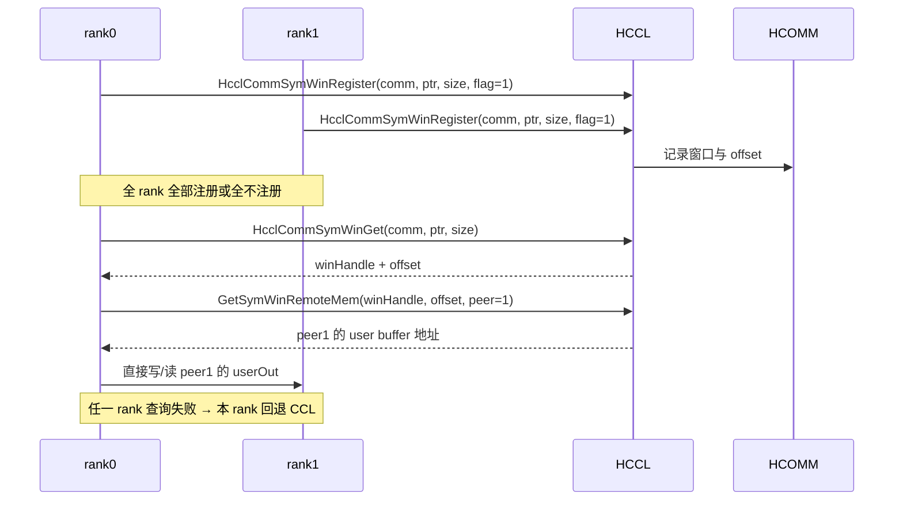
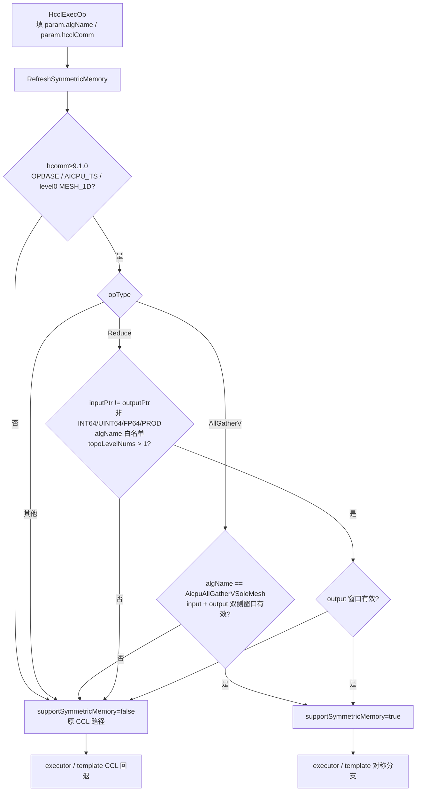
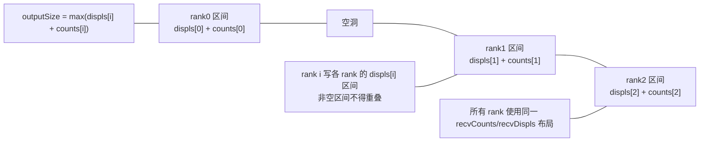
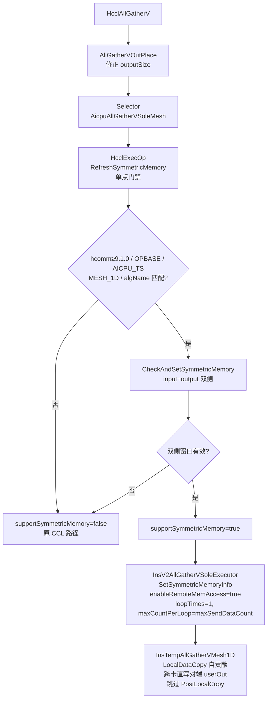
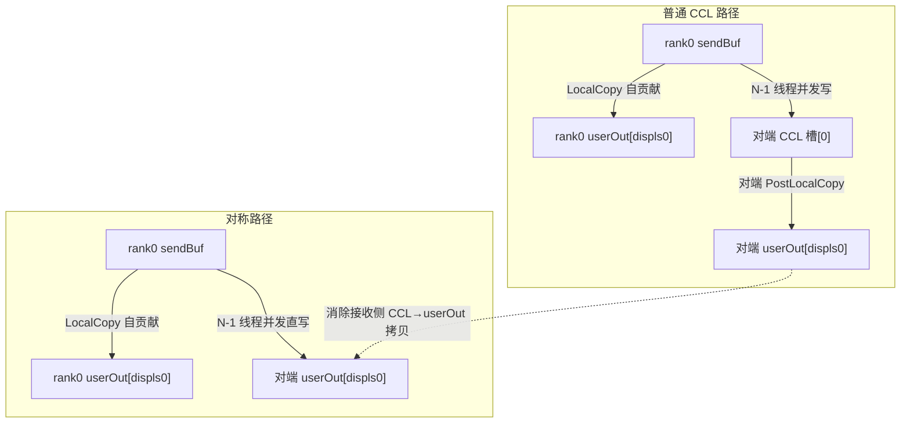
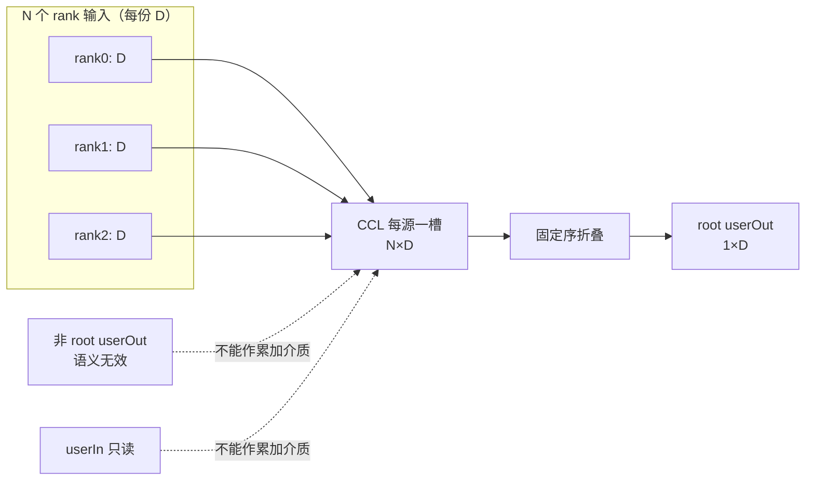
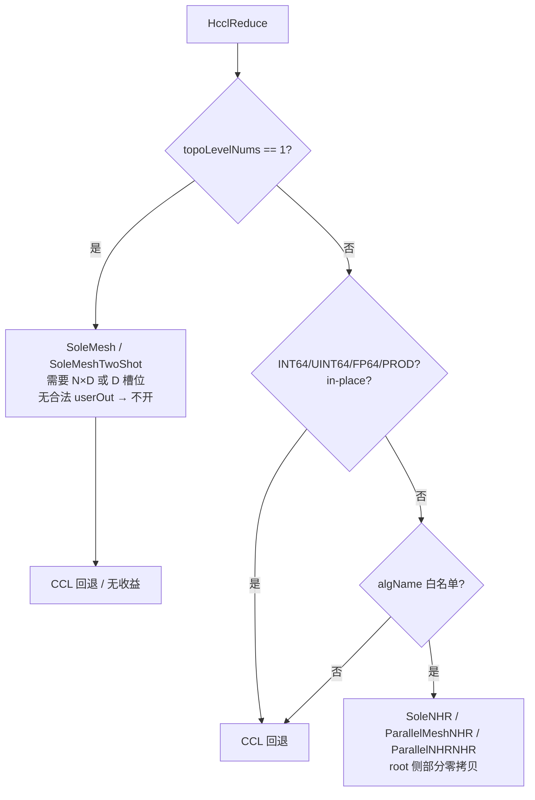
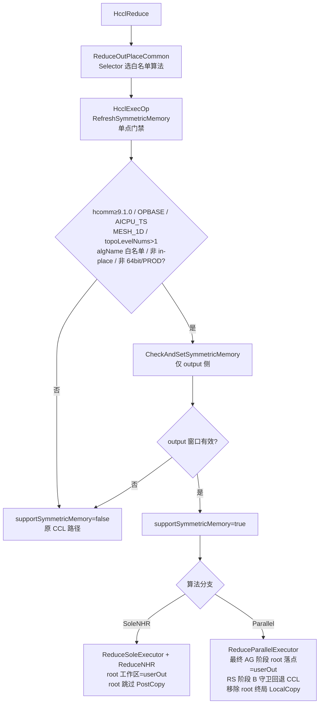
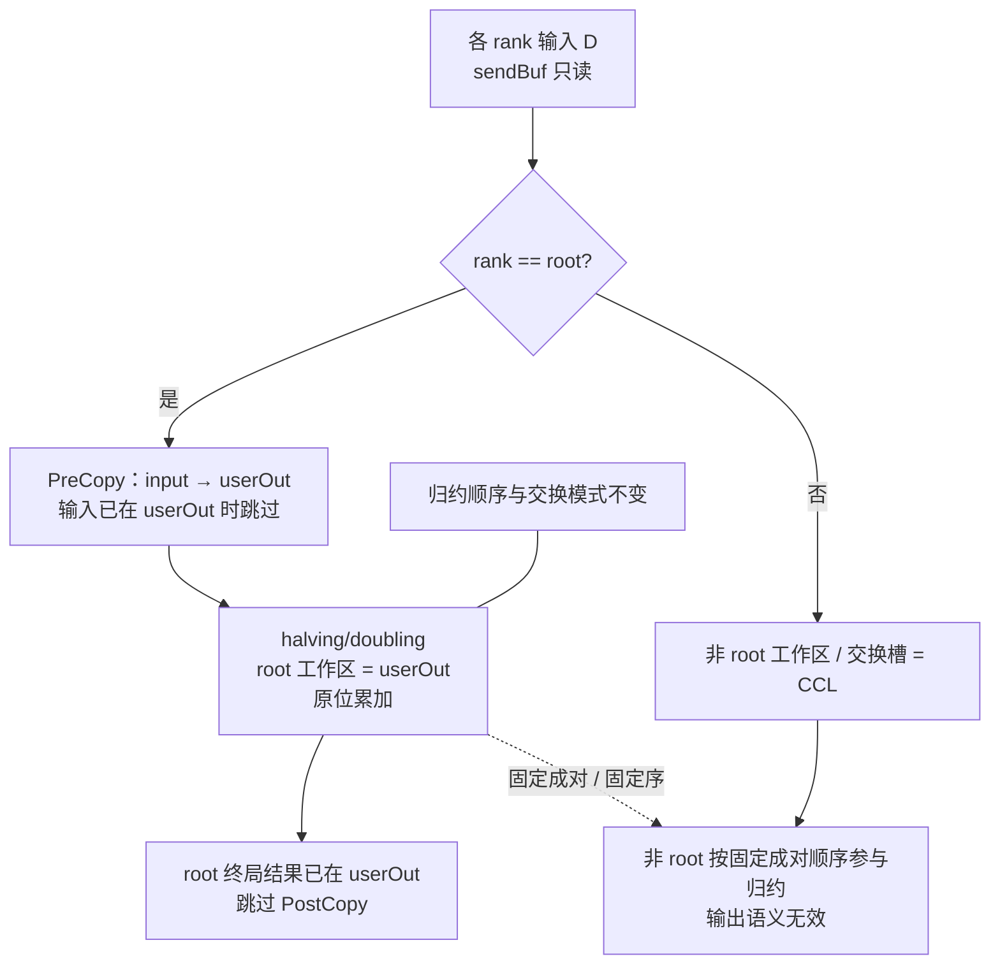
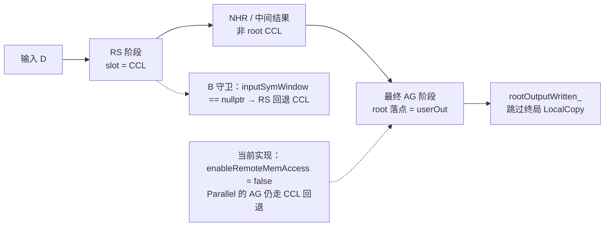

# 需求分析与软件设计（SRS/SD）：AllGatherV / Reduce 零拷贝模式

| 项目 | 内容 |
| ---- | ---- |
| 需求编号 | AR20261029516478（AllGatherV）、AR20261029517134（Reduce） |
| 涉及算子 | `HcclAllGatherV`（`include/hccl.h:141`）、`HcclReduce`（`include/hccl.h:249`） |
| 引擎 / 拓扑 | AICPU（`COMM_ENGINE_AICPU_TS`）；`level0Topo == MESH_1D`；Reduce 多级（2/3 级） |
| 文档模板 | 同目录 `srs&sd.md` 结构（SRS + SD + 决策记录） |
| 关联文档 | 同目录《se设计文档.md》《预调研-AllGatherV与Reduce零拷贝模式.md》《前置知识.md》 |
| 事实基准 | hccl 仓 `master` @ `7585a50c`（2026-10-31） |
| 责任边界 | 本文仅覆盖 AllGatherV 与 Reduce；Scatter、ReduceScatterV 由他人负责，本文只描述公共层交叉影响 |

---

# 0 公共设计

## 0.1 背景与目标

超节点内大数据量通信是性能关键路径。当前 AICPU 非对称内存模式下，跨卡数据需经 CCL buffer 中转（跨卡写对端 CCL + 本地拷贝入 user buffer），存在两个问题：

- 额外本地拷贝：每条链路多一次 CCL 与 user buffer 间的拷贝，大数据量下 HBM 带宽浪费显著。
- 循环切片：CCL scratch 槽位与 UB 单次传输上限（256MB）共同约束单轮数据量，大数据被切成多轮 loop。

本需求为 AllGatherV、Reduce 接入对称内存零拷贝：允许各 rank 经对称窗口直接访问对端 user buffer，减少本地拷贝与中转。

## 0.2 判定标准与改造范式

对齐 SE 设计文档 §3.1 的四条硬约束：

1. **归约确定性必须**：每源一槽 + 固定序折叠，或成对/环形归约，不能并发融合累加。
2. **fullmesh 链路同时使用**：不能串行化。
3. **不改数据面**：只把 CCL 槽位原样搬进 user buffer，不新增算法。
4. **不能污染输入**：userIn 只读，累加介质只能用合法 userOut。

数据面拆成四类环节，可直访的换 user buffer，其余保留 CCL：

| 环节 | 零拷贝处理 |
|------|-----------|
| ① 源头（user→CCL 头拷贝） | 数据持有侧 SDMA 源直读 user buffer |
| ② 落点（接收方 == 最终目的 rank） | 直写接收方 userOut，跳过 PostCopy |
| ③ 工作区（归约累加介质） | 仅在合法 userOut 原位进行（Reduce 仅 root） |
| ④ 交换槽（每源一槽、多跳中转） | 保留 CCL（确定性与空间下界） |

本文两个算子分别对应：

- **AllGatherV：全量零拷贝**——单跳纯搬运，跨卡数据全程直落对端 userOut，仅保留一次自贡献本地拷贝。
- **Reduce：部分零拷贝**——仅 root 侧工作区/终局汇集改 userOut；非 root 与交换槽保留 CCL。

## 0.3 公共层改造

### 0.3.1 白名单

`RefreshSymmetricMemory`（`src/ops/op_common/op_common.cc:4619`）新增两个 case：

- `HCCL_CMD_ALLGATHER_V`：直接放行（无归约），AGV 为纯搬运。
- `HCCL_CMD_REDUCE`：限 algName ∈ {`AicpuReduceSoleNHR`, `AicpuReduceParallelMeshNHR`, `AicpuReduceParallelNHRNHR`}，且 `param.inputPtr != param.outputPtr`。

RSV 维持 default 拒绝；Scatter 由他人负责。

### 0.3.2 单边探测与 IsSymMemWindowValid

Reduce 对称路径只写 root 的 output 窗口，不应额外要求注册 sendBuf，因此 Reduce 采用"仅 output 侧"探测；AGV 采用"input + output 双侧"探测（与 AllGather 一致）。

原公共层 `CheckAndSetSymmetricMemory`（`src/ops/op_common/op_common.cc:4660`）无条件探测双侧；本需求按 `opType` 决定所需侧。**同时必须适配 `IsSymMemWindowValid`（`:4612-4617`）**：若 Reduce 只探测 output，`inputSize > 0 && inputSymWindow == nullptr` 会让该函数返回 false，`RefreshSymmetricMemory` 随即将 `supportSymmetricMemory` 清零。这是 SE 设计文档未显式覆盖、但实现必须补充的点。

**图 0-3：对称窗口注册与地址换算**



> 串讲要点：`HcclCommSymWinRegister` 是业务/测试侧注册；`HcclCommSymWinGet` 是 HCCL 反查本端窗口；`GetSymWinRemoteMem` 才算出对端地址。三者缺一不可。

### 0.3.3 Reduce 专用确定性函数与多级策略

现有 `IsReduceOpSymMemDeterministic`（`src/ops/op_common/op_common.cc:4602`）只服务 AllReduce / ReduceScatter，且对 `topoLevelNums != 1` 直接返回 false。Reduce 的白名单算法主要在 2/3 级被选中，不能直接复用。

本需求**新增 Reduce 专用函数**，不改动现有函数及其 AR/RS 调用点：

```cpp
bool IsReduceAlgSymMemDeterministic(const std::string& algName, const TopoInfoWithNetLayerDetails* topoInfo)
{
    // 单级 MESH_1D 选到 SoleMesh/TwoShot，无合法 userOut 槽位，显式排除
    if (topoInfo == nullptr || topoInfo->topoLevelNums == TOPO_LEVEL_NUM_1) {
        return false;
    }
    return algName == "AicpuReduceSoleNHR"
        || algName == "AicpuReduceParallelMeshNHR"
        || algName == "AicpuReduceParallelNHRNHR";
}
```

判定依据：

- 白名单算法只在多级被选中（`src/ops/reduce/selector/reduce_auto_selector.cc:274-310`）；单级 MESH_1D 选到的是 `SoleMesh` / `SoleMeshTwoShot`（`:324-326`），不在白名单。
- 各算法自身 attrs 已限定拓扑：`SoleNHR` 支持多级、`ParallelMeshNHR` ≤2 级、`ParallelNHRNHR` 仅 3 级（`src/ops/reduce/algorithm/executor/reduce_sole_executor.cc:332-343`、`reduce_parallel_executor.cc:986-1014`）。
- AR/RS 多级仍保持 `IsReduceOpSymMemDeterministic` 的 false 结论，避免把多级 PipeLineMeshNHR 误放进来（`all_reduce_auto_selector.cc:429`、`reduce_scatter_auto_selector.cc:431`）。

### 0.3.4 门禁、探测与回退

- AGV / Reduce 算子入口不再单独探测；`Selector` 后直接进入 `HcclExecOp`。
- `HcclExecOp` 填入最终 `algName` / `hcclComm` 后调用 `RefreshSymmetricMemory`；版本/模式/引擎/拓扑、算子白名单、算法确定性、窗口探测统一在单点完成。
- `symMemChecked` 防止重复查询；AGV 双侧、Reduce 仅 output 侧；探测失败或门禁不满足时 `supportSymmetricMemory=false`，本 rank 回退原 CCL 路径。
- 框架暂无跨 rank 对称标志协商，依赖“全 rank 注册或全不注册”契约。

**图 0-4：对称门禁与回退决策树**



> 串讲要点：AGV/Reduce 入口不再单独探测；`HcclExecOp → RefreshSymmetricMemory` 是唯一门禁。AGV 需要双侧窗口，Reduce 只需要 output；Reduce 单级 `topoLevelNums==1` 直接被白名单函数排除。

### 0.3.5 版本、缓存与预热

- 版本：HCOMM ≥ 9.1.0（`HcclSymWinGetPeerPointer`），9.2.0+ 优先 `HcclSymWinGetRemoteAddr`，均由 dlsym 运行期探测（`src/common/hcomm_dlsym/hccl_sym_win_dl.cc:28`）。
- task cache：`supportSymmetricMemory` 已自动禁用缓存（`aicpu_task_cache_policy.cc:69`），无需改动。
- warmup：`LaunchWarmupVOperator` 在 `supportSymmetricMemory` 时跳过（`op_common.cc:887`），无需改动。

## 0.4 决策记录

| ID | 决策 | 结论 |
|----|------|------|
| D0 | 多级策略改法 | 新增 Reduce 专用函数，不动现有 AR/RS 函数 |
| D1 | 多级放行范围 | Reduce 白名单算法放行；AR/RS 多级保持 false |
| D2 | Parallel 接入方式 | 方案 B：RS 模板加 `param.inputSymWindow != nullptr` 守卫，仅 output 注册时 RS 阶段自动回退 CCL |
| D3 | Reduce 算法范围 | 3 个白名单算法，不含 `MultiJetty` |
| D4 | 单级 MESH_1D | **显式声明无零拷贝收益**，本期不追求 |
| D5–D16 | 其余 | 按 SE 设计文档与本 SD 落地，不再单列决策 |

## 0.5 风险与依赖

| 风险/依赖 | 说明 | 处理 |
|-----------|------|------|
| 单边探测被清零 | `IsSymMemWindowValid` 未适配时 Reduce 探测无效 | 本需求同步修改该函数 |
| AGV 大数据截断 | 仅设 `loopTimes=1` 不够，`maxCountPerLoop` 仍按 256MB 截断 | 同步放大 `maxCountPerLoop = maxSendDataCount` |
| 跨 rank 不一致 | 无对称标志协商，部分注册/部分回退会协议错配 | 契约约束"全 rank 注册或全不注册" |
| AR/RS 共享模板回归 | B 守卫改动 `InsTempReduceScatterMesh1D/NHR` | 全量回归 AR/RS 双侧注册行为 |
| 非 root output 语义 | 非 root recvBuf 仅作窗口锚点，内容无效 | 模板不写非 root output，文档声明 |

---

# 1 AR20261029516478 AllGatherV（SRS）

## 1.1 介绍

`HcclAllGatherV` 将各 rank 长度可不同的数据汇聚到所有 rank。当前单算子路径 `AllGatherVOutPlace`（`src/ops/all_gather_v/all_gather_v.cc:195`）不调用对称窗口探测，`supportSymmetricMemory` 恒 false，一律走 CCL 中转。

现状问题：

- 跨卡写入对端 CCL 后，接收端还需 `PostLocalCopy` 到 userOut（`ins_temp_all_gather_v_mesh_1D.cc:110`）。
- `outputSize` 按 `sum(recvCounts)` 统计（`all_gather_v.cc:207`），而真实最大落点是 `max(displs[i] + counts[i])`，displs 带空洞时探测尺寸偏小、有越界写风险。
- 大数据受 CCL scratch 与 256MB 限制，被切成多轮 loop。

本需求目标：打通单算子（OPBASE）对称链路，跨卡数据全程直落对端 userOut，仅保留一次自贡献本地拷贝。

**图 1-1：AGV 的 recvBuf / displs 布局**



> 串讲要点：displs 允许空洞，但所有 rank 的布局必须一致；`outputSize` 取最大落点；rank i 只写各 rank 的 `displs[i]` 区间，因此并发写彼此不重叠。

## 1.2 输入

**API 入参**（与现状一致，无新增）：

| 参数 | 类型 | 说明 |
|------|------|------|
| sendBuf | void* | 本端发送缓冲区 |
| sendCount | uint64_t | 本端发送元素数 |
| recvBuf | void* | 接收缓冲区 |
| recvCounts | const void* | 各 rank 接收元素数 |
| recvDispls | const void* | 各 rank 在 recvBuf 中的偏移 |
| dataType | HcclDataType | 数据类型 |
| comm / stream | HcclComm / aclrtStream | 通信域与流 |

**进入零拷贝条件**：

- HCOMM ≥ 9.1.0；
- `opMode == OPBASE`；
- `engine == AICPU_TS`；
- `topoInfo->level0Topo == MESH_1D`；
- `algName == AicpuAllGatherVSoleMesh`（`all_gather_v_auto_selector.cc:91`）；
- input 与 output 均注册对称内存（双侧探测成功）。

## 1.3 处理

```
入口 AllGatherVOutPlace
  → 修正 outputSize 口径（max(displs+counts)）
  → Selector 选 AicpuAllGatherVSoleMesh
  → HcclExecOp → 填 algName/hcclComm → RefreshSymmetricMemory（单点门禁 + 双侧探测）
  → InsV2AllGatherVSoleExecutor
       supportSymmetricMemory_ / SetSymmetricMemoryInfo
       enableRemoteMemAccess = true
       loopTimes = 1；maxCountPerLoop = maxSendDataCount
  → InsTempAllGatherVMesh1D
       LocalDataCopy：input → 自身 output[displs[myRank]]
       跨卡写：对端 remoteOutputGraphMode.addr + displs[myRank]
       跳过 PostLocalCopy
```

## 1.4 输出

- 各 rank `recvBuf` 按 `recvDispls` 布局，内容与非对称路径逐 bit 一致。
- 不写 recvBuf 落点之外的区域。

## 1.5 约束分析

| 维度 | 约束 |
|------|------|
| 引擎 | 仅 AICPU_TS；AIV/CCU 不开启 |
| 模式 | 单算子 OPBASE；图模式 OFFLOAD 已具备直写能力，仅回归 |
| 拓扑 | `level0Topo == MESH_1D`；其他拓扑回退 |
| in-place | 禁止：`sendBuf == recvBuf` 返回 `HCCL_E_PARA`（`all_gather_v.cc:166`） |
| 数组契约 | `recvCounts/recvDispls` 全 rank 一致；displs 单调不减、非空区间不得重叠、末段 ≤ outputSize |
| 注册契约 | 全 rank 双侧全部注册或全不注册；探测失败本 rank 回退 |
| 数据量 | 对称路径无 256MB/scratch 约束，`loopTimes=1` |

---

# 2 AR20261029516478 AllGatherV（SD）

## 2.1 功能描述

激活 `InsTempAllGatherVMesh1D` 已有的 `enableRemoteMemAccess` 分支：跨卡写落点为对端 `remoteOutputGraphMode.addr`，写偏移为 `displs[myAlgRank]`；本地仅保留一次 `LocalDataCopy`（input→自身 output 的 displs 区间）作为发送源。

## 2.2 流程描述



**图 1-2：AGV 普通路径与对称路径的数据流**



> 串讲要点：两种路径都保留一次自贡献本地拷贝；差异只在跨卡落点——普通路径先写对端 CCL 再 PostLocalCopy，对称路径直接写对端 userOut。每对端一线程，不能串行化。

## 2.3 数据描述

| 数据 | 说明 |
|------|------|
| `param.vDataDes.counts` / `param.varData` | recvCounts 与 recvDispls 合并存放（`all_gather_v.cc:246-252`） |
| `param.outputSize` | 修正为 `max(recvDispls[i] + recvCounts[i]) * typeSize` |
| `TemplateDataParams.allRankDispls` | 各 rank 在 output 中的偏移 |
| `TemplateDataParams.allRankSliceSize` | 各 rank 本轮处理的字节数 |
| `ChannelInfo.remoteOutputGraphMode.addr` | 对端 userOut 地址（`FillChannelSymWinPeerAddrs` 填充） |
| `TempDataParams.count` | 本端参与元素数，需在 executor 填充 |

## 2.4 依赖性描述

- 公共层：`CheckAndSetSymmetricMemory`、`RefreshSymmetricMemory`、`FillChannelSymWinPeerAddrs`（`template_utils.cc:647`）。
- 执行器基类：`SetSymmetricMemoryInfo`（`executor_v2_base.h:254`）、`RestoreChannelMap`（`executor_v2_base.cc:81`）。
- 先例：AllGather 对称路径（`ins_v2_all_gather_sole_executor.cc:242-244`）。

## 2.5 接口描述

无 API 变更。行为变化：注册对称内存后，跨卡数据不再经 CCL；未注册时行为与现网一致。

## 2.6 约束分析

同 SRS 1.5。补充：`remoteOutputGraphMode` 只回填地址、size 恒 0，越界校验必须使用本地 `outputSize`。

## 2.7 DFX 设计

- 日志：`HcclExecOp` 打印对称开关与窗口探测结果；模板打印对端地址与落点偏移。
- 回退：任一侧探测失败即回退，不打印 ERROR。
- 错误码：对端地址为空返回 `HCCL_E_INTERNAL`；displs 非法返回 `HCCL_E_PARA`。
- 可测性：`supportSymmetricMemory` 可在日志中观测。

## 2.8 资料描述

- `docs/zh/api_ref/comm_op_interface/HcclAllGatherV.md` 补充对称内存说明与注册契约。
- 支持表 `docs/zh/user_guide/comm_ops_support_list/comm_ops_support_a3.md:129` 由 `×` 改 `√`（限单算子、AICPU_TS、MESH_1D）。

## 2.9 性能与质量

- 每 rank 消除 1 次接收侧 CCL→userOut 拷贝（本地拷贝 2 次 → 1 次自贡献拷贝）。
- `loopTimes` 从 `ceil(max counts / min(256MB, cclMem/N))` 降为 1；>256MB 端到端时延优于非对称路径。
- 正确性基线：与非对称路径逐 bit 一致。

## 2.10 改动清单

| 文件 | 位置 | 改动 |
|------|------|------|
| `src/ops/all_gather_v/all_gather_v.cc` | `AllGatherVOutPlace` | `outputSize` 口径修复；displs 校验；Selector 后由 `HcclExecOp` 单点门禁/探测 |
| `src/ops/op_common/op_common.cc` | `RefreshSymmetricMemory` | 新增 `HCCL_CMD_ALLGATHER_V` case |
| `src/ops/all_gather_v/algorithm/executor/ins_v2_all_gather_v_sole_executor.cc` | `Orchestrate/OrchestrateLoop` | `supportSymmetricMemory_` + `SetSymmetricMemoryInfo`；`enableRemoteMemAccess=true`；`loopTimes=1` 且 `maxCountPerLoop=maxSendDataCount`；填充 `count` |
| `src/ops/all_gather_v/algorithm/template/aicpu/ins_temp_all_gather_v_mesh_1D.cc` | `CalcScratchMultiple` / `RunAllGatherVMesh` | 对称时 scratch=0；修复 rx 偏移交叉赋值；对端地址判空与越界防御 |
| 文档 | API/支持表 | 补充对称说明与支持状态 |

---

# 3 AR20261029517134 Reduce（SRS）

## 3.1 介绍

`HcclReduce` 将所有 rank 的同形状数据逐元素归约，结果仅落在 root。原入口 `ReduceOutPlaceCommon`（`src/ops/reduce/reduce.cc:219`）不接入对称内存探测；本需求由 `HcclExecOp → RefreshSymmetricMemory` 单点接入。

Reduce 是"N 份全量 D → root 一份 D"的向心归约。确定性 + fullmesh 并发要求 N×D 落地槽位（或分布于非 root 的中间累加区），而合法介质只有 root 的 1×D，因此只有 root 侧环节可直访 user buffer。

本需求目标：对 `AicpuReduceSoleNHR`、`AicpuReduceParallelMeshNHR`、`AicpuReduceParallelNHRNHR` 做部分零拷贝——仅 root 侧工作区/终局汇集改 userOut；非 root 与交换槽保留 CCL。

**范围声明：单级 `MESH_1D` 无零拷贝收益。单级 MESH_1D 的 Reduce 选到 SoleMesh/TwoShot：要确定性 + fullmesh，就需要 N×D 的中间槽位；root 只有 1×D 的 userOut，非 root output 无定义、input 只读，所以没有合法 user buffer 可替换；能省的那一步已经直写，或者只能串行化，而串行化违反 fullmesh。SoleNHR/Parallel 的 root 侧收益只在多级拓扑出现，单级被设计门禁直接排除。


**图 3-1：Reduce 的空间下界——N×D 输入 vs root 1×D 输出**



> 串讲要点：确定性 + fullmesh 要求 N 份源数据都有落点；root 只有 1×D 的合法输出，非 root output 语义无效、input 只读，所以只有 root 侧环节能换 user buffer。

## 3.2 输入

**API 入参**（与现状一致，无新增）：

| 参数 | 类型 | 说明 |
|------|------|------|
| sendBuf | void* | 各 rank 输入 |
| recvBuf | void* | root 输出；非 root 仅作窗口锚点 |
| count | uint64_t | 元素个数 |
| dataType | HcclDataType | 数据类型 |
| op | HcclReduceOp | SUM/PROD/MAX/MIN |
| root | uint32_t | 结果落地 rank |
| comm / stream | HcclComm / aclrtStream | 通信域与流 |

**进入零拷贝条件**：

- HCOMM ≥ 9.1.0；
- `opMode == OPBASE`；
- `engine == AICPU_TS`；
- `topoInfo->level0Topo == MESH_1D`；
- `topoInfo->topoLevelNums > 1`（单级 MESH_1D 不开启）；
- `algName ∈ {AicpuReduceSoleNHR, AicpuReduceParallelMeshNHR, AicpuReduceParallelNHRNHR}`；
- `param.inputPtr != param.outputPtr`（禁 in-place）；
- output 侧注册对称内存（单边探测成功）。

## 3.3 处理

```
入口 ReduceOutPlaceCommon
  → Selector 选 Reduce 白名单算法
  → HcclExecOp → 填 algName/hcclComm → RefreshSymmetricMemory（单点门禁 + 仅 output 探测）
  → ReduceSoleExecutor / ReduceParallelExecutor
       supportSymmetricMemory_ + SetSymmetricMemoryInfo
  → 模板 root 侧改造
       SoleNHR：root PreCopy 目的 = userOut
                halving/doubling 对 root 的读写走 remoteOutputGraphMode
                root 跳过 PostCopy
       Parallel：AG 阶段 root 落点 = userOut
                 移除 root 终局 LocalCopy
       RS 阶段：B 守卫，仅 output 注册时回退 CCL
```

## 3.4 输出

- root 的 `recvBuf` 内容与非对称路径逐 bit 一致。
- 非 root `recvBuf` 内容语义无效，对称路径不写入非 root output。
- 输入 `sendBuf` 不被污染（本需求不走输入对称窗口）。

## 3.5 约束分析

| 维度 | 约束 |
|------|------|
| 引擎 | 仅 AICPU_TS；AIV/CCU 不开启 |
| 模式 | 单算子 OPBASE；图模式不在本次范围 |
| 拓扑 | `level0Topo == MESH_1D`；**单级 MESH_1D 无收益**；CLOS/MESH_1D_CLOS 走原路径 |
| 算法 | 仅 3 个白名单算法；`MultiJetty`、`SoleMesh`、`TwoShot`、`3level`、`AicpuReduceNHR` 不开启 |
| 数据类型 | 白名单算法 attrs 已排除 int64/uint64/fp64 与 PROD；公共层再加 `IsReduceOpSymMemAllowed` 防御 |
| in-place | `inputPtr != outputPtr`；要求全 rank 一致 |
| 注册契约 | 全 rank recvBuf 全部注册或全不注册；非 root recvBuf 必须非空并注册（窗口锚点） |
| 输入污染 | 本需求不污染输入；非 root output 不写 |
| 重执行 | 沿用"零拷贝场景不支持重执行"（`docs/zh/user_guide/hccl_env/HCCL_OP_RETRY_ENABLE.md:59`） |

**图 3-2：Reduce 算法支持范围决策树**



> 串讲要点：单级 MESH_1D 选到 SoleMesh/TwoShot，不是 SoleNHR/Parallel；即使强制单级 SoleNHR，也会被 `topoLevelNums == 1` 门禁拒绝。Reduce 零拷贝必须多级拓扑。

---

# 4 AR20261029517134 Reduce（SD）

## 4.1 功能描述

- **SoleNHR**：root 的本地工作区从 CCL 改为自身 userOut；PreCopy 目的、halving/doubling 的原位归约介质、终局落点都指向 userOut；root 跳过 PostCopy。归约顺序与交换模式不变。
- **ParallelMeshNHR / ParallelNHRNHR**：最终 AG 阶段 root 侧工作区/最终落点改 userOut，移除 root 终局 LocalCopy。
- **B 方案守卫**：`InsTempReduceScatterMesh1D` / `InsTempReduceScatterNHR` 的 `supportSymmetricMemAccess_` 改为 `param.supportSymmetricMemory && param.inputSymWindow != nullptr`。Reduce 仅注册 output 时，RS 阶段自动回退 CCL，避免空地址与输入污染。

## 4.2 流程描述


> 现状说明：`ReduceParallelExecutor` 当前未启用 `enableRemoteMemAccess`，Parallel 的最终 AG 仍走 CCL 回退；图中 root 直写为设计路径，待 AG 偏移修复后启用。

**图 4-1：SoleNHR 的 root 工作区与固定成对归约**



> 串讲要点：SoleNHR 只把 root 的工作区换成 userOut；非 root 仍用 CCL。halving/doubling 的成对顺序不变，所以结果确定性不变。

**图 4-2：ParallelMeshNHR 的两级流水**



> 串讲要点：设计目标是 RS 阶段保 CCL、最终 AG 的 root 落点换 userOut。现状 `enableRemoteMemAccess` 未启用，Parallel 仍是 CCL 回退；图中 root 直写是待启用路径。

## 4.3 数据描述

| 数据 | 说明 |
|------|------|
| `param.root` | 结果落地 rank；模板 `root_` 由 `InsAlgTemplateBase` 构造时取 `param.root`（`alg_v2_template_base.cc:19`） |
| `param.inputOffset` / `outputOffset` | 仅 output offset 参与 Reduce 对称路径 |
| `ChannelInfo.remoteOutputGraphMode.addr` | 指向对端 userOut；Reduce 只在"对端为 root"时使用 |
| `TemplateDataParams.buffInfo.outBuffType` | root 终局阶段需为 `OUTPUT` |
| `TemplateDataParams.buffInfo.outBuffBaseOff` | 多轮 loop 时叠加到直写地址 |

## 4.4 依赖性描述

| 依赖 | 说明 |
|------|------|
| `ReduceNHR` | SoleNHR 模板；PreCopy/RunReduce/RunGather/PostCopy 需按 root 选择地址 |
| `ReduceParallelExecutor` | 4 模板组合：RS Mesh/NHR + AG Mesh/NHR |
| `InsTempReduceScatterMesh1D/NHR` | B 守卫改动；与 AR/RS 共享，需全量回归 |
| `InsTempAllGatherMesh1D/NHR` | 已支持 `enableRemoteMemAccess` + `remoteOutputGraphMode`，由 executor 按阶段开启 |
| `FillChannelSymWinPeerAddrs` | 仅填 addr，不填 size；越界校验用本地 size |
| AR/RS 多级 | 必须保持 `IsReduceOpSymMemDeterministic` 的 false 结论 |

## 4.5 接口描述

无 API 变更。行为变化：满足条件时 root 侧减少一次全量本地拷贝；非 root 输出语义仍无效。

## 4.6 约束分析

同 SRS 3.5。补充：

- **单级 Reduce 无收益**：单级 MESH_1D 选到 SoleMesh/TwoShot，不在白名单；即使同拓扑也不会开启。
- **非 root recvBuf 必须注册**：作为查询 root 地址的窗口锚点；内容不参与计算。
- **RS 阶段不污染输入**：B 守卫确保仅 output 注册时 RS 走 CCL。
- **多轮 loop**：直写/原位归约地址必须叠加 `outBuffBaseOff`；notify 握手不得随拷贝省略。

## 4.7 DFX 设计

- 日志：`HcclExecOp` 打印 algName、对称开关、root、窗口探测结果；模板打印 root 工作区地址与阶段。
- 回退：探测失败或门禁不满足即回退，不打印 ERROR。
- 错误码：对端地址为空 `HCCL_E_INTERNAL`；in-place `HCCL_E_PARA`；类型不支持按既有门禁。
- 可测性：`supportSymmetricMemory`、`enableRemoteMemAccess` 可观测。

## 4.8 资料描述

- `docs/zh/api_ref/comm_op_interface/HcclReduce.md` 补充对称内存说明：仅 recvBuf 注册、非 root 内容无效、不污染输入、单级无收益、探测失败回退。
- 支持表 `docs/zh/user_guide/comm_ops_support_list/comm_ops_support_a3.md:176` 按白名单算法/拓扑更新。

## 4.9 性能与质量

- SoleNHR / Parallel：root 消除 1×D 全量本地拷贝及 CCL 往返；非 root 路径不变。
- 无回退：非白名单算法、单级、CLOS、64bit/PROD 路径保持现状。
- 正确性基线：root 输出与非对称路径逐 bit 一致；重复执行逐 bit 一致。

## 4.10 改动清单

| 文件 | 位置 | 改动 |
|------|------|------|
| `src/ops/op_common/op_common.h` / `op_common.cc` | 新增函数 | `IsReduceAlgSymMemDeterministic` |
| `src/ops/op_common/op_common.cc` | `RefreshSymmetricMemory` | 新增 `HCCL_CMD_REDUCE` case |
| `src/ops/op_common/op_common.cc` | `IsSymMemWindowValid` / `CheckAndSetSymmetricMemory` | 按 opType 支持单边探测 |
| `src/ops/reduce/reduce.cc` | `ReduceOutPlaceCommon` | Selector 后由 `HcclExecOp` 单点门禁/探测；显式初始化 `supportSymmetricMemory=false` |
| `src/ops/reduce/algorithm/executor/reduce_sole_executor.cc` | `Orchestrate` | `supportSymmetricMemory_` + `SetSymmetricMemoryInfo`（`RestoreChannelMap` 前） |
| `src/ops/reduce/algorithm/template/aicpu/reduce_nhr.cc` | PreCopy/RunReduce/RunGather/PostCopy | root 工作区改 userOut；按 root 选择本地/远端地址；root 跳过 PostCopy |
| `src/ops/reduce/algorithm/executor/reduce_parallel_executor.cc` | `Orchestrate` / `GenDataParamsTempAlg` / 终局 LocalCopy | 接线 sym；最终 AG 阶段 `outBuffType=OUTPUT`、`enableRemoteMemAccess=true`；移除 root LocalCopy |
| `src/ops/reduce_scatter/algorithm/template/aicpu/ins_temp_reduce_scatter_mesh_1D.cc` | `KernelRun` | B 守卫：`param.supportSymmetricMemory && param.inputSymWindow != nullptr` |
| `src/ops/reduce_scatter/algorithm/template/aicpu/ins_temp_reduce_scatter_nhr.cc` | `KernelRun` | 同上 |
| 文档 | API/支持表 | 补充对称说明与支持状态 |

---

# 5 测试与验收

## 5.1 测试分层

| 层级 | 范围 | 说明 |
|------|------|------|
| UT | 确定性函数矩阵、`IsSymMemWindowValid` 单/双边、入口门禁逻辑 | 函数级，可用 stub |
| ST | AGV/Reduce 端到端（AICPU_TS 实机/仿真） | 覆盖拓扑、rankSize、数据量、注册状态 |
| 回归 | AR/RS 共享模板守卫、Reduce 非白名单算法、Scatter/RSV 抽烟 | 防 B 方案回归 |

> 对称路径在 ST 仿真中通过 stub 启用：`HCCL_ST_SYM_WIN=1`、`HCCL_ST_HCOMM_VERSION=90200000`、`LD_PRELOAD=.../libst_symwin.so`；AGV 一键脚本为 `test/st/algorithm/run_agv_sym_st.sh`，Reduce 为 `test/st/algorithm/run_reduce_sym_st.sh`。默认不带这些环境变量时走非对称回退路径。
>
> Reduce 专用用例：
> - `st_reduce_aicpu_2level_4rank_fp32_sum_sym_test`（1pod×4srv×1rank，`AicpuReduceSoleNHR`）：root `LocalCopy INPUT→OUTPUT`，非 root `WriteReduce CCL→OUTPUT`，无 root PostCopy。
> - `st_reduce_aicpu_2level_16rank_fp32_max_parallel_sym_test`（1pod×2srv×8rank、16MB，`AicpuReduceParallelMeshNHR`）：仅最后一个 AG step 落 userOut；RS 阶段由 B 守卫回退 CCL；root 终局 LocalCopy 跳过。
> - `st_reduce_aicpu_2level_4rank_fp32_sum_sym_root3_test`、`..._parallel_sym_root13_test`：root 非 0。
> - `st_reduce_aicpu_2level_4rank_fp32_sum_sym_inplace_test`：in-place 门禁回退。
> - `st_reduce_aicpu_2level_4rank_fp32_sum_sym_no_pollution_test`：task graph 无 INPUT 写。
> - `st_reduce_aicpu_2level_16rank_fp32_max_parallel_sym_multiloop_test`：64MB 多轮 loop。
> - `st_reduce_aicpu_3level_32rank_fp32_max_sym_test`：3 级 32rank sym 链路（ParallelNHRNHR 选路未单独断言）。
>
> AGV 新增 `st_all_gather_v_displs_hole_test`、`..._all_zero_counts_test`、`..._invalid_displs_test`、`..._inplace_test`，并修正 checker 支持 displs 空洞。
>
> 实测：AGV default/sym 11/11；Reduce default/sym 30/30；AR 18/18、RS 5/5（default+sym）；UT_EXIT=0（含 task cache sym 断言）。剩余待补：AGV 窗口失败/AIV/CCU/CLOS，Reduce CCU 回退/确定性，ParallelNHRNHR 选路确认，UT 静态函数。

## 5.2 通用维度

| 维度 | 取值 |
|------|------|
| 对称内存 | 全 rank 注册 / 全不注册 / 窗口查询失败注入 / AGV 双侧 / Reduce 仅 output |
| 引擎 | AICPU_TS；CCU→AICPU 回退；AIV（应不开启） |
| 模式 | OPBASE；AGV OFFLOAD 回归 |
| 拓扑 | 单级 MESH_1D；2/3 级（Reduce）；非 MESH_1D（应回退） |
| rankSize | {2, 4, 8, 16, 32} |
| 数据量 | {1KB, 1MB, 255MB, 256MB, 512MB, 1GB} |
| 数据类型 | int8/int16/int32/int64/uint64/float16/float32/bfp16/float64 |
| root（Reduce） | {0, rankSize/2, rankSize-1} |

## 5.3 AGV 测试矩阵

| ID | 场景 | 输入/维度 | 预期结果 | 覆盖点 |
|----|------|----------|---------|--------|
| AGV-001 | 均匀 counts，sym 开 | 1MB，rankSize 8 | 与非对称逐 bit 一致 | 基础通路 |
| AGV-002 | 非均匀 counts，sym 开 | 含极端比例 | 逐 bit 一致；各段落点正确 | 变长布局 |
| AGV-003 | 含 0 段 | 部分 recvCounts=0 | 无死锁、结果正确 | 握手退化 |
| AGV-004 | displs 带空洞 | 非零起始/中间空洞 | 无越界；`outputSize` 口径修复生效 | 缺口：outputSize |
| AGV-005 | 全 0 counts | 全部 recvCounts=0 | 入口短路成功 | 边界 |
| AGV-006 | 大数据 | 256MB/512MB/1GB | `loopTimes=1` 且数据完整；`maxCountPerLoop` 已放大 | 缺口：maxCountPerLoop |
| AGV-007 | 双侧未注册 | 不注册对称内存 | 回退原路径，逐 bit 一致 | 回退 |
| AGV-008 | 窗口查询失败注入 | mock 失败 | 回退，无 ERROR 泄漏 | 防御 |
| AGV-009 | displs 非法 | 单调递减/末段超 outputSize | `HCCL_E_PARA` | 入参校验 |
| AGV-010 | in-place | sendBuf==recvBuf | `HCCL_E_PARA` | 既有约束 |
| AGV-011 | 非 MESH_1D / CCU / AIV | 各引擎/拓扑 | 不开启，走原路径 | 门禁 |
| AGV-012 | OFFLOAD 图模式回归 | 图模式 | 直写能力不变 | 回归 |
| AGV-013 | rankSize/类型组合 | {2,4,8,16,32} × 全类型 | 逐 bit 一致 | 覆盖度 |
| AGV-014 | 非落点区域 | 检查对端 output 其他区间 | 不被踩踏 | 正确性 |

## 5.4 Reduce 测试矩阵

| ID | 场景 | 输入/维度 | 预期结果 | 覆盖点 |
|----|------|----------|---------|--------|
| RED-001 | SoleNHR 2 级，sym 开 | rankSize 8/16 | root 输出逐 bit 一致 | SoleNHR |
| RED-002 | ParallelMeshNHR 2 级，sym 开 | rankSize 8/16 | root 输出逐 bit 一致 | Parallel |
| RED-003 | ParallelNHRNHR 3 级，sym 开 | rankSize 16/32 | root 输出逐 bit 一致 | 3 级 |
| RED-004 | SoleNHR 3 级，sym 开 | 非对称 3 级 | root 输出逐 bit 一致 | SoleNHR 3 级 |
| RED-005 | 单级 MESH_1D | 选到 SoleMesh/TwoShot | `supportSymmetricMemory=false`，路径不变 | 显式无收益 |
| RED-006 | 单级 CLOS / MESH_1D_CLOS | 选到 SoleNHR | 门禁拦截，回退原路径 | 拓扑门禁 |
| RED-007 | 未注册/查询失败 | 全不注册或注入失败 | 回退，逐 bit 一致 | 回退 |
| RED-008 | root 变化 | {0, mid, last} | 结果正确落 root | root 语义 |
| RED-009 | 64bit/PROD | int64/uint64/fp64/PROD | attrs 排除，回退 | 类型门禁 |
| RED-010 | root in-place | sendBuf==recvBuf | 门禁拦截回退 | in-place |
| RED-011 | 非 root output | 检查非 root recvBuf | 不被写入 | 语义边界 |
| RED-012 | 输入不被污染 | 调用前后 sendBuf 内容 | 保持不变 | 不污染输入 |
| RED-013 | 多轮 loop | >单轮切片 | `outBuffBaseOff` 叠加正确、握手保留、各轮不互踩 | 多轮正确性 |
| RED-014 | 确定性 | 重复执行 | 逐 bit 一致 | 确定性 |
| RED-015 | CCU→AICPU 回退 | 初始 CCU 后回退 | 白名单补探生效 | 回退路径 |
| RED-016 | Parallel RS 阶段守卫 | 仅 output 注册 | RS 走 CCL，无空指针、无输入污染 | B 方案 |
| RED-017 | root 终局直写 | 移除 LocalCopy 后 | root 输出正确 | Parallel 改造 |
| RED-018 | 2/3 级 × rankSize × 数据量 × 类型 | 组合覆盖 | 全部逐 bit 一致 | 覆盖度 |

## 5.5 公共层与回归

| ID | 场景 | 预期结果 | 覆盖点 |
|----|------|---------|--------|
| COMM-001 | 新确定性函数矩阵：opType × algName × topoLevelNums | Reduce 白名单 2/3 级 true；AR/RS 多级仍 false | D0/D1 |
| COMM-002 | AR/RS 多级回归 | `AicpuAllReducePipeLineMeshNHR` / `AicpuReduceScatterPipeLineMeshNHR` 多级仍 false | 多级策略 |
| COMM-003 | B 守卫回归 | AR/RS 双侧注册行为不变 | D2 |
| COMM-004 | `IsSymMemWindowValid` | Reduce 仅 output 时 true；AGV 双侧时 true | 单边探测 |
| COMM-005 | task cache / warmup | sym 开启时均禁用 | 既有能力 |
| COMM-006 | Reduce 非白名单算法回归 | SoleMesh/TwoShot/3level/AicpuReduceNHR 路径不变 | 回归 |
| COMM-007 | Scatter/RSV 抽烟 | 不受本次公共层改动影响 | 交叉影响 |

## 5.6 异常/防御

| 场景 | 预期 |
|------|------|
| 对端地址为空注入 | `HCCL_E_INTERNAL` |
| AGV displs 非法 | `HCCL_E_PARA` |
| counts=0 握手退化 | 无死锁 |
| 窗口查询失败 | 回退且无 ERROR 泄漏 |
| 超时看护 | 正常触发 |

## 5.7 验收标准

1. 所有 sym 开启用例与非对称路径结果逐 bit 一致。
2. 非落点区域不被踩踏；非 root output 不被写入；Reduce 输入不被污染。
3. AGV >256MB 完整搬运；`loopTimes=1`、scratch=0 生效。
4. Reduce 白名单算法 2/3 级生效，单级明确回退。
5. AR/RS 多级仍不开启；B 守卫不改变其双侧注册行为。
6. 回退路径无结果/性能回退；日志与错误码符合 DFX。

---

# 6 决策记录与待确认

## 6.1 已定决策

| ID | 决策 | 结论 |
|----|------|------|
| D0 | 多级策略改法 | 新增 `IsReduceAlgSymMemDeterministic`，不动现有 AR/RS 函数 |
| D1 | 多级放行范围 | Reduce 白名单算法放行；AR/RS 多级保持 false |
| D2 | Parallel 接入方式 | B：RS 模板加 `inputSymWindow != nullptr` 守卫 |
| D3 | Reduce 算法范围 | `SoleNHR` / `ParallelMeshNHR` / `ParallelNHRNHR`，不含 MultiJetty |
| D4 | 单级 MESH_1D | 显式声明无收益，本期不追求 |

## 6.2 待确认（SE 文档未覆盖的实现补充）

1. `IsSymMemWindowValid` 需按 opType 支持单边探测，否则 Reduce 的 output-only 探测会被清零。
2. AGV 仅设 `loopTimes=1` 不够，需同步放大 `maxCountPerLoop`，否则 >256MB 数据被截断。

## 6.3 待补信息

- 需求编号已提供：AR20261029516478（AGV）、AR20261029517134（Reduce）。
- 事实基准：hccl `master` @ `7585a50c`。
- 测试用例表（STC/xlsx）：本期先写测试矩阵，后续按需补充。

---

# 附录 A：关键 file:line 索引

| 主题 | 位置 |
|------|------|
| API 声明 | `include/hccl.h:141`（AllGatherV）、`:249`（Reduce） |
| AGV 入口 | `src/ops/all_gather_v/all_gather_v.cc:195`、`:207`、`:253`、`:274` |
| AGV in-place 禁止 | `src/ops/all_gather_v/all_gather_v.cc:166` |
| AGV 图模式 outputSize | `src/ops/all_gather_v/all_gather_v.cc:312` |
| AGV executor | `src/ops/all_gather_v/algorithm/executor/ins_v2_all_gather_v_sole_executor.cc:96-104`、`:120-157` |
| AGV 模板 | `src/ops/all_gather_v/algorithm/template/aicpu/ins_temp_all_gather_v_mesh_1D.cc:68-77`、`:82-111`、`:154-174` |
| Reduce 入口 | `src/ops/reduce/reduce.cc:208`、`:219`、`:261` |
| Reduce selector | `src/ops/reduce/selector/reduce_auto_selector.cc:274-310`、`:324-326` |
| Reduce attrs | `src/ops/reduce/algorithm/executor/reduce_sole_executor.cc:332-343`、`reduce_parallel_executor.cc:986-1014` |
| ReduceNHR | `src/ops/reduce/algorithm/template/aicpu/reduce_nhr.cc:94-150`、`:185-335` |
| ReduceSoleExecutor | `src/ops/reduce/algorithm/executor/reduce_sole_executor.cc:116-140` |
| ReduceParallelExecutor | `src/ops/reduce/algorithm/executor/reduce_parallel_executor.cc:366-395`、`:536-537`、`:736-742` |
| 公共层 | `src/ops/op_common/op_common.cc:4591`、`:4602`、`:4612`、`:4619`、`:4632/4636`、`:4660` |
| 执行器传参 | `src/ops/op_common/algorithm/executor/executor_v2_base.h:254`、`executor_v2_base.cc:81` |
| 对端地址填充 | `src/ops/op_common/algorithm/template/template_utils.cc:647` |
| 远端地址接口 | `src/common/hcomm_dlsym/hccl_sym_win_dl.cc:28` |
| task cache / warmup | `aicpu_task_cache_policy.cc:69`、`op_common.cc:887` |
| 支持表 | `docs/zh/user_guide/comm_ops_support_list/comm_ops_support_a3.md:129`、`:176` |

# 附录 B：术语表

| 术语 | 说明 |
|------|------|
| 对称内存 / 窗口 | 多 rank 按相同地址布局注册、可互相推算地址的内存；窗口是其注册句柄 |
| ccl buffer | HCCL 的跨 rank 中转内存 |
| 零拷贝 | 省掉用户内存与 CCL 之间的本地拷贝与中转 |
| 全量零拷贝 | 跨卡数据全程不经 CCL |
| 部分零拷贝 | 仅部分环节直访 user buffer，中转/交换槽保留 CCL |
| 确定性 | 相同输入多次执行得到相同结果（与归约顺序有关） |
