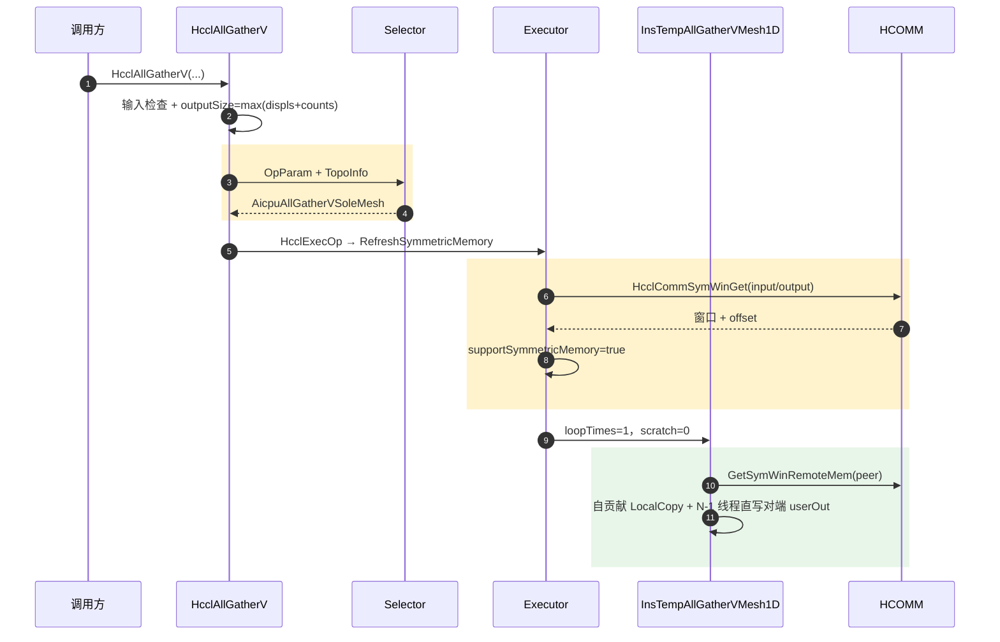
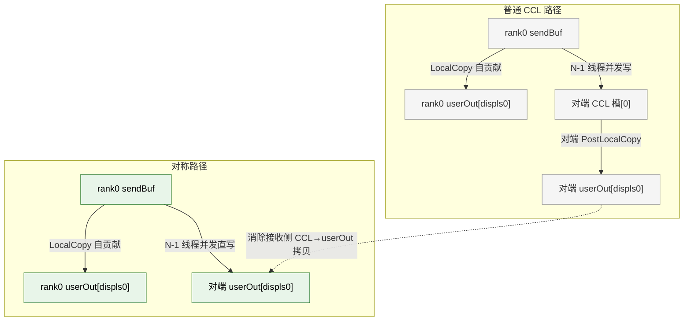
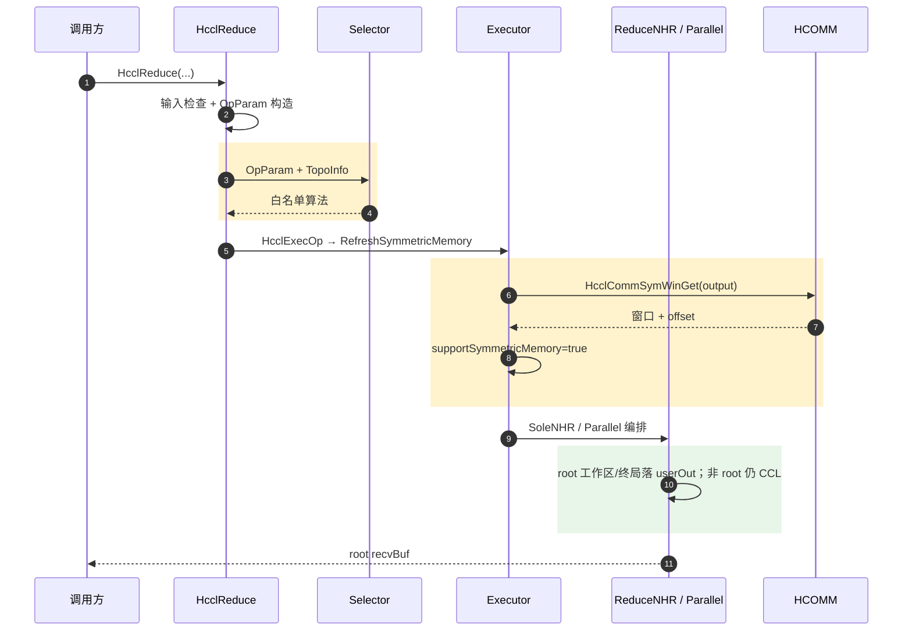
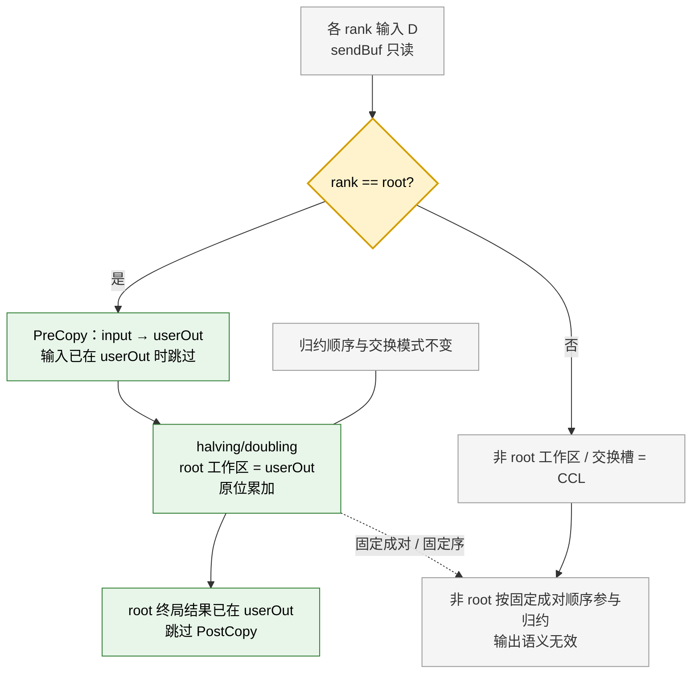
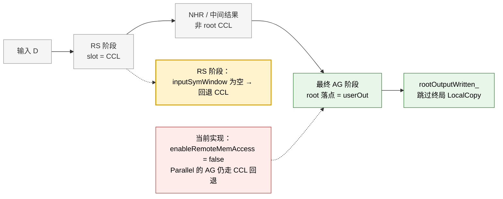
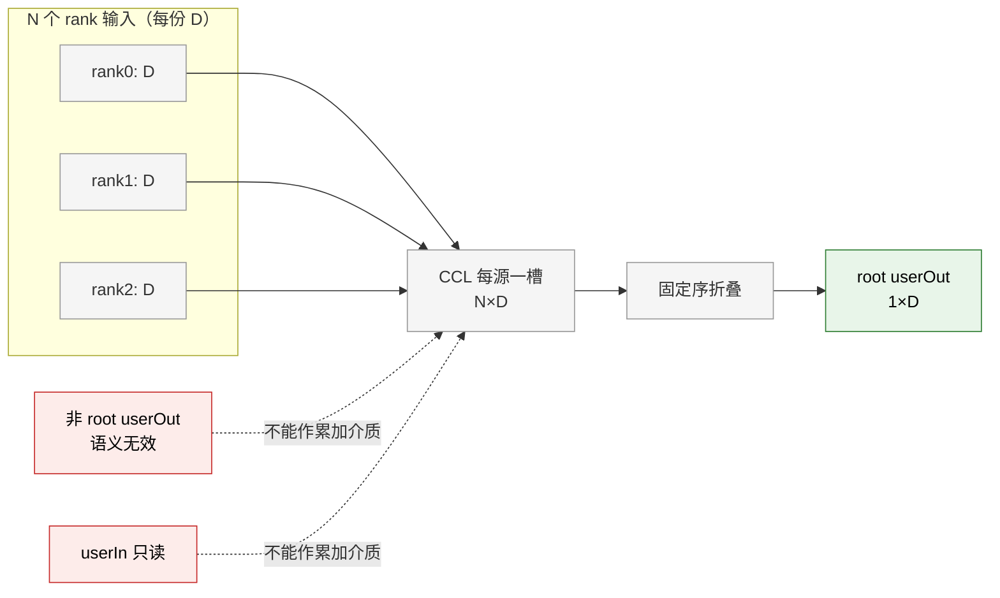
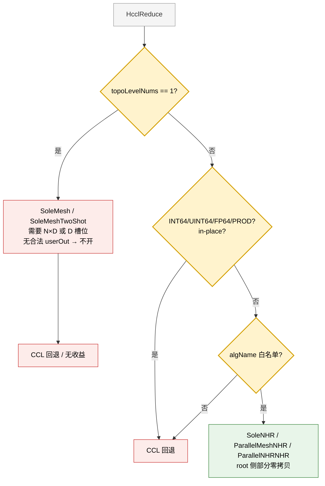

# 1.AR20261029516478 AllGatherV（SRS）

## 1.1 介绍

`HcclAllGatherV` 将各 rank 长度可不同的数据汇聚到所有 rank。当前 AICPU 非对称路径需要先把跨卡数据写入对端 CCL，再由对端 `PostLocalCopy` 到 userOut，存在额外本地拷贝；大数据还会受 CCL scratch 与 256MB 单轮上限约束。

本需求在 OPBASE 下打通 AllGatherV 的对称内存路径：各 rank 通过对称窗口直接读写对端 userOut，仅保留一次自贡献本地拷贝，从而消除接收侧 CCL→userOut 拷贝，并去掉 256MB/scratch 的单轮限制。

## 1.2 输入

**API 入参**（与现状一致，无新增）：

| 参数 | 类型 | 说明 |
|------|------|------|
| sendBuf | void* | 本端发送缓冲区 |
| sendCount | uint64_t | 本端发送元素数 |
| recvBuf | void* | 接收缓冲区 |
| recvCounts | const void* | 各 rank 接收元素数 |
| recvDispls | const void* | 各 rank 在 recvBuf 中的偏移 |
| dataType | HcclDataType | 数据类型 |
| comm / stream | HcclComm / aclrtStream | 通信域与流 |

**进入零拷贝条件**：

- HCOMM ≥ 9.1.0；
- `opMode == OPBASE`；
- `engine == COMM_ENGINE_AICPU_TS`；
- `topoInfo->level0Topo == MESH_1D`；
- `algName == AicpuAllGatherVSoleMesh`；
- input 与 output 均注册对称内存（双侧探测成功）。

## 1.3 处理

1. 修正 `outputSize` 口径为 `max(recvDispls[i] + recvCounts[i]) * typeSize`，并校验 displs 单调、非空区间不重叠和溢出。
2. `Selector` 选出 `AicpuAllGatherVSoleMesh` 后，由 `HcclExecOp → RefreshSymmetricMemory` 完成单点门禁与双侧窗口探测。
3. 对称生效时，执行器设置 `loopTimes=1`、`scratchMultiple=0`，并把 `maxCountPerLoop` 放大到本次最大 `recvCounts`。
4. `InsTempAllGatherVMesh1D` 保留一次自贡献本地拷贝，N-1 个对端线程并发直写对端 `userOut[displs[myRank]]`，跳过对端 `PostLocalCopy`。

## 1.4 输出

- 各 rank `recvBuf` 按 `recvDispls` 布局，内容与非对称路径逐 bit 一致。
- 不写 `recvBuf` 落点之外的区域。
- 对称路径不污染 `sendBuf`。

## 1.5 约束分析

| 支持的算子名称 | `HcclAllGatherV` |
| --- | --- |
| 支持的算法名称 | `AicpuAllGatherVSoleMesh` |
| 支持的芯片类型 | Ascend 950PR/950DT、Atlas A3 系列（以产品支持表为准） |
| 支持的展开模式 | AI CPU（`COMM_ENGINE_AICPU_TS`） |
| 支持的拓扑形态 | 单级 `MESH_1D`；A3 仅单 Server，其他拓扑回退 |
| 支持的调用类型 | 单算子 OPBASE；图模式不在本次范围（OFFLOAD 仅回归） |
| 支持的数据类型 | 全部 HCCL 数据类型（纯搬运） |
| 支持的数据量 | 无 256MB/scratch 单轮限制，`loopTimes=1` |
| 是否支持绕路 | 否 |
| 是否支持确定性计算 | 是（纯搬运，逐 bit 一致） |

其他约束：

- `sendBuf == recvBuf`（in-place）返回 `HCCL_E_PARA`。
- `recvCounts/recvDispls` 全 rank 一致；displs 单调不减、非空区间不得重叠、末段不超过 `outputSize`。
- 注册契约为全 rank 双侧全部注册或全不注册；部分注册属于契约外行为。
- 框架暂无跨 rank 对称标志协商，探测失败时本 rank 回退 CCL。

---

# 2.AR20261029516478 AllGatherV（SD）

## 2.1 功能描述

激活 `InsTempAllGatherVMesh1D` 的 `enableRemoteMemAccess` 分支：跨卡写落点为对端 `remoteOutputGraphMode.addr`，写偏移为 `displs[myAlgRank]`；本地保留一次 `LocalDataCopy`（input → 自身 output 的 displs 区间）作为发送源，接收侧跳过 `PostLocalCopy`。

## 2.2 流程描述

一次 `HcclAllGatherV` 调用经过 5 个阶段，本需求改动位于阶段 3（门禁/窗口探测）和阶段 5（模板直写）。



> 黄色为门禁/窗口探测改动，绿色为数据面直写改动。

**改动点 1——对称门禁与窗口探测**

**表 2-1：AllGatherV 对称门禁矩阵**

| 阶段 | 检查项 | AGV 条件 | 不满足 |
| --- | --- | --- | --- |
| 1 基础门禁 | 版本 / 模式 / 引擎 / 一级拓扑 | hcomm≥9.1.0、OPBASE、AICPU_TS、level0 MESH_1D | CCL 回退 |
| 2 算法门禁 | 选路 | `AicpuAllGatherVSoleMesh` | CCL 回退 |
| 3 窗口门禁 | 双侧注册 | input + output 窗口均有效 | CCL 回退 |
| 4 执行 | 全部通过 | `supportSymmetricMemory=true`；`loopTimes=1`、scratch=0；直写对端 userOut | CCL 回退 |

> 门禁顺序：基础 → 算法 → 窗口；任一层失败即本 rank 回退 CCL，不做跨 rank 协商。

**改动点 2——数据面直写**

**图 2-2：AllGatherV 普通路径与对称路径数据流**



普通路径先写对端 CCL，再由对端 `PostLocalCopy` 到 userOut；对称路径保留一次自贡献本地拷贝，N-1 个对端线程并发直写对端 `userOut`，不再执行接收侧 `PostLocalCopy`。

## 2.3 数据描述

本需求不修改 AllGatherV 的数据面结构（`OpParam` / `TemplateDataParams` / `ChannelInfo` 均复用既有字段）。数据面变化集中在四点：`outputSize` 口径、`recvBuf/displs` 布局校验、对称窗口地址的消费方式，以及 executor 的 loop 参数。本节按“输入字段 → 模板/通道字段 → 布局 → 行为变化”组织。

**OpParam 关键字段**

| 字段 | 含义 | 与本需求的关系 |
| --- | --- | --- |
| `vDataDes.dataType` | 元素类型 | 计算 `perDataSize`，决定 `outputSize` 的字节口径 |
| `vDataDes.counts` | recvCounts 数组 | 与 recvDispls 一起计算真实最大落点 |
| `varData` | recvCounts + recvDispls 合并存放 | 模板侧 `allRankDispls` 的来源 |
| `inputPtr/inputSize` | 本端 `sendBuf` 及其字节数 | 对称路径 input 窗口探测依据 |
| `outputPtr/outputSize` | `recvBuf` 及修正后的字节数 | 对称路径 output 窗口探测与越界校验依据 |
| `opType/opMode` | `HCCL_CMD_ALLGATHER_V` / `OPBASE` | 对称门禁判定 |

**TemplateDataParams / ChannelInfo**

| 字段 | 含义 | 用途 |
| --- | --- | --- |
| `TemplateDataParams.allRankDispls` | 各 rank 在 output 中的偏移 | rank i 写各 rank 的 `displs[i]` 区间 |
| `TemplateDataParams.allRankSliceSize` | 各 rank 本轮处理的字节数 | 构造 per-rank 的 tx/rx slice |
| `buffInfo.outputPtr` | 本端 `recvBuf` 基址 | 对称路径的本端落点 |
| `buffInfo.outputSize` | 本端窗口大小 | 对称落点越界校验 |
| `buffInfo.outBuffBaseOff` | 本轮 output 偏移 | 多轮 loop 时叠加 |
| `TemplateDataParams.enableRemoteMemAccess` | 是否使用对端 user buffer | 决定 tx/rx 地址走 userOut 还是 CCL |
| `ChannelInfo.remoteOutputGraphMode.addr` | 对端 userOut 地址 | 跨卡直写目标 |
| `ChannelInfo.remoteCclMem.addr` | 对端 CCL 地址 | 非对称回退目标 |

**recvBuf 与 displs 布局**

**表 2-2：recvBuf 布局示例（counts={2,3,1}、displs={0,5,8}、FP32）**

| 源 rank | counts | displs | recvBuf 元素区间 | FP32 字节区间 |
| --- | ---: | ---: | --- | --- |
| rank0 | 2 | 0 | `[0, 2)` | `[0, 8)` |
| 空洞 | — | — | `[2, 5)` | `[8, 20)` |
| rank1 | 3 | 5 | `[5, 8)` | `[20, 32)` |
| rank2 | 1 | 8 | `[8, 9)` | `[32, 36)` |

**图 2-3：recvBuf / displs 元素下标视角**

```text
元素下标:  0   1   2   3   4   5   6   7   8
          ┌───┬───┬───┬───┬───┬───┬───┬───┬───┐
recvBuf:  │ r0│ r0│   │   │   │ r1│ r1│ r1│ r2│
          └───┴───┴───┴───┴───┴───┴───┴───┴───┘
区间:      [0,2)      [2,5)      [5,8)   [8,9)
                         空洞
```

- 所有 rank 使用同一套 `recvCounts/recvDispls` 布局。
- rank i 把自己的数据写到每个 rank 的 `recvBuf` 的 `displs[i]` 区间；非空区间不能重叠。
- `outputSize = max(displs[i] + counts[i]) * typeSize`，本例为 `9 × 4B = 36B`，不是 `sum(counts)=6 × 4B`。

**对称窗口地址**

业务或测试侧先调用 `HcclCommSymWinRegister` 把 user buffer 注册为窗口；HCCL 通过 `HcclCommSymWinGet` 反查本端窗口与 offset；再通过 `GetSymWinRemoteMem`（优先 `HcclSymWinGetRemoteAddr`，9.1 回退 `HcclSymWinGetPeerPointer`）按 peer rank 换算出对端 userOut 地址。注册只建立窗口、不搬数据；本需求不修改注册与地址换算实现，只新增探测策略和直接读写消费路径；注册/查询失败时回退 CCL。

**数据行为变化**

1. `outputSize` 从 `sum(recvCounts)` 改为 `max(recvDispls[i] + recvCounts[i])`，覆盖 displs 空洞，避免探测尺寸偏小。
2. 跨卡落点从对端 CCL 改为对端 userOut；模板跳过接收侧 `PostLocalCopy`，但保留自贡献本地拷贝。
3. 对称时 executor 设置 `loopTimes=1`、`scratchMultiple=0`，并把 `maxCountPerLoop` 放大到本次最大 `recvCounts`，摆脱 CCL scratch/256MB 单轮限制。

## 2.4 依赖性描述

- 公共层：`RefreshSymmetricMemory`、`CheckAndSetSymmetricMemory`、`IsSymMemWindowValid`、`FillChannelSymWinPeerAddrs`。
- HCOMM：`HcclCommSymWinRegister`、`HcclCommSymWinGet`、`GetSymWinRemoteMem`，按 9.1/9.2 版本能力动态加载。
- 执行器/模板：`InsV2AllGatherVSoleExecutor`、`InsTempAllGatherVMesh1D`、`executor_v2_base` 的对称信息传递。
- 不依赖 Scatter/ReduceScatterV 的实现。

## 2.5 接口描述

| 函数原型 | `HcclResult HcclAllGatherV(void *sendBuf, uint64_t sendCount, void *recvBuf, const void *recvCounts, const void *recvDispls, HcclDataType dataType, HcclComm comm, aclrtStream stream)` |
| --- | --- |
| 函数功能 | 将各 rank 的输入按 `recvCounts/recvDispls` 汇聚到所有 rank 的 `recvBuf`。 |
| 输入说明 | `sendBuf/sendCount` 为本端输入；`recvCounts/recvDispls` 为全 rank 一致的接收布局；`dataType` 为元素类型；`comm/stream` 为通信域与流。 |
| 输出说明 | 各 rank `recvBuf` 按 `recvDispls` 布局；对称路径下跨卡数据直接写入对端 `userOut`。 |
| 返回值说明 | `HCCL_SUCCESS`；参数为空/非法返回 `HCCL_E_PTR`/`HCCL_E_PARA`；内部错误返回 `HCCL_E_INTERNAL`。 |

无 API 变更；注册对称内存且门禁满足时行为变化为跨卡数据不经 CCL，未注册时保持原路径。

## 2.6 约束分析

| 支持的算子名称 | `HcclAllGatherV` |
| --- | --- |
| 支持的算法名称 | `AicpuAllGatherVSoleMesh` |
| 支持的芯片类型 | Ascend 950PR/950DT、Atlas A3 系列（以产品支持表为准） |
| 支持的展开模式 | AI CPU（`COMM_ENGINE_AICPU_TS`） |
| 支持的拓扑形态 | 单级 `MESH_1D`；A3 仅单 Server，其他拓扑回退 |
| 支持的调用类型 | 单算子 OPBASE；图模式不在本次范围（OFFLOAD 仅回归） |
| 支持的数据类型 | 全部 HCCL 数据类型（纯搬运） |
| 支持的数据量 | 无 256MB/scratch 单轮限制，`loopTimes=1` |
| 是否支持绕路 | 否 |
| 是否支持确定性计算 | 是（纯搬运，逐 bit 一致） |

补充约束：

- `remoteOutputGraphMode` 只回填地址、不保证 size，越界校验使用本地 `outputSize`。
- 全 rank 双侧全部注册或全不注册；部分注册属于契约外行为。
- 探测失败或门禁不满足时，本 rank 回退 CCL。

## 2.7 DFX设计

| 校验内容 | 级别 | 搜索内容 |
| --- | --- | --- |
| 对称窗口探测 | INFO | `supportSymmetricMemory`、`symMem`、窗口查询结果 |
| 门禁与算法 | INFO | `RefreshSymmetricMemory`、`algName`、`engine`、`level0Topo` |
| 对端地址/越界 | ERROR | `remote output addr is null`、`output offset out of range` |
| 参数校验 | ERROR | displs 单调/重叠/溢出、in-place |
| 回退 | INFO/WARNING | `supportSymmetricMemory=false`、CCL fallback |

## 2.8 资料描述

- `docs/zh/api_ref/comm_op_interface/HcclAllGatherV.md`：补充对称内存说明、注册契约与 displs 约束。
- `docs/zh/user_guide/comm_ops_support_list/comm_ops_support_a3.md`：按产品支持表更新单算子零拷贝状态。

## 2.9 性能&&质量

- 正确性：ST 12/12 默认路径通过；对称路径与默认路径逐 bit 一致，非落点区域不被踩踏。
- 真机：8p 单 Server、512MB FP32，base 11816.32us / 45.43GB/s，sym 6089.40us / 88.16GB/s，约 1.94x；64MB 约 5.5% 提升。
- 对称 ST 当前未纳入默认 CI，仅保留手工/临时验证；后续按专项 issue 接入。
- 质量约束：大数据 `loopTimes=1`，无 256MB 截断；对端地址空值和越界有防御。

---

# 3.AR20261029517134 Reduce（SRS）

## 3.1 介绍

`HcclReduce` 将所有 rank 的同形状数据逐元素归约，结果仅落在 root。Reduce 是“N 份全量 D → root 一份 D”的向心归约：确定性 + fullmesh 并发要求 N×D 的中间落点，而合法用户介质只有 root 的 1×D，因此只能做 root 侧部分零拷贝。

本需求对 `AicpuReduceSoleNHR`、`AicpuReduceParallelMeshNHR`、`AicpuReduceParallelNHRNHR` 开启 root 侧零拷贝：root 工作区/终局汇集改 userOut；非 root 与交换槽保留 CCL。

**单级 MESH_1D 无零拷贝收益**：单级选到 `SoleMesh` / `SoleMeshTwoShot`，需要 N×D 或 D 槽位；root 只有 1×D 的 userOut，非 root output 语义无效、input 只读，没有合法 user buffer 可替换。即使强制单级 `SoleNHR`，也会被 `topoLevelNums == 1` 门禁拒绝。

## 3.2 输入

**API 入参**（与现状一致，无新增）：

| 参数 | 类型 | 说明 |
|------|------|------|
| sendBuf | void* | 各 rank 输入 |
| recvBuf | void* | root 输出；非 root 仅作窗口锚点 |
| count | uint64_t | 元素个数 |
| dataType | HcclDataType | 数据类型 |
| op | HcclReduceOp | SUM/PROD/MAX/MIN |
| root | uint32_t | 结果落地 rank |
| comm / stream | HcclComm / aclrtStream | 通信域与流 |

**进入零拷贝条件**：

- HCOMM ≥ 9.1.0；
- `opMode == OPBASE`；
- `engine == COMM_ENGINE_AICPU_TS`；
- `topoInfo->level0Topo == MESH_1D`；
- `topoInfo->topoLevelNums > 1`（单级不开启）；
- `algName ∈ {AicpuReduceSoleNHR, AicpuReduceParallelMeshNHR, AicpuReduceParallelNHRNHR}`；
- `param.inputPtr != param.outputPtr`（禁 in-place）；
- output 侧注册对称内存（单边探测成功）。

## 3.3 处理

1. `Selector` 选出 Reduce 白名单算法；`HcclExecOp → RefreshSymmetricMemory` 完成版本/引擎/拓扑/算法/类型/in-place 门禁与 output 单边探测。
2. 对称生效时，执行器把 `supportSymmetricMemory` 与窗口信息传给模板。
3. `SoleNHR`：root 的 PreCopy 目的、工作区和终局落点改 userOut，root 跳过 PostCopy；非 root 工作区/交换槽保持 CCL。
4. `ParallelMeshNHR / ParallelNHRNHR`：RS 阶段保持 CCL，仅当 `inputSymWindow` 非空时才走对称，否则回退 CCL；最终 AG 阶段 root 落点改 userOut，并移除 root 终局 LocalCopy。

## 3.4 输出

- root 的 `recvBuf` 内容与非对称路径逐 bit 一致。
- 非 root `recvBuf` 内容语义无效，对称路径不写入非 root output。
- 输入 `sendBuf` 不被污染。

## 3.5 约束分析

| 支持的算子名称 | `HcclReduce` |
| --- | --- |
| 支持的算法名称 | `AicpuReduceSoleNHR`、`AicpuReduceParallelMeshNHR`、`AicpuReduceParallelNHRNHR` |
| 支持的芯片类型 | Ascend 950PR/950DT、Atlas A3 系列（以产品支持表为准） |
| 支持的展开模式 | AI CPU（`COMM_ENGINE_AICPU_TS`） |
| 支持的拓扑形态 | 2/3 级 `MESH_1D`；单级 MESH_1D 不开启；CLOS/MESH_1D_CLOS 走原路径 |
| 支持的调用类型 | 单算子 OPBASE；图模式不在本次范围 |
| 支持的数据类型 | 排除 INT64/UINT64/FP64 与 PROD；其余按算法 attrs |
| 支持的数据量 | 支持多轮 loop；非 root 交换槽仍受 CCL 槽位约束 |
| 是否支持绕路 | 否 |
| 是否支持确定性计算 | 是（固定成对序，逐 bit 一致） |

其他约束：

- 仅 3 个白名单算法；`MultiJetty`、`SoleMesh`、`TwoShot`、`3level`、`AicpuReduceNHR` 不开启。
- 全 rank `recvBuf` 全部注册或全不注册；非 root `recvBuf` 必须非空并注册（窗口锚点）。
- `inputPtr == outputPtr`、INT64/UINT64/FP64、PROD 均回退。
- 框架暂无跨 rank 对称标志协商，依赖注册契约。

---

# 4.AR20261029517134 Reduce（SD）

## 4.1 功能描述

- **SoleNHR**：root 的本地工作区从 CCL 改为自身 userOut；PreCopy 目的、halving/doubling 的原位归约介质、终局落点都指向 userOut；root 跳过 PostCopy。归约顺序与交换模式不变。
- **ParallelMeshNHR / ParallelNHRNHR**：最终 AG 阶段 root 侧工作区/最终落点改 userOut，移除 root 终局 LocalCopy。
- **RS 阶段 input 窗口判断**：`InsTempReduceScatterMesh1D` / `InsTempReduceScatterNHR` 与 AR/RS 共用。Reduce 只注册 `recvBuf`（output），`sendBuf` 不注册，因此 `inputSymWindow` 为空；模板不能只凭 `supportSymmetricMemory` 走对称，还必须满足 `param.inputSymWindow != nullptr`。条件不满足时 RS 阶段自动回退 CCL，避免空 input 地址和污染 user input；最终 AG 阶段仍可使用 root 的 output 窗口。

关键决策：

- 新增 Reduce 专用 `IsReduceAlgSymMemDeterministic`，不改动 AR/RS 既有函数；AR/RS 多级仍保持 false。
- Reduce 白名单仅 `SoleNHR`、`ParallelMeshNHR`、`ParallelNHRNHR`，不含 MultiJetty。
- 单级 MESH_1D 显式无收益；依赖多级拓扑。
- 无跨 rank 对称标志协商，采用“全 rank 注册或全不注册”契约。

## 4.2 流程描述

一次 `HcclReduce` 调用经过 6 个阶段，本需求改动位于阶段 3（门禁/窗口探测）、阶段 5（SoleNHR root 工作区）和阶段 6（Parallel 最终 AG）。



> 黄色为门禁/窗口探测改动，绿色为 root 侧数据面改动。

**改动点 1——门禁与算法选择**

**表 4-1：Reduce 对称门禁矩阵**

| 阶段 | 检查项 | Reduce 条件 | 不满足 |
| --- | --- | --- | --- |
| 1 基础门禁 | 版本 / 模式 / 引擎 / 一级拓扑 | hcomm≥9.1.0、OPBASE、AICPU_TS、level0 MESH_1D | CCL 回退 |
| 2 拓扑门禁 | 多级 | `topoLevelNums > 1`；单级直接排除 | CCL 回退 |
| 3 类型/调用门禁 | 数据类型 / 规约 / in-place | 非 INT64/UINT64/FP64/PROD；`inputPtr != outputPtr` | CCL 回退 |
| 4 算法门禁 | 白名单 | `SoleNHR` / `ParallelMeshNHR` / `ParallelNHRNHR` | CCL 回退 |
| 5 窗口门禁 | 单边注册 | 仅 output 窗口有效 | CCL 回退 |
| 6 执行 | 全部通过 | `supportSymmetricMemory=true`；root 工作区/终局落 userOut；非 root 仍 CCL | CCL 回退 |

> 门禁顺序：基础 → 拓扑 → 类型/调用 → 算法 → 窗口；任一层失败即本 rank 回退 CCL，不做跨 rank 协商。

**改动点 2——SoleNHR**

**图 4-2：SoleNHR 的 root 工作区与固定成对归约**



SoleNHR 只把 root 的 PreCopy 目的、工作区和终局落点改到 userOut；非 root 工作区/交换槽仍使用 CCL，halving/doubling 的成对顺序不变。

**改动点 3——Parallel**

**图 4-3：ParallelMeshNHR 的两级流水**



RS 阶段保持 CCL：模板只在 input 窗口非空时走对称，否则回退 CCL；最终 AG 阶段的 root 落点设计为 userOut。当前 `enableRemoteMemAccess=false`，Parallel 实际仍走 CCL 回退。

## 4.3 数据描述

本需求不修改 Reduce 的数据面结构（`OpParam` / `TemplateDataParams` / `ChannelInfo` 均复用既有字段）。数据面变化集中在 root 工作区与 `outBuffType`、多轮 loop 偏移、对称窗口地址消费，以及 RS 阶段 input 窗口判断。本节按“输入字段 → 模板/通道字段 → 空间与 loop → 行为变化”组织。

**OpParam 关键字段**

| 字段 | 含义 | 与本需求的关系 |
| --- | --- | --- |
| `root` | 结果落地 rank | 只有 root 的 output 有语义；非 root output 仅作窗口锚点 |
| `DataDes.dataType/count` | 元素类型/个数 | 决定 `outputSize` 与类型门禁；64bit/FP64/PROD 回退 |
| `inputPtr/inputSize` | 本端 `sendBuf` | 不探测 input 窗口；RS 阶段不能依赖 `inputSymWindow` |
| `outputPtr/outputSize` | `recvBuf` 及字节数 | root output 窗口探测依据；Reduce 采用仅 output 侧探测 |
| `reduceType` | SUM/PROD/MAX/MIN | PROD 回退 |
| `opType` | `HCCL_CMD_REDUCE` | 门禁与算法白名单判定 |

**TemplateDataParams / ChannelInfo**

| 字段 | 含义 | 用途 |
| --- | --- | --- |
| `buffInfo.outBuffType` | root 终局为 `OUTPUT`，其余为 `HCCL_BUFFER` | 决定落点走 userOut 还是 CCL |
| `buffInfo.outputPtr` | root 终局为 userOut 加 loop 偏移，否则为 CCL | 模板写目标 |
| `buffInfo.outputSize` | root 终局为本轮剩余 output 大小 | 落点越界校验 |
| `buffInfo.outBuffBaseOff` | 本轮/dataSlice 的输出偏移 | 多轮 loop 时叠加 |
| `TemplateDataParams.enableRemoteMemAccess` | 是否启用对端 user buffer 访问 | 当前 Parallel 为 false，AG 仍走 CCL |
| `ChannelInfo.remoteOutputGraphMode.addr` | 对端 userOut 地址 | 只在对端为 root 时使用 |
| `ChannelInfo.remoteCclMem.addr` | 对端 CCL 地址 | 非对称路径与 RS 阶段的回退目标 |

**root 输出与空间下界**

**图 4-4：Reduce 的空间下界——N×D 输入 vs root 1×D 输出**



- Reduce 是 N 份全量 D 汇总到 root 一份 D；确定性 + fullmesh 需要 N×D 中间落点。
- 非 root output 语义无效，userIn 只读，因此只有 root 的 userOut 可以作为合法累加/最终落点。
- 所以 SoleNHR / Parallel 只能做 root 侧部分零拷贝；非 root 工作区和 RS 交换槽保留 CCL。

**多轮 loop 偏移**

- `outputLoopBaseOff_ = processedCount * dataTypeSize_`：root 在当前 loop 的 userOut 基址偏移。
- root 终局的 `outputPtr` 叠加该偏移，`outputSize` 使用 `param.outputSize - outputLoopBaseOff_`，避免把整块 userOut 当成单轮可写区间。
- `outBuffBaseOff` 继续叠加 dataSlice 偏移；直写/原位归约地址必须包含这两个偏移，否则多轮数据会互踩。
- 跳过的是本地拷贝，不是跨轮 notify 握手；RS/AG 的同步不能随 `PostLocalCopy` 一起省略。

**对称窗口地址**

业务或测试侧先调用 `HcclCommSymWinRegister` 把 user buffer 注册为窗口；HCCL 通过 `HcclCommSymWinGet` 反查本端窗口与 offset；再通过 `GetSymWinRemoteMem`（优先 `HcclSymWinGetRemoteAddr`，9.1 回退 `HcclSymWinGetPeerPointer`）按 peer rank 换算出对端 userOut 地址。注册只建立窗口、不搬数据；本需求不修改注册与地址换算实现，只新增探测策略和直接读写消费路径；注册/查询失败时回退 CCL。

**数据行为变化**

1. **SoleNHR**：root 的 PreCopy 目的、工作区和终局落点改到 userOut，root 跳过 PostCopy；非 root 工作区/交换槽保持 CCL。
2. **Parallel**：最终 AG 阶段 root 落点改 userOut；RS 阶段仅在 `inputSymWindow != nullptr` 时走对称，Reduce 仅注册 output 时自动回退 CCL，避免空 input 地址和输入污染。
3. **现状**：`enableRemoteMemAccess=false`，Parallel 的 AG 仍走 CCL 回退；因此 Parallel 当前只验证正确性与回退，不按零拷贝收益评估。

## 4.4 依赖性描述

| 依赖 | 说明 |
|------|------|
| `ReduceNHR` | SoleNHR 模板；PreCopy/RunReduce/RunGather/PostCopy 按 root 选择地址 |
| `ReduceParallelExecutor` | RS Mesh/NHR + AG Mesh/NHR 组合；最终 AG root 落点处理 |
| `InsTempReduceScatterMesh1D/NHR` | RS 阶段 input 窗口判断改动；与 AR/RS 共享，需回归 |
| `InsTempAllGatherMesh1D/NHR` | 使用 `enableRemoteMemAccess` 与 `remoteOutputGraphMode` |
| `FillChannelSymWinPeerAddrs` | 只填地址，不填 size；越界校验使用本地 size |
| 公共层 | `RefreshSymmetricMemory`、`CheckAndSetSymmetricMemory`、`IsSymMemWindowValid`、`IsReduceAlgSymMemDeterministic` |
| HCOMM | `HcclCommSymWinRegister`、`HcclCommSymWinGet`、`GetSymWinRemoteMem` |

## 4.5 接口描述

| 函数原型 | `HcclResult HcclReduce(void *sendBuf, void *recvBuf, uint64_t count, HcclDataType dataType, HcclReduceOp op, uint32_t root, HcclComm comm, aclrtStream stream)` |
| --- | --- |
| 函数功能 | 将所有 rank 的 `sendBuf` 逐元素归约，结果写入 root 的 `recvBuf`。 |
| 输入说明 | `sendBuf/count/dataType/op` 为各 rank 输入；`root` 指定结果落地 rank；`comm/stream` 为通信域与流。 |
| 输出说明 | root 的 `recvBuf` 为归约结果；非 root `recvBuf` 内容无效。 |
| 返回值说明 | `HCCL_SUCCESS`；参数为空/非法返回 `HCCL_E_PTR`/`HCCL_E_PARA`；内部错误返回 `HCCL_E_INTERNAL`。 |

无 API 变更；注册对称内存且门禁满足时，root 侧减少一次全量本地拷贝。

## 4.6 约束分析

| 支持的算子名称 | `HcclReduce` |
| --- | --- |
| 支持的算法名称 | `AicpuReduceSoleNHR`、`AicpuReduceParallelMeshNHR`、`AicpuReduceParallelNHRNHR` |
| 支持的芯片类型 | Ascend 950PR/950DT、Atlas A3 系列（以产品支持表为准） |
| 支持的展开模式 | AI CPU（`COMM_ENGINE_AICPU_TS`） |
| 支持的拓扑形态 | 2/3 级 `MESH_1D`；单级 MESH_1D 不开启；CLOS/MESH_1D_CLOS 走原路径 |
| 支持的调用类型 | 单算子 OPBASE；图模式不在本次范围 |
| 支持的数据类型 | 排除 INT64/UINT64/FP64 与 PROD；其余按算法 attrs |
| 支持的数据量 | 支持多轮 loop；非 root 交换槽仍受 CCL 槽位约束 |
| 是否支持绕路 | 否 |
| 是否支持确定性计算 | 是（固定成对序，逐 bit 一致） |

补充约束：

- 单级 MESH_1D 选到 SoleMesh/TwoShot，不在白名单；强制单级 SoleNHR 也被 `topoLevelNums == 1` 排除。
- 全 rank `recvBuf` 全部注册或全不注册；非 root `recvBuf` 必须非空并注册（窗口锚点）。
- RS 阶段仅 output 注册时由 input 窗口判断回退 CCL，不污染输入。
- 多轮 loop 下直写/原位归约地址必须叠加 `outBuffBaseOff`，notify 握手不得省略。

**图 4-5：Reduce 算法支持范围决策树**



## 4.7 DFX设计

| 校验内容 | 级别 | 搜索内容 |
| --- | --- | --- |
| 对称窗口探测 | INFO | `symMem`、`supportSymmetricMemory`、窗口查询结果 |
| 门禁与算法 | INFO | `RefreshSymmetricMemory`、`algName`、`topoLevelNums`、`isCapture` |
| root 工作区/阶段 | INFO | `rootUsesOutputWorkspace_`、PreCopy/PostCopy、最终 AG 阶段 |
| 对端地址/越界 | ERROR | remote root output addr null、output offset out of range |
| 参数/类型/回退 | ERROR/INFO | in-place、64bit/PROD、窗口失败、CCL fallback |

## 4.8 资料描述

- `docs/zh/api_ref/comm_op_interface/HcclReduce.md`：补充对称内存说明（仅 recvBuf 注册、非 root 内容无效、不污染输入、单级无收益、探测失败回退）。
- `docs/zh/user_guide/comm_ops_support_list/comm_ops_support_a3.md`：按白名单算法/拓扑更新支持状态。

## 4.9 性能&&质量

- 正确性：Reduce 默认 ST 22/22 通过；root 输出与非对称路径逐 bit 一致，重复执行逐 bit 一致。
- 单级 MESH_1D 实测：`symMem[0]`，base/sym 512MB 均约 3606us/148.8GB/s，符合“单级无收益”设计。
- 多级 SoleNHR 为 root 侧收益场景，需 2 Server 拓扑验证；Parallel 当前 `enableRemoteMemAccess=false`，仍是 CCL 回退。
- 对称 ST 当前未纳入默认 CI，仅保留手工/临时验证；后续按专项 issue 接入。
- 边界质量：非 root output 不写、输入不污染、多轮偏移与对端空地址有防御。
