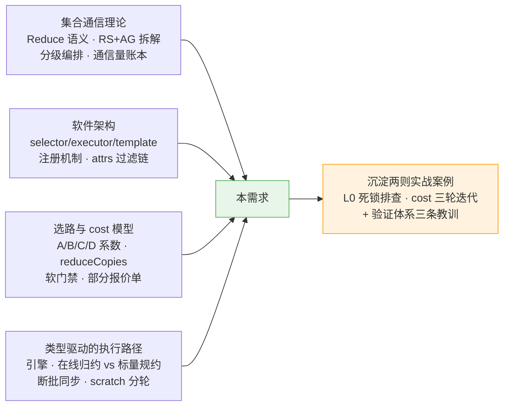
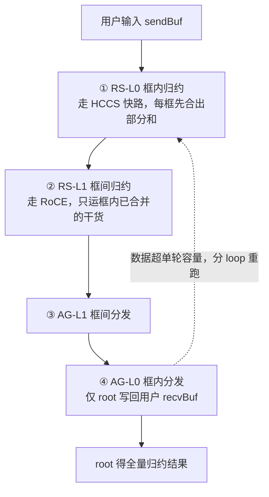
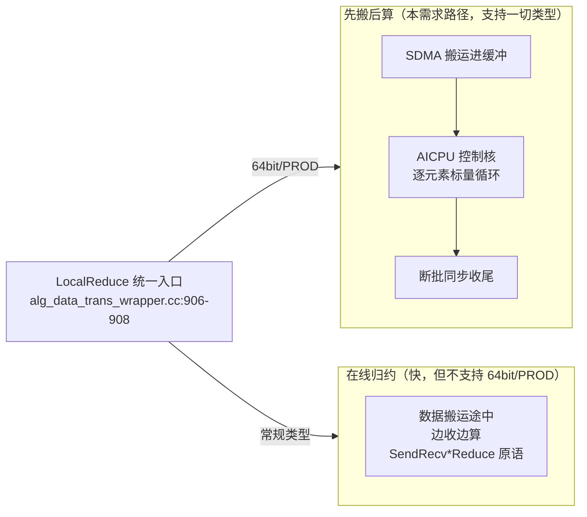

# 实践总结｜Reduce 64bit/特殊规约分级算法：集合通信与 HCCL 基础理论

> **所属专栏**：[实践总结](index.md) · 第 2 篇
>
> **面向读者**：组内同行——有集合通信与分布式训练背景，不要求读过 hccl 仓源码。
>
> **事实基准**：hccl 仓 `feature/reduce-64bit-prod-2level-hier` 分支 `e012c9c6`（2026-10-28）；文中 `文件:行号` 均按此基线核对，可直接跳转源码验证。
>
> **主线案例**：需求 AR20260930049502（Reduce 算子 64bit/PROD 两级分级算法）。理论是通用的，案例是本需求独有的沉淀。

---

## 0. 开篇：这个需求触碰了哪些知识

**需求一句话**：Reduce 算子遇到 64bit 类型（INT64/UINT64/FP64）或 PROD 规约、且是跨机两级组网时，只能走整域扁平的慢算法；本需求为它注册了一套"框内 + 框间"两级编排的分级算法，并让 cost 计价真实参与选路排序。

需求虽小（核心改动两处：一个注册 + 一个路由分支），却纵向穿透了 HCCL 的全部关键机制：



全文按这条线展开：第 1 节速查理论（同行可跳），第 2-4 节讲机制（本需求视角的架构/选路/路径），第 5-6 节是两则排障实战，第 7 节是验证体系的工程教训。

---

## 1. 集合通信与分级原理（速查）

### 1.1 Reduce 与它的拆解范式

`HcclReduce`（`include/hccl.h:249`）把通信域内所有 rank 的同形状数据逐元素归约，**结果只落在 root rank**（非 root 的用户输出缓冲不被写——这条语义后面在第 7 节还会出场）。HCCL 内部普遍把 Reduce / AllReduce 拆成 **ReduceScatter（先归约并散开）+ AllGather（再拼回全量）** 两段组合实现；分级算法正是在这两段上按拓扑层级继续拆。

### 1.2 两级拓扑与分级编排

跨机组网天然是两级的：框内（level0，HCCS 高速互联）与框间（level1，RoCE 网络）；代码用 `topoLevelNums` 计层数（1=单机、2=跨机、3=超大规模）。分级编排把 RS/AG 各拆两层，共 4 步：



### 1.3 通信量账本：分级为什么快

扁平算法把 N 张卡当作一个平面：gather 全量到本卡再算，**框间链路要运 N-1 份完整数据**。分级算法在第①步就把框内数据归约成"每框一份部分和"，框间只运部分和——16 卡（2 节点×8）64m 实测：扁平 Sole 183ms vs 分级新算法 27ms，**6.8 倍差距**（详见第 6 节）。这笔账就是分级通信的全部意义：**贵链路上只运合并后的干货**。

### 1.4 搬运算法家族一句话

- **Ring**：环形逐块传递，步数线性于 N，等分带宽，大数据量稳态最优；
- **NHR**（Nonuniform Hierarchical Ring）：按生成树构造最优收发关系，步数 ⌈log₂N⌉，非 2 的幂也吃满链路，**跨机主力**（本需求每个层级都用它搬运）；
- **Mesh**：框内全互联直连，一步到位，适合小 rank 数框内。

官方总览见 hccl 仓 `docs/zh/user_guide/coll_algo_intro/algo_intro.md`，NHR 专述见同目录 `NHR.md`。

---

## 2. HCCL 软件架构与注册机制

### 2.1 三层职责与一次调用的 7 个阶段

HCCL 的核心分层：**selector（选算法）→ executor（编排步骤）→ template（具体搬算）**，模板发出的动作原语经 wrapper 封装、通过 dlsym 调 HCOMM 基础通信库落到硬件（两仓解耦是架构硬约束，HCCL 不编译期依赖 HCOMM）。一次 `HcclReduce` 调用的旅程：

| 阶段 | 职责 | 代码位置（已核对） |
| ---- | ---- | ---- |
| 0 入口分流 | 设备/版本判断，走新流程 | `reduce.cc:23`（`IsOutPlaceDevice` :33） |
| 1 入参检查 | 指针/count/类型/root；PROD 类型白名单 | `reduce.cc:129`、`CheckReduceOp` :146（白名单 `op_common.cc:3581-3584`） |
| 2 模式分流 | OPBASE 单算子 / OFFLOAD 图模式；组装 OpParam | `reduce.cc:219`（`ReduceConstructOpParam` :179） |
| 3 算法选择 ★ | 按拓扑+参数点名算法名 | `Selector`（`op_common.cc:160`）→ `reduce_auto_selector.cc:281` 特判 |
| 4 资源计算 | 分级通信域、线程/notify/channel；不足则 FallbackOp 回退 | `HcclGetAlgRes`（`op_common.cc:1532`） |
| 5 执行编排 | 按层级顺序调模板 KernelRun，分 loop | executor `OrchestrateLoop`（`reduce_sequence_executor_aicpu_3level.cc:817`） |
| 6 硬件执行 | 搬运/规约原语经 dlsym 下发 | wrapper → HCOMM（如 `alg_data_trans_wrapper.cc:924`） |

### 2.2 注册机制：算法名 = executor + 模板组合

新算法落地的唯一"生产动作"是两条注册宏（`reduce_sequence_executor_aicpu_3level.cc:840-851`）：`REGISTER_EXEC_V2_MULTI` 把"executor + 6 个模板位"的组合登记进注册表，算法名即检索键——selector 能选中它、资源按它的 executor 算、编排按它的模板跑。**"只加注册、不改框架"** 的含义即此：编排逻辑与模板执行零改动，只是新增一种合法组合。

6 个模板位是"三层楼六工位"的出厂设计：两级注册时第三层的两位填同款模板占位、由 `skipLevel2_` 跳过永不启动（先例 `AicpuReduceSequenceMeshConcurNHR`，:829-839）。Reduce 与 AllReduce 共用这套 3level executor 框架，兄弟算子各注册各的，互不干扰。

### 2.3 attrs 能力过滤链：算法的"自述简历"

注册同时用 `REGISTER_ALG_ATTRS` 声明能力边界，选路前逐级过滤：

| attrs 项 | 作用 | 本需求取值 |
| ---- | ---- | ---- |
| `min/maxTopoLevelNum` | 适用几级拓扑 | 2/2（三级直接被拒） |
| `supportLevel0Topos` | 框内形态白名单 | MESH_1D / CLOS / MESH_1D_CLOS |
| `isSupportLevel1Nhr` / `isSupportLevel0PcieMix` | 框间形态 / PCIe 混连 | true / false（后者仅 PCIe 混连时参与过滤，`cost_model.cc:225`） |
| `unsupportedDataTypes` / `isSupportProd` | 类型与 PROD 排除 | **正是它们把 64bit/PROD 挡在既有分级算法门外**（:826/:835） |
| `opCustomCheck` | 运行时软门禁（lambda） | 仅 64bit ∥ PROD 放行（:849-851），见第 3.3 节 |

### 2.4 算法命名语法

`<引擎><算子><编排模式><框内算法><框间算法>`，例：`Aicpu` + `Reduce` + `Sequence` + `NHR` + `AicpuReduceNHR`。编排模式速记：**Sole**=整域扁平一段、**Sequence**=按层串行、**Parallel**=多线程并发跑层。算法名同时是 `HCCL_ALGO` 环境变量的可指定 token（本算法 `reduce:sequence{nhraicpureduce,nhr}`，按层级模板组合语法解析）。

---

## 3. 算法选路与 cost 模型

### 3.1 选路双路径

- **selector 特判**：`ReduceAutoSelector::SelectAicpuAlgo` 按拓扑/参数走 if-else 决策树（`reduce_auto_selector.cc:281-287`：两级 + 64bit/PROD → 新算法；三级 → 维持 Sole），日志关键字 `[ReduceAutoSelector] Algo match`；
- **cost 排序**：`SelectorEngine` 把通过 attrs 过滤的候选池按估算耗时排序取最小（日志 `[SelectorEngine] ... selected algo type`，`selector_engine.cc:337`）。两级 MESH_1D 的常规 dtype 场景走这条路径。
- 保序（DETERMINISTIC_STRICT）拦截优先于两者，走 `*StrictOrderedMesh` 专属路径。

### 3.2 cost 系数：A/B/C/D + reduceCopies

每个模板可提供静态报价 `CalcCostCoeff`（无报价的模板返回空，`alg_v2_template_base.h:28`），executor 聚合成算法级报价，cost table 逐段估算：

```text
segCost = (A/util + B + bReduce) × dataSize + C
cost = Σ segCost，再与 totalD 取 max
```

| 系数 | 含义 | 本需求相关 |
| ---- | ---- | ---- |
| A | 传输时间斜率（除以链路带宽利用率 util） | 按层级 netType/portNum 计算 |
| B | 本地拷贝斜率 | 入/出 ccl buffer 的搬运 |
| C / D | 时延常数 / 任务下发开销 | 按 taskNum 折算 |
| **reduceCopies**（`cost_model.h:68`） | **AICPU 规约总量折算为 dataSize 的份数**（字节口径） | RS 段模板产出，如 Mesh1D `(rankSize-1)×dataRatio`（`ins_temp_reduce_scatter_mesh_1D.cc:55`） |

**关键扩展——host 规约折算**：64bit/PROD 的规约实际走 AICPU 控制核标量循环（第 4 节），框架用实测斜率 **1.2ns/count**（fp64 1GB 0.162s 标定）把它折算进 B：`CalcHostReduceSlope`（`cost_model.h:72-82`）按 `count×1.2ns` 折为每字节斜率、不除 util，由 `cost_table.cc:407` 逐段并入。门控条件（dataTypeSize==8 ∥ PROD）与执行层的实际分流条件严格对齐——**计价口径必须与执行路径一致，否则排序就是错的**。

### 3.3 "部分报价单"问题与软门禁

风险场景：executor 聚合系数是**直接拼接、无"任一为空则整体退出"短路**（`reduce_sequence_executor_aicpu_3level.cc:44-110`；对照 RS executor 有此短路，`ins_v2_reduce_scatter_sequence_executor_aicpu.cc:121-127`）。若算法 6 个模板位中一部分有报价、一部分没有，聚合结果**非空但不完整**——缺失最重的 RS 项，估算系统性偏低，常规场景会被"低价"误选，把 fp32+sum 的常规流量路由到标量慢路径上。

**处置——`opCustomCheck` 软门禁**：attrs 声明一个 lambda（仅 64bit ∥ PROD 放行，与 selector 特判逐字一致），常规场景直接被候选池过滤、不进比价；特殊场景由 selector 特判兜底。本需求先落门禁、后补齐真实系数，两者并存复核通过（AllReduce 孪生算法同款，`ins_v2_all_reduce_sequence_executor_aicpu.cc:895-899`）。

---

## 4. 数据类型如何改变执行路径

### 4.1 三引擎

| 引擎 | 一句话 |
| ---- | ---- |
| AICPU_TS | AICPU 控制核跑通信 Kernel，不占计算核，适合大数据量（**本需求**） |
| AIV | Vector 向量核直接执行，低时延但占计算核 |
| CCU | IO Die 硬化集合通信单元，微码执行 |

### 4.2 在线归约 vs 先搬后算：64bit/PROD 的根源



`LocalReduce` 是分流点：遇 INT64/UINT64/FP64/PROD 走 `AicpuReduce` 标量循环，否则走 DMA 融合的在线归约（`SendRecvBatchReadReduce` 等，`ins_temp_reduce_scatter_nhr.cc:426-441`）。**数据类型不只是内存宽度问题——底层搬运与计算的硬件单元按"类型×操作"逐组合支持**，8 字节类型和乘法恰落在薄弱组合上，这就是需求存在的根源。

### 4.3 断批同步

控制核标量计算期间不能与批量任务描述符混排：先 `HcommBatchModeEnd/Start` 清空批次、算完 `HcommThreadJoin` 等待收尾（`ins_temp_reduce_scatter_mesh_1D.cc:149-152`）。〔比方〕流水线上插了段手工工序：得先清空传送带、师傅干完活、再重启传送带。每轮规约重复一次——这是"正确性优先、不设性能指标"的直接原因。

### 4.4 scratch 与分轮

算法工作缓冲按模板的 scratch 倍数相乘申请（Mesh1D `templateRankSize_`，`ins_temp_reduce_scatter_mesh_1D.cc:111-117`；NHRPcie `rankSize*2`，`ins_temp_reduce_scatter_aicpu_reduce_nhr_pcie.cc:342-352`），倍数越高单轮可处理量越小，大数据量按 `maxCountPerLoop` 分多轮。分轮数放大 → 断批同步次数线性放大 → 超时误报风险（4G 大包实测 919540.60us 无 CUSTOM_TIMEOUT，已缓解验证）。

---

## 5. 实战案例一：NHRPcie 作 L0 模板的通信死锁

### 5.1 现象

新算法最初设计为 6 个模板位全用 NHRPcie/AG-NHR。NPU 16 卡（2 节点×8）两级 MESH_1D 跑 fp64 64m：**rank0 死等同节点 rank7 的 notify id=88，350s 超时**；死锁位置极早（task_pos=1，首轮 NHR 通信开头）。ST 仿真同位复现：`unmatched task（rankId:0, queueId:0, index:1）`——确定性任务错配，非时序竞争。

### 5.2 对照排除法（5 组实验）

前置已排除：选路（plog 确认选中）、门禁（CI 全绿）、建链（CreateChannels 通过）。

| # | 尝试 | 结果 | 结论 |
| - | ---- | ---- | ---- |
| 1 | 原始注册（NHRPcie×3 + AG_NHR×3） | 228205 建链失败 | 环境偶发，非本问题 |
| 2 | attrs `isSupportLevel0PcieMix` 改 false | 建链过、执行死锁 | 首次稳定复现；该 attrs 在规整 mesh 下是死代码，与死锁无关 |
| 3 | RSL1 buffInfo 修复（`hcclBuffBaseOff` 对齐） | 同位置死锁 | 排除"缓冲偏移错位"假设 |
| 4 | **全新 2level executor**（照 AllReduce 已验证布局重写编排） | **同位置死锁** | **排除 executor 编排因素**——两种截然不同的编排挂同一位置，指向模板自身 |
| 5 | L0 换商用 `InsTempReduceScatterMesh1D` + AG-L0 换 Mesh1D | **跑通，CI 全绿** | 死锁解决（`f6e71812`） |

### 5.3 根因：与商用 NHR 模板的四差异

| 维度 | 商用 NHR（L0 可跑通） | NHRPcie（L0 必挂） |
| ---- | ---- | ---- |
| NHR 对端方向 | sendTo≠recvFrom 永不相同 | 8 卡 step0（delta=4）出现 **sendTo==recvFrom 自环**：同一 link 同一 notify idx 上自 record 又自 wait |
| 通信原语 | SendRecvXXXReduce（DMA 融合规约） | SendRecvWrite（纯写 + CPU 后置规约） |
| 线程 | 每 channel 独立线程 | 恒 threads[0] 单线程串行 |
| 槽位语义 | 写对端槽 | 写自己槽（靠对端写入对齐） |

头号嫌疑是**自环场景下同链路同 idx 的 record/wait 底层语义**（hcomm 仓决定）：若存在自消费/残留，8 卡 8 轮×3 步的交错误位累积 → 某轮 wait 永等。框间 L1（2 卡）虽也是 1v1，但每轮仅 1 步、交错简单恰好无害——解释了"L1 可跑通、L0 必死"。

### 5.4 启示

1. **"层级身份"不改变模板的内部通信行为**——NHRPcie 在 L1 能跑，不代表它能安全地当 L0 模板（8 卡 mesh 的对端关系完全不同）；
2. 排障方法论：**换掉一个变量看是否同位复现**——两种编排挂同一位置，才能把矛头从 executor 转向模板；
3. 优先对齐**商用已验证的布局组合**（Mesh+NHR 孪生），新组合的死锁分析留给模板 owner。

---

## 6. 实战案例二：cost 建模的三轮迭代

### 6.1 时间线

| 轮次 | 改动 | 后果 |
| ---- | ---- | ---- |
| ① v1（`316e57f0`） | 规约项按 Ds 口径进 totalD 的 max 地板 | 被地板吞掉，新算法 0.000893 侥幸胜出——错得悄悄的 |
| ② v2（`1bf16813`） | 改 reduceCopies 口径、如实加法计价 | 暴露**存量 SoleMesh 建模缺失 AICPU 规约**：64bit host 规约实测 ~150ms 零计价，8.4ms 失真低价抢走全部 64bit 场景，实测慢 7.7 倍 |
| ③ 补漏（`574e85da`） | 给 ReduceMesh1D 补 `reduceCopies=(N-1)×dataRatio×rankSize` | SoleMesh 计价恢复 0.159，三算法计价与实测全部同量级吻合，自适应公平竞争下新算法自然胜出 |
| ④ 终态（`86c09ee8` 等） | NHRPcie 新增模板级真实系数、isPod 口径修正、portNum 守卫 | 门禁与真实计价并存，16 卡 64m：新算法 27ms/2.486GB/s vs Sole 183ms/0.366GB/s |

### 6.2 启示

1. **零计价的慢路径比错误计价更危险**——它在排序里是"免费"的，会把所有流量抢过去；排序机制只有在"池内所有候选计价同口径补齐"后才优于不排序；
2. 计价口径必须**对齐执行路径的真实分流**（`CalcHostReduceSlope` 的门控与 wrapper 的 LocalReduce 分流逐字一致）；
3. 验证方式是**计价与实测同量级对照**，而非单点正确：三算法 × {计价, 实测} 六个数互相吻合才算闭环；
4. 选路临界点可用仿真预测、真机复核（ST 仿真测得 SoleMesh→新算法翻转临界 count\*=13549=108392B/rank，NPU 邻域扫描实验就绪）。

---

## 7. 验证体系与三条工程教训

### 7.1 三层用例

| 层 | 内容 | 结果 |
| ---- | ---- | ---- |
| UT | `reduce_64bit_hier_ut_test` 7 用例（路由矩阵/软门禁/斜率语义/注册链/系数完整性）+ `reduce_scatter_seq64_test` 7 用例（模板计价数值断言） | 7/7 + 7/7 |
| ST | `reduce_aicpu_testcase.cc` 22 用例 = STC ST_RD_2L_001-015，auto（自适应选路）/spec（`HCCL_ALGO` 强制指定）双模式，覆盖类型矩阵/尾块/多 loop/root 非 0/count=1/三级回归/单机回归/门禁负向 | CI 22/22；实机 22/22 + 全量回归 31/31 |
| STC | 用例设计与执行台账（Checker L2 28 条 + NPU 组） | 全 PASS 反填 |

### 7.2 教训一：语义校验器会暴露存量缺陷

给 ST 校验器补"**非 root 用户输出 buffer 不被写**"断言后，首次生效就暴露了 DPU 存量缺陷（`InsTempGatherMesh1dIntra::LocalDataCopy` 无 root 门控，非 root 被写，2026-09-02 引入）——此前行为一直错，只是没人查。断言随存量缺陷撤除、产品修复另立排期。**校验器断言是语义契约的执行者，上线时机与暴露面要评估**；正确姿势参照：executor 仅 `isRootRank_` 时给最后一段绑 OUTPUT（`reduce_sequence_executor_aicpu_3level.cc:398-406`）。

### 7.3 教训二：SIOF——全局构造的链接序

UT 首版 7/7 里 UT-5 段错误（SIOF）：`REGISTER_ALG_ATTRS` 的全局 ctor 按链接序先于 `alg_parse.cc` 的 `EXECUTOR_TYPES` 静态 map 构造执行。修复：把 `alg_parse.cc` 在 UT CMakeLists 链接序前移 + 两处断言口径修正。**注册宏式架构的代价：全局对象的初始化顺序依赖链接序，测试工程要显式约束**。

### 7.4 教训三：token 笔误的静默回退

`HCCL_ALGO` 指定算法名未命中时**静默回退自适应**，不报错——一次 token 笔误（`{mesh,nhraicpureduce}` 顺序写反）让"指定新算法"的用例实际测的是自适应路径，直到用 plog cost 表三算法并存才佐证命中。**按名指定的测试，必须校验"确实选中了"**（日志复核选路关键字，或断言执行路径标志）。

---

## 8. 术语速查与延伸阅读

| 术语 | 一句话 |
| ---- | ---- |
| rank / rankSize / root | 卡编号 / 卡数 / 结果落地的卡 |
| topoLevelNums | 拓扑层数（1 单机、2 跨机、3 超大规模） |
| level0 / level1 | 框内（HCCS）/ 框间（RoCE） |
| NHR / Mesh / Ring | 非均衡层次环 / 全互联直连 / 环形传递 |
| Sole / Sequence / Parallel | 扁平一段 / 按层串行 / 并发跑层 |
| selector / executor / template | 选算法 / 编排步骤 / 具体搬算 |
| attrs | 算法能力自述（拓扑/类型/操作/软门禁） |
| opCustomCheck | attrs 运行时软门禁（lambda，过滤 cost 候选池） |
| cost 系数 A/B/C/D | 传输斜率 / 本地拷贝斜率 / 时延常数 / 下发开销 |
| reduceCopies | 规约总量折算为 dataSize 的份数（1.2ns/count 折进 B） |
| 在线归约 / AicpuReduce | 边搬边算（不支持 64bit/PROD）/ 控制核先搬后逐元素算 |
| HcommBatchMode / ThreadJoin | 断批清空 / 等线程收尾（标量规约配套同步） |
| scratch / maxCountPerLoop | 工作缓冲倍数 / 单轮容量（超则分 loop） |
| skipLevel2 | 两级注册复用 3level executor，第三层占位跳过 |
| wrapper / HCOMM / dlsym | 原语封装层 / 基础通信库（独立仓）/ 动态加载解耦 |
| SIOF | 静态初始化顺序灾难（本文案例：注册宏 ctor vs 链接序） |

**延伸阅读**：

- 本站课程（理论体系）：[集合通信专栏](../../collective/index.md)（语义/代价模型/Ring/树/拓扑分级）、[HCCL 与 HCOMM 源码学习](../hccl-hcomm.md)（12 个单元 + 总结的源码精读）；
- hccl 仓官方文档：`docs/zh/architecture/architecture-brief.md`（分层与架构约束）、`docs/zh/user_guide/coll_algo_intro/`（算法原理：algo_intro/NHR/hierarchical_comm_principle）、`docs/zh/user_guide/hccl_env/HCCL_ALGO.md`（算法指定方法）。

---

[返回实践总结 →](index.md) · [返回专栏目录 →](../index.md)
