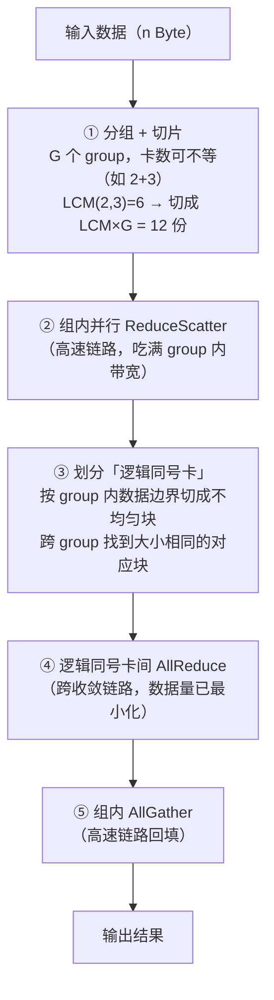
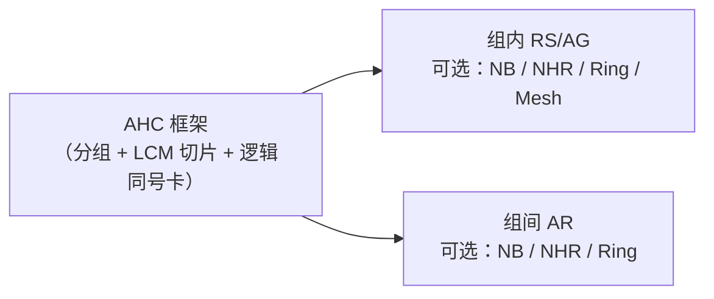

# AHC（Asymmetric Hierarchical Concatenate，非对称层次化拼接）

> **深度参考** · 前置阅读：[《集合通信》第 2 章（Ring）与第 3 章（Tree/选型）](/comm-ascend/02-ring-allreduce.md)。本篇为参考手册体例，检索导向；事实基线见文首引用块。

> HCCL 通信算法解析。枚举：`HCCL_ALGO_TYPE_AHC` / `HCCL_ALGO_TYPE_AHC_BROKE`（`hccl/src/common/alg_type.h:32-33`）；层级枚举 `ALG_LEVEL1_AHC`、`ALG_LEVEL1_AHC_BROKE`（名称映射 `"AHC"` / `"AHC_BROKE"`）。
> 权威描述：`hccl/docs/zh/user_guide/coll_algo_intro/AHC.md`。

## 1. 算法描述与动机

当集群网络存在**层次化特征**且**层次间存在带宽收敛**时，集合通信面临两大技术挑战：

| 挑战 | 说明 |
| --- | --- |
| **① 带宽收敛** | 不同区域间存在带宽收敛问题，传统的**单层**集合通信算法性能下降 |
| **② 卡数非对称** | 不同区域的计算单元数量不同（即卡数非对称），使得**常规层次化算法不再适用**。例如同一通信域可能横跨两个超节点，且两个超节点中的卡数量不一致（一个超节点 64 张卡，另一个 128 张卡） |

**AHC 的核心思想**：基于拓扑将通信域内 NPU 及各 NPU 上的数据**重新分组**——组内充分利用高速网络带宽，组间实现基于**"逻辑同号卡"**的非对称拼接。


> 图源：`hccl/docs/zh/user_guide/coll_algo_intro/figures/ahc_allreduce_5rank_flow.png`

## 2. 三步实现流程

### 步骤 1：基于物理拓扑对计算单元分组

临近的 NPU 划分为一个 group，**各 group 内卡数无需一致**，group 间带宽相比 group 内可能存在收敛。

- 求解所有分组数的**最小公倍数 LCM**；若 G 个分组，则将数据划分为 **LCM × G 个切片**
- 每个分组内**并行执行标准的 ReduceScatter**

> 图示示例：分组为 2 和 3 → LCM = 6、G = 2 → 将数据切分成 **12 份切片**

### 步骤 2：划分"逻辑同号卡"，基于逻辑同号卡实现组间 AllReduce

1. 将每个 group 中待执行 reduce 操作的数据，按照 group 内各 NPU 卡间的**数据边界进行切分**，形成若干**不均匀的数据块**
2. 每个 group 中的每份数据，在其他所有 group 中各有一份**对应的、大小相同**的数据。按照数据对应关系，group 间的 NPU 也存在对应关系——**存在对应关系的 NPU 称为"逻辑同号卡"**
3. 在**逻辑同号卡间执行 AllReduce 操作**

### 步骤 3：各 group 内的 NPU 之间执行 AllGather 操作



### 2.1 "逻辑同号卡"为什么能解决非对称

| 常规层次化算法 | AHC |
| --- | --- |
| 要求各层卡数**对称**（如每 Server 都 8 卡），才能按"同号卡"配对 | 用 **LCM 切片**把不等长的 group 归一到相同切片粒度，再按**数据块对应关系**（而非 rank 编号）配对 |
| 64 卡 + 128 卡超节点无法直接层次化 | 64 与 128 的 LCM 切片后，每个 group 的数据块都能在其他 group 找到等大小对应块 |

> 这是 AHC 名字里 **Asymmetric（非对称）** 与 **Concatenate（拼接）** 的确切含义。

## 3. 内部拼接算法可插拔

**具体的组内和组间的 ReduceScatter、AllGather、AllReduce 等操作，其实现算法可以是任意已知的算法**，如 NB、NHR、Ring 等。当前 AHC 算法内部根据具体场景和策略选择性能更优的拼接算法类型。



## 4. 耗时计算（α–β 模型）

当**组内和组间都采用 NB 算法**时，AllReduce 算子的算法耗时：

| 操作 | 耗时 |
| --- | --- |
| ReduceScatter | $2(\lceil log(m+d)\rceil+\lceil log(G)\rceil)\alpha+2\left(\frac{m+d-1}{m+d}+\frac{(G-1)\cdot C}{Gm}\right)n\beta+\left(\frac{m+d-1}{m+d}+\frac{G-1}{Gm}\right)n\gamma$ |

参数含义：

| 符号 | 含义 |
| --- | --- |
| **m** | 最小分组数（最小 group 的卡数） |
| **m + d** | 最大分组数（最大 group 的卡数），d 为非对称差值 |
| **G** | 分组数（group 个数） |
| **C** | **组间带宽相对于组内带宽的收敛比** |

> **公式解读**：$\alpha$ 项为 $2(\lceil log(m+d)\rceil+\lceil log(G)\rceil)$——组内对数步 + 组间对数步，两层都是对数复杂度；$\beta$ 项中 $\frac{(G-1)C}{Gm}$ 显式含**收敛比 C**，说明**C 越小（收敛越严重）AHC 相对收益越大**，与官方"层次间存在带宽收敛时相对收益会更好"一致。

## 5. 适用场景与约束（官方口径）

| 项 | 说明 |
| --- | --- |
| **适用算子** | **仅 ReduceScatter、AllGather、AllReduce** 三个算子 |
| **适用拓扑** | 通信域内 NPU 分布存在**多个层次**，同时支持多个层次间 NPU **对称或非对称**分布 |
| **收益场景** | 通信域内**层次间存在带宽收敛**时相对收益更好 |
| **产品支持** | **仅 Atlas A3**（L1：RS/AG/AR）；A2、Atlas 训练系列、950PR&950DT 均不支持 |
| **L2 联动** | **L1 配置 AHC 时，L2 自动采用 AHC，显式配置的其他 L2 算法不生效** |

## 6. 层级支持

| 层级 | 枚举 | 说明 |
| --- | --- | --- |
| **L0** | 无 | AHC 是跨层算法，不用于 Server 内 |
| **L1** | `ALG_LEVEL1_AHC`、`ALG_LEVEL1_AHC_BROKE` | Server 间 |
| **L2** | 无独立枚举，但**随 L1 联动生效** | 超节点间自动采用 AHC |

## 7. AHC_BROKE 变体

`HCCL_ALGO_TYPE_AHC_BROKE` / `ALG_LEVEL1_AHC_BROKE` 为 AHC 的**断链（Broke）变体**，与 AHC 并列注册在层级枚举与 `HCCL_ALGO` 解析中，模板文件成对出现（`all_reduce_ahc.cc` / `all_reduce_ahc_broke.cc` 等）。

## 8. 代码位置

| 路径 | 内容 |
| --- | --- |
| `hcomm/src/legacy/ascend910/algorithm/base/alg_template/asymmetric_hierarchical_concatenate_base.cc` / `.h` / `_pub.h` | **AHC 算法基类**（分组、LCM 切片、逻辑同号卡构造） |
| `.../asymmetric_hierarchical_concatenate_alg_template_base.cc` / `.h` / `_pub.h` | **AHC 算法模板基类**（拼接算法调度） |
| `.../asymmetric_hierarchical_concatenate_nslb.cc` / `.h` | **AHC NSLB 变体**（NSLB = 非对称层次拼接的负载均衡实现） |
| `.../temp_all_reduce/all_reduce_ahc.cc`、`all_reduce_ahc_broke.cc` | AllReduce AHC / AHC_BROKE |
| `.../temp_reduce_scatter/reduce_scatter_ahc.cc`、`reduce_scatter_ahc_broke.cc` | ReduceScatter AHC / AHC_BROKE |
| `.../temp_all_gather/all_gather_ahc.cc`、`all_gather_ahc_broke.cc` | AllGather AHC / AHC_BROKE |
| `hccl/src/common/alg_type.h:32-33,62-63` | `HCCL_ALGO_TYPE_AHC/AHC_BROKE`、`ALG_LEVEL1_AHC/AHC_BROKE`；名称映射（:162） |
| `hccl/src/common/alg_env_config.cc` / `.h` | `HCCL_ALGO` 中 AHC / AHC_BROKE 解析与 L2 联动逻辑 |
| `hccl/src/ops/scatter/scatter.cc` | `SetAlgoLevel1` 中按 `HCCL_ALGO_TYPE_AHC(AHC_BROKE)` 映射（Scatter 本身不支持 AHC，会重定向为 Ring） |

> **注意**：`hccl/src/ops/*/algorithm/template/` 下**没有 AHC 模板文件**——AHC 仅在层级枚举与环境变量解析层出现，实际实现全部在 `hcomm/src/legacy/ascend910/`。这与其"仅 Atlas A3 支持"的产品约束一致。

## 9. 配置

```bash
export HCCL_ALGO="level0:NA;level1:AHC"          # L1 使用 AHC（L2 自动联动 AHC）
export HCCL_ALGO="level0:NA;level1:AHC_BROKE"    # 断链变体
export HCCL_ALGO="allreduce=level0:NA;level1:AHC"
```

> 仅 Atlas A3 生效；配置后 L2 的显式算法配置不生效。

## 10. 参考资料

- `hccl/docs/zh/user_guide/coll_algo_intro/AHC.md`：算法描述、三步流程、逻辑同号卡与耗时表（本文主要来源）
- `hccl/docs/zh/user_guide/coll_algo_intro/algo_intro.md`：适用算子约束（仅 RS/AG/AR）
- `hccl/docs/zh/user_guide/hccl_env/HCCL_ALGO.md`：AHC 配置语法与 **L2 联动规则**
- `hccl/docs/zh/user_guide/hccl_env/inter_server_algo_support.md`：仅 Atlas A3 支持
- `hcomm/src/legacy/ascend910/algorithm/base/alg_template/asymmetric_hierarchical_concatenate_base.h`：AHC 基类实现
- [nhr.md](/comm-ascend/reference/algorithms/nhr.md)、[nb.md](/comm-ascend/reference/algorithms/nb.md)：AHC 内部可选的拼接算法
- [algo_level_matrix.md](/comm-ascend/reference/algorithms/algo_level_matrix.md)：L1/L2 联动与产品支持度
- [../networking/ub_superpod.md](/comm-ascend/reference/networking/ub_superpod.md)：非对称超节点组网（AHC 的目标场景）

