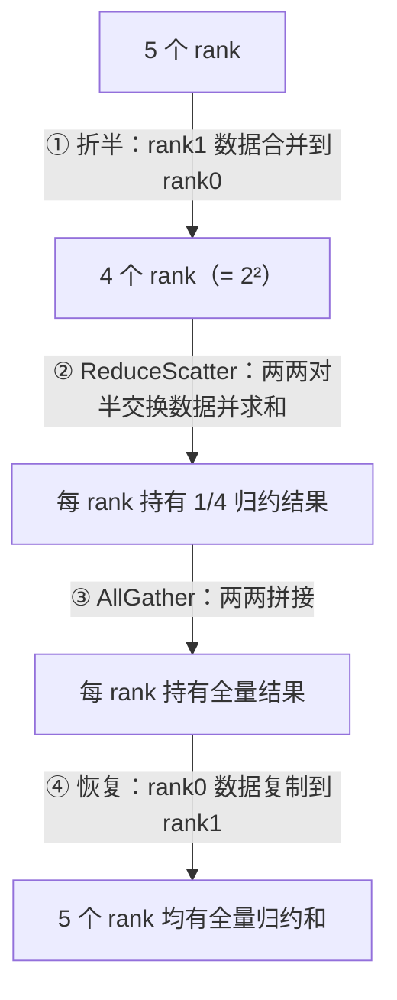
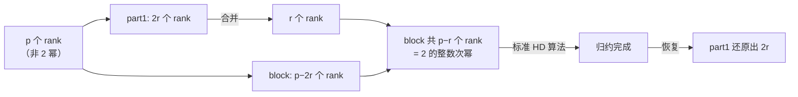

# RHD / HDR（Recursive Halving-Doubling，递归二分-倍增）

> **深度参考** · 前置阅读：[《集合通信》第 2 章（Ring）与第 3 章（Tree/选型）](/comm-ascend/02-ring-allreduce.md)。本篇为参考手册体例，检索导向；事实基线见文首引用块。

> HCCL 通信算法解析。枚举：`HCCL_ALGO_TYPE_HDR`（`hccl/src/common/alg_type.h:25`）；层级枚举 `ALG_LEVEL0_NP_HD`、`ALG_LEVEL1_HD`、`ALG_LEVEL2_HD`（名称映射为 `"H-D"`）。
> 权威描述：`hccl/docs/zh/user_guide/coll_algo_intro/RHD.md`。
> 命名说明：代码枚举用 **HDR**，官方文档用 **RHD**，配置字符串用 **H-D_R / H-D**，三者同指一算法。

## 1. 算法描述与动机

**为什么需要 RHD**（官方原文动机）：

| 已有算法 | 大规模下的问题 |
| --- | --- |
| **Mesh** | 组网增大至 4K rank 时，很难组成 4K rank 的全连接网络；资源开销（链路资源、交换资源、同步资源）太大；还可能存在算力和资源开销不匹配 |
| **Ring** | 虽然节省资源（只用左手卡和右手卡进行一次收发），但环内要做太多次，流转太慢；大型集群有"服务器内数据量庞大、Ring 环极长"的特点，切分数据块的方式不再占优势 |

**RHD 通过递归加倍及递归折半方式完成 NPU 间的数据交换**——相对 Mesh 资源消耗较小，相对 Ring 效率更高。


> 图源：`hccl/docs/zh/user_guide/coll_algo_intro/figures/rhd.png`

### 1.1 非 2 幂规模的处理（以 5 rank 为例）

假设有 5（= 2² + 1）个 rank：



### 1.2 通用非 2 幂策略

对于 2 的整数次幂，使用 **Vector / Distance Halving-Doubling** 策略；对于非 2 的整数次幂，划分为 **2r（part1）** 和 **p−2r** 两部分（$r = p - 2^{\lfloor log(p)\rfloor}$）：

1. 先将 part1 部分合并为 r，使得剩余 rank 之和为 p−r（block）
2. 再执行 2 的整数次幂的 HD（Halving-Doubling）算法
3. 最后再在 part1 部分恢复出 2r，得到最终结果



## 2. 复杂度与特点

| 项 | 值 |
| --- | --- |
| **时间复杂度** | $\lceil log_2 N \rceil$ |
| **通信步数** | 对数（远少于 Ring 的线性） |
| **时延** | 相对**低** |
| **代价** | **非 2 次幂节点规模下会引入额外的通信量** |
| **拓扑适配** | 同样适用于"星型"或"胖树"拓扑互联 |
| **已知缺陷** | 每个通信阶段的对象在变化 → 通信链路也变化 → 大流量场景可能引起**交换机流量冲突**，导致带宽下降（NHR 的诞生动机，见 [nhr.md](/comm-ascend/reference/algorithms/nhr.md)） |

## 3. 耗时计算（α–β 模型）

记 $k = \lfloor log(p) \rfloor$，$p' = 2^{\lfloor log(p)\rfloor}$。

| 操作 | 耗时 |
| --- | --- |
| **Broadcast** | 根据 root rank 的奇偶，决定 part1 部分参与 block 的为奇数 rank 还是偶数 rank；block 内先执行 Distance Halving，再向剩余 rank 发送一次：<br/>$\lceil log(p)\rceil(\alpha+n\beta)$ |
| **ReduceScatter**（2 的整数次幂） | 使用 Vector Doubling + Distance Halving（保证 Scatter 顺序）：<br/>$log(p)\alpha+\frac{p-1}{p}n\beta+\frac{p-1}{p}n\gamma$ |
| **ReduceScatter**（非 2 幂） | 第一步（Reduce）：$\alpha+n\beta+n\gamma$<br/>第二步（非均匀分片 ReduceScatter，某些 rank 持有 2 份数据），做 k 次通信，每次交换最大数据量 $n_i=\lceil\frac{p}{2^{k-i+1}}\rceil\frac{n}{p}$：<br/>$\lfloor log(p)\rfloor\alpha+\frac{n\beta}{p}\sum_{i=1}^{k}\lceil\frac{p}{2^i}\rceil+\frac{n\gamma}{p}\sum_{i=1}^{k}\lceil\frac{p}{2^i}\rceil$<br/>下限：$k\alpha+(k+2^k-1)\frac{n\beta}{p}+(k+2^k-1)\frac{n\gamma}{p}$<br/>上限：$k\alpha+(2^{k+1}-2)\frac{n\beta}{p}+(2^{k+1}-2)\frac{n\gamma}{p}$<br/>第三步（Scatter）：$\alpha+\frac{1}{p}n\beta$ |
| **AllGather** | 耗时同 ReduceScatter，**无 γ 相关部分** |
| **AllReduce**（2 的整数次幂） | ReduceScatter + AllGather（拆分是**不完全的** RS 和 AG，不需 scatter 到所有 rank，可采用 Vector Halving + Distance Doubling——分层网络下耗时更小，但无法保证顺序，拆分中也不需要保证顺序）：<br/>$2log(p)\alpha+2\frac{p-1}{p}n\beta+\frac{p-1}{p}n\gamma$ |
| **AllReduce**（非 2 幂） | 第一步（Reduce）：$\alpha+n\beta+n\gamma$<br/>ReduceScatter：$\lfloor log(p)\rfloor\alpha+\frac{p'-1}{p'}n\beta+\frac{p'-1}{p'}n\gamma$<br/>AllGather：$\lfloor log(p)\rfloor\alpha+\frac{p'-1}{p'}n\beta$<br/>最后一步：$\alpha+n\beta$<br/>**总耗时**：$(2\lfloor log(p)\rfloor+2)\alpha+(2\frac{p'-1}{p'}+2)n\beta+(\frac{p'-1}{p'}+1)n\gamma$ |
| **Reduce**（2 的整数次幂） | 当前实现为 ReduceScatter + Gather：$2log(p)\alpha+2\frac{p-1}{p}n\beta+\frac{p-1}{p}n\gamma$ |
| **Reduce**（非 2 幂） | 第一步（Reduce）：$\alpha+n\beta+n\gamma$<br/>ReduceScatter：$\lfloor log(p)\rfloor\alpha+\frac{p'-1}{p'}n\beta+\frac{p'-1}{p'}n\gamma$<br/>Gather：$\lfloor log(p)\rfloor\alpha+\frac{p'-1}{p'}n\beta$<br/>**总耗时**：$(2\lfloor log(p)\rfloor+1)\alpha+(2\frac{p'-1}{p'}+1)n\beta+(\frac{p'-1}{p'}+1)n\gamma$ |

## 4. 适用场景（官方口径）

适合**通信域内 Server 个数是 2 的整数次幂且 Pipeline 算法不适用**的场景，或 **Server 个数不是 2 的整数次幂但通信数据量较小**的场景。

L1 默认选择规则（`GetDefaultAlgoLevel1V1`）：

| Server 数 | 默认算法 |
| --- | --- |
| ≥ 8（`HCCL_INTER_SERVER_RING_ALGO_MAX_SUPPORT_SERVER_NUM=8`） | **H-D_R** |
| 2 的整数次幂（非 1） | **H-D_R** |
| 非 2 的整数次幂（含 1） | Ring |
| 910_93 的 H-D_R 结果 | 替换为 **NHR** |

L2 默认（HCCL_ALGO.md 口径）：超节点个数 <8 且非 2 幂 → Ring，其他 → **H-D_R**。

## 5. 层级与算子支持

| 层级 | 枚举 |
| --- | --- |
| **L0** | `ALG_LEVEL0_NP_HD` |
| **L1** | `ALG_LEVEL1_HD` |
| **L2** | `ALG_LEVEL2_HD`（仅 Atlas A3） |

算子支持度（`inter_server_algo_support.md`）：

| 产品 | 支持 H-D_R 的算子 |
| --- | --- |
| Atlas A2 / Atlas 训练系列 | RS、AG、AR、Bcast、Reduce |
| Atlas A3 | —（由 NHR / ring 接管） |
| 950PR&950DT | — |

## 6. 代码位置

| 路径 | 内容 |
| --- | --- |
| `hcomm/src/legacy/ascend910/algorithm/base/alg_template/recursive_halvingdoubling_base.cc` / `.h` | **RHD 算法基类**（Halving/Doubling 通用实现） |
| `.../temp_all_reduce/all_reduce_recursive_hd.cc` | AllReduce 递归 HD |
| `.../temp_all_reduce/all_reduce_doubling.cc`、`all_reduce_doubling_direct.cc`、`all_reduce_doubling_local_reduce.cc` | Doubling 及直连 / 本地归约变体 |
| `.../temp_all_reduce/all_reduce_hd_optim.cc` | HD 优化版 |
| `.../temp_reduce_scatter/reduce_scatter_recursive_hd.cc`、`reduce_scatter_halving_doubling.cc`、`reduce_scatter_hd_stage.cc` | ReduceScatter HD 族（含分阶段） |
| `.../temp_all_gather/all_gather_recursive_hd.cc`、`all_gather_halving_doubling.cc`、`all_gather_hd_stage.cc` | AllGather HD 族 |
| `.../temp_broadcast/bcast_recursive_halvingdoubling.cc` | Broadcast RHD |
| `.../temp_reduce/reduce_recursive_hd.cc` | Reduce 递归 HD |
| `hccl/src/common/alg_type.h:47,55,69` | `ALG_LEVEL0_NP_HD` / `ALG_LEVEL1_HD` / `ALG_LEVEL2_HD`；名称映射 `{ALG_LEVEL1_HD, "H-D"}`（:159,167） |
| `hccl/src/ops/scatter/scatter.cc` | `GetDefaultAlgoLevel1V1` 中 H-D_R 默认判定与 910_93 → NHR 替换 |
| `hccl/src/ops/op_common/algorithm/template/alg_template_base.h` | HDR 相关模板基类引用 |

> **注意**：`hccl/src/ops/*/algorithm/template/` 下**没有** HDR 专属模板文件——HDR 只在层级枚举与环境变量解析层出现（`alg_type.h`、`alg_env_config.cc`、`scatter.cc`），实际执行模板在 `hcomm/src/legacy/ascend910/`。这是 950 路径以 Mesh1D + NHR 为主、经典算法保留在 910 路径的直接体现。

## 7. 配置

```bash
export HCCL_ALGO="level0:NA;level1:H-D"        # L1 使用 RHD
export HCCL_ALGO="allreduce=level0:NA;level1:H-D"
```

## 8. 参考资料

- `hccl/docs/zh/user_guide/coll_algo_intro/RHD.md`：算法描述、非 2 幂策略与完整耗时表（本文主要来源）
- `hccl/docs/zh/user_guide/coll_algo_intro/algo_intro.md`：适用场景
- `hccl/docs/zh/user_guide/coll_algo_intro/NHR.md`：RHD 缺陷（链路变化引起交换机流量冲突）与 NHR 改进动机
- `hccl/docs/zh/user_guide/hccl_env/HCCL_ALGO.md`、`inter_server_algo_support.md`、`inter_superpod_algo_support.md`
- [nhr.md](/comm-ascend/reference/algorithms/nhr.md)、[nb.md](/comm-ascend/reference/algorithms/nb.md)：同为对数复杂度的改进算法
- [algo_level_matrix.md](/comm-ascend/reference/algorithms/algo_level_matrix.md)：L1/L2 默认选择规则

