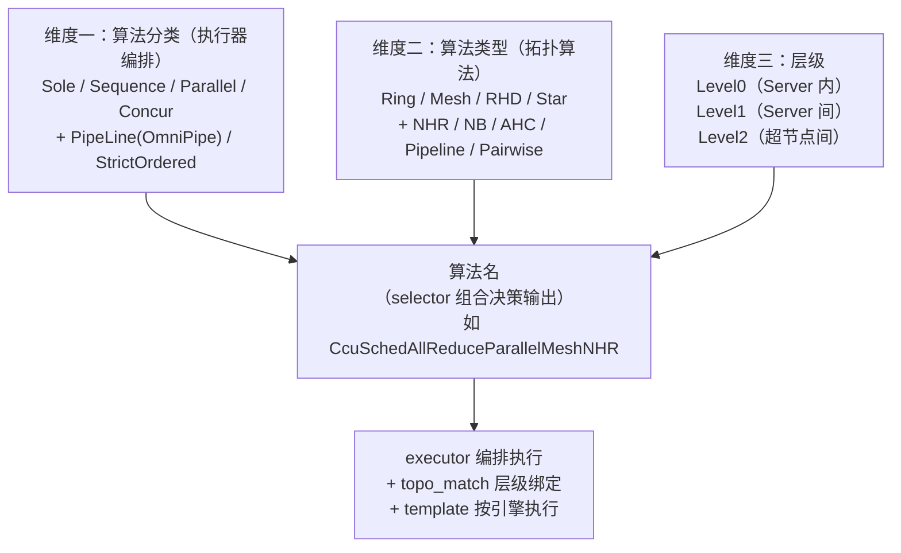

# algorithms：通信算法解析

> **深度参考** · 前置阅读：[《集合通信》第 2 章（Ring）与第 3 章（Tree/选型）](/comm-ascend/02-ring-allreduce.md)。本篇为参考手册体例，检索导向；事实基线见文首引用块。

> **通信怎么编排**（编排层）。同一批 rank、同一条链路，用不同的算法编排，时延与带宽利用率天差地别。本目录解析 HCCL 的通信算法：**算法方案 = 三维组合**（执行器编排 × 算法类型 × 层级），涵盖 4 种基础拓扑算法 + 5 种自研扩展算法 + 3 种特殊算法，以及算法选择器与分层选择矩阵。
>
> 上游消费方为 [../operators/](/comm-ascend/reference/operators/)（算子语义），下游落点为 [../engine/](/comm-ascend/reference/engine/)（引擎执行）与 [../networking/](/comm-ascend/reference/networking/)（层级拓扑）。算法选择的**引擎回退规则**见 [algo_selector.md](/comm-ascend/reference/algorithms/algo_selector.md)，**自定义算法扩展**见 [../extension/algo_plugin.md](/comm-ascend/reference/extension/algo_plugin.md)。
>
> 事实来源（可信度：代码 > 仓内文档 > 社区资料）：
> `hccl/src/common/alg_type.h`（`HcclAlgoType` 13 值、`AlgTypeLevel0/1/2`）、`hccl/src/ops/*/selector/`（各算子选择器）、`hccl/src/ops/op_common/selector/`（10 类组件）、`hccl/src/ops/op_common/algorithm/{executor,template,topo_match}/`、`hcomm/src/legacy/ascend910/algorithm/`（经典算法模板）、`hccl/docs/zh/user_guide/coll_algo_intro/`（11 篇算法 + 17 张原理图）。

---

## 1. 算法方案 = 三维组合

| 维度 | 权威文档 |
| --- | --- |
| 算法分类（执行器编排） | [combination.md](/comm-ascend/reference/algorithms/combination.md) |
| 算法类型（拓扑算法） | 各算法原理篇（见 §3） |
| 层级（L0/L1/L2） | [algo_level_matrix.md](/comm-ascend/reference/algorithms/algo_level_matrix.md)、[../03_L0L1L2分级通信实现原理.md](/comm-ascend/reference/overview/l0l1l2-principle.md) |

> **算法组合的核心视角**：一次算子执行 = 对 **L0/L1/L2 三层算法的一种组合**——同一算子在不同层级跑不同子算法，再由**组合方式**（串行 Sequence / 并行 Parallel / **流水 PipeLine** / 并发 Concur）拼接成完整通信。**Pipeline 即"流水组合"**（L0 Mesh + L1 Ring 流水并行），是一种组合方式而非孤立算法类型。逐算子 L0/L1/L2 组合总表、五种组合方式、Pipeline 组合示例见 **[combination.md §3 分层算法组合](/comm-ascend/reference/algorithms/combination.md)**。

---

## 2. 算法族分类（4 基础 + 5 自研 + 3 特殊）

### 2.1 四种基础拓扑算法

| 算法 | 枚举 | 原理 | 复杂度 | 特点 |
| --- | --- | --- | --- | --- |
| **Ring** | `HCCL_ALGO_TYPE_RING` | 首尾相连分块轮转 | 线性 O(p−1) | 带宽满载、抗拥塞，大消息首选 |
| **Mesh / FullMesh** | `HCCL_ALGO_TYPE_FULLMESH` | 两两直连一步直达 | **O(1)** | 并发多路 HCCS，双工双向带宽同时利用，小消息低时延 |
| **RHD / HDR** | `HCCL_ALGO_TYPE_HDR` | 递归折半-倍增配对 | 对数 ⌈log₂p⌉ | 2·log₂(N) 步；**非 2 幂引入额外通信量** |
| **Star** | `ALG_LEVEL0_NP_STAR`/`ALG_LEVEL1_STAR` | 根 rank 汇聚分发 | **1 步** | 有根算子一步直达（α+βn）；根为热点 |

### 2.2 五种自研扩展算法

| 算法 | 枚举 | 原理 | 适用 |
| --- | --- | --- | --- |
| **NHR** | `NHR`/`NHR_V1` | N 个节点构建 N 棵生成树 + 数据片重排聚合发送；流量集中物理相近节点 | Server 数多且 Pipeline 不适用；**950 唯一自适应算法** |
| **NB** | `NB` | 动态调整步长的多重环状结构；非 2 幂无额外数据量增长 | Server 数多且 Pipeline 不适用 |
| **AHC** | `AHC`/`AHC_BROKE` | 分组 + LCM 切片 + "逻辑同号卡"非对称拼接 | **仅 RS/AG/AR**；层间带宽收敛时收益更好（仅 A3） |
| **Pipeline** | `PIPELINE` | **本质是「流水组合」**：L0（Server 内 Mesh）+ L1（Server 间 Ring）两层子算法流水并行，并发使用两层链路（细粒度分级流水） | 数据量大、每机多卡；A2 不支持确定性计算。组合视角见 [combination.md §3.4](/comm-ascend/reference/algorithms/combination.md) |
| **Pairwise** | `PAIRWISE` | Mesh 的分步执行版本：每步只 1 收 1 发 | **仅 AlltoAll/V/VC**；规避"一打多" |

### 2.3 三种特殊算法（不可配置）

| 算法 | 适用 | 说明 |
| --- | --- | --- |
| **分组 Full Mesh** | 仅 A3 的 AlltoAll 族 | 集群规模大时分多组完成：超节点内并发度高、时延小；超节点间并发度低（避免一打多） |
| **NHR-HCF** | 仅 A3 | 超节点间 **Server 数不一致但 Server 内卡数一致**时默认生效；按 Server 数最大公约数切分对称逻辑超节点 |
| **CP** | 仅 A2 的 AlltoAllV（单算子模式） | 不支持时回退 Pairwise |

---

## 3. 文档索引

### 3.1 机制篇（3 篇）

| 文档 | 内容 |
| --- | --- |
| [combination.md](/comm-ascend/reference/algorithms/combination.md) | **算法分类与组合**：执行器编排（Sole/Sequence/Parallel/Concur/PipeLine-OmniPipe/StrictOrdered）× 算法类型 × 层级 → selector 算法名；各编排的执行语义、CCL Buffer 分区、线程模型、变体、适用场景、mermaid 图；`HCCL_ALGO` 配置语法；**§3 分层算法组合**（逐算子 L0/L1/L2 组合总表、五种组合方式、Pipeline 组合示例、组合算法名解构） |
| [algo_selector.md](/comm-ascend/reference/algorithms/algo_selector.md) | **算法选择器与算法族总览**：`HcclAlgoType` 全枚举（13 值）、三维组合模型、选择机制全流程图、配置优先级、**引擎回退规则（9 条）**、算法名解构、算法 × 算子实现矩阵（910 + 950 路径）、selector 组件构成（10 类） |
| [algo_level_matrix.md](/comm-ascend/reference/algorithms/algo_level_matrix.md) | **各算子分层算法选择矩阵**：L0/L1/L2 选择方式与决策依据、L0 默认规则与标卡分支、950 Mesh 族细选、L1 默认规则、按产品算子支持度、L2 规则与 AHC 联动、各算子分级编排表 |

### 3.2 原理篇（9 篇）

每篇含：官方描述与动机、原理图、mermaid 图、复杂度特点、**α–β 耗时公式表**、适用场景、层级与算子支持、**真实代码位置**、配置语法。

| 文档 | 算法 | 复杂度 | 一句话 |
| --- | --- | --- | --- |
| [ring.md](/comm-ascend/reference/algorithms/ring.md) | **Ring**（环） | 线性 O(p−1) | 首尾相连分块轮转，带宽满载、抗拥塞，大消息首选 |
| [fullmesh.md](/comm-ascend/reference/algorithms/fullmesh.md) | **Mesh / FullMesh**（全互联） | **O(1)** | 两两直连，并发多路 HCCS 使双工双向带宽同时利用，小消息低时延 |
| [hdr.md](/comm-ascend/reference/algorithms/hdr.md) | **RHD / HDR**（递归二分-倍增） | 对数 ⌈log₂N⌉ | 递归折半-倍增；解决 Mesh 资源开销与 Ring 步数过多；非 2 幂引入额外通信量 |
| [star.md](/comm-ascend/reference/algorithms/star.md) | **Star**（星型） | **1 步** | 有根算子一步直达（α+βn）；根为热点；实现仅覆盖 Broadcast/Gather |
| [nhr.md](/comm-ascend/reference/algorithms/nhr.md) | **NHR**（非均衡层次环，自研） | 对数 ⌈log₂N⌉ | N 个节点构建 N 棵生成树 + 数据片重排；非 2 幂无额外开销；含 NHR-HCF |
| [nb.md](/comm-ascend/reference/algorithms/nb.md) | **NB**（非均匀 Bruck，自研） | 对数 ⌈log₂N⌉ | 动态调整步长的多重环状结构；非 2 幂无额外数据量增长 |
| [ahc.md](/comm-ascend/reference/algorithms/ahc.md) | **AHC**（非对称层次化拼接，自研） | 层次 | 分组 + LCM 切片 + "逻辑同号卡"非对称拼接；仅 RS/AG/AR，仅 A3 |
| [pipeline.md](/comm-ascend/reference/algorithms/pipeline.md) | **Pipeline**（分级流水） | 流水 | 并发使用 Server 内与 Server 间链路；双链路 MAX 耗时模型 |
| [pairwise.md](/comm-ascend/reference/algorithms/pairwise.md) | **Pairwise**（逐对通信） | 线性 O(p−1) | Mesh 的分步执行版本：每步只 1 收 1 发；仅 AlltoAll 族 |

---

## 4. 原理图资源

各算法的官方原理图与通信过程图见 ../assets/algorithms/（图库）（17 张）：Ring/Mesh/RHD/Star/NHR/NB/AHC/Pipeline/Pairwise 原理图 + RS/AG/AR 分级流程图。

---

## 5. 耗时模型（α–β / Hockney）

所有算法的耗时公式基于 α–β 模型（详见 [../03_L0L1L2分级通信实现原理.md §8](/comm-ascend/reference/overview/l0l1l2-principle.md)）：

| 变量 | 含义 | 由什么决定 |
| --- | --- | --- |
| **α** | 节点间固定时延 | 通信硬件设备与底层软件栈 |
| **β** | 每 Byte 数据传输耗时 | 通信链路能力 |
| **n** | 节点间通信数据大小 | 通信算法 |
| **γ** | 每 Byte 归约计算耗时 | 计算硬件能力 |
| **p** | 通信域节点个数 | 影响通信步数 |

> 单步传输并归约 n Byte：**D = α + nβ + nγ**。分级通信通过减少 α（对数复杂度算法）、β（先 L0 归约压缩跨机数据量）、γ（归约近数据）三项收益最小化总耗时。

---

## 6. 参考资料

- `hccl/docs/zh/user_guide/coll_algo_intro/`：11 篇算法介绍 + 17 张原理图（`algo_intro.md` 分级通信权威编排表 + α–β 模型、`hierarchical_comm_principle.md`）
- `hccl/src/common/alg_type.h`：`HcclAlgoType`（13 值）、`AlgTypeLevel0/1/2`、`TagAlgType`
- `hccl/src/ops/op_common/selector/`、`hccl/src/ops/*/selector/`：算法选择器
- `hccl/src/ops/op_common/algorithm/{executor,template,topo_match}/`：执行器/模板/拓扑匹配
- `hcomm/src/legacy/ascend910/algorithm/`：经典算法模板（AHC/RHD/Star/NB 等）
- 关联：[../02_HCCL算子与算法总览.md](/comm-ascend/reference/overview/ops-algos-overview.md)（算法 × 算子矩阵）、[../operators/](/comm-ascend/reference/operators/)（算子语义）、[../engine/](/comm-ascend/reference/engine/)（引擎执行）、[../extension/algo_plugin.md](/comm-ascend/reference/extension/algo_plugin.md)（自定义算法插件）

