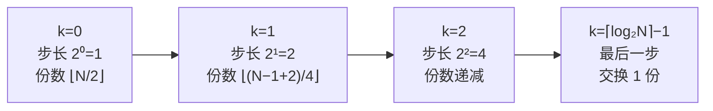

# NB（Nonuniform Bruck，非均匀数据块算法）

> **深度参考** · 前置阅读：[《集合通信》第 2 章（Ring）与第 3 章（Tree/选型）](/comm-ascend/02-ring-allreduce.md)。本篇为参考手册体例，检索导向；事实基线见文首引用块。

> HCCL 通信算法解析。枚举：`HCCL_ALGO_TYPE_NB`（`hccl/src/common/alg_type.h:29`）；层级枚举 `ALG_LEVEL1_NB`、`ALG_LEVEL2_NB`（名称映射 `"NB"`）。
> 权威描述：`hccl/docs/zh/user_guide/coll_algo_intro/NB.md`。

## 1. 算法描述与动机

| 已有算法 | 缺陷 |
| --- | --- |
| **Ring** | 通信步数为 $O(N-1)$，随网络规模增加，通信开销显著增加 |
| **RHD** | 虽将通信步数减少到 $log_2 N$，但 **rank 数量不是 2 的幂时需要进行数据合并操作，导致通信数据量增加** |

**NB 算法通过动态调整步长的多重环状结构，实现不同 rank 数量下均保持通信步数为 $\lceil log_2 N\rceil$，同时避免了额外的通信数据量增长。**

### 1.1 rank size 是 2 的幂（以 4 rank 为例）


> 图源：`hccl/docs/zh/user_guide/coll_algo_intro/figures/nb_algo_4rank_flow.png`

### 1.2 rank size 不是 2 的幂（以 5 rank 为例）


> 图源：`hccl/docs/zh/user_guide/coll_algo_intro/figures/nb_algo_5rank_flow.png`

### 1.3 步长与数据份数规律

对于 ReduceScatter 和 AllGather 算子，通信步数均为 $\lceil log_2 N\rceil$：

| 算子 | 每步行为 |
| --- | --- |
| **ReduceScatter** | 每一步通信中，每张卡向通信步长为 $2^k\ (0\le k<\lceil log_2 N\rceil)$ 的目标卡发送数据，每步发送数据的份数为 $\lfloor (N-1+2^k)/2^{k+1}\rfloor$ |
| **AllGather** | 每一步的**通信步长递减**，而**通信数据量递增**；当卡数不是 2 的幂时，最后一步的通信数据量为 $N-2^{\lfloor log_2 N\rfloor}$ |



> **ReduceScatter：步长递增、数据量递减；AllGather：步长递减、数据量递增**——两者互为镜像，这是 Bruck 类算法的典型特征。

## 2. 复杂度与特点

| 项 | 值 |
| --- | --- |
| **时间复杂度** | $\lceil log_2 N\rceil$ |
| **通信步数** | 对数，**且非 2 幂时不增加** |
| **通信数据量** | **无额外增长**（相对 RHD 的关键优势） |
| **结构** | 动态调整步长的**多重环状结构** |
| **拓扑适配** | 同样适用于"星型"和"胖树"拓扑 |

## 3. 耗时计算（α–β 模型）

| 操作 | 耗时 |
| --- | --- |
| ReduceScatter | $\lceil log(p)\rceil\alpha+\frac{p-1}{p}n\beta+\frac{p-1}{p}n\gamma$ |
| AllGather | $\lceil log(p)\rceil\alpha+\frac{p-1}{p}n\beta$ |
| **AllReduce** | ReduceScatter + AllGather：$2\lceil log(p)\rceil\alpha+2\frac{p-1}{p}n\beta+\frac{p-1}{p}n\gamma$ |
| Scatter | $\lceil log(p)\rceil\alpha+\frac{p-1}{p}n\beta$ |
| Broadcast | Scatter + AllGather：$2\lceil log(p)\rceil\alpha+2\frac{p-1}{p}n\beta$ |

> **NB 与 NHR 的耗时公式形式完全一致**（均为 $\lceil log_2 p\rceil$ 步 + $\frac{p-1}{p}n$ 数据量）。两者的差异在**通信关系构造方式**：NHR 用 N 棵生成树 + 数据片重排，NB 用动态步长的多重环。因此 selector 在两者间的选择依据是产品形态与实测成本表（`op_common/selector/cost_table.cc`），而非公式差异。

## 4. 适用场景（官方口径）

适合**通信域内 Server 个数较多且 Pipeline 算法不适用**的场景（与 NHR 同一适用区间，互为备选）。

## 5. 层级与算子支持

| 层级 | 枚举 |
| --- | --- |
| **L0** | 无独立 NB 枚举 |
| **L1** | `ALG_LEVEL1_NB` |
| **L2** | `ALG_LEVEL2_NB`（仅 Atlas A3） |

算子支持度（`inter_server_algo_support.md`）：

| 产品 | 支持 NB 的算子 |
| --- | --- |
| Atlas A3 / A2 / Atlas 训练系列 | RS、AG、AR、Bcast、RSV、Scatter、AGV |
| 950PR&950DT | —（NHR 自动接管） |

**Scatter 特殊约束**：Server 间仅支持 **Ring / NHR / NB** 三种，其余算法重定向为 Ring（`hccl/src/ops/scatter/scatter.cc:652`）——NB 是 Scatter 跨机的三个合法选择之一。

## 6. 代码位置

| 路径 | 内容 |
| --- | --- |
| `hcomm/src/legacy/ascend910/algorithm/base/alg_template/nonuniform_bruck_base.cc` / `.h` / `_pub.h` | **NB 算法基类**（动态步长多重环构造） |
| `.../temp_all_reduce/all_reduce_nb.cc` | AllReduce NB |
| `.../temp_reduce_scatter/reduce_scatter_nb.cc` | ReduceScatter NB |
| `.../temp_all_gather/all_gather_nb.cc` / `.h` / `_pub.h` | AllGather NB |
| `.../temp_broadcast/broadcast_nb.cc`、`broadcast_nb_binary.cc` | Broadcast NB（含二叉变体） |
| `.../temp_scatter/scatter_nb.cc` | Scatter NB |
| `hccl/src/ops/scatter/algorithm/template/scatter_nb.cc` / `.h` | **950/A5 路径 Scatter NB 模板**（NB 在 hccl 仓的唯一模板落点） |
| `hccl/src/common/alg_type.h:62,72` | `ALG_LEVEL1_NB`、`ALG_LEVEL2_NB`；名称映射 `{ALG_LEVEL1_NB, "NB"}`（:162,168） |
| `hccl/src/common/alg_env_config.cc` | `HCCL_ALGO` 中 NB 的解析 |
| `hccl/src/ops/scatter/scatter.cc` | Scatter Server 间 Ring/NHR/NB 白名单 |

> **注意**：950/A5 路径中 NB 仅保留 Scatter 一个模板；AllReduce/AllGather/ReduceScatter 的 NB 实现均在 `hcomm/src/legacy/ascend910/`。此外 AHC 算法内部可选择 NB 作为组内/组间的拼接算法（见 [ahc.md](/comm-ascend/reference/algorithms/ahc.md)）。

## 7. 配置

```bash
export HCCL_ALGO="level0:NA;level1:NB"
export HCCL_ALGO="reducescatter=level0:NA;level1:NB"
```

## 8. 参考资料

- `hccl/docs/zh/user_guide/coll_algo_intro/NB.md`：算法描述、4/5 rank 流程图、步长规律与耗时表（本文主要来源）
- `hccl/docs/zh/user_guide/coll_algo_intro/algo_intro.md`：适用场景
- `hccl/docs/zh/user_guide/coll_algo_intro/AHC.md`：AHC 内部可选 NB 作为拼接算法
- `hccl/docs/zh/user_guide/hccl_env/HCCL_ALGO.md`、`inter_server_algo_support.md`、`inter_superpod_algo_support.md`
- `hcomm/src/legacy/ascend910/algorithm/base/alg_template/nonuniform_bruck_base.h`：NB 基类实现
- [nhr.md](/comm-ascend/reference/algorithms/nhr.md)：同为对数复杂度的自研路线（生成树 vs 多重环）
- [hdr.md](/comm-ascend/reference/algorithms/hdr.md)：NB 改进的对象（非 2 幂的数据合并开销）

