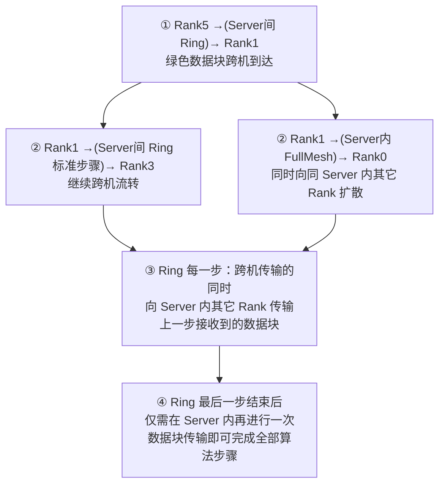

# Pipeline（分级流水算法）

> **深度参考** · 前置阅读：[《集合通信》第 2 章（Ring）与第 3 章（Tree/选型）](/comm-ascend/02-ring-allreduce.md)。本篇为参考手册体例，检索导向；事实基线见文首引用块。

> HCCL 通信算法解析。枚举：`HCCL_ALGO_TYPE_PIPELINE`（`hccl/src/common/alg_type.h:23`）；层级枚举 `ALG_LEVEL1_PIPELINE`（名称映射 `"pipeline"`）。
> 权威描述：`hccl/docs/zh/user_guide/coll_algo_intro/Pipeline.md`。
>
> **Pipeline 本质是一种「分层算法组合」**：它把 **L0（Server 内，通常 FullMesh）与 L1（Server 间，通常 Ring）两层子算法流水并行组合**，两层链路并发使用——因此它与 Sequence/Parallel/Concur 一样是**组合方式**的一种（流水组合），而非孤立的拓扑算法。组合视角与逐算子 L0/L1/L2 组合总表见 [combination.md §3](/comm-ascend/reference/algorithms/combination.md)。
> ⚠️ **务必区分两个同名概念**：本文是**算法类型 PIPELINE**（L0+L1 流水组合）；另有**执行器编排方式 PipeLine/OmniPipe**（更通用的流水容器，任何子算法都可编排进流水阶段），见 [combination.md §2.1.5](/comm-ascend/reference/algorithms/combination.md)。

## 1. 算法描述与动机

### 1.1 背景：分级网络的带宽浪费

为降低网络流量冲突，AI 计算集群中常常采用**分级网络架构**——Server 内通过直接连接的电缆互联，Server 间**同号卡**通过交换机互联。为适配这种拓扑，集合通信采用**分级算法策略**：将全局通信操作分解为多个层级的局部操作，利用分阶段、分层递进的方法提升通信效率。

以 AllGather 为例：Server 间先执行一次**同号卡间的 AllGather**，再在 Server 内执行一次 AllGather，以完成整个集群的数据集合过程。

**然而这种方式会造成一定程度上的链路带宽浪费：当 Server 间数据传输时，Server 内的链路处于空闲状态，未能充分利用带宽资源。**

### 1.2 解决方案：细粒度分级流水

HCCL 采用**细粒度的分级流水（pipeline）算法**，通过**挖掘通信算法本身的数据依赖**，并结合**流水并行**的方式，解决带宽利用率不足的问题。

**核心特征：可并发使用 Server 内与 Server 间的链路**（或超节点内与超节点间的链路）。

以 AllGather 为例，Server 间通信选择 **Ring** 算法，Server 内通信选择 **FullMesh** 算法：


> 图源：`hccl/docs/zh/user_guide/coll_algo_intro/figures/pipeline.png`

### 1.3 数据块流转（官方示例）

绿色数据块从 **Rank5** 被发送到 **Rank1** 上（仅描述部分 Rank 的行为，其它 Rank 对称处理）：



> **Rank 初始数据块的 Server 内传输操作，可以隐藏在 Ring 算法的第一步中进行**——这是流水"填满"的技巧。

### 1.4 Rank0 视角的全部传输任务编排


> 图源：`hccl/docs/zh/user_guide/coll_algo_intro/figures/allgather_pipeline.png`

> **LocalCopy 操作仅在输入输出内存不同的场景中执行**，用于将数据块从输入内存移动到输出内存；在输入输出内存相同场景中，则无需执行该操作。

## 2. 复杂度与特点

| 项 | 值 |
| --- | --- |
| **通信步数** | $p_{inter}-1$ 步（由 Server 间 Ring 决定），Server 内传输**隐藏在流水中** |
| **链路利用** | **Server 内与 Server 间链路并发使用**（相对纯分级算法的核心优势） |
| **时延模型** | 每步取 inter/intra 的 **MAX**（两维并行，慢者决定节拍） |
| **约束** | Atlas A2 下**不支持确定性计算** |

## 3. 耗时计算（α–β 模型，双链路版）

Pipeline 的耗时公式引入了**分层下标**——这是它与其他算法最大的建模差异：

| 操作 | 耗时 |
| --- | --- |
| ReduceScatter | $max\left(\frac{s}{p}\beta_{inter}+\alpha_{inter},\ \frac{s}{p}\beta_{intra}+\alpha_{intra}\right)\cdot(p_{inter}-1)+\frac{s}{p}\beta_{intra}+\alpha_{intra}$ |
| AllGather | 同 ReduceScatter |
| **AllReduce** | $2\times\left[max\left(\frac{s}{p}\beta_{inter}+\alpha_{inter},\ \frac{s}{p}\beta_{intra}+\alpha_{intra}\right)\cdot(p_{inter}-1)+\frac{s}{p}\beta_{intra}+\alpha_{intra}\right]$ |

参数含义：

| 符号 | 含义 |
| --- | --- |
| **p** | 完成集合通信的**总卡数** |
| **$p_{inter}$** | **Server 数** |
| **s** | 集合通信操作**总数据量** |
| **$\beta_{inter}$** | Server **间**链路每 Byte 数据传输耗时 |
| **$\beta_{intra}$** | Server **内**链路每 Byte 数据传输耗时 |
| **$\alpha_{inter}$** | Server **间**链路传输固定耗时 |
| **$\alpha_{intra}$** | Server **内**链路传输固定耗时 |

> **公式解读**：$max(\cdot,\cdot)$ 表示两层链路**并发**，节拍由较慢的一层决定；$(p_{inter}-1)$ 表示只有 Server 间的 Ring 步数计入主循环，Server 内传输被流水吸收；末尾单独的 $\frac{s}{p}\beta_{intra}+\alpha_{intra}$ 是**流水排空**（drain）的最后一次 Server 内传输。

## 4. 适用场景（官方口径）

适合**通信数据量较大且通信域内每机包含多卡**的场景。

| 约束 | 说明 |
| --- | --- |
| **确定性计算** | **Atlas A2 下不支持确定性计算** |
| **优先级** | 官方对 Ring/RHD/NHR/NB 的适用场景描述中反复出现"**且 Pipeline 算法不适用**"——即 **Pipeline 是大数据量多卡场景的优先选择**，其余算法是其不适用时的备选 |

## 5. 层级与算子支持

| 层级 | 枚举 | 说明 |
| --- | --- | --- |
| **L0** | 无独立枚举 | Server 内作为流水的"内层"参与（通常配 FullMesh） |
| **L1** | `ALG_LEVEL1_PIPELINE` | Server 间（通常配 Ring） |
| **L2** | 无独立枚举 | 仅 AG/RS 的 Pipeline，**仅单算子模式且开启零拷贝** |

算子支持度（`inter_server_algo_support.md`）：

| 产品 | 支持 Pipeline 的算子 |
| --- | --- |
| **Atlas A2** | AR、AG、AGV、RS、AlltoAll 族 |
| Atlas A3 / 950PR&950DT / Atlas 训练系列 | —（A3 的 L2 另有 AG/RS Pipeline，需单算子模式 + 零拷贝） |

## 6. 算法类型 PIPELINE vs 执行器编排 PipeLine/OmniPipe

这是最容易混淆的一对概念：

| | **算法类型 PIPELINE**（本文） | **执行器编排 PipeLine / OmniPipe** |
| --- | --- | --- |
| 归属维度 | 算法类型（拓扑算法） | 算法分类（执行器编排方式） |
| 枚举/文件 | `HCCL_ALGO_TYPE_PIPELINE`、`ALG_LEVEL1_PIPELINE`；`all_gather_pipeline.cc` 等模板 | `ins_v2_<op>_omnipipe_executor.cc`、`ins_v2_<op>_omnipipe_2d_executor.cc`、`ins_v2_<op>_omnipipe_3d_executor.cc` |
| 语义 | Server 间 Ring + Server 内 Mesh **两层链路并发** | 数据按切片沿**算法阶段**流水推进（阶段 k 处理第 i 片时，阶段 k+1 处理第 i−1 片） |
| 层级 | L1（Server 间） | 跨层（2D/3D 沿 X/Y/Z 维度铺阶段） |
| 关系 | 是一种具体的通信算法 | 是**编排容器**——任何算法类型（含 PIPELINE 本身）都可能被编排进流水阶段 |
| 算法名体现 | `HCCL_ALGO="level1:pipeline"` | `AicpuAllReducePipeLineMeshNHR`、`CcuMSReduceScatterPipeLineMeshNHR`、`*PipeLineMeshNHRNHR` |

RFC 0003 将 OmniPipe 的执行策略归为 **OMNIPIPE（流水交叉）**。切片布局由 `hccl/src/ops/op_common/omnipipe_data_slice_calc.h` 统一计算（`OmniPipeSliceParam` / `OmniPipeScratchParam`，含 `outerStepNum` / `innerStepNum` / `levelAlgType`）。

## 7. 代码位置

### 7.1 910/A2/A3 路径（`hcomm/src/legacy/ascend910/algorithm/base/alg_template/`）

| 文件 | 内容 |
| --- | --- |
| `alg_template_multi_deter_pipeline.cc` / `.h` | **多确定性流水模板基类** |
| `temp_all_reduce/all_reduce_graph_pipeline.cc` | AllReduce 图模式流水 |
| `temp_all_reduce/all_reduce_opbase_pipeline.cc` | AllReduce opbase 流水 |
| `temp_all_reduce/all_reduce_multi_deter_pipeline.cc` | AllReduce 多确定性流水 |
| `temp_reduce_scatter/reduce_scatter_pipeline.cc`、`reduce_scatter_graph_pipeline.cc`、`reduce_scatter_multi_deter_pipeline.cc`、`reduce_scatter_v_pipeline.cc` | ReduceScatter / RSV 流水族 |
| `temp_all_gather/all_gather_pipeline.cc`、`all_gather_graph_pipeline.cc`、`all_gather_v_pipeline.cc`、`all_gather_v_graph_pipeline.cc` | AllGather / AGV 流水族 |
| `temp_alltoall/allltoall_pipeline_base.cc` | AlltoAll 流水基类 |
| `temp_alltoall/allltoall_pipeline_mesh_pairwise_ccl_enough.cc` | **Mesh + Pairwise 流水（CCL Buffer 充足）** |
| `temp_alltoall/allltoall_pipeline_mesh_pairwise_ping_pong.cc` | **Mesh + Pairwise 流水（乒乓缓冲）** |
| `temp_alltoallv/alltoallv_continuous_pipeline.cc` | AlltoAllV 连续流水 |

### 7.2 950/A5 路径（`hccl/src/ops/`）

| 文件 | 内容 |
| --- | --- |
| `*/algorithm/executor/ins_v2_*_omnipipe_executor.cc` | OmniPipe 执行器（AllReduce/AllGather/Reduce/ReduceScatter/Scatter/Broadcast） |
| `*/algorithm/executor/ins_v2_*_omnipipe_2d_executor.cc` | **2D OmniPipe**（AllReduce/AllGather/ReduceScatter/Scatter/Broadcast） |
| `reduce/algorithm/executor/ins_v2_reduce_omnipipe_3d_executor.cc` | **3D OmniPipe（Reduce 算子独有）** |
| `op_common/omnipipe_data_slice_calc.cc` / `.h` | **流水切片统一计算**（`OmniPipeSliceParam`/`OmniPipeScratchParam`） |
| `op_common/omnipipe_gather_data_slice_calc.cc`、`omnipipe_scatter_data_slice_calc.cc` | Gather / Scatter 专属切片计算 |
| `op_common/algorithm/executor/omnipipe_executor_utils.h` | OmniPipe 执行器工具 |
| `op_common/algorithm/template/omnipipe_template_utils.cc` / `.h` | OmniPipe 模板工具 |
| `*/algorithm/template/aicpu/ins_temp_*_omnipipe_*.cc` | AICPU 引擎流水模板（mesh_1D / nhr / nhr_dpu） |
| `*/algorithm/template/ccu/ccu_temp_*_omnipipe_*.cc` + `*/ccu/kernel/ccu_kernel_*_omnipipe_*.cc` | CCU 引擎流水模板与 kernel |

> 实测：`hccl/src/ops` 下含 `omnipipe` 的文件 **87 个**——流水编排是 950 路径的核心能力之一。

## 8. 配置

```bash
export HCCL_ALGO="level0:NA;level1:pipeline"
# 950 系列的流水编排（执行器维度）
export HCCL_ALGO="pipeline{mesh,nhr}"
```

## 9. 参考资料

- `hccl/docs/zh/user_guide/coll_algo_intro/Pipeline.md`：算法描述、示意图、时序图与双链路耗时表（本文主要来源）
- `hccl/docs/zh/user_guide/coll_algo_intro/algo_intro.md`：适用场景与 A2 确定性计算约束
- `hccl/docs/zh/rfcs/0003-executor-template-refactor.md`：OmniPipe 执行策略与切片计算重构
- `hccl/docs/zh/user_guide/hccl_env/inter_server_algo_support.md`、`inter_superpod_algo_support.md`
- `hccl/src/ops/op_common/omnipipe_data_slice_calc.h`：流水切片参数
- [combination.md §2.1.5](/comm-ascend/reference/algorithms/combination.md)：执行器编排 PipeLine/OmniPipe 详解
- [ring.md](/comm-ascend/reference/algorithms/ring.md)、[fullmesh.md](/comm-ascend/reference/algorithms/fullmesh.md)：Pipeline 的两个组成算法

