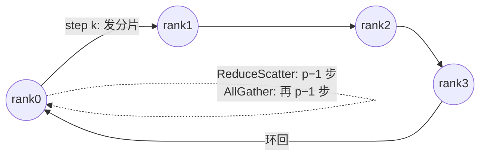

# Ring（环算法）

> **深度参考** · 前置阅读：[《集合通信》第 2 章（Ring）与第 3 章（Tree/选型）](/comm-ascend/02-ring-allreduce.md)。本篇为参考手册体例，检索导向；事实基线见文首引用块。

> HCCL 通信算法解析。枚举：`HCCL_ALGO_TYPE_RING`（`hccl/src/common/alg_type.h:22`）；层级枚举 `ALG_LEVEL0_8P_RING` / `4P_RING` / `NP_SINGLE_RING` / `NP_DOUBLE_RING` / `WHOLE_RING`、`ALG_LEVEL1_RING`、`ALG_LEVEL2_RING`。
> 权威描述：`hccl/docs/zh/user_guide/coll_algo_intro/Ring.md`。

## 1. 算法描述

所有的 NPU 以**环形相连**，每张卡都有**左手卡与右手卡**——一个负责数据接收，一个负责数据发送，循环完成梯度累加，再循环做参数同步。


> 图源：`hccl/docs/zh/user_guide/coll_algo_intro/figures/ring.png`

Ring 算法适用于**"星型"或"胖树"拓扑互联**，其特点是通过 Ring 环将所有 NPU 设备的**单端口双工链路串联**起来。

以 AllReduce 为例：每一步依次给下游发送对应的数据块，沿着环转一圈之后完成 **ReduceScatter** 阶段，再沿环转一圈完成 **AllGather** 阶段。


> 图源：`hccl/docs/zh/user_guide/coll_algo_intro/figures/ring_algo_principle.png`



## 2. 复杂度与特点

| 项 | 值 |
| --- | --- |
| **时间复杂度** | O(n−1)，n 为 Ring 环上的 NPU 设备个数 |
| **通信步数** | 线性（AllReduce = 2(p−1) 步） |
| **每步数据量** | n/p（每卡每步只发 1/p 数据量） |
| **链路利用率** | 满（无热点，每卡只与左右邻居通信） |
| **时延** | 相对**高**（步数随规模线性增长） |
| **抗拥塞** | **好**（通信关系简单，受网络拥塞影响小） |

## 3. 耗时计算（α–β 模型）

整体思路：将所有参与节点构成环，每个节点只和左右节点通信。节点数为 p，则通信次数为 p−1，每次交换 1/p 的数据。

单步传输并归约 n Byte 耗时：**D = α + nβ + nγ**（α 固定时延、β 每 Byte 传输耗时、γ 每 Byte 归约耗时）

| 操作 | 耗时 |
| --- | --- |
| Scatter | $(p-1)\alpha+\frac{p-1}{p}n\beta$ |
| Gather | $(p-1)\alpha+\frac{p-1}{p}n\beta$ |
| Broadcast | $(p-1)\alpha+(p-1)n\beta$ |
| Reduce | $(p-1)\alpha+(p-1)n\beta+(p-1)n\gamma$ |
| ReduceScatter | $(p-1)\alpha+\frac{p-1}{p}n\beta+\frac{p-1}{p}n\gamma$ |
| AllGather | $(p-1)\alpha+\frac{p-1}{p}n\beta$ |
| **AllReduce** | ReduceScatter + AllGather：$2(p-1)\alpha+2\frac{p-1}{p}n\beta+\frac{p-1}{p}n\gamma$ |

> 变量定义见 [../03_L0L1L2分级通信实现原理.md §8](/comm-ascend/reference/overview/l0l1l2-principle.md)。

## 4. 适用场景（官方口径）

适合**通信域内 Server 个数较少、通信数据量较小、网络存在明显拥塞、且 Pipeline 算法不适用**的场景。

L1 默认选择规则（`GetDefaultAlgoLevel1V1`）：Server 数**非 2 的整数次幂（含 1）**时默认 Ring；≥8 或 2 的整数次幂时默认 H-D_R。

## 5. 层级与算子支持

| 层级 | 支持情况 |
| --- | --- |
| **L0（Server 内）** | `ALG_LEVEL0_8P_RING`（8 卡环，4 个固定 stream）、`4P_RING`、`NP_SINGLE_RING`（n rank 单环，**标卡专用**）、`NP_DOUBLE_RING`（910_93 双环，吃满链路）、`WHOLE_RING`（所有 level 均为 Whole Ring 时组成一个大环） |
| **L1（Server 间）** | `ALG_LEVEL1_RING`；950PR&950DT 上由 NHR 自动接管 |
| **L2（超节点间）** | `ALG_LEVEL2_RING`（仅 Atlas A3，超节点个数 <8 且非 2 幂时默认） |

算子支持度（按产品，详见 `hccl/docs/zh/user_guide/hccl_env/inter_server_algo_support.md`）：

| 产品 | 支持 Ring 的算子 |
| --- | --- |
| Atlas A3 / A2 | RS、AG、AR、Reduce、RSV、Scatter、AGV |
| Atlas 训练系列 | RS、AG、AR、Reduce |
| 950PR&950DT | —（NHR 自动接管） |

**Scatter 特殊约束**：Server 间仅支持 Ring/NHR/NB，其余算法重定向为 Ring（`hccl/src/ops/scatter/scatter.cc:652`）；910_93 仅 Server 间 Ring。

## 6. 代码位置

| 路径 | 内容 |
| --- | --- |
| `hcomm/src/legacy/ascend910/algorithm/base/alg_template/temp_all_reduce/all_reduce_ring.cc` | AllReduce Ring 模板（910/A2/A3 路径） |
| `.../temp_reduce_scatter/reduce_scatter_ring.cc`、`reduce_scatter_slim_ring.cc`、`reduce_scatter_ring_concurrent_direct.cc` | ReduceScatter Ring 及精简环/并发直连变体 |
| `.../temp_reduce_scatter/aligned_reduce_scatter_double_ring.cc`（+`_with_serial_local_copy`） | 对齐双环变体 |
| `.../temp_all_gather/all_gather_ring.cc`、`all_gather_ring_direct.cc`、`all_gather_ring_concurrent_direct.cc`、`all_gather_slim_ring.cc`、`aligned_all_gather_double_ring.cc` | AllGather Ring 族 |
| `.../temp_broadcast/broadcast_ring.cc` | Broadcast Ring |
| `.../temp_scatter/scatter_ring.cc`、`scatter_ring_direct.cc`、`scatter_ring_concurrent_direct.cc`、`scatter_double_ring_direct.cc`、`multi_root_scatter_ring.cc` | Scatter Ring 族（含多 root） |
| `.../temp_reduce/reduce_ring.cc`、`.../temp_gather/gather_ring.cc` | Reduce / Gather Ring |
| `hccl/src/ops/scatter/algorithm/template/scatter_ring.cc`、`scatter_ring_direct.cc` | 950/A5 路径 Scatter Ring 模板 |
| `hccl/src/common/alg_type.h:38-73` | `ALG_LEVEL0/1/2_*_RING` 枚举与名称映射（`HCCL_ALGO_LEVEL0_NAME_MAP` 中映射为 `"ring"`） |
| `hccl/src/ops/scatter/scatter.cc` | `GetDefaultAlgoLevel0Module` / `GetDefaultAlgoLevel1V1` 默认选择逻辑 |

> **两条实现路径**：910/A2/A3 走 `hcomm/src/legacy/ascend910/algorithm/`（算法模板齐全，Ring/Mesh/RHD/NHR/NB/AHC/Pipeline/Pairwise 全在此）；950/A5 走 `hccl/src/ops/*/algorithm/`（以 Mesh1D + NHR 为主，靠执行器编排组合）。详见 [../02_HCCL算子与算法总览.md](/comm-ascend/reference/overview/ops-algos-overview.md)。

## 7. 配置

```bash
# A2/A3/910 系列：level0 固定 NA，仅配 level1/level2
export HCCL_ALGO="level0:NA;level1:ring"
export HCCL_ALGO="allreduce=level0:NA;level1:ring"   # 按算子配置
```

显式指定后自适应选择失效（见 [algo_selector.md](/comm-ascend/reference/algorithms/algo_selector.md)）。

## 8. 参考资料

- `hccl/docs/zh/user_guide/coll_algo_intro/Ring.md`：算法描述、原理图与耗时表（本文主要来源）
- `hccl/docs/zh/user_guide/coll_algo_intro/algo_intro.md`：适用场景与分级通信
- `hccl/docs/zh/user_guide/hccl_env/HCCL_ALGO.md`、`inter_server_algo_support.md`：配置语法与产品支持度
- `hccl/src/common/alg_type.h`：层级 Ring 枚举
- [algo_level_matrix.md](/comm-ascend/reference/algorithms/algo_level_matrix.md)：各算子 L0/L1/L2 选择矩阵
- [combination.md](/comm-ascend/reference/algorithms/combination.md)：执行器编排 × 算法类型 × 层级

