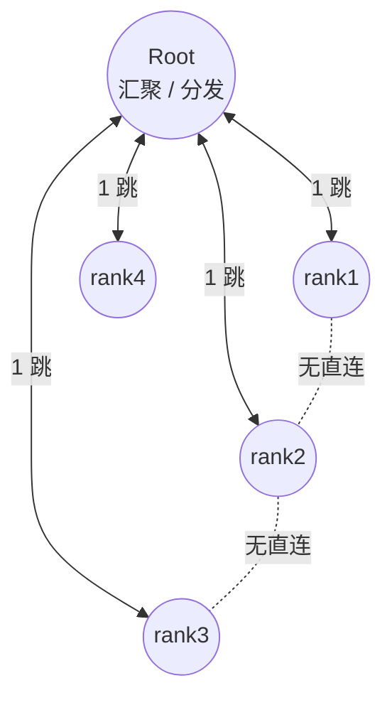

# Star（星型算法）

> **深度参考** · 前置阅读：[《集合通信》第 2 章（Ring）与第 3 章（Tree/选型）](/comm-ascend/02-ring-allreduce.md)。本篇为参考手册体例，检索导向；事实基线见文首引用块。

> HCCL 通信算法解析。枚举：`ALG_LEVEL0_NP_STAR`（`hccl/src/common/alg_type.h:48`，名称映射 `"star"`）、`ALG_LEVEL1_STAR`（`alg_type.h:58`）。
> 权威描述：`hccl/docs/zh/user_guide/coll_algo_intro/Star.md`。
> Star 是官方口径中 **4 种基础拓扑算法之一**（Ring、Mesh、RHD、Star，见 `architecture-brief.md`）。

## 1. 算法描述

Star 算法适用于**有根节点的通信操作**（如 Broadcast、Reduce、Gather、Scatter 等），利用**星型拓扑或全连接拓扑一步完成**通信操作。

以 Broadcast 算子为例，根节点 Root 利用星型拓扑从其他各节点收集数据：

> 图源：`hccl/docs/zh/user_guide/coll_algo_intro/figures/star_algo_principle.png`

> **与 Mesh 的区别**：Mesh 中任意两 rank 都直接收发（$\frac{p(p-1)}{2}$ 条边）；Star 中**非根节点只与根交互**（p−1 条边），非根节点之间不通信。

## 2. 复杂度与特点

| 项 | 值 |
| --- | --- |
| **通信步数** | **1 步**（一步完成） |
| **每 rank 至根跳数** | 1 跳（路径最短） |
| **时延** | 最低（$\alpha + \beta n$，仅一次固定时延） |
| **瓶颈** | **根 rank 为流量汇聚点，易成热点**——根的端口带宽被 p−1 个对端共享 |
| **拓扑要求** | 星型拓扑，或全连接拓扑（可退化为一步直达） |
| **算子约束** | **仅适用于有根节点的算子**（Broadcast / Reduce / Gather / Scatter） |

## 3. 耗时计算（α–β 模型）

定义每个非根节点与根节点的通信数据大小为 n，那么完成整个 Star 算法的通信耗时为：

$$\alpha + \beta n$$

> **这是所有算法中最简洁的耗时公式**——只有一步，没有 p 相关项。对比：
> - Mesh AllGather：$\alpha+\frac{1}{p}n\beta$（数据被切成 p 份，但需 p−1 个对端并发）
> - Ring Broadcast：$(p-1)\alpha+(p-1)n\beta$（线性步数 + 全量数据）
> - RHD Broadcast：$\lceil log(p)\rceil(\alpha+n\beta)$（对数步数）
>
> Star 的 α 项为 1（最优），但**根节点的端口需承载 (p−1)·n 的总流量**，这一物理约束未体现在单 rank 的公式中——这也是 Star 只用于"有根"算子、且不作为大规模默认算法的原因。

## 4. 适用场景

| 场景 | 说明 |
| --- | --- |
| **有根算子的一步直达** | Broadcast（root 分发）、Reduce（root 汇聚）、Gather（root 收集）、Scatter（root 散布） |
| **L0 小规模节点内** | rank 数少、层次分明的拓扑（如单机 HCCS 域内），根热点可接受 |
| **全连接拓扑退化** | 官方描述"利用星型拓扑**或全连接拓扑**一步完成"——FullMesh 下 Star 即一步直达的特例 |
| **不适用** | 大规模（根端口成为瓶颈）、无根算子（AllReduce / AllGather / ReduceScatter / AlltoAll） |

## 5. 层级与算子支持

| 层级 | 枚举 | 说明 |
| --- | --- | --- |
| **L0** | `ALG_LEVEL0_NP_STAR` | 官方口径：Server 内支持 **Mesh、Ring、Double-Ring、Star**，按硬件拓扑自动选择（`algo_intro.md`），**用户无须配置也不支持配置** |
| **L1** | `ALG_LEVEL1_STAR` | 枚举已定义；`inter_server_algo_support.md` 的 Server 间支持列表中**未列 Star** |
| **L2** | 无 | 超节点间不支持 Star |

> **实现现状（代码实测）**：
> - `hccl/src/ops/*/selector/` 输出的算法名中**没有 Star 组合**（950/A5 路径以 Mesh1D + NHR 为主）
> - `hccl/src/ops/*/algorithm/template/` 下**没有 Star 模板文件**
> - **Star 的实际实现在 `hcomm/src/legacy/ascend910/`**，且**仅覆盖 Broadcast 与 Gather 两个算子**（含专用 `comm_star` 通信器）
>
> 因此准确表述是：**Star 是官方 4 种基础拓扑算法之一，在 910/A2/A3 路径中为 Broadcast/Gather 提供实现；在 950/A5 路径中层级枚举保留但 selector 未选用。**

## 6. 代码位置

| 路径 | 内容 |
| --- | --- |
| `hcomm/src/legacy/ascend910/algorithm/base/alg_template/temp_broadcast/broadcast_star.cc` / `.h` | **Broadcast Star 算法模板** |
| `hcomm/src/legacy/ascend910/algorithm/base/alg_template/temp_gather/gather_star.cc` / `.h` | **Gather Star 算法模板**（Gather 用于 Reduce 算子的第三阶段"Server 内 Gather，结果仅发 root"） |
| `hcomm/src/legacy/ascend910/algorithm/base/communicator/legacy/comm_star.cc` / `.h` | **Star 通信器**（星型通信域的建链与资源管理） |
| `hcomm/src/legacy/ascend910/algorithm/base/inc/broadcast_star_pub.h` | Broadcast Star 公共头 |
| `hcomm/src/legacy/ascend910/algorithm/base/inc/gather_star_pub.h` | Gather Star 公共头 |
| `hcomm/src/legacy/ascend910/algorithm/base/inc/comm_star_pub.h` | Star 通信器公共头 |
| `hccl/src/common/alg_type.h:48,58` | `ALG_LEVEL0_NP_STAR`、`ALG_LEVEL1_STAR` |
| `hccl/src/common/alg_type.h:155` | 名称映射 `{ALG_LEVEL0_NP_STAR, "star"}`（`HCCL_ALGO_LEVEL0_NAME_MAP`） |

> **注意 `HcclAlgoType` 中没有 `HCCL_ALGO_TYPE_STAR`**——Star 只以**层级拓扑枚举**（`ALG_LEVEL0_NP_STAR` / `ALG_LEVEL1_STAR`）形式存在，不像 Ring/Pipeline/FullMesh/HDR/Pairwise/NHR/NB/AHC 那样有独立的算法类型枚举。这与 Star"仅作为有根算子的一步直达形态、不独立成算法族"的定位一致。

## 7. 与 Reduce 算子分级编排的关系

Reduce 算子的三阶段编排（`algo_intro.md` 权威表）中，第三阶段是 **"Server 内 Gather"**：

| 阶段 | 操作 | 说明 |
| --- | --- | --- |
| 阶段一 | Server 内 ReduceScatter | L0 |
| 阶段二 | Server 间 Reduce | L1 |
| 阶段三 | **Server 内 Gather** | L0，**结果仅发送到 root 节点的输出 buffer** |

> 官方特别说明：**HCCL 未提供 Gather 算子**，Gather 操作与 AllGather 操作的区别是**仅将结果发送到 root 节点**的输出 buffer。`gather_star.cc` 正是这一"仅发 root"语义的星型实现——**Star 是 Gather 的天然算法**（所有 rank 一步发给 root）。

## 8. 参考资料

- `hccl/docs/zh/user_guide/coll_algo_intro/Star.md`：算法描述、原理图与耗时公式（本文主要来源）
- `hccl/docs/zh/user_guide/coll_algo_intro/algo_intro.md`：Server 内支持 Mesh/Ring/Double-Ring/**Star**，按硬件拓扑自动选择
- `hccl/docs/zh/architecture/architecture-brief.md`：4 种基础拓扑算法（Ring、Mesh、RHD、Star）+ 自研算法
- `hcomm/src/legacy/ascend910/algorithm/base/alg_template/temp_broadcast/broadcast_star.cc`、`temp_gather/gather_star.cc`：Star 实现
- `hccl/src/common/alg_type.h`：`ALG_LEVEL0_NP_STAR` / `ALG_LEVEL1_STAR` 枚举与名称映射
- [fullmesh.md](/comm-ascend/reference/algorithms/fullmesh.md)：Star 可视为全连接拓扑下的一步直达特例
- [../operators/broadcast.md](/comm-ascend/reference/operators/broadcast.md)、[../operators/reduce.md](/comm-ascend/reference/operators/reduce.md)：使用 Star 的算子
- [algo_level_matrix.md](/comm-ascend/reference/algorithms/algo_level_matrix.md)：L0 默认选择规则

