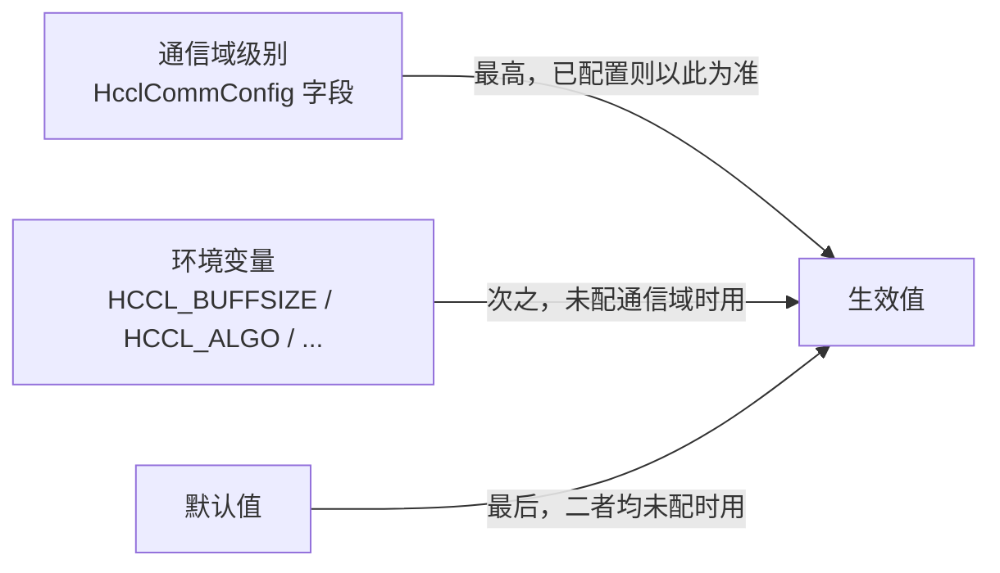
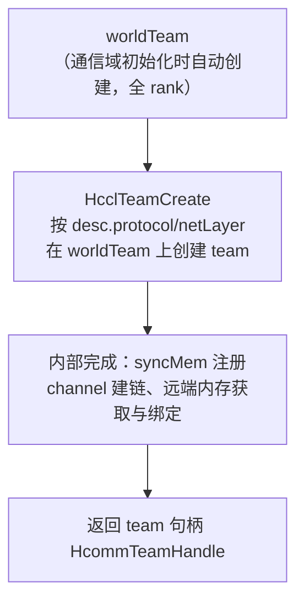

# 通信域配置：HcclCommConfig / Team / 生命周期

> **深度参考** · 前置阅读：[源码课程单元 2｜控制面：通信域的一生](/comm-ascend/hccl-hcomm/02-control-plane.md)。本篇为参考手册体例，检索导向；事实基线见文首引用块。

> 通信域粒度的配置（`HcclCommConfig`）、Team 子分组、挂起恢复与销毁。配置优先级：**通信域级别（HcclCommConfig）> 环境变量 > 默认值**。
>
> 事实来源：`hcomm/docs/zh/api_ref/comm_mgr_c/data_type_definition/HcclCommConfig.md`（配置结构体权威）、`hcomm/docs/zh/api_ref/comm_opdev/control_plane_api/comms_domain_resource_mgmt/HcclTeamCreate.md`（Team）、`hcomm/docs/zh/api_ref/comm_mgr_c/{HcclCommSuspend,HcclCommResume,HcclCommDestroy}.md`。

---

## 1. HcclCommConfig 结构体

`HcclCommConfigInit(&config)` 初始化后按需修改字段，传入 `HcclCommInit*Config` 创建特定配置的通信域：

```c
typedef struct HcclCommConfigDef {
    char     reserved[24];                 // 保留字段，不可修改
    uint32_t hcclBufferSize;               // 共享数据缓存区大小（MB）
    uint32_t hcclDeterministic;            // 确定性计算开关（0/1/2）
    char     hcclCommName[128];            // 通信域名称
    char     hcclUdi[128];                 // 用户自定义信息
    uint32_t hcclOpExpansionMode;          // 算子展开模式（引擎）
    uint32_t hcclRdmaTrafficClass;         // RDMA traffic class
    uint32_t hcclRdmaServiceLevel;         // RDMA service level
    uint32_t hcclWorldRankID;              // NSLB-DP 全局 rank ID
    uint64_t hcclJobID;                    // NSLB-DP 业务唯一标识
    uint8_t  aclGraphZeroCopyEnable;       // aclgraph Reduce 类零拷贝
    int32_t  hcclExecTimeOut;              // 设备间执行同步等待时间（s）
    char     hcclAlgo[1600];               // Server 间/超节点间通信算法
    char     hcclRetryEnable[50];          // 算子重执行开关（L1/L2）
    char     hcclRetryParams[128];         // 重执行参数
    char     hcclBufferName[128];          // CCLBuffer 名称（多域共享）
    uint32_t hcclQos;                      // 超平面 QoS 级别
    uint64_t hcclSymWinMaxMemSizePerRank;  // 每 rank 对称内存预留（GB）
    uint32_t hcclChannelSqDepth;           // 通信发送队列 SQ 深度
} HcclCommConfig;
```

---

## 2. 字段详解

| 字段 | 含义 | 取值 / 默认 | 备注 |
| --- | --- | --- | --- |
| **hcclBufferSize** | 共享数据缓存区大小 | ≥1，单位 MB，默认 200 | 优先级高于 `HCCL_BUFFSIZE`；HCCL 独占；通信域独占 `2×hcclBufferSize` 内存保证多域并发互不影响；数据量超此值可能性能下降 |
| **hcclDeterministic** | 确定性计算开关 | 0/1/2 | 见 §2.1 |
| **hcclCommName** | 通信域名称 | ≤128，不指定则自动生成 | 须唯一；**避免以 `_negotiation` 结尾**（CCU 模式内部用此后缀） |
| **hcclUdi** | 用户自定义信息 | ≤128，默认空 | — |
| **hcclOpExpansionMode** | 算子展开模式（引擎） | 0/1/2/3/4/5/6 | 见 §2.2，通信域粒度，对应 [../engine/](/comm-ascend/reference/engine/) |
| **hcclRdmaTrafficClass** | RDMA traffic class | [0,255]，4 的整数倍，默认 132 | RoCE v2 对应 IP 头 ToS；÷4 = DSCP；`0xFFFFFFFF` 表示无效（取环境变量/默认） |
| **hcclRdmaServiceLevel** | RDMA service level | [0,7]，默认 4 | 须与网卡 PFC 优先级一致，否则性能劣化 |
| **hcclWorldRankID** | NSLB-DP 全局 rank ID | — | 数据面网络级负载均衡；**950 不支持** |
| **hcclJobID** | NSLB-DP 业务唯一标识 | 由 AI 框架生成 | **950 不支持** |
| **aclGraphZeroCopyEnable** | aclgraph Reduce 类零拷贝 | 0（默认）/1 | 仅图捕获模式对 Reduce 类生效；**950 不支持** |
| **hcclExecTimeOut** | 设备间执行同步等待时间 | 单位 s，默认 1836 | 卡间执行不一致时（如仅特定进程存 checkpoint）的同步等待；`0xFFFFFFFF` 无效；**950 不支持**（用 `HCCL_EXEC_TIMEOUT`） |
| **hcclAlgo** | Server 间/超节点间通信算法 | 字符串 | 指定后**自适应算法选择不再生效**；语法见 `HCCL_ALGO` |
| **hcclRetryEnable** | 算子重执行开关 | `"L1:1, L2:0"` | **仅 A3**；L1=Server 间、L2=超节点间，各 0/1，默认 0 |
| **hcclRetryParams** | 重执行参数 | `"MaxCnt:3, HoldTime:5000, IntervalTime:1000"` | **仅 A3**；MaxCnt[1,10]、HoldTime[0,60000]ms、IntervalTime[0,60000]ms |
| **hcclBufferName** | CCLBuffer 名称 | ≤128，默认不共享 | 多域同名共享同一片 CCLBuffer，须下发到**同一 Stream**；**950 不支持** |
| **hcclQos** | 超平面 QoS 级别 | [0,7]；950 默认 4，A3/A2 默认 6 | — |
| **hcclSymWinMaxMemSizePerRank** | 每 rank 对称内存预留 | 单位 GB，默认 16 | **仅 A3 HCCS 场景**生效；总预留 = rankSize × 该值 |
| **hcclChannelSqDepth** | 通信发送队列 SQ 深度 | 向上取 2 的幂，[16, max_jfs_depth] | **仅 A5 + AIV 展开 + UB_CTP/UB_RTP** 可配 |

### 2.1 hcclDeterministic（确定性计算）

| 值 | 含义 | 支持产品 |
| --- | --- | --- |
| **0** | 不开启（950 归约类算子**强制确定性**，不受此影响） | 全部 |
| **1** | 开启归约类算子确定性计算（相同硬件+输入 → 相同输出） | 全部（950 默认） |
| **2** | **严格确定性（保序）**：所有 bit 位归约顺序一致 | 950/A2/A3 |

> **值 2（保序）约束**：950 要求 rank size ≥3、仅 INF/NaN 模式、**仅 AI CPU 展开**（CCU_MS/CCU_SCHED/AIV 回退 AI CPU）；A2/A3 仅多机对称分布、不支持饱和模式、有性能下降（建议推理场景）。详见 [../reference/reliability_security.md](/comm-ascend/reference/runtime/reliability_security.md)。

### 2.2 hcclOpExpansionMode（展开模式 ↔ 引擎）

| 值 | 引擎 | 950 | A3 | A2 |
| --- | --- | --- | --- | --- |
| 0 | 默认（950/A3→AI CPU，A2→Host CPU） | √ | √ | √ |
| 1 | Host CPU | — | — | √ |
| 2 | AI CPU（STARS 调度） | √ | √ | √（仅 AG/A2A 族） |
| 3 | AIV（Vector Core，数据量不足自动切默认） | √ | √ | √ |
| 4 | AIV_ONLY（始终 Vector Core，不满足则报错） | √ | √ | √ |
| 5 | CCU_MS（CcuBuffer 中转，**950PR 不支持**） | √ | — | — |
| 6 | CCU_SCHED（UB WQE 调度） | √ | — | — |

> 各引擎的支持算子、数据类型、控核要求详见 [../engine/](/comm-ascend/reference/engine/) 与 `HCCL_OP_EXPANSION_MODE.md`。多通信域并行时**不支持多个域同时配 3/4（AIV）**。

---

## 3. 配置优先级



| 配置项 | 优先级链 |
| --- | --- |
| hcclBufferSize | 配置项 > `HCCL_BUFFSIZE` > 默认 200 |
| hcclDeterministic | 配置项 > `HCCL_DETERMINISTIC` > 默认开关 |
| hcclOpExpansionMode | 配置项 > `HCCL_OP_EXPANSION_MODE` > 默认展开模式 |
| hcclRdmaTrafficClass | 配置项 > `HCCL_RDMA_TC` > 默认 132 |
| hcclRdmaServiceLevel | 配置项 > `HCCL_RDMA_SL` > 默认 4 |
| hcclExecTimeOut | 配置项 > `HCCL_EXEC_TIMEOUT` > 默认超时 |
| hcclAlgo | 配置项 > `HCCL_ALGO` > 自适应选择 |
| hcclRetryEnable | 配置项 > `HCCL_OP_RETRY_ENABLE` > 默认 0 |
| hcclRetryParams | 配置项 > `HCCL_OP_RETRY_PARAMS` > 默认（MaxCnt:1, HoldTime:5000, IntervalTime:1000） |

---

## 4. Team / LSA Team

Team 是通信域内一组 rank 的子分组（`HcclTeamCreate.md`，**仅 950 支持**）：



`HcclTeamCreateDesc` 关键字段（`HcclTeamCreate.md` 示例）：

| 字段 | 说明 |
| --- | --- |
| `rankIds` / `rankNum` / `selfRankId` | team 成员 rank 列表 / 数量 / 本 rank |
| `netLayer` | 网络层级 |
| `protocol` | **当前仅支持 URMA**（`COMM_PROTOCOL_UB_CTP`/`UBC_TP`/`UB_RTP`），不可为 RESERVED |
| `engine` | 通信引擎（如 `COMM_ENGINE_AIV`） |
| `requirement.barrierCount` / `notifyNum` / `channelCnt` | barrier 数 / notify 数 / channel 数 |

| 接口 | 作用 |
| --- | --- |
| `HcclTeamCreate(comm, desc, team)` | 创建 team（建链失败自动回滚，team 置 NULL） |
| `HcclTeamGetLsaTeam(...)` | 获取 **LSA Team**（Load/Store Accessible，可加载/存储直访的 rank 集合） |
| `HcclTeamMemberToRank` / `HcclTeamRankToMember` | team 成员号 ↔ 通信域 rank 号 |
| `HcclTeamDestroy(team)` | 销毁 team |

> **约束**：worldTeam 自动创建无需手动；`HcclTeamCreate` 不支持多线程并发；常与对称内存配合（AIV+URMA 场景需先 `HcclTeamCreate`，见 [../comm/symmetric_mem.md](/comm-ascend/reference/comm/symmetric_mem.md)）。

---

## 5. 挂起 / 恢复 / 销毁 / 状态

| 接口 | 作用 | 场景 |
| --- | --- | --- |
| `HcclCommSuspend(comm)` | 挂起通信域 | 容错：故障时暂停通信 |
| `HcclCommResume(comm)` | 恢复通信域 | 容错：恢复后继续；配合算子重执行 |
| `HcclCommDestroy(comm)` | 销毁通信域 | 释放内存/Stream/Device 资源 |
| `HcclCommGetStatus(comm, status)` | 查询通信域状态 | 运行态监控 |
| `HcclGetCommAsyncError(comm, error)` | 获取异步错误 | 异步错误检测 |

> 挂起/恢复与**算子重执行**（`hcclRetryEnable`）、**借轨通信**、**N 秒快恢**共同构成 HCCL 可靠性机制，详见 [../reference/reliability_security.md](/comm-ascend/reference/runtime/reliability_security.md)。

---

## 6. 参考资料

- `hcomm/docs/zh/api_ref/comm_mgr_c/data_type_definition/HcclCommConfig.md`：配置结构体全字段（本文主要来源）
- `hcomm/docs/zh/api_ref/comm_mgr_c/HcclCommConfigInit.md`、`HcclSetConfig.md`、`HcclGetConfig.md`、`HcclConfigGetInfo.md`、`HcclGetCommConfigCapability.md`
- `hcomm/docs/zh/api_ref/comm_opdev/control_plane_api/comms_domain_resource_mgmt/HcclTeamCreate.md`（含完整调用示例）、`HcclTeamCreateDescInit.md`、`HcclTeamGetLsaTeam.md`、`HcclTeamDestroy.md`
- `hcomm/docs/zh/api_ref/comm_mgr_c/HcclCommSuspend.md`、`HcclCommResume.md`、`HcclCommDestroy.md`、`HcclCommGetStatus.md`、`HcclGetCommAsyncError.md`
- `hccl/docs/zh/user_guide/hccl_env/`：`HCCL_BUFFSIZE.md`、`HCCL_DETERMINISTIC.md`、`HCCL_OP_EXPANSION_MODE.md`、`HCCL_ALGO.md`、`HCCL_OP_RETRY_ENABLE.md`、`HCCL_OP_RETRY_PARAMS.md`、`HCCL_EXEC_TIMEOUT.md`
- 关联：[README.md](/comm-ascend/reference/communicator/)、[creation.md](/comm-ascend/reference/communicator/creation.md)、[../engine/README.md](/comm-ascend/reference/engine/)（展开模式↔引擎）、[../reference/reliability_security.md](/comm-ascend/reference/runtime/reliability_security.md)、[../reference/env_vars.md](/comm-ascend/reference/runtime/env_vars.md)

