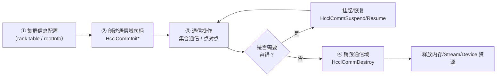
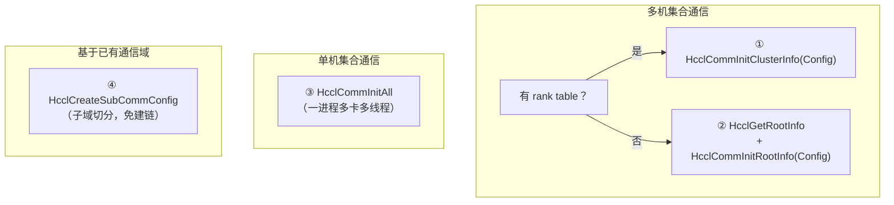

# communicator：通信域管理

> **深度参考** · 前置阅读：[源码课程单元 2｜控制面：通信域的一生](/comm-ascend/hccl-hcomm/02-control-plane.md)。本篇为参考手册体例，检索导向；事实基线见文首引用块。

> **通信域（Communicator）是集合通信算子执行的上下文**，管理参与通信的对象（每个 NPU/Die 为一个 rank）与通信所需资源。本目录聚焦 HCCL 的**控制面**：通信域的创建、配置、rank/Team 管理、挂起恢复与销毁。
>
> 通信域是 L2-comm 层（`hccl_comm.h`）的核心，向上供 AI 框架调用，向下依赖 [../04_昇腾集群组网总览.md](/comm-ascend/reference/overview/cluster-topology.md) 的 RankGraph 建模与 [../comm/](/comm-ascend/reference/comm/) 的传输建链。
>
> 事实来源（可信度：代码 > 仓内文档 > 社区资料）：
> `hccl/docs/zh/user_guide/api_comm_impl.md`（通信域管理权威）、`hcomm/docs/zh/api_ref/comm_mgr_c/`（40+ 通信域管理 API）、`hcomm/docs/zh/api_ref/comm_mgr_c/data_type_definition/HcclCommConfig.md`（配置结构体）、`hcomm/docs/zh/api_ref/comm_opdev/control_plane_api/comms_domain_resource_mgmt/`（Team/Thread/Channel）、`hcomm/include/hccl/hccl_comm.h`。

---

## 1. 通信域与 rank

> 图源：`hccl/docs/zh/architecture/diagrams/coll_comm_model.excalidraw.svg`

| 概念 | 说明 |
| --- | --- |
| **通信域（Communicator）** | 集合通信执行的上下文，管理通信对象与资源；句柄类型 `HcclComm` |
| **rank** | 通信域中的每个通信对象，分配唯一标识 0~n−1（n 为 NPU 数量；**A3 例外：一个 Die 为一个 rank**） |
| **通信算子** | 在通信域内完成通信任务，分**集合通信**（AllReduce 等）与**点对点通信**（Send/Recv/BatchSendRecv） |
| **worldTeam** | 通信域初始化时**自动创建**的全局 Team，用户无需手动创建 |

> 一个计算任务可创建多个通信域，一个通信成员也可加入多个通信域。

---

## 2. 通信域生命周期

> 图源：`hccl/docs/zh/user_guide/figures/hccl_operation_flow.png`

---

## 3. 四种创建方式（对比）

`api_comm_impl.md` 给出四种通信域创建方式，详见 [creation.md](/comm-ascend/reference/communicator/creation.md)：

| 方式 | 接口 | 适用场景 | 是否需 socket 建链 |
| --- | --- | --- | --- |
| **① rank table** | `HcclCommInitClusterInfo` / `HcclCommInitClusterInfoConfig` | 多机，有完整集群信息配置文件 | 是 |
| **② root 节点信息** | `HcclGetRootInfo` + `HcclCommInitRootInfo` / `Config` | 多机，无 rank table（集群协商方式） | 是（向 root 建 socket） |
| **③ 单机批量** | `HcclCommInitAll` | 单机，一进程统管多卡（每卡一线程） | 否（单机内） |
| **④ 子通信域切分** | `HcclCreateSubCommConfig` | 基于已有通信域切分，**故障下快速创建** | **否**（无需建链与 rank 信息交换） |

> **Config 后缀**：带 `Config` 的接口（`HcclCommInitClusterInfoConfig`/`HcclCommInitRootInfoConfig`）可传入 `HcclCommConfig` 创建**具有特定配置**的通信域（缓冲区大小、展开模式、确定性、算法等，详见 [config.md](/comm-ascend/reference/communicator/config.md)）。

---

## 4. rank 与状态管理 API

| 类别 | 接口 | 作用 |
| --- | --- | --- |
| **rank 查询** | `HcclGetRankId(comm, rankId)` | 获取本 rank 在通信域内的编号 |
| | `HcclGetRankSize(comm, rankSize)` | 获取通信域大小（rank 总数） |
| **状态查询** | `HcclCommGetStatus(comm, status)` | 查询通信域状态 |
| | `HcclGetCommAsyncError(comm, error)` | 获取通信域异步错误 |
| **挂起/恢复** | `HcclCommSuspend(comm)` / `HcclCommResume(comm)` | 容错场景下挂起/恢复通信域 |
| **销毁** | `HcclCommDestroy(comm)` | 销毁通信域，释放内存/Stream/Device 资源 |
| **名称** | `HcclGetCommName` / `HcclCommGetHandleWithName` | 通信域名查询/按名取句柄 |
| **工作网卡** | `HcclCommWorkingDevNicSet` | 设置工作 Device 网卡 |

---

## 5. Team：通信域内的子分组

Team 是通信域内一组 rank 的子分组，用于限定同步与通信范围（详见 [config.md §4](/comm-ascend/reference/communicator/config.md)）：

| 接口 | 作用 |
| --- | --- |
| `HcclTeamCreate(comm, desc, team)` | 在 worldTeam 上创建 team（按 `desc` 的 protocol/netLayer） |
| `HcclTeamGetLsaTeam(...)` | 获取 **LSA Team**（Load/Store Accessible，可加载/存储访问的 rank 集合） |
| `HcclTeamMemberToRank` / `HcclTeamRankToMember` | team 成员号 ↔ 通信域 rank 号 互转 |
| `HcclTeamDestroy(team)` | 销毁 team |

> **LSA（Load/Store Accessible）**：一组可通过加载/存储语义直接互访内存的 rank。对称内存 UB Memory 场景要求"同一通信域内所有 **LSA WorldTeam** 成员同时注册"（见 [../comm/symmetric_mem.md](/comm-ascend/reference/comm/symmetric_mem.md)）。`HcclTeamCreate` 当前仅 950 支持、仅 URMA 协议。

---

## 6. 关键约束

`api_comm_impl.md` 说明：

| 约束 | 说明 |
| --- | --- |
| **串行下发** | 多个通信域下的所有通信算子在每个 Device 上需**串行下发**，不允许乱序、多线程并发下发，不支持线程重入 |
| **同 Context** | 同一 Device、同一通信域内所有通信算子的下发线程需使用**相同 Context** |
| **不可混合执行** | 同一通信域内**不支持图模式通信与单算子通信混合执行** |
| **串行创建** | 同一 NPU 上需**串行创建**多个通信域 |
| **A3 多超节点配置** | 通信域初始化时，同一超节点内的 AI Server 信息须配置在一起，**不支持交叉配置** |
| **单卡多进程** | 建议配置 `device_port` 且各进程不同，否则端口冲突运行失败 |

---

## 7. C 接口 vs Python 接口

| 语言 | 用途 | 头文件/文档 |
| --- | --- | --- |
| **C 接口** | 单算子模式下的框架适配，实现分布式能力 | `hccl/include/hccl.h`、hcomm `comm_mgr_c/` |
| **Python 接口** | 图模式下的框架适配（当前仅用于 TensorFlow 网络在 AI 处理器执行分布式优化） | hcomm `comm_mgr_python/` |

---

## 8. 文档索引

| 文档 | 内容 |
| --- | --- |
| [creation.md](/comm-ascend/reference/communicator/creation.md) | 四种创建方式的**完整流程、参数、代码示例**（rank table / rootInfo / InitAll / 子域切分）+ 网卡选择 + 端口配置 |
| [config.md](/comm-ascend/reference/communicator/config.md) | **`HcclCommConfig` 全字段表**（缓冲区/确定性/展开模式/算法/重执行/对称内存/QoS 等）+ 配置优先级 + Team/LSA + 挂起恢复/销毁 |

---

## 9. 参考资料

- `hccl/docs/zh/user_guide/api_comm_impl.md`：使用通信库 API 实现通信功能（通信域管理权威，本文主要来源）
- `hcomm/docs/zh/api_ref/comm_mgr_c/`：`HcclCommInitClusterInfo(Config)`、`HcclCommInitRootInfo(Config)`、`HcclGetRootInfo`、`HcclCommInitAll`、`HcclCreateSubCommConfig`、`HcclCommDestroy`、`HcclCommSuspend/Resume`、`HcclCommGetStatus`、`HcclGetCommAsyncError`、`HcclGetRankId/Size` 等
- `hcomm/docs/zh/api_ref/comm_mgr_c/data_type_definition/HcclCommConfig.md`：通信域配置结构体
- `hcomm/docs/zh/api_ref/comm_opdev/control_plane_api/comms_domain_resource_mgmt/`：`HcclTeamCreate`、`HcclTeamGetLsaTeam`、`HcclThreadAcquire`、`HcclChannelAcquire` 等
- 关联：[../01_HCCL集合通信概述.md](/comm-ascend/reference/overview/hccl-overview.md)（API 分层）、[../04_昇腾集群组网总览.md](/comm-ascend/reference/overview/cluster-topology.md)（RankGraph）、[../execution/](/comm-ascend/reference/execution/)（执行模式）、[../comm/symmetric_mem.md](/comm-ascend/reference/comm/symmetric_mem.md)（对称内存与 Team）

