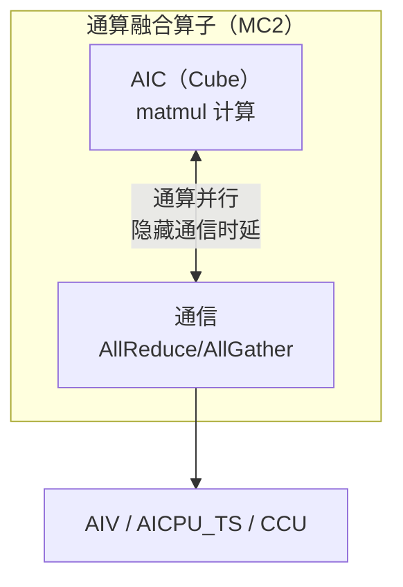
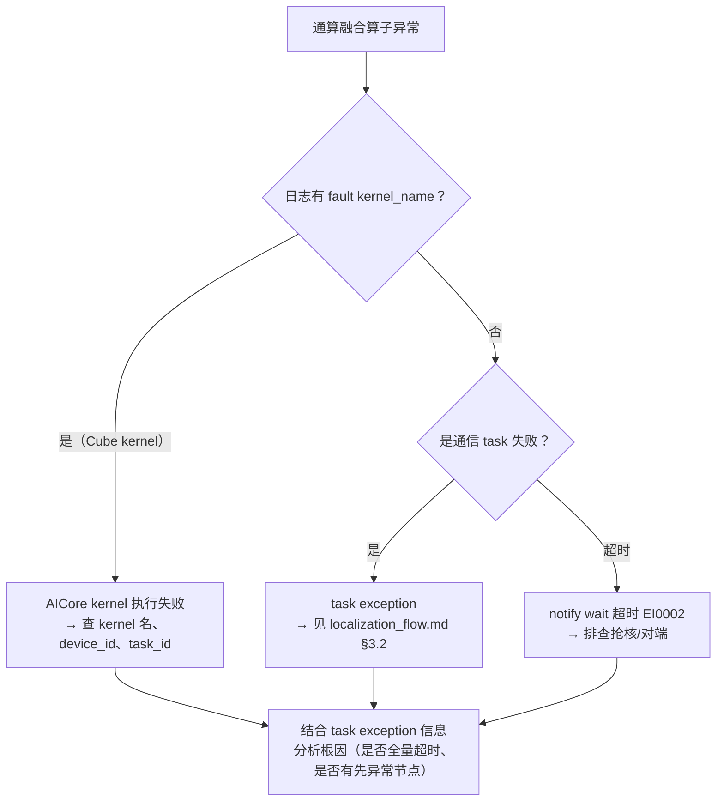

# AIC 问题定位

> **问题类型**：AIC（AI Cube，立方核，负责矩阵运算）相关的执行失败。**纯 HCCL 通信算子跑在 AIV/AICPU/CCU 上，不直接使用 AIC**——AIC 问题主要出现在**通算融合（MC2）场景**（Cube 执行 matmul + 通信融合），以及 AICore kernel 执行失败、AIC/AIV 抢核等。
>
> 事实来源：`hccl/docs/zh/user_guide/fault_diagnosis/aiv_comm_op_exec_fail.md`（AICore kernel 执行失败机制，AIC/AIV 同源）、`hccl/include/hccl_mc2.h`（MC2 通算融合框架）、`shmem/docs/glossary.md`（AIC = Cube Core）、`hcomm/docs/zh/aclgraph/aclgraph_introduction.md`（计算 stream 与通信 stream 并行）。

---

## 1. AIC 在通信中的角色

| 概念 | 说明 |
| --- | --- |
| **AIC（AI Cube）** | 昇腾分离架构下的 Cube Core，负责矩阵运算（matmul） |
| **AIV（AI Vector）** | Vector Core，负责向量计算与**低时延通信**（见 [aiv](/comm-ascend/reference/debug/cases/aiv/)） |
| **纯通信算子** | AllReduce/AllGather 等由 AIV/AICPU/CCU 承载，**不用 AIC** |
| **通算融合（MC2）** | MatmulAllReduce、AllGatherMatmul 等——**AIC 执行 matmul，通信并行**，此时 AIC 问题会影响融合算子 |



---

## 2. 问题现象

| 现象 | 说明 |
| --- | --- |
| **AICore kernel 执行失败** | 日志 `Aicore kernel execute failed ... fault kernel_name=<cube_kernel>`（与 AIV 失败同一机制，kernel 名为 Cube kernel） |
| **通算融合算子异常** | MC2 算子（如 MatmulAllReduce）执行失败、结果错误或超时 |
| **抢核/死锁** | AIC 计算核与通信争抢资源，或多通信域并发导致核不足 |
| **task exception** | 融合算子的通信 task 执行失败，经 task exception 回调上报 |

AICore kernel 执行失败日志（与 AIV 同源机制，`davinci_kernel_task.cc`）：

```text
[ERROR] RUNTIME(...):... PrintErrorInfoForDavinciTask:[INIT][DEFAULT]Aicore kernel execute failed, device_id=0, stream_id=2, ..., task_id=..., fault kernel_name=<cube_kernel_name>, ...
```

---

## 3. 定位流程



---

## 4. 常见根因

| 根因 | 说明 | 排查 |
| --- | --- | --- |
| **Cube kernel 本身异常** | 融合算子的 matmul kernel 执行失败（非法地址、参数错误） | 查 `fault kernel_name`、device_id、program id |
| **AIC/AIV 抢核** | 计算核与通信核资源争抢，通算融合下并发配置不当 | 检查控核配置、并发图数量（≤6） |
| **通信 task 失败连带** | 融合算子中通信段失败（notify 超时、SDMA 异常） | 见 [../localization_flow.md §3.2](/comm-ascend/reference/debug/localization_flow.md)（task exception） |
| **对端异常** | 对端 rank 先崩溃/慢，导致本端融合算子通信段超时 | 见 [coredump](/comm-ascend/reference/debug/cases/coredump/)、[whole_network](/comm-ascend/reference/debug/cases/whole_network/) |
| **多通信域并发** | 单卡并发图 >6 导致 AI CPU 核占满、通信阻塞 | 见 [../../reference/constraints.md](/comm-ascend/reference/runtime/constraints.md) |

---

## 5. 关联错误码与关键字

| 错误码/关键字 | 含义 |
| --- | --- |
| **EI0002** | 通信算子执行超时（融合算子通信段） |
| **EI9999** | HCCL 内部错误（结合 CANN 日志） |
| `fault kernel_name=` | AICore kernel 执行失败（Cube/Vector kernel） |
| `TaskExecStage` / `Task run failed` | task exception 机制上报 |
| `Aicore kernel execute failed` | AICore（含 AIC）kernel 执行失败 |

---

## 6. 处置与规避

| 处置 | 说明 |
| --- | --- |
| **定位失败 kernel** | 按 `fault kernel_name` + device_id + task_id 定位是哪个 Cube kernel 失败 |
| **检查通算融合配置** | MC2 算子需正确配置 KfcOpArgs（数据类型/归约类型/通信引擎），见 [../../extension/mc2_and_rfc.md](/comm-ascend/reference/extension/mc2_and_rfc.md) |
| **控核与并发** | 合理配置 Vector/Cube 核数，避免抢核；图模式并发图 ≤6 |
| **task 级跟踪** | A3/A2 开启 `HCCL_DIAGNOSE_ENABLE` 跟踪 task 级信息 |

---

## 7. 参考资料

- `hccl/docs/zh/user_guide/fault_diagnosis/aiv_comm_op_exec_fail.md`：AICore kernel 执行失败机制（AIC/AIV 同源）
- `hccl/docs/zh/user_guide/fault_diagnosis/task_exception_mechanism_troubleshooting.md`：task exception 机制
- `hccl/include/hccl_mc2.h`、`hccl/src/common/hccl_mc2.cc`：MC2 通算融合框架
- `shmem/docs/glossary.md`：AIC（Cube Core）/AIV（Vector Core）术语
- 关联：[README.md](/comm-ascend/reference/debug/cases/)、[aiv](/comm-ascend/reference/debug/cases/aiv/)（Vector 核问题）、../../mc2/（通算融合算子）、[../../extension/mc2_and_rfc.md](/comm-ascend/reference/extension/mc2_and_rfc.md)（MC2 框架）、[../localization_flow.md](/comm-ascend/reference/debug/localization_flow.md)（task exception）

