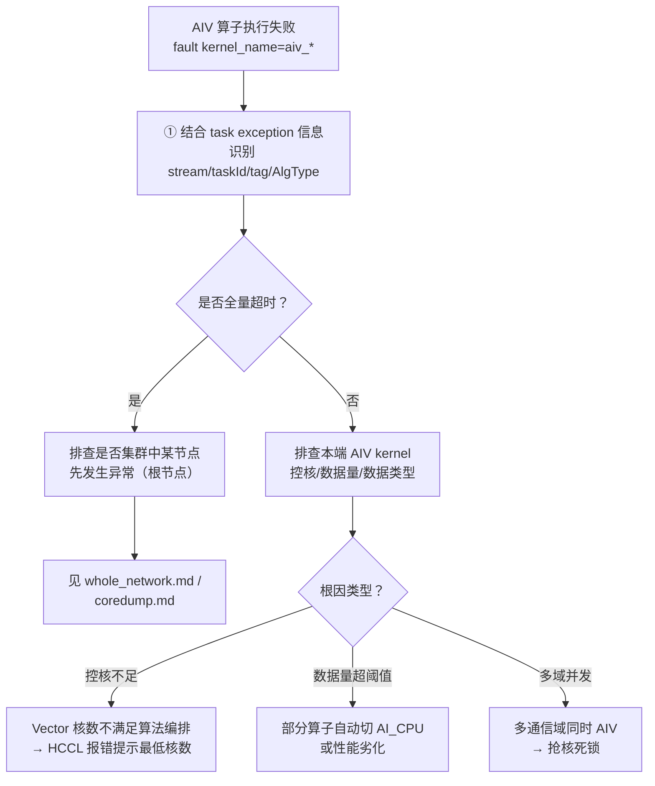

# AIV 问题定位

> **问题类型**：AIV（Vector Core）通信算子执行失败。启用 AIV 模式（`HCCL_OP_EXPANSION_MODE=AIV`）后，HCCL 以 kernel 执行方式实现通信算子编排与执行，若执行异常会打印 `fault kernel_name=aiv_*`。
>
> 事实来源：`hccl/docs/zh/user_guide/fault_diagnosis/aiv_comm_op_exec_fail.md`（AIV 执行失败权威）、`hccl/docs/zh/user_guide/hccl_env/HCCL_OP_EXPANSION_MODE.md`（AIV 约束/控核）、`hcomm/src/legacy/ascend950/unified_platform/aiv/`（AIV 数据通路）。

---

## 1. 问题现象

启用 AIV 模式后，通信算子执行异常时日志出现关键打印 **`fault kernel_name=aiv_all_reduce_***`**，表明 HCCL 的 AIV 算子执行失败：

```text
[ERROR] RUNTIME(699131,python):2025-04-24-21:54:17.707.236 [davinci_kernel_task.cc:1268]699131 PrintErrorInfoForDavinciTask:[INIT][DEFAULT]Aicore kernel execute failed, device_id=0, stream_id=2, report_stream_id=2, task_id=55873, flip_num=2073, fault kernel_name=aiv_all_reduce_***, fault kernel info ext=aiv_all_reduce_910b_bfloat16_t, program id=42, hash=9645272693770703471.
```

> 同时会有 task exception 信息打印（`Task run failed`/`TaskExecStage`），可通过 notify wait 超时（EI0002）排查思路分析任务失败根因——如是否全量超时、集群中是否存在某个**先发生异常的节点**。

---

## 2. 定位流程



---

## 3. 常见根因

| 根因 | 说明 | 排查/处置 |
| --- | --- | --- |
| **控核不足** | 分配的 Vector Core 核数无法满足算法编排要求 | HCCL 报错并提示所需最低核数；按算子配置核数（见 §4） |
| **数据量超阈值** | AIV 适合小数据低时延；大数据量部分算子自动切 AI_CPU，或性能劣化 | AlltoAllV/VC、AlltoAll（多机）配 AIV **不自动切换**——任意两 rank 间最大数据量 ≤1MB 才建议 AIV |
| **多通信域并发抢核** | 不支持多个通信域同时配 AIV，否则抢核死锁等不可预期行为 | 用 `HcclCommConfig` 将**某个**通信域单独设 AIV，避免多域并发 AIV |
| **数据类型不支持** | 归约类算子数据类型受限 | Reduce/AllReduce/ReduceScatter：int8/16/32/64、float16/32、bfp16；ReduceScatter 额外支持 hifloat8 |
| **对端先异常** | 集群中某节点先崩溃/慢，导致 AIV 算子 notify wait 超时 | 见 [coredump](/comm-ascend/reference/debug/cases/coredump/)、[whole_network](/comm-ascend/reference/debug/cases/whole_network/) |
| **确定性优先级** | 同时设 `HCCL_DETERMINISTIC` 时确定性优先级更高，AIV 展开可能不生效 | 见 [precision](/comm-ascend/reference/debug/cases/precision/) |

---

## 4. 控核要求（Vector Core 核数）

AIV 模式支持控核，核数不足会报错（`HCCL_OP_EXPANSION_MODE.md`）：

| 产品 | 算子 | 建议最低 Vector 核数 |
| --- | --- | --- |
| **A3** | Broadcast | ≥ ranksize |
| **A3** | AllGather、非确定性 ReduceScatter | ≥ max(2, ⌈ranksize/20⌉) |
| **A3** | AllReduce、确定性 ReduceScatter、AlltoAll/V/VC | ≥ max(2, ⌈ranksize/20⌉) 且为**偶数** |
| **A2** | AllReduce、ReduceScatter、ReduceScatterV | ≥ 24 |
| **A2** | Broadcast、AlltoAll/V/VC、AllGather、AllGatherV | ≥ 16 |

---

## 5. 关联错误码与关键字

| 错误码/关键字 | 含义 |
| --- | --- |
| **EI0002** | 通信算子执行超时（AIV notify wait 超时） |
| `fault kernel_name=aiv_*` | AIV 通信算子 kernel 执行失败 |
| `Aicore kernel execute failed` | AICore kernel 执行失败 |
| `TaskExecStage` / `Task run failed` | task exception 上报（三级关键字 `AIV`） |

> 950 的三级关键字含 `AIV`：`[TaskExecStage][RunFailed][AIV]` 表示 AIV 执行异常（见 [../error_codes.md §3](/comm-ascend/reference/debug/error_codes.md)）。

---

## 6. 处置与规避

| 处置 | 说明 |
| --- | --- |
| **按算子配核** | 按 §4 配置足够 Vector Core 核数 |
| **数据量评估** | 大数据量场景评估是否改用 AI_CPU；AlltoAll 族按 1MB 阈值判断 |
| **避免多域并发 AIV** | 通过 `HcclCommConfig` 单域配置 AIV，不并发多域 |
| **task 级跟踪** | A3/A2 开启 `HCCL_DIAGNOSE_ENABLE` |
| **根节点定位** | 全量超时时经心跳 crimer rank 找先异常节点 |

---

## 7. 参考资料

- `hccl/docs/zh/user_guide/fault_diagnosis/aiv_comm_op_exec_fail.md`：AIV 通信算子执行失败（本文主要来源）
- `hccl/docs/zh/user_guide/hccl_env/HCCL_OP_EXPANSION_MODE.md`：AIV 约束、控核、数据类型、数据量回退
- `hccl/docs/zh/user_guide/fault_diagnosis/notify_wait_timeout_EI0002.md`：notify wait 超时排查
- `hcomm/src/legacy/ascend950/unified_platform/aiv/`：`ub_memory_transport.*`、`urma_direct_transport.*`
- 关联：[README.md](/comm-ascend/reference/debug/cases/)、[aic](/comm-ascend/reference/debug/cases/aic/)（Cube 核问题）、[../../engine/aiv.md](/comm-ascend/reference/engine/aiv.md)（AIV 引擎）、[precision](/comm-ascend/reference/debug/cases/precision/)（确定性优先级）、[../localization_flow.md](/comm-ascend/reference/debug/localization_flow.md)（task exception）

