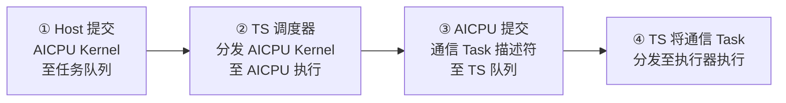
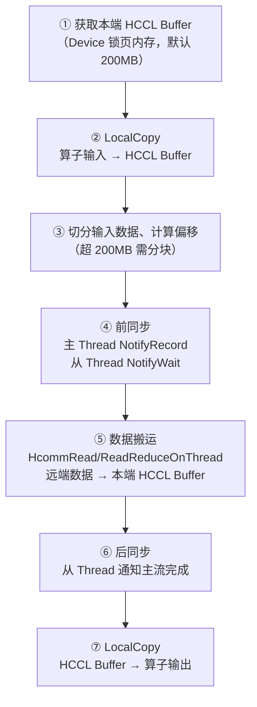
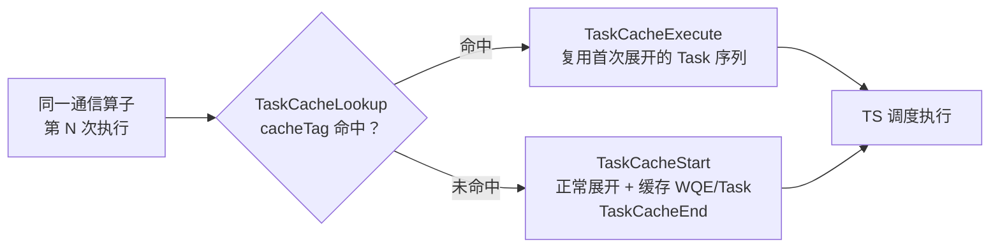

# AICPU_TS 通信引擎

> **深度参考** · 前置阅读：[源码课程单元 4｜通信引擎与三引擎编排](/comm-ascend/hccl-hcomm/04-comm-engines.md)。本篇为参考手册体例，检索导向；事实基线见文首引用块。

> **大数据高带宽场景的主力引擎**（L1/L2）。AICPU 运行通信 Kernel 并向任务调度系统（TS，Task Scheduler）提交通信 Task 描述符，由 TS 调度到执行器执行——**不占用计算核**（AI Core/Vector Core），通信效率高。
>
> 事实来源（可信度：代码 > 仓内文档 > 社区资料）：
> `hcomm/include/hcomm_primitives.h`（数据面原语）、`hcomm/src/base_comm/primitives/aicpu/task_cache/`（Task Cache 实现）、`hcomm/src/base_comm/primitives/api_c_adpt/aicpu_ts_primitives_c_adapt.cc`（C 接口适配）、`hcomm/src/legacy/ascend950/unified_platform/resource/transport/aicpu/`（AICPU 侧传输实现）、`hcomm/docs/zh/comm_op_dev_guide/prog_models_concepts/comm_engine.md`（执行流程）、`hcomm/docs/zh/comm_op_dev_guide/aicpu_comm_op_dev/`（开发流程）、`hccl/docs/zh/user_guide/hccl_env/HCCL_OP_EXPANSION_MODE.md`。

---

## 1. 定位与特点

| 维度 | 说明 |
| --- | --- |
| **Thread 抽象** | NPU Stream |
| **并发实体** | Stream |
| **同步实现** | NPU Notify 寄存器 |
| **调度器** | TS（Task Scheduler）/ STARS |
| **优势** | 不占用计算核，通信效率高，适用于大数据高带宽场景 |
| **约束** | 通信静态开销较大，对小数据量通信场景不友好 |
| **适用场景** | 高带宽通信（**L1/L2 主力**） |
| **支持产品** | Ascend 950PR&950DT 系列、Atlas A3 系列 |
| **`OpExecuteConfig`** | `AICPU_TS = 2`（`AICPU = 7` 为不带 TS 的变体） |
| **算法名前缀** | `Aicpu*`（如 `AicpuAllReduceParallelMeshNHR`、`AicpuAllReduceSoleNHR`） |

---

## 2. 任务执行流程

由 AI CPU 向任务调度系统（TS）提交通信操作相关任务：


> 图源：`hcomm/docs/zh/comm_op_dev_guide/prog_models_concepts/figures/aicpu_ts_schedule.png`



| 步骤 | 动作 | 主体 |
| --- | --- | --- |
| ① | 提交 AICPU Kernel 至任务队列 | Host |
| ② | 调度 AICPU Kernel 至 AICPU 执行 | TS 调度器 |
| ③ | 提交通信 Task 描述符至 TS 队列 | AICPU |
| ④ | 将通信 Task 分发至执行器 | TS |

> **要点**：AICPU 通过 **Task 描述符**下发通信任务，通信逻辑跑在 AICPU 核上、数据搬运由 TS 调度到硬件（RDMA 网卡 / SDMA / UB 引擎），**全程不占 AI Core/Vector Core 计算核**。

---

## 3. 数据面原语（`hcomm_primitives.h`）

AICPU_TS 与 CPU_TS 共用同一套 L3-prim 数据面原语（`hcomm/include/hcomm_primitives.h`，600 行）。按类别：

| 类别 | 关键 API | 语义 |
| --- | --- | --- |
| **本地操作** | `HcommLocalCopyOnThread`、`HcommLocalReduceOnThread` | 本地内存拷贝 / 本地归约 |
| **网络写** | `HcommWriteOnThread`、`HcommWriteReduceOnThread`、`HcommWriteWithNotifyOnThread`、`HcommWriteReduceWithNotifyOnThread` | 写远端内存（可带归约 / 带 notify） |
| **网络读** | `HcommReadOnThread`、`HcommReadReduceOnThread` | 读远端内存（可带归约） |
| **非阻塞** | `HcommWriteNbi(OnThread)`、`HcommReadNbi(OnThread)`、`HcommWriteWithNotifyNbi(OnThread)` | Nbi = Non-Blocking Issue，下发即返回 |
| **批量** | `HcommBatchTransferOnThread` | 一次提交多笔传输（AlltoAll 族、BatchSendRecv） |
| **线程内同步** | `HcommThreadNotifyRecordOnThread`、`HcommThreadNotifyWaitOnThread` | 同一通信实体内 Thread 间同步 |
| **跨实体同步** | `HcommChannelNotifyRecord(OnThread)`、`HcommChannelNotifyWait(OnThread)` | 经 Channel 向远端 Thread 发/等同步信号 |
| **序保证** | `HcommFenceOnThread`、`HcommChannelFence(OnThread)`、`HcommChannelDrainOnThread` | 内存序栅栏 / 通道排空 |
| **批处理模式** | `HcommBatchModeStart/End`、`HcommAcquireComm`/`HcommReleaseComm` | 批量下发窗口，降低下发开销 |
| **Task Cache** | `HcommAicpuTsTaskCacheLookup/Start/End/Execute/Clear` | 复用首次展开结果，省展开开销 |

> 原语的完整分类与三层（L0/L1/L2）用法见 [../03_L0L1L2分级通信实现原理.md §3](/comm-ascend/reference/overview/l0l1l2-principle.md)。

---

## 4. 任务编排（AICPU 侧）

`hcomm/docs/zh/comm_op_dev_guide/aicpu_comm_op_dev/task_sched.md`——参与集合通信的各 rank 协调有序地同步与搬运，将不同 Thread 上的任务并行执行以最大化资源利用：



> **HCCL Buffer**：每个通信域管理的一块 Device 锁页内存（Pinned Memory）。通信任务异步执行，为确保用户输入数据在实际执行时仍有效，需先拷贝到固定地址的 HCCL Buffer。默认 200MB，超出则切分为多块分别处理。

Send/Recv 的 AICPU 侧编排示例（`task_sched.md`）：

```c
// Send：拷贝到中转内存 → 通知接收端数据就绪 → 等待接收端读完
HcommLocalCopyOnThread(threadHandle, localAddr, inputPtr, size);
HcommChannelNotifyRecordOnThread(threadHandle, channelHandle, 0);
HcommChannelNotifyWaitOnThread(threadHandle, channelHandle, 1, 1800);

// Recv：等待发送端就绪 → 读对端数据 → 通知发送端读完
HcommChannelNotifyWaitOnThread(threadHandle, channelHandle, 0, 1800);
HcommReadOnThread(threadHandle, channelHandle, outputPtr, remoteAddr, size);
HcommChannelNotifyRecordOnThread(threadHandle, channelHandle, 1);
```

---

## 5. AICPU Task Cache：省展开开销

AICPU_TS 的"通信静态开销较大"主要体现在**算子展开**（把通信算法翻译成 Task 描述符序列）上。Task Cache 复用同一算子**首次执行**的展开结果，第二次起直接命中缓存，省去重复展开。

`hcomm/src/base_comm/primitives/aicpu/task_cache/aicpu_task_cache.h`：

| 要素 | 值 / 说明 |
| --- | --- |
| **默认容量** | `AICPU_TASK_CACHE_CAPACITY = 10 * 1024 * 1024`（10 MiB） |
| **键** | `cacheTag`（算子标识字符串） |
| **核心操作** | `FindEntry`（查）、`AddEntry`（增，满则返回 nullptr）、`IncCacheBytes`（计量）、`ClearEntry`（清） |
| **并发** | `std::shared_timed_mutex`（多通信域共享的超时读写锁） |
| **数据面接口** | `HcommAicpuTsTaskCacheLookup/Start/End/Execute/Clear` |
| **关闭开关** | `HCCL_OP_EXPANSION_MODE=AICPU_CacheDisable` |



> **权衡**：开启 Cache 有一定显存开销。**通信数据量频繁变化**的服务场景，建议配置 `AICPU_CacheDisable` 关闭 cache 以减小显存开销（`HCCL_OP_EXPANSION_MODE.md`）。

---

## 6. Profiling：下发 + 执行两段开销

AICPU_TS 算子的 Profiling 分为**下发**与**执行**两段——静态开销体现在下发段：


> 图源：`hccl/docs/zh/user_guide/perf_analysis/figures/comm_op_dispatch.png`、`comm_op_execution.png`。这正是 AICPU Task Cache 与 `AICPU_CacheDisable` 开关存在的原因。端到端 Profiling 任务对应见 [../03_L0L1L2分级通信实现原理.md §5](/comm-ascend/reference/overview/l0l1l2-principle.md)。

---

## 7. 算法选择（AICPU 侧）


> 图源：`hcomm/docs/zh/comm_op_dev_guide/aicpu_comm_op_dev/figures/algo_select_new.png`

AICPU_TS 承载**全部 13 个算子**，是 L1/L2 的默认引擎。各算子的分级编排与可选算法名见 [../operators/](/comm-ascend/reference/operators/) 与 [../algorithms/algo_level_matrix.md](/comm-ascend/reference/algorithms/algo_level_matrix.md)。

---

## 8. 配置与约束

| 项 | 说明 |
| --- | --- |
| **环境变量** | `HCCL_OP_EXPANSION_MODE=AI_CPU`（将废弃，等价 `AICPU_TS`）/ `AICPU_TS`（950 默认）/ `AICPU_CacheDisable`（关 cache） |
| **通信域粒度** | `HcclCommConfig.hcclOpExpansionMode` 优先于环境变量 |
| **图模式约束** | 图模式（Ascend IR）/ 图捕获（aclgraph）下，AI CPU 模式单卡并发图数量 **≤ 6**，否则 AICPU 核被占满导致通信阻塞 |
| **安全风险** | A3 的 AI_CPU 模式依赖开放 AI CPU 用户态下发调度任务，需用户自行确保自定义算子安全可靠 |
| **确定性计算** | `DETERMINISTIC_STRICT` 模式下 CCU_MS/CCU_SCHED 回退到 AICPU（见 [../algorithms/algo_selector.md §3](/comm-ascend/reference/algorithms/algo_selector.md)） |
| **借轨通信** | L2 借轨（`backup_device_ip`）仅 `HCCL_OP_EXPANSION_MODE=AI_CPU` + 开启重执行时生效 |

---

## 9. 代码落点

| 组件 | 路径 |
| --- | --- |
| **数据面原语（C 接口适配）** | `hcomm/src/base_comm/primitives/api_c_adpt/aicpu_ts_primitives_c_adapt.cc`、`aicpu_ts_sync_data_c_adpt.cc`、`aicpu_ts_diag_c_adapt.cc` |
| **Task Cache** | `hcomm/src/base_comm/primitives/aicpu/task_cache/`：`aicpu_task_cache.{h,cc}`、`aicpu_task_cache_entry.{h,cc}`、`aicpu_task_cache_manager.{h,cc}` |
| **Task Cache C 适配** | `hcomm/src/base_comm/primitives/aicpu/aicpu_task_cache_c_adpt.cc` |
| **AICPU 侧传输（950）** | `hcomm/src/legacy/ascend950/unified_platform/resource/transport/aicpu/`：`mem_transport_lite.*`、`ub_transport_lite_impl.*`、`roce_transport_lite_impl.*`、`p2p_transport_lite_impl.*` |
| **引擎选择** | `hccl/src/ops/*/selector/*_auto_selector.cc`、`selector_engine.cc` |
| **加速模式枚举** | `hccl/src/ops/op_common/inc/alg_param.h:133-153` |

---

## 10. 参考资料

- `hcomm/docs/zh/comm_op_dev_guide/prog_models_concepts/comm_engine.md`：AI CPU+TS 执行流程
- `hcomm/docs/zh/comm_op_dev_guide/aicpu_comm_op_dev/`：`overall_flow.md`、`task_sched.md`、`algo_select.md`、`op_dispatch.md`、`create_res.md`、`query_topo.md`、`build_deploy.md`
- `hcomm/docs/zh/api_ref/comm_opdev/data_plane_api/cpu-cpu_ts-aicpu_ts/`：数据面原语 API（communication_operations / local_operations / others）
- `hccl/docs/zh/user_guide/hccl_env/HCCL_OP_EXPANSION_MODE.md`：展开模式与约束
- `hccl/docs/zh/user_guide/perf_analysis/typical_op_behavior.md`：Profiling 任务对应
- 关联：[README.md](/comm-ascend/reference/engine/)（引擎总览）、[ccu.md](/comm-ascend/reference/engine/ccu.md)、[aiv.md](/comm-ascend/reference/engine/aiv.md)、[../comm/roce_rdma.md](/comm-ascend/reference/comm/roce_rdma.md)、[../comm/ub_network.md](/comm-ascend/reference/comm/ub_network.md)

