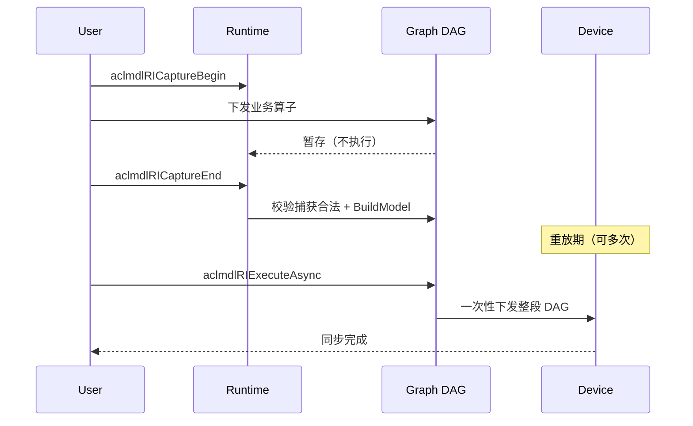
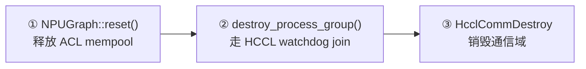
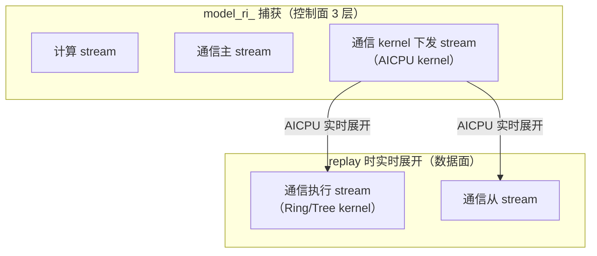

# ACL Graph（aclgraph）：图捕获执行模式

> **深度参考** · 前置阅读：[源码课程单元 11｜实战与第一个算子](/comm-ascend/hccl-hcomm/11-examples-first-op.md)。本篇为参考手册体例，检索导向；事实基线见文首引用块。

> **ACL Graph 是 CANN Runtime 提供的"捕获—重放"机制**，对应 CUDA Graph 在 NPU 侧的等价物：在 `aclmdlRICaptureBegin`/`aclmdlRICaptureEnd` 之间提交的任务不立即执行，而暂存为**模型运行实例**（`aclmdlRI`），之后 `aclmdlRIExecuteAsync` 可多次整体重放。把"一次下发一次执行"变为"一次捕获多次重放"，摊销 Host 调度开销。
>
> 事实来源：`hcomm/docs/zh/aclgraph/aclgraph_introduction.md`（ACL Graph 权威）、cann/runtime 仓 `include/external/acl/acl_rt.h`（API）、`example/2_advanced_features/model_ri/`（示例）、torch_npu `NPUGraph.cpp`/`ProcessGroupHCCL.cpp`。

---

## 1. 为什么需要 ACL Graph

| 问题 | 说明 |
| --- | --- |
| **Eager 模式 Host dispatch 瓶颈** | PyTorch 默认 Eager：单算子下发后立即执行，每个算子都要走 Host Python API → Host C++ 下发 → Device kernel 执行；Device 每次 kernel 执行前需等 Host 下发完成 |
| **Device 空闲** | 单算子计算量小或 Host 性能不佳时，每个 kernel 执行完需等待下一个 kernel 下发，产生 Device 空闲 |
| **ACL Graph 解法** | 把多次重复的 Host 调度开销摊销到一次 capture；重放时 CPU 端开销只剩**一次 syscall**，与算子数量无关 |



> **适用范围**：小算子密集推理（DDP/FSDP gradient bucketing、LLM decode、推荐系统 inference、动态 batch）、通信密集训练（HCCL 集合通信在 stream 上重复执行）。**不适用**：任务拓扑每次变化、CPU 同步密集、调试原型阶段。

---

## 2. 捕获生命周期

### 2.1 4 步 API 流程

核心 API：`aclmdlRICaptureBegin` / `aclmdlRICaptureEnd` / `aclmdlRIExecuteAsync` / `aclmdlRIDestroy`；捕获模式 `ACL_MODEL_RI_CAPTURE_MODE_GLOBAL` / `RELAXED`。

### 2.2 capture 之前的准备

| 准备 | 说明 |
| --- | --- |
| **派发 HCCL watchdog 排空** | `ProcessGroupHCCL` 后台 watchdog 线程会调 `aclrtEventQuery` 检查 collective 完成情况；capture 期间若调 query 会把"事件查询"也写入捕获上下文。`NPUGraph::capture_begin` 在调 `AclmdlRICaptureBegin` 前完成 mempool 绑定与 stream 检查 |
| **路由 allocator 到私有池** | capture 期间分配的 tensor 生命周期绑到 `model_ri_`，销毁时连同 mempool 一起释放 |

### 2.3 捕获中约束（HCCL 视角）

**① 跨流捕获必须"加入后回到主流"**：要把其他 stream 的任务加入 capture，须用 event/notify 引入，且**最终必须通过 event/notify 回到主流**，否则 `capture_end` 校验报错。返回主流后、结束捕获前，**不能再在副流上下发任务**。

**② 同步原语选择**：

| 场景 | 选 notify | 选 event |
| --- | --- | --- |
| 跨 Device 同步 | 推荐（更轻量） | 也可以 |
| 同一 Device 多 stream 同步 | 等价 | 等价 |
| 一对多通知 | 不支持 | 支持 |
| 需要时间戳 | 不支持 | 支持 |
| Wait 后状态 | **自动重置**（一次性） | **不自动重置**（可重用） |

> notify 的"一次性自动重置"匹配 HCCL 内部"通知从 stream → 等从 stream → 通知依赖方"的有状态机；event 的"多对多可重用"适合业务/通信语义切换点。

### 2.4 capture 之后：replay 与销毁

`capture_end` 内部完成 `aclmdlRIBuildModel`（DAG 实例化为可执行图）。之后任意 stream 调 `aclmdlRIExecuteAsync(model_ri, stream)` 整体重放。

**销毁顺序约束**（与 `ProcessGroupHCCL` 配合）：



> ⚠️ 颠倒顺序会因 HCCL 端 work 元数据指向已释放 buffer 导致 **use-after-free**。

---

## 3. 任务更新

任务被捕获暂存到 `aclmdlRI` 后，若需更新任务或参数，CANN 9.0.0 提供两种方式：

| 维度 | 原地更新 | 重新捕获 |
| --- | --- | --- |
| **任务数** | 少量 | 大量 |
| **接口复杂度** | 较复杂（需任务组/更新组） | 简单（重新调 Begin/End） |
| **硬件资源** | 复用同一 `aclmdlRI` | 每种 Shape 维护一份 `aclmdlRI` |
| **主要风险** | 任务组边界不当时机错误 | `aclmdlRI` 数量超硬件资源限制 |
| **典型场景** | varlen attention、动态 batch | 多 Shape 模型训练 |

> 并发执行场景是原地更新的特例：需"先更新任务再执行 capture 模型"时，引入 Update stream + Event Wait 顺序保证。

---

## 4. 多 stream 拓扑（核心）


> 图源：`hcomm/docs/zh/aclgraph/figures/multi_streams_in_aclgraph.png`

### 4.1 HCCL 内部的多 stream 拆分

Runtime 不感知通信语义，只接收 stream 上的任务。HCCL 按"控制面/数据面分离"和"并行流水"原则，把一次 collective 拆到多条内部 stream：

| Stream | 角色 | 设备 | 设计目的 |
| --- | --- | --- | --- |
| **计算 stream** `@pytorch` | 业务 matmul/bias/relu | NPU device | 与通信流并行，隐藏通信 latency |
| **通信主 stream** `@pytorch` | `dist.all_gather(...)` 入口 | NPU device | 业务/通信语义切换点（user 可见） |
| **通信 kernel 下发 stream** `@HCCL_HOST` | HCCL AICPU kernel | **AICPU 协处理器** | 把通信描述符从 host 卸载到协处理器，不阻塞 host CPU |
| **通信执行 stream** `@HCCL_DEVICE`（主） | 通信 task（Ring/Tree/HalvingDoubling kernel） | NPU device | 真正搬数据的设备 kernel |
| **通信从 stream** `@HCCL_DEVICE` | 主从并行场景的另一段通信 task | NPU device | 大集合通信的"主从"分段并行 |

### 4.2 `model_ri_` 实际只包含 3 层（控制面）

> **关键设计**：`model_ri_` 只包含**计算 stream、通信主 stream、通信 kernel 下发 stream**（控制面）。通信执行 stream / 通信从 stream 的通信 task 在 **AICPU kernel 执行时实时展开**——replay 时 Runtime 调 `AclmdlRIExecuteAsync` 触发通信 kernel 下发 stream 的 AICPU kernel，AICPU 再实时展开出通信执行/从 stream 的 task。



带来的好处：

- 图对象体积大幅缩小（只 capture 控制流）
- 数据面算法可**每次 replay 重新决定**（Ring/Bruck 切换、拓扑变化适应）
- 跨 NPU 部署时，replay 阶段根据当前实际拓扑选最优算法

### 4.3 Runtime 与 HCCL 的 4 个协同点

| # | 行为 | 实现 |
| --- | --- | --- |
| 1 | 通信主 stream 加入 `model_ri_` | Runtime 根据 event 关系自动纳入 |
| 2 | 通信 kernel 下发 stream 加入 `model_ri_` | HCCL 主动拉入（`currentStreamCaptureStatusMayInitCtx` 识别 capture 状态） |
| 3 | 通信执行/从 stream **不加入** | AICPU 端在 replay 时实时展开 |
| 4 | `capture_end` 移出所有 stream | 一次性从 `model_ri_` 卸载，不残留 |

---

## 5. 已知失败模式

### 5.1 启动期失败

| 失败模式 | 触发条件 | 规避 |
| --- | --- | --- |
| `TASK_QUEUE_ENABLE=2` 报错 | 环境变量与 ACL Graph 互斥 | 设为 `0` 或 `1` |
| pin_memory_expandable_segments 报错 | `NPUExpandableHostAllocator` 与图私有池冲突 | 改回 `NPUCachingAllocator` |
| 旧 CANN 不识别通信 kernel 下发 stream | 通信 kernel 下发 stream 不进入 `model_ri_` | 升级 CANN 到 8.5+ |

### 5.2 捕获期失败

| 失败模式 | 触发条件 | 规避 |
| --- | --- | --- |
| `aclrtEventQuery` 污染 DAG | watchdog/用户代码在 capture 期间调 query | `capture_begin` 入口检查 + mempool 预绑定排空 |
| `aclrtMemcpy` 在 GLOBAL 模式被拒 | 业务有同步内存函数 | 调 `aclmdlRICaptureThreadExchangeMode` 降级 RELAXED |
| 跨流任务不返回主流 | 跨流捕获未在主流上 `End` | 严格按 §2.3 设计捕获拓扑 |
| 默认 Stream 操作 | `with torch.npu.stream(s_default)` 嵌套在 capture 期间 | 显式切到非默认 stream |

### 5.3 释放期失败

| 失败模式 | 触发条件 | 规避 |
| --- | --- | --- |
| `destroy_process_group` 挂起 | 销毁顺序颠倒（通信域先于 `aclmdlRI`） | 严格按 §2.4 三步顺序 |
| UB overflow | graph 一次性驻留所有 intermediate tensor 超 NPU UB 大小 | 监控 `peak_mempool_bytes`；必要时 graph partition + fallback |
| 显存超限 | 同 `aclmdlRI` 数量过多（重新捕获方式） | 监控 model 数量；切到原地更新 |

---

## 6. torch_npu 对接（上层封装）

| 层 | 源码 | 说明 |
| --- | --- | --- |
| **C++ 核心** | `torch_npu/csrc/core/npu/NPUGraph.cpp` | `capture_begin` 调用链与 `replay`（mempool 绑定 → `AclmdlRICaptureBegin` → `AclmdlRICaptureGetInfo`） |
| **Python 入口** | `torch_npu/csrc/npu/Graph.cpp`（PyBind11） | `torch.npu.graph` / `torch.npu.NPUGraph` |
| **OpHandler** | `torch_npu/npu/_npugraph_handlers/` | 算子级预处理 |
| **集合通信对接** | `torch_npu/csrc/distributed/ProcessGroupHCCL.cpp` | watchdog 轮询间隔 `kWatchdogThreadSleepMillis=1000` |

```python
g = torch.npu.NPUGraph()              # 创建
with torch.npu.graph(g):              # 进入捕获
    out = model(static_input)         # 业务代码
g.replay()                            # 多次执行
```

---

## 7. 参考资料

- `hcomm/docs/zh/aclgraph/aclgraph_introduction.md`：ACL Graph 介绍（本文主要来源）
- cann/runtime 仓：`include/external/acl/acl_rt.h`（API 签名）、`docs/zh/dev_guide/04_ACL-Graph.md`、`docs/zh/dev_guide/04-02_cross_stream_capture.md`（跨流捕获）、`example/2_advanced_features/model_ri/`（4 个示例）、`src/runtime/feature/aclgraph/`（实现）
- cann/runtime 仓：`docs/zh/dev_guide/03-05_event_management.md`、`03-06_notify_management.md`（Event/Notify API）
- torch_npu（Ascend/pytorch）：`NPUGraph.cpp`、`Graph.cpp`、`ProcessGroupHCCL.cpp`
- 关联：[README.md](/comm-ascend/reference/execution/)（执行模式总览）、[../engine/aicpu_ts.md](/comm-ascend/reference/engine/aicpu_ts.md)（图模式并发图 ≤6 约束）、[../reference/constraints.md](/comm-ascend/reference/runtime/constraints.md)（ACL Graph 约束）

