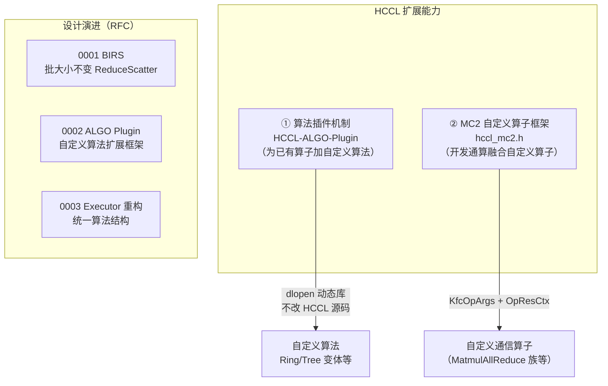

# extension：扩展机制与设计演进

> **深度参考** · 前置阅读：[源码课程单元 10｜MC2 框架与官方样例](/comm-ascend/hccl-hcomm/10-mc2-custom-ops.md)。本篇为参考手册体例，检索导向；事实基线见文首引用块。

> HCCL 提供两类扩展能力：**① 算法插件机制**（不改 HCCL 源码，以动态库形式为已有算子添加自定义算法）与 **② MC2 自定义通信算子框架**（开发通算融合的自定义通信算子）。本目录还收录 **RFC 设计演进**（HCCL 的重大架构提案）。
>
> 事实来源（可信度：代码 > 仓内文档 > 社区资料）：
> `hccl/docs/zh/rfcs/`（0001 BIRS、0002 ALGO Plugin、0003 executor-template-refactor）、`hccl/src/algo_plugin/`（插件管理器）、`hccl/src/common/tuner/`（调优器）、`hccl/include/hccl_mc2.h`（MC2 框架）、`hccl/experimental/`（试验性代码）。

---

## 1. 扩展机制全景

| 扩展方式 | 目标 | 载体 | 是否改 HCCL 源码 | 详见 |
| --- | --- | --- | --- | --- |
| **算法插件** | 为已有算子（AllReduce/AllGather 等）添加自定义算法 | 动态库（`.so`）+ dlopen | **否** | [algo_plugin.md](/comm-ascend/reference/extension/algo_plugin.md) |
| **MC2 框架** | 开发通算融合的自定义通信算子 | `hccl_mc2.h`（KfcOpArgs/OpResCtx） | 否（用框架接口） | [mc2_and_rfc.md](/comm-ascend/reference/extension/mc2_and_rfc.md) |

---

## 2. 算法插件机制（HCCL-ALGO-Plugin）

允许用户**在不修改 HCCL 核心代码的前提下**，针对已有算子通过动态库形式添加自定义算法，无缝接入现有算法选择与执行流程（RFC 0002）。

> 图源：`hccl/docs/zh/rfcs/总体架构图.png`。三部分：Plugin 管理器（`HcclAlgoPluginMgr`，内嵌 HCCL）+ PluginBroker 动态库（桥梁）+ 自定义算法实现动态库。

| 解决的痛点 | 方案 |
| --- | --- |
| **代码侵入** | 用户只需实现标准接口打包为动态库，**无需修改任何 HCCL 源码** |
| **构建耦合** | 自定义算法以独立 `.so` 交付，`dlopen` 运行时加载，与 HCCL 主库**完全解耦编译** |
| **发布依赖** | 更新算法只需替换对应 `.so`，无需重新编译/发布整个 HCCL |
| **选择逻辑封闭** | 在原有算法选择流程入口插入优先匹配逻辑，未命中自动回退，两套机制互不干扰 |

> 详见 [algo_plugin.md](/comm-ascend/reference/extension/algo_plugin.md)（三部分架构、调用时序、目录组织、接口设计、兼容性）。

---

## 3. MC2 自定义通信算子框架

`hccl/include/hccl_mc2.h` 提供自定义通信算子（通算融合）的开发接口，是 ../mc2/ 通算融合算子的底层框架。核心是 **KfcOpArgs**（算子参数）+ **OpResCtx**（算子资源上下文）：

| 接口族 | 作用 |
| --- | --- |
| `HcclKfcAllocOpArgs` / `HcclKfcFreeOpArgs` | 分配/释放 `HcclOpArgs` 内存 |
| `HcclKfcOpArgsSet*` | 设置算子参数：SrcDataType/DstDataType/ReduceType/Count/AlgConfig/CommEngine |
| `HcclCreateOpResCtx` | 创建通信算子资源上下文 `OpResCtx` |

> 详见 [mc2_and_rfc.md](/comm-ascend/reference/extension/mc2_and_rfc.md)。MC2 算子清单见 ../../mc2/。

---

## 4. RFC 设计演进

`hccl/docs/zh/rfcs/` 记录 HCCL 的重大架构提案（详见 [mc2_and_rfc.md §2](/comm-ascend/reference/extension/mc2_and_rfc.md)）：

| 编号 | 标题 | 状态 | 一句话 |
| --- | --- | --- | --- |
| **0001** | BIRS（Batchsize Invariant ReduceScatter）for A3 | accepted | 批大小不变的确定性 ReduceScatter，充分利用 SIO+HCCS 混合互连，大消息相比 RHD **最高提升 25%** |
| **0002** | HCCL-ALGO-Plugin | — | 自定义算法扩展框架（dlopen 动态库，零侵入） |
| **0003** | 集合通信 Executor 统一算法结构方案 | — | 以 `HcclAlgorithm`（静态描述）+ `OpsExecutor`（通用解释器）+ Template + CommPlanner 重构，递归算法树描述 Sequence/Parallel/OmniPipe，**插件式零侵入**适配四层拓扑 |

> RFC 取号流程：查 INDEX → 登记最小未用编号（reserved）→ 取号 PR → 撰写 RFC 文档 PR → 合入后 accepted。

---

## 5. 试验性代码（experimental）

`hccl/experimental/` 收录社区贡献的试验性代码（结构与 `src` 一致，**不保证兼容性、不编入商用版本**）：

| 目录 | 内容 |
| --- | --- |
| `experimental/ops/` | 试验性算子（all_gather/all_reduce/reduce_scatter/op_common） |
| `experimental/eco_system/algo_plugin/` | 算法插件生态示例 |

> RFC 0003 的 recursive_executor 即落地于 `experimental/ops/op_common/recursive_executor/`。

---

## 6. 调优器（tuner）

`hccl/src/common/tuner/`（`tuner_host_funcs.cc`、`tuner_setup.cc`）——与算法选择/成本模型相关的调优能力，配合算法插件机制为自定义算法提供调优入口。

---

## 7. 文档索引

| 文档 | 内容 |
| --- | --- |
| [algo_plugin.md](/comm-ascend/reference/extension/algo_plugin.md) | **HCCL-ALGO-Plugin（RFC 0002）**：背景动机、算子执行流程、三部分架构、调用时序（初始化/选择/执行）、目录组织、接口设计（`HcclAlgoPlugin_t`/`HcclAlgoPluginParam`/`REGISTER_HCCL_ALGO`）、兼容性 |
| [mc2_and_rfc.md](/comm-ascend/reference/extension/mc2_and_rfc.md) | **MC2 自定义算子框架**（`hccl_mc2.h` KfcOpArgs/OpResCtx）+ **RFC 演进**（0001 BIRS / 0002 Plugin / 0003 Executor 重构） |

---

## 8. 参考资料

- `hccl/docs/zh/rfcs/`：`INDEX.md`（RFC 登记索引）、`0001-add-batch-invariant-reducescatter.md`、`0002-HCCL-ALGO-Plugin.md`、`0003-executor-template-refactor.md`、`README.md`（RFC 流程）
- `hccl/src/algo_plugin/`：`hccl_algo_plugin_mgr.{h,cc}`、`inc/hccl_algo_plugin_broker_api.h`、`inc/hccl_algo_plugin_common.h`
- `hccl/src/common/tuner/`：`tuner_host_funcs.cc`、`tuner_setup.{h,cc}`
- `hccl/include/hccl_mc2.h`：MC2 自定义算子框架接口
- `hccl/experimental/`：试验性代码（ops/、eco_system/algo_plugin/）
- 关联：[README.md](/comm-ascend/reference/extension/)、[../algorithms/algo_selector.md](/comm-ascend/reference/algorithms/algo_selector.md)（算法选择器）、../../mc2/（通算融合算子）、[../reference/reliability_security.md](/comm-ascend/reference/runtime/reliability_security.md)（确定性计算与 BIRS）

