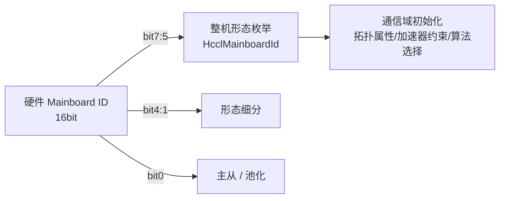

# 整机形态与 Mainboard ID（POD / A+K / A+X Server / 标卡 / 装备 / EVB）

> **深度参考** · 前置阅读：[《集合通信》第 5 章｜拓扑、分层与重叠](/comm-ascend/05-topology-hierarchical-overlap.md)。本篇为参考手册体例，检索导向；事实基线见文首引用块。

> 昇腾集群组网描述之一。概念与实现依据：`hcomm/src/legacy/ascend950/common/types/dev_type.h`（`HcclMainboardId`）、`hcomm/src/legacy/ascend950/unified_platform/external_system/orion_adapter_rts.cc`（Mainboard ID 编码）、`hcomm/src/legacy/ascend910/framework/communicator/impl/hccl_communicator_host.cc`（标卡判定）、`hccl/src/ops/op_common/inc/alg_param.h`（标卡拓扑）。与[组网拓扑](/comm-ascend/reference/overview/cluster-topology.md)正交：组网描述"卡怎么连"，整机形态描述"卡装在什么整机里"。

## 1. 整机形态枚举

`HcclMainboardId`（dev_type.h）由硬件 **Mainboard ID** 的 bit[7:5] 解析而来（`HrtGetMainboardId`：`ACL_DEV_ATTR_MAINBOARD_ID` 右移 5 位取 3 bit，未识别值归 `MAINBOARD_OTHERS`）：

| bit[7:5] | 整机形态 | 枚举 | 一句话 |
| --- | --- | --- | --- |
| 000 | 天成 POD | `MAINBOARD_POD` | POD 整机（超节点资源池形态，与 SuperPod 语义衔接） |
| 001 | A+K Server | `MAINBOARD_A_K_SERVER` | 昇腾 AI 处理器 + 鲲鹏 CPU 的训练服务器 |
| 010 | A+X Server | `MAINBOARD_A_X_SERVER` | 昇腾 AI 处理器 + x86 CPU 的训练服务器 |
| 011 | PCIE 标卡 | `MAINBOARD_PCIE_STD` | PCIe 标准卡插在通用服务器，卡间无 HCCS 直连 |
| 100-101 | RSV | `MAINBOARD_RSV` | 预留 |
| 110 | 装备 | `MAINBOARD_EQUIPMENT` | 装备/测试整机 |
| 111 | EVB | `MAINBOARD_EVB` | 开发板（工程验证） |

**Mainboard ID 完整编码**（16bit）：bit[7:5] 整机形态、bit[4:1] 形态细分（0000-1111）、bit[0] **主从/池化**（0 = NPU 作为某 Host 的从设备、Host 主控；1 = NPU 作为资源池，其它 Host 对等访问）。当前 POD 与 EVB 不区分 A+X/A+K。

## 2. 标卡（PCIE 标准卡）专有逻辑

标卡是算法分支最多的整机形态，判定与影响链：

- **判定**（`HcclCommunicator::IsStandardCard()`，hccl_communicator_host.cc:1306）：
  - 310P3 设备恒为标卡场景；
  - 其他设备：通信域内 **HCCS/HCCS_SW/SIO 三类卡间直连链路数均为 0**（卡间只走 PCIe 主机链路）即标卡。结果写入 `TopoAttr.isStandardCard`（hccl_impl_pub.h:121），hccl 日志关键字 `isStandardCard`（debug_thinking.md）。
- **Level0 算法选择**（hcomm `alg_configurator.cc` `SetAlgoLevel0StandardCard`/`GetDefaultAlgoLevel0StandardCard`）：标卡不走普通 Module 逻辑，固定默认拓扑——2 卡：910B 用 `NP_SINGLE_RING`、其余用 `2P_MESH`；1 卡或 3~8 卡：`NP_SINGLE_RING`；显式配置非 DEFAULT/NA 的 level0 算法会被忽略并告警。
- **专用拓扑**：`TOPO_TYPE_NP_SINGLE_RING`（alg_param.h:123，"目前仅用于标卡"）——服务器内 n rank 组成单环。
- **引擎约束**：标卡环境配置 `CCU_MS` 加速模式直接拦截报错（communicator_impl.cc:2905）；`CCU_SCHED` 遇 PCIE 链路域回退 `AICPU_TS`（>8 卡再回退 AIV）。
- **UB 互通档位**：标卡 TP 策略固定取 TP 列表首个 TP、jetty priority（SL）取 2（tp_manager.cc:44-45，与现网标卡环境对齐）。

## 3. Server / POD 与组网模型的衔接

- **Server**：A+K/A+X Server 是承载 [单服务器组网](/comm-ascend/reference/networking/server_internal.md)（Layer0 HCCS 直连）与[服务器间 RoCE 组网](/comm-ascend/reference/networking/roce_cluster.md)（Layer1）的整机形态，拓扑属性以 serverIdx/serverNum 建模。
- **POD / 超节点**：天成 POD 对应 [UB 超节点组网](/comm-ascend/reference/networking/ub_superpod.md) 的资源池化形态——`superPodId`、`useSuperPodMode`、`serverNumPerSuperPod` 建模；bit[0] 池化位表示 NPU 作为资源池被多 Host 对等访问。
- **形态 × 拓扑正交**：同一套组网拓扑算法（Ring/Mesh/NHR...）在 A+K、A+X Server 上行为一致，形态差异只影响：拓扑属性采集（链路类型探测）、引擎约束（标卡 CCU 拦截）、默认算法分支（标卡单环）。

## 4. 排障视角

故障定位时日志首查字段（debug_thinking.md）：`server[节点信息]`、`superPodId[超节点Id]`、`useSuperPodMode[是否为超节点模式]`、`isStandardCard[是否为标卡场景]`（1 是 / 0 否）。

## 5. 参考资料

- `hcomm/src/legacy/ascend950/common/types/dev_type.h`：`HcclMainboardId` 与 `DevType`（910A/A2/A3/950/960...）枚举
- `hcomm/src/legacy/ascend950/unified_platform/external_system/orion_adapter_rts.cc`：Mainboard ID 16bit 编码与解析
- `hcomm/src/legacy/ascend910/framework/communicator/impl/hccl_communicator_host.cc`：标卡判定（HCCS/SIO 链路探测）
- `hcomm/src/legacy/ascend910/algorithm/impl/alg_configurator.cc`：标卡 Level0 算法默认选择
- `hccl/docs/zh/user_guide/fault_diagnosis/debug_thinking.md`：整机形态相关日志关键字
- [04_昇腾集群组网总览.md](/comm-ascend/reference/overview/cluster-topology.md)：组网拓扑维度（与本文整机形态维度正交）

