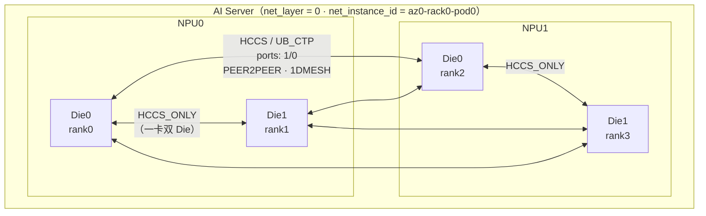
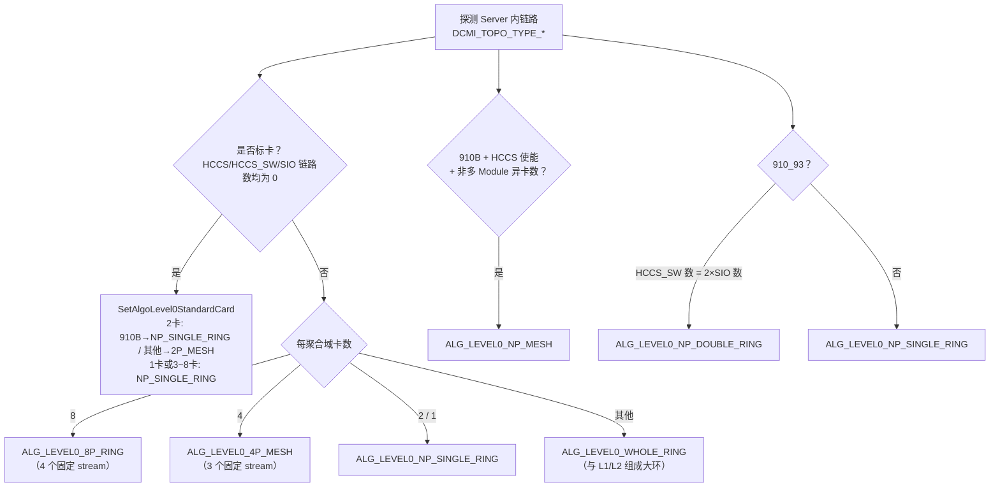

# 单服务器组网（Server 内 L0 直连）

> **深度参考** · 前置阅读：[《集合通信》第 5 章｜拓扑、分层与重叠](/comm-ascend/05-topology-hierarchical-overlap.md)。本篇为参考手册体例，检索导向；事实基线见文首引用块。

> 昇腾集群组网描述之一。**L0 层级**——通信质量最优、带宽最高、唯一以**内存语义**为主的一层。
> 依据：`hccl/docs/zh/user_guide/cluster_info_config/rank_table_config_a5.md`（拓扑文件 `net_layer=0` 配置）、`hcomm/src/legacy/ascend910/algorithm/pub_inc/common.h:325-338`（`TopoType` 12 值）、`hcomm/src/legacy/ascend950/framework/topo/topo_addr_info/src/hal.h`（DCMI 链路类型）、`hccl/src/common/alg_type.h:36-50`（`AlgTypeLevel0`）、`hccl/src/ops/scatter/scatter.cc`（`GetDefaultAlgoLevel0Module`）。

## 1. 拓扑形态

一台 AI Server 内的 NPU（通常 8 卡或 16 卡）通过**片间总线直连**，构成全互联（Fullmesh）或 1DMesh 拓扑实例，**无交换机、所有跨卡路径同跳**。



> ⚠️ **A3 的 rank 粒度**：Atlas A3 系列**每个 NPU 包含 2 个 Device（两个 Die），每个 Device 为一个 rank**。因此"8 NPU 的 A3 Server"实际是 **16 个 rank**——这是 `Level0MeshType::TWO_DIE_REGULAR / TWO_DIE_NOT_REGULAR` 与 `SoleMesh2Die` / `SequenceMesh2Die` / `ccu_temp_*_2dies_*` 等算法/模板存在的原因。

## 2. 层级特征

| 维度 | L0 取值 |
| --- | --- |
| **net_layer** | `0` |
| **net_type** | **仅支持 `TOPO_FILE_DESC`**（通过拓扑文件描述，不可配 CLOS） |
| **link_type** | `PEER2PEER`（NPU 直连） |
| **topo_type** | **`1DMESH`**（Device 和 Device 之间直连，全互联拓扑） |
| **net_instance_id** | 如 `az0-rack0-pod0`、`superpod_0_0` |
| **通信语义** | **内存语义**为主（远端内存映射进本地地址空间，直接本地拷贝） |
| **通道实体** | 映射内存——Channel 仅表示"内存映射已启用"，**不承载数据** |
| **数据搬运硬件** | SDMA / 片间直连 |
| **同步方式** | **ThreadNotify**（同一通信实体内，Notify 寄存器 / Device 内存） |
| **主力引擎** | AIV（低时延）、CCU（950）、AICPU_TS |
| **可否配置算法** | **不可配**——`HCCL_ALGO` 的 level0 **仅支持 NA**，按硬件拓扑自动选择 |

## 3. 链路协议与硬件探测

### 3.1 L0 可用协议（`hcomm/include/hcomm_res_defs.h:118-133`）

| 协议 | 说明 | 语义 |
| --- | --- | --- |
| `COMM_PROTOCOL_HCCS` | Huawei Cache Coherence System，用于 CPU/NPU 之间的高速互联 | 内存语义 |
| `COMM_PROTOCOL_HCCS_ONLY` | **一卡双 Die 使用 HCCS**（Die 间互联） | 内存语义 |
| `COMM_PROTOCOL_UB_MEM` | UB 内存语义 | 内存语义 |
| `COMM_PROTOCOL_UB_CTP` | 灵衢统一总线 CTP——950 的 Server 内 `PEER2PEER` 链路即用此协议 | 网络语义 |
| `COMM_PROTOCOL_PCIE` | PCIe 主机链路（**标卡卡间唯一通路**） | 内存语义 |
| `COMM_PROTOCOL_SIO` | SIO 链路（910_93 场景） | 内存语义 |

### 3.2 DCMI 驱动的链路类型探测

`hcomm/src/legacy/ascend950/framework/topo/topo_addr_info/src/hal.h:113-125`——**DCMI 驱动拓扑类型，`DCMI_TOPO_TYPE_UB` 表示网卡与 NPU 亲和，枚举值需与驱动侧保持一致**：

```c
DCMI_TOPO_TYPE_SELF = 0,   // 同一设备
DCMI_TOPO_TYPE_SYS,        // 跨 NUMA/系统
DCMI_TOPO_TYPE_PHB,        // 经 PCIe Host Bridge
DCMI_TOPO_TYPE_HCCS,       // HCCS 直连
DCMI_TOPO_TYPE_PXB,        // 经多个 PCIe Switch
DCMI_TOPO_TYPE_PIX,        // 经单个 PCIe Switch
DCMI_TOPO_TYPE_SIO,        // SIO 链路
DCMI_TOPO_TYPE_HCCS_SW,    // HCCS Switch
DCMI_TOPO_TYPE_UB,         // 灵衢总线（网卡与 NPU 亲和）
```

> 这 9 个链路类型是 L0 算法自动选择的**物理依据**——`GetDefaultAlgoLevel0Module` 与标卡判定（`IsStandardCard()`：HCCS/HCCS_SW/SIO 三类卡间直连链路数均为 0 即标卡）都基于此探测结果。

### 3.3 Server 形态（`hal.h:91-93`）

```c
#define TOPO_TYPE_IGNORE      (99)  // 忽略该拓扑类型
#define TOPO_TYPE_SERVER_8P   (0)   // 普通服务
#define TOPO_TYPE_SERVER_16FM (3)   // 两个服务器组 16p fullmesh
```

> `TOPO_TYPE_SERVER_16FM`：**两台 Server 组成 16 卡 Fullmesh**——此时"Server 间"链路质量接近 Server 内，L0/L1 的边界被打破，是超节点组网的雏形（见 [ub_superpod.md](/comm-ascend/reference/networking/ub_superpod.md)）。

## 4. L0 算法自动选择规则

### 4.1 `TopoType` 全枚举（`hcomm/src/legacy/ascend910/algorithm/pub_inc/common.h:325-338`）

| 值 | 枚举 | 说明 |
| --- | --- | --- |
| 0 | `TOPO_TYPE_COMMON` | 普通拓扑类型，**default 单层拓扑使用** |
| 1 | `TOPO_TYPE_8P_RING` | 特殊场景，服务器内 **8 rank 组成一个 ring，4 个逻辑环** |
| 2 | `TOPO_TYPE_4P_MESH` | 特殊场景，服务器内 **4 rank 组成 MESH** |
| 3 | `TOPO_TYPE_2P_MESH` | 特殊场景，服务器内 2 rank 组成 MESH。**仅用于测试和自验证** |
| 4 | `TOPO_TYPE_1P_MESH` | 特殊场景，服务器内 1 rank 组成 MESH。**仅用于测试和自验证** |
| 5 | `TOPO_TYPE_4P_RING` | 特殊场景，服务器内 4 rank 组成 ring |
| 6 | `TOPO_TYPE_NP_SINGLE_RING` | 特殊场景，服务器内 n rank 组成单 ring。**目前仅用于标卡** |
| 7 | `TOPO_TYPE_8P_MESH` | 特殊场景，服务器内 **8 rank 通过 RDMA 组成 MESH** |
| 8 | `TOPO_TYPE_NP_MESH` | 特殊场景，服务器内 **3~8p rank 组成 MESH** |
| 9 | `TOPO_TYPE_NP_DOUBLE_RING` | 特殊场景，**910_93 场景** |
| 10 | `TOPO_TYPE_HETEROG` | 异构 |
| 11 | `TOPO_TYPE_ES_MESH` | ES Mesh |

对应 hccl 侧的 `AlgTypeLevel0`（`alg_type.h:36-50`）：`ALG_LEVEL0_WHOLE_RING`、`8P_RING`、`4P_MESH`、`2P_MESH`、`1P_MESH`、`4P_RING`、`NP_SINGLE_RING`、`NP_DOUBLE_RING`、`NP_MESH`、`NP_HD`、`NP_STAR`、`PAIRWISE`、`RESERVED`。

### 4.2 默认选择规则（`GetDefaultAlgoLevel0Module`）

| 每聚合域卡数 / 条件 | 默认算法 | 说明 |
| --- | --- | --- |
| **8 卡** | `ALG_LEVEL0_8P_RING` | 8 卡 HCCS 环，**节点内 4 个固定 stream** |
| **4 卡** | `ALG_LEVEL0_4P_MESH` | 4 卡 Mesh，**节点内 3 个固定 stream** |
| **2 卡 / 1 卡** | `ALG_LEVEL0_NP_SINGLE_RING` | 单环 |
| **其他** | `ALG_LEVEL0_WHOLE_RING` | **与 L1/L2 共同组成一个大环**（单层拓扑） |
| **910B**（HCCS 链路使能、非多 Module 异卡数） | `ALG_LEVEL0_NP_MESH` | 服务器内 3~8p 组 Mesh |
| **910_93** | HCCS_SW 数 = 2×SIO 数 → `NP_DOUBLE_RING`；否则 `NP_SINGLE_RING` | **双环吃满链路** |
| **标卡 2 卡** | 910B → `NP_SINGLE_RING`；其余 → `2P_MESH` | 见 [board_form_factor.md](/comm-ascend/reference/networking/board_form_factor.md) |
| **标卡 1 卡或 3~8 卡** | `NP_SINGLE_RING` | `TOPO_TYPE_NP_SINGLE_RING` 仅用于标卡 |



### 4.3 官方口径

> HCCL 通信域 **Server 内支持 Mesh、Ring、Double-Ring 和 Star 算法**，具体使用的算法**根据硬件拓扑自动选择，用户无须配置也不支持配置**。（`hccl/docs/zh/user_guide/coll_algo_intro/algo_intro.md`）

### 4.4 950 系列的 L0 Mesh 族细选

950PR&950DT 的 selector 在 L0 输出更细的 Mesh 系算法名（**可配 `HCCL_ALGO` 的 level0**，与 A2/A3 不同）：

| 算法名 | 选择条件 |
| --- | --- |
| `*SoleMeshOneShot` | 小数据量**一步直达**（$\alpha+\frac{1}{p}n\beta$ 级别时延） |
| `*SoleMeshTwoShot` | 中数据量**两步收发**（RS + AG） |
| `*SoleMesh` / `*SoleMeshChunk` | 常规 / 分块 |
| `*SoleMesh2Die` / `*SequenceMesh2Die` | **跨 Die**（A3 每 NPU 含 2 Die） |
| `*SoleMeshConcur` / `*ConcurMeshNHRMultiLink` | 多算法 / 多链路并发 |
| `*ParallelMeshNHR` | **矩形拓扑大数据量**（层内层间并行） |
| `*PipeLineMeshNHR` | 流水编排 |

## 5. L0 的引擎选择

| 引擎 | L0 适用性 | 说明 |
| --- | --- | --- |
| **AIV** | ✅ **低时延首选** | Vector Core 直接执行；仅支持对称组网、推理特性；**不支持多通信域并行**；支持控核能力（配置 Vector Core 核数）。产品支持：950PR&950DT、A3（**仅超节点内通信场景**）、A2（**仅单机通信场景**） |
| **CCU** | ✅ **950 专属** | `CCU_MS`（CcuBuffer 中转，**仅单机场景**，仅 Broadcast/Reduce/AllReduce/ReduceScatter/AllGather）；`CCU_SCHED`（UB WQE 调度，片上内存直传）。**标卡环境配置 CCU_MS 直接拦截报错**；CCU_SCHED 遇 PCIe 链路域回退 AICPU_TS |
| **AICPU_TS** | ✅ 大数据量 | 不占计算核；产品支持：950PR&950DT、Atlas A3 |
| **Host CPU_TS** | — | **Atlas A2 专用**（下发开销大，随任务数线性增加） |


> 图源：`hccl/docs/zh/architecture/diagrams/aiv_communication.png`。Host 提交 AIV Kernel → 调度器分发至 Vector Core → Vector Core 利用不同协议完成数据搬运。**AIV 低延迟但占 Vector 计算核**。

## 6. 组网配置示例

### 6.1 950 拓扑文件（L0 部分，`rank_table_config_a5.md`）

```json
{
    "net_layer": 0,              // Server内连接
    "link_type": "PEER2PEER",
    "protocols": ["UB_CTP"],
    "local_a": 0,                // NPU0
    "local_a_ports": ["1/0"],    // Server内连接端口为 Die1 的 0 号端口
    "local_b": 1,                // NPU1
    "local_b_ports": ["1/0"],
    "topo_instance_id": 0,
    "topo_type": "1DMESH",
    "position": "DEVICE"
}
```


> 图源：`hccl/docs/zh/user_guide/cluster_info_config/figures/comm_connect_a5_example.png`（2 个 AI Server，每 Server 2 个 NPU）

### 6.2 950 rank table（L0 部分，EID 地址类型）

```json
{
    "net_layer": 0,                       // Device侧连接
    "net_instance_id": "superpod_0_0",
    "net_type": "TOPO_FILE_DESC",         // ★ net_layer=0 时只能是此值
    "net_attr": "",
    "rank_addr_list": [
        {"addr_type": "EID", "addr": "000000000000000000100000dfdf0020",
         "ports": ["0/4"], "plane_id": "plane0"},
        {"addr_type": "EID", "addr": "000000000000000000100000dfdf0028",
         "ports": ["0/5"], "plane_id": "plane0"}
    ]
}
```

> **EID**（Entity ID）：通信中发起或接收对象的标识，通过 **HCCN TOOL** 查询获取。950 基于 rootInfo 创建通信域前需检查 `/etc/hccl_rootInfo.json` 是否存在（记录 NPU 间通信的 EID 信息，环境部署完成后自动生成）。
>
> **一个地址可绑定多个端口**（上例中同一 rank 的 L0 用了 3 个 EID 各绑一个端口），但**一个端口在同一个网络层次下只能映射到一个地址**。

### 6.3 A2 rank table（隐式 L0，v1.0）

A2 的 rank table 无 `level_list`——L0/L1 由 `server_id` **隐式划分**（同 `server_id` 即同 Server，走 L0）：

```json
{
    "status": "completed", "version": "1.0", "server_count": "2",
    "server_list": [
        {"server_id": "node_0", "device": [
            {"device_id": "0", "device_ip": "192.168.1.8", "device_port": "16667", "rank_id": "0"},
            {"device_id": "1", "device_ip": "192.168.1.9", "device_port": "16667", "rank_id": "1"}]},
        {"server_id": "node_1", "device": [
            {"device_id": "0", "device_ip": "192.168.2.8", "device_port": "16667", "rank_id": "2"},
            {"device_id": "1", "device_ip": "192.168.2.9", "device_port": "16667", "rank_id": "3"}]}
    ]
}
```

> `device_ip` 查询：`cat /etc/hccn.conf` → `address_0=xx.xx.xx.xx`，`address` 后的序号即 `device_id`。**单机场景下 `device_ip` 可不配置**（多机场景必须配置）。

## 7. L0 相关环境变量

| 环境变量 | 作用 |
| --- | --- |
| `HCCL_INTER_HCCS_DISABLE=TRUE` | **禁用 HCCS**，超节点内改用 RDMA 通信（此时 `device_ip` 必须配置） |
| `HCCL_INTRA_PCIE_ENABLE` | Server 内是否启用 PCIe 链路 |
| `HCCL_INTRA_ROCE_ENABLE=1` | Server 内采用 **RoCE 环路**进行多卡间通信（需 Server 上存在 RoCE 网卡且收发设备间 RDMA 链路互通）。与 `HCCL_INTRA_PCIE_ENABLE=0` 配合处置 Atlas 200T A2 Box16 异构子框的 EI0010 建链失败 |
| `HCCL_OP_EXPANSION_MODE` | 引擎展开模式（`AICPU_TS` 默认 / `AIV` / `CCU_MS` / `CCU_SCHED` / `AICPU_CacheDisable`） |
| `HCCL_BUFFSIZE` | 通信缓存区大小 |
| `HCCL_ALGO` | **level0 仅支持 NA**（A2/A3/910）；950 可配 Mesh 族 |

## 8. 适用场景

| 场景 | 说明 |
| --- | --- |
| **单机 SMP 训练/推理** | 8 卡（A3 为 16 rank）单 Server，仅 L0 生效，无跨机通信 |
| **多机集群的 L0 层** | 作为层次化组合的最内层参与分级通信（见 [hierarchical.md](/comm-ascend/reference/networking/hierarchical.md)）——AllReduce 的第一/第三阶段、AllGather 的第一阶段、Broadcast 的第一/第三阶段都在 L0 完成 |
| **AIV / CCU 引擎的唯一完整支持域** | AIV 在 A3 上**仅支持超节点内通信场景**、在 A2 上**仅支持单机通信场景**；CCU_MS **仅支持单机场景** |
| **标卡（PCIe）场景** | 无 HCCS 直连，卡间只走 PCIe 主机链路，L0 算法退化为单环，详见 [board_form_factor.md](/comm-ascend/reference/networking/board_form_factor.md) |

## 9. 参考资料

- `hccl/docs/zh/user_guide/cluster_info_config/rank_table_config_a5.md`：拓扑文件 `net_layer=0` 配置与字段说明（本文 §6.1-§6.2 来源）
- `hccl/docs/zh/user_guide/cluster_info_config/rank_table_config_a2.md`：A2 隐式两级配置
- `hccl/docs/zh/user_guide/coll_algo_intro/algo_intro.md`：Server 内支持 Mesh/Ring/Double-Ring/Star，自动选择不可配
- `hccl/docs/zh/user_guide/coll_algo_intro/Mesh.md`：Mesh 并发使用多路 HCCS 链路、双工双向带宽同时利用
- `hccl/docs/zh/user_guide/hccl_env/HCCL_OP_EXPANSION_MODE.md`：AIV/CCU_MS/CCU_SCHED 的单机约束
- `hccl/docs/zh/user_guide/hccl_env/HCCL_INTER_HCCS_DISABLE.md`、`HCCL_INTRA_PCIE_ENABLE.md`、`HCCL_INTRA_ROCE_ENABLE.md`
- `hcomm/src/legacy/ascend910/algorithm/pub_inc/common.h:325-338`：`TopoType` 12 值（本文 §4.1 来源）
- `hcomm/src/legacy/ascend950/framework/topo/topo_addr_info/src/hal.h:91-125`：Server 形态与 DCMI 链路类型
- `hcomm/src/legacy/ascend910/algorithm/impl/alg_configurator.cc`：`SetAlgoLevel0StandardCard` / `GetDefaultAlgoLevel0StandardCard`
- `hccl/src/ops/scatter/scatter.cc`：`GetDefaultAlgoLevel0Module`
- `hccl/src/common/alg_type.h:36-50`：`AlgTypeLevel0` 枚举
- [04_昇腾集群组网总览.md](/comm-ascend/reference/overview/cluster-topology.md)：RankGraph 模型与配置映射
- [../algorithms/fullmesh.md](/comm-ascend/reference/algorithms/fullmesh.md)、[../algorithms/ring.md](/comm-ascend/reference/algorithms/ring.md)、[../algorithms/star.md](/comm-ascend/reference/algorithms/star.md)：L0 可用算法
- [../03_L0L1L2分级通信实现原理.md](/comm-ascend/reference/overview/l0l1l2-principle.md)：L0 的语义/引擎/原语实现

