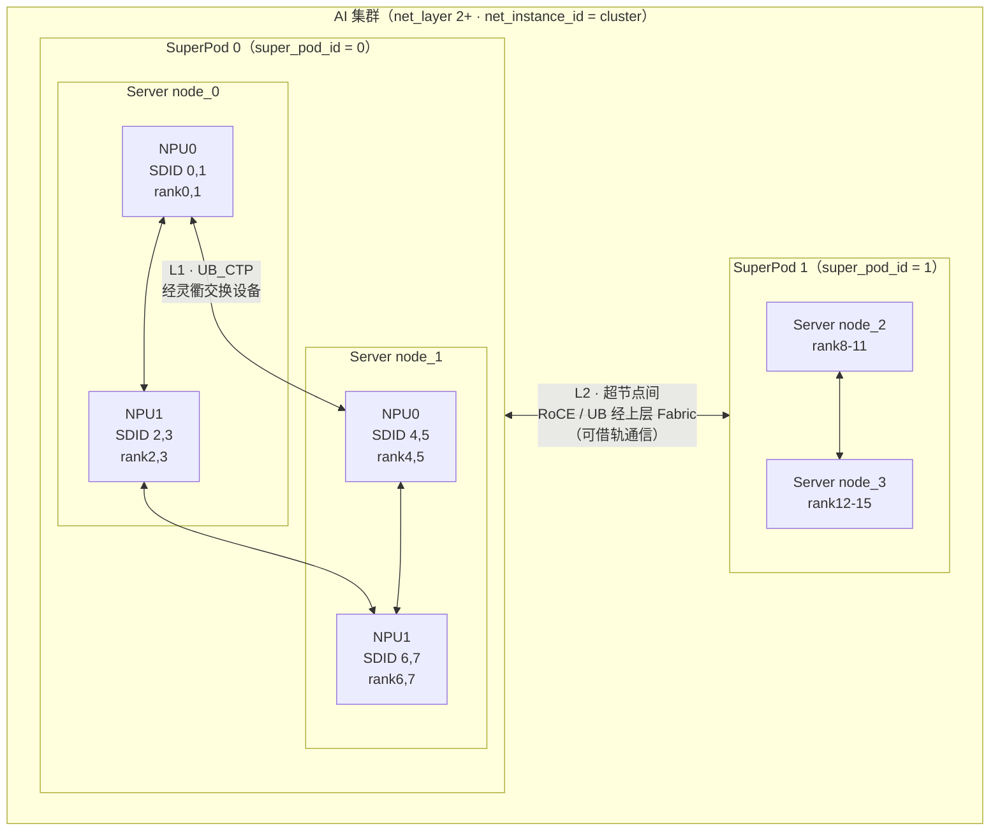
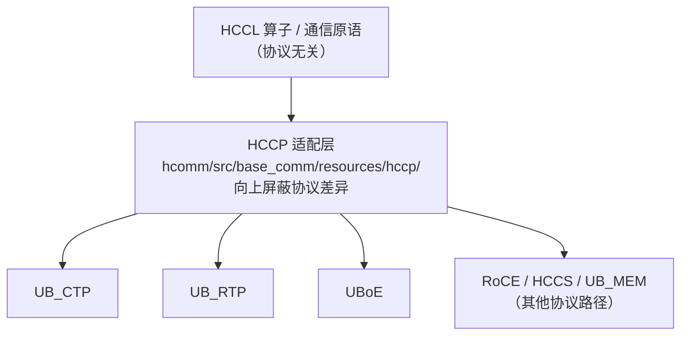
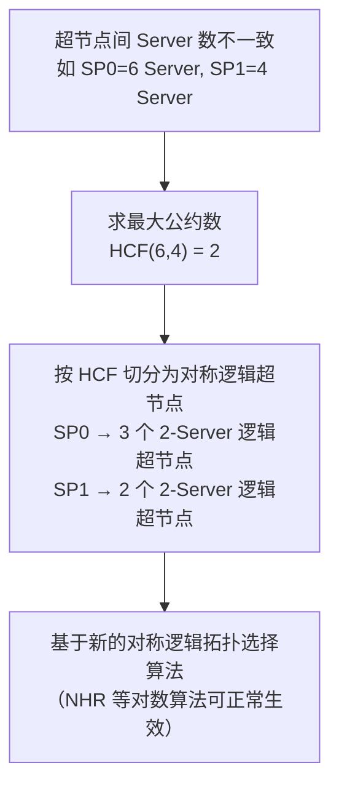
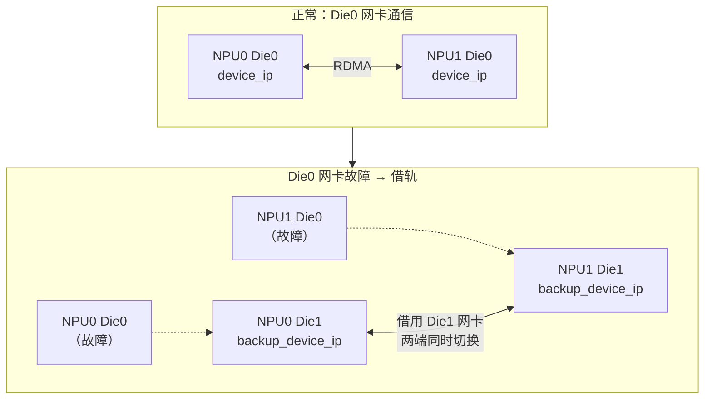

# UB 超节点组网（SuperPod，L1 + L2）

> **深度参考** · 前置阅读：[《集合通信》第 5 章｜拓扑、分层与重叠](/comm-ascend/05-topology-hierarchical-overlap.md)。本篇为参考手册体例，检索导向；事实基线见文首引用块。

> 昇腾集群组网描述之一。**超节点组网 = AI Server 间通过灵衢总线（UB）交换设备连接**——这是唯一同时涉及 **L1（超节点内 Server 间）与 L2（超节点间）** 两层的组网形态。
> 依据：`hccl/docs/zh/user_guide/concepts.md`（超节点组网定义）、`hccl/docs/zh/user_guide/cluster_info_config/rank_table_config_a3.md`（`super_pod_list` / `super_device_id` / 借轨）、`rank_table_config_a5.md`（UB_CTP 拓扑文件）、`hccl/docs/zh/user_guide/hccl_env/HCCL_LOGIC_SUPERPOD_ID.md`、`inter_superpod_algo_support.md`、`hccl/src/common/alg_type.h:66-73`（`AlgTypeLevel2`）、`hccl/src/ops/op_common/inc/alg_param.h:253-264`（超节点字段）。

## 1. 拓扑形态

多台 AI Server 以 **UB（灵衢总线，Unified Bus）协议族**在超节点内对等互联，形成大规格"逻辑单机"；多个超节点再经上层 Fabric 互联组成集群。



> **超节点内 vs 超节点间的层级归属**：超节点内的 Server 间通信为 **L1**（高质量域，UB 直连经灵衢交换设备）；超节点之间为 **L2**（更远层级，带宽收敛更严重）。950 的 rank table 中甚至出现 `net_layer: 3` 用于 **Host 侧连接**（`net_instance_id: "cluster"`，`net_type: "CLOS"`，`addr_type: IPv4`）——说明层级编号可延伸到 Host 网络。

## 2. UB 协议族

| 协议 | 枚举值 | 说明 | 语义 | 典型用途 |
| --- | --- | --- | --- | --- |
| **UB_CTP** | `COMM_PROTOCOL_UB_CTP = 4` | 华为统一总线 CTP（旧名 `UBC_CTP`，兼容别名 `UBC_TP = 5`） | 网络语义 | **超节点内 Server 间**；950 的 L0 `PEER2PEER` 亦用此协议 |
| **UB_RTP** | `COMM_PROTOCOL_UB_RTP = 9` | 华为统一总线 RTP（旧名 `UBG`） | 网络语义 | 超节点内/间可靠传输 |
| **UBoE** | `COMM_PROTOCOL_UBOE = 7` | **UB over Ethernet** | 网络语义 | UB 语义承载在以太网上 |
| **UB_MEM** | `COMM_PROTOCOL_UB_MEM = 6` | UB 内存语义 | **内存语义** | 超节点内直接内存访问 |

### 2.1 HCCP：协议适配层

**HCCP（Huawei Collective Communication adaptive Protocol，集合通信适配协议）**：提供**跨 NPU 设备通信能力，向上屏蔽具体通信协议差异**（`hccl/docs/zh/user_guide/concepts.md`）。

| 项 | 说明 |
| --- | --- |
| 代码路径 | `hcomm/src/base_comm/resources/hccp/` |
| 文档 | `hcomm/docs/zh/architecture/base_comm/hccp.md` |
| 南向适配 | `hcomm/src/base_comm/resources/southbound_adpt/hcomm_adapter_hccp.h`：`MAKE_ENUM(TpProtocol, CTP, RTP, UBOE)`（:155）——HCCP 下挂三种 TP 协议 |
| 超时配置 | `TA_RTP_UBOE_TIMEOUT_DEFAULT = 16`（对应 8s）、`UB_TIMEOUT_MIN = 0`、`UB_TIMEOUT_MAX = 31`（`base_config.h:169-171`）；环境变量 `HCOMM_TA_CTP_UB_TIMEOUT`、`HCOMM_TA_RTP_UB_TIMEOUT`、`HCOMM_TA_RTP_UBOE_TIMEOUT` |



### 2.2 CCU + URMA：950 超节点内的硬化通路

CCU（Collective Communication Unit，集合通信加速单元）是**位于 IO Die 的专用集合通信协处理器**，Thread 抽象为 Mission：

1. Host 将 CCU 指令序列下发至 CCU 指令空间，同时提交 CCU Kernel 任务至任务队列
2. CCU Kernel 被调度器调度后发送至 CCU 执行
3. CCU 执行对应指令流，并利用 **URMA（Unified Remote Memory Access，统一远端内存访问）**完成数据搬运


> **要点**：CCU 执行预置的 CCU 指令流（经 URMA 搬运数据）；**高带宽、低时延**且少占计算核与访存带宽，但**受片上资源限制、支持的通信域数量有限**（Ascend 950PR&950DT 系列产品）。

| CCU 模式 | 数据通路 | 超节点相关性 |
| --- | --- | --- |
| **CCU_MS** | 经 **CcuBuffer** 中转（片上小容量高速缓冲） | **仅单机场景**（不用于跨 Server） |
| **CCU_SCHED** | CCU 作调度器，向 **UB 引擎**下发 **UB WQE**，片上内存→片上内存直传 | **直接驱动 UB 引擎**——超节点内 UB 链路的硬化通路 |

## 3. 层级特征

| 维度 | L1（超节点内 Server 间） | L2（超节点间） |
| --- | --- | --- |
| **net_layer** | `1` | `2`（950 的 Host 侧连接可为 `3`） |
| **net_type** | `CLOS` / `TOPO_FILE_DESC` | `CLOS` |
| **协议** | UB_CTP / UB_RTP / UBoE / UB_MEM | RoCE(v2) / UB 族 |
| **通信语义** | 网络语义（UB_MEM 为内存语义） | 网络语义 |
| **通道实体** | **UB Jetty** 连接 | RoCE QP / UB Jetty |
| **可选算法** | Ring、HD、Pipeline、NHR、NHR_V1、NB、AHC、AHC_BROKE、Star | **Ring、HD、NHR、NB**（+ AG/RS 的 Pipeline，**仅单算子模式且开启零拷贝**） |
| **默认算法** | 见 [roce_cluster.md §5.2](/comm-ascend/reference/networking/roce_cluster.md) | **代码 default 分支选 NHR**（`scatter.cc` `SetAlgoLevel2` 注释"Level2默认选择NHR算法"）；HCCL_ALGO.md 口径：超节点个数 <8 且非 2 幂 → Ring，其他 → H-D_R |
| **可否配置** | ✅ `HCCL_ALGO` level1 | ✅ `HCCL_ALGO` level2；但 **L1 配 AHC 时 L2 自动采用 AHC，显式配置不生效** |
| **产品支持** | A3、950PR&950DT | **仅 Atlas A3** |
| **展开模式** | 任意 | **需 AI_CPU 展开模式**（`HCCL_OP_EXPANSION_MODE`） |
| **确定性计算** | 视算法 | **全部算法支持确定性计算**（`inter_superpod_algo_support.md`） |
| **重执行** | `HCCL_OP_RETRY_ENABLE="L1:1"` | `HCCL_OP_RETRY_ENABLE="L2:1"`（L2 代表通信域物理范围为超节点间通信域） |

`AlgTypeLevel2` 全枚举（`hccl/src/common/alg_type.h:66-73`）：

| 值 | 枚举 | 名称映射 |
| --- | --- | --- |
| 0 | `ALG_LEVEL2_WHOLE_RING` | `"ring"`（单层拓扑，所有 level2 均为 Whole Ring 时组成一个大环） |
| 1 | `ALG_LEVEL2_HD` | `"H-D"` |
| 2 | `ALG_LEVEL2_RING` | `"ring"` |
| 3 | `ALG_LEVEL2_NHR` | `"NHR"` |
| 4 | `ALG_LEVEL2_NB` | `"NB"` |
| 5 | `ALG_LEVEL2_RESERVED` | `"null"` |

## 4. 超节点的非对称难题与两个专用算法

超节点组网带来了集合通信的两个新挑战，HCCL 各有一个专用算法应对：

### 4.1 NHR-HCF（超节点间 Server 数不一致）

| 项 | 说明 |
| --- | --- |
| **全称** | NHR Highest Common Factor（最大公约数） |
| **适用产品** | **仅 Atlas A3 系列** |
| **生效条件** | 超节点间 **Server 数不一致但 Server 内卡数一致**时**默认生效** |
| **可否配置** | **不支持** `HCCL_ALGO` 配置 |
| **原理** | 通过计算超节点间 Server 数的**最大公约数**，将通信域切分为多个**对称分布的逻辑超节点**，并基于新的逻辑拓扑形态选择通信算法 |
| **收益场景** | "超节点间 Server 数的**最大公约数大于 1**"时相对收益更好 |
| **代码关联** | `alg_param.h:264 multiSuperPodDiffServerNumMode`（超节点间 Server 数不一致）；`hcomm/src/coll_communicator_mgr/rank_graph/rank_graph_builder/updater_for_64_plus_1.cc`（64+1 形态的 RankGraph 更新器） |



### 4.2 AHC（超节点间卡数非对称 + 带宽收敛）

| 项 | 说明 |
| --- | --- |
| **全称** | Asymmetric Hierarchical Concatenate（非对称层次化拼接） |
| **适用产品** | **仅 Atlas A3**（L1：RS/AG/AR） |
| **目标场景** | 通信域内 NPU 分布存在**多个层次**，层次间 NPU **对称或非对称**分布；**层次间存在带宽收敛时相对收益更好** |
| **典型例子** | 同一通信域横跨两个超节点，且两个超节点中卡数量不一致（**一个超节点 64 张卡，另一个 128 张卡**） |
| **核心机制** | 基于拓扑重新分组 → 求分组数的**最小公倍数 LCM**，切成 **LCM × G** 份 → 组内并行 ReduceScatter → 划分**"逻辑同号卡"** → 逻辑同号卡间 AllReduce → 组内 AllGather |
| **L2 联动** | **L1 配置 AHC 时，L2 自动采用 AHC，显式配置的其他 L2 算法不生效** |

详见 [../algorithms/ahc.md](/comm-ascend/reference/algorithms/ahc.md)。

## 5. 借轨通信（L2 可靠性机制）

**借轨通信 = 启用备用 Device 网卡的通信方式**：当超节点间通信开启了算子重执行特性时，如果 Device 网卡故障（RDMA 链路故障），可通过 `backup_device_ip` 将**同一 NPU 中的另一个 Die 网卡**指定为备用 Device 网卡，提升算子重执行的成功率。



### 5.1 生效条件（全部满足）

| 条件 | 说明 |
| --- | --- |
| **展开模式** | `export HCCL_OP_EXPANSION_MODE="AI_CPU"` |
| **重执行开关** | `export HCCL_OP_RETRY_ENABLE="L1:1,L2:1"`（L2 代表通信域物理范围为超节点间通信域，取值 1 代表开启） |
| **备用链路正常** | 备用网卡的通信链路正常 |
| **两端 Die 均业务可见** | 互为主备的 Device 都在业务可见范围内。例如 NPU1 含 Device0 与 Device1 两个 Die 互为主备，若通过 `ASCEND_RT_VISIBLE_DEVICES` 指定业务可见 Device 为 Device0、Device1 不可见，则**借轨功能无法执行** |
| **同 NPU 的两 Die 互为备用** | `backup_device_ip` 与 `device_ip` 对应的 Device 需属于**同一 NPU**（同一 NPU 下 Die0 与 Die1 对应的 Device 网卡才能互为备用） |
| **端口不冲突** | 同一个 Device 网卡作为主网卡与备网卡时配置的通信端口号**不能相同** |

### 5.2 行为约束

| 约束 | 说明 |
| --- | --- |
| **两端同时切换** | 两个 NPU 之间的通信要求**本端与对端同时切换为备用网卡**——若 NPU0 的 Die0 网卡故障切换到 Die1，则 NPU1 也会从 Die0 切换到 Die1 |
| **Die 间已有通信则不可借轨** | 如果 Die0 与 Die1 之间本身就存在通信任务，此时借轨功能无法执行 |
| **性能下降** | 发生借轨后，原 Die0 的网卡流量也会通过 Die1 网卡收发，导致 Die1 流量增大，**总体性能会由于物理带宽减半、端口冲突导致下降** |
| **仅一次、不可回切** | **同一 NPU 仅支持发生一次借轨，且不支持回切**。若借轨后再发生链路故障，则不再支持借轨，会**报错退出** |
| **部署建议** | 建议一个 NPU 的两个 Die 分配给**同一个**训练或推理任务。若分给两个不同任务，一个任务发生故障会借用另一个任务的网卡，**两个任务均会发生一定程度的性能下降** |

### 5.3 相关配置

| 字段/环境变量 | 说明 |
| --- | --- |
| `host_ip`（rank table） | AI Server 的 Host IP。**开启 HCCL 重执行特性时必须配置**，否则重执行失效，走无重执行流程 |
| `backup_device_ip` / `backup_device_port` | 备用 Device 网卡 IP 与端口 |
| `HCCL_OP_RETRY_ENABLE` | `"L0:0,L1:1,L2:1"`——按层级独立开关 |
| `HCCL_OP_RETRY_PARAMS` | 重执行参数 |
| `comm_retry_perf_impact.md` | 重执行的性能影响说明 |

## 6. 逻辑超节点划分（`HCCL_LOGIC_SUPERPOD_ID`）

针对 Atlas A3 系列的超节点模式组网，**若不使用 rank table 文件配置集群资源信息**，可通过此环境变量指定当前节点运行进程所属的超节点 ID，实现**将一个物理超节点划分为多个逻辑超节点**的功能。

| 项 | 说明 |
| --- | --- |
| 取值 | string 类型，长度 <128 字符，**默认值为空字符串** |
| 未配置时的行为 | 获取环境中 **"Super Pod ID"** 的值作为超节点 ID；可通过 `npu-smi info -t spod-info -i <id> -c <chip_id>` 查看 |
| **优先级** | 若使用了 rank table 文件，则**优先使用 rank table 文件中的配置** |
| **能力边界** | 作用为将一个物理超节点**划分**为多个逻辑超节点；**不支持将归属于不同物理超节点的 rank 配置到一个逻辑超节点内** |
| 产品支持 | **Ascend 950PR&950DT 系列产品：不支持** |

```bash
export HCCL_LOGIC_SUPERPOD_ID=super_pod_id_1
```

> **与 NHR-HCF 的互补关系**：`HCCL_LOGIC_SUPERPOD_ID` 是**用户主动**把大物理超节点切成小逻辑超节点（划分）；NHR-HCF 是**系统自动**把非对称的多个超节点重组为对称逻辑超节点（重组）。两者都通过"逻辑超节点"这一抽象让算法面对规整拓扑。

## 7. 组网配置

### 7.1 A3 超节点模式 rank table（v1.2）

```json
{
    "status": "completed",
    "version": "1.2",              // ★ 超节点模式组网固定为 1.2
    "server_count": "4",
    "server_list": [
        {"server_id": "node_0", "host_ip": "172.16.0.100", "device": [
            {"device_id": "0", "super_device_id": "0", "device_ip": "192.168.1.6",
             "device_port": "16666", "backup_device_ip": "192.168.1.7",
             "backup_device_port": "16667", "host_port": "16665", "rank_id": "0"},
            {"device_id": "1", "super_device_id": "1", "device_ip": "192.168.1.7",
             "device_port": "16666", "backup_device_ip": "192.168.1.6",
             "backup_device_port": "16667", "host_port": "16666", "rank_id": "1"}
        ]},
        {"server_id": "node_1", "host_ip": "172.16.0.101", "device": [ "... rank_id 4-7 ..."]},
        {"server_id": "node_2", "host_ip": "172.16.0.102", "device": [ "... rank_id 8-11 ..."]},
        {"server_id": "node_3", "host_ip": "172.16.0.103", "device": [ "... rank_id 12-15 ..."]}
    ],
    "super_pod_list": [                                  // ★ 超节点模式独有
        {"super_pod_id": "0", "server_list": [{"server_id": "node_0"}, {"server_id": "node_1"}]},
        {"super_pod_id": "1", "server_list": [{"server_id": "node_2"}, {"server_id": "node_3"}]}
    ]
}
```

| 字段 | 说明 |
| --- | --- |
| `super_device_id` | 可选（**若不配置该字段，会采用"AI Server 模式"**）。AI 处理器在**超节点系统中的物理 ID**，为超节点系统中 NPU 唯一标识。查询：`npu-smi info -t spod-info -i id -c chip_id`，回显中的 **SDID** 即为此值 |
| `super_pod_list[].super_pod_id` | 超节点唯一标识 |
| `super_pod_list[].server_list[].server_id` | 与顶层 `server_list` 的 `server_id` 对应 |

> ⚠️ **注意 `super_device_id` 在不同超节点间会重复**：上例中 node_0 的 SDID 为 0-3、node_1 为 4-7，而 node_2 又从 0 开始、node_3 为 4-7——**SDID 是超节点内唯一，不是全局唯一**（全局唯一标识是 `rank_id`）。

> ⚠️ **多超节点配置顺序**：如果组网中存在多个超节点，**请将属于同一超节点内的 AI Server 信息配置在一起**。假设有两个超节点标识为 "0" 和 "1"，请先配置 "0" 中的 AI Server 信息，再配置 "1" 中的，**不支持交叉配置**。

> ⚠️ **`device_ip` 配置要求**：当组网中包含**多个超节点**时，`device_ip` **必须配置**；若组网中仅包含一个超节点，`device_ip` 仅在**超节点内使用 RDMA 通信时**（即 `HCCL_INTER_HCCS_DISABLE=TRUE` 禁用了 HCCS 功能的场景）必须配置，其他场景可不配置。

### 7.2 950 的超节点建模（v2.0）

950 用 `net_instance_id` 的**命名层次**表达超节点归属，而非独立的 `super_pod_list`：

| net_layer | net_instance_id 示例 | 含义 |
| --- | --- | --- |
| `0` | `superpod_0_0`、`az0-rack0-pod0` | Device 侧连接（超节点内 / AZ-rack-pod 内） |
| `1` | `az0` | Server 间连接（AZ 内） |
| `3` | `cluster` | **Host 侧连接**（EID → IPv4 切换，`net_type: CLOS`） |

## 8. 超节点相关的软件建模字段

`hccl/src/ops/op_common/inc/alg_param.h:253-264`：

| 字段 | 说明 |
| --- | --- |
| `superPodIdx` | SuperPod 在 ranktable 中的自然顺序 |
| `superPodNum` | 超节点数量 |
| `serverNumPerSuperPod` | 每个超节点的服务器个数 |
| `multiSuperPodDiffServerNumMode` | **超节点间 Server 数不一致**（触发 NHR-HCF） |
| `serverIdx` / `serverNum` | Server 顺序与数量 |
| `moduleIdx` / `moduleNum` / `deviceNumPerModule` | A2 的 Module 粒度（A+X 场景 moduleNum 可能与 serverNum 不符） |

拓扑匹配器：`hccl/src/ops/op_common/algorithm/topo_match/topo_match_three_level.cc`、`topo_match_3_level.cc`、`topo_match_nlevel.cc`（三级/多级层级绑定）。

## 9. 适用场景

| 场景 | 说明 |
| --- | --- |
| **Atlas A3 超节点集群** | 大规模训练的近场高带宽域；**唯一支持 L2 层级算法选择的产品** |
| **Ascend 950PR&950DT UB 直连** | L0 + L1 的 Mesh × NHR 组合（`ParallelMeshNHR`、`PipeLineMeshNHR`、`ConcurMeshNHRMultiLink`、`SoleMesh2Die`），**CCU 引擎 + URMA** |
| **MC2 / EP 通算融合** | 通算融合算子在超节点域内通信时延最优；大 EP 场景的 Dispatch/Combine 依赖超节点内高并发 |
| **非对称超节点** | 超节点间 Server 数不一致 → NHR-HCF；卡数非对称 + 带宽收敛 → AHC |
| **16 卡 Fullmesh 形态** | `TOPO_TYPE_SERVER_16FM = 3`（两个服务器组 16p fullmesh）——超节点内 Server 间链路质量接近 Server 内，L0/L1 边界模糊化 |

## 10. 参考资料

- `hccl/docs/zh/user_guide/concepts.md`：**"若 AI Server 间通过灵衢总线交换设备进行连接，组成的组网称之为超节点组网"**（本文 §1 定义来源）；HCCP/QP/SDMA/RoCE 术语
- `hccl/docs/zh/user_guide/cluster_info_config/rank_table_config_a3.md`：超节点模式 rank table（v1.2）、`super_pod_list`、`super_device_id`、**借轨通信完整约束**（本文 §5 来源）、多超节点配置顺序
- `hccl/docs/zh/user_guide/cluster_info_config/rank_table_config_a5.md`：950 的 `net_instance_id` 层级命名与 `net_layer: 3` Host 侧连接
- `hccl/docs/zh/user_guide/hccl_env/HCCL_LOGIC_SUPERPOD_ID.md`：逻辑超节点划分（本文 §6 来源）
- `hccl/docs/zh/user_guide/hccl_env/inter_superpod_algo_support.md`：L2 算法支持度与确定性计算
- `hccl/docs/zh/user_guide/hccl_env/HCCL_OP_RETRY_ENABLE.md`、`HCCL_OP_RETRY_PARAMS.md`、`comm_retry_perf_impact.md`：重执行与借轨
- `hccl/docs/zh/user_guide/hccl_env/HCCL_INTER_HCCS_DISABLE.md`：超节点内改用 RDMA
- `hccl/docs/zh/user_guide/hccl_env/HCOMM_TA_CTP_UB_TIMEOUT.md`、`HCOMM_TA_RTP_UB_TIMEOUT.md`、`HCOMM_TA_RTP_UBOE_TIMEOUT.md`、`HCCL_UB_MULTI_CHANNEL_NUM.md`
- `hccl/docs/zh/user_guide/coll_algo_intro/algo_intro.md`：**NHR-HCF 与分组 Full Mesh 特殊说明**（本文 §4.1 来源）
- `hccl/docs/zh/user_guide/coll_algo_intro/AHC.md`：非对称超节点的 AHC 算法（本文 §4.2 来源）
- `hccl/docs/zh/architecture/architecture-brief.md` §2.4.2：CCU 引擎与 URMA
- `hcomm/docs/zh/architecture/base_comm/hccp.md`、`hcomm/src/base_comm/resources/hccp/`：HCCP 协议模块
- `hcomm/src/base_comm/resources/southbound_adpt/hcomm_adapter_hccp.h:155`：`TpProtocol`（CTP/RTP/UBOE）
- `hcomm/src/base_comm/config_mgr/base_config.h:169-171`：UB/UBoE 超时默认值与范围
- `hcomm/src/coll_communicator_mgr/rank_graph/rank_graph_builder/updater_for_64_plus_1.cc`：非对称超节点的 RankGraph 更新
- `hccl/src/common/alg_type.h:66-73`：`AlgTypeLevel2` 枚举
- `hccl/src/ops/op_common/inc/alg_param.h:253-264`：超节点建模字段
- [04_昇腾集群组网总览.md](/comm-ascend/reference/overview/cluster-topology.md)：RankGraph 模型与配置映射
- [roce_cluster.md](/comm-ascend/reference/networking/roce_cluster.md)：L1 的 RoCE 实现；[hierarchical.md](/comm-ascend/reference/networking/hierarchical.md)：多级嵌套
- [../algorithms/ahc.md](/comm-ascend/reference/algorithms/ahc.md)、[../algorithms/nhr.md](/comm-ascend/reference/algorithms/nhr.md)
- [../03_L0L1L2分级通信实现原理.md](/comm-ascend/reference/overview/l0l1l2-principle.md)：L2 的算法/引擎/可靠性

