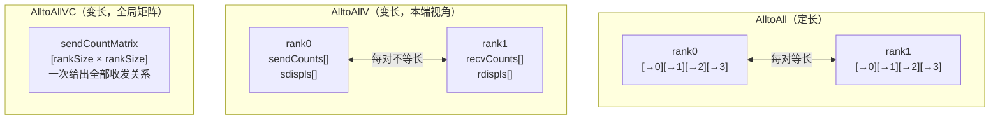
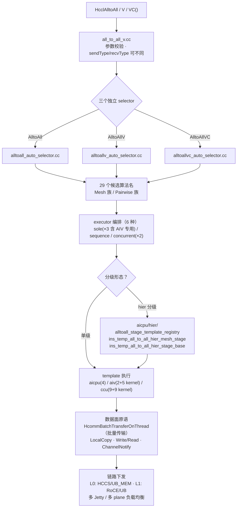

# HcclAlltoAll / AlltoAllV / AlltoAllVC 算子解析

> **深度参考** · 前置阅读：[《集合通信》第 1 章（语义）与第 4 章（AG/RS/AlltoAll）](/comm-ascend/01-collective-semantics-cost.md)。本篇为参考手册体例，检索导向；事实基线见文首引用块。

> 代码基线：`hccl/src/ops/all_to_all_v/`（一个目录承载三个 API）+ `hcomm/src/legacy/ascend910/algorithm/base/alg_template/temp_alltoall/`、`temp_alltoallv/`。
> 参数与约束以 `hccl/docs/zh/api_ref/comm_op_interface/HcclAlltoAll.md`、`HcclAlltoAllV.md`、`HcclAlltoAllVC.md` 为准。
> **EP（专家并行）的通信内核**：MoE Dispatch/Combine 的底层语义即 AlltoAllv。

## 1. 三个变体的语义差异

| 变体 | 功能 | 数据量 | 参数传递方式 |
| --- | --- | --- | --- |
| **AlltoAll** | 向通信域内所有 rank 发送**相同数据量**的数据，并从所有 rank 接收相同数据量的数据。将输入数据在特定维度切分成特定块数，按顺序发送给其他 rank，同时从其他 rank 接收输入数据，按顺序在特定维度拼接 | 定长 | `sendCount` / `recvCount` 标量 |
| **AlltoAllV** | 向所有 rank 发送数据（**数据量可以定制**），并从所有 rank 接收数据 | 变长 | `sendCounts`/`sdispls` + `recvCounts`/`rdispls` 数组 |
| **AlltoAllVC** | 同 AlltoAllV，但**通过输入参数 `sendCountMatrix` 传入所有 rank 的收发参数** | 变长 | `sendCountMatrix` **矩阵**（全 rank 收发关系一次性给出） |

  

> 图源：`hccl/docs/zh/api_ref/comm_op_interface/figures/alltoall.png`、`alltoallv.png`、`alltoallvc.png`



## 2. 函数原型

```c
// AlltoAll（定长）
HcclResult HcclAlltoAll(const void *sendBuf, uint64_t sendCount, HcclDataType sendType,
                        const void *recvBuf, uint64_t recvCount, HcclDataType recvType,
                        HcclComm comm, aclrtStream stream)

// AlltoAllV（变长，收发计数与位移数组）
HcclResult HcclAlltoAllV(const void *sendBuf, const void *sendCounts, const void *sdispls, HcclDataType sendType,
                         const void *recvBuf, const void *recvCounts, const void *rdispls, HcclDataType recvType,
                         HcclComm comm, aclrtStream stream)

// AlltoAllVC（变长，全局收发矩阵）
HcclResult HcclAlltoAllVC(const void *sendBuf, const void *sendCountMatrix, HcclDataType sendType,
                          const void *recvBuf, HcclDataType recvType,
                          HcclComm comm, aclrtStream stream)
```

> **注意 sendType 与 recvType 可以不同**——这是 AlltoAll 族与归约类算子的显著差异（后者要求全 rank dataType 一致）。

## 3. 约束说明

| 变体 | 约束 |
| --- | --- |
| **AlltoAll** | 所有 rank 的 `sendCount`、`sendType`、`recvCount`、`recvType` 均应相同 |
| **AlltoAllV / VC** | 无"全 rank 计数相同"约束（变长语义本身允许不同） |
| **三者共同** | 性能与 NPU 间共享数据的**缓存区大小**有关：当通信数据量超过缓存区大小时性能将**明显下降**。数据量较大时建议通过 `HCCL_BUFFSIZE` 适当增大缓存区 |
| **Atlas 训练系列** | 通信域需满足：**单 Server 1p、2p 通信域要在同一个 cluster 内**（Server 内 0-3 卡和 4-7 卡各为一个 cluster）；单 Server 4p、8p 和多 Server 通信域中 rank 要**以 cluster 为基本单位**，且 Server 间 cluster 选取要一致。单 Server 场景要求网卡状态为 "up"，否则接口执行失败 |
| **Atlas 300I Duo** | 仅支持单 Server 场景，单 Server 最大 2 张 300I Duo（4 个 NPU） |
| **通用** | 串行下发、不允许乱序/多线程并发、不支持线程重入；同一通信域下发线程需相同 Context |

## 4. 分级通信编排（L0/L1/L2）

| 算子 | 阶段一 | 阶段二 | 阶段三 |
| --- | --- | --- | --- |
| AlltoAll / V / VC | **Server 内 AlltoAll**（L0） | **Server 间 AlltoAll**（L1） | — |

> 与 RS/AG 不同，AlltoAll 族的两阶段是**同语义的层级拆分**（都是全交换），不涉及"数据块连续性"的顺序取舍。

### 4.1 专属算法：Pairwise 与分组 Full Mesh

AlltoAll 族是**唯一使用 Pairwise 算法**的算子族，也是**分组 Full Mesh** 的唯一适用对象——两者都为规避 RDMA 链路上的**"一打多"**（一个 rank 通过同一端口给多个 rank 发送数据）：

| 算法 | 产品 | 原理 | 可配置 |
| --- | --- | --- | --- |
| **Pairwise** | Atlas A2 / A3 | Mesh 的分步执行版本：每步只从 1 个节点收、向 1 个节点发，对端按偏移 k 轮转（p−1 步） | ✅ `HCCL_ALGO` |
| **分组 Full Mesh** | **仅 Atlas A3** | 集群规模较大时以一定并发度**分多组**完成：超节点内并发度高、时延小；超节点间并发度低、时延相对较高 | ❌ 不支持配置 |
| **CP 算法** | **仅 Atlas A2 的 AlltoAllV**（单算子模式） | 不支持时**回退 Pairwise** | — |

详见 [../algorithms/pairwise.md](/comm-ascend/reference/algorithms/pairwise.md)、[../algorithms/fullmesh.md](/comm-ascend/reference/algorithms/fullmesh.md)。

## 5. 实现流程图（真实代码路径）



## 6. 代码结构（实测文件清单）

```
all_to_all_v/
├── all_to_all_v.cc / .h                            # 一个目录承载 AlltoAll/V/VC 三个 API
├── selector/                                       # 三个独立 selector（全 HCCL 唯一）
│   ├── alltoall_auto_selector.cc / .h
│   ├── alltoallv_auto_selector.cc / .h
│   └── alltoallvc_auto_selector.cc / .h
├── algorithm/
│   ├── executor/                                   # 6 种执行器
│   │   ├── ins_all_to_all_v_sole_executor.cc               # 注意：无 ins_v2_ 前缀（旧代）
│   │   ├── ins_v2_all_to_all_v_sole_executor.cc
│   │   ├── ins_v2_aiv_all_to_all_v_sole_executor.cc        # AIV 引擎专用 Sole
│   │   ├── ins_v2_all_to_all_sequence_executor.cc          # AlltoAll 顺序编排
│   │   ├── ins_v2_all_to_all_concurrent_executor.cc        # AlltoAll 并发
│   │   └── ins_v2_all_to_all_v_concurrent_executor.cc      # AlltoAllV 并发
│   └── template/
│       ├── aicpu/                                  # 4 个模板 + hier 子目录
│       │   ├── ins_temp_all_to_all_v_mesh_1D.cc
│       │   ├── ins_temp_all_to_all_v_pairwise.cc           # ★ Pairwise（hccl 仓唯一）
│       │   ├── ins_temp_dpu_alltoall_mesh.cc               # 框间（DPU）Mesh
│       │   ├── ins_temp_ubx_all_to_all_v_mesh_1D.cc        # UBX（UB 交换）组网专用
│       │   └── hier/                                       # ★ 分级阶段模板（AlltoAll 族独有）
│       │       ├── alltoall_stage_template_registry.cc/.h  # 阶段模板注册表
│       │       ├── ins_temp_all_to_all_hier_stage_base.h   # 分级阶段基类
│       │       └── ins_temp_all_to_all_hier_mesh_stage.cc  # 分级 Mesh 阶段
│       ├── aiv/
│       │   ├── aiv_temp_all_to_all_mesh_1D.cc
│       │   ├── aiv_temp_all_to_all_v_mesh_1D.cc
│       │   └── kernel/aiv_all_to_all_mesh_1D.h、aiv_all_to_all_v_mesh_1D.h
│       │            aiv_a2a_mesh_1d_superkernel.h
│       │            aiv_all_to_all_op.h、aiv_all_to_all_v_op.h
│       └── ccu/                                    # 9 模板 + 9 kernel
│           ├── ccu_temp_all_to_all_mesh_1D.cc / _mesh1d_2Die.cc / _mesh2die.cc
│           ├── ccu_temp_all_to_all_mesh1d_multi_jetty.cc           # 多 Jetty
│           ├── ccu_temp_all_to_all_concurrent_mesh_nhr.cc          # Mesh+NHR 并发
│           ├── ccu_temp_all_to_all_v_mesh_1D.cc / _mesh1d_2Die.cc / _mesh2die.cc
│           ├── ccu_temp_all_to_all_v_mesh_1D_multi_jetty.cc
│           └── kernel/ccu_kernel_all_to_all*_*.cc
└── op_graph/all_to_all_v_proto.cc
```

## 7. 可选算法名（selector 实测，29 个）

| 引擎 | 变体 | 算法名 |
| --- | --- | --- |
| **AICPU_TS** | AlltoAll | `AicpuAllToAllSoleMesh`、`SoleMeshConcurrent`、`SoleMeshMultiJetty`、`SoleMeshSingleChannel`、`SolePairwise` |
| | AlltoAllV | `AicpuAllToAllVSoleMesh`、`SoleMeshConcurrent`、`SoleMeshMultiJetty`、`SolePairwise` |
| | AlltoAllVC | `AicpuAllToAllVCSoleMesh`、`SolePairwise` |
| **CCU_SCHED** | AlltoAll | `CcuSchedAllToAllSoleMesh`、`SoleMesh2Die`、`SoleMeshConcur`、`SoleMeshConcurrent`、`SoleMeshMultiJetty`、`SoleMeshMultiLink` |
| | AlltoAllV | `CcuSchedAllToAllVSoleMesh`、`SoleMesh2Die`、`SoleMeshConcurrent`、`SoleMeshMultiJetty`、`SoleMeshMultiLink` |
| | AlltoAllVC | `CcuSchedAllToAllVCSoleMesh` |
| **AIV** | 三者 | `AivAllToAllSoleMesh`、`AivAllToAllVSoleMesh`、`AivAllToAllVCSoleMesh` |

> **观察**：AlltoAll 族的算法名**全部是 Sole 编排**——没有 Sequence/Parallel/PipeLine 组合。原因：Pairwise 本身就是 p−1 步的完整方案，Mesh 是 1 步完整方案，两者都无需再分层编排；分级需求由 `hier/` 阶段模板注册表在**模板层**而非**执行器层**解决。

## 8. 实现要点

| 要点 | 说明 |
| --- | --- |
| **一目录三 API + 三 selector** | 全 HCCL 唯一：`alltoall_auto_selector` / `alltoallv_auto_selector` / `alltoallvc_auto_selector` 各自独立比选 |
| **`hier/` 分级阶段模板注册表** | AlltoAll 族独有的分级实现方式——用 `alltoall_stage_template_registry` 注册各层级阶段模板，而非用 Sequence 执行器串联 |
| **UBX 专用模板** | `ins_temp_ubx_all_to_all_v_mesh_1D.cc` 对应 UB 交换组网；配套 `op_common/algorithm/topo_match/topo_match_ubx.cc`、`topo_match_ubx_1d.cc` |
| **多 Jetty / 多 Link** | `SoleMeshMultiJetty`、`SoleMeshMultiLink` 用于 CLOS 多端口（`CLOS_PORT_NUM=4`）与多 plane 负载均衡——EP 变长流量在多平面上分摊 |
| **910 路径的流水 + Pairwise 组合** | `allltoall_pipeline_mesh_pairwise_ccl_enough.cc`（CCL Buffer 充足）、`allltoall_pipeline_mesh_pairwise_ping_pong.cc`（乒乓缓冲）——**Mesh 与 Pairwise 混合流水** |
| **对称内存路径** | `alltoall_symmetric_memory.cc`（910 路径）——零拷贝直读远端对称窗口 |
| **staged 分级中转** | `alltoallv_staged_base.cc`、`_staged_calculator.cc`、`_staged_mesh.cc`、`_staged_pairwise.cc`——经 CCL Buffer 中转的分级实现 |
| **300I Duo 专用** | `alltoallv_for_310p.cc` |
| **缓存区敏感** | 数据量超 `HCCL_BUFFSIZE` 时性能明显下降——EP 大 batch 场景需调大 |

## 9. 上层消费方（EP 场景）

AlltoAllv 是 **MoE 专家并行**的通信内核：

| 上层算子 | 通信语义 |
| --- | --- |
| `MoeDistributeDispatch` / `V2` / `V3` | **Dispatch**：按路由结果把 token 发往各专家所在 rank（AlltoAllV，变长） |
| `MoeDistributeCombine` / `V2` / `V3` | **Combine**：把专家计算结果收回原 rank 并加权归约（AlltoAllV + Reduce） |
| `MoeEpDispatch` / `MoeEpCombine`（+ `_epilogue`） | EP 专用 Dispatch/Combine |
| `AlltoAllMatmul` / `V2`、`MatmulAlltoAll` | AlltoAll 与 Matmul 融合 |
| `AlltoAllvQuantGroupedMatMul`、`QuantGroupedMatMulAlltoAllv`、`GroupedMatMulAlltoAllv` | 量化 + 分组 Matmul + AlltoAllv 三段融合 |
| `AlltoAllAllGatherBatchMatMul`、`BatchMatMulReduceScatterAlltoAll` | 多段融合 |
| `MegaMoe` | 大 EP 融合算子 |

详见 ../../ep/01_专家并行通信概述.md、../../mc2/operators/。

## 10. 参考资料

- `hccl/docs/zh/api_ref/comm_op_interface/HcclAlltoAll.md`、`HcclAlltoAllV.md`、`HcclAlltoAllVC.md`：三变体参数与约束
- `hccl/docs/zh/user_guide/api_comm_impl.md`：AlltoAll 语义（按维度切分/拼接）
- `hccl/docs/zh/user_guide/coll_algo_intro/Pairwise.md`：一打多问题与 Pairwise 原理
- `hccl/docs/zh/user_guide/coll_algo_intro/algo_intro.md`：分组 Full Mesh 特殊说明（仅 A3）
- `hccl/docs/zh/user_guide/hccl_env/inter_server_algo_support.md`：Pairwise / CP 算法产品支持
- `hccl/docs/zh/user_guide/hccl_env/HCCL_BUFFSIZE.md`：缓存区大小对 AlltoAll 性能的影响
- `hccl/src/ops/all_to_all_v/`：950/A5 路径实现（含 `hier/` 分级阶段注册表）
- `hcomm/src/legacy/ascend910/algorithm/base/alg_template/temp_alltoall/`、`temp_alltoallv/`：910/A2/A3 路径 12 个模板
- [../algorithms/pairwise.md](/comm-ascend/reference/algorithms/pairwise.md)、[../algorithms/fullmesh.md](/comm-ascend/reference/algorithms/fullmesh.md)
- ../../ep/：EP Dispatch/Combine 消费方

