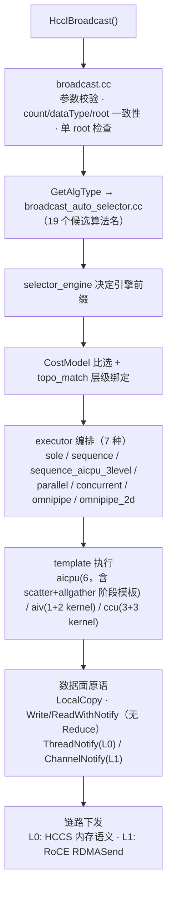

# HcclBroadcast 算子解析

> **深度参考** · 前置阅读：[《集合通信》第 1 章（语义）与第 4 章（AG/RS/AlltoAll）](/comm-ascend/01-collective-semantics-cost.md)。本篇为参考手册体例，检索导向；事实基线见文首引用块。

> 代码基线：`hccl/src/ops/broadcast/`（950/A5 路径）+ `hcomm/src/legacy/ascend910/algorithm/base/alg_template/temp_broadcast/`（910/A2/A3 路径，9 个模板）。
> 参数与约束以 `hccl/docs/zh/api_ref/comm_op_interface/HcclBroadcast.md` 为准。
> **Broadcast 是唯一使用单一 `buf` 参数（原地语义）的集合通信算子**。

## 1. 算子概述

**功能**：将通信域内 **root 节点**的数据广播到其他 rank。


> 图源：`hccl/docs/zh/api_ref/comm_op_interface/figures/broadcast.png`

**函数原型**（注意：**只有一个 `buf`**，无 sendBuf/recvBuf 之分）：

```c
HcclResult HcclBroadcast(void *buf, uint64_t count, HcclDataType dataType,
                         uint32_t root, HcclComm comm, aclrtStream stream)
```

| 参数 | 输入/输出 | 描述 |
| --- | --- | --- |
| `buf` | **输入兼输出** | root 节点：作为**输入**（待广播数据）；其他节点：作为**输出**（接收广播结果） |
| `count` | 输入 | 数据个数 |
| `dataType` | 输入 | 数据类型（**无 op 参数**——Broadcast 不做归约） |
| `root` | 输入 | 根节点 rank id |
| `comm` / `stream` | 输入 | 通信域 / 本 rank 的 stream |

> **原地语义**：`buf` 既是源又是目的——这是 Broadcast 与所有其他集合通信算子的接口差异。root 的数据原地不变，非 root 的 `buf` 被覆写。

## 2. 约束说明

- 所有 rank 的 `count`、`dataType`、`root` 均应相同
- **全局只能有 1 个 root 节点**
- 通信算子需串行下发，不允许乱序、多线程并发下发，不支持线程重入；同一通信域下发线程需相同 Context

## 3. 分级通信编排（L0/L1/L2）

Broadcast 是**三阶段编排**，且第一阶段用 **Scatter** 而非 Broadcast：

| 阶段 | 层级 | 操作 | 说明 |
| --- | --- | --- | --- |
| 阶段一 | **L0** | **Server 内 Scatter** | root 先把数据在**本 Server 内散开**（切成多份分给各卡） |
| 阶段二 | **L1** | **Server 间 Broadcast** | 每张卡各自负责把**自己那一份**广播给其他 Server 的**同号卡** |
| 阶段三 | **L0** | **Server 内 AllGather** | 各卡把收到的分片在 Server 内聚合，还原完整数据 |


> **为什么先 Scatter 再 Broadcast**：如果直接 Server 间 Broadcast 全量数据，root 所在 Server 的出口带宽要承载 (serverNum−1) × 全量；先 Scatter 切成 p₀ 份后，**Server 内所有卡的网卡并行出口**，跨机总带宽提升 p₀ 倍。这与 AllReduce "先 L0 ReduceScatter 降低跨机数据量" 是同一思路的镜像。

## 4. 实现流程图（真实代码路径）



## 5. 代码结构（实测文件清单）

```
broadcast/
├── broadcast.cc / .h
├── selector/broadcast_auto_selector.cc / .h        # 19 个算法名
├── algorithm/
│   ├── executor/                                   # 7 种执行器（全部 ins_v2_ 前缀）
│   │   ├── ins_v2_broadcast_sole_executor.cc
│   │   ├── ins_v2_broadcast_sequence_executor.cc
│   │   ├── ins_v2_broadcast_sequence_executor_aicpu_3level.cc   # 三级拓扑
│   │   ├── ins_v2_broadcast_parallel_executor.cc
│   │   ├── ins_v2_broadcast_concurrent_executor.cc
│   │   ├── ins_v2_broadcast_omnipipe_executor.cc
│   │   └── ins_v2_broadcast_omnipipe_2d_executor.cc
│   └── template/
│       ├── aicpu/                                  # 6 个模板 = 2 Broadcast + 2 Scatter阶段 + 2 AllGather阶段
│       │   ├── ins_temp_broadcast_mesh_1D_two_shot.cc         # Broadcast Mesh 两步
│       │   ├── ins_temp_broadcast_nhr.cc                      # Broadcast NHR
│       │   ├── ins_temp_scatter_mesh_1D_intra.cc              # ★ 阶段一：框内 Scatter
│       │   ├── ins_temp_scatter_nhr_dpu_inter.cc              # ★ 阶段二辅助：框间 Scatter（DPU）
│       │   ├── ins_temp_allgather_mesh_1D_intra.cc            # ★ 阶段三：框内 AllGather
│       │   └── ins_temp_allgather_nhr_dpu_inter.cc            # ★ 阶段二：框间 AllGather（DPU）
│       ├── aiv/
│       │   ├── aiv_temp_broadcast_mesh_1D.cc
│       │   └── kernel/aiv_broadcast_mesh_1d.h、aiv_broadcast_op.h
│       └── ccu/                                    # 3 模板 + 3 kernel
│           ├── ccu_temp_broadcast_mesh_1D.cc / _mesh_1D_mem2mem.cc
│           ├── ccu_temp_broadcast_nhr_1D_mem2mem.cc
│           └── kernel/ccu_kernel_broadcast_mesh1d.cc、_mesh1d_mem2mem.cc、_nhr1d_mem2mem.cc
└── op_graph/broadcast_proto.cc
```

> **阶段模板命名差异**：Broadcast 目录下的 Scatter/AllGather 阶段模板使用 `ins_temp_allgather_*`（**小写 g**），而 AllReduce 目录下是 `ins_temp_all_gather_*`（**下划线分隔**）——两批代码命名风格不同，检索时需注意。

## 6. 可选算法名（selector 实测，19 个）

| 引擎 | 编排 | 算法名 |
| --- | --- | --- |
| **AICPU_TS** | Sole | `AicpuBroadcastSoleMeshTwoShot`、`SoleNHR`、`SoleNHRMultiLink` |
| | Sequence | `AicpuBroadcastSequenceMeshConcurNHRNHR` |
| | Parallel | `AicpuBroadcastParallelMeshNHR`、`ParallelMeshNHRMultiJetty`、`ParallelNHRNHR` |
| | Concur | `AicpuBroadcastConcurMeshNHR` |
| **CCU_MS** | Concur | `CcuMSBroadcastConcurMeshNHR` |
| **CCU_SCHED** | Sole / Parallel / PipeLine / Concur | `CcuSchedBroadcastSoleMesh`、`SoleNHR`、`ParallelMeshNHR`、`ParallelMeshNHRMultiJetty`、`PipeLineMeshNHR`、`ConcurMeshNHR` |
| **AIV** | Sole | `AivBroadcastSoleMesh` |

## 7. 实现要点

| 要点 | 说明 |
| --- | --- |
| **910 路径模板覆盖全部算法族** | `temp_broadcast/` 9 个模板：`broadcast_oneshot`（一步直达）、`broadcast_ring`、`broadcast_star`、`broadcast_nb`、`broadcast_nb_binary`（NB 二叉变体）、`broadcast_nhr`、`broadcast_nhr_oneshot`、`broadcast_nhr_v1`、`bcast_recursive_halvingdoubling` |
| **Star 算法的两个落点之一** | `broadcast_star.cc`——官方 Star 文档即**以 Broadcast 为例**讲解（"根节点 Root 利用星型拓扑从其他各节点收集数据"），见 [../algorithms/star.md](/comm-ascend/reference/algorithms/star.md) |
| **无归约语义** | 纯数据分发，模板不含 `_reduce_`；耗时公式无 γ 项 |
| **CCU_MS 支持** | Broadcast 是 CCU_MS 模式支持的 5 个算子之一（Broadcast/Reduce/AllReduce/ReduceScatter/AllGather），仅单机场景 |
| **AIV 支持** | Broadcast 在 AIV 展开模式的支持列表内 |
| **无 order_preserved** | 保序执行器仅 AllReduce/ReduceScatter 有 |
| **NHR 耗时公式** | Broadcast = Scatter + AllGather：$2\lceil log_2 p\rceil\alpha+2\frac{p-1}{p}n\beta$（无 γ 项） |

## 8. 与 Scatter 的镜像关系

| | **Broadcast** | **Scatter** |
| --- | --- | --- |
| 语义 | root 的**全量**数据 → 所有 rank 都得到**全量** | root 的全量数据 → **均分**，每 rank 得到 **1/p** |
| 接口 | 单一 `buf`（原地） | `sendBuf` + `recvBuf` 分离 |
| 分级阶段一 | Server 内 **Scatter** | Server 间 **Scatter** |
| 分级阶段二 | Server 间 **Broadcast** | Server 内 **Scatter** |
| 分级阶段三 | Server 内 **AllGather** | —（两阶段） |
| L1 算法约束 | 无特殊限制 | **仅 Ring/NHR/NB**（其余重定向为 Ring） |
| op_graph | ✅ `broadcast_proto.cc` | ❌ 无 |

详见 [scatter.md](/comm-ascend/reference/operators/scatter.md)。

## 9. 上层消费方

| 上层算子 | 说明 |
| --- | --- |
| `MatmulAllReduceAddRmsNorm` | RmsNorm 后的参数广播 |
| `MoeDistributeDispatch` 族 | 路由信息广播 |
| `DistributeBarrier` / `DistributeBarrierExtend` | 同步语义（Barrier 可视为无数据的 Broadcast） |
| 910 路径 AllReduce 的组合实现 | `all_reduce_reduce_broadcast.cc`、`all_reduce_local_reduce_bcast.cc`——Reduce 到 root 再 Broadcast |

## 10. 参考资料

- `hccl/docs/zh/api_ref/comm_op_interface/HcclBroadcast.md`：参数（单一 `buf`）与约束
- `hccl/docs/zh/user_guide/api_comm_impl.md`：Broadcast 语义与"通信域内只能有一个 root 节点"
- `hccl/docs/zh/user_guide/coll_algo_intro/algo_intro.md`：Broadcast 三阶段分级编排表（本文 §3 来源）
- `hccl/docs/zh/user_guide/coll_algo_intro/Star.md`：以 Broadcast 为例的 Star 算法讲解
- `hccl/docs/zh/user_guide/coll_algo_intro/NHR.md`：Broadcast = Scatter + AllGather 耗时公式
- `hccl/src/ops/broadcast/`：950/A5 路径实现
- `hcomm/src/legacy/ascend910/algorithm/base/alg_template/temp_broadcast/`：910/A2/A3 路径 9 个模板
- [scatter.md](/comm-ascend/reference/operators/scatter.md)：镜像算子；[../algorithms/star.md](/comm-ascend/reference/algorithms/star.md)
- 算法详解：[../algorithms/](/comm-ascend/reference/algorithms/)；层级原理：[../03_L0L1L2分级通信实现原理.md](/comm-ascend/reference/overview/l0l1l2-principle.md)

