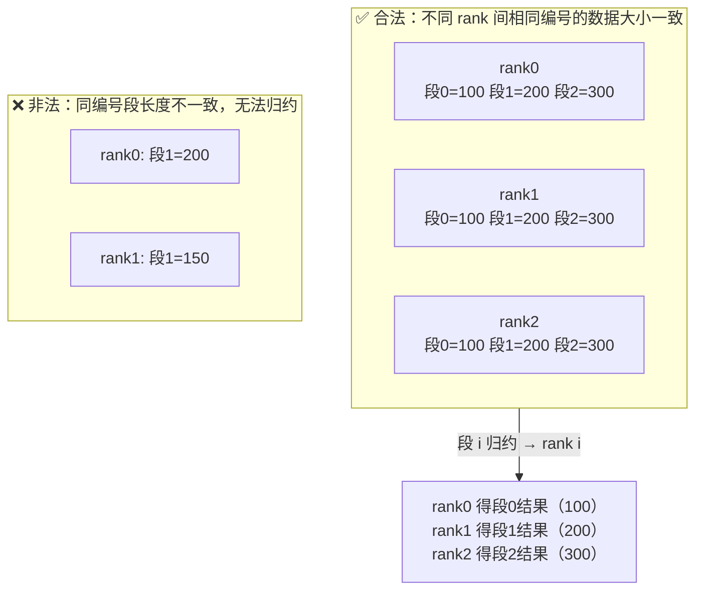
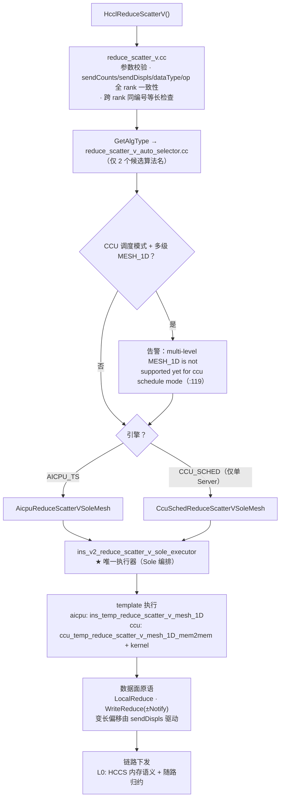

# HcclReduceScatterV 算子解析

> **深度参考** · 前置阅读：[《集合通信》第 1 章（语义）与第 4 章（AG/RS/AlltoAll）](/comm-ascend/01-collective-semantics-cost.md)。本篇为参考手册体例，检索导向；事实基线见文首引用块。

> 代码基线：`hccl/src/ops/reduce_scatter_v/`（950/A5 路径）+ `hcomm/src/legacy/ascend910/algorithm/base/alg_template/temp_reduce_scatter/reduce_scatter_v_pipeline.cc`（910/A2/A3 路径）。
> 参数与约束以 `hccl/docs/zh/api_ref/comm_op_interface/HcclReduceScatterV.md` 为准。
> **实现最精简的集合通信算子之一**：仅 1 种执行器、2 个算法名。

## 1. 算子概述

**功能**：与 ReduceScatter 操作类似，不同点是**支持为通信域内不同的节点配置不同大小的数据量**（同一 rank 不同编号的数据大小可设置，但**不同 rank 间相同编号的数据大小需保持一致**），取每个 rank 对应编号的数据进行归约操作后（支持 sum、prod、max、min），再把结果按照编号分散到各个 rank 的输出 buffer。


> 图源：`hccl/docs/zh/api_ref/comm_op_interface/figures/reducescatterv.png`

**函数原型**（用 `sendCounts` + `sendDispls` 数组描述变长布局）：

```c
HcclResult HcclReduceScatterV(void *sendBuf, const void *sendCounts, const void *sendDispls,
                              void *recvBuf, uint64_t recvCount, HcclDataType dataType,
                              HcclReduceOp op, HcclComm comm, aclrtStream stream)
```

| 参数 | 输入/输出 | 描述 |
| --- | --- | --- |
| `sendBuf` | 输入 | 源数据 buffer（按编号切分为 rankSize 段，**各段长度可不同**） |
| `sendCounts` | 输入 | **数组**：本 rank 输入中各编号段的数据个数 |
| `sendDispls` | 输入 | **数组**：各编号段在 `sendBuf` 中的起始偏移 |
| `recvBuf` | 输出 | 目的 buffer，接收本 rank 编号对应的归约结果 |
| `recvCount` | 输入 | 本 rank 输出的数据个数 |
| `dataType` | 输入 | 数据类型 |
| `op` | 输入 | 归约操作类型（sum/prod/max/min） |
| `comm` / `stream` | 输入 | 通信域 / 本 rank 的 stream |

### 1.1 变长约束的关键：跨 rank 同编号必须等长



> **为什么必须等长**：归约是**逐元素**操作，编号 i 的段要在所有 rank 间做 element-wise 归约，长度不一致则无法对齐。变长体现在**不同编号之间**长度可不同（段0=100、段1=200、段2=300），而非同一编号跨 rank 可不同。

## 2. 约束说明

| 约束 | 说明 |
| --- | --- |
| **全 rank 一致** | 所有 rank 的 `sendCounts`、`sendDispls`、`dataType`、`op` 均应相同 |
| **Atlas A3** | **仅支持单 Server 场景** |
| **Atlas A2** | **仅支持多机对称分布场景，不支持非对称分布（即卡数非对称）的场景** |
| **Atlas 300I Duo** | 仅支持单 Server 场景，单 Server 中最大支持部署 **2 张** 300I Duo（即 **4 个 NPU**） |
| **CCU_SCHED** | ReduceScatterV、AllGatherV 算子**仅支持单 Server 场景** |
| **对齐要求** | int8→1 Byte；int16/float16/bfp16→2 Byte；int32/float32→4 Byte；int64/uint64/float64→8 Byte |
| **通用** | 串行下发、不允许乱序/多线程并发、不支持线程重入；同一通信域下发线程需相同 Context |

## 3. 分级通信编排（L0/L1/L2）

| 阶段 | 层级 | 操作 |
| --- | --- | --- |
| 阶段一 | **L1** | Server 间 ReduceScatterV |
| 阶段二 | **L0** | Server 内 ReduceScatterV |

> 与 ReduceScatter 一致：**先层间后层内**，保证 Server 间通信数据块的连续性。

## 4. 实现流程图（真实代码路径）



## 5. 代码结构（实测文件清单）

```
reduce_scatter_v/
├── reduce_scatter_v.cc / .h
├── selector/reduce_scatter_v_auto_selector.cc / .h  # 2 个算法名；:119 CCU 多级 MESH_1D 不支持告警
├── algorithm/
│   ├── executor/
│   │   └── ins_v2_reduce_scatter_v_sole_executor.cc / .h   # ★ 唯一执行器
│   └── template/
│       ├── aicpu/ins_temp_reduce_scatter_v_mesh_1D.cc / .h
│       └── ccu/
│           ├── ccu_temp_reduce_scatter_v_mesh_1D_mem2mem.cc / .h
│           └── kernel/ccu_kernel_reduce_scatter_v_mesh1d_mem2mem.cc / .h
└── op_graph/reduce_scatter_v_proto.cc
```

> **与 AllGatherV 结构完全对称**：1 执行器 + 2 模板 + 1 kernel，无 aiv 模板。

## 6. 可选算法名（selector 实测，2 个）

| 引擎 | 算法名 | 约束 |
| --- | --- | --- |
| **AICPU_TS** | `AicpuReduceScatterVSoleMesh` | — |
| **CCU_SCHED** | `CcuSchedReduceScatterVSoleMesh` | **仅单 Server 场景** |

> 无 `Aiv*`（RSV 不在 AIV 展开模式支持列表内）、无 `CcuMS*`（CCU_MS 仅支持 Broadcast/Reduce/AllReduce/ReduceScatter/AllGather）。

## 7. L1 算法支持度

| 算法 | RSV 支持情况 |
| --- | --- |
| **NHR** | ✅ Atlas A3、A2 |
| **Ring** | ✅ Atlas A3、A2 |
| **NB** | ✅ Atlas A3、A2、Atlas 训练系列 |
| **Pipeline** | ✅ **仅 Atlas A2** |
| H-D_R / AHC / Pairwise / NHR_V1 | ❌（AHC 仅支持 RS/AG/AR，不含 RSV） |
| Atlas 训练系列 | ❌ RSV 不在其支持列表 |

## 8. 实现要点

| 要点 | 说明 |
| --- | --- |
| **与 ReduceScatter 的实现落差** | ReduceScatter 有 9 种执行器 + 33 个算法名 + 12 个 AICPU 模板 + hif8/保序/控核等特性；RSV 只有 1 执行器 + 2 算法名——**变长语义显著提高了分层算法的实现成本** |
| **CCU 多级 MESH_1D 明确不支持** | `reduce_scatter_v_auto_selector.cc:119` 告警 "multi-level MESH_1D is not supported yet for ccu schedule mode"——CCU_SCHED 下 RSV 只能单 Server |
| **无 hifloat8** | hif8 仅 ReduceScatter 支持（`aiv_reduce_scatter_mesh_1d_hif8.h`），RSV 不在其列 |
| **无保序（order_preserved）** | 严格保序仅 AllReduce/ReduceScatter 支持 |
| **910 路径有流水模板** | `reduce_scatter_v_pipeline.cc`——A2 的 RSV Pipeline 支持来源 |
| **EP 场景的典型用途** | MoE Combine 时各专家返回的 token 数不等，RSV 用于按不等长分片归约散布 |

## 9. 参考资料

- `hccl/docs/zh/api_ref/comm_op_interface/HcclReduceScatterV.md`：参数（`sendCounts`/`sendDispls`）与按产品约束（本文 §2 来源）
- `hccl/docs/zh/user_guide/api_comm_impl.md`：ReduceScatterV 语义（同 rank 不同编号可不等长、跨 rank 同编号需一致）
- `hccl/docs/zh/user_guide/coll_algo_intro/algo_intro.md`：RSV 两阶段分级编排
- `hccl/docs/zh/user_guide/hccl_env/HCCL_OP_EXPANSION_MODE.md`：CCU_SCHED 下 RSV 仅单 Server
- `hccl/docs/zh/user_guide/hccl_env/inter_server_algo_support.md`：RSV 的 L1 算法支持度
- `hccl/src/ops/reduce_scatter_v/`：950/A5 路径实现（含 `:119` 告警）
- `hcomm/src/legacy/ascend910/algorithm/base/alg_template/temp_reduce_scatter/reduce_scatter_v_pipeline.cc`：A2 的 RSV Pipeline
- [reduce_scatter.md](/comm-ascend/reference/operators/reduce_scatter.md)：定长版本（实现丰富得多）；[all_gather_v.md](/comm-ascend/reference/operators/all_gather_v.md)：结构对称的变长聚合
- 算法详解：[../algorithms/](/comm-ascend/reference/algorithms/)；层级原理：[../03_L0L1L2分级通信实现原理.md](/comm-ascend/reference/overview/l0l1l2-principle.md)

