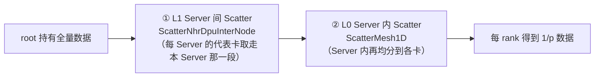
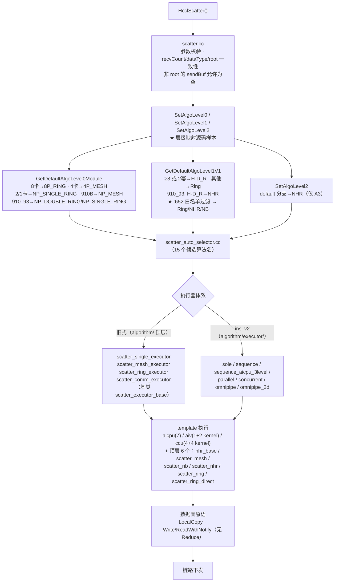

# HcclScatter 算子解析

> **深度参考** · 前置阅读：[《集合通信》第 1 章（语义）与第 4 章（AG/RS/AlltoAll）](/comm-ascend/01-collective-semantics-cost.md)。本篇为参考手册体例，检索导向；事实基线见文首引用块。

> 代码基线：`hccl/src/ops/scatter/`（950/A5 路径）+ `hcomm/src/legacy/ascend910/algorithm/base/alg_template/temp_scatter/`（910/A2/A3 路径，8 个模板）。
> 参数与约束以 `hccl/docs/zh/api_ref/comm_op_interface/HcclScatter.md` 为准。
> **Scatter 是结构最特殊的算子**：唯一同时保留"旧式 algorithm/ 顶层执行器"与"ins_v2 执行器"两套体系、唯一无 `op_graph/`、且是 `SetAlgoLevel0/1/2` 层级映射的源码样本。

## 1. 算子概述

**功能**：将 **root 节点**的数据**均分并散布**至其他 rank。


> 图源：`hccl/docs/zh/user_guide/figures/scatter.png`

**函数原型**（注意是 `recvCount`）：

```c
HcclResult HcclScatter(void *sendBuf, void *recvBuf, uint64_t recvCount, HcclDataType dataType,
                       uint32_t root, HcclComm comm, aclrtStream stream)
```

| 参数 | 输入/输出 | 描述 |
| --- | --- | --- |
| `sendBuf` | 输入 | 源数据 buffer——**非 root 节点可以为空**，root 节点不能为空 |
| `recvBuf` | 输出 | 目的 buffer，接收本 rank 分到的那一份（长度 `recvCount`） |
| `recvCount` | 输入 | **每个 rank 输出**的数据个数 |
| `dataType` | 输入 | 数据类型（**无 op 参数**——Scatter 不做归约） |
| `root` | 输入 | 根节点 rank id |
| `comm` / `stream` | 输入 | 通信域 / 本 rank 的 stream |

## 2. 约束说明

- 所有 rank 的 `recvCount`、`dataType`、`root` 均应相同
- **全局只能有 1 个 root 节点**
- **非 root 节点的 `sendBuf` 可以为空；root 节点的 `sendBuf` 不能为空**（Scatter 独有约束）
- 通信算子需串行下发，不允许乱序、多线程并发下发，不支持线程重入；同一通信域下发线程需相同 Context

## 3. 分级通信编排（L0/L1/L2）

| 阶段 | 层级 | 操作 | 为什么这个顺序 |
| --- | --- | --- | --- |
| 阶段一 | **L1** | **Server 间 Scatter** | **先层间后层内**——保证 Server 间通信数据块的连续性 |
| 阶段二 | **L0** | **Server 内 Scatter** | 再在 Server 内把分片散到各卡 |



> 顺序与 ReduceScatter 一致（**先层间后层内**），与 AllGather/Broadcast 相反——因为 Scatter 是"分发"语义，需保证跨机传输的是**连续的大块**。

## 4. L1 算法白名单（Scatter 独有的强约束）

**Server 间仅支持 Ring / NHR / NB 三种算法，其余算法一律重定向为 Ring**（`hccl/src/ops/scatter/scatter.cc:652`）：

| L1 算法 | Scatter 是否支持 | 不支持时的行为 |
| --- | --- | --- |
| **Ring** | ✅ | — |
| **NHR** | ✅ | — |
| **NB** | ✅ | — |
| H-D_R（RHD） | ❌ | **重定向为 Ring** |
| Pipeline | ❌ | 重定向为 Ring |
| AHC / AHC_BROKE | ❌ | 重定向为 Ring |
| Pairwise | ❌ | 重定向为 Ring（Pairwise 仅 AlltoAll 族） |
| Star | ❌ | 重定向为 Ring |

**910_93 特殊约束**：仅支持 Server 间 **Ring**。

> **为什么 Scatter 的 L1 算法受限**：Scatter 是"root 单点分发"语义，数据流是**单向、非对称**的（root → 其他）。RHD/NHR/NB 这类对数算法依赖**双向对等交换**（每步两两互发），无法直接承载单向分发；Pipeline 依赖 Server 内链路的并发回填，而 Scatter 的 Server 内阶段本身就是分发的最后一步。因此只有 Ring（单向轮转天然匹配）、NHR/NB（生成树/多重环可构造单向分发路径）可用。

## 5. 实现流程图（真实代码路径）



## 6. 代码结构（实测文件清单）

```
scatter/
├── scatter.cc / .h                                 # ★ SetAlgoLevel0/1/2 层级映射源码样本
│                                                   #   GetDefaultAlgoLevel0Module / GetDefaultAlgoLevel1V1
│                                                   #   :652 L1 白名单（Ring/NHR/NB）
├── selector/scatter_auto_selector.cc / .h          # 15 个算法名
├── algorithm/
│   ├── ★ 旧式执行器（algorithm/ 顶层，非 executor/ 子目录）
│   │   ├── scatter_executor_base.cc / .h           # 旧式执行器基类
│   │   ├── scatter_single_executor.cc / .h         # 单卡/单步
│   │   ├── scatter_mesh_executor.cc / .h           # Mesh 形态
│   │   ├── scatter_ring_executor.cc / .h           # Ring 形态
│   │   └── scatter_comm_executor.cc / .h           # 通用通信执行器
│   ├── executor/                                   # 7 种 ins_v2 执行器
│   │   ├── ins_v2_scatter_sole_executor.cc
│   │   ├── ins_v2_scatter_sequence_executor.cc
│   │   ├── scatter_sequence_aicpu_executor_3level.cc      # 三级拓扑（命名顺序不同）
│   │   ├── ins_v2_scatter_parallel_executor.cc
│   │   ├── ins_v2_scatter_concurrent_executor.cc
│   │   ├── ins_v2_scatter_omnipipe_executor.cc
│   │   └── ins_v2_scatter_omnipipe_2d_executor.cc
│   └── template/
│       ├── ★ 顶层算法模板（6 个，非引擎子目录）
│       │   ├── nhr_base.cc / .h                    # NHR 基类
│       │   ├── scatter_mesh.cc / .h
│       │   ├── scatter_ring.cc / .h
│       │   ├── scatter_ring_direct.cc / .h         # 直连环
│       │   ├── scatter_nhr.cc / .h
│       │   └── scatter_nb.cc / .h                  # ★ NB 在 hccl 仓的两个落点之一
│       ├── aicpu/                                  # 7 个模板
│       │   ├── ins_temp_scatter_mesh_1D.cc
│       │   ├── aicpu_temp_scatter_mesh_1D_Z_axis_detour.cc   # CLOS Z 轴绕路（命名前缀不同）
│       │   ├── ins_temp_scatter_nhr.cc
│       │   ├── ins_temp_scatter_nhr_dpu_inter_node.cc        # 框间（跨节点 DPU）
│       │   ├── ins_temp_scatter_omnipipe_mesh1d.cc           # 流水 Mesh
│       │   ├── ins_temp_scatter_omnipipe_nhr.cc              # 流水 NHR
│       │   └── ins_temp_scatter_omnipipe_nhr_dpu.cc          # 流水框间 NHR
│       ├── aiv/
│       │   ├── aiv_temp_scatter_mesh_1D.cc
│       │   └── kernel/aiv_scatter_mesh_1d.h、aiv_scatter_op.h
│       └── ccu/                                    # 4 模板 + 4 kernel
│           ├── ccu_temp_scatter_mesh1d.cc
│           ├── ccu_temp_scatter_nhr1d_mem2mem.cc
│           ├── ccu_temp_scatter_omnipipe_mesh1d_mem2mem.cc
│           ├── ccu_temp_scatter_omnipipe_nhr1d_mem2mem.cc
│           └── kernel/ccu_kernel_scatter_*.cc
└── ★ 无 op_graph/ 目录（Scatter 不支持 GE 图模式注册）
```

## 7. 可选算法名（selector 实测，15 个）

| 引擎 | 编排 | 算法名 |
| --- | --- | --- |
| **AICPU_TS** | Sole | `AicpuScatterSoleMesh`、`SoleNHR` |
| | Parallel | `AicpuScatterParallelMeshNHR`、`ParallelMeshNHRMultiJetty` |
| | PipeLine | `AicpuScatterPipeLineMeshNHR` |
| | Concur | `AicpuScatterConcurMeshNHR` |
| **CCU_SCHED** | Sole / Parallel / PipeLine / Concur | `CcuSchedScatterSoleMesh`、`SoleNHR`、`ParallelMeshNHR`、`ParallelMeshNHRMultiJetty`、`PipeLineMeshNHR`、`ConcurMeshNHR` |
| **AIV** | Sole | `AivScatterSoleMesh` |

> **观察**：Scatter 的算法名中**没有 Pairwise、没有 SequenceMesh2Die、没有 MultiLink**——与其 L1 算法白名单受限、无跨 Die 专用模板的实现现状一致。

## 8. 实现要点

| 要点 | 说明 |
| --- | --- |
| **两套执行器体系并存** | 全 HCCL 唯一：`algorithm/` 顶层的旧式执行器（`scatter_single/mesh/ring/comm_executor`，基类 `scatter_executor_base`）与 `algorithm/executor/` 的 ins_v2 执行器同时存在——反映 Scatter 从旧架构向执行器-模板架构迁移的中间态 |
| **顶层算法模板** | 6 个模板直接放在 `algorithm/template/` 而非引擎子目录（`scatter_mesh/ring/ring_direct/nhr/nb`、`nhr_base`）——引擎无关的算法逻辑 |
| **`SetAlgoLevel0/1/2` 源码样本** | `scatter.cc` 是理解 HCCL 三层算法映射的**最佳入口**：`GetDefaultAlgoLevel0Module`（L0 按卡数/链路形态）、`GetDefaultAlgoLevel1V1`（L1 按 Server 数/2 幂）、`SetAlgoLevel2`（L2 default→NHR）全部在此，[../algorithms/algo_level_matrix.md](/comm-ascend/reference/algorithms/algo_level_matrix.md) 的规则表即源自此文件 |
| **无 op_graph** | Scatter 不注册进 GE 图模式——图模式下无 Scatter 算子 |
| **910 路径含多 root 与双环** | `temp_scatter/` 8 个模板：`multi_root_scatter_ring`（**多 root** Scatter）、`scatter_double_ring_direct`、`scatter_ring_direct`、`scatter_ring_concurrent_direct`、`scatter_ring`、`scatter_mesh`、`scatter_nhr`、`scatter_nb` |
| **NB 的 hccl 仓落点** | `scatter/algorithm/template/scatter_nb.cc` 是 NB 算法在 hccl 仓的**唯一模板文件**（其余 NB 实现均在 hcomm 910 路径） |
| **AIV 支持** | Scatter 在 AIV 展开模式的支持列表内 |
| **CCU_MS 不支持** | CCU_MS 仅支持 Broadcast/Reduce/AllReduce/ReduceScatter/AllGather——**Scatter 不在其中** |

## 9. 与 Broadcast 的镜像关系

| | **Scatter** | **Broadcast** |
| --- | --- | --- |
| 语义 | root 全量 → **均分**，每 rank 得 1/p | root 全量 → 所有 rank 得**全量** |
| 接口 | `sendBuf` + `recvBuf` 分离 | 单一 `buf`（原地） |
| `sendBuf` 可空 | ✅ 非 root 可为空 | —（无 sendBuf） |
| 分级阶段数 | **2**（L1 Scatter → L0 Scatter） | **3**（L0 Scatter → L1 Broadcast → L0 AllGather） |
| L1 算法约束 | **仅 Ring/NHR/NB** | 无特殊限制 |
| op_graph | ❌ | ✅ |
| 执行器体系 | 旧式 + ins_v2 **两套并存** | 仅 ins_v2 |

## 10. 参考资料

- `hccl/docs/zh/api_ref/comm_op_interface/HcclScatter.md`：参数与约束（含"非 root 的 sendBuf 可为空"）
- `hccl/docs/zh/user_guide/api_comm_impl.md`：Scatter 语义与"通信域内只能有一个 root 节点"
- `hccl/docs/zh/user_guide/coll_algo_intro/algo_intro.md`：Scatter 两阶段分级编排表
- `hccl/docs/zh/user_guide/hccl_env/inter_server_algo_support.md`：Scatter 的 L1 算法支持范围
- `hccl/src/ops/scatter/scatter.cc`：**`SetAlgoLevel0/1/2` 与 `GetDefaultAlgoLevel0Module`/`GetDefaultAlgoLevel1V1` 层级映射源码**（:652 L1 白名单）
- `hcomm/src/legacy/ascend910/algorithm/base/alg_template/temp_scatter/`：910/A2/A3 路径 8 个模板
- `hcomm/src/legacy/ascend910/algorithm/impl/alg_configurator.cc`：`SetAlgoLevel0StandardCard`/`GetDefaultAlgoLevel0StandardCard`（标卡分支）
- [broadcast.md](/comm-ascend/reference/operators/broadcast.md)：镜像算子；[../algorithms/nb.md](/comm-ascend/reference/algorithms/nb.md)：NB 算法
- [../algorithms/algo_level_matrix.md](/comm-ascend/reference/algorithms/algo_level_matrix.md)：L0/L1/L2 选择矩阵（源自 scatter.cc）
- [../networking/board_form_factor.md](/comm-ascend/reference/networking/board_form_factor.md)：标卡场景的 L0 算法分支

