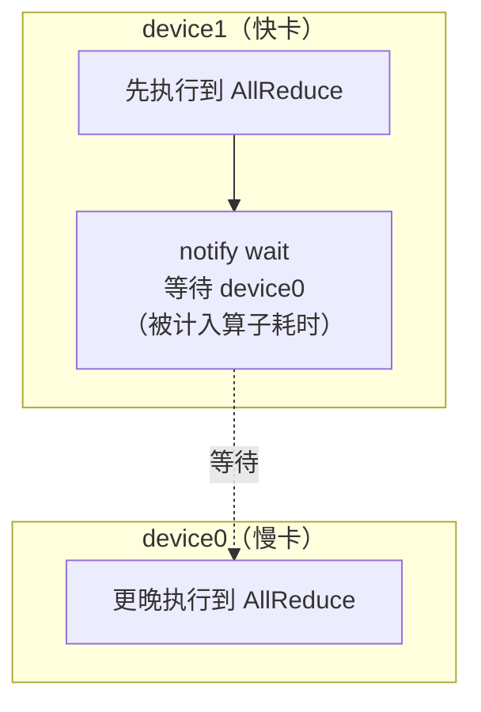
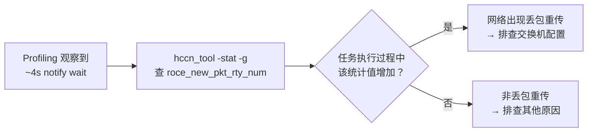

# 快慢卡分析与交换机拥塞

> **深度参考** · 前置阅读：[CANN 常用命令速查（Profiling 节）](/comm-ascend/cann常用命令.md)。本篇为参考手册体例，检索导向；事实基线见文首引用块。

> 两类典型的执行层性能问题：**快慢卡**（rank 间执行不同步导致 notify wait 被计入算子耗时）与**交换机拥塞丢包**（网络配置问题导致重传）。
>
> 事实来源：`hccl/docs/zh/user_guide/perf_analysis/slow_fast_card_analysis.md`、`switch_congestion_loss.md`。

---

## 1. 快慢卡问题

### 1.1 现象与机理

集合通信算子在执行内存拷贝任务前，需与对端进行**一次前同步**（保证对端已准备好接收数据）。若对端还没执行到同一个通信算子，本端需等待对端算子同步后才能往下执行——**这个 notify wait 的等待时间会被统计到通信算子执行中**，形成"通信算子性能慢"的假象。


> 图源：`hccl/docs/zh/user_guide/perf_analysis/figures/slow_fast_rank.png`



> 示例：device1 先执行到 AllReduce，但 device0 执行到的时间更慢，因此 device1 上的 AllReduce 会有一段 notify wait 时间被统计到算子耗时中。

### 1.2 常见原因与排查

| 原因 | 说明 | 排查方向 |
| --- | --- | --- |
| **前置计算算子性能波动** | 慢卡的前置计算算子耗时波动，导致到达通信算子的时间晚 | 分析前置计算算子的 Profiling，找波动源 |
| **通信算子下发瓶颈** | host 侧其他行为导致慢卡的通信算子没能及时下发 | 分析下发层（CANN 层），CPU 绑核 / 切 AIV 模式（见 [collect_analyze.md §4](/comm-ascend/reference/profiling/collect_analyze.md)） |

> **定位关键**：快慢卡的本质是 **notify wait 时间被误认为通信耗时**。需进一步排查卡间算子执行为何有快慢——是计算波动还是下发瓶颈。

---

## 2. 交换机流量拥塞反压 / 丢包重传

> 本节场景及处理方法**仅适用于 Atlas A3 / Atlas A2 系列产品**。

### 2.1 现象

若在 Profiling 数据中观察到**长达 4 秒左右的 notify wait 任务**，一般对应网络配置出现问题，导致**丢包重传**。

### 2.2 定位方法

通过 `hccn_tool` 查看统计值中的 **`roce_new_pkt_rty_num`** 字段：

```bash
hccn_tool -i {DeviceId} -stat -g
```



> 若在任务执行过程中 `roce_new_pkt_rty_num` 统计值增加，说明网络出现丢包重传，需进一步排查**交换机配置**（PFC/ECN/拥塞控制等）。

---

## 3. 两类问题对比

| 维度 | 快慢卡 | 交换机拥塞丢包 |
| --- | --- | --- |
| **本质** | rank 间执行不同步 | 网络丢包重传 |
| **Profiling 特征** | notify wait 被计入算子耗时 | **~4s 的 notify wait 任务** |
| **定位手段** | 分析前置计算 / 下发层 | `hccn_tool -stat -g` 查 `roce_new_pkt_rty_num` |
| **根因** | 前置计算波动 / 下发瓶颈 | 交换机配置（拥塞反压） |
| **适用产品** | 全部 | 仅 A3 / A2 |

---

## 4. 参考资料

- `hccl/docs/zh/user_guide/perf_analysis/slow_fast_card_analysis.md`：快慢卡问题分析（本文 §1 来源）
- `hccl/docs/zh/user_guide/perf_analysis/switch_congestion_loss.md`：交换机流量拥塞反压或丢包重传（本文 §2 来源）
- `hccl/docs/zh/user_guide/perf_analysis/profiling_op_behavior.md`：notify wait / RDMASend 任务识别
- 关联：[README.md](/comm-ascend/reference/profiling/)、[collect_analyze.md](/comm-ascend/reference/profiling/collect_analyze.md)、[../debug/localization_flow.md](/comm-ascend/reference/debug/localization_flow.md)（notify wait 超时 EI0002 的故障诊断）、[../networking/roce_cluster.md](/comm-ascend/reference/networking/roce_cluster.md)（RoCE 调优）

