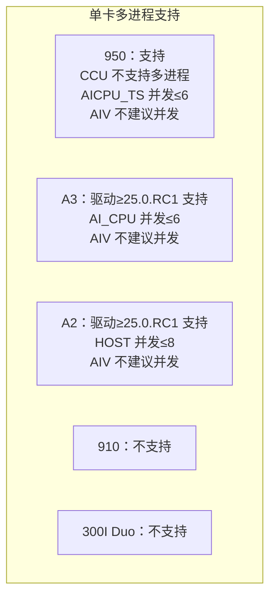

# 系统约束与限制

> HCCL 的公共约束与各产品（950/A3/A2/910/300I Duo）专属约束。涉及虚拟化、ACL Graph、单卡多进程、CCU 资源规格、图模式并发图数、卡数等。
>
> 事实来源：`hccl/docs/zh/user_guide/constraints.md`（系统约束权威）、`hccl/docs/zh/user_guide/hccl_env/HCCL_OP_EXPANSION_MODE.md`（展开模式约束）。

---

## 1. 公共约束

| 约束 | 说明 |
| --- | --- |
| **不支持虚拟化实例** | 集合通信不支持应用于昇腾虚拟化实例场景（vNPU——通过资源虚拟化将物理机/虚拟机 NPU 切分成多个虚拟实例） |
| **ACL Graph 同一捕获实例** | 使用 ACL Graph 特性时，若捕获的 Graph 实例含通信算子，则执行阶段通信域内**所有 Rank 必须执行同一次捕获生成的同一个 Graph 实例**；不支持跨不同捕获会话生成的 Graph 实例配对执行（即使内部算子序列完全相同），否则通信算子执行异常 |
| **单机多容器同 IP** | 单机多容器场景建议为所有容器配置**相同 IP 地址**，避免性能对比测试中相较裸机出现性能劣化 |

---

## 2. 各产品约束对比

### 2.1 Ascend 950PR&950DT 系列

| 约束 | 说明 |
| --- | --- |
| **x86 服务器内核版本** | 昇腾计算模组适配第三方 x86 服务器时，OS 内核版本需 **> 5.18**；否则需手工安装 haveged 补熵工具并启动服务 |
| **单卡多进程** | CCU **不支持多进程**——需保证不同 NPU 上首个通信域创建归属同一组业务进程（保证 CCU 被同一组进程占用）；AICPU_TS（默认）单卡进程并发 **≤6**；AIV 不建议单卡多进程并发（建议串行），否则任务死锁风险 |
| **图模式并发图** | 图模式（Ascend IR）/图捕获（aclgraph）下，AI CPU 模式单卡并发图数量 **≤6**，否则 AI CPU 核被占满导致通信阻塞 |
| **CCU 调度模式资源规格** | 受 CCU 硬件资源规格限制：**≤64P** 通信算子（AlltoAllV **≤16P**）可考虑开启 CCU；通信域间 CCU 资源无法复用，多通信域需评估资源是否充足 |

CCU 硬件资源规格（调度模式）：

| 资源分类 | 单位 | 硬件资源规格 |
| --- | --- | --- |
| Channel | 个 | **120** |
| Loop | 个 | **68** |
| CCU Buffer | KB | **2048** |

> CCU 配置：① 环境变量 `HCCL_OP_EXPANSION_MODE`（资源不足回退 AI CPU）；② 通信域粒度 `HcclCommInitClusterInfoConfig`（CCU 通信域独立管理，按需规划 CCU 资源）。详见 [../engine/ccu.md](/comm-ascend/reference/engine/ccu.md)。

### 2.2 Atlas A3 系列

| 约束 | 说明 |
| --- | --- |
| **单卡多进程** | 驱动固件 ≥25.0.RC1 支持（多进程共用一 NPU）；AI_CPU（默认）单卡进程并发 **≤6**；AIV 不建议并发（建议串行），否则任务死锁风险；驱动不满足则单进程运行 |
| **对称组网建议** | 建议每个超节点中 Server 数量一致、每个 Server 中 AI 处理器数量一致，否则性能劣化 |
| **图模式并发图** | AI CPU 模式单卡并发图 **≤6** |

### 2.3 Atlas A2 系列

| 约束 | 说明 |
| --- | --- |
| **单卡多进程** | 驱动固件 ≥25.0.RC1 支持；HOST（默认）单卡进程并发**不建议 >8**；AIV 不建议并发；驱动不满足则单进程 |
| **卡数约束** | 单 Server 场景对参与集合通信的 AI 处理器数量**无限制**；Server 集群场景要求卡数为 **(1~8)×n**（n 为 Server 个数）；建议每 Server 卡数一致，否则性能劣化 |

### 2.4 Atlas 训练系列（910）

| 约束 | 说明 |
| --- | --- |
| **不支持单卡多进程** | 不支持多个业务进程同时共用一个 NPU |
| **卡数约束** | 单 Server：实际参与卡数只能为 **1/2/4/8**，且 0-3 卡和 4-7 卡各为一个组网，2/4 卡训练不支持跨组网创建集群；Server 集群：卡数只能为 **1×n/2×n/4×n/8×n**，n 为 2 的指数倍时集群性能最好 |

### 2.5 Atlas 300I Duo 推理卡

| 约束 | 说明 |
| --- | --- |
| **不支持单卡多进程** | 不支持多个业务进程同时共用一个 NPU |
| **仅单 Server** | 仅支持单 Server 场景，每个集合通信操作支持的最大 NPU 数量见具体 API |
| **初始化时序** | 通信域初始化需在**其他任何涉及 Device 内存申请的操作之前**，否则可能因 P2P 内存不足导致初始化失败 |

---

## 3. 单卡多进程并发数速查

| 产品 | 默认展开模式 | 建议并发上限 | AIV 模式 |
| --- | --- | --- | --- |
| **950** | AICPU_TS | ≤6 | 不建议并发（串行） |
| **A3** | AI_CPU | ≤6 | 不建议并发（串行） |
| **A2** | HOST | ≤8 | 不建议并发（串行） |
| **910** | — | 不支持多进程 | — |
| **300I Duo** | HOST | 不支持多进程 | — |

> 多进程会对资源开销、通信性能产生一定影响；同一 NPU 上进程过多可能因资源不足导致业务运行失败。单卡多进程须配置端口避免冲突（见 [../communicator/creation.md §5](/comm-ascend/reference/communicator/creation.md)）。

---

## 4. 参考资料

- `hccl/docs/zh/user_guide/constraints.md`：系统约束与限制（本文主要来源）
- `hccl/docs/zh/user_guide/hccl_env/HCCL_OP_EXPANSION_MODE.md`：各产品展开模式与约束
- `hccl/docs/zh/user_guide/recommended_config.md`：推荐业务配置（A3/A2）
- 关联：[README.md](/comm-ascend/reference/runtime/)、[../engine/ccu.md](/comm-ascend/reference/engine/ccu.md)（CCU 资源）、[../execution/aclgraph.md](/comm-ascend/reference/execution/aclgraph.md)（ACL Graph 约束）、[../communicator/creation.md](/comm-ascend/reference/communicator/creation.md)（单卡多进程端口）

