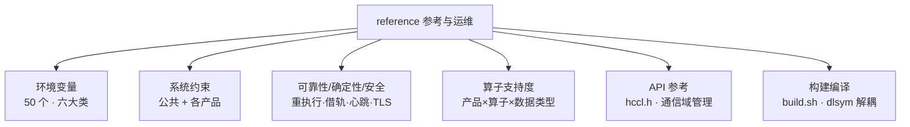
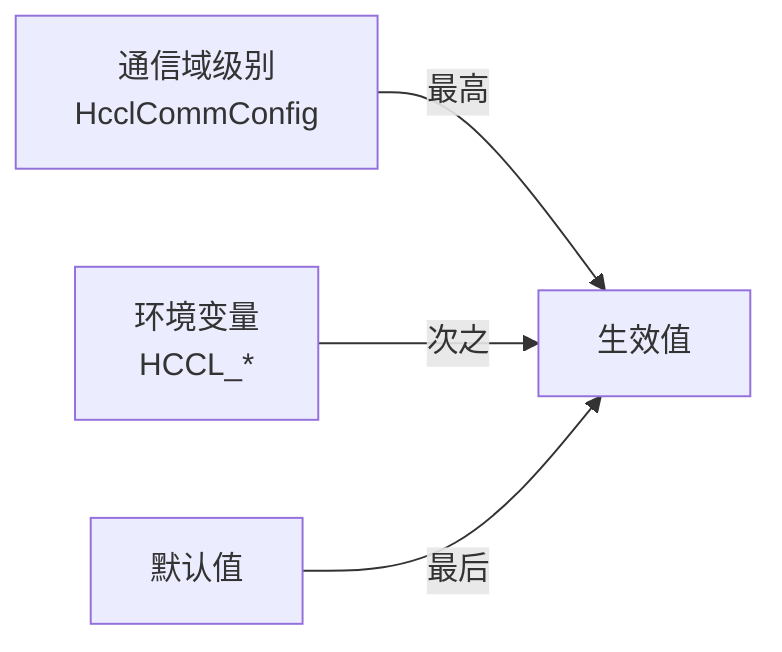

# reference：参考与运维

> HCCL 的参考与运维类知识汇总：**环境变量**（50 个，六大类）、**系统约束与限制**、**可靠性 / 确定性 / 安全机制**、**算子支持度清单**、**API 参考与构建编译**。本目录是配置、约束、运维速查的入口。
>
> 事实来源（可信度：代码 > 仓内文档 > 社区资料）：
> `hccl/docs/zh/user_guide/hccl_env/`（50 个环境变量）、`hccl/docs/zh/user_guide/constraints.md`（系统约束）、`hccl/docs/zh/user_guide/comm_ops_support_list/`（算子支持度）、`hccl/docs/zh/api_ref/`（API 参考）、`hccl/docs/zh/build/build.md`（构建）、`hccl/AGENTS.md`（架构约束/dlsym）。

---

## 1. 目录索引

| 文档 | 内容 |
| --- | --- |
| [env_vars.md](/comm-ascend/reference/runtime/env_vars.md) | **50 个环境变量**，分六大类：功能 / 性能 / 网络 / 调试 / 可靠性 / 安全；含取值、默认值、产品支持 |
| [constraints.md](/comm-ascend/reference/runtime/constraints.md) | **系统约束与限制**：公共约束（虚拟化/ACL Graph/多容器）+ 各产品约束（950/A3/A2/910/300I Duo 的单卡多进程、CCU 资源规格、并发图数、卡数） |
| [reliability_security.md](/comm-ascend/reference/runtime/reliability_security.md) | **可靠性**（算子重执行/借轨通信/N 秒快恢/集群心跳）+ **确定性计算**（HCCL_DETERMINISTIC/保序/BIRS）+ **安全**（TLS/白名单/补熵） |
| [support_build.md](/comm-ascend/reference/runtime/support_build.md) | **算子支持度清单**（产品 × 算子 × 数据类型矩阵）+ **API 参考**（hccl.h 算子 API、通信域管理 C/Python）+ **构建编译**（build.sh/CMake/dlsym 解耦） |

---

## 2. 六大知识域速览

| 知识域 | 关键内容 | 文档 |
| --- | --- | --- |
| **环境变量** | 功能（HCCL_ALGO/BUFFSIZE/OP_EXPANSION_MODE/DETERMINISTIC）、性能（RDMA_*）、网络（IF_IP/SOCKET_IFNAME）、调试（DEBUG_CONFIG/ENTRY_LOG）、可靠性（OP_RETRY_*）、安全（WHITELIST_*） | [env_vars.md](/comm-ascend/reference/runtime/env_vars.md) |
| **系统约束** | 不支持虚拟化、ACL Graph 约束、单卡多进程并发数、CCU 资源规格（Channel 120/Loop 68/Buffer 2048KB）、图模式并发图 ≤6 | [constraints.md](/comm-ascend/reference/runtime/constraints.md) |
| **可靠性/安全** | 算子重执行（L0/L1/L2 独立开关）、借轨通信、N 秒快恢、集群心跳、确定性计算（保序）、TLS 加密、白名单 | [reliability_security.md](/comm-ascend/reference/runtime/reliability_security.md) |
| **算子支持度** | 950/A3/A2/910/300I Duo 五套支持矩阵（展开模式 × 算子 × 零拷贝/确定性/重执行 × 节点内/超节点内/超节点间） | [support_build.md](/comm-ascend/reference/runtime/support_build.md) |
| **API 参考** | L1 算子（hccl.h）、MC2（hccl_mc2.h）、L2-comm 通信域、L2-res 拓扑/资源、L3-prim 原语、CCU 接口 | [support_build.md](/comm-ascend/reference/runtime/support_build.md) |
| **构建编译** | build.sh（--pkg/-u/-s/--static/--asan）、CMake、pre-commit、**dlsym 解耦**（hccl↔hcomm 独立编译） | [support_build.md](/comm-ascend/reference/runtime/support_build.md) |

---

## 3. 配置优先级总原则

> 通信域级别（`HcclCommConfig`，见 [../communicator/config.md](/comm-ascend/reference/communicator/config.md)）> 环境变量（见 [env_vars.md](/comm-ascend/reference/runtime/env_vars.md)）> 默认值。

---

## 4. 参考资料

- `hccl/docs/zh/user_guide/hccl_env/`：50 个环境变量文档 + 六大分类 README
- `hccl/docs/zh/user_guide/constraints.md`：系统约束与限制
- `hccl/docs/zh/user_guide/comm_ops_support_list/`：五套产品算子支持度清单
- `hccl/docs/zh/user_guide/recommended_config.md`：推荐业务配置（A3/A2）
- `hccl/docs/zh/api_ref/`、`hcomm/docs/zh/api_ref/`：API 参考
- `hccl/docs/zh/build/build.md`、`hccl/AGENTS.md`、`hcomm/AGENTS.md`：构建与架构约束
- 关联：[README.md](/comm-ascend/reference/runtime/)、[../communicator/config.md](/comm-ascend/reference/communicator/config.md)（通信域配置）、[../debug/](/comm-ascend/reference/debug/)（故障诊断）、[../extension/mc2_and_rfc.md](/comm-ascend/reference/extension/mc2_and_rfc.md)（BIRS 确定性算法）

