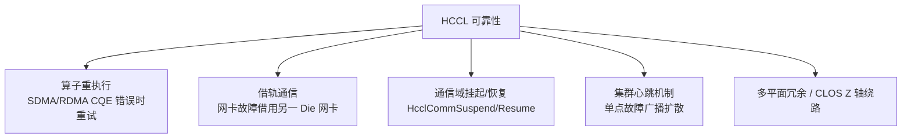

# 可靠性、确定性与安全机制

> HCCL 的三类质量保障机制：**可靠性**（算子重执行/借轨通信/快恢/心跳）、**确定性计算**（比特级可重现）、**安全**（TLS/白名单/补熵）。
>
> 事实来源（可信度：代码 > 仓内文档 > 社区资料）：
> `hccl/docs/zh/user_guide/hccl_env/`（`HCCL_OP_RETRY_ENABLE.md`/`HCCL_OP_RETRY_PARAMS.md`/`HCCL_DETERMINISTIC.md`/`HCCL_WHITELIST_*.md`）、`hccl/docs/zh/user_guide/cluster_info_config/rank_table_config_a3.md`（借轨通信）、`hccl/docs/zh/user_guide/fault_diagnosis/cluster_heartbeat_mechanism_troubleshooting.md`（心跳）、`hcomm/docs/zh/api_ref/comm_mgr_c/data_type_definition/HcclCommConfig.md`（确定性/重执行配置）、`hccl/docs/zh/rfcs/0001-add-batch-invariant-reducescatter.md`（BIRS）。

---

## 1. 可靠性机制

### 1.1 算子重执行（Retry）

通信算子执行报 **SDMA 或 RDMA CQE 类型错误**时，HCCL 尝试重新执行此通信算子。**仅 Atlas A3 支持**。

| 配置 | 环境变量 / 字段 | 说明 |
| --- | --- | --- |
| **开关** | `HCCL_OP_RETRY_ENABLE` / `hcclRetryEnable` | 按层级独立配置 `"L0:0,L1:1,L2:1"`；L1=Server 间、L2=超节点间，各 0/1，默认 0 |
| **参数** | `HCCL_OP_RETRY_PARAMS` / `hcclRetryParams` | `MaxCnt`[1,10] 默认 1、`HoldTime`[0,60000]ms 默认 5000（首次重执行等待）、`IntervalTime`[0,60000]ms 默认 1000（两次重执行间隔） |

> 重执行对整网性能影响见 `hccl_env/comm_retry_perf_impact.md`。

### 1.2 借轨通信

Device 网卡（RDMA 链路）故障时，借用**同一 NPU 内另一个 Die 的网卡**（`backup_device_ip`）继续通信（详见 [../networking/ub_superpod.md](/comm-ascend/reference/networking/ub_superpod.md)）。

| 约束 | 说明 |
| --- | --- |
| 生效条件 | 仅 `HCCL_OP_EXPANSION_MODE=AI_CPU` + 开启重执行时生效 |
| 主备要求 | 两 Die 须互为主备且都在业务可见范围 |
| 次数限制 | 同一 NPU **仅支持一次借轨且不支持回切** |
| 带宽影响 | 借轨后物理带宽**减半** |

### 1.3 通信域挂起 / 恢复

| 接口 | 作用 |
| --- | --- |
| `HcclCommSuspend(comm)` | 挂起通信域（故障时暂停通信） |
| `HcclCommResume(comm)` | 恢复通信域（恢复后继续，配合算子重执行） |

### 1.4 集群心跳机制

HCCL 与邻近 rank 建立独立维测链路，提供集群**单点故障广播扩散**能力，使任意 rank 的 plog 均含故障根节点信息。探测三类异常：`ERROR CQE`（网络）> `STUCK`（进程卡死）> `LOST`（进程退出）。详见 [../debug/localization_flow.md §3.1](/comm-ascend/reference/debug/localization_flow.md)。

### 1.5 多平面冗余 / CLOS 绕路

| 机制 | 作用层级 | 说明 |
| --- | --- | --- |
| **多平面冗余** | L1/L2 | 单平面链路/交换机故障不影响其余平面，通信降级不中断（见 [../networking/multi_plane.md](/comm-ascend/reference/networking/multi_plane.md)） |
| **CLOS Z 轴绕路** | L1 | 交换机拥塞时绕路（`detour_rules.cc`/`detour_service.cc` + `*_Z_axis_detour` 模板） |
| **Server 内链路切换** | L0 | `HCCL_INTRA_ROCE_ENABLE=1`+`HCCL_INTRA_PCIE_ENABLE=0`：Server 内改走 RoCE 环路 |

---

## 2. 确定性计算

**确定性集合通信**要求归约操作（AllReduce/ReduceScatter 等）在输入相同时，无论批大小、进程数、内存分片策略如何变化，都产生**比特级完全相同**的结果。

### 2.1 配置（HCCL_DETERMINISTIC / hcclDeterministic）

| 值 | 含义 | 支持产品 |
| --- | --- | --- |
| **0 / false** | 不开启（950 归约类算子**强制确定性**，不受此影响） | 全部 |
| **1 / true** | 开启归约类算子确定性计算（相同硬件+输入 → 相同输出） | 全部 |
| **2 / strict** | **严格确定性（保序）**：所有 bit 位归约顺序一致 | 950/A2/A3 |

### 2.2 保序（strict / 值 2）约束

| 产品 | 约束 |
| --- | --- |
| **950** | rank size ≥3；仅 INF/NaN 模式（不支持饱和模式）；**仅 AI CPU 展开**（CCU_MS/CCU_SCHED/AIV 回退 AI CPU）；支持 AllReduce/ReduceScatter |
| **A2/A3** | 仅多机对称分布（不支持非对称）；不支持饱和模式（仅 INF/NaN）；有性能下降（建议推理场景）；支持 AllReduce/ReduceScatter/ReduceScatterV |

> 开启确定性后算子执行变慢、性能下降；默认无需开启，发现模型多次结果不同或精度调优时可开启辅助调试。`DETERMINISTIC_STRICT` 模式下 CCU_MS/CCU_SCHED 回退 AICPU（见 [../algorithms/algo_selector.md §3](/comm-ascend/reference/algorithms/algo_selector.md)）。

### 2.3 BIRS（批大小不变 ReduceScatter，RFC 0001）

面向 A3 的新型批大小不变 ReduceScatter 算法，保证确定性归约顺序前提下充分利用 SIO+HCCS 混合互连，大消息相比 RHD **最高提升 25%**。详见 [../extension/mc2_and_rfc.md §2.1](/comm-ascend/reference/extension/mc2_and_rfc.md)。

> **业界需求**：训练可复现性/CI-CD、强化学习（RL/RLHF/PPO，verl `full_determinism`+`HCCL_DETERMINISTIC=1`）、推理 Batch 不变性（vLLM/SGLang `--enable-deterministic-inference`）。

---

## 3. 安全机制

| 机制 | 配置 | 说明 |
| --- | --- | --- |
| **TLS 加密** | 默认启用 | 保护跨设备数据传输；集群信息校验 TLS 配置一致性（不一致报 EI0016，见 [../debug/error_codes.md](/comm-ascend/reference/debug/error_codes.md)）；SHMEM 可经 `aclshmemx_set_conf_store_tls` 接口级关闭 |
| **白名单** | `HCCL_WHITELIST_DISABLE`（0=启用）、`HCCL_WHITELIST_FILE` | socket 连接白名单，保障通信连接安全（`HrtRaSocketWhiteListAdd/Del`） |
| **补熵** | haveged | 950 适配第三方 x86 服务器、OS 内核 ≤5.18 时需手工安装 haveged 补熵工具并启动服务 |
| **AI CPU 用户态下发安全** | — | A3 的 AI_CPU 模式依赖开放 AI CPU 用户态下发调度任务，存在安全风险，需用户自行确保自定义算子安全可靠、防止恶意攻击 |

---

## 4. 参考资料

- `hccl/docs/zh/user_guide/hccl_env/`：`HCCL_OP_RETRY_ENABLE.md`、`HCCL_OP_RETRY_PARAMS.md`、`HCCL_DETERMINISTIC.md`、`HCCL_WHITELIST_DISABLE.md`、`HCCL_WHITELIST_FILE.md`、`comm_retry_perf_impact.md`
- `hccl/docs/zh/user_guide/cluster_info_config/rank_table_config_a3.md`：借轨通信（backup_device_ip）
- `hccl/docs/zh/user_guide/fault_diagnosis/cluster_heartbeat_mechanism_troubleshooting.md`：集群心跳机制
- `hcomm/docs/zh/api_ref/comm_mgr_c/data_type_definition/HcclCommConfig.md`：hcclDeterministic/hcclRetryEnable/hcclRetryParams
- `hccl/docs/zh/rfcs/0001-add-batch-invariant-reducescatter.md`：BIRS 确定性算法
- 关联：[README.md](/comm-ascend/reference/runtime/)、[../debug/localization_flow.md](/comm-ascend/reference/debug/localization_flow.md)（心跳/重执行诊断）、[../networking/ub_superpod.md](/comm-ascend/reference/networking/ub_superpod.md)（借轨通信）、[../extension/mc2_and_rfc.md](/comm-ascend/reference/extension/mc2_and_rfc.md)（BIRS）、[../communicator/config.md](/comm-ascend/reference/communicator/config.md)（确定性/重执行配置）

