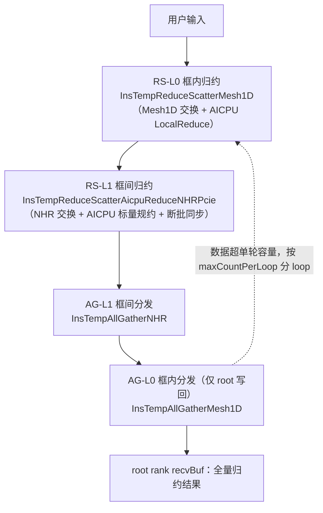
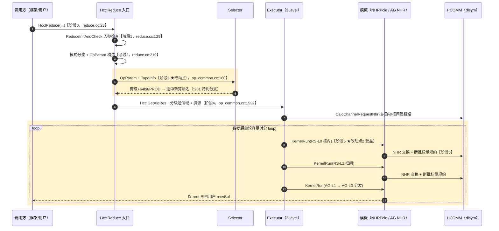
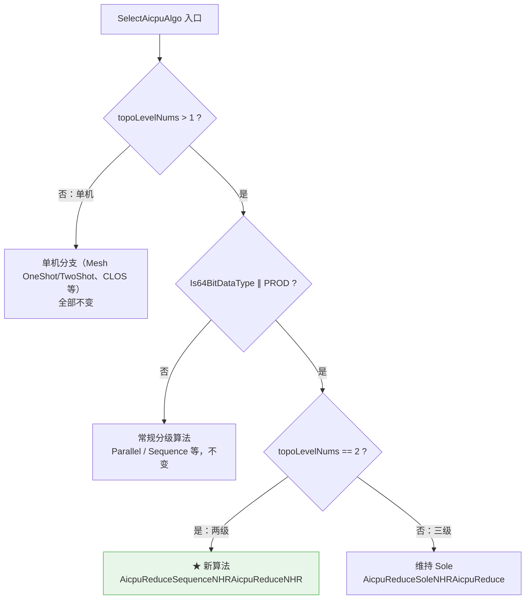
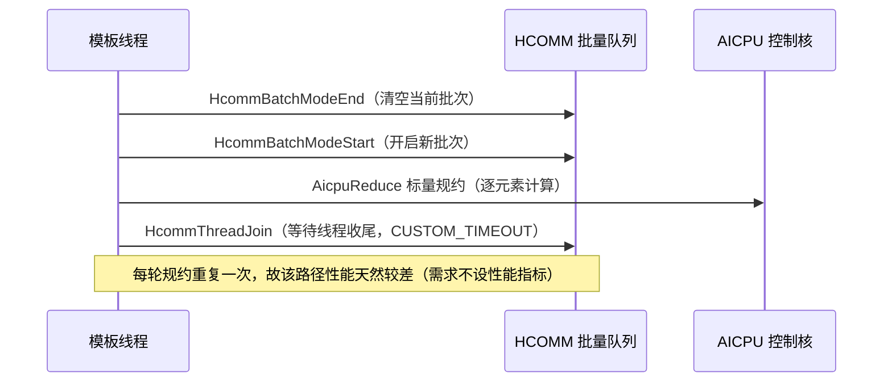

# 需求分析与软件设计（SRS/SD）：Reduce 算子 64bit/特殊规约两级分级算法

| 项目 | 内容 |
| ---- | ---- |
| 需求编号 | AR20260930049502 |
| 涉及算子 | Reduce（HcclReduce 单算子 / 图模式入口） |
| 引擎 / 拓扑 | aicpu（AICPU_TS）/ 两级拓扑（topoLevelNums == 2） |
| 文档模板 | `project_mgr/2026年10月迭代材料/srs_sd/SRS-SD文档模板.md` |
| 关联文档 | 同目录《reverse-walkthrough-64bit分级算子.md》（反串讲）、《02-前置知识.md》、《08-问题对齐-DPU-Reduce写非root用户输出buffer.md》（存量缺陷对齐材料）、《05-STC.xlsx》（用例设计与执行结果）、`scripts/`（NPU/ST/Checker 一键执行脚本）；SE 串讲文档《plan-64bit分级算子.md》 |
| 事实基准 | hccl 仓 `feature/reduce-64bit-prod-2level-hier` 分支 `e012c9c6`（2026-10-28；CI 压缩版 `5bbdb792`、CI 通过 tip `47e390f1`。关键论断均带 文件:行号，经反串讲与实测核实） |

---

# 1. AR20260930049502 【HCCL】Reduce算子支持64bit/特殊规约两级分级算法（SRS）

## 1.1 介绍

HCCL 是 CANN 的核心集合通信库，Reduce 算子（`HcclReduce`，`include/hccl.h:249`）将通信域内所有 rank 的同形状数据逐元素归约，结果仅落在 root rank，内部普遍拆解为 ReduceScatter + AllGather 两段组合实现。

**现状与问题**：aicpu 分级算法（Parallel/Sequence 家族）因层间模板采用在线归约原语（`SendRecvBatchReadReduce` / `SendRecvReadReduce` / `SendRecvBatchWriteReduce`，`ins_temp_reduce_scatter_nhr.cc:426-441`）而被 attrs 整体排除 64bit 类型与 PROD（`reduce_sequence_executor_aicpu_3level.cc:826/835`，`UNSUPPORTED_64BIT + isSupportProd=false`）；根因是 `LocalReduce` 对 64bit/PROD 分流至 AICPU 控制核标量规约（`alg_data_trans_wrapper.cc:906-908`），需 `HcommBatchModeEnd/Start + HcommThreadJoin` 断批同步，仅 aicpu_reduce 系列模板兼容该路径。因此两级及以上拓扑 + 64bit/PROD 场景只能回退扁平算法 `AicpuReduceSoleNHRAicpuReduce`（注册于 `reduce_sole_executor.cc:348`，路由于 `reduce_auto_selector.cc:281`）：整域扁平跑 NHR、gather 全量数据到本卡再标量算，通信量放大 rankSize 倍且不分框内/框间链路。

**本次需求目的**：为两级拓扑新增"nhr+nhr"两级 sequence 分级算法，框内/框间均复用 aicpu_reduce 系列分级模板，正确承接 64bit（INT64/UINT64/FP64 × SUM/PROD/MAX/MIN）与 PROD（任意支持 dtype）全组合；**正确性优先，不设性能指标**。实施中需求方向经 2026-10-21 反串讲会反转并已落地：新算法真实参与 cost 排序（attrs 门禁与真实计价并存，见 2.2 决策记录终态），64bit 场景实测较回退路径加速 6.8 倍（见 2.9 性能实测）。

**责任边界**：本文档仅覆盖 Reduce。AllReduce / ReduceScatter 为同型兄弟需求（由他人负责），三算子 selector/executor 分文件、无共同改动点，仅交付节奏与验收口径需对齐。

根因与现状回退链：


## 1.2 输入

**API 入参**（与现状一致，无新增）：

| 参数 | 类型 | 说明 |
| ---- | ---- | ---- |
| sendBuf / recvBuf | void* | 发送/接收缓冲区 |
| count | uint64_t | 元素个数 |
| dataType | HcclDataType | 本需求关注 INT64/UINT64/FP64 |
| op | HcclReduceOp | SUM/PROD/MAX/MIN |
| root | uint32_t | 结果落地 rank |
| comm / stream | HcclComm / aclrtStream | 通信域与流 |

**新算法路由进入条件**（本次需求定义的核心输入条件）：

```
topoInfo->topoLevelNums == TOPO_LEVEL_NUM_2
且（ Is64BitDataType(dataType)            // INT64/UINT64/FP64，四类规约操作均承接
   ∥ reduceType == HCCL_REDUCE_PROD ）    // 任意支持 dtype（白名单 op_common.cc:3581-3584）
```

非 64bit 的 min/max 不进入新算法（常规算法已支持且性能更优）——设计确认点，默认不改。环境输入：`HCCL_ALGO` 白名单可按算法名指定新算法。

## 1.3 处理

为完成本需求需要做的处理（概述，细节见第 2 章 SD）：

1. **新增两级 sequence 算法注册**：复用既有 `ReduceSequenceExecutorAicpu3Level` 编排框架与 aicpu_reduce 系列分级模板，"只加注册、不改框架"；
2. **selector 路由改造**：两级拓扑 + 64bit/PROD 场景由"回退 Sole"改判新算法；三级维持 Sole，单机分支不变；
3. **cost 隔离→真实计价（已完成）**：先以 attrs `opCustomCheck` 门禁保证新算法不被常规场景误选（处置方案见 2.2 决策记录）；后随需求方向反转落地真实计价——`CostModelParam` 扩展 `reduceCopies` 字段、框架按 1.2ns/count 折算 host 规约进 B（`CalcHostReduceSlope`），新算法真实参与 cost 排序且自适应选中；
4. **兼容与回退**：保序拦截、`HCCL_ALGO` 指定、资源不足 FallbackOp 回退等既有机制全部沿用。

## 1.4 输出

- **功能输出**：root rank 的 recvBuf 得到全量归约结果（数值与参考实现逐位一致）；非 root rank 不写用户输出；
- **日志输出**：算法选中、资源分配、编排起止等既有格式日志（检索关键字见 2.7）；
- **测试输出**：UT（路由矩阵/注册完整性）与 ST（双机正确性矩阵）通过记录。

## 1.5 约束分析

| 支持的算子名称 | Reduce（HcclReduce / HcclReduceGraphMode） |
| -------------- | ---- |
| 支持的算法名称 | 新增 `AicpuReduceSequenceNHRAicpuReduceNHR`（命名已定稿，`HCCL_ALGO` token `reduce:sequence{nhraicpureduce,nhr}` 已验证）；兜底维持 `AicpuReduceSoleNHRAicpuReduce` |
| 支持的芯片类型 | 走新算子框架的设备（Ascend 950 系列，以入口 `IsOutPlaceDevice` 判定为准；非 95 设备转老流程，不涉及）。【口径需与 SE 确认】 |
| 支持的展开模式 | 默认展开（aicpu / AICPU_TS 引擎）；不涉及 AIV_ONLY 强制展开 |
| 支持的拓扑形态 | 两级拓扑（topoLevelNums == 2；level0 含 MESH_1D / MESH_1D_CLOS / CLOS，level1 为 NHR）；三级/单机不进入 |
| 支持的调用类型 | 单算子（OPBASE）与图模式（OFFLOAD）均生效（路由位于公共 Selector 阶段） |
| 支持的数据类型 | INT64 / UINT64 / FP64（四类规约全承接）+ PROD 白名单类型（int8/int32/int64/uint64/fp16/fp32/fp64）；非 64bit 的 SUM/MIN/MAX 不进入（设计确认点） |
| 支持的数据量 | 无新增数据量限制；受 scratch multiplier 相乘影响单轮容量变小、loop 增多，GB 级大数据量需 ST 验证分轮正确性 |
| 是否支持绕路 | 否（`enableDetour = false`，本需求不涉及绕路场景） |
| 是否支持确定性计算 | 不承载：保序场景由 DETERMINISTIC_STRICT 优先拦截，走 `*StrictOrderedMesh` 路径 |

**其他约束**：

- inplace：不支持（`op.isSupportInplace = false`，对齐现有 Reduce 分级算法）；
- task cache：64bit/PROD 维持既有禁用策略（`aicpu_task_cache_policy.cc:222-225`）；
- 对称内存：随现有 `AicpuReduceSequenceMeshConcurNHR` 行为（不特判，UT/ST 验证项）；
- 性能：无指标要求，正确性优先；
- 版本与结构：注册无版本宏包裹（与同文件既有注册一致）；模板均为 aicpu 引擎，无需 `#ifndef AICPU_COMPILE` 包裹；src 侧无新增文件，测试侧新增 UT 两目录（`test/ut/reduce_64bit_hier`、`test/ut/reduce_scatter_seq64`）与 ST 套件（`reduce_aicpu_testcase.cc`）并登记 CMakeLists；符合仓内编码/静态检查/pre-commit 规范（C++17、`.clang-format`、OAT）；
- 架构：不新增跨仓依赖，HCOMM 仅使用既有 dlsym 符号。

---

# 2. AR20260930049502 【HCCL】Reduce算子支持64bit/特殊规约两级分级算法（SD）

## 2.1 功能描述

新增 aicpu 引擎、两级拓扑的 sequence 分级算法（复用 `ReduceSequenceExecutorAicpu3Level`，两级注册 + `skipLevel2_` 跳层，先例 `AicpuReduceSequenceMeshConcurNHR`，`reduce_sequence_executor_aicpu_3level.cc:829-839`）：



注册的 6 个模板位（L2 两位因 skipLevel2 不会被拉起，按现有惯例填同款占位）：

| 模板位 | 模板 | 说明 |
| ---- | ---- | ---- |
| T0（RS-L0） | InsTempReduceScatterMesh1D | 框内；商用孪生同款 Mesh+NHR 布局（SE 拍板，规避 NHRPcie L0 死锁，见 2.9 风险 2） |
| T1（RS-L1） | InsTempReduceScatterAicpuReduceNHRPcie | 框间 |
| T2（RS-L2） | InsTempReduceScatterAicpuReduceNHRPcie | 占位（skipLevel2） |
| T3（AG-L2） | InsTempAllGatherNHR | 占位（skipLevel2） |
| T4（AG-L1） | InsTempAllGatherNHR | 框间分发 |
| T5（AG-L0） | InsTempAllGatherMesh1D | 框内分发，root 输出 |

**关键选型——RS-L0 为何用商用 `InsTempReduceScatterMesh1D`**：NHRPcie 作 L0 模板在节点内规整 mesh 实测死锁（NPU notify wait 超时，详见 2.9 风险 2 扩展节），SE 评审拍板 L0 换商用 Mesh1D，整体对齐孪生算法 `AicpuAllReduceSequenceMeshNHRAicpuReduce` 的 Mesh+NHR 布局（其准入门禁现为 `opCustomCheck = Is64BitDataType ∥ PROD`，与本算法同款，商用验证充分）；Mesh1D 模板内部含 AICPU `LocalReduce` 路径（`ins_temp_reduce_scatter_mesh_1D.cc:227`），保证 64bit 兼容。

**关键选型——RS-L1 为何复用分级版 `InsTempReduceScatterAicpuReduceNHRPcie`**（而非 Sole 版）：分级 executor 以 `algHierarchyInfo.infos[level]`（框内如 `[0..7]`、框间如 `[0,8,16,24]`）构造模板，userRank 不等于算法内索引，Sole 版直接用于两级编排会错乱；分级版具备全部两级编排语义：

| 能力 | InsTempReduceScatterAicpuReduceNHR（Sole 版） | InsTempReduceScatterAicpuReduceNHRPcie（分级版） |
| ---- | ---- | ---- |
| 本 rank 定位 | `sliceIdx == myRank_`，假设 userRank==算法内索引 | `GetAlgRank`，支持任意 subCommRanks 映射 |
| 尾块处理 | 无（只认 sliceSize） | `tailSize` 支持（最后 rank 尾块） |
| 输出步长 | 无 | `outputSliceStride` 支持 |
| repeatNum 多轮 | 有 | 有（框内多框数据重复） |
| in/out 同 buffer | 无处理 | 自动后移 `hcclBuffBaseOff_`，避免读写冲突 |
| scratch 占用 | rankSize 倍 | rankSize×2 倍 |
| 静态 CalcCostCoeff | 有（真实建模，`86c09ee8` 起含 reduceCopies） | 有（**真实计价落地后新增**，原为基类默认返回空——见 2.2 终态） |

AllGather 阶段为纯数据搬运、不做规约，64bit 无障碍，复用 `InsTempAllGatherNHR`（具备 `GetAlgRank` 分级映射）。

**能力矩阵**：两级拓扑 × {INT64/UINT64/FP64} × {SUM/PROD/MAX/MIN} 全承接；PROD@任意白名单 dtype；非 64bit 的 SUM/MIN/MAX 维持常规算法。

## 2.2 流程描述

一次 `HcclReduce` 调用经过 7 个阶段，本需求改动位于阶段 3 与注册表（阶段定义详见《02-前置知识.md》3.1）：



**改动点 1——selector 路由**（`reduce_auto_selector.cc` `SelectAicpuAlgo` :281 附近），路由决策树：



对应代码修改（`reduce_auto_selector.cc:281-287` 实码节选）：

```cpp
if (Is64BitDataType(opParam.DataDes.dataType) || opParam.reduceType == HcclReduceOp::HCCL_REDUCE_PROD) {
    if (topoInfo->topoLevelNums == TOPO_LEVEL_NUM_2) {
        selectAlgName = "AicpuReduceSequenceNHRAicpuReduceNHR";  // 新：两级分级
    } else {
        selectAlgName = "AicpuReduceSoleNHRAicpuReduce";         // 三级维持
    }
}
// 其余分支（单机 Mesh/CLOS、保序拦截、非 64bit 常规分级）一律不动
```

**改动点 2——注册表登记**（`reduce_sequence_executor_aicpu_3level.cc:840-851`，已落地实码；模板均为 aicpu 引擎，无需 `#ifndef AICPU_COMPILE` 包裹）：

```cpp
REGISTER_EXEC_V2_MULTI(
    HcclCMDType::HCCL_CMD_REDUCE, AicpuReduceSequenceNHRAicpuReduceNHR, ReduceSequenceExecutorAicpu3Level,
    TopoMatchTwoLevel, InsTempReduceScatterMesh1D, InsTempReduceScatterAicpuReduceNHRPcie,
    InsTempReduceScatterAicpuReduceNHRPcie, InsTempAllGatherNHR, InsTempAllGatherNHR, InsTempAllGatherMesh1D);
REGISTER_ALG_ATTRS(
    AicpuReduceSequenceNHRAicpuReduceNHR, topo.minTopoLevelNum = TOPO_LEVEL_NUM_2;
    topo.maxTopoLevelNum = TOPO_LEVEL_NUM_2;
    topo.supportLevel0Topos = LEVEL0_TOPO_MESH_1D | LEVEL0_TOPO_CLOS | LEVEL0_TOPO_MESH_1D_CLOS;
    topo.isSupportLevel1Nhr = true; topo.isSupportLevel0PcieMix = false; op.isSupportInplace = false;
    op.opCustomCheck = [](const OpParam& opParam, const TopoInfoWithNetLayerDetails* topo) -> bool {
        return Is64BitDataType(opParam.DataDes.dataType) || opParam.reduceType == HcclReduceOp::HCCL_REDUCE_PROD;
    });
// include 已补：reduce_sequence_executor_aicpu_3level.cc:17/:19（ins_temp_reduce_scatter_mesh_1D.h、
// ins_temp_reduce_scatter_aicpu_reduce_nhr_pcie.h）
```

attrs 显式声明 `supportLevel0Topos`（MESH_1D|CLOS|MESH_1D_CLOS）、`isSupportLevel1Nhr=true`、`isSupportLevel0PcieMix=false` 三项（原风险 6"attrs 留白"已闭环）；`opCustomCheck` 为 cost 候选池软门禁，进入条件与 selector 特判逐字一致。

**【已拍板】cost 误选风险处置决策记录**

（对应 2.9 风险表第 1 条。**决策结果（2026-10-21 反串讲会）**：已实施方案②门禁并验证（CI 全绿）；需求方向同步反转——新算法将真实参与 cost 排序，NHRPcie 模板级真实系数（含 `CostModelParam` 扩展 `Ds` 字段，后定稿为 `reduceCopies`，见下文终态）由同事在 AllReduce 侧 PR #3645 承担，**完全落地后移植到本需求**（届时门禁与真实 cost 并存复核）。以下因果链与三选一分析保留作决策过程记录，方案②为最终选择。）

**问题**：新算法聚合得到的 cost 系数不完整，可能在常规场景被误选。因果链：

1. 6 个模板位中 `InsTempAllGatherNHR`×3 实现了静态 `CalcCostCoeff`，`InsTempReduceScatterAicpuReduceNHRPcie`×3 未实现（基类默认返回空，`alg_v2_template_base.h:28`）——该缺口在真实计价落地后已补齐（见下文终态第 4 条）；
2. `ReduceSequenceExecutorAicpu3Level::CalcCostCoeff`（`reduce_sequence_executor_aicpu_3level.cc:44-110`）对 p0..p5 直接拼接，无"任一为空则整体返回空"的短路（RS executor 有此短路且注释即为该目的，`ins_v2_reduce_scatter_sequence_executor_aicpu.cc:121-127`）；
3. 拼接结果非空但不完整——仅含 AG 项、缺失最重的 RS 项，估算耗时系统性偏低；
4. 新算法 attrs 不设数据类型白名单与 `isSupportProd` 限制，常规场景（两级 + fp32 + sum）下为 cost 候选池合法候选；
5. 常规场景 cost 排序时新算法因低估胜出，路由至 aicpu 标量慢路径，违背"其余场景路由不变"约束。

参考：现有 `AicpuAllReduceSequenceMeshNHRAicpuReduce` 同为部分系数组合，靠 `opCustomCheck = Is64BitDataType ∥ PROD` 限定可选范围（`ins_v2_all_reduce_sequence_executor_aicpu.cc:895-899`，注释明示"不能用 supportedDataTypes 白名单"）；本需求进入条件与其一致，已照搬该门禁模式。

**三种处置方案**：

| 处置方案 | 改法 | 效果与影响 | 代价 |
| ---- | ---- | ---- | ---- |
| ① executor 补短路（推荐） | `CalcCostCoeff` 聚合前增加"任一模板系数为空则整体返回空"，对齐 RS executor 既有模式 | 新算法退出 cost 排序、仅可由 selector 指定；需核查同执行器既有算法（MeshConcurNHR/NHRNHR）系数完整性，并与 AllReduce 负责人对齐同改（其 executor 同样无短路，`ins_v2_all_reduce_sequence_executor_aicpu.cc:42-106`） | ~10 行 |
| ② opCustomCheck 门禁 | attrs 增加 `opCustomCheck = Is64BitDataType ∥ PROD`，与 selector 进入条件一致（先例：`AicpuReduceSequenceMeshConcurNHR` 的 perRankSize 检查，`reduce_sequence_executor_aicpu_3level.cc:836-838`） | 常规场景被 attrs 过滤、不进候选池；特殊场景仍为部分系数（由 selector 特判兜底） | ~3 行 |
| ③ 证据豁免 | 论证两级特判分支不经过 cost table 排序（含图模式离线资源计算路径） | 若成立无需改动；结论依赖当前架构，selector 演进后需重新评估 | 分析工作 |

**决策结果**：已选 ②（attrs `opCustomCheck` 门禁，仅 64bit/PROD 参选，条件与 selector 特判一致）——实施后 CI 全绿（实施前 58 个 ST 常规 dtype 误选用例失败全部恢复）。真实 cost 系数待同事 PR #3645 完全实现后移植。

**【终态】真实计价已落地（2026-10-27/28）**：同事侧 aicpu cost 工作（覆盖 RS/AR/Reduce 三算子）已合入本分支（`86c09ee8`、isPod 修正 `e68baf9a`、omnipipe 口径 `9b999af4`），本需求压缩版 `5bbdb792`（CI tip `47e390f1`）含 Reduce 侧全量；方案②门禁保留，与真实计价并存复核通过。落地内容：

1. `CostModelParam` 扩展 `reduceCopies` 字段（`cost_model.h:68`）——AICPU 规约总量折算为 dataSize 的份数（字节口径、与 dtype 无关），存量 {A,B,C,D} 聚合初始化自动补 0；
2. `REDUCE_SEC_PER_COUNT = 1.2ns/count`（fp64 1GB 0.162s 实测标定）+ `CalcHostReduceSlope()`（`cost_model.h:72-82`）——64bit/PROD 时按 count×1.2ns 把 reduceCopies 折算为 B 的每字节斜率（不除 util，host 项与 B 口径一致），门控条件（dataTypeSize==8 ∥ PROD）与 wrapper 的 LocalReduce host 路由（`alg_data_trans_wrapper.cc:906`）对齐；
3. `cost_table.cc:407` 逐段计算 `bReduces` 并入 `(A/util + B + bReduce)×dataSize`；
4. 相关模板全部实现真实静态 `CalcCostCoeff` 含 reduceCopies：`ReduceAicpuReduceNHR`/`ReduceMesh1D`（Reduce 侧）、`InsTempReduceScatterAicpuReduceNHR`/`NHRPcie`/`Mesh1D`（RS 侧）、`InsTempAllReduceAicpuReduceNHR`（AR 侧）——其中 NHRPcie 为新增（原无静态系数，即上文因果链第 1 条的缺口本身）；
5. 模板级 portNum 判空与下界守卫（检视意见处置 `14061870`，防空 vector 越界/取 0 除零得 inf 污染 cost）；RS AicpuReduce 系 isPod 场景不做端口减半（`e68baf9a`，对齐 RS 家族 `ins_temp_reduce_scatter_nhr.cc`/`hd.cc` 口径，避免 A 高估 ~1.74x）。

实测复核（2026-10-26 `574e85da` 基线数据，见 2.9）：64bit 池内三算法计价与实测全部同量级吻合，自适应公平竞争下新算法自然胜出——"门禁 + 真实计价并存"复核通过；executor 物理层级 CalcCostCoeff（逐层 `physicalIdxForAlgoLevels` 取 netType/portNum 传模板，`reduce_sequence_executor_aicpu_3level.cc:44-110`）为既有基础设施（`596b167b` 迁移 V2 topo match 时引入），本需求未改动其结构。

**修改文件清单**（当前分支 `e012c9c6` 全量；`5bbdb792`/`47e390f1` 为其 Reduce 侧子集压缩版，`86c09ee8`/`e68baf9a`/`9b999af4` 为同事侧三算子全量来源）：

| # | 文件 | 改动 |
| - | ---- | ---- |
| 1 | `src/ops/reduce/selector/reduce_auto_selector.cc` | :281-287 特判分支两级/三级分流 |
| 2 | `src/ops/reduce/algorithm/executor/reduce_sequence_executor_aicpu_3level.cc` | 新增注册宏 ×2（:840-851）+ include ×2（:17/:19） |
| 3 | `src/ops/op_common/selector/cost_model.h` | `CostModelParam.reduceCopies` 字段、`REDUCE_SEC_PER_COUNT`、`CalcHostReduceSlope()` |
| 4 | `src/ops/op_common/selector/cost_table.cc` / `.h` | `bReduces` 逐段折算入 B（:407）；计价接口签名调整 |
| 5 | `src/ops/reduce/algorithm/template/aicpu/reduce_aicpu_reduce_nhr.cc` | 真实 `CalcCostCoeff`（含 reduceCopies、portNum 守卫） |
| 6 | `src/ops/reduce/algorithm/template/aicpu/reduce_mesh_1D.cc` | 补 reduceCopies=(N-1)×dataRatio |
| 7 | `src/ops/reduce_scatter/algorithm/template/aicpu/ins_temp_reduce_scatter_aicpu_reduce_nhr_pcie.cc` / `.h` | 新增真实 `CalcCostCoeff`（原无静态系数）；isPod 不减半；portNum 守卫 |
| 8 | `src/ops/reduce_scatter/algorithm/template/aicpu/ins_temp_reduce_scatter_mesh_1D.cc` / `ins_temp_reduce_scatter_aicpu_reduce_nhr.cc` | 补 reduceCopies；isPod 口径对齐（兜底 Sole 路径计价） |
| 9 | `test/st/algorithm/testcase/CMakeLists.txt` + `reduce_aicpu_testcase.cc` | 新增 ST 套件 22 用例（`ST_TASKS=reduce_aicpu`） |
| 10 | `test/st/algorithm/utils/src/hccl_proxy/hccl_stub.cc` | ST 桩补 `LocalReduce` 符号适配 64bit/PROD host 规约（修首条用例段错误，`a5ab8490`） |
| 11 | `test/ut/reduce_64bit_hier/`（4 文件）+ `test/ut/CMakeLists.txt` | UT 主目标 7 用例；`alg_parse.cc` 链接序前移修复 SIOF（`714b9f68`，route 冗余目标后由 `e012c9c6` 移除） |
| 12 | `test/ut/reduce_scatter_seq64/`（3 文件） | 模板真实建模 UT 7 用例（同事侧随 `86c09ee8` 落地，覆盖本需求依赖的模板系数） |

**排查确认与状态翻转**（初版"不修改"结论随需求方向反转已部分失效，逐条更新）：

| 文件/模块 | 结论 |
| ---- | ---- |
| `cost_table.cc` / `cost_model.h` | **已修改**（初版按门禁方案判定不修改；真实计价落地后翻转，见上文终态记录 3） |
| `alg_attrs_registry.*` / `algo_name_mapper.*` | 不修改，注册宏自动登记（维持） |
| executor `GetAlgNetMeta` / `CalcCostCoeff` 结构 | 不修改；均已实现（物理层级口径为 `596b167b` 既有基础设施），随注册自动生效（维持） |
| template 层（aicpu 目录） | **仅静态 `CalcCostCoeff` 修改**（初版"不修改、不新增"约束随真实计价落地部分翻转；执行逻辑零改动，`14061870` 增 portNum 守卫、`e68baf9a` 修 isPod 口径） |
| `CMakeLists.txt` | src 侧不修改；测试侧已登记（ST/UT 新目标，见修改文件清单 9/11/12） |

## 2.3 数据描述

本需求**不修改任何数据面数据结构**（OpParam/TemplateDataParams/AlgResourceRequest 均零改动；控制面 `CostModelParam` 随真实计价扩展 `reduceCopies` 字段，见下文数据行为变化③）。本节一方面给出数据面零改动的依据（前三项：判定输入来源、编排参数语义对齐、资源计算覆盖），另一方面指出新组合带来的**三处数据行为变化**（后三项：分轮数放大、仅 root 写回、cost 计价扩展），分别支撑 2.9 风险 3、root 语义相关用例与 cost 完整性 UT。

**OpParam 关键字段**（`ReduceConstructOpParam`，`reduce.cc:179` 组装）——改动点 1 的判定输入即取自其中两个字段：

| 字段 | 取值 | 与本需求的关系 |
| ---- | ---- | ---- |
| DataDes.dataType / count | 用户入参（INT64/UINT64/FP64 等） | selector 特判分支按 `dataType` 判定 Is64BitDataType |
| reduceType | SUM/PROD/MAX/MIN | 特判分支的另一判定条件（==PROD） |
| root / userRank | 用户指定 / 本卡 rank | AG-L0 仅 root 写回的依据 |
| opType | HCCL_CMD_REDUCE | 注册表检索键 |

**TemplateDataParams**：sliceSize / tailSize（尾块）/ outputSliceStride / repeatNum / buffInfo——与分级版模板语义完全对齐，executor 编排代码无需修改。这是"只加注册、不改框架"的成立前提：新模板组合消费的参数语义与既有编排逻辑完全一致。

**资源（AlgResourceRequest）**：NHRPcie 模板单线程（slaveThreadNum=0），sequence executor 对 thread/notify 取 max 合并；链路按框内/框间 `subCommRanks` 分建——新算法的资源需求被既有 `CalcRes` 路径原样覆盖，是阶段 4（资源计算）零改动的依据。

**scratch（数据行为变化①，布局调整后已缓解）**：RS-L0 Mesh1D `CalcScratchMultiple = templateRankSize_`（`ins_temp_reduce_scatter_mesh_1D.cc:111-117`）、RS-L1 NHRPcie `rankSize*2`（`ins_temp_reduce_scatter_aicpu_reduce_nhr_pcie.cc:342-352`）——L0 段较原全 NHRPcie 布局减半，单轮可处理数据量 `maxCountPerLoop` 相应改善；断批同步（`HcommBatchModeEnd/Start + HcommThreadJoin`）仅存在于 RS-L1 NHRPcie 段，次数仍随数据量放大但增速放缓——2.9 风险 3 等级相应下调。

断批同步机制时序（代码调用顺序忠实呈现，`ins_temp_reduce_scatter_mesh_1D.cc:149-152`）：



**输出数据流（数据行为变化②）**：通信全程经 ccl buffer 中转；AG-L0 阶段仅 root rank 将结果写入用户 recvBuf——Reduce 语义在新算法的落点，对应 ST 的"root 非 0 / 非 root 不写"用例。

**cost 计价数据（数据行为变化③，控制面）**：`CostModelParam` 扩展 `reduceCopies` 字段（`cost_model.h:68`，规约总字节 = reduceCopies×dataSize，字节口径与 dtype 无关，存量 {A,B,C,D} 聚合初始化自动补 0）；64bit/PROD 时 `cost_table.cc:407` 经 `CalcHostReduceSlope`（1.2ns/count）折算为 B 的每字节斜率，并入 `(A/util + B + bReduce)×dataSize`。新算法 6 模板位中 RS 段两模板均产出非零 reduceCopies：L0 Mesh1D `(rankSize-1)×dataRatio`（`ins_temp_reduce_scatter_mesh_1D.cc:55`，PostCopy 逐 slice LocalReduce，64bit 时走 host 标量路径）与 L1 NHRPcie 同式（`ins_temp_reduce_scatter_aicpu_reduce_nhr_pcie.cc:53`）；AG 段纯搬运天然为 0。该口径由 UT 断言系数存在性（见 2.9 UT 明细 UT-5）。

## 2.4 依赖性描述

| 依赖项 | 类型 | 是否修改 |
| ---- | ---- | ---- |
| `ReduceSequenceExecutorAicpu3Level`（编排/资源/层级计算） | 仓内 executor | 否，仅新增注册（include ×2） |
| `InsTempReduceScatterAicpuReduceNHRPcie`（两级 RS 模板） | 仓内 template | 执行逻辑否；静态 `CalcCostCoeff` 新增（真实计价） |
| `InsTempAllGatherNHR`（两级 AG 模板） | 仓内 template | 否 |
| `InsTempReduceScatterMesh1D` / `InsTempAllGatherMesh1D`（L0 模板） | 仓内 template | 执行逻辑否；Mesh1D 静态系数补 reduceCopies |
| `cost_model.h` / `cost_table.cc`（cost 计价框架） | 仓内 op_common | 是（reduceCopies / CalcHostReduceSlope / bReduces，随真实计价落地） |
| HCOMM dlsym 符号：`HcommLocalReduceOnThread`（`alg_data_trans_wrapper.cc:924`）、`HcommBatchModeEnd/Start`、`HcommThreadJoin`、SendRecv 读写系列 | 跨仓（cann/hcomm） | 否，全部为既有符号，无新增跨仓依赖 |
| `REGISTER_EXEC_V2_MULTI` / `REGISTER_ALG_ATTRS` 注册框架 | 仓内 op_common | 否 |
| AllReduce / ReduceScatter 同型需求 | 兄弟特性 | 无代码耦合（分文件）；cost 真实计价已由同事统一落地（`86c09ee8` 覆盖三算子），方案对齐闭环 |

分层依赖方向（selector → executor → template → wrapper → HCOMM/dlsym）自上而下，符合仓内架构硬约束。

## 2.5 接口描述

**对外接口（既有，本需求不修改）**：

| 函数原型 | `HcclResult HcclReduce(void* sendBuf, void* recvBuf, uint64_t count, HcclDataType dataType, HcclReduceOp op, uint32_t root, HcclComm comm, aclrtStream stream)` |
| -------- | ---- |
| 函数功能 | 将通信域内所有 rank 的数据逐元素归约至 root rank（既有语义，不变更） |
| 输入说明 | sendBuf、count、dataType、op、root、comm、stream（含义与现状一致） |
| 输出说明 | root rank 的 recvBuf 得到全量归约结果 |
| 返回值说明 | HCCL_SUCCESS / 既有错误码（含 HCCL_E_NOT_SUPPORT，触发条件不变） |

**内部接口**：新增 `CalcHostReduceSlope()` 内联函数（`cost_model.h:77-82`，host 规约斜率折算，随真实计价落地，另有 `REDUCE_SEC_PER_COUNT` 常量）；其余新增内容为两条注册（算法名进入 `CollAlgExecRegistryV2` 注册表）。新算法名 `HCCL_ALGO` token 已定稿为 `reduce:sequence{nhraicpureduce,nhr}`，经 `alg_parse.cc` 分段解析验证——ST spec 子模式 7 条用例（3 代表组合 + 尾块/多 loop/root 非 0/count=1 边界）setenv 强制指定全过（`reduce_aicpu_testcase.cc:14`）。

## 2.6 约束分析

（与 1.5 同表，本节为实现机制视角——每项约束由什么机制保证）

| 支持的算子名称 | 注册键 `HCCL_CMD_REDUCE`；selector 按 opType 检索本算子注册表 |
| -------------- | ---- |
| 支持的算法名称 | 新算法名经 `REGISTER_EXEC_V2_MULTI` 登记；selector 特判点名；`HCCL_ALGO` 按名检索 |
| 支持的芯片类型 | 设备分流在入口完成（`reduce.cc:32-37` `IsOutPlaceDevice`），算法层不感知 |
| 支持的展开模式 | 引擎由 Selector 内 `SetCommEngine` 按选择结果设定；AIV_ONLY 模式选不中 AIV 时直接返回不支持（`op_common.cc` Selector 内校验） |
| 支持的拓扑形态 | attrs `min/maxTopoLevelNum = 2` + `supportLevel0Topos`（MESH_1D/CLOS/MESH_1D_CLOS）+ `isSupportLevel1Nhr`/`isSupportLevel0PcieMix` 在通信域初始化阶段过滤（`cost_model.cc:225` 仅 PCIe 混连时参与）+ selector 三级分支维持 Sole，双重保证 |
| 支持的调用类型 | OPBASE/OFFLOAD 汇聚于公共路径 `ReduceOutPlaceCommon` → `Selector`，天然同时生效 |
| 支持的数据类型 | selector 判定（`Is64BitDataType ∥ PROD`）；PROD 白名单在入参阶段 `CheckReduceOp`（`reduce.cc:146`）拦截 |
| 支持的数据量 | 既有分轮机制（`maxCountPerLoop`）保证，无新增上限判断逻辑 |
| 是否支持绕路 | `param.enableDetour = false` 固定（`reduce.cc:209`） |
| 是否支持确定性计算 | selector 中保序（DETERMINISTIC_STRICT）拦截优先于本分支 |

**其他机制约束**：inplace 由 attrs `op.isSupportInplace = false` 过滤；cost 候选池由 attrs `opCustomCheck` 软门禁过滤（仅 64bit/PROD 参选，常规场景不进池），池内按真实计价（含 `reduceCopies` 折算）排序；task cache 由 `aicpu_task_cache_policy.cc` 策略层禁用；执行期资源不足由 `FallbackOp` 回退链兜底；算法名查不到由注册表报错。

## 2.7 DFX 设计

**日志检索关键字**（均为既有日志格式，通过 plog 检索确认新算法生效与排障）：

| 校验内容 | 级别 | 搜索内容 |
| -------- | ---- | -------- |
| 入参合法性（指针/count/数据类型/PROD 白名单/root 越界） | ERROR | `EI0003`、`CheckReduceDataType` |
| 算法选择结果（两级 MESH_1D 选路=cost 最小者：SoleMesh/新算法均合法、三级仍选 Sole；CLOS L0 两级走特判无条件选中新算法） | INFO | `[SelectorEngine]` + `selected algo type`（两级 MESH_1D/单机/三级 cost 排序路径，NPU plog 与 ST gtest stdout 均可检索）；`[ReduceAutoSelector]` + `Algo match`（仅 CLOS L0 特判路径） |
| cost 系数采集（executor 物理层级 rankSize/portNum/netType 逐层） | INFO | `[ReduceSequenceExecutorAicpu3Level][CalcCostCoeff]`（`reduce_sequence_executor_aicpu_3level.cc:73`） |
| 模板级系数与 host 规约折算份数 | INFO | `[CalcCostCoeff]` + `reduceCopies`（如 `[InsTempReduceScatterAicpuReduceNHRPcie][CalcCostCoeff] algName[...] A=... B=... reduceCopies=...`） |
| 逐算法计价结果（含 bReduces 归并后的 cost/totalD） | INFO | `[CalcAlgCost] algName=... cost=... totalD=...`（`cost_table.cc`） |
| 资源分配（线程数/每层 channel 数/引擎/algTag） | RUN | `[HcclGetAlgRes] resource allocated` |
| 两级编排起止与分轮 | INFO | `[ReduceSequenceExecutorAicpu3Level][OrchestrateLoop]` |
| 执行失败（executor 检索失败/IDE 错误定位） | ERROR | `Fail to find executor`、opTag（`CHK_RET_AND_PRINT_IDE`） |

**其他 DFX**：

- 可测试性：`HCCL_ALGO` 按名强制指定新算法即可单算法验证（token `reduce:sequence{nhraicpureduce,nhr}`）；UT 入口 `build.sh -u`（目标 `reduce_64bit_hier_ut_test` 7 用例、`reduce_scatter_seq64_test` 7 用例）；ST 入口 `build.sh -s`（`test/st/algorithm/testcase/reduce_aicpu_testcase.cc` 22 用例，`ST_TASKS=reduce_aicpu` 可单跑）；
- 可维护性：注册式扩展、不动框架；算法名遵循既有命名语法（命名已定稿，历史尾段问题见 2.9 风险 4）；
- 异常与回退：三级/单机误入由 attrs 过滤；算法名查不到由注册表报错；资源不足由 FallbackOp 回退链兜底；
- 网络安全：无新增外部输入/端口/协议/落盘；日志仅输出元信息（指针/大小/类型/算法名），不输出数据内容；无密钥/凭据/遥测新增；不引入新的网络安全暴露面。

## 2.8 资料描述

不涉及。对外 API 资料（`docs/zh/api_ref/comm_op_interface/HcclReduce.md` 及英文版）已按产品粒度声明 sum/prod/max/min 与数据类型支持，本需求不改变对外能力口径；`HCCL_ALGO` 环境变量文档已含 `NHRAicpuReduce`（nhraicpureduce）模板级描述（`docs/zh/user_guide/hccl_env/HCCL_ALGO.md:53`，声明其承接 INT64/UINT64/FP64 及 PROD 归约），新算法 token `reduce:sequence{nhraicpureduce,nhr}` 按既有分层模板组合语法解析，无需新增资料条目；内部实现粒度资料默认无需同步。

## 2.9 性能&&质量

**性能**：不设指标（aicpu 标量规约 + 断批同步天然较慢，需求明确正确性优先）。**最终实测对照（2026-10-26，16 卡 2 节点×8 两级 MESH_1D，`574e85da` = Mesh+NHR + cost v2 + SoleMesh 计价补漏，日志 `npu_logs/20261026_193438`，17 用例全 success）**：

| 场景（64m，iters=20） | 耗时 | 带宽 | cost 计价 | 说明 |
| ---- | ---- | ---- | ---- | ---- |
| 新算法自适应（=自动选中） | 26992.83 us | 2.486 GB/s | 0.010383 | 三算法中最小，选路正确 |
| 新算法指定 `reduce:sequence{nhraicpureduce,nhr}` | 27128.97 us | 2.474 GB/s | 0.010383（count=1 收敛） | token 三轮实测确认有效 |
| Sole 对照 `reduce:sole{nhraicpureduce}` | 183180.91 us | 0.366 GB/s | 0.159733（count=1 收敛） | **新算法加速 6.8 倍** |
| SoleMesh（补漏后计价） | （上轮实测 220458 us） | — | **0.159441** | 与实测吻合（此前 0.0084 失真低价抢占，见下） |

补充：4G 大包 919540.60 us / **4.671 GB/s**（多 loop 无 CUSTOM_TIMEOUT，风险 3 缓解验证）；PROD@int32 27131 us（Breduce 按双倍 count 计价生效）；小消息 8B/24B 自适应选 SoleMesh（9.4ms，Breduce∝dataSize 趋零属真实排序；实测三算法对照 Sole 3.5ms 最快——小消息时延建模为框架遗留项）；单机 8p 选 TwoShot 31.2ms 路由不变。

**cost v2 迭代记录（四轮，前三轮 NPU 实测驱动）**：①v1（Ds 口径，`316e57f0`）规约项进 totalD max 地板被吞、新算法低价 0.000893 侥幸胜出；②v2（reduceCopies 口径，`1bf16813`）规约如实加法计价后暴露 **SoleMesh 存量建模缺失 AICPU 规约**（64bit 走 host 标量 LocalReduce 实测 ~150ms 零计价，8.4ms 失真低价抢走全部 64bit 场景、实测慢 7.7 倍）；③补漏（`574e85da`）给 ReduceMesh1D 补 `reduceCopies=(N-1)×dataRatio×rankSize` 后 SoleMesh 计价恢复 0.159，三算法计价与实测全部同量级吻合，自适应公平竞争下新算法自然胜出；④终态合入（`86c09ee8`+`e68baf9a`+`14061870`，2026-10-27/28，随分支重定基以同事三算子统一实现落库）：NHRPcie 新增模板级真实系数、RS AicpuReduce 系 isPod 不减半、portNum 判空守卫，两级 MESH_1D 自适应路径计价与实测同量级吻合（见上表）。**结论：64bit 池内所有候选算法的规约计价必须补齐**（ReduceMesh1DTwoShot/ReduceNHR 经查不参选问题池未改，列为框架侧后续项）。

**阈值实验（SoleMesh↔新算法选路临界点，2026-10-28 设计就绪）**：ST 仿真测得两级 MESH_1D + INT64 场景 SoleMesh→新算法的 cost 翻转临界 **count\*=13549（=108392B/rank）**；NPU 实机验证实验区 `NPU_RD_TH_*` 已就绪（`scripts/run_reduce_npu_test.sh`，尾部自动汇总 `threshold_summary.tsv`）——实验一 TH_S 自适应选路邻域扫描 13 点（8 远端校准 + 108384/108392/108400 临界±8B 邻域 + 64m 远端校准，验证真机翻转临界与仿真吻合度）；实验二 TH_P 双算法强制计时 7 点×2（`reduce:sole{mesh}` 强制 SoleMesh 与 `reduce:sequence{nhraicpureduce,nhr}` 新算法对照，测真机性能交叉点评估 cost 模型校准）。真机结果：【待回填：TH_S 各点位 selectedAlgo/耗时、TH_P 交叉点与仿真临界 108392B/rank 的偏差】。

**正确性验收矩阵（ST，双机两级环境；已落地为 `reduce_aicpu_testcase.cc` 22 用例 = STC ST_RD_2L_001-015，auto/spec 双模式）**：

| 维度 | 取值（→ 对应用例） |
| ---- | ---- |
| 数据类型 × 规约 | INT64×`{SUM/PROD/MAX/MIN}`、UINT64×SUM、FP64×SUM、PROD@`{FP16/FP32}`（→ 001-008）；全 12 组合 64bit 矩阵与 PROD@`{int8/int32}` 等由 STC Checker L2 28 条与 NPU 组覆盖（`scripts/run_checker_case.sh`，明细见 STC） |
| 数据形状 | 整除切分（001-008）/ 尾块非整除 12rank×243（009）/ 16M 多 loop 分轮（010）/ count=1 单元素退化（015） |
| root 语义 | root=13 非 0（011，仅 root 写回语义；非 root 不被写的机器断言因 DPU 存量缺陷暂撤，见风险 7） |
| 指定与回归 | spec 强制指定 token 7 条（001/005/007/009/010/011/015）；三级 32rank 维持 Sole（012）；单机 8rank 维持单机算法（013）；两级 FP32+MAX 门禁负向（014） |
| 场景开关 | 对称内存开/关、inplace 拒绝路径等由 STC 开关批次与既有 Reduce 套件覆盖（见 STC） |

**执行结果**：CI `st_reduce_aicpu_test` 22/22 通过（tip `47e390f1`，含 run#4167 首条用例段错误修复 `a5ab8490` 与 run#4199 格式修复）；实机复测 22/22 + 全量 ST 回归 31/31 无回归（2026-10-28，aarch64 实验服务器 + CANN9.2.0，@`14061870` 编包安装）；STC 已反填 ST_RD_2L_001-015 全 PASS（CI 与实机双记录）。

**UT 用例明细**（承接设计文档 4.4 / 第 6 章；已落地两个目标，均全绿）：

`reduce_64bit_hier_ut_test`（7 用例，`test/ut/reduce_64bit_hier/`）：

| 用例 | 断言要点 |
| ---- | ---- |
| UT-1a 两级 × `{INT64/UINT64/FP64}`×SUM ∪ PROD@`{INT64/FP16/FP32}` | SelectAicpuAlgo 特判返回新算法名（真实生效形态 CLOS 构造） |
| UT-1b 三级 × `{INT64×SUM, FP32×PROD}` | 维持 Sole（AicpuReduceSoleNHRAicpuReduce） |
| UT-1c 两级 × 非 64bit 且非 PROD（fp32×sum/min/max） | 不选新算法（常规分级分支） |
| UT-2 cost 候选池门禁 | INT64/PROD@int32 进池；FP32+SUM 被拒且 reason 含 `opCustomCheck` |
| UT-3 CalcHostReduceSlope 语义 | 64bit/PROD 按 1.2ns/count×copies/dts 折算；非 host 路径/copies≤0/dts=0 归零 |
| UT-4 注册完整性 | 注册表可检索非空 executor；两级通过、三级被拒（min/maxTopoLevelNum=2）、pcie-mix L0（CLOS 构造）被拒 |
| UT-5 新算法 cost 系数完整性 | 两级 CalcCostCoeff 非空且存在 reduceCopies>0 条目（RS 段产出） |

`reduce_scatter_seq64_test`（7 用例，`test/ut/reduce_scatter_seq64/`，同事侧随 `86c09ee8` 落地）：Pcie 模板框间段真实建模数值断言（A/B/C/D/reduceCopies）、algName 不门控（共用模板同口径）、dataRatio 缩放（A/B∝dataRatio、C 不变）、isPod 不减半（对齐非 pod 逐位一致，误用默认高估 ~1.74x）、Sole 整域建模（N=16：reduceCopies=15）、AR 单轮整域建模、HostReduceSlope 门控矩阵。

实施备注：UT-5 曾因 SIOF 搁置——根因为 `REGISTER_ALG_ATTRS` 全局 ctor 按链接序先于 `alg_parse.cc` 的 `EXECUTOR_TYPES` 构造，将 `alg_parse.cc` 在 UT CMakeLists 链接序前移并修正两处断言口径后转 PASS（7/7）；初版 route 精简回归目标（4 用例）因与主目标语义完全重复由 `e012c9c6` 移除。

**质量门禁**：`bash build.sh --pkg` 编译无告警；`build.sh -u` UT 通过（两目标 7/7 + 7/7，已达成）；`build.sh -s` ST 通过（22/22 已达成）；pre-commit（clang-format + OAT）与 CI codecheck 通过（CI 全绿已达成）；PR 关联 Issue。

**风险与对策**（承接反串讲，含对 SE 串讲原论断的修正；已按 NPU 实测与落地终态刷新）：

| 风险 | 等级 | 对策与终态 |
| ---- | ---- | ---- |
| cost 误选：Reduce 3level executor `CalcCostCoeff` 为拼接聚合、无"任一模板空则退出"短路（`reduce_sequence_executor_aicpu_3level.cc:44-110`），且 `InsTempAllGatherNHR` 有静态系数（`ins_temp_all_gather_nhr.cc:18`）→ 新算法形成非空部分系数，可能在常规场景被 cost 低估误选（修正 SE 原论断） | 高（**已闭环**） | 方案②（attrs `opCustomCheck` 门禁：仅 64bit/PROD 参选，条件与 selector 特判一致）先行实施并验证——实施前 CI 58 个 ST 常规 dtype 误选用例失败（CCL 切片冲突 + Post/Wait 死锁），实施后全部恢复；后续真实计价落地（`86c09ee8` 等，NHRPcie 补齐模板级系数，见 2.2 终态），门禁与真实计价并存复核通过，自适应公平竞争下新算法自然胜出 |
| NHRPcie 作 L0 模板（节点内规整 mesh）通信死锁：NPU 16 卡两级 fp64 实测必挂（首轮 NHR 通信即死等 notify 超时），ST 仿真同样复现；经多组对照实验排除 executor 编排因素，根因定位为模板 L0 通信缺陷（**实测记录、尝试明细与根因分析见本节末扩展节**） | 高（**已解决**） | 已按 SE 拍板实施方案 A：L0 换 `InsTempReduceScatterMesh1D`、AG-L0 换 `InsTempAllGatherMesh1D`（`f6e71812`，Mesh+NHR 布局对齐商用孪生）；**16 卡（2 节点×8）fp64 64m NPU 实测跑通**，CI 全绿 |
| loop 暴增误报 CUSTOM_TIMEOUT（scratch 相乘 → 单轮容量骤减 → 断批同步次数线性放大） | 中（**已缓解并实测验证**） | 布局调整后已缓解（L0 换 Mesh1D，scratch 由 rankSize\*2 降为 templateRankSize_，单轮容量改善、loop 放大放缓）；4G 大包多 loop 实测 919540.60 us 无 CUSTOM_TIMEOUT（2026-10-26）；ST 010 多 loop 用例实机复测通过 |
| 命名尾段与组合不一致（按惯例应为 NHRAicpuReduce×2）及 `HCCL_ALGO` 解析 | 中（**已定稿关闭**） | 命名定稿 `AicpuReduceSequenceNHRAicpuReduceNHR`；token `reduce:sequence{nhraicpureduce,nhr}` 经 ST spec 子模式 7 条用例端到端验证（此前 009a 曾因 token 笔误未命中静默回退自适应，修正后以 plog cost 表三算法并存佐证命中） |
| Reduce 对称内存路径未特判 | 低（维持） | 与现有两级算法行为一致，STC 开关批次覆盖；异常则 attrs `opCustomCheck` 排除 symm 场景并回退 Sole |
| 设计文档对 Reduce 注册 attrs 细节留白（AllReduce 行明确声明 supportLevel0Topos / isSupportLevel1Nhr / isSupportLevel0PcieMix，Reduce 行仅写"两级拓扑约束 + isSupportInplace=false"） | 待确认（**已闭环**） | 注册已显式声明三项（`reduce_sequence_executor_aicpu_3level.cc:847-848`，对齐 Sole 版 attrs `reduce_sole_executor.cc:350-361`；差异项：Sole `isSupportLevel0PcieMix=true` vs 新算法 `false`，后者承接死锁排查期结论）；实测确认 attrs `isSupportLevel0PcieMix` 仅在拓扑实际为 PCIe 混连时参与过滤（`cost_model.cc:225`），规整 mesh 环境为死代码 |
| 【新增】ST 校验器"非 root 用户输出 buffer 不被写"断言暴露 DPU 存量缺陷：hostDpu 模式 `DpuReduceSequenceMeshNHR` 的 `InsTempGatherMesh1dIntra::LocalDataCopy` 无 root 门控，非 root rank 被写用户输出（2026-09-02 `06a6848a` 入库，与本需求无关，断言 `d5479596` 首次生效即暴露） | 中（存量缺陷，非本需求引入） | 断言已撤除恢复 CI（STC 011 行备注），产品修复单独排期；证据链/影响评估/修复建议见同目录《08-问题对齐-DPU-Reduce写非root用户输出buffer.md》；正确姿势参照 `ReduceSequenceExecutorAicpu3Level::GenBaseTempAlgParams` 仅 `isRootRank_` 绑 OUTPUT（`reduce_sequence_executor_aicpu_3level.cc:398-406`） |

**NHRPcie L0 通信死锁——实测记录与根因分析**（风险表第 2 条扩展，供 SE 评审拍板）：

**一、现象（NPU 与 ST 双重复现）**

- 测试环境：16 卡（2 节点×8 卡）两级 MESH_1D，`reduce_test` 64m fp64；plog 确认选中新算法（SelectorEngine 路径，`selected algo type is AicpuReduceSequenceNHRAicpuReduceNHR`）。
- NPU 实测：rank0 死等**同节点 rank7** 的 notify id=88，350s 超时；死锁位置极早（task_pos=1，首轮 NHR 通信开头）。
- ST 仿真：任务图校验 `unmatched task（rankId:0, queueId:0, index:1）`——确定性任务错配，非时序竞争。

**二、验证尝试（分情况，逐项排除）**

前置已通过项（非死锁因素）：选路（fp64 两级自动选中新算法）、门禁（`opCustomCheck` 后 CI 全绿，存量不受干扰）、建链（CreateChannels 通过）。

| # | 尝试 | 版本 | 结果 | 结论 |
| ---- | ---- | ---- | ---- | ---- |
| 1 | 原始注册（NHRPcie×3 + AG_NHR×3，3level executor，pcieMix=true） | 初始版 | 228205 建链失败 | 判定为环境偶发（后续同场景建链通过），非本问题 |
| 2 | attrs `isSupportLevel0PcieMix` 改 false（门禁版） | e87cee42 | 建链通过，执行死锁（notify wait 350s） | 死锁首次稳定复现；该 attrs 在规整 mesh 下为死代码（`cost_model.cc:225` 仅 PCIe 混连时参与过滤），与死锁无关 |
| 3 | 3level executor RSL1 buffInfo 修复：`hcclBuffBaseOff` 由 0 改 `meshCommBuffOffset_`，避开 NHRPcie 在 inBuff/hcclBuff 同 BaseOff 时触发的自适应后移错位 | 84e72178 | 同位置死锁 | 排除"自适应后移错位 3level 布局"假设 |
| 4 | 全新 2level executor：照 AllReduce 已验证编排布局（cclBuffer 对半切）+ Reduce root 语义，四模板 NHRPcie×2 + AG_NHR×2 | 800fa69e | 同位置死锁 | 排除 executor 编排因素——两种截然不同的编排挂同一位置，指向模板自身 |
| 5 | **SE 拍板方案 A**：L0 换 `InsTempReduceScatterMesh1D`、AG-L0 换 `InsTempAllGatherMesh1D`（Mesh+NHR，对齐商用孪生布局，回到 3level 六模板、L2 占位） | f6e71812 | **NPU 16 卡（2 节点×8）fp64 64m 跑通，CI 全绿** | 死锁解决，功能验证通过 |

**三、根因分析（与商用 `InsTempReduceScatterNHR` 的四差异）**

| 维度       | 商用 NHR（L0/L1 商用跑通）                       | NHRPcie（L0 必挂）                                                                                           |
| -------- | ---------------------------------------- | -------------------------------------------------------------------------------------------------------- |
| NHR 对端方向 | sendTo≠recvFrom 永不相同，每步两条 link 跨 rank 配对 | 8 卡 step0（delta=4）出现 sendTo==recvFrom 自环：同一条 link 同一 notify idx 上 record ACK + wait ACK（自 record 自 wait） |
| 通信原语     | SendRecvXXXReduce（DMA 融合规约）              | SendRecvWrite（纯写 + CPU 后置规约）                                                                             |
| 线程       | threads[channelIdx]（每 channel 独立线程）      | 恒 threads[0]（单线程串行）                                                                                      |
| 槽位语义     | txSliceIdx=sendTo（写对端槽）                  | txSliceIdx=my（自己槽，靠对端写入对齐）                                                                               |

头号嫌疑：**自环场景下同链路同 idx 的 record/wait 底层语义**（hcomm 仓决定）——若存在自消费/残留，8 卡 8 轮×3 步的多轮次交错误位累积 → 某轮 wait 永等 → 死锁。L1（2 卡）虽也是 1v1，但每轮仅 1 步、交错简单恰好无害——解释"L1 可跑通、L0 必死"。

**四、处置结论（已拍板并验证）**

- **SE 反串讲会（2026-10-21）拍板方案 A**：L0 换 `InsTempReduceScatterMesh1D`、AG-L0 换 `InsTempAllGatherMesh1D`，整体 Mesh+NHR，对齐 master 商用孪生 `AicpuAllReduceSequenceMeshNHRAicpuReduce` 布局；仍用三级 6 模板实现（`ReduceSequenceExecutorAicpu3Level` + `REGISTER_EXEC_V2_MULTI`），L2 占位。已实施（`f6e71812`）并经 NPU 16 卡（2 节点×8）fp64 64m 实测跑通 + CI 全绿。
- 方案 B（修 NHRPcie L0 支持）不再采用，本节分析记录保留供模板 owner 后续参考。
- cost 相关：初版冻结不动，等同事实现后移植——**已落地（2026-10-27/28，`86c09ee8` 等，见 2.2 终态记录）**：门禁与真实计价并存复核通过，自适应公平竞争下新算法自然胜出。
