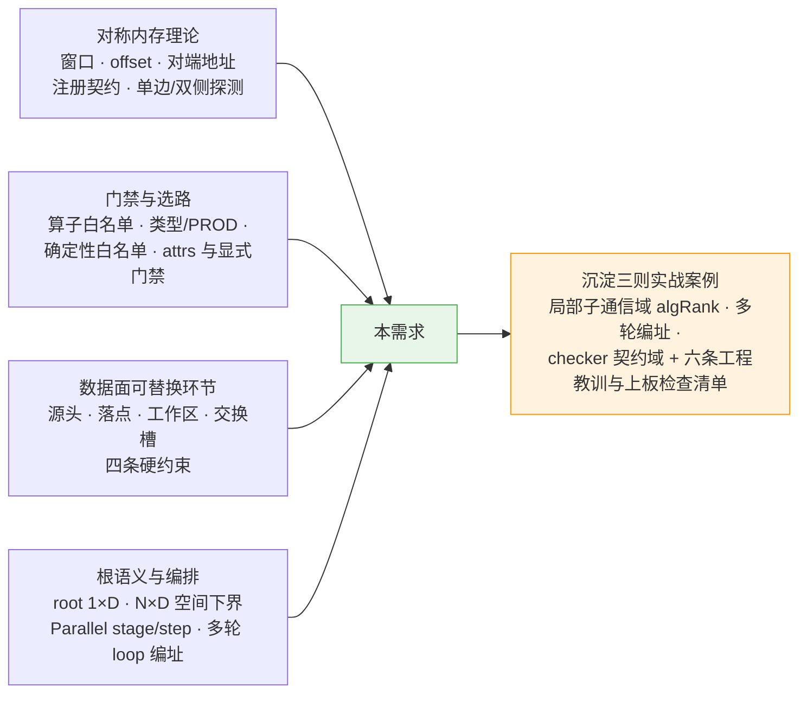
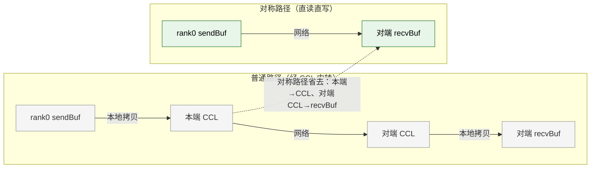
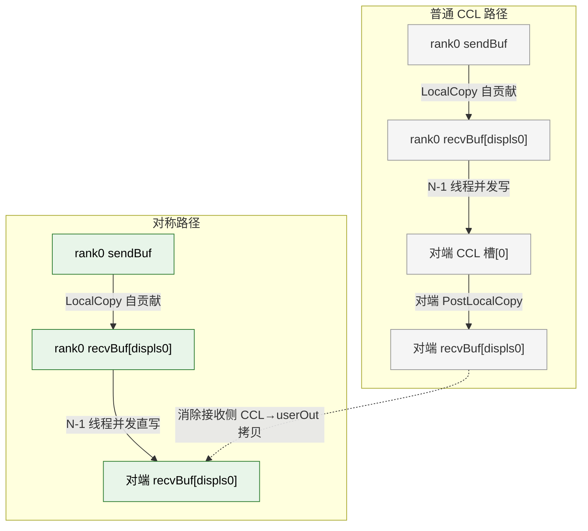
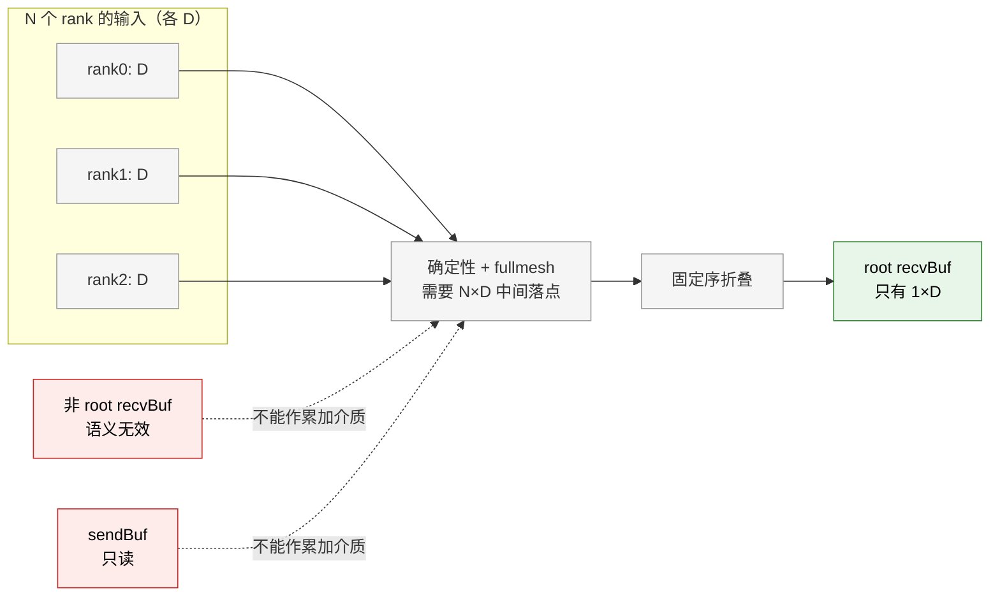
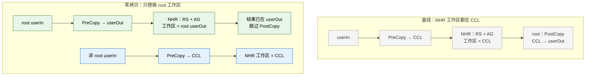

# 实战复盘｜AllGatherV/Reduce 零拷贝（对称内存）：从门禁到数据面的完整实战

> **所属专栏**：[实战复盘](index.md) · 第 3 篇
> **面向读者**：组内同行——有集合通信与分布式训练背景，不要求读过 hccl 仓源码。
> **事实基准**：hccl 仓 `feature/zero-copy-agv-reduce` 分支 `6e568841`（2026-11-12，父提交 `7442bf8e`；单 squash 提交，40 文件 +1390/-208）。文中 文件:行号 均按此基线核对，可直接跳转源码验证。
> **主线案例**：需求 AR20261029516478（AllGatherV/Reduce 接入对称内存零拷贝）。同一设计文档中的 Scatter 由他人负责、RSV 明确不开启，均不在本支范围。
> **配套文档**：[my-cann 仓需求目录](https://gitcode.com/cassielee-tech/my-cann/tree/main/design/26RP4/02-AllGatherV与Reduce零拷贝模式)——《02-前置知识》（小白版向导）、《01-预调研》（现状与待确认项）、《03-SE设计》（四算子方案全文）、《04-SRS_SD》（需求与设计）、《05-STC.xlsx》（用例与执行台账）、`scripts/run_agv_reduce_npu_test.sh`（真机一键脚本）。

---

## 0. 开篇：这个需求触碰了哪些知识

**需求一句话**：让 AllGatherV 和 Reduce 在满足门禁时，跨卡数据直接读写对端用户 buffer（`recvBuf`），省掉 CCL 中转与"CCL↔user buffer"的本地拷贝。AllGatherV 是**全量零拷贝**（跨卡数据全程不经 CCL）；Reduce 是**root 侧部分零拷贝**（只有 root 的工作区/终局落点搬到 `recvBuf`，非 root 与交换槽仍走 CCL）。

这个需求代码量不大（新增 2 个门禁文件 + 2 个入口探测块 + AGV/Reduce 的执行器与模板改造 + checker/UT/ST），却纵向穿透了 HCCL 的几条关键机制：



全文按这条线展开：第 1 节速查零拷贝与对称内存（同行可跳），第 2 节讲接入链路与门禁，第 3 节讲两个算子"哪些环节能换、为什么只能换这些"，第 4-6 节是三则排障实战，第 7 节是验证体系与工程教训。

---

## 1. 零拷贝与对称内存（速查）

### 1.1 "零拷贝"省的是什么

零拷贝**不是数据完全不动**。网络/总线上该搬的还得搬，它省的是两件事：

1. **用户内存与 HCCL 中转内存 `cclMem` 之间的本地拷贝**：普通路径是 `sendBuf → 本端 CCL → 网络 → 对端 CCL → recvBuf`，对称路径是 `sendBuf → 网络 → 对端 recvBuf`（AGV 仍保留一次自贡献本地拷贝，Reduce 仍有 root 的 PreCopy，见 1.5 的拷贝账本）；
2. **中转内存本身及其带来的单轮容量上限**：CCL scratch 槽位与单次传输上限（`UB_MAX_DATA_SIZE = 256MB`，`src/ops/op_common/inc/alg_param.h:39`）共同决定分几轮 loop。

真正生效的开关叫 `supportSymmetricMemory`（`src/ops/op_common/inc/alg_param.h:760`，同段 758-765 还有两个窗口句柄、`symMemChecked` 与两侧 offset）；`isZeroCopy` 不是功能开关，全仓没有位置把它置 `true`。

### 1.2 对称内存：窗口 + offset + peer 换地址

多个 rank 把各自的同一段虚拟地址布局注册到通信域后，HCCL 就能由"我这块地址 + 对端 rank"推算出"你那块对应地址"：

| 动作 | 接口 | 位置 |
| --- | --- | --- |
| 注册/解注册对称窗口 | `HcclCommSymWinRegister(comm, addr, size, &win, flag)` / `HcclCommSymWinDeregister(win)` | hcomm 仓 `include/hccl/hccl_comm.h:405`、`:413`；`flag` 当前仅支持 `1` |
| 查询本端 buffer 的对称窗口与 offset | `HcclCommSymWinGet` | host 侧 `libhcomm.so`，`dlsym` 加载 |
| 由窗口 + offset + peer 取对端地址 | `GetSymWinRemoteMem` | device 侧 `libccl_kernel.so`，优先 `HcclSymWinGetRemoteAddr`，9.1 回退 `HcclSymWinGetPeerPointer`（`src/common/hcomm_dlsym/hccl_sym_win_dl.cc:28`） |
| 把对端地址回填到 channel | `FillChannelSymWinPeerAddrs` | `src/ops/op_common/algorithm/template/template_utils.cc:969-1006` |

**注册契约（用户侧）**：

- A3 的 HCCS 场景要"提前预留相同大小、相同布局的虚拟地址"，窗口容量由 `HcclCommConfig.hcclSymWinMaxMemSizePerRank` 决定（默认 16GB，通信域预留总量 = rankSize × 该值）。
- 950 的 AICPU+URMA 场景，`HcclCommSymWinRegister` 只完成本端登记；跨 rank 的 memHandle 交换与远端信息更新在通信通道创建时完成（集合通信算子内部触发），在远端信息就绪前不应调 `HcclSymWinGetRemoteAddr`。
- **全 rank 一致是用户责任**：所有 rank 的 `recvBuf`（AGV 还包括 `sendBuf`）要么全部注册、要么全部不注册；窗口生命周期由用户持有，通信域销毁前建议先 `HcclCommSymWinDeregister`。

两个容易踩的工程点：

- **版本门禁不等于符号可用**：`GetHcommVersion() >= 9.1.0` 只是粗判；符号缺失时弱桩返回失败，按探测失败静默回退。
- **只回填地址、不回填大小**：`FillChannelSymWinPeerAddrs` 在对应窗口非空时分别写 `remoteInputGraphMode.addr` / `remoteOutputGraphMode.addr`，但 `.size` 保持默认 0。因此模板的越界校验只能用**本端** `outputSize` 兜底，不能假设拿得到对端窗口大小。

### 1.3 四类环节与四条硬约束

设计文档把数据面拆成四类环节，**能替换的环节集合 = 算法的零拷贝支持范围**：

| 环节 | 零拷贝处理 | 严格约束下的合法落点 |
| --- | --- | --- |
| ① 源头（user→CCL 头拷贝） | 数据持有侧直接读 user buffer，跳过头拷贝 | userIn 只读即可 |
| ② 落点（本跳接收方 == 数据最终目的 rank） | 直写接收方 userOut，跳过其 PostCopy | 接收方自身 userOut |
| ③ 工作区（归约累加介质） | 在合法 userOut 上原位归约/汇集 | 仅 root 的 userOut（Reduce 语义） |
| ④ 交换槽（每源一槽、多跳中转） | **保留 CCL**——确定性与空间下界 | — |

四条硬约束：① 归约确定性必须（每源一槽 + 固定序折叠，或成对/环形归约）；② fullmesh 链路同时使用（不能串行化）；③ 不改数据面（只把 CCL 槽位原样搬进 user buffer，不新增算法）；④ 不污染输入（userIn 只读，累加介质只能用合法 userOut）。

### 1.4 CCL buffer、scratch 与 256MB

对 AllGatherV 普通路径：

- `CalcScratchMultiple` 在 OPBASE 返回 `templateRankSize_`（`ins_temp_all_gather_v_mesh_1D.cc:70-82`）；
- executor 取 `maxDataSizePerLoop = min(UB_MAX_DATA_SIZE, cclMemSize / templateRankSize_)`，再算 `maxCountPerLoop` 与 `loopTimes`（`ins_v2_all_gather_v_sole_executor.cc:127-155`）。

对称路径下这两个约束同时消失：模板 `CalcScratchMultiple` 返回 0，executor 把 `maxCountPerLoop` 放大到本次最大 `recvCounts` 并强制 `loopTimes = 1`（`:147-158`）。**注意**：这是对仓内软件上限的旁路，代码并没有向硬件查询"单次传输到底能多大"。

### 1.5 数据流账本：AGV 与 Reduce 的根本差别

- **AllGatherV 是纯搬运**：每个 rank 的贡献在对端 output 里有专属 `displs[myRank]` 区间，落点即最终位置，不存在归约，也不存在"谁的 output 没语义"的问题。
- **Reduce 是向心归约**：N 份全量 D 汇总到 root 一份 D。确定性 + fullmesh 要求 N×D 的中间落点（每源一槽或分布式累加区），而合法用户介质只有 root 的 1×D——这就是 Reduce 只能做 root 侧部分零拷贝的根本原因（第 3.2 节展开）。需要说明的是：环形/成对归约本身也能满足确定性，但它们会把 fullmesh 链路串行化（违反硬约束②），所以在"确定性 + fullmesh"这组约束下才取 N×D 下界。



**拷贝账本（按每份数据计）**：

| 指标 | AGV 普通路径 | AGV 对称路径 | Reduce SoleNHR 普通 | Reduce SoleNHR 对称（root） |
| --- | --- | --- | --- | --- |
| 本地拷贝 | 2 次：发送侧自贡献 + 接收侧 CCL→userOut | 1 次：仅自贡献 | root 2 次（PreCopy + PostCopy）；非 root 1 次 | root 1 次（PreCopy 直写 userOut），PostCopy 跳过；非 root 不变 |
| CCL scratch | N×slice（`scratchMultiple=N`） | 0 | 算法工作区（NHR 为 1×D/rank） | root 工作区搬到 userOut；非 root 保留 |
| 单轮容量 / loop | `min(256MB, cclMem/N)`，多轮 | 单轮（`loopTimes=1`） | 受 CCL 槽位约束，多轮 | root 侧不受 CCL 约束；非 root 仍受 |
| 网络搬运量 | 每 rank 发 N-1 份自片 | 不变 | NHR 固定步序，量不变 | 不变 |
| 新增开销 | — | 远端写寻址；跨机 RoCE 上可能变慢 | — | 远端写寻址；跨机 RoCE 上可能变慢 |

---

### 1.6 拓扑与算法家族（速查）

- **level0 / level1**：level0 是框内（HCCS 高速互联），level1 是框间（RoCE 等网络）；`topoLevelNums` 计层数（1=单机、2=跨机、3=超大规模）。
- **算法家族**：`Mesh` 是框内全互联直连；`NHR`（Nonuniform Hierarchical Ring）按生成树构造最优收发关系，步数 ⌈log₂N⌉，是跨机主力；`Ring` 是环形逐块传递。Reduce 的 `Sole`/`Parallel`/`Sequence` 是编排模式：整域扁平一段 / 多线程按层并发 / 按层串行。
- 本需求的门禁都用 `level0Topo == MESH_1D` 限定框内形态；Reduce 还要求 `topoLevelNums > 1`，因为单级没有可替换的 root 工作区收益。

---

## 2. HCCL 接入链路与门禁

在 HCCL 里，一次集合通信调用由三层协作完成：**selector** 选算法（按拓扑/数据量/attrs 产出 `algName`）→ **executor** 申请资源并编排步骤（切 loop、准备模板参数）→ **template** 执行具体搬运/规约（经 wrapper 与 `dlsym` 落到 HCOMM）。零拷贝接入不改这三层职责，只是把"探测结果"和"对端地址"沿链路传下去，并在 template 里换掉读写目标。

### 2.1 五步接入链路

已支持算子（AllGather/AllReduce 等）与本次新增的 AGV/Reduce 共用同一条链路：

| 步骤 | 动作 | 位置 |
| --- | --- | --- |
| ① 入口探测 | 按算子条件调用 `CheckAndSetSymmetricMemory`，对需要的一侧/双侧问 `HcclCommSymWinGet` | AGV `all_gather_v.cc:366-372`；Reduce `reduce.cc:262-271` |
| ② 统一门禁/回退补齐 | `HcclExecOp → RefreshSymmetricMemory`，按最终 `algName/engine/topo` 重算白名单 | `op_common.cc:4808-4854`，调用点 `:1065-1068` |
| ③ 执行器传参 | 置 `supportSymmetricMemory_`，内联拷贝 `inputOffset_/outputOffset_/inputSymWindow_/outputSymWindow_`（与基类 `SetSymmetricMemoryInfo` 同体，但 AGV/Reduce 未调用该函数） | AGV `ins_v2_all_gather_v_sole_executor.cc:59-65`；Reduce `reduce_sole_executor.cc:124-130` / `reduce_parallel_executor.cc:389-395` |
| ④ 填对端地址 | `RestoreChannelMap → FillChannelSymWinPeerAddrs`，按窗口填 `remoteInputGraphMode.addr` / `remoteOutputGraphMode.addr` | `executor_v2_base.cc:81-84` → `template_utils.cc:969-1006` |
| ⑤ 模板直连 | 用对端地址读写，跳过 CCL scratch / 本地拷贝 | 见第 3 节 |

这里有两个分工必须分清：

- **入口条件块负责"清"**：按初始算法评估，不满足就保持/置 `supportSymmetricMemory=false`；
- **`RefreshSymmetricMemory` 只负责"补探/恢复"**：白名单条件不满足时它不触碰标志（不清 `false`，`op_common.cc:4850-4853`）；若本轮已探测过，则按 `IsSymMemWindowValid` 重算，窗口失效时可能把 `true` 置回 `false`（`:4842-4849`）。`symMemChecked` 保证一次调用内不重复查询。

> 这也是 review B1 的由来：Reduce 入口原本依赖算法 attrs 隐式挡 64bit/PROD。当前 selector 在 Phase1 对 preferred（`HCCL_ALGO` 正向指定）算法同样执行 `unsupportedDataTypes/isSupportProd` 硬过滤，所以"强制选路绕过 attrs"在现网代码里并不是一条实际可达路径；显式加 `IsReduceOpSymMemAllowed(param)`（`reduce.cc:262-270`）的定位是**不依赖 attrs 的防御性双保险**——防 attrs 后续漏声明/被改动，并保证入口与 `RefreshSymmetricMemory` 的 REDUCE 分支同口径。

### 2.2 一次调用的阶段表

| 阶段 | AllGatherV | Reduce |
| --- | --- | --- |
| 0 入口分流 | `AllGatherVOutPlace` | `ReduceOutPlaceCommon` |
| 1 入参检查 | 指针/counts/displs/in-place；`outputSize` 布局校验（`all_gather_v.cc:137-170`、`:201-283`） | 指针/count/type/root；64bit/PROD 白名单（`reduce.cc`） |
| 2 算法选择 | `AicpuAllGatherVSoleMesh` | 白名单三算法之一 |
| 3 对称探测 | Selector 之后，双侧窗口 | Selector 之后，**仅 output 侧**；禁 in-place |
| 4 资源/回退 | `HcclExecOp → RefreshSymmetricMemory` 兜底 | 同左 |
| 5 执行编排 | executor：对称时 `loopTimes=1`、scratch=0 | SoleNHR / Parallel 编排 |
| 6 数据面 | Mesh1D 模板直写对端 userOut | root 工作区/终局落 userOut |

### 2.3 门禁矩阵

| 层 | 检查项 | AllGatherV | Reduce | 不满足 |
| --- | --- | --- | --- | --- |
| 基础 | 版本/模式/引擎/一级拓扑 | hcomm≥9.1.0、OPBASE、AICPU_TS、`level0Topo==MESH_1D` | 同左 | 本 rank 回退 CCL |
| 拓扑 | 层级数 | 单级 MESH_1D 即可 | `topoLevelNums > 1`（单级永不开启） | 回退 |
| 算子 | 算法白名单 | `AicpuAllGatherVSoleMesh` | `AicpuReduceSoleNHR` / `AicpuReduceParallelMeshNHR` / `AicpuReduceParallelNHRNHR` | 回退 |
| 类型/规约 | 归约能力 | 全类型（纯搬运） | 排除 INT64/UINT64/FP64 与 PROD（`sym_mem_gate.cc:15-21`） | 回退 |
| 调用 | in-place | 入口禁止 `sendBuf==recvBuf` | 要求 `inputPtr != outputPtr` | AGV 返回 `HCCL_E_PARA`；Reduce 回退 CCL |
| 窗口 | 注册探测 | **双侧**（input+output） | **仅 output 侧**（`NeedInputSymWin` 只对 REDUCE 返回 false，`sym_mem_gate.cc:54`） | 回退 |

这里的"门禁"容易混淆：共享函数只有一组，但**每个算子的 Refresh 白名单是重复实现**，必须与算子入口同口径。按职责拆成四块：

1. **算法 attrs**（能力自述）：`REGISTER_ALG_ATTRS` 声明 `isSupportProd` / `unsupportedDataTypes` / `minTopoLevelNum` 等，选路时由 cost 表硬过滤；
2. **显式类型门禁**：`IsReduceOpSymMemAllowed` 排除 64bit/PROD。它是与 attrs 独立、不依赖选路结果的**防御性双保险**——当前 selector 对 preferred 算法也执行同样的硬过滤，它主要用于防 attrs 后续漏声明/被改动；
3. **确定性白名单函数**：`IsReduceOpSymMemDeterministic` 按 `opType` 分派（`sym_mem_gate.cc:23-52`）——AR/RS 的 SoleNHR 不受层级限制、其余单级算法多级否决；Reduce 单级一律 false、多级仅三个算法。入口与 Refresh 共用这一个函数；
4. **每算子 Refresh 白名单**：`RefreshSymmetricMemory` 的 `switch`（`op_common.cc:4815-4839`）与算子入口条件块是两份重复实现，新增算子或改白名单时必须同时修改。

> 单级 Reduce 的排除**不是靠 attrs**：`AicpuReduceParallelMeshNHR` 的 `minTopoLevelNum` 是 1，真正挡住单级的是确定性门禁里的 `topoLevelNums == 1 → false`。即使有人放宽该函数，单级 Parallel 仍会在选路层被 `TopoMatchTwoLevel` 的 `d1 == 1` 拒绝（`reduce_parallel_executor.cc:1054`）；确定性门禁是最后一道，不是唯一一道。

### 2.4 单边探测、注册契约与残留复位

- **单边语义**：Reduce 只写 root 的 output，不应额外要求注册 `sendBuf`；`NeedInputSymWin` 显式表达这一点，`CheckAndSetSymmetricMemory` 在非 input 分支把 `inputSymWindow/inputOffset` 清空。
- **空侧也算有效**：某一侧 `ptr == nullptr` 或 `size == 0` 时，`IsSymMemWindowValid` 视为该侧有效（`sym_mem_gate.cc:56-64`）。所以 `supportSymmetricMemory == true` **不代表两个窗口都存在**，模板仍需判空。
- **参数复用残留**：`OpParam` 可能跨调用复用。input 探测失败时同步清空 output 窗口与开关（`op_common.cc:4862-4877`）；output 探测失败时也复位开关（`:4887-4896`）。否则上一轮的窗口可能被本轮误判为有效。
- **无跨 rank 协商**：`OpExchangeInfo` 不含对称标志（`alg_param.h:928-939`），各 rank 独立探测、独立回退。全 rank 注册或全不注册、`recvCounts/recvDispls` 全 rank 一致，都是**用户契约**；部分注册/布局不一致不会报错，可能挂起、错数据或越界，框架不会给出清晰错误码。
- **门禁不检查链路类型，也没有 per-call 关闭开关**：一旦全 rank 注册窗口且其余条件满足，就会走对称路径。在 2 节点 RoCE 上 Reduce 直写可能变慢（见 7.5），目前唯一的规避方式是不注册；"按链路自动选择"仍是后续公共需求。

### 2.5 为什么把门禁逻辑拆到 `sym_mem_gate.cc`

`IsReduceOpSymMemAllowed` / `IsReduceOpSymMemDeterministic` / `NeedInputSymWin` / `IsSymMemWindowValid` 原先散在 `op_common.cc`（其中 `IsReduceOpSymMemAllowed`、`IsSymMemWindowValid` 是 static，`IsReduceOpSymMemDeterministic` 非 static；`NeedInputSymWin` 是本支新增）。仓里的 C++ 符号在 `libhccl.so` 中被 version script 局部化，库级 UT 不可行；把这些门禁逻辑集中到独立编译单元后，UT 可以用最小闭包直接链接（`test/ut/common/op_common_sym/`），6 个用例覆盖了 AR/RS/Reduce × 算法 × 层级矩阵、64bit/PROD、单边语义与空值/零长度分支。

> 拆分的代价是双份实现风险：入口条件块与 `RefreshSymmetricMemory` 必须保持同条件。当前 AGV/Reduce 入口与 Refresh 的白名单是逐项对齐的，新增算子时必须同时改两处。

---

## 3. 数据面：哪些环节可以零拷贝

### 3.1 AllGatherV：全量零拷贝

普通路径（`ins_temp_all_gather_v_mesh_1D.cc`）：

1. `LocalDataCopy`：把自己的 `sendBuf` 拷到本端 `recvBuf[displs[myRank]]`，这份自贡献同时作为发送源（`:242-277`）；
2. N-1 个对端线程把该片写进对端 CCL 槽 `scratchBase + sliceSize*myAlgRank`（`:135-136`、`:171-172`、`:194`）；
3. `PostLocalCopy` 再把每个对端的 CCL 槽拷到本端 `recvBuf[displs[algRank]]`（`:279-310`）。

对称路径只改两处：

- 跨卡写落点从 `remoteCclMem.addr` 换成 `remoteOutputGraphMode.addr`，偏移仍是 `displs[myAlgRank] * typeSize + outBaseOff`；
- `PostLocalCopy` 整体跳过（`:115-117`），接收侧 CCL→userOut 拷贝消失；**自贡献本地拷贝保留**，因为它是"本 rank 数据进入最终布局"的语义必需步骤。



> 两种路径的跨卡发送源都是**完成自贡献拷贝后的本地 `recvBuf`**，不是 `sendBuf`；`sendBuf` 只参与 `LocalDataCopy`。

**布局校验是本需求真正的改动。** 上游 `502e8c47`（UBX OmniPipe AGV）已把 OPBASE 的 `outputSize` 从 `sum(recvCounts)` 改成 `max(displs[i]+counts[i])`；本支在此基础上补的是：

- 零长度 rank 完全跳过（其 `displs` 不参与布局约束，MPI_Allgatherv 语义，`all_gather_v.cc:210-212`）；
- 非空区间 `[displs[i], displs[i]+counts[i])` 必须两两不重叠，**不要求单调**，允许乱序（`:222-232`）；
- 乘法溢出检查（`:213-218`、`:237-256`）；
- 单 rank 路径落到 `recvBuf + displs[0]*typeSize`，不是 offset 0（`op_common.cc:4053-4059`、`:4088-4089`）。

模板侧同时补了一批加固：远端地址判空、空槽跳过越界校验（多轮 loop 且各 rank counts 不等时，已传完一侧的槽位不应误报；该场景来自 OFFLOAD 图模式——对称 OPBASE 被强制 `loopTimes=1`，但两条路径共用 `enableRemoteMemAccess` 分支）、`rxSrc/rxDst` 偏移合并、每个 slice 用自身 count（不再复用 loop 级 `tempAlgParams_.count`）、`dataTypeSize == 0` 防御。

### 3.2 Reduce：为什么只能 root 侧部分零拷贝



- 非 root 的 `recvBuf` 内容语义无效，不能当工作区；
- `sendBuf` 只读，不能当累加介质；
- 只有 root 的 `recvBuf` 是合法累加/终局落点；
- 单级 MESH_1D 选到 `SoleMesh`/`TwoShot`，需要 N×D 或 D 槽位，root 也只有 1×D，**单级无收益**，门禁直接排除。

因此白名单只放三个多级算法，分别对应两类编排。

### 3.3 SoleNHR：root 工作区搬到 userOut

`ReduceNHR` 的对称改造只有一组地址 helper（`reduce_nhr.cc:59-94`）：

- 本端工作区：root 用 `outputPtr + outBuffBaseOff`，非 root 用 `hcclBuff.addr + hcclBuffBaseOff`；
- 远端工作区：对端 algRank 映射后是 root，则用 `remoteOutputGraphMode.addr + outBuffBaseOff`，否则用 `remoteCclMem.addr + hcclBuffBaseOff`。

配套改动：

- `PreCopy`：对称 root 直接 `userIn → userOut`（`sliceSize`）；非 root 仍 `userIn → CCL`（`:228-260`）；
- `PostCopy`：对称 root 已在 userOut，提前返回；非 root 返回；只有非对称 root 才从 CCL 回拷（`:416-443`）；
- `RunReduce/RunGather`：所有 slice 的 `txSrc/txDst/rxSrc/rxDst` 都走上述 helper，并对"远端是 root 但地址为空"显式报 `HCCL_E_INTERNAL`。

NHR 的步序、每步 peer、slice 编号完全不变，**只换 root 的读写地址**，所以归约顺序与确定性等价。



> 图中 N0/N1/N2 是非 root 链路，**仍走 CCL**；"零拷贝"只对 root 链路成立。子图放在一起是为了对比同一套 NHR 步序下两种介质的选择。

### 3.4 Parallel：只给最终 root-bound 的 AG 开直写

`ReduceParallelExecutor` 固定 `stageNum=2`（stage0=RS 折叠、stage1=AG 汇聚），每 stage 两个 step（intra/inter 按 dataSliceIdx 交错）。final stage/step 由常量 `(1,1)` 锚定（`reduce_parallel_executor.cc:42-44`），对称路径区分两个布尔条件（`:554-563`）：

- `rootOutputStage = sym && myRank_==root_ && (stageIdx,stepIdx)==(1,1)`：决定 root 的 `outBuffType=OUTPUT`、`outputPtr/outputSize`；
- `enableRootDirectWrite = sym && (stageIdx,stepIdx)==(1,1) && isInter`：**对全 rank** 置 `enableRemoteMemAccess=true`，由 AG NHR 模板按 root/non-root 角色分派地址。

为什么只开 (1,1)：

| 传输 | 是否直写 | 原因 |
| --- | --- | --- |
| stage0/step0、stage0/step1（RS） | 否 | Reduce 只注册 output，`inputSymWindow` 为空，RS 必须回退 CCL |
| stage1/step0（AG 中间步） | 否 | 产物仍是中转数据，必须落 CCL |
| stage1/step1（最终 AG，接收方=root） | **是** | 该跳接收方就是最终目的 root，满足"②落点" |
| stage1/step1（接收方=非 root） | 否 | 非 root 的 output 无意义，且其工作区仍是 CCL |
| intra Mesh1D（isInter=false） | 否 | 走 `SendRecvBatchRead` 直接读对端 CCL 并写本端 `outputPtr`，不需要远端写地址 |

`InsTempAllGatherNHR` 里用 `reduceRootOnly_ = (opType==REDUCE) && enableRemoteMemAccess_` 区分"全网对称 AG"与"Reduce root-only 直写"（`ins_temp_all_gather_nhr.cc:169-179`）。这里 root 判定必须是 **userRank 语义**：

- `iAmRoot = (myRank_ == tempAlgParams_.root)`；
- `sendToRoot/recvFromRoot = GetRankFromMap(stepInfo.toRank/fromRank) == root`；
- **不做** `root 的 algRank == 0` 或 `myAlgRank == root` 的假设。

原因见第 4 节：inter 层的 `subCommRanks` 是局部视图，root 并不在每张卡的 algRank 表里。

### 3.5 不开启的算法与死代码清理

- **不开启的算法**（原因各不相同，不能一句话概括）：

| 算法 | 不开启原因 | 未来是否可突破 |
| --- | --- | --- |
| `SoleMesh` | 星型汇聚需 root N×D 槽位，userOut 仅 1×D | 需更换归约形态（分片/树/环形） |
| `SoleMeshTwoShot` | 阶段1 每 rank 需 D 槽位；非 root userOut 无效、input 只读 | 允许污染时仅整除场景可解锁 |
| `Sequence` 3level / `AicpuReduceNHR` / `MultiJetty` | 各层部分归约/中转结果只能落 CCL；其中 64bit/PROD 专用变体（如 `AicpuReduceSoleNHRAicpuReduce`）另被类型门禁排除 | 组合流水改造需单独立项 |
| RSV 全部 | 发送源已直读 userIn、折叠目标已是 userOut，无可直访环节 | 环形在途归约（MeshChunk V 版）可突破 |

- **清理**：`ReduceMesh1DTwoShot` 的 `enableRemoteMemAccess_` 分支在父提交 `7442bf8e` 就不可达（`ReduceSoleExecutor` 从未赋值，基类默认 false），但分支里存在"槽位=对端 userIn"的污染路线与非整除偏移缺陷。本支在接通对称前先把这些死分支全部删除，统一为 `remoteCclMem + hcclBuff`（`reduce_mesh_1D_two_shot.cc:79-84`、`:164-230`、`:305-370`），行为保持不变。

### 3.6 RS 阶段：`inputSymWindow` 守卫

Reduce 只注册 `recvBuf`，`sendBuf` 不注册，所以 `inputSymWindow` 为空。RS 模板（`InsTempReduceScatterMesh1D/NHR/MeshChunk`）与 AR/RS 共用，不能只凭 `supportSymmetricMemory` 走对称：

```cpp
supportSymmetricMemAccess_ = param.supportSymmetricMemory && param.inputSymWindow != nullptr;
```

（`ins_temp_reduce_scatter_mesh_1D.cc:122-124`、`ins_temp_reduce_scatter_nhr.cc:137-139`、`ins_temp_reduce_scatter_mesh_1D_meshchunk.cc:111`）

去掉这个守卫的后果很具体：Mesh1D 会把 `reduceDstPtr` 切到 `inputPtr` 并在末尾从 input 拷到 output；NHR/MeshChunk 会把远端地址切到 `remoteInputGraphMode.addr`，而该地址在"只注册 output"时为 `nullptr`——要么空指针，要么污染输入。

---

## 4. 实战案例一：root 在局部子通信域里不是 algRank

### 4.1 现象

Parallel 对称路径在 16 rank（2 节点×8）首次接通后，**每个 AICPU kernel 都失败**：单用例累计 224 个 kernel failure，stream 同步返回 `retcode 507018`。选路、建链、门禁日志都正常，失败发生在模板执行阶段。

### 4.2 根因

最初在 AG NHR 模板里把 root 换算成 algRank：`GetAlgRank(root, subCommRanks_[0], ...)`。但 Reduce Parallel 的 inter 层 `subCommRanks` 是**每 rank 的局部视图**（只含本 rank 与跨框对端），root 只存在于 root 自己和它对端的视图里。其他 rank 调 `GetAlgRank(root, ...)` 找不到 root，返回 `HCCL_E_PARA`，于是整条对称路径的 kernel 全部失败。

### 4.3 修复

去掉 algRank 换算，直接按 userRank 语义比较（`ins_temp_all_gather_nhr.cc:315-317`）：

```cpp
const bool iAmRoot      = (myRank_ == tempAlgParams_.root);
const bool sendToRoot   = (GetRankFromMap(stepInfo.toRank)   == tempAlgParams_.root);
const bool recvFromRoot = (GetRankFromMap(stepInfo.fromRank) == tempAlgParams_.root);
```

`GetRankFromMap` 负责把 algRank 映射回 userRank；局部视图下直写只在"root ↔ 其跨框对端"之间正确启用。

### 4.4 启示

1. **分层/并行执行器里至少有三种 rank 编号**：userRank、全局 algRank、子通信域 algRank。跨层比较必须先确认当前 map 是否包含目标 rank，不能默认"root 的 algRank 是 0"。
2. 同一语义（root）在不同模板里可以有两种实现形态：`ReduceNHR` 用 `IsRootAlgRank(algRank)`（先映射 `subCommRanks_[0][algRank]` 再比 userRank），`InsTempAllGatherNHR` 用 `GetRankFromMap(algRank) == root`。移植时不能简化成 `myAlgRank == root`。
3. 排障线索要往"局部视图/全局视图"上想：选路和建链都过、只有模板执行报 `HCCL_E_PARA`，通常不是通信问题，而是地址/编号空间用错。

---

## 5. 实战案例二：多轮 loop 的编址不变量

### 5.1 现象

16 rank、512MB 的 Parallel/SoleNHR 用例在单轮小数据下正确，多轮 loop 下出现数据错位/互踩。根因不在通信，而在"跳过本地拷贝后，本轮进度偏移由谁负责"。

### 5.2 两种编址与统一规则

`ReduceParallelExecutor` 里同时存在两种编址：

| 子步 | 编址方式 | 代码 |
| --- | --- | --- |
| intra Mesh1D（rootOutputStage 且非 inter） | **折指针**：`outputPtr = param_.outputPtr + outputLoopBaseOff_`，`outputSize = param_.outputSize - outputLoopBaseOff_` | `reduce_parallel_executor.cc:595-599` |
| inter NHR（enableRootDirectWrite） | **不折指针、折偏移**：`outputPtr = param_.outputPtr`（root）或 CCL（非 root），`outBuffBaseOff += outputLoopBaseOff_`，全 rank `outputSize = param_.outputSize` | `:625-635` |

为什么 inter 必须统一：非 root 的远端直写偏移要和 root 本地落点**逐字节一致**。root 用裸 `outputPtr + outBuffBaseOff` 落位，非 root 用 `remoteOutputGraphMode.addr + outBuffBaseOff` 落位；只有全 rank 都把 `outputLoopBaseOff_` 叠进 `outBuffBaseOff`，两边才对得上。

配套不变量：

- `outputLoopBaseOff_ = processedCount * dataTypeSize_`，每轮起点重置 `rootOutputWritten_ = false`（`:750-751`）；
- `OrchestrateLoop` 对所有 rank 校验 `outputLoopBaseOff_ + 本轮字节数 ≤ param_.outputSize`（`:752-760`）；
- 只有实际下发的 `outBuffType == OUTPUT` 才置 `rootOutputWritten_ = true`（`:847-849`）；
- root 仅在 `sym && rootOutputWritten_` 时跳过终局 `LocalCopy`，避免"以为写了其实没写"（`:798-806`）。

### 5.3 review 补丁：非 root 也要用 root 的 `outputSize`

最初的越界校验只在 root 上做。review 指出：非 root 直写 root 的 userOut 时，也必须以 **root 的输出边界**校验，而不是 `cclMem.size`。修复是 executor 在 `enableRootDirectWrite` 分支里把 `param_.outputSize` 传给**全 rank**（`:631`），AG NHR 在 `sendToRoot` 分支用 `txOutOff + txSliceSize ≤ outputSize` 校验（`ins_temp_all_gather_nhr.cc:350-368`）。

### 5.4 启示

1. **"拷贝可跳、握手不可跳"**：跳过 PreCopy/PostCopy 省的是本地拷贝，不是跨轮 notify/ACK/DATA_SIGNAL。同步逻辑随拷贝一起删，下一轮就会提前覆盖。
2. **跳过拷贝后，进度偏移的责任转移**：普通路径由 `LocalCopy` 自带本轮偏移；对称路径必须把偏移叠进跨卡落点或工作区地址。多轮问题大多不是"算错了"，而是"少叠了一项"。
3. **越界校验要用最终落点所属方的边界**：非 root 写 root 的 buffer，就用 root 的 `outputSize`；用本端 `cclMem.size` 等于没校验。
4. **"写过了"要留证据**：`rootOutputWritten_` 是"是否真的落到 userOut"的运行时证据，不能只看开关是否为 true。

---

## 6. 实战案例三：checker 严格断言与 HostDPU 的合法暂存

### 6.1 现象

为 Reduce 补两条语义断言后，CI（run#5424）出现 14 条失败，集中在 `st_reduce_dpu_test`、`st_hostdpu_inline_reduce_test`、`st_dpu_thread_arrangement_test`：

- `CHK_RED_002`：非 root rank 的 `recvBuf` 不得产生任何写入语义；
- `CHK_RED_003`：`sendBuf` 不得被污染（INPUT 语义块来源必须是自身初始输入）。

### 6.2 根因

这两条断言对**对称路径的 AICPU 域**成立，但不是所有 Reduce 实现的公共契约：

- 对称路径下非 root `recvBuf` 只作窗口锚点，写它就是 bug；
- 但 HostDPU Reduce 合法地把非 root `recvBuf` 当暂存介质；
- API 从未定义"非对称模式下非 root `recvBuf` 的内容"，因此不能用对称路径的红线去判 DPU。

### 6.3 处置

给 `TaskCheckReduceSemantics` 加 `strictBufferContract` 参数，默认 `false`，只在 AICPU 语义域的 `RunReduceTest/RunReduceTestTwice` 里 opt-in（`reduce_aicpu_testcase.cc` 的 28 个 TEST_F：27 个 `RunReduceTest` + 1 个 `RunReduceTestTwice`），DPU/HostDPU 套件保持豁免（`reduce_semantics_checker.cc:91-130`、`reduce_testcase_common.h:125-127`、`:172-173`）。

### 6.4 启示

1. **校验器断言是语义契约的执行者，但先要确认"这条契约对谁成立"**。契约域不同的实现共用一套用例时，断言必须以 opt-in 方式启用，默认保持历史行为。
2. 断言失败不一定是被测代码错，也可能是**断言的作用域错了**。先问"这个域承诺过这条契约吗"，再改代码。
3. 严格断言的价值在于"能抓住存量缺陷"，但上线时机与作用域要评估——这与参考文档里"语义校验器暴露 DPU 存量缺陷"的教训同构。

---

## 7. 验证体系与工程教训

### 7.1 三层用例

| 层 | 内容 | 结果（按提交快照） |
| --- | --- | --- |
| UT | `op_common_sym` 6 个用例：AR/RS/Reduce × 算法 × 层级矩阵、64bit/PROD、空 topo、单边语义、窗口有效性 | 6/6；全量 UT 597 条 0 失败（`fe20d3a` 快照；加这 6 条前为 591） |
| ST | AGV：displs 空洞/全 0/非法/in-place/重叠/非单调 6 条专项；Reduce：白名单强制选路、非白名单回退、同 comm 连续两次调用、3 级 ParallelNHRNHR | AGV 默认 12/12（`f73a83c5` 快照；HEAD 为 13 个 TEST_F）；Reduce 23/23（同快照；HEAD 为 28 个 TEST_F）；全量 ST 记录 261 条 0 失败（`f73a83c5` / `st_suite_results.tsv`），另有 402 条口径来自 PR#3842 基线，两者不是同一快照 |
| 真机 | 2 节点×8 测试集群：AGV 8 rank 多档数据量；Reduce SoleNHR/Parallel、root∈{0,3,8,15}、16MB/512MB 多轮 | 回归记录 24/24（当时脚本口径；HEAD 脚本有 26 个 active 用例，构成不能精确还原）；AGV 512MB 56.18→86.27 GB/s（1.53x，STC 未记录 dtype） |

**证据边界要讲清楚**：

- 真机数据来自 STC 台账与提交正文，原始 stdout 在远端 `npu_logs/`，本机只有汇总值；AGV 512MB 另有一组 `11816.32us/45.43GB/s → 6089.40us/88.16GB/s`（约 1.94x）的 8 rank 单 Server FP32 测量，**两组不要混用**。
- 历史对称 ST（AGV 7/7、Reduce 24/24）依赖已删除的 `run_*_sym_st.sh` 与 `libst_symwin.so` 桩环境；HEAD 默认 ST 不注册对称窗口，6 条 AGV 新用例验证的是布局/入口/checker 与 CCL 回退路径，**不验证直写**。直写正确性由真机脚本与 checker 历史结果承担。
- Reduce 在 2 节点 RoCE 上直写比 CCL **慢约 43%**（仅 STC 备注，无原始 us/GB/s）。这是边界信息，不是"零拷贝一定更快"。

### 7.2 教训一：门禁是多副本，不是单一函数

门禁不是一个函数，而是四块职责（第 2.3 节）：算法 attrs、显式类型门禁、共享的确定性白名单函数、以及**每个算子的入口条件块 + `RefreshSymmetricMemory` 的 switch 这两份重复实现**。入口比 Refresh **宽**时最危险：入口置 true、Refresh 判 false 又不主动清标志，executor 会带着 true 进入模板；入口比 Refresh **窄**时 Refresh 会补探，通常不会漏开，但两边行为已不一致，后续改动容易踩坑。

**检查方法**：新增算子时把入口条件与 Refresh 的 `case` 逐项对照；类型门禁不要依赖 attrs 隐式挡，显式函数与 attrs 各写一遍；确定性白名单是共享函数，改一次两处生效，但新增算法名仍要同时补入口、Refresh 和 UT 矩阵。

### 7.3 教训二：开关粒度与单边语义

`supportSymmetricMemory` 是**算子级**开关，不表示每一侧都有窗口，也不表示整个模板都可以直连：

- Reduce 是单边探测，`inputSymWindow` 恒为空；`IsSymMemWindowValid` 又把空指针/零长度侧视为有效。因此"支持对称"≠"输入已注册"。
- **只有共用的 RS 模板**（ReduceScatter Mesh1D/NHR/MeshChunk）需要额外的 `inputSymWindow != nullptr` 守门；AG 模板不使用 input 窗口，按 `enableRemoteMemAccess` 与 output 窗口判空即可。
- `enableRemoteMemAccess` 在 Reduce Parallel 里只对 `(stage1,step1)` 的 inter AG 置位，且是**对全 rank 置位**、由 AG NHR 模板按 root/non-root 角色分派。RS、AG 中间步、非 root 工作区全部保持 CCL。

**把"算子级开关"直接下传给"模板级分支"，是这类 bug 的共同来源。**

### 7.4 教训三：编址与握手不变量

- **拷贝可跳、握手不可跳**：跳过 PreCopy/PostCopy 省的是本地拷贝，不是跨轮 notify/ACK/DATA_SIGNAL。
- 本轮进度偏移必须叠加到最终落点/工作区地址；折指针与折偏移只能选一种，且全 rank 必须一致。
- 每个 slice 的 size/count/stride 必须同源（V 类算子不能复用 loop 级 `count`）。
- 越界校验用最终落点所属方的 `outputSize`，不是本端 `cclMem.size`。
- "是否真的写了 userOut"要有运行时标志（`rootOutputWritten_`），不能只看开关。

这些是本需求多轮 loop 的**主要**不变量，不是全部；地址对齐、notify 配对等仍由模板既有逻辑保证。

### 7.5 教训四：性能收益看链路，也要告诉用户怎么规避

- AGV 512MB 在测试集群上 1.53x（另一组 8 rank 单 Server FP32 测量约 1.94x）；
- Reduce 在 2 节点 RoCE 上 root 侧直写慢约 43%；
- 单级 Reduce 512MB 实测 base/sym 均约 3606us/148.8GB/s（`symMem[0]`，即门禁回退，不是 A/B 收益）。

零拷贝消除的是本地拷贝，但改变了写目标与链路行为。**收益必须按拓扑/链路实测**；跨机 RoCE 与超节点 HCCS 可能是两种结论。对外表述要区分"设计目标"（`loopTimes=1`、解除 256MB）与"实测收益"。

更要紧的是**用户如何规避**：当前门禁不检查链路类型，也没有 per-call 关闭开关；一旦全 rank 注册窗口，2 节点 RoCE 上的 Reduce 也会自动走直写。现阶段唯一的规避方式是不注册，等待"链路感知门禁"作为后续公共需求补上。

### 7.6 教训五：三个工程习惯

1. **先清死代码，再激活开关**：`ReduceMesh1DTwoShot` 的对称分支不可达，但里面藏着"污染 sendBuf"和"非整除偏移"两个缺陷。接通开关前先审计并删除不可达分支——删除是行为保持的（`enableRemoteMemAccess_` 恒 false），但能让激活后的语义边界变干净。
2. **rebase 后重新审视你的 diff**：本支最初把 AGV 的 `outputSize` 从 `sum(recvCounts)` 改成 `max(displs+counts)`；rebase 到含上游 `502e8c47` 的基线后，这个口径修复已被上游吸收，本支实际保留的是布局校验与单 rank `displs[0]` 落位。同理，确定性白名单在 rebase 期间合并了上游 `de8c245e` 新增的 Concurrent AR/RS 算法（`sym_mem_gate.cc:39-41`）。**以 `git diff base..HEAD` 为准，不要按记忆描述贡献。**
3. **纯逻辑抽出来，才有最小闭包 UT**：门禁符号随 `libhccl.so` 的 version script 被局部化，库级 UT 不可行；抽成 `sym_mem_gate.cc/.h` 后，UT 直接编译该单元即可覆盖矩阵与防御分支。可测试性要在拆函数时考虑，同时接受"入口 vs Refresh 双份实现"的维护成本。

### 7.7 教训六：跨 rank 契约无法由单 rank 代码保证

全 rank 注册、`recvCounts/recvDispls` 一致、`sendCount == recvCounts[userRank]`，都是用户契约。框架没有跨 rank 对称标志协商，部分 rank 失败只会让该 rank 静默回退 CCL，其他 rank 仍走对称——结果可能是挂起、错数据或越界，而不是清晰的错误码。**文档必须把契约写死**（`HcclAllGatherV.md:95-96`、`HcclReduce.md:99`），测试要覆盖"全不注册"的回退路径，并在设计上把"跨 rank 协商"列为后续公共需求。

### 7.8 上板前检查清单

| 类别 | 检查项 |
| --- | --- |
| 门禁 | 入口条件与 Refresh 同口径；attrs 与显式类型门禁都覆盖 64bit/PROD；单级/单边语义正确；窗口探测失败会复位两侧窗口与开关 |
| 契约 | 全 rank 注册或全不注册；V 类 counts/displs 全 rank 一致；in-place 行为与 API 一致；文档写清非 root output 无效与 input 不污染 |
| 数据面 | 共用 RS 模板有 `inputSymWindow` 守门；跳过拷贝后保留 notify；loop 进度偏移叠加且全 rank 一致；非 root 直写用 root 的 `outputSize` 校验；`rootOutputWritten_` 防假写 |
| 清理 | 不可达的对称分支已删除；rebase 后 `git diff base..HEAD` 复核过归属 |
| 验证 | 门禁矩阵 UT；非白名单/64bit/PROD/单级/不注册的回退 ST；真机 root 矩阵与多轮；性能按链路分别记录，不混用测点 |

---

## 8. 术语速查与延伸阅读

| 术语 | 一句话 |
| --- | --- |
| 零拷贝 / 对称内存 | 省掉用户 buffer 与 CCL 中转之间的本地拷贝；真正开关是 `supportSymmetricMemory` |
| 注册 / 解注册 | `HcclCommSymWinRegister(comm, addr, size, &win, flag=1)` / `HcclCommSymWinDeregister(win)` |
| 窗口 / offset | 对称内存的注册描述句柄 / 用户 buffer 相对窗口基址的偏移 |
| level0 / level1 / `topoLevelNums` | 框内（HCCS）/ 框间（RoCE 等）/ 拓扑层数（1 单机、2 跨机、3 超大规模） |
| Mesh / NHR / Ring | 框内全互联 / 非均衡层次环（跨机主力，步数 ⌈log₂N⌉）/ 环形逐块传递 |
| selector / executor / template | 选算法 / 申请资源并编排步骤 / 执行具体搬运与规约 |
| Sole / Sequence / Parallel | 整域扁平一段 / 按层串行 / 按层并发 |
| 单边 / 双侧探测 | Reduce 只探 output；AGV 探 input+output；空侧（ptr 空或 size 0）视为有效 |
| `symMemChecked` | 本次调用是否已探测过；一次失败本调用内不再重试 |
| 全量 / 部分零拷贝 | AGV 跨卡数据全程不经 CCL / Reduce 仅 root 侧工作区与终局落点改 userOut |
| 源头 / 落点 / 工作区 / 交换槽 | 数据面四类环节；交换槽因确定性与空间下界保留 CCL |
| SoleNHR / Parallel | 单模板蝶形成对归约 / RS+AG 两级流水（stage0=RS，stage1=AG，每 stage 两 step） |
| rootOutputStage / enableRootDirectWrite | root 终局落 OUTPUT / (1,1) inter AG 的远端直写开关（全 rank 置位，模板按角色分派） |
| 折指针 / 折偏移 | `outputPtr += loopBase` / `outBuffBaseOff += loopBase`；inter 路径必须全 rank 统一折偏移 |
| `UB_MAX_DATA_SIZE` | 单次传输软件上限 256MB；对称路径旁路，不是硬件查询结果 |
| `strictBufferContract` | checker 严格契约断言的 opt-in 开关，仅 AICPU 语义域启用 |
| userRank / algRank / 子通信域 algRank | 全局 rank / 算法视图 rank / 局部视图 rank；跨层比较前先确认 map 是否包含目标 |
| attrs / 显式门禁 / 确定性白名单 / Refresh 白名单 | 算法能力自述 / 类型与 PROD 排除 / 归约顺序是否确定（共享函数）/ 每算子 switch（与入口重复，必须同步改） |

**延伸阅读**：

- 本需求全量材料：[my-cann 仓需求目录](https://gitcode.com/cassielee-tech/my-cann/tree/main/design/26RP4/02-AllGatherV与Reduce零拷贝模式)（《02-前置知识》《01-预调研》《03-SE设计》《04-SRS_SD》《05-STC.xlsx》、`scripts/run_agv_reduce_npu_test.sh`）；
- hccl 仓（[gitcode.com/cann/hccl](https://gitcode.com/cann/hccl)）官方文档：`docs/zh/architecture/architecture-brief.md`（分层与架构约束）、`docs/zh/api_ref/comm_op_interface/HcclAllGatherV.md` / `HcclReduce.md`（对称内存约束与注册契约）、`docs/zh/user_guide/comm_ops_support_list/comm_ops_support_a3.md`（A3 单算子零拷贝支持表）、`docs/zh/user_guide/coll_algo_intro/{README.md,NHR.md,hierarchical_comm_principle.md}`（算法与分级原理）；
- hcomm 仓（[gitcode.com/cann/hcomm](https://gitcode.com/cann/hcomm)）API 文档：`docs/zh/api_ref/comm_mgr_c/HcclCommSymWinRegister.md`（注册契约与 A3/950 差异）、`HcclSymWinGetRemoteAddr.md` / `HcclSymWinGetPeerPointer.md`（远端地址换算与协议限制）。
