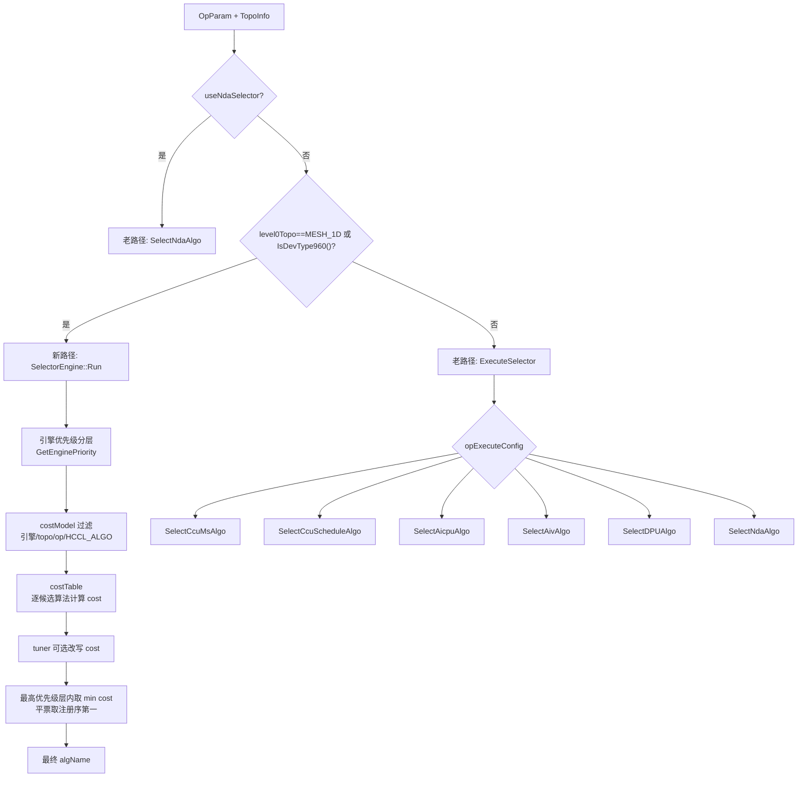

# AllGather Selector 算法选择决策树与 Corner Case

> 仓：`cann/hccl`，基于当前分支 `support_aclgraph_zerocopy-clean`（HEAD `7b0fa2d2`）。
> 目标：把 AllGather 的算法选择策略讲成一张可执行的决策树，说明 cost model 引入后决策边界从"显式阈值"变成了什么，
> 并给出可复现的 corner case。

## 0. 结论先行

1. **AllGather 目前有两条选路路径，不是一条**：
   - **新路径** `SelectorEngine`（cost model）：只在 `level0Topo == MESH_1D` 或 960 机型时启用；
   - **老路径** `ExecuteSelector → AllGatherAutoSelector`（手写阈值 if-else）：其余拓扑（CLOS / MESH_1D_CLOS / hostDPU / NDA）。
2. **引入 cost model 后，"决策树"分两层**：
   - **可行集**由硬过滤决定（引擎 → 拓扑 → 算子属性 → `HCCL_ALGO`/priority），这一层仍然是布尔决策树；
   - **选谁**由每条候选算法的分段线性 cost 曲线下界决定（最高引擎优先级层内取 min cost）。
3. 因此真正的决策边界不是单一阈值，而是**cost 曲线的交叉点**；由于 `util(dataSize)` 是分段常数阶跃函数，
   交叉点会随 util 断点发生跳变，出现"数据量增加 1 字节、选中算法翻转"的非单调行为。
4. **已确认的 corner case**（代码里自带补丁）：16P 两级 `MESH_1D`、总数据量 32~64MB 区段，cost model 对
   `AicpuAllGatherSoleNHR` 估值偏低导致误选，只能靠 `opCustomCheck` 硬排除（`ins_v2_all_gather_sole_executor.cc:409-423`）。
5. **结构性的 corner case**（本文重点）：util 表的断点 + NHR 的 `rankSize/2` 查表放大，使 16P 下 per-rank
   数据量恰好 256KB 时 `SoleNHR` 的 cost 跳降约 70µs，可能与竞争算法的排序翻转（见第 6.2 节）。

---

## 1. 选路总入口

算法选择入口：`src/ops/op_common/op_common.cc:225`（`ReSelector` 在 `:957` 复用同一分流逻辑）。

```cpp
bool useNdaSelector = hostDPUOnly && isSupportNda;
if (!useNdaSelector && ((topoInfo->level0Topo == Level0Shape::MESH_1D) || AutoSelectorBase::IsDevType960())) {
    CHK_RET(SelectorEngine::Global()->Run(comm, param, topoInfo.get(), algName));   // 新路径
} else {
    std::shared_ptr<ExecuteSelector> collAlgSelector = std::make_shared<ExecuteSelector>();
    CHK_RET(collAlgSelector->Run(param, topoInfo.get(), algName));                  // 老路径
}
```

分流条件：

| 条件 | 路径 |
|---|---|
| `useNdaSelector == true`（hostDPU-only 且支持 NDA） | 老路径的 `SelectNdaAlgo` 分支 |
| `level0Topo == MESH_1D` 或 `IsDevType960()` | 新路径 `SelectorEngine` |
| 其余（`CLOS`、`MESH_1D_CLOS`、不满足上面条件的 2D 拓扑等） | 老路径 `ExecuteSelector` |

> 注意：即使 `level0Topo == MESH_1D`，两级拓扑的 level1 仍可能是 CLOS；NHR 模板在
> `ins_temp_all_gather_nhr.cc:20` 直接把 `param.netType` 设为 `COMM_TOPO_CLOS`，因此 CLOS 的 util 表
> 在新路径中同样生效，6.2 的 util 断点分析对新路径成立。

---

## 2. 决策树总览



关键差别：

- **老路径**：`Select*Algo` 内部是一棵显式 if/else 阈值树，命中即返回算法名，决策边界直接写在代码里。
- **新路径**：阈值树退化成"可行性过滤"，最终选择由 cost 数值比较决定；显式 if/else 没有消失，而是以
  `opCustomCheck` / `topoCustomCheck` / `topoPriorityCheck` / `opPriorityCheck` / `HCCL_ALGO` 优先级 /
  tuner 的形式挂在树梢（"补丁叶子"）。

---

## 3. 新路径：cost model 如何形成决策树

### 3.1 管线

`SelectorEngine::Run`（`src/ops/op_common/selector/selector_engine.cc:413`）：

```
step 0  tuner 初始化
step 1  从通信域 ctx 取/建 costModel（按 opExecuteConfig 分 tag）
step 2  CostTableManager::GenerateCostTable
step 3  TunerEnrichCostTable（可选）
step 4  GetEnginePriority + SelectMinCost
```

### 3.2 costModel 的五步（`cost_model.cc:314 GenerateCostModel`）

| 步骤 | 函数 | 作用 |
|---|---|---|
| 1 | `InitModel` | 按全量算法注册表分配条目 |
| 2 | `FilterByEngine`（`:371`） | 非候选引擎的条目 `count=0` |
| 3 | `ApplyHcclAlgoPriority`（`:401`） | `HCCL_ALGO` 正向/否定打标，只打标不过滤 |
| 4 | `FilterByTopoAndCalibrate`（`:408`） | topo 硬/软过滤 + 按拓扑标定 A/B/C/D |
| 5 | `ApplyTopoPriority`（`:480`） | topoPriority 排他（只保留命中的算法） |

### 3.3 引擎优先级（`selector_engine.cc:74 GetEnginePriority`）

最终算法 = **候选中实际出现的最高优先级层内 cost 最低者**（`selector_engine.cc:597 SelectMinCost`）。

| `opExecuteConfig` | 候选引擎（同层按数值大者优先） |
|---|---|
| `CCU_MS` | CCU_MS, CCU_SCHED, AICPU_TS, HOSTCPU（平级 0） |
| `CCU_SCHED` | CCU_SCHED, AICPU_TS, HOSTCPU |
| `CCU_MS_ONLY` | CCU_MS |
| `CCU_SCHED_ONLY` | CCU_SCHED |
| `AIV` | AIV, AIV_URMA, AICPU_TS, HOSTCPU |
| `AIV_URMA` | AIV_URMA(1) → AICPU_TS(0), HOSTCPU(0) |
| `AIV_ONLY` | AIV |
| `AICPU_TS` | AICPU_TS, HOSTCPU |
| `HOSTCPU` | HOSTCPU |
| 默认 | AICPU_TS, HOSTCPU |

引擎由算法名前缀解析（`alg_parse.cc:897`）：

| 前缀 | 引擎 |
|---|---|
| `CcuSched` | CCU_SCHED |
| `CcuMS` | CCU_MS |
| `Aicpu` | AICPU_TS |
| `AivUrma` | AIV_URMA |
| `Aiv` | AIV |
| `Dpu` | HOSTCPU |
| 无匹配前缀 | 默认 AICPU_TS（`alg_attrs_registry.cc:61`） |

### 3.4 costTable 三阶段（`cost_table.cc:163 GenerateCostTable`）

| 阶段 | 函数 | 作用 |
|---|---|---|
| Phase 1 | `OpFilterAndCalcCost`（`:202`） | op 属性过滤 + 逐算法算 cost |
| Phase 2 | `ApplyOpPriority`（`:276`） | opPriority 排他（tuner 加载时跳过） |
| Phase 3 | `ConvergeHcclAlgoTier`（`:312`） | `HCCL_ALGO` 优先级收敛（全否定时放开回退） |

### 3.5 代价公式（`cost_table.cc:360 CalcAlgCost`）

```text
perTransfer = dataSize × dataRatio            // NHR/NHR_MULTILINK/NHR_NDA 还要 ×(rankSize/2)
util        = QueryUbUtil(netType, perTransfer, engine, algoType, opType)
segCost     = (A / util + B + Breduce) × dataSize + C
groupCost   = Σ segCost  或  max(segCost)     // 由 AlgNetMeta.intraGroupMode 决定
cost        = max( Σ groupCost, Σ D )
```

要点：

- `util` 只影响 `A` 项；`B`/`C`/`D` 与数据量无关或线性。
- `perTransfer` 用于查 util，`dataSize` 用于乘 cost——两者不是同一个量。
- `Breduce` 是 64bit/PROD 的 host 规约附加斜率（`cost_model.h:77 CalcHostReduceSlope`）。
- 多段算法的段划分、`dataRatio`、`groupSizes`、`intra/interGroupMode` 由 `AlgNetMeta` 给出。

### 3.6 util 是分段常数阶跃函数（`cost_table.cc:437-505`）

CLOS 表（`closUbUtilTable_`）与 MESH 表（`meshUbUtilTable_`）按上界分档：

| CLOS 上界 | util | MESH 上界 | util |
|---|---|---|---|
| 0.125MB | 0.10388 | 1MB | 0.7135 |
| 0.25MB | 0.10388 | 2MB | 0.7758 |
| 0.5MB | 0.10388 | 4MB | 0.8112 |
| 1MB | 0.1855 | 8MB | 0.8301 |
| 2MB | 0.3 | 16MB | 0.84 |
| 4MB | 0.4288 | 32MB | 0.8449 |
| 8MB | 0.5302 | 64MB | 0.8475 |
| 16MB | 0.568 | 128MB | 0.8487 |
| 32MB | 0.6549 | 256MB | 0.8494 |
| 64MB | 0.7184 | | |
| 128MB | 0.7408 | | |
| 256MB | 0.7644 | | |

查表语义（`cost_table.cc:486-493`）：

```cpp
auto it = std::lower_bound(table.begin(), table.end(), dataSize, [](const UbUtilEntry& e, u64 ds) {
    return e.upperBound <= ds;      // 找第一个 upperBound > ds 的档
});
```

即：**档位 `m` 覆盖区间 `[prev, m)`；`ds` 恰好等于 `m` 时使用下一档**。这与注释
"小于 m 的数据量取利用率 n"一致，但意味着**边界点本身是阶跃点**。

额外的 AllGather 特判（`cost_table.cc:480-485`）：

```cpp
// AllGather: CLOS 小数据量(< 1MB)统一用 1MB 的 util
if (opType == ALLGATHER && netType == CLOS && dataSize < 1MB) {
    dataSize = 1MB;
}
```

按上面的查表语义，`dataSize = 1MB` 会命中 **2MB 档（util=0.3）**，而不是 1MB 档（0.1855）。
因此该特判的实际效果是：**CLOS 段 `perTransfer < 2MB` 时 util 恒为 0.3**。注释里的 "1MB 的 util"
容易被理解为 0.1855，建议与 owner 确认预期（见第 9 节）。

### 3.7 平票与外部覆盖

- **平票**：`cost == minCost` 时取 `tiedAlgos[0]`（注册序第一个），只打 WARNING（`selector_engine.cc:693-703`）。
- **tuner**：`TunerEnrichCostTable` 可改写 cost；被 tuner 标记的条目（`cost < 0` 或 `algName == nullptr`）
  不参与最高优先级层判定。
- **`HCCL_ALGO`**：正向指定（`hcclAlgoPriority > 0`）优先且跳过软策略检查；否定指定（`-1`）排除；
  全为否定层时放开回退。
- **软策略让位**：preferred 或 tuner 加载时，`opCustomCheck`/`opPriorityCheck` 等软策略跳过；`topoPrecondCheck`
  等硬前提始终执行。

---

## 4. 老路径：`AllGatherAutoSelector` 完整分支表

文件：`src/ops/all_gather/selector/all_gather_auto_selector.cc`。

### 4.1 `SelectCcuMsAlgo`（`:37`）

| 条件 | 结果 |
|---|---|
| `topoLevelNums > 1` | NOT_MATCH |
| 两级网 + `userRankSize == 2` + `dataSize >= 4MB` | NOT_MATCH（回退到后续引擎） |
| `level0Topo == MESH_1D` 且输入输出 overlap | NOT_MATCH |
| `MESH_1D` + `TWO_DIE_REGULAR` | `CcuMSAllGatherSoleMesh2Die` |
| `MESH_1D` + `TWO_DIE_NOT_REGULAR` | NOT_MATCH |
| `MESH_1D` 其他 | `CcuMSAllGatherSoleMesh` |
| `MESH_1D_CLOS` + pcieMix 且非全 1DMesh 连通 | NOT_MATCH |
| `MESH_1D_CLOS` + `dataSize > 512KB` | NOT_MATCH |
| `MESH_1D_CLOS` 其他 | `CcuMSAllGatherSoleMesh` |
| 其他拓扑 | NOT_MATCH |

### 4.2 `SelectCcuScheduleAlgo`（`:210`）

前置：`level2UbRtp` 或 `topoLevelNums >= 3` → NOT_MATCH；overlap → NOT_MATCH。

**两级（`topoLevelNums > 1`）**

| 条件 | 结果 |
|---|---|
| `level0Topo == MESH_1D` 且 `userRankSize > 64` | NOT_MATCH |
| `Level1Nhr` | `CcuSchedAllGatherSoleNHR` |
| `is2DieFullMesh` | NOT_MATCH |
| `localNetInsSizeOfLayer[0] == 1` | `CcuSchedAllGatherSoleNHR` |
| `userRankSize <= 8` 且 `dataSize <= 1MB` | `CcuSchedAllGatherSoleMesh` |
| `userRankSize <= 8` 且 `frameNum <= 16` | `CcuSchedAllGatherParallelMeshNHR` |
| `userRankSize <= 8` 且 `frameNum > 16` | `CcuSchedAllGatherSoleNHR` |
| `userRankSize > 8` 且 `dataSize < 128KB` 且 `userRankSize <= 32` | `CcuSchedAllGatherSoleMesh` |
| `dataSize < 4MB` 且 `frameNum <= 16` | `CcuSchedAllGatherSequenceMeshMesh` |
| `frameNum <= 16` | `CcuSchedAllGatherParallelMeshNHR` |
| `frameNum > 16` | `CcuSchedAllGatherSoleNHR` |
| `level0Topo == CLOS` | `CcuSchedAllGatherSoleNHR` |

**单级（`topoLevelNums == 1`）**

| 条件 | 结果 |
|---|---|
| `MESH_1D` + `TWO_DIE_REGULAR` | `CcuSchedAllGatherSoleMesh2Die` |
| `MESH_1D` + `TWO_DIE_NOT_REGULAR` | NOT_MATCH |
| 960 + `dataSize > 16MB` + 两级网 | `CcuSchedAllGatherSoleMeshConcur` |
| 两级网 + `userRankSize == 2` + `dataSize >= 4MB` | NOT_MATCH |
| `MESH_1D` 其他 | `CcuSchedAllGatherSoleMesh` |
| `MESH_1D_CLOS` + pcieMix + 全 1DMesh 连通 | 复用 MESH_1D 分支 |
| `MESH_1D_CLOS` + pcieMix + 非全连通 | NOT_MATCH |
| UBX（`MESH_1D_CLOS` 非 pcieMix）+ `dataSize > 512KB` + mesh 数等于 clos 数 + `rank <= 4` | `CcuSchedAllGatherConcurMeshNHRMultiLink` |
| UBX + `dataSize > 512KB` + clos 数是 mesh 数倍数 + `dataSize < 16MB` | `CcuSchedAllGatherParallelMeshNHRMultiLink` |
| UBX + `dataSize > 512KB` + clos 数是 mesh 数倍数 + `dataSize >= 16MB` | `CcuSchedAllGatherPipeLineMeshNHR` |
| UBX + `dataSize > 512KB` + 其他 | `CcuSchedAllGatherSoleNHRMultiLink` |
| UBX + `dataSize <= 512KB` | `CcuSchedAllGatherSoleMesh` |
| `CLOS` + pcieMix | NOT_MATCH |
| `CLOS` 其他 | `CcuSchedAllGatherSoleNHR` |

### 4.3 `SelectAicpuAlgo`（`:303`）

**两级**

| 条件 | 结果 |
|---|---|
| level0/level1 对称 + `deviceNumPerModule == 8` + `topLevelUboe` + `topoLevelNums == 2` | `AicpuAllGatherPipeLineMeshNHR` |
| 同上 + `topoLevelNums > 2` | `AicpuAllGatherPipeLineMeshNHRNHR` |
| 对称 + `topoLevelNums == 3` + `topLevelUboe`（且不满足上面 `deviceNumPerModule == 8` 的条件） | `AicpuAllGatherParallelNHRNHR` |
| `Level1Nhr` / `Level0Nhr` / `localNetInsSizeOfLayer[0] == 1` | `AicpuAllGatherSoleNHR` |
| `MESH_1D` + `topoLevelNums >= 3` + 对称 | `AicpuAllGatherSequenceMeshConcurNHRNHR` |
| `MESH_1D` + `topoLevelNums >= 3` + 非对称 | `AicpuAllGatherSoleNHR` |
| `MESH_1D` + `dataSize × rankSize >= 1GB` + `rankSize >= 1024` | `AicpuAllGatherParallelMeshNHR` |
| `MESH_1D` + `dataSize > 1MB` + `dataSize × rankSize > 4GB` | `AicpuAllGatherSequenceMeshConcurNHR` |
| `MESH_1D` + `dataSize > 1MB` 其他 | `AicpuAllGatherParallelMeshNHR` |
| `MESH_1D` + `dataSize <= 1MB` | `AicpuAllGatherSoleNHR` |
| `CLOS` | `AicpuAllGatherSoleNHRMultiLink` |

**单级**

| 条件 | 结果 |
|---|---|
| `MESH_1D` + 两级网 + (`dataSize × rankSize > 1GB` 或 (`rank == 2` 且 `dataSize >= 4MB`)) | `AicpuAllGatherSoleMeshConcur` |
| `MESH_1D` 其他 | `AicpuAllGatherSoleMesh` |
| `MESH_1D_CLOS` + pcieMix + 全 1DMesh 连通 | `AicpuAllGatherSoleMesh` |
| `MESH_1D_CLOS` + pcieMix + 非全连通 + `dataSize < 16MB` | `AicpuAllGatherParallelMeshNHR` |
| `MESH_1D_CLOS` + pcieMix + 非全连通 + `dataSize >= 16MB` | `AicpuAllGatherPipeLineMeshNHR` |
| UBX + mesh 数等于 clos 数 + `rank <= 4` + `dataSize > 512KB` | `AicpuAllGatherConcurMeshNHR` |
| UBX + mesh 数等于 clos 数 + `rank <= 4` + `dataSize <= 512KB` | `AicpuAllGatherSoleMesh` |
| UBX + clos 数是 mesh 数倍数 + `dataSize > 512KB` + `dataSize < 16MB` | `AicpuAllGatherParallelMeshNHRMultiJetty` |
| UBX + clos 数是 mesh 数倍数 + `dataSize > 512KB` + `dataSize >= 16MB` | `AicpuAllGatherPipeLineMeshNHR` |
| UBX + 其他 | `AicpuAllGatherSoleNHR` |
| `CLOS` | `AicpuAllGatherSoleNHRMultiLink` |

### 4.4 `SelectAivAlgo`（`:412`）

| 条件 | 结果 |
|---|---|
| `userRankSize > 1024`（`hccl_aiv_utils.h:26 MAX_RANK_SIZE`） | NOT_MATCH |
| `level2UbRtp` | NOT_MATCH |
| `topoLevelNums >= 3` | NOT_MATCH |
| 取 `HcclGetHcclBuffer` 失败 | NOT_MATCH |
| 非 UBX + bigdata（per-rank ≥ 8MB） | NOT_MATCH |
| UBX + bigdata + (`rank > 8` 或 `rank <= 4`) | NOT_MATCH |
| `totalSize > cclBufferSize × 16`（`AIV_MAX_CCL_LOOP_NUM`） | NOT_MATCH |
| 其他 | `AivAllGatherSoleMesh` |

### 4.5 `SelectDPUAlgo` / `SelectNdaAlgo`（`:476` / `:509`）

| 条件 | DPU 结果 | NDA 结果 |
|---|---|---|
| 两级 + (`localNetInsSizeOfLayer[0] == 1` 或 `MESH_1D`) | `DpuAllGatherSequenceMeshNHR` | `DpuAllGatherSequenceNHRNHRNDA` |
| 两级 + `MESH_1D_CLOS` + 非 pcieMix + `dataSize > 4MB` | — | `DpuAllGatherPipeLineMeshNHRNHRNDA` |
| 两级 + `MESH_1D_CLOS` + 非 pcieMix + `dataSize <= 4MB` | `DpuAllGatherPipeLineMeshNHRNHR` | `DpuAllGatherSequenceNHRNHRNDA` |
| 两级 + `MESH_1D_CLOS` + pcieMix | `DpuAllGatherSequenceMeshNHR` | `DpuAllGatherSequenceNHRNHRNDA` |
| 两级 + 其他 | `DpuAllGatherSequenceMeshNHR` | `DpuAllGatherSequenceNHRNHRNDA` |
| 单级 | NOT_MATCH | NOT_MATCH |

---

## 5. 阈值常量表与比较符审计

### 5.1 常量

| 常量 | 值 | 使用点 | 备注 |
|---|---|---|---|
| `SMALL_COUNT_512KB` | 512KB | `:99`、`:128`、`:389` | 全部用 `>` |
| `AG_FLATTEN_MAX_DATA_SIZE` | 128KB | `:267` | 用 `<` |
| `AG_CCU_CLOS_SMALL_DATA_SIZE` | 1MB | `:255` | 用 `<=` |
| `AG_CCU_SEQUENCE_MAX_DATA_SIZE` | 4MB | `:270` | 用 `<` |
| `AG_AICPU_SMALL_DATA_SIZE` | 1MB | `:345` | 用 `>` |
| `AG_AICPU_1D_TWO_LEVEL_DATA_SIZE_THRESHOLD` | 1GB | `:361` | 用 `>` |
| `AG_AICPU_SEQUENCE_DATA_SIZE` | 4GB | `:346` | 用 `>` |
| `AG_2P_DETOUR_DATA_SIZE` | 4MB | `:52`、`:160`、`:362` | 全部用 `>=` |
| `OMNI_PCIE_AG_DATA_SIZE` | 16MB | `:373`、`:395` | 用 `<` |
| `OMNI_UBX_AG_DATA_SIZE` | 16MB | `:132` | 用 `<` |
| `SMALL_COUNT_16M` | 16MB | `:157` | 用 `>` |
| `AG_NDA_PIPELINE_MIN_DATA_SIZE` | 4MB | `:529` | 用 `>` |
| `MAX_FRAME_NUM_FOR_CCU_ALGO` | 16 | `:257`、`:270`、`:273` | `<=` / `>` |
| `MAX_RANK_NUM_FOR_CONCURRENT_ALGO` | 4 | `:129`、`:317`、`:388` | `<=` |
| `MAX_RANK_NUM_FOR_SEQ_ALGO` | 8 | `:254` | `<=` |
| `AG_CCU_MAX_RANK_SIZE` | 64 | `:240` | `>` |
| `AG_CCU_RANK_SIZE` | 32 | `:267` | `<=` |
| `DEVICE_NUM_PER_MODULE_8` | 8 | `:316` | `==` |
| `AG_UBX_AIV_BIGDATA_RANK_LOWER` | 4 | `:454` | `<=` |
| `AG_UBX_AIV_BIGDATA_RANK_UPPER` | 8 | `:453` | `>` |
| `AIV_MAX_PER_RANK_DATA_SIZE` | 8MB | `:450` | `>=` |
| `AIV_MAX_CCL_LOOP_NUM` | 16 | `:463` | `>` |
| `MAX_RANK_SIZE` | 1024 | `:419` | `>` |
| `AG_2D_SMALL_DATA_SIZE` | 1MB | 无 | **未使用** |
| `AG_CCU_SMALL_DATA_SIZE` | 4MB | 无 | **未使用** |

### 5.2 比较符不一致

同一语义阈值在不同分支使用了不同的比较符：

- **4MB**：`>=`（`:52`、`:160`、`:362`）vs `>`（NDA `:529`）；
- **16MB**：`>`（`:157`）vs `<`（`:132`、`:373`、`:395`）；
- **512KB**：全部 `>`，但小数据分支的"else"意味着恰好 512KB 走大数据侧；
- **1MB**：`>`（`:345`）、`<=`（`:255`）、`<`（`:270`）。

这些不一致不会导致同一分支内自相矛盾，但会让"恰好等于阈值"的输入在不同引擎/拓扑下落到不同侧，
是构造 corner case 最直接的入口。

---

## 6. Corner Case

### 6.1 已确认：16P 32~64MB 区段 `SoleNHR` 被 cost model 低估

位置：`src/ops/all_gather/algorithm/executor/ins_v2_all_gather_sole_executor.cc:409-423`。

```cpp
// 规避: 16P MESH_1D 总数据量 32~64MB(per-rank 2~4MB)区段 costmodel 对 SoleNHR 估值偏低导致误选,
// 先在该区段排除该算法, 待 costmodel 对应区段系数修正后移除
op.opCustomCheck = [](const OpParam& opParam, const TopoInfoWithNetLayerDetails* topo) -> bool {
    u64 totalSize = opParam.DataDes.count * DATATYPE_SIZE_TABLE[opParam.DataDes.dataType] * topo->userRankSize;
    return !(
        topo->userRankSize == 16 && totalSize >= 32ULL * 1024 * 1024 && totalSize <= 64ULL * 1024 * 1024
        && topo->level0Topo == Level0Shape::MESH_1D);
};
```

要点：

- 场景：16P、两级 `MESH_1D`、AllGather、AICPU；
- 问题：cost model 在该区段把 `AicpuAllGatherSoleNHR` 估得偏低，导致选中它；
- 现状：用 `opCustomCheck` 硬排除，属于**承认 cost model 在该区段失真**的补丁；
- 测试价值：`totalSize` 恰好 32MB、64MB 两侧是天然边界；补丁移除条件应与 cost 系数修正同步。

### 6.2 结构性 corner case：util 断点导致 cost 跳变与算法翻转

这是 cost model 决策树最隐蔽的一类边界，**不是代码 bug，而是分段近似模型的固有性质**，但会导致
"数据量增加 1 字节、算法翻转"的非单调行为。

**机制**

1. `cost = (A/util + B) × dataSize + C`，`util` 由 `perTransfer` 查表；
2. `util` 是分段常数，且**在断点上直接切换**（`upperBound <= ds` 语义），所以 `cost(dataSize)` 本身在断点处**不连续**；
3. NHR 类算法的 `perTransfer = dataSize × dataRatio × (rankSize/2)`（`cost_table.cc:387-390`），
   查表断点被"放大/缩小"到 `dataSize = 断点 / (dataRatio × rankSize/2)`；
4. 若竞争算法的 cost 恰好落在跳变量级内，min-cost 的选择就会翻转。

**可复现的具体点（16P，SoleNHR，dataRatio=1，CLOS 端口数 P=1，A=15/56e9）**

| per-rank dataSize | perTransfer = ds×8 | util | `A/util × ds`（A=15/56e9） |
|---|---|---|---|
| 262143B（256KB-1） | 2MB-8 | 0.3 | ≈ 234.1µs |
| 262144B（256KB） | 2MB | 0.4288 | ≈ 163.7µs |

也就是说，per-rank 数据量从 256KB-1 增加到 256KB，`SoleNHR` 的 cost **向下跳约 70µs**。
若此时 `ParallelMeshNHR` 的 cost 落在两者之间，选路会从 Parallel 翻到 SoleNHR——
**数据量变大反而选择了理论上更"小数据"的算法**。

同理的断点：

- 16P：ds = 256KB（2MB）、512KB（4MB）、1MB（8MB）、2MB（16MB）……
- 8P：ds = 512KB（2MB）、1MB（4MB）、2MB（8MB）……

> 说明：上述 cost 只计算了 `A/util × ds` 一项；`B/C/D` 与竞争算法会改变翻转是否真正发生。
> 因此该点的正确用法是"作为必测边界"，而不是断言一定翻转。

**CLOS 小数据钳制的影响**

`cost_table.cc:480-485` 把 AllGather + CLOS + `perTransfer < 1MB` 统一抬到 1MB。按查表语义，
1MB 命中 2MB 档（util=0.3），所以实际效果是：

```text
perTransfer ∈ (0, 2MB)  → util = 0.3
perTransfer = 2MB       → util = 0.4288
```

钳制把 1MB 断点"抹平"了，但 2MB 断点仍然存在。这也解释了为什么对 16P，第一个真正的跳变点在
per-rank 256KB，而不是 128KB。

**建议的验证方式**

1. 固定其余输入，令 per-rank `dataSize` 分别为 `256KB-1`、`256KB`、`256KB+1`；
2. 打开 `[CalcAlgCost]` 日志，观察 `SoleNHR` 与 `ParallelMeshNHR` 的 seg cost；
3. 观察 `[SelectorEngine] SelectMinCost` 的最终 `selected algName`；
4. 若翻转发生，记录 util 档位、A/B/C/D、以及两条曲线的差值，作为 cost model 的标定输入。

### 6.3 2P 4MB 特判：注释、日志与实际回退不一致

位置：`all_gather_auto_selector.cc:49-57`。

```cpp
// 2P场景且数据量大于阈值时回退到AICPU
if (IsTwoLevelNetLayer(topoInfo, opParam) && topoInfo->userRankSize == 2 && dataSize >= AG_2P_DETOUR_DATA_SIZE) {
    HCCL_DEBUG("... fallback to CCU sched for better performance.", ...);
    return SelectorStatus::NOT_MATCH;
}
```

- 注释说"回退到 AICPU"；
- 日志说"fallback to CCU sched"；
- 实际行为：`SelectCcuMsAlgo` 返回 `NOT_MATCH` 后，`GetEnginePriority(CCU_MS)` 的下一个候选是
  `CCU_SCHED`，所以落到 **CCU_SCHED**，不是 AICPU。

这是一个"文档/日志与真实决策树不一致"的典型点，适合作为 code review 的整改项。

### 6.4 边界比较符导致的跳变

以 2P 两级网为例：

| dataSize | `SelectCcuMsAlgo` | `SelectCcuScheduleLevel0AlgoMesh1D` | `SelectAicpuAlgo`（单级） |
|---|---|---|---|
| 4MB-1 | 继续 `SelectMeshAlgo` | 继续 `SoleMesh` | `SoleMesh` |
| 4MB | `NOT_MATCH`（`>=`） | `NOT_MATCH`（`>=`） | `SoleMeshConcur`（`>=`） |

同一输入在 4MB 前后跨过三个不同的分支，且三个分支对"等于阈值"的处理一致（都用 `>=`），
但与 NDA 的 `>`（`:529`）不一致。若后续统一阈值语义，这里是必须回归的点。

---

## 7. 如何观测与复现

### 7.1 关键日志

| 日志关键字 | 来源 | 用途 |
|---|---|---|
| `[SelectorEngine] The opExecuteConfig is ... selected algo type is ...` | `selector_engine.cc:510 LogSelectedAlgo` | 最终选中算法 |
| `[SelectorEngine] SelectMinCost: costTable count=...` | `selector_engine.cc:635` | 候选数量 |
| `[SelectorEngine] \| idx \| algName \| enginePrio \| cost \|` | `selector_engine.cc:638` | 每个候选的 cost 表 |
| `[CalcAlgCost] algName=... cost=...` | `cost_table.cc:411` | 单算法总 cost |
| `[CalcAlgCost]   seg[j] A=... util=...` | `cost_table.cc:427` | 每段 A/B/C/D/util |
| `[DFX_CostTableDump]` | `cost_table.cc:157` | cost table dump |
| `[CostTableManager] QueryUbUtil ... utilization=...` | `cost_table.cc:501` | 实际查到的 util |
| `[Algo][Selector] The selector[priority of %u] is matched` | `execute_selector.cc:46` | 老路径命中 |

### 7.2 控制变量

- `HCCL_ALGO`：正向指定/否定指定算法，用来隔离单个候选；
- tuner 插件：直接改写 cost，验证"如果 cost 变 X，选择是否翻转"；
- `opExecuteConfig` / `commOpExpansionMode`：切换引擎候选集（`CCU_MS`、`CCU_SCHED`、`AIV`、`AICPU_TS`、`*_ONLY`）。

### 7.3 UT 入口

- `test/ut/selector_engine/selector_engine_test.cc`
- `test/ut/aiv_template_selector/aiv_template_selector_test.cc`
- `test/ut/alltoall_nda_selector/alltoall_nda_selector_test.cc`（NDA 分支参考）

---

## 8. 文件索引

| 内容 | 位置 |
|---|---|
| 选路分流 | `src/ops/op_common/op_common.cc:225`、`:957` |
| 新路径入口 | `src/ops/op_common/selector/selector_engine.cc:413` |
| 引擎优先级 | `src/ops/op_common/selector/selector_engine.cc:74` |
| min-cost 选择 | `src/ops/op_common/selector/selector_engine.cc:597` |
| costModel 五步 | `src/ops/op_common/selector/cost_model.cc:314` |
| costTable 三阶段 | `src/ops/op_common/selector/cost_table.cc:163` |
| cost 公式 | `src/ops/op_common/selector/cost_table.cc:360` |
| util 表 | `src/ops/op_common/selector/cost_table.cc:437-457` |
| util 查表 | `src/ops/op_common/selector/cost_table.cc:461-505` |
| AG CLOS 钳制 | `src/ops/op_common/selector/cost_table.cc:480-485` |
| 带宽常量 | `src/ops/op_common/selector/cost_model.cc:114` |
| Mesh/NHR 参数 | `src/ops/op_common/selector/cost_model.cc:555`、`:584` |
| 引擎前缀 | `src/common/alg_parse.cc:897` |
| 老路径完整树 | `src/ops/all_gather/selector/all_gather_auto_selector.cc` |
| 16P 补丁 | `src/ops/all_gather/algorithm/executor/ins_v2_all_gather_sole_executor.cc:409-423` |
| AIV 常量 | `src/ops/op_common/algorithm/template/aiv/hccl_aiv_utils.h:26`、`:38` |

---

## 9. 待确认问题

1. **AG CLOS 钳制的预期**：`cost_table.cc:480-485` 注释写"用 1MB 的 util"，但按查表语义实际命中
   2MB 档（0.3），不是 1MB 档（0.1855）。是注释不准确，还是钳制点应为 `1MB-1`？
2. **16P 补丁的移除条件**：`ins_v2_all_gather_sole_executor.cc:409` 的 `opCustomCheck` 是临时规避，
   需要明确对应 cost 系数修正的责任人和验收用例。
3. **老路径是否收敛**：新 cost model 只覆盖 `MESH_1D`/960，CLOS/UBX 仍走手写阈值树。
   长期是否计划把 CLOS 也迁到 cost model，决定了这份决策树是"过渡态"还是"终态"。
4. **util 表断点的标定来源**：CLOS/MESH 表的断点（1/2/4/8/16MB…）与实测带宽的对应关系，
   建议补一份标定记录，否则 6.2 的翻转点无法判断是"模型正确"还是"模型失真"。

---

## 附：同目录相关材料

- `allgather-selector-costmodel-analysis.md`：更偏"代价函数推导 + 数值决策表"的分析；
- `ag_util_steps.png`：util 分段阶跃函数示意；
- `ag_cost_curves.png`：候选算法 cost 曲线；
- `ag_decision_heatmap.png`：rankSize × dataSize 的算法胜负热力图；
- `ag_flipflop_band.png`：决策边界附近的 flip-flop 带。
