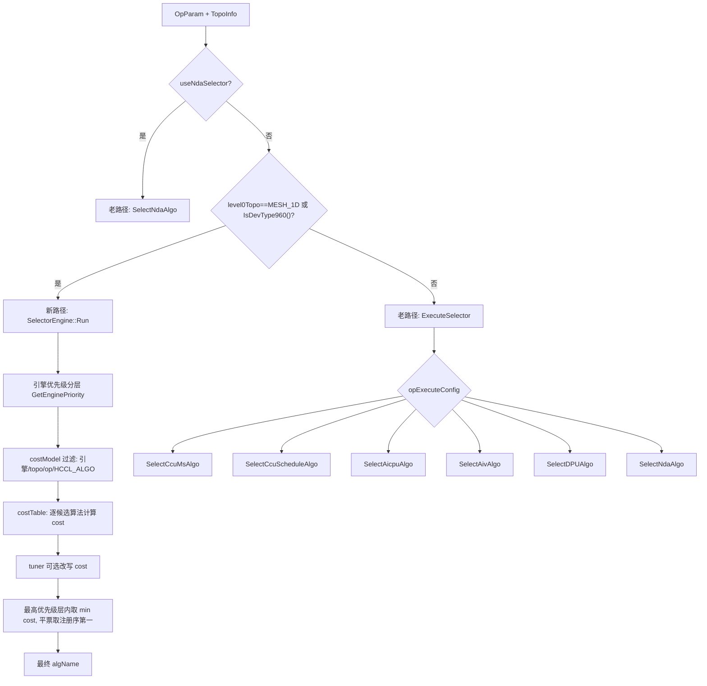

# AllGather 选算法：从阈值树到代价模型

> 研究对象：仓 `cann/hccl`，分支 `support_aclgraph_zerocopy-clean`（HEAD `7b0fa2d2`）。
> 本文是这次研讨的**合集版**：决策树、代价模型、corner case、10 分钟分享稿、复现方法与全部图表都在这一页。
> 所有数字都来自**按仓内公式的模型复刻**，不是上板实测；真实选路以 `[CalcAlgCost]` / `[SelectorEngine] SelectMinCost` 日志为准。

**一句话主线**

> 选路已经从"按条件查表"变成"给每个候选算一笔账、选最便宜的"。
> 但账本里的 `util` 是分段常数阶梯，所以决策边界会在某些数据量上**跳变**；
> 这次给出了一个可复现的"多 1 字节、算法翻转"的用例。

## 阅读地图

| 想了解 | 看这里 |
|---|---|
| 结论与事实边界 | 第 0 节 |
| 入口怎么分流、NDA/DPU 是什么 | 第 2 节 |
| 老路径的手写阈值树 | 第 3 节 |
| 新路径五步 + 三阶段 | 第 4 节 |
| 代价公式怎么读 | 第 5 节 |
| util 为什么是阶梯 | 第 6 节 |
| Parallel 的 4 段与 α | 第 7 节 |
| 怎么找边界 | 第 8 节 |
| 64KB 翻转的完整证据 | 第 9 节 |
| 7 组翻转与三处债 | 第 10 节 |
| 自己改参数算一遍 | 第 12 节 |
| 直接拿去讲 | 第 13 节 |
| 复现与观测 | 第 15 节 |

---

## 0. 结论先行

1. **AllGather 有两条选路路径，不是一条**：
   - **新路径** `SelectorEngine`（cost model）：只在 `level0Topo == MESH_1D` 或 960 机型时启用；
   - **老路径** `ExecuteSelector → AllGatherAutoSelector`（手写阈值 if-else）：其余拓扑（CLOS / MESH_1D_CLOS / hostDPU / NDA）。
2. **"决策树"分两层**：
   - **可行集**由硬过滤决定（引擎 → 拓扑 → 算子属性 → `HCCL_ALGO` / priority），这一层仍是布尔决策树；
   - **选谁**由每条候选的分段线性 cost 曲线决定（最高引擎优先级层内取 min cost）。
3. 真正的决策边界不是单一阈值，而是 **cost 曲线的交叉点**；由于 `util(dataSize)` 是分段常数阶跃，
   交叉点会随 util 断点跳变，出现"数据量增加 1 字节、选中算法翻转"的非单调行为。
4. **已确认的 corner case（代码自带补丁）**：16P 两级 `MESH_1D`、总数据量 32~64MB（per-rank 2~4MB）区段，
   cost model 对 `AicpuAllGatherSoleNHR` 估值偏低导致误选，只能靠 `opCustomCheck` 排除
   （**软过滤**：默认自动选路时生效，preferred / tuner 可绕过；`ins_v2_all_gather_sole_executor.cc:409-423`）。
5. **结构性的 corner case（本文重点）**：util 表断点 + NHR 的 `rankSize/2` 查表放大，
   使 64P、P=1、per-rank 64KB 时 `SoleNHR` 的 cost 在 1 字节内跳降 **73.8µs**，选路从 Parallel 翻到 SoleNHR。
   同机制在 7 组参数上复现（15.7µs ~ 139.7µs）。
6. **边界是一条"带"**：Δcost 在窄区间内多次穿越 0；首次穿越点随 rank/P 漂移（51/57/120/502KB 各不相同）。
   因此回归要覆盖**断点 ±1 字节**，而不是只测连续区间。

---

## 1. 范围、假设与方法

### 1.1 假设与边界

- 非 POD；
- 单端口向量，CLOS 端口数 `P` 作为参数（默认 1）；
- 两级拓扑 `L0 = 8` 卡/服务器；`L1 = rankSize / L0`；
- `α = quantize(L1 / (L1 + L0·(L1−1)/P))`，量化到 `1/8`；
- 只比较 `AicpuAllGatherSoleNHR` 与 `AicpuAllGatherParallelMeshNHR` 两个核心候选；
- 未计入 cclBuffer 容量、dtype、in-place 等其它过滤条件。

### 1.2 方法

**模型复刻 + 断点枚举**：按 `cost_table.cc` / `cost_model.cc` / 模板里的系数，在本地重建 cost 函数，
再用"util 断点反解"把连续的数据量空间压缩成有限个候选边界点（见第 8 节），逐点验证胜负是否翻转。

复刻来源：

- `src/ops/op_common/selector/cost_table.cc:360 CalcAlgCost`
- `src/ops/op_common/selector/cost_table.cc:437-505` util 表与 `QueryUbUtil`
- `src/ops/op_common/selector/cost_model.cc:114` 带宽常量
- `src/ops/op_common/selector/cost_model.cc:555/584` Mesh / NHR 系数
- `src/ops/all_gather/algorithm/template/aicpu/ins_temp_all_gather_nhr.cc:49` NHR 的 D 系数
- `src/ops/all_gather/algorithm/template/aicpu/ins_temp_all_gather_mesh_1D.cc:49` Mesh 的 D 系数
- `src/ops/all_gather/algorithm/executor/ins_v2_all_gather_parallel_executor.cc:52` Parallel 4 段

> 图上的具体数值和翻转点用于**研讨与定位**，真实选路需以日志为准。

---

## 2. 入口：一条入口，两条路径


> AllGather 同时存在 `SelectorEngine`（cost model）与 `ExecuteSelector`（手写 if/else）两套选路。

### 2.1 分流代码

AllGather 自己不做分流，它只调共享的 `Selector()`（`all_gather.cc:226`），真正的分流在
`src/ops/op_common/op_common.cc:225`：

```cpp
bool useNdaSelector = hostDPUOnly && isSupportNda;
if (!useNdaSelector && ((topoInfo->level0Topo == Level0Shape::MESH_1D) || AutoSelectorBase::IsDevType960())) {
    CHK_RET(SelectorEngine::Global()->Run(comm, param, topoInfo.get(), algName));   // 新路径
} else {
    std::shared_ptr<ExecuteSelector> collAlgSelector = std::make_shared<ExecuteSelector>();
    CHK_RET(collAlgSelector->Run(param, topoInfo.get(), algName));                 // 老路径
}
```

| 条件 | 路径 |
|---|---|
| `useNdaSelector == true`（hostDPU-only 且支持 NDA） | 老路径的 `SelectNdaAlgo` 分支 |
| `level0Topo == MESH_1D` 或 `IsDevType960()` | 新路径 `SelectorEngine` |
| 其余（`CLOS`、`MESH_1D_CLOS`、不满足上面条件的 2D 拓扑等） | 老路径 `ExecuteSelector` |

三个必须讲准的点：

1. **`!useNdaSelector` 是前置条件**：NDA 机型即使拓扑是 `MESH_1D`，也走老路径。
2. **`IsDevType960()` 是"全拓扑放行"**：非 960 只有 `MESH_1D` 进新路径；960 不分 CLOS / UBX，全进 `SelectorEngine`。
   所以"CLOS/UBX 要不要迁 cost model"只对非 960 成立。
3. **`ReSelector`（`op_common.cc:957`）少了 `!useNdaSelector`**：重选路径上 NDA 机型可能进 `SelectorEngine`，
   与首选的二选一不完全对称。

即使 `level0Topo == MESH_1D`，两级拓扑的 level1 仍可能是 CLOS；NHR 模板在
`ins_temp_all_gather_nhr.cc:20` 直接把 `param.netType` 设为 `COMM_TOPO_CLOS`，因此 CLOS 的 util 表
在新路径中同样生效。

### 2.2 决策树总览



关键差别：

- **老路径**：`Select*Algo` 内部是一棵显式 if/else 阈值树，命中即返回算法名，决策边界直接写在代码里。
- **新路径**：阈值树退化成"可行性过滤"，最终选择由 cost 数值比较决定；显式 if/else 没有消失，
  而是以 `opCustomCheck` / `topoCustomCheck` / `topoPriorityCheck` / `opPriorityCheck` / `HCCL_ALGO`
  优先级 / tuner 的形式挂在树梢（"补丁叶子"）。

### 2.3 NDA 与 DPU 是什么

| 缩写 | 全称 | 在这个语境里指什么 |
|---|---|---|
| **NDA** | NPU Direct RDMA Async | NPU 直连 RDMA 的异步通道。主板号 `0x44`（UBX 350L）/ `0x48`（大禹）的机型支持；`CheckSupportNda` 查主板号与端点能力。命中后走 `SelectNdaAlgo`，按拓扑层数和 L0 形状挑 `*NDA` 变体 |
| **DPU** | Data Processing Unit | host 侧数据处理单元，`CheckHostDPUOnly` 判定"host DPU 组网"。这类场景由 DPU 代理搬运，走 `SelectDPUAlgo` 兜底；链路带宽按 RoCE 25GB/s 计 |

注意：**DPU 不是 `EngineType`**。枚举只有 AICPU / CCU / CCU_CIR_MODE / AIV / CPU（`cost_model.h:125-131`）；
`Dpu*` 类算法走 `HOSTCPU/CPU`，模板仍放在 `aicpu/` 目录下。"Template = AICPU/AIV/CCU/DPU"是命名上的简写，
严格讲是"引擎 + 执行位置"。

### 2.4 三层抽象：Selector / Executor / Template

| 层 | 代码里的形态 | 关键接口 |
|---|---|---|
| Selector | `SelectorEngine` / `ExecuteSelector` / `SelectNdaAlgo` | 选出一个**算法名** |
| Executor | `InsV2AllGather{Sole,Parallel,Sequence,Concurrent,OmniPipe}Executor` | `Orchestrate()`（`executor_v2_base.h:70`，纯虚） |
| Template | `InsTempAllGather*`，按引擎目录 aicpu / aiv / ccu | `KernelRun()` |

cost model 的候选不是"算法名"，而是 **Executor × Template 的组合**。同一个 Executor 配 Mesh 模板和配
NHR 模板是两笔不同的账——这就是为什么 AllGather 能注册出 35 个唯一算法名。

### 2.5 35 个算法名：引擎 × 编排 × 链路


两种拆法，数出来都是 35：

| 按引擎拆 | 数量 | 按编排拆 | 数量 |
|---|---|---|---|
| AICPU | 14 | Sole | 12 |
| CCU_SCHED | 10 | Parallel | 5 |
| DPU | 7 | OmniPipe | 4 |
| CCU_MS | 2 | SequenceAicpu | 4 |
| AIV | 1 | Sequence | 3 |
| AIV_URMA | 1 | Sequence3Level / Sequence3LevelDpu | 2 / 2 |
| | | Concurrent | 2 |
| | | OmniPipe2D | 1 |


> 每个格子列出该「引擎 × 编排」下的算法；带 ○ 的 6 个只有新路径能选到（`RHD`、`URMA` 这些较新的变体：
> `AicpuAllGatherSequenceMeshConcurRHD`、`...RHDRHD`、`AivUrmaAllGatherSequenceMeshConcurMesh`、
> `DpuAllGatherSequenceMeshConcurNHRNHR`、`...RHDRHD`、`DpuAllGatherSequenceMeshRHD`），右列是老路径的拓扑覆盖。
> 老路径的阈值树是随算法演进一层层加 if 分支长出来的，新算法只接进了 cost model，没回头补进老分支——
> 所以"老路径 = 35 里较老的那 29 个"。

老路径拓扑覆盖：AICPU、CCU_SCHED、AIV 是 5/5；DPU 和 CCU_MS 是 3/5（DPU 不走单级和 CLOS，NDA 是它的一个分支）；
AIV_URMA 是 0/5，纯新路径产物。

---

## 3. 老路径：阈值树


> 只有 `MESH_1D`/960 走新路径；CLOS / UBX / PCIE 混合仍由阈值树主导。

文件：`src/ops/all_gather/selector/all_gather_auto_selector.cc`。

### 3.1 `SelectCcuMsAlgo`（`:37`）

| 条件 | 结果 |
|---|---|
| `topoLevelNums > 1` | NOT_MATCH |
| 两级网 + `userRankSize == 2` + `dataSize >= 4MB` | NOT_MATCH（回退到后续引擎） |
| `level0Topo == MESH_1D` 且输入输出 overlap | NOT_MATCH |
| `MESH_1D` + `TWO_DIE_REGULAR` | `CcuMSAllGatherSoleMesh2Die` |
| `MESH_1D` + `TWO_DIE_NOT_REGULAR` | NOT_MATCH |
| `MESH_1D` 其他 | `CcuMSAllGatherSoleMesh` |
| `MESH_1D_CLOS` + pcieMix 且非全 1DMesh 连通 | NOT_MATCH |
| `MESH_1D_CLOS` + `dataSize > 512KB` | NOT_MATCH |
| `MESH_1D_CLOS` 其他 | `CcuMSAllGatherSoleMesh` |
| 其他拓扑 | NOT_MATCH |

### 3.2 `SelectCcuScheduleAlgo`（`:210`）

前置：`level2UbRtp` 或 `topoLevelNums >= 3` → NOT_MATCH；overlap → NOT_MATCH。

**两级（`topoLevelNums > 1`）**

| 条件 | 结果 |
|---|---|
| `level0Topo == MESH_1D` 且 `userRankSize > 64` | NOT_MATCH |
| `Level1Nhr` | `CcuSchedAllGatherSoleNHR` |
| `is2DieFullMesh` | NOT_MATCH |
| `localNetInsSizeOfLayer[0] == 1` | `CcuSchedAllGatherSoleNHR` |
| `userRankSize <= 8` 且 `dataSize <= 1MB` | `CcuSchedAllGatherSoleMesh` |
| `userRankSize <= 8` 且 `frameNum <= 16` | `CcuSchedAllGatherParallelMeshNHR` |
| `userRankSize <= 8` 且 `frameNum > 16` | `CcuSchedAllGatherSoleNHR` |
| `userRankSize > 8` 且 `dataSize < 128KB` 且 `userRankSize <= 32` | `CcuSchedAllGatherSoleMesh` |
| `dataSize < 4MB` 且 `frameNum <= 16` | `CcuSchedAllGatherSequenceMeshMesh` |
| `frameNum <= 16` | `CcuSchedAllGatherParallelMeshNHR` |
| `frameNum > 16` | `CcuSchedAllGatherSoleNHR` |
| `level0Topo == CLOS` | `CcuSchedAllGatherSoleNHR` |

**单级（`topoLevelNums == 1`）**

| 条件 | 结果 |
|---|---|
| `MESH_1D` + `TWO_DIE_REGULAR` | `CcuSchedAllGatherSoleMesh2Die` |
| `MESH_1D` + `TWO_DIE_NOT_REGULAR` | NOT_MATCH |
| 960 + `dataSize > 16MB` + 两级网 | `CcuSchedAllGatherSoleMeshConcur` |
| 两级网 + `userRankSize == 2` + `dataSize >= 4MB` | NOT_MATCH |
| `MESH_1D` 其他 | `CcuSchedAllGatherSoleMesh` |
| `MESH_1D_CLOS` + pcieMix + 全 1DMesh 连通 | 复用 MESH_1D 分支 |
| `MESH_1D_CLOS` + pcieMix + 非全连通 | NOT_MATCH |
| UBX（`MESH_1D_CLOS` 非 pcieMix）+ `dataSize > 512KB` + mesh 数等于 clos 数 + `rank <= 4` | `CcuSchedAllGatherConcurMeshNHRMultiLink` |
| UBX + `dataSize > 512KB` + clos 数是 mesh 数倍数 + `dataSize < 16MB` | `CcuSchedAllGatherParallelMeshNHRMultiLink` |
| UBX + `dataSize > 512KB` + clos 数是 mesh 数倍数 + `dataSize >= 16MB` | `CcuSchedAllGatherPipeLineMeshNHR` |
| UBX + `dataSize > 512KB` + 其他 | `CcuSchedAllGatherSoleNHRMultiLink` |
| UBX + `dataSize <= 512KB` | `CcuSchedAllGatherSoleMesh` |
| `CLOS` + pcieMix | NOT_MATCH |
| `CLOS` 其他 | `CcuSchedAllGatherSoleNHR` |

### 3.3 `SelectAicpuAlgo`（`:303`）

**两级**

| 条件 | 结果 |
|---|---|
| level0/level1 对称 + `deviceNumPerModule == 8` + `topLevelUboe` + `topoLevelNums == 2` | `AicpuAllGatherPipeLineMeshNHR` |
| 同上 + `topoLevelNums > 2` | `AicpuAllGatherPipeLineMeshNHRNHR` |
| 对称 + `topoLevelNums == 3` + `topLevelUboe`（且不满足上面 `deviceNumPerModule == 8` 的条件） | `AicpuAllGatherParallelNHRNHR` |
| `Level1Nhr` / `Level0Nhr` / `localNetInsSizeOfLayer[0] == 1` | `AicpuAllGatherSoleNHR` |
| `MESH_1D` + `topoLevelNums >= 3` + 对称 | `AicpuAllGatherSequenceMeshConcurNHRNHR` |
| `MESH_1D` + `topoLevelNums >= 3` + 非对称 | `AicpuAllGatherSoleNHR` |
| `MESH_1D` + `dataSize × rankSize >= 1GB` + `rankSize >= 1024` | `AicpuAllGatherParallelMeshNHR` |
| `MESH_1D` + `dataSize > 1MB` + `dataSize × rankSize > 4GB` | `AicpuAllGatherSequenceMeshConcurNHR` |
| `MESH_1D` + `dataSize > 1MB` 其他 | `AicpuAllGatherParallelMeshNHR` |
| `MESH_1D` + `dataSize <= 1MB` | `AicpuAllGatherSoleNHR` |
| `CLOS` | `AicpuAllGatherSoleNHRMultiLink` |

**单级**

| 条件 | 结果 |
|---|---|
| `MESH_1D` + 两级网 + (`dataSize × rankSize > 1GB` 或 (`rank == 2` 且 `dataSize >= 4MB`)) | `AicpuAllGatherSoleMeshConcur` |
| `MESH_1D` 其他 | `AicpuAllGatherSoleMesh` |
| `MESH_1D_CLOS` + pcieMix + 全 1DMesh 连通 | `AicpuAllGatherSoleMesh` |
| `MESH_1D_CLOS` + pcieMix + 非全连通 + `dataSize < 16MB` | `AicpuAllGatherParallelMeshNHR` |
| `MESH_1D_CLOS` + pcieMix + 非全连通 + `dataSize >= 16MB` | `AicpuAllGatherPipeLineMeshNHR` |
| UBX + mesh 数等于 clos 数 + `rank <= 4` + `dataSize > 512KB` | `AicpuAllGatherConcurMeshNHR` |
| UBX + mesh 数等于 clos 数 + `rank <= 4` + `dataSize <= 512KB` | `AicpuAllGatherSoleMesh` |
| UBX + clos 数是 mesh 数倍数 + `dataSize > 512KB` + `dataSize < 16MB` | `AicpuAllGatherParallelMeshNHRMultiJetty` |
| UBX + clos 数是 mesh 数倍数 + `dataSize > 512KB` + `dataSize >= 16MB` | `AicpuAllGatherPipeLineMeshNHR` |
| UBX + 其他 | `AicpuAllGatherSoleNHR` |
| `CLOS` | `AicpuAllGatherSoleNHRMultiLink` |

### 3.4 `SelectAivAlgo`（`:412`）

| 条件 | 结果 |
|---|---|
| `userRankSize > 1024`（`hccl_aiv_utils.h:26 MAX_RANK_SIZE`） | NOT_MATCH |
| `level2UbRtp` | NOT_MATCH |
| `topoLevelNums >= 3` | NOT_MATCH |
| 取 `HcclGetHcclBuffer` 失败 | NOT_MATCH |
| 非 UBX + bigdata（per-rank ≥ 8MB） | NOT_MATCH |
| UBX + bigdata + (`rank > 8` 或 `rank <= 4`) | NOT_MATCH |
| `totalSize > cclBufferSize × 16`（`AIV_MAX_CCL_LOOP_NUM`） | NOT_MATCH |
| 其他 | `AivAllGatherSoleMesh` |

### 3.5 `SelectDPUAlgo` / `SelectNdaAlgo`（`:476` / `:509`）

| 条件 | DPU 结果 | NDA 结果 |
|---|---|---|
| 两级 + (`localNetInsSizeOfLayer[0] == 1` 或 `MESH_1D`) | `DpuAllGatherSequenceMeshNHR` | `DpuAllGatherSequenceNHRNHRNDA` |
| 两级 + `MESH_1D_CLOS` + 非 pcieMix + `dataSize > 4MB` | `DpuAllGatherPipeLineMeshNHRNHR` | `DpuAllGatherPipeLineMeshNHRNHRNDA` |
| 两级 + `MESH_1D_CLOS` + 非 pcieMix + `dataSize <= 4MB` | `DpuAllGatherPipeLineMeshNHRNHR` | `DpuAllGatherSequenceNHRNHRNDA` |
| 两级 + `MESH_1D_CLOS` + pcieMix | `DpuAllGatherSequenceMeshNHR` | `DpuAllGatherSequenceNHRNHRNDA` |
| 两级 + 其他 | `DpuAllGatherSequenceMeshNHR` | `DpuAllGatherSequenceNHRNHRNDA` |
| 单级 | NOT_MATCH | NOT_MATCH |

### 3.6 阈值常量与比较符审计


| 常量 | 值 | 使用点 | 备注 |
|---|---|---|---|
| `SMALL_COUNT_512KB` | 512KB | `:99`、`:128`、`:389`、`:394` | 全部用 `>` |
| `AG_FLATTEN_MAX_DATA_SIZE` | 128KB | `:267` | 用 `<` |
| `AG_CCU_CLOS_SMALL_DATA_SIZE` | 1MB | `:255` | 用 `<=` |
| `AG_CCU_SEQUENCE_MAX_DATA_SIZE` | 4MB | `:270` | 用 `<` |
| `AG_AICPU_SMALL_DATA_SIZE` | 1MB | `:345` | 用 `>` |
| `AG_AICPU_1D_TWO_LEVEL_DATA_SIZE_THRESHOLD` | 1GB | `:361` | 用 `>` |
| `AG_AICPU_SEQUENCE_DATA_SIZE` | 4GB | `:346` | 用 `>` |
| `AG_2P_DETOUR_DATA_SIZE` | 4MB | `:52`、`:161`、`:362` | 全部用 `>=` |
| `OMNI_PCIE_AG_DATA_SIZE` | 16MB | `:373`、`:395` | 用 `<` |
| `OMNI_UBX_AG_DATA_SIZE` | 16MB | `:132` | 用 `<` |
| `SMALL_COUNT_16M` | 16MB | `:157` | 用 `>` |
| `AG_NDA_PIPELINE_MIN_DATA_SIZE` | 4MB | `:529` | 用 `>` |
| `MAX_FRAME_NUM_FOR_CCU_ALGO` | 16 | `:257`、`:270`、`:273` | 全部用 `<=` |
| `MAX_RANK_NUM_FOR_CONCURRENT_ALGO` | 4 | `:129`、`:388` | `<=` |
| `MAX_RANK_NUM_FOR_SEQ_ALGO` | 8 | `:254` | `<=` |
| `AG_CCU_MAX_RANK_SIZE` | 64 | `:240` | `>` |
| `AG_CCU_RANK_SIZE` | 32 | `:267` | `<=` |
| `DEVICE_NUM_PER_MODULE_8` | 8 | `:316` | `==` |
| `AG_UBX_AIV_BIGDATA_RANK_LOWER` | 4 | `:454` | `<=` |
| `AG_UBX_AIV_BIGDATA_RANK_UPPER` | 8 | `:453` | `>` |
| `AIV_MAX_PER_RANK_DATA_SIZE` | 8MB | `:450` | `>=` |
| `AIV_MAX_CCL_LOOP_NUM` | 16 | `:463` | `>` |
| `MAX_RANK_SIZE` | 1024 | `:419` | `>` |
| `AG_2D_SMALL_DATA_SIZE` | 1MB | 无 | **未使用** |
| `AG_CCU_SMALL_DATA_SIZE` | 4MB | 无 | **未使用** |

同一语义阈值在不同分支使用不同比较符：

- **4MB**：`>=`（2P detour / CCU_MS：`:52`、`:161`、`:362`，都带 `userRankSize == 2`）vs `>`（NDA `:529`）vs `<`（CCU 序列上限 `:270`）；
- **16MB**：`>`（CCU_SCHED 960 `:157`）vs `<`（AICPU `:373`/`:395`、CCU_SCHED UBX `:132`）；
- **512KB**：全部 `>`，但小数据分支的"else"意味着恰好 512KB 走**小数据侧**；
- **1MB**：`>`（`:345`）、`<=`（`:255`）——注意 `:270` 的 `<` 比的是 4MB 的 `AG_CCU_SEQUENCE_MAX_DATA_SIZE`，不是 1MB。

这些不一致不会让同一分支自相矛盾，但会让"恰好等于阈值"的输入在不同引擎/拓扑下落到不同侧，
是构造 corner case 最直接的入口。

---

## 4. 新路径：五步 + 三阶段


`SelectorEngine::Run`（`selector_engine.cc:413`）是四段流水；代码里标成 step 0–4，其中 step 0 是初始化，真正干活的四段是 step 1–4：

```
step 0  tuner 初始化
step 1  从通信域 ctx 取/建 costModel（按 opExecuteConfig 分 tag）
step 2  CostTableManager::GenerateCostTable
step 3  TunerEnrichCostTable（可选）
step 4  GetEnginePriority + SelectMinCost
```

### 4.1 costModel 五步（`cost_model.cc:314 GenerateCostModel`）

| 步骤 | 函数 | 作用 |
|---|---|---|
| 1 | `InitModel` | 按全量算法注册表分配条目 |
| 2 | `FilterByEngine`（`:371`） | 非候选引擎的条目 `count=0` |
| 3 | `ApplyHcclAlgoPriority`（`:401`） | `HCCL_ALGO` 正向/否定打标，只打标不过滤 |
| 4 | `FilterByTopoAndCalibrate`（`:408`） | topo 硬/软过滤 + 按拓扑标定 A/B/C/D |
| 5 | `ApplyTopoPriority`（`:480`） | topoPriority 排他（只保留命中的算法） |

关键：**这五步跟数据量无关**，只跟拓扑和引擎有关，所以按通信域建一次并缓存复用。
反过来，costTable 每个 op 都要重建，所以模型里可以放贵的拓扑标定，而表必须便宜。

### 4.2 costTable 三阶段（`cost_table.cc:163 GenerateCostTable`）

| 阶段 | 函数 | 作用 |
|---|---|---|
| Phase 1 | `OpFilterAndCalcCost`（`:202`） | op 属性过滤 + 逐算法算 cost，同时打 `[CalcAlgCost]` |
| Phase 2 | `ApplyOpPriority`（`:276`） | opPriority 排他（tuner 加载时跳过） |
| Phase 3 | `ConvergeHcclAlgoTier`（`:312`） | `HCCL_ALGO` 优先级收敛（全否定时放开回退） |

与 costModel 正相反：**每次算子下发都要重建**，因为它依赖 dataSize。

### 4.3 引擎优先级与 min-cost


最终算法 = **候选中实际出现的最高优先级层内 cost 最低者**（`selector_engine.cc:597 SelectMinCost`）。

| `opExecuteConfig` | 候选引擎（同层按数值大者优先） |
|---|---|
| `CCU_MS` | CCU_MS, CCU_SCHED, AICPU_TS, HOSTCPU（平级 0） |
| `CCU_SCHED` | CCU_SCHED, AICPU_TS, HOSTCPU |
| `CCU_MS_ONLY` | CCU_MS |
| `CCU_SCHED_ONLY` | CCU_SCHED |
| `AIV` | AIV, AIV_URMA, AICPU_TS, HOSTCPU |
| `AIV_URMA` | AIV_URMA(1) → AICPU_TS(0), HOSTCPU(0) |
| `AIV_ONLY` | AIV |
| `AICPU_TS` | AICPU_TS, HOSTCPU |
| `HOSTCPU` | HOSTCPU |
| 默认 | AICPU_TS, HOSTCPU |

两条规则：

- **`AIV_URMA` 档给 URMA 优先级 1**，URMA 算法存在则必选（除非被功能过滤）；在 AIV 模式下 AIV_URMA 会被压平到 0，这时不强制。
- **层内取 min 用严格小于**（`cost < minCost`，`:665`），所以**平票取表里靠前的那个**，而表序就是注册序
  （`AddAlgToAllAlgos` 的 append 顺序）。具体是取 `tiedAlgos[0]`，只打 WARNING（`selector_engine.cc:693-703`）；
  无效项（`name == nullptr || cost < 0`）不参与 `activeMaxPrio` 统计。

引擎由算法名前缀解析（`alg_parse.cc:897`）：

| 前缀 | 引擎 |
|---|---|
| `CcuSched` | CCU_SCHED |
| `CcuMS` | CCU_MS |
| `Aicpu` | AICPU_TS |
| `AivUrma` | AIV_URMA |
| `Aiv` | AIV |
| `Dpu` | HOSTCPU |
| 无匹配前缀 | 默认 AICPU_TS（`alg_attrs_registry.cc:61`） |

### 4.4 硬前提与软策略

| 机制 | preferred `HCCL_ALGO` 时 | tuner 加载时 | 代码 |
|---|---|---|---|
| `topoPrecondCheck` | **完全不绕过** | **完全不绕过** | `cost_model.cc:283-285` |
| `opCustomCheck` | 跳过 | 跳过 | `cost_table.cc:226` |
| `topoCustomCheck` | 跳过 | 跳过 | `cost_model.cc:424` |
| `ApplyOpPriority`（Phase 2） | **仍执行**，只是偏好项被豁免于剔除 | **整段跳过** | `cost_table.cc:186`、`:290` |
| `ApplyTopoPriority` | **仍执行**，偏好项豁免 | 该组跳过 | `cost_model.cc:502`、`:512` |

准确说法：**customCheck 类会整体让位；priority 类不让位，只是对偏好项做"排他豁免"**。
`HCCL_ALGO` 并没有把优先级过滤整个关掉，只是保证你点的那个不会被别人挤掉。

### 4.5 tuner 语义

插件契约在 `hccl_tuner_plugin.h:133`：**`cost < 0` = 禁用，`cost == 0` = 偏好，`cost > 0` = 覆盖**。
负数不是"算错了"，是主动排除——`SelectMinCost` 会跳过它，而不是把它钳到 0。
tuner 入口在 `selector_engine.cc:438` 起；未加载时全程 no-op，`SelectMinCost` 每个 op 选一次。

---

## 5. 代价函数：四项与两把尺子


### 5.1 公式

```text
perTransfer = dataSize × dataRatio            // NHR/NHR_MULTILINK/NHR_NDA 还要 ×(rankSize/2)
util        = QueryUbUtil(netType, perTransfer, engine, algoType, opType)
segCost     = (A / util + B + Breduce) × dataSize + C
groupCost   = Σ segCost  或  max(segCost)     // 由 AlgNetMeta.intraGroupMode 决定
cost        = max( Σ groupCost, Σ D )
```

代码位置：`cost_table.cc:402`（`abCost`）、`:403`（`segCost`）、`:404`（组内 SUM/MAX）、
`:407`（组间恒求和）、`:410`（`cost = std::max(cost, totalD)`）。

这个公式别横着念，**从外往里读三层**：

1. **最外层** `max(分段总耗时, ΣD)`：把"算出来的账"和"下发同步的下界"取大的那个。小数据时后者赢，所以曲线是平的。
2. **分段总耗时**：各组相加；组内是求和还是取最大，由算法自己声明——Parallel 声明两段一组、组内取最大，因为那两段是并行的。
3. **每一段** `(A/util + B) × dataSize + C`：跨卡传输 + 本地拷贝 + 固定开销。

### 5.2 四项的物理含义

| 项 | 含义 | 取值 |
|---|---|---|
| **A** | 跨卡传输斜率 | Mesh(1DMESH) = `n/BW`；**Mesh(CLOS) = `n·(rs−1)/(P·BW)`**；NHR = `n·(rs−1)/(P·BW)` |
| **B** | 本地拷贝斜率 | `1/1400GB/s`（`cost_model.cc:118`，`localCopyBw_ = 1400e9`） |
| **Breduce** | 规约附加项 | 仅 `dts==8` 或 `PROD` 时非零：`1.2e-9 × reduceCopies / dts`（`cost_model.h:77`） |
| **C** | 固定时延 | AICPU `2μs × taskNum`、AIV `1μs × taskNum`（`cost_model.cc:638/640`） |
| **D** | 下发/同步 | NHR `1.2μs × taskNum`、Mesh `0.6μs × taskNum`（模板内 `:49`） |
| **BW** | 链路带宽 | `crossChip 56e9`；CPU 引擎用 `roce 25e9` |

注意：`Mesh: n / BW` 只对 `COMM_TOPO_1DMESH` 成立；**CLOS 下的 Mesh 是 `n·(rs−1)/(P·BW)`**（`cost_model.cc:562-574`）。

### 5.3 两把尺子：`perTransfer` 查表，`dataSize` 乘钱

- `cost_table.cc:391`：`perTransferSize = dataSize × dr`
- `:396`：拿 `perTransferSize` 去 `QueryUbUtil`
- `:402`：乘的是函数入参 `dataSize`

`dr` 初值是该段的 `dataRatio`；NHR 类再乘 `rankSize/2`，折算成"单次消息量"去查表。
这解释了为什么"数据量翻倍、cost 不一定翻倍"——util 会换档。**只有 SoleNHR 的 `dr == 1`** 时才退化成
`perTransfer = ds × rs/2`；Parallel 的 NHR 段 `dr` 是 `closFirstRatio` 之类，不能直接用 `rs/2` 反解断点。

### 5.4 util 只除 A，不除 B

`:402` 是 `A/util + B + Breduce`，`:400` 的注释明确写了"不除 util"。物理上合理：
`util` 描述的是**链路利用率**，本地拷贝不经过链路。

### 5.5 `ΣD` 是下界，不是常数

小数据时 `A/util + B` 项很小，cost 由 `ΣD` 兜底，所以曲线是平的。64KB 附近的这一段（per-rank ≤128KB），
ParallelMeshNHR 恒为 276.0µs，就是因为它 **D-bound**——四个 D 项相加，与数据量无关；
数据量再大，A/util 项开始主导（256KB 时 332.8µs，4MB 时 1843.6µs），曲线就不再水平。


拿 65,535B（64KB 断点前 1 字节）时 SoleNHR 的 327.8µs 拆开：传输 **245.8**、本地拷贝 **0.05**、
固定开销 **82.0**——加起来正好；到 65,536B 时它会降到 254.0µs（见第 9 节）。

---

## 6. util 阶梯：分段常数与两个特判


### 6.1 四张表，不是两张

`cost_table.cc:437-457`：

| 表 | 用途 | 2MB 档 |
|---|---|---|
| `closUbUtilTable_` | 基础 CLOS | 0.3 |
| `meshUbUtilTable_` | MESH | 0.7758 |
| `closOneJettyOnePortUbUtilTable_` | CLOS 上的 MESH 类算法 | 0.3453 |
| `closAivUbUtilTable_` | CLOS + AIV 引擎 | 0.622 |

CLOS 基础表（`closUbUtilTable_`）与 MESH 表（`meshUbUtilTable_`）：

| CLOS 上界 | util | MESH 上界 | util |
|---|---|---|---|
| 0.125MB | 0.10388 | 1MB | 0.7135 |
| 0.25MB | 0.10388 | 2MB | 0.7758 |
| 0.5MB | 0.10388 | 4MB | 0.8112 |
| 1MB | 0.1855 | 8MB | 0.8301 |
| 2MB | 0.3 | 16MB | 0.84 |
| 4MB | 0.4288 | 32MB | 0.8449 |
| 8MB | 0.5302 | 64MB | 0.8475 |
| 16MB | 0.568 | 128MB | 0.8487 |
| 32MB | 0.6549 | 256MB | 0.8494 |
| 64MB | 0.7184 | | |
| 128MB | 0.7408 | | |
| 256MB | 0.7644 | | |

### 6.2 查表语义：等于边界就跳到下一档

`QueryUbUtil`（`:461-505`）用的是：

```cpp
auto it = std::lower_bound(table.begin(), table.end(), dataSize,
                           [](const UbUtilEntry& e, u64 ds) { return e.upperBound <= ds; });
```

容器是 `lower_bound`，但比较器是 `upperBound <= ds`，**等价于"第一个 `upperBound > ds` 的档位"**。
所以 `ds` 恰好等于 2MB 时，会跳过 2MB 行、命中 4MB 行。

口语版：**看查询值落在哪一段；上界不含自己——正好等于上界，算下一行。**
这一条是整个 corner case 的唯一机关。

### 6.3 特判一：AG + CLOS 钳制

`:480-485`：

```cpp
// AllGather: CLOS 小数据量(< 1MB)统一用 1MB 的 util
if (opType == HCCL_CMD_ALLGATHER && netType == COMM_TOPO_CLOS && dataSize < 1MB) {
    dataSize = 1MB;
}
```

注意三点：

1. 条件**没有 engine / algo 限制**（AIV 也钳）；
2. 钳的是 **`perTransfer` 实参**，不是原始 `dataSize`；
3. 钳到**恰好** 1MB。

于是：钳到 1MB → `lower_bound` 跳过 1MB 行（0.1855）→ 命中 2MB 行（0.3）。
**结果是 `perTransfer < 2MB` 全段 util 恒为 0.3，到 2MB 跳到 0.4288。**

而注释说"用 1MB 的 util"，实际把 util 从 0.1855 **抬高**到了 0.3，与注释描述的意图相反——
这是第 10.3 节的第三处债。

### 6.4 特判二：NHR 的放大

`:387-391`：

```cpp
if (at == NHR || at == NHR_MULTILINK || at == NHR_NDA) {
    dr *= rankSize / 2.0f;
}
perTransferSize = dataSize * dr;
```

准确式是 `perTransfer = ds × dr × (段 rankSize / 2)`，`dr` 初值是 `dataRatio`。
查表断点因此被"放大/缩小"到 `ds = 断点 / (dr × rankSize/2)`。

---

## 7. 多段算法：Parallel 的 4 段与 α


### 7.1 段与比例

`ins_v2_all_gather_parallel_executor.cc:159-174`：

```text
段序     : [L0-mesh, L1-NHR, L0-mesh, L1-NHR]
dataRatio: [α, 1−α, (1−α)·L1, α·L0]
```

注意：`α` 在代码里叫 `meshFirstRatio`，`1−α` 叫 `closFirstRatio`。先算 clos 再取补，别被变量名绕进去。

### 7.2 α 的来源

`template_utils.cc:735-741` 的注释直接给了理由：**第二阶段为耗时主导项，因此按第二阶段配平。**

```text
timeCoeff.mesh = L0 · (L1 − 1) / P
timeCoeff.clos = L1
α_raw          = timeCoeff.clos / (timeCoeff.clos + timeCoeff.mesh)
α              = quantize(α_raw, 1/8)   // 四舍五入后钳到 [1/8, 7/8]
```

**64P（L0=8, L1=8, P=1）的算术**：

```text
timeCoeff.mesh = 8 × 7 / 1 = 56
timeCoeff.clos = 8
α_raw = 8 / (8 + 56) = 0.125
量化：round(0.125 / 0.125) = 1 → 钳到 [1,7] → 1 × 1/8 = 0.125
```

四段比例：**0.125 / 0.875 / 7.0 / 1.0**。验算配平：`0.125 × 56 = 7.0 = 0.875 × 8`。

### 7.3 聚合

`cost_table.cc:404`：

```cpp
groupCost = (meta.intraGroupMode == CostAggMode::MAX)
              ? std::max(groupCost, segCost)
              : groupCost + segCost;
```

Executor 声明 `intraGroupMode = MAX`、`groupSizes = {2,2}`（`parallel_executor.cc:164-165`），所以是：

```text
cost = max( seg0, seg1 ) + max( seg2, seg3 )     // 组内取 max（同一组两段并行）
     → 再与 ΣD 取 max                            // :410
```

### 7.4 两个 code review 会问的项

- `bConst = 23e-6`（`:115`）：**加到每一段的 C 上**，每段凭空多 23µs。名字叫 bConst，实际是 C 项。
- `dAdd = 1.5e-6 × (9·rank + 32) / 32`（`:119`）：只在 `D > 0` 时加到 D 上（`:120-123`）。

**适用条件**：`α = 0.125` 只在 `multipleDimensionSplitRatioSource == BUILTIN_FORMULA` 且
`SupportsParallelAdaptiveSplit` 时成立；否则退回配置值，再退就是 **0.5**。
所以"看到 Parallel 就以为按 1:7 切"是不对的。

---

## 8. 怎么找边界：断点枚举

### 8.1 四步法

1. **每段求 scale**：`s = dataRatio`；NHR 段再 `× rankSize/2`。
2. **断点反解**：util 表的断点 `B`（2/4/8/16/…MB）反解成 per-rank `ds = B / s`。
3. **两侧取点**：在 `ds − 1` 和 `ds` 上各算一次 Δcost。
4. **变号即候选**：`Δcost` 在两侧异号 → 这个断点上选路会翻。

关键观察：两个算法的 cost 都是**分段线性**的，只在 util 换档的地方跳。所以"谁更便宜"要发生变化，
只可能发生在**档位边界**上——边界是有限的，可枚举。

### 8.2 为什么只扫 ≥ 2MB 的断点

AG-CLOS 钳制把 `perTransfer < 2MB` 全段压成 0.3，那些断点**在 AllGather + CLOS 下不可见**。
扫它们只会得到一堆"跨过去也没变化"的假候选。

这是一个很好的方法论细节：**扫描空间要先被语义裁剪，否则枚举出来的是噪声。**

### 8.3 扫描结果

`rank ∈ {16, 32, 64, 128, 256, 512} × P ∈ {1, 2, 4, 8}`，命中 **7 组**，全部方向一致（Parallel → SoleNHR）。

这 7 组不是"7 个 bug"，是**同一机制在 7 个参数点上的投影**：SoleNHR 的 `perTransfer = ds × rs/2`
落到 CLOS util 的某一档边界上。

---

## 9. Corner case：64P、P=1、64KB


场景：64P 两级拓扑（`L0=8`，`L1=8`），CLOS 端口 `P=1`，候选为
`AicpuAllGatherSoleNHR` 与 `AicpuAllGatherParallelMeshNHR`。

| per-rank dataSize | SoleNHR | ParallelMeshNHR | 胜者 |
|---|---|---|---|
| 65,535 B | **327.803 µs** | 276.000 µs | Parallel，领先 51.803 µs |
| 65,536 B | **253.987 µs** | 276.000 µs | **SoleNHR**，领先 22.013 µs |

SoleNHR 在 1 字节内**向下跳 73.816 µs**。

### 9.1 机制，三步讲完

1. `perTransfer = 65,536 × 32 = 2,097,152 B`，**恰好等于 2MB**。
2. 查表语义是"第一个 `upperBound > ds`"，所以 `ds == 2MB` 命中 **4MB 行** → `util = 0.4288`。
3. 65,535 时 `perTransfer = 2,097,120 < 2MB` → 命中 **2MB 行** → `util = 0.3`。

`util` 变大 → `A/util` 变小 → 整段 cost 下降；B 和 C 没动，跳变量正好是
`A × ds × (1/0.3 − 1/0.4288)` 这一块。

### 9.2 为什么断点附近 Parallel 一动不动

在 64KB 断点附近这一段（per-rank ≤128KB）它是 **D-bound**：`cost == ΣD = 276.0µs`，而 D 只和 taskNum 有关，
与数据量无关。所以断点附近紫线是水平线，**只有橙线在跳**。数据量再大，A/util 项接手（256KB 时 332.8µs，
4MB 时 1843.6µs），紫线也会抬起来。

### 9.3 必须补的两句限定

1. 这不是"数据量越大反而选小数据算法"的单调性结论。SoleNHR 在小数据段本来就赢（D 更小），
   到 50.5KB 附近第一次被 Parallel 反超，64KB 又翻回来，72.2KB 之后再被反超。
   **64KB 只是这条交替带上的一个断点，不是分界线。**
2. **老路径既不会走到，也没有这层机制**。按 2.1 节，`level0Topo == MESH_1D` 一律走 `SelectorEngine`，
   64P 这个用例根本不会进老路径；而老路径的阈值树是按 1MB / 4MB / frameNum 这类显式阈值分流
   （AICPU 两级还会先按对称 / UBoE / NHR 分），里面没有 util 断点这一层。
   所以这是**新路径才暴露出来的边界**。

### 9.4 跳变不等于翻转：16P/P=1 的 256KB

同一机制在别的参数上也会跳，但不一定翻转：

| per-rank ds | perTransfer = ds×8 | util | SoleNHR（µs） | Parallel（µs） | 翻转 |
|---|---|---|---|---|---|
| 262,143 B（256KB−1） | 2MB−8 | 0.3 | 284.2 | 130.2 | 否 |
| 262,144 B（256KB） | 2MB | 0.4288 | 213.9 | 130.2 | 否 |

SoleNHR 在 1 字节内掉 **70.3µs**，但 Parallel 只有 130.2µs，差距太大——**跳变发生了，胜负没翻**。
第 10.1 节的 7 组是"跳变 + 竞争算法恰好落在跳变量级内"的交集，所以只有 7 组。

同理的断点：16P 在 per-rank 256KB / 512KB / 1MB / 2MB，8P 在 512KB / 1MB / 2MB。
这些点都值得作为**必测边界**，但不保证翻转。

> 不是 bug，是分段常数 util 的固有边界；模型复刻，非上板实测。

---

## 10. 不是孤例：7 组翻转与三处债


> 这张图是"曲线形状"的例子：P=1 的 16P 在约 90KB 处交叉，之后 Parallel 领先；
> 16P/P=1 本身不在 7 组 util 断点翻转里（7 组里的是 16P/P=4/512KB）。

### 10.1 7 组翻转

方向全部是 Parallel → SoleNHR，跳降从 **15.7µs 到 139.7µs**（`corner_case_scan.csv`）：

| rank | P | per-rank 断点 | 命中的 util 档 | SoleNHR 跳降 |
|---|---|---|---|---|
| 16P | 4 | 512KB | 4MB → 8MB | 15.7 µs |
| 32P | 2 | 128KB | 2MB → 4MB | 36.3 µs |
| 32P | 8 | 1MB | 16MB → 32MB | 17.0 µs |
| 64P | 1 | 64KB | 2MB → 4MB | 73.8 µs |
| 128P | 1 | 64KB | 4MB → 8MB | 66.3 µs |
| 256P | 1 | 64KB | 8MB → 16MB | 37.4 µs |
| 512P | 1 | 64KB | 16MB → 32MB | 139.7 µs |


> 横轴是 per-rank dataSize；16P 的排除带是 per-rank 2~4MB（换算成总数据量是 32~64MB）。

**两个"脆弱边界"要主动标出来**：

- **32P / P=8**：翻转后只领先 **1.26 µs**。任何系数扰动（POD、端口组、dtype）都会把它推回去。
- **256P**：翻转前 Parallel 的领先区间只有 **约 1.4KB** 宽。也就是说这条边界"擦着"就过去了。

### 10.2 债 A：16P 的硬补丁

位置：`src/ops/all_gather/algorithm/executor/ins_v2_all_gather_sole_executor.cc:409-423`。

```cpp
// 规避: 16P MESH_1D 总数据量 32~64MB(per-rank 2~4MB)区段 costmodel 对 SoleNHR 估值偏低导致误选,
// 先在该区段排除该算法, 待 costmodel 对应区段系数修正后移除
topo->userRankSize == 16 &&
totalSize >= 32MB && totalSize <= 64MB &&
topo->level0Topo == Level0Shape::MESH_1D
```

三个精确点：

1. **区间是闭区间** `[32MB, 64MB]`，不是半开；
2. **还要求 `level0Topo == MESH_1D`**，所以 16P 的 CLOS/UBX 不受影响；
3. **它是"软过滤"，不是"硬排除"**。`opCustomCheck` 被归类为软策略（`selector_engine.cc:455`），
   tuner 加载或 `HCCL_ALGO` 优先级 > 0 时会被跳过（`cost_table.cc:225-226`）。
   准确说法是：**默认自动选路时被排除，preferred / tuner 可绕过。**

测试价值：`totalSize` 恰好 32MB、64MB 两侧是天然边界；补丁移除条件应与 cost 系数修正同步。

### 10.3 债 B：阈值比较符不一致

- 同一 4MB：`>=` 只出现在 **2P detour / CCU_MS** 分支（`:52`、`:161`、`:362`，都带 `userRankSize == 2`），
  NDA 分支用 `>`（`:529`），CCU 序列上限用 `<`（`:270`）。
- 同一 16MB：CCU_SCHED 960 用 `>`（`:157`）；**用 `<` 的是 AICPU（`:373`/`:395`）和 CCU_SCHED UBX（`:132`）**——
  不是 NDA，NDA 根本没有 16MB 比较。

以 2P 两级网为例：

| dataSize | `SelectCcuMsAlgo` | `SelectCcuScheduleLevel0AlgoMesh1D` | `SelectAicpuAlgo`（单级） |
|---|---|---|---|
| 4MB-1 | 继续 `SelectMeshAlgo` | 继续 `SoleMesh` | `SoleMesh` |
| 4MB | `NOT_MATCH`（`>=`） | `NOT_MATCH`（`>=`） | `SoleMeshConcur`（`>=`） |

同一输入在 4MB 前后跨过三个不同分支，且三个分支对"等于阈值"的处理一致（都用 `>=`），但与 NDA 的 `>` 不一致。

### 10.4 债 C：AG-CLOS 钳制的注释与实现相反

注释想用 1MB 档（0.1855），实现拿到 2MB 档（0.3），而且效果是**抬高**了 util。
是注释不准确，还是钳制点应为 `1MB-1`？见第 16 节。

### 10.5 另外四处同类硬编码

1. `aiv_temp_all_gather_mesh_1D.cc:31-34`：非 POD 机型 `portNum / 2` 的实测口径校准。
2. `ins_v2_all_gather_sequence_executor_aicpu.cc:594-597`：4GB 的 `opCustomCheck` 硬上限，
   与 selector 的 `AG_AICPU_SEQUENCE_DATA_SIZE` 重复。
3. `ins_v2_all_gather_sole_executor.cc:509-516`：AIV SoleMesh 的 buffer 容量门槛。
4. `ins_v2_all_gather_omnipipe_executor.cc:162-165`：OmniPipe 第三轴的"实测校准"常数。

所以准确说法是："我列了三处，实际上同类至少七处"。

### 10.6 债 D：2P 4MB 特判的注释、日志与实际回退不一致

位置：`all_gather_auto_selector.cc:49-57`。

```cpp
// 2P场景且数据量大于阈值时回退到AICPU
if (IsTwoLevelNetLayer(topoInfo, opParam) && topoInfo->userRankSize == 2 && dataSize >= AG_2P_DETOUR_DATA_SIZE) {
    HCCL_DEBUG("... fallback to CCU sched for better performance.", dataSize);
    return SelectorStatus::NOT_MATCH;
}
```

- 注释说"回退到 **AICPU**"；
- 日志说"fallback to **CCU sched**"；
- 实际行为：`SelectCcuMsAlgo` 返回 `NOT_MATCH` 后，`GetEnginePriority(CCU_MS)` 的下一个候选是
  `CCU_SCHED`，所以落到 **CCU_SCHED**，不是 AICPU。

三处说法两两不一致，是"文档/日志与真实决策树不一致"的典型点，适合作为 code review 的整改项：
把注释改成实际行为，或把日志改成通用描述（例如"fallback to next engine priority"）。

---

## 11. 边界不是阈值，是"跳变带"


定义：`Δcost = cost(SoleNHR) − cost(ParallelMeshNHR)`；`Δcost < 0` → SoleNHR 赢，`> 0` → Parallel 赢。

64P / P=1 下，`Δcost` 在 **51KB（51,724B）、64KB（65,536B）、72.2KB（73,925B）** 附近各穿越一次零线：

- **51KB**：区间内线性增长导致的第一次反超（SoleNHR → Parallel）；
- **64KB**：util 跳档导致的一次断崖（Parallel → SoleNHR）；
- **72.2KB**：跳档后重新爬升，再次被反超（SoleNHR → Parallel）。

**"首次翻转点"和"util 断点翻转"是两个概念**：

| 概念 | 是什么 | 第 10.1 节的 7 组用的是哪个 |
|---|---|---|
| 首次穿越点 | `Δcost` 第一次变号的位置，随 rank/P 漂移 | 否 |
| util 断点翻转 | 在反解出的 `ds` 上，因跳档发生的翻转 | **是** |

首次穿越点还随 rank/P 变化：51KB、57KB、120KB、502KB 各不相同——所以决策边界不是单阈值，
而是"跳变带"。

**为什么会有多次穿越**：在一个 util 档内，`cost(ds)` 是斜率为 `(A/util + B)` 的直线；跨档时向下跳一段。
对手 Parallel 在 64KB 附近是水平线（D-bound，276.0µs）。一条"锯齿上升的斜线"对一段水平线，自然会反复穿越；
数据量再往上，Parallel 也开始上升，穿越就不再发生。

> 回归必须覆盖断点 ±1 字节，而不是只测连续区间。

---

## 12. 交互式计算器


打开：[/tools/allgather-cost-calculator.html](/tools/allgather-cost-calculator.html)（本地文件位于
`docs/public/tools/allgather-cost-calculator.html`）。

| 输入 | 取值 |
|---|---|
| rankSize | 16 / 32 / 64 / 128 / 256 / 512 |
| L0（机内卡数） | 4 / 8 / 16 |
| CLOS 端口 P | 1 / 2 / 4 / 8 |
| per-rank 数据量 | B / KB / MB / GB 自由输入 |

输出：

- 两张候选卡：cost 与胜负（严格 `<`，平票按代码语义判 Parallel 胜）；
- `Δ = SoleNHR − Parallel` 与领先量；
- log-x/log-y 代价曲线：当前数据量打红虚线 + 两个标记点，util 台阶肉眼可见；
- 分段明细：`dr / perTransfer / util / A/util×ds / +C / segCost`，底部给出组内折叠与 `max(分段合计, ΣD)`；
- util 断点卡：给出 SoleNHR 的下一个断点（per-rank 字节数），并直接算出断点两侧的 cost 和是否翻转。

已核对的值：

| 场景 | SoleNHR | Parallel |
|---|---|---|
| 64P / P=1 / 65535B | 327.8µs | 276.0µs |
| 64P / P=1 / 65536B | 254.0µs | 276.0µs（翻转） |
| 64P / P=1 / 4MB | 6257.9µs | 1843.6µs |

边界处理：`L1 < 2` 或 rankSize 不能被 L0 整除时，Parallel 显示「不适用」，不输出无意义数字。

---

## 13. 10 分钟分享稿

> 9 页幻灯片 + 1 页附录，幻灯片见附录 B，合并 PDF 见
> [`AllGather选算法_10分钟分享.pdf`](/files/allgather-selector/AllGather选算法_10分钟分享.pdf)。
> **必讲** S1、S2、S3、S4、S6、S7、S8、S9；**可略** 附录、S10。

### 13.1 时间分配

| 时间 | 页面 | 一句话 |
|---|---|---|
| 0:00–0:50 | S1 封面 | 2 条路径、5+3 管线、1 字节翻转 |
| 0:50–2:00 | S2 全景 | 一条入口、两条路径、三层抽象；老路径按引擎回落 |
| 2:00–2:30 | 附录 算法全景矩阵（可略） | 35 个算法名 = 引擎 × 编排；老路径只覆盖 29 个 |
| 2:30–4:00 | S3 管线 | 建参数表 → 乘数据量算 cost → tuner → 分层取 min（含例子） |
| 4:00–5:20 | S4 代价函数 | 三层读法；327.8 拆成传输/拷贝/固定三块 |
| 5:20–6:20 | S6 util 阶梯 | 查表、AG 钳制、NHR ×rs/2 |
| 6:20–7:30 | S7 方法 | 为什么只需查断点；四步走一遍 |
| 7:30–8:35 | S8 corner case | 64P/P=1/64KB：73.8μs 跳变、胜负翻转 |
| 8:35–9:25 | S9 不是孤例 | 7 组翻转 + 3 处模型/工程债 |
| 9:25–9:45 | S10 跳变带（可略） | 同一参数下多次穿越 0 |
| 9:45–10:00 | 收尾 | 一句话回扣主线，进入提问 |

### 13.2 逐页口播

**S1｜封面（约 50 秒）**

> 今天讲 AllGather 的选算法。三个数字：**2 条**选路路径并存；新路径是 **5 步 costModel + 3 阶段 costTable**；
> 最后，一个 **1 字节**的输入变化就能让胜负翻转。
>
> 一句话结论：选路已经变成"可行集上的比价"，但 `util` 是阶梯，所以边界呈"跳变带"。

**S2｜全景（约 70 秒）**

> 这张图就是完整的决策树。入口只有一个：`all_gather.cc:226` 调共享的 `Selector()`（算子级选路总入口：
> 先判 NDA，再按拓扑把请求分给新、老两条路），真正的分流在 `op_common.cc:225`。
>
> 第一个判定是 NDA：`hostDPUOnly && CheckSupportNda`（前者判断是不是 host DPU 组网，后者查主板号和端点
> 是否具备 NDA 能力）都为真才走 `SelectNdaAlgo`（NDA 机型专用选路：按拓扑层数和 L0 形状挑 NDA 变体算法），
> 它没命中就回落到 `SelectDPUAlgo`（host DPU 场景的兜底选路：走 DPU 代理搬运的算法）。
>
> 第二个判定是拓扑：`L0 == MESH_1D` 或 `IsDevType960()`（判断是不是 960 代际设备）为真走新路径
> `SelectorEngine`（新路径：用 cost model 对候选比价选路）；否则走老路径 `ExecuteSelector`（老路径：
> 按手写阈值树逐条命中）。注意 960 是**全拓扑放行**，所以"CLOS/UBX 要不要迁 cost model"只对非 960 成立。
>
> 老路径按引擎分五支：CCU_MS、CCU_SCHED、AICPU、AIV，再加一个只有 NDA 未命中才进来的 DPU；
> CCU 两个分支没命中会依次回落，每个分支里都是一串手写阈值。新路径是四步流水，每个候选都算一遍账。
>
> 左下三层要分清：**Selector** 选算法名，**Executor** 编排执行，**Template** 是 AICPU/AIV/CCU 引擎模板。
> cost model 真正评价的是 **Executor × Template** 的组合，不是算法名字——这就是为什么 AllGather 能注册出 35 个算法名。

**附录｜算法全景矩阵（约 30 秒，可略）**

> 上一页说"35 个算法名"，这页把它拆开。行是**引擎**，列是**编排**，格子里的短名拼上引擎前缀就是完整名字——
> 比如 AICPU 那一行、Sole 那一列，4 个短名 `Mesh / MeshConcur / NHR / NHRMultiLink`，拼起来就是
> `AicpuAllGatherSoleMesh` 这一族。
>
> 红字带 `○` 的 6 个，只有新路径能选到：`RHD`、`URMA` 这些较新的变体。老路径的阈值树是随算法
> 演进一层层加 if 分支长出来的，新算法只接进了 cost model，没回头补进老分支——所以"老路径 = 35 里较老的那 29 个"。
>
> 右边一列是补充：老路径在哪些拓扑下会启用这个引擎。AICPU、CCU_SCHED、AIV 是 5/5；DPU 和 CCU_MS 是 3/5
> （DPU 不走单级和 CLOS，NDA 是它的一个分支）；AIV_URMA 是 0/5，纯新路径产物。
>
> 一句话：35 不是"35 种算法思想"，是**引擎 × 编排 × 链路**的合法组合；而两条路径的差别，本质是**覆盖了其中多少组合**。

**S3｜管线（约 90 秒）**

> 这一页回答一个问题：**一个 AllGather 请求进来，怎么一步步变成最后那个算法名。**
>
> 我用一个具体例子走一遍：64P 两级拓扑、CLOS 端口 P=1、per-rank 65535 字节。
>
> **第一站 costModel，给每个候选建一张"参数表"。** 五件事：
> ① `InitModel`——把注册表里所有 AllGather 候选拉出来，建一张空表；
> ② 引擎过滤——按这次的展开模式（AICPU / CCU / AIV）把别的引擎的候选砍掉；
> ③ `HCCL_ALGO` 打标——如果有人指定了算法，给它记一个优先级；
> ④ topo 过滤 + 标定——先跑 `topoPrecondCheck`（拓扑硬前提：跑不了的直接淘汰），再给留下的每个候选算出 A/B/C/D 四个参数；
> ⑤ topo 优先级——做拓扑维度的排他。
>
> 这一步的关键：**它跟数据量无关**，只跟拓扑和引擎有关，所以按通信域建一次就缓存复用。
>
> **第二站 costTable，拿参数乘本次数据量，算出钱。** 三件事：
> Phase1 先做 op 级过滤（buffer、inplace 之类），再对每个候选调 `CalcAlgCost` 算出 cost，同时打出 `[CalcAlgCost]` 日志；
> Phase2 op 级优先级排他；
> Phase3 如果有人指定了 `HCCL_ALGO`，把候选收敛到那一档。
>
> 这一步跟 costModel 正相反——**每次算子下发都要重建**，因为它依赖 dataSize。
>
> **第三站 tuner（可选）**：插件按算法名改写 cost——小于 0 是禁用，等于 0 是偏好，大于 0 是直接覆盖。
>
> **第四站 SelectMinCost**：先按引擎优先级分组（URMA 独占最高层，AICPU 和 HostCPU 同在下一层），
> 取最高的非空层，层内取最小 cost；平票取注册序第一个。
>
> 回到例子：SoleNHR 的 perTransfer 是 65535 × 32，刚好卡在 2MB 下面，util 取 0.3，算出 327.8μs；
> Parallel 四段都是 D 主导，276.0μs；所以这一轮选 Parallel。（再多 1 个字节就翻过来了，S8 细说。）
>
> 最后一个设计取舍：**硬前提和软策略分开**。`topoPrecondCheck` 管的是"跑不了"，必须永远生效；
> `opCustomCheck` 管的是"经验上别选"，所以用户指定或 tuner 加载时可以让位。阈值没有消失，它变成了这种"补丁叶子"。
>
> **30 秒压缩版**：costModel 建参数表（跟数据量无关、按通信域缓存）→ costTable 乘本次数据量算 cost（每次重建）
> → tuner 可选改写 → 按引擎分层取 min。

**S4｜代价函数（约 80 秒）**

> 这个公式别横着念，**从外往里读三层**。
>
> **第一层，最外面**：`max( 分段总耗时, ΣD )`——把"算出来的账"和"下发同步的下界"取大的那个。小数据时后者赢，所以曲线是平的。
>
> **第二层，分段总耗时**：各组相加；组内是求和还是取最大，由算法自己声明——Parallel 声明的是两段一组、
> 组内取最大，因为那两段是并行的。
>
> **第三层，每一段**：`(A/util + B) × dataSize + C`。翻成人话：
> - `A/util × ds` 是**跨卡传输**：A 是每字节的传输时间，util 是链路利用率，所以 A 除以 util 就是"实际每字节花多久"；
> - `B × ds` 是**本地拷贝**，B = 1/1400GB/s；
> - `C` 是**固定开销**，kernel 启动那一下，跟数据量无关。
>
> 拿 65,535 字节时 SoleNHR 的 327.8 拆开看：传输 245.8、本地拷贝 0.05、固定开销 82.0——加起来正好；
> 到 65,536 字节会降到 254.0，后面 S8 细说。
>
> 这里要分清**两把尺子**：`perTransfer` 是查表用的——`dataSize` 乘上这一段的占比 `dr`，NHR 再乘 `rankSize/2`，
> 折算成"单次消息量"去查 util 表；而 `dataSize` 是用来乘出时间的。另外 **util 只除 A，不除 B**——
> 利用率说的是链路，本地拷贝不经过链路。
>
> 最后一句：四项里只有 util 会随数据量跳变，所以边界的形状由它决定。

**S6｜util 阶梯（约 60 秒）**

> 右边就是这张表，直接看数。每一行管一段区间：512K 以下是 0.1039；1M 那行管 512K 到 1M，给 0.1855；
> 2M 那行管 1M 到 2M，给 0.3；4M 那行管 2M 到 4M，给 0.4288。
>
> 查法就一句话：**看查询值落在哪一段**。注意上界不含自己——正好等于上界，算下一行。所以 2MB 整拿到的是 0.4288，不是 0.3。
>
> 左边这张图就是把这张表画成阶梯：2MB 以内一条水平线压在 0.3，到 2MB 直接跳上去。
>
> 两个特殊处理：一是 AllGather + CLOS 小于 1MB 会被抬到 1MB，抬完正好落在 1M~2M，所以拿到 0.3；
> 二是 NHR 查表前要把 `ds × rankSize/2`，阶梯整体被缩放到 per-rank 的数据量。

**S7｜方法（约 70 秒）**

> 前面说了边界在 util 断点上，但数据量是连续的，不可能一个一个试。这页讲怎么用**有限次计算**把它找出来。
>
> 关键观察：两个算法的 cost 都是**分段线性**的，只在 util 换档的地方跳。所以"谁更便宜"要发生变化，
> 只可能发生在**档位边界**上——边界是有限的，可枚举。
>
> 四步：① 算这一段的折算系数 `s`（就是 dataRatio，NHR 再乘 `rankSize/2`）；② 把断点 `B` 反解回 per-rank
> 数据量：`ds = B / s`；③ 在 `ds-1` 和 `ds` 上各算一次 Δcost，也就是断点左右各取一个点；④ 看符号变没变，变了就是候选。
>
> 拿 64P、P=1 走一遍：`s = 1 × 32 = 32`；2MB 断点反解成 `2MB ÷ 32 = 64KB`；65535 字节时 Δ = +51.8（Parallel 赢），
> 65536 字节时 Δ = -22.0（SoleNHR 赢）——变号，命中。
>
> 把 rank 从 16 扫到 512、P 从 1 扫到 8，一共 7 组。这不是 7 个 bug，是**同一个机制在 7 个参数点上的投影**。

**S8｜corner case（约 65 秒）**

> 64P 两级拓扑，L0=8、L1=8，P=1。
>
> per-rank 65,535 字节：SoleNHR 327.8μs，Parallel 276.0μs，Parallel 赢 51.8μs。
> 多 1 个字节到 65,536：SoleNHR 掉到 254.0μs，Parallel 还是 276.0，SoleNHR 反超 22.0μs。
>
> 原因：64KB × 32 正好等于 2MB，跨过 util 的 2MB 断点，NHR 代价瞬间降 73.8μs。不是 bug，是分段常数 util
> 的固有边界；模型复刻，非上板实测。

**S9｜不是孤例（约 50 秒）**

> 同样的翻转有 7 组：16P/P=4/512KB、32P/P=2/128KB、64P/P=1/64KB 等，NHR 跳降从 15.7μs 到 139.7μs。
>
> 另外有三处"债"：一是 16P 的**总数据量** 32~64MB（per-rank 2~4MB）区段，cost model 低估 SoleNHR，已经用
> `opCustomCheck`（算子级软过滤，默认自动选路时排除，preferred/tuner 可绕过）排除，是临时补丁；二是同一 4MB/16MB 阈值的
> 比较符不一致；三是 AG-CLOS 钳制的注释与查表实际值不一致。

**S10｜跳变带（约 20 秒，可略）**

> 这张图说明：同一组参数下，Δcost 在窄区间内多次穿越 0，不是一根干净的阈值。首次翻转点还随 rank/P 变化：
> 51KB、57KB、120KB、502KB 各不相同。所以回归必须覆盖断点 ±1 字节。

**收尾（约 15 秒）**

> 三句话收束：选路不是一棵树，是可行集 + 比价；边界不是阈值，是跳变带；所以回归要按断点测。谢谢。

### 13.3 可能被问到的问题

**Q1：为什么 util 是阶梯，不做成平滑曲线？**
它来自实测带宽利用率的离散标定；分段常数是当前工程上的近似。平滑会改动模型语义，需要先有更细的标定数据。

**Q2：为什么 NHR 查表要乘 rankSize/2？**
`util` 表是按"单次消息量"标定的，NHR 的传输被拆成多步，步数和单步量与 rankSize 相关；乘 `rs/2` 是把它
折算回单步消息量。这个折算也决定了断点会被放大到哪个 per-rank 数据量。

**Q3：为什么不直接用实测或 tuner？**
实测只能覆盖有限点，选路要在算子下发时就能算；tuner 是可选覆盖，不是默认路径。cost model 用来做趋势判断
和边界定位，最终再用日志确认。

**Q4：64KB 的翻转线上真的会发生吗？**
取决于端口组、POD、dtype、cclBuffer 以及其它候选算法是否参与。它是"模型层面的翻转点"，
正确用法是作为**必测边界**，而不是直接当线上结论。

**Q5：16P 的补丁风险是什么？**
它是一个软过滤：**总数据量** 32~64MB（per-rank 2~4MB）区段 SoleNHR 默认不参与竞争。如果系数修正后仍保留补丁，可能长期屏蔽一个本应更优的
算法；需要 owner 和移除条件。

**Q6：为什么老路径覆盖不到那 8 个算法？**
老路径是 `selectAlgName = "..."` 的硬编码分支，新算法上线时只注册进了 cost model 的候选表，没有回头补 if 分支。
不是 bug，是演进路径造成的；要用老路径选到，只能显式加分支，或者把该拓扑整体迁到 cost model。

**Q7：35 个是"35 种算法思想"吗？**
不是，是**引擎 × 编排 × 链路**的合法组合数。同一套编排换个引擎就是另一个名字——`ParallelMeshNHR` 在 AICPU
和 CCU_SCHED 下各有一个独立算法名。所以算法数量反映的是"部署形态的多样性"，不是"思路的多样性"。

**Q8：这套模型可信吗？**
它的定位是**趋势判断和边界定位**，不是性能预测。所有数字都来自按仓内公式的复刻，不是上板实测；
真实选路以 `[CalcAlgCost]` / `[SelectMinCost]` 日志为准。它最大的价值是告诉我们**该测哪些点**，
而不是直接告诉我们**线上会选谁**。

### 13.4 如果只有 3 分钟

1. AllGather 有两条选路：新 cost model（`MESH_1D`/960）和老阈值树（其余拓扑）；三层是 Selector / Executor / Template。
2. 新路径是"可行集 + 比价"，边界由 cost 曲线交叉点决定；`util` 是分段常数阶梯。
3. 64P/P=1 时 per-rank 64KB 恰好跨 2MB 断点，SoleNHR 代价跳降 73.8μs、胜负翻转——**边界要按断点测**。

### 13.5 函数速查

| 函数 / 类 | 干什么 | 出现在 |
|---|---|---|
| `Selector()` | 算子级选路总入口：先判 NDA，再按拓扑把请求分给新、老两条路 | S2 |
| `CheckSupportNda` | 查主板号（0x44/0x48）与端点特性，判定 NDA 能力是否可用 | S2 |
| `SelectNdaAlgo` | NDA 机型专用选路：按拓扑层数、L0 形状挑 NDA 变体算法 | S2 |
| `SelectDPUAlgo` | host DPU 场景兜底：NDA 不满足时按数据量挑 DPU 算法 | S2 |
| `IsDevType960()` | 判断当前是否 960 代际设备（决定全拓扑是否放行新路径） | S2 |
| `SelectorEngine` | 新路径：构建 cost model / cost table，按代价比价选路 | S2、S3 |
| `ExecuteSelector` | 老路径：按引擎分五支（CCU_MS、CCU_SCHED、AICPU、AIV、DPU），逐条命中手写阈值 | S2 |
| `topoPrecondCheck` | 拓扑硬前提校验，不满足直接淘汰，preferred / tuner 都绕不过 | S3 |
| `opCustomCheck` | 算子级软过滤：按数据量等条件把某算法踢出候选 | S3、S9 |
| `topoCustomCheck` | 拓扑级软过滤：按拓扑条件踢出候选 | S3 |
| `CalcAlgCost` | 给单个候选算一笔总代价，并打印 A/B/C/D 分段明细 | S4 |
| `SelectMinCost` | 在最高优先级的引擎层内取最小 cost，平票取表序第一 | S3 |
| `DFX_CostTableDump` | 把过滤后的候选表整表打印出来（发生在 tuner 改写之前） | 第 14 节 |

---

## 14. 工程含义

| 类别 | 动作 | 具体做什么 |
|---|---|---|
| **回归** | 把边界变成用例 | 断点 ±1 字节纳入 UT/ST；覆盖 rank × P 组合；固定 dtype / in-place / cclBuffer |
| **模型** | 把系数变成假设 | 复核 util 表标定来源；决定是否强制连续/单调；修正 16P 区段系数 |
| **治理** | 把补丁变成债 | 补丁登记 owner 与移除条件；日志留痕；DFX dump |

### 14.1 日志三件套

- `[CalcAlgCost]`（`cost_table.cc:412`）：每个幸存候选一次，先打总 cost、再逐段打 `A/B/Bre/C/D/util/segCost`（`:428`）。
- `[SelectorEngine] SelectMinCost`（`selector_engine.cc:636`）：打 costTable 规模、opType、dataSize，最后打选中的 algName。
- `[DFX_CostTableDump]`（`cost_table.cc:155`，实现在 `DumpCostTable:153`）：无条件 `HCCL_INFO`，不是可开关的 dump 符号。

**dump 的位置有个坑**：`DumpCostTable` 在 `GenerateCostTable` 末尾（`:191`）调用，**早于 tuner 改写
（`selector_engine.cc:467`）和 `SelectMinCost`**。所以 dump 里看不到 tuner 之后的最终 cost，也看不到最终选择。
要复现一次选路，得把三条日志拼起来看。

### 14.2 UT 现在抓不到这类问题

`test/ut/selector_engine/stub/selector_deps_stub.cc:193` 把每个候选的 `CostModelParam` A/B/C/D 都塞成 `1.0`，
`GenerateCostTable` 桩（`:248-269`）再把每个候选的 `cost` 直接置 `1.0f`（`:268`），并且**完全忽略 dataSize**。
也就是说，现有 UT 里不存在"cost 随数据量变化"这回事，
任何 util 档位翻转都不可能被测出来。ST 虽然有 1MB / 4MB+1 / 16MB 这些尺寸，但断言的是功能和模板，
不是选路结果。

这条是整份材料最有说服力的地方——它证明"缺回归"不是猜测，是有代码证据的。

---

## 15. 观测与复现

### 15.1 关键日志

| 日志关键字 | 来源 | 用途 |
|---|---|---|
| `[SelectorEngine] The opExecuteConfig is ... selected algo type is ...` | `selector_engine.cc:510 LogSelectedAlgo` | 最终选中算法 |
| `[SelectorEngine] SelectMinCost: costTable count=...` | `selector_engine.cc:636` | 候选数量 |
| `[SelectorEngine] \| idx \| algName \| enginePrio \| cost \|` | `selector_engine.cc:641` | 每个候选的 cost 表 |
| `[CalcAlgCost] algName=... cost=...` | `cost_table.cc:412` | 单算法总 cost |
| `[CalcAlgCost]   seg[j] A=... util=...` | `cost_table.cc:428` | 每段 A/B/C/D/util |
| `[DFX_CostTableDump]` | `cost_table.cc:155`（逐条在 `:158`） | cost table dump |
| `[CostTableManager] QueryUbUtil ... utilization=...` | `cost_table.cc:501` | 实际查到的 util |
| `[Algo][Selector] The selector[priority of %u] is matched` | `execute_selector.cc:46` | 老路径命中 |

### 15.2 控制变量

- `HCCL_ALGO`：正向指定/否定指定算法，用来隔离单个候选；
- tuner 插件：直接改写 cost，验证"如果 cost 变 X，选择是否翻转"；
- `opExecuteConfig` / `commOpExpansionMode`：切换引擎候选集（`CCU_MS`、`CCU_SCHED`、`AIV`、`AICPU_TS`、`*_ONLY`）。

### 15.3 断点验证步骤

1. 固定其余输入，令 per-rank `dataSize` 分别为 `断点-1`、`断点`、`断点+1`（例如 64P 的 65,535 / 65,536 / 65,537）；
2. 打开 `[CalcAlgCost]` 日志，观察 `SoleNHR` 与 `ParallelMeshNHR` 的 seg cost；
3. 观察 `[SelectorEngine] SelectMinCost` 的最终 `selected algName`；
4. 若翻转发生，记录 util 档位、A/B/C/D、以及两条曲线的差值，作为 cost model 的标定输入。

### 15.4 回归 / UT 入口

- `test/ut/selector_engine/selector_engine_test.cc`
- `test/ut/aiv_template_selector/aiv_template_selector_test.cc`
- `test/ut/alltoall_nda_selector/alltoall_nda_selector_test.cc`（NDA 分支参考）

### 15.5 产物与数据

图表、幻灯片、PDF 都已归档在 `docs/public`（见附录 A）。本次整理已移除三个生成脚本
（`generate_charts.py` / `make_slides.py` / `make_pdf.py`），产物不再随模型自动重算；
后续若要改动图中数值，需要手工更新图片，或从 git 历史取回脚本（`git show HEAD:<脚本路径>`）再跑。

---

## 16. 开放问题

按"能不能从代码回答"分类：

| 问题 | 性质 | 已知 |
|---|---|---|
| AG-CLOS 钳制的预期是 1MB 档 0.1855 还是 2MB 档 0.3？ | **半开放**：行为已确定（0.3），缺的是设计意图 | 代码行为确定，注释相反 |
| 16P 补丁何时移除、谁负责？ | **真开放** | 代码只写了"待系数修正后移除"，没有 owner / issue / 验收用例 |
| CLOS / UBX 是否迁到 cost model？ | **真开放，但要加限定** | 960 机型**已经**走 cost model；问题只对非 960 成立 |
| util 表断点的标定来源是什么？ | **真开放** | 需要一份断点与实测带宽的对应记录 |

1. **AG CLOS 钳制的预期**：`cost_table.cc:480-485` 注释写"用 1MB 的 util"，但按查表语义实际命中
   2MB 档（0.3），不是 1MB 档（0.1855）。是注释不准确，还是钳制点应为 `1MB-1`？
2. **16P 补丁的移除条件**：`ins_v2_all_gather_sole_executor.cc:409` 的 `opCustomCheck` 是临时规避，
   需要明确对应 cost 系数修正的责任人和验收用例。
3. **老路径是否收敛**：新 cost model 只覆盖 `MESH_1D`/960，CLOS/UBX 仍走手写阈值树——
   注意 **960 机型已经全拓扑走 cost model**，所以"CLOS/UBX 要不要迁"只对**非 960** 成立（见 2.1 节第 2 点）。
   长期是否计划迁移，决定了这份决策树是"过渡态"还是"终态"。
4. **util 表断点的标定来源**：CLOS/MESH 表的断点（1/2/4/8/16MB…）与实测带宽的对应关系，
   建议补一份标定记录，否则翻转点无法判断是"模型正确"还是"模型失真"。

---

## 附录 A：代码与文件索引

| 内容 | 位置 |
|---|---|
| 选路分流 | `src/ops/op_common/op_common.cc:225`、`:957` |
| 新路径入口 | `src/ops/op_common/selector/selector_engine.cc:413` |
| 引擎优先级 | `src/ops/op_common/selector/selector_engine.cc:74` |
| min-cost 选择 | `src/ops/op_common/selector/selector_engine.cc:597` |
| costModel 五步 | `src/ops/op_common/selector/cost_model.cc:314` |
| costTable 三阶段 | `src/ops/op_common/selector/cost_table.cc:163` |
| cost 公式 | `src/ops/op_common/selector/cost_table.cc:360` |
| util 表 | `src/ops/op_common/selector/cost_table.cc:437-457` |
| util 查表 | `src/ops/op_common/selector/cost_table.cc:461-505` |
| AG CLOS 钳制 | `src/ops/op_common/selector/cost_table.cc:480-485` |
| 带宽常量 | `src/ops/op_common/selector/cost_model.cc:114` |
| Mesh/NHR 参数 | `src/ops/op_common/selector/cost_model.cc:555`、`:584` |
| 引擎前缀 | `src/common/alg_parse.cc:897` |
| 老路径完整树 | `src/ops/all_gather/selector/all_gather_auto_selector.cc` |
| 16P 补丁 | `src/ops/all_gather/algorithm/executor/ins_v2_all_gather_sole_executor.cc:409-423` |
| AIV 常量 | `src/ops/op_common/algorithm/template/aiv/hccl_aiv_utils.h:26`、`:38` |
| Parallel 4 段 | `src/ops/all_gather/algorithm/executor/ins_v2_all_gather_parallel_executor.cc:52`、`:159-174` |

本目录产物：

| 文件 | 说明 |
|---|---|
| `index.md` | 本文（合集版） |
| `corner_case_scan.csv` | 7 组断点翻转的完整数值 |
| `/tools/allgather-cost-calculator.html` | 交互式计算器 |
| `/files/allgather-selector/AllGather选算法_10分钟分享.pdf` | 合并 PDF |

---

## 附录 B：分享版幻灯片（10 页）

> PDF 共 10 页：下面 9 页（S1–S4、S6–S10）加第 3 页的附录 `15_算法全景矩阵`。
> S5（Parallel 四段与 α）已从分享版移除，内容保留在本文第 7 节。

| | |
|---|---|
|  |  |
|  |  |
|  |  |
|  |  |
|  |  |

*S5 未纳入分享版，仅作为过程产物保留。*

---

## 附录 C：断点扫描数据

`corner_case_scan.csv` 全量（单位：µs）：

| rank | P | ds (B) | ds (MiB) | Δ 前 | Δ 后 | NHR 前 | Par 前 | NHR 后 | Par 后 |
|---|---|---|---|---|---|---|---|---|---|
| 16 | 4 | 524288 | 0.500 | +2.05 | −13.61 | 132.25 | 130.20 | 116.59 | 130.20 |
| 32 | 2 | 131072 | 0.125 | +8.22 | −28.10 | 187.02 | 178.80 | 150.70 | 178.80 |
| 32 | 8 | 1048576 | 1.000 | +15.69 | −1.26 | 194.49 | 178.80 | 177.54 | 178.80 |
| 64 | 1 | 65536 | 0.0625 | +51.80 | −22.01 | 327.80 | 276.00 | 253.99 | 276.00 |
| 128 | 1 | 65536 | 0.0625 | +39.05 | −27.23 | 444.65 | 405.60 | 378.37 | 405.60 |
| 256 | 1 | 65536 | 0.0625 | +12.09 | −25.36 | 676.89 | 664.80 | 639.44 | 664.80 |
| 512 | 1 | 65536 | 0.0625 | +42.88 | −96.81 | 1182.88 | 1140.00 | 1043.19 | 1140.00 |

> 这些是"模型层面的翻转点"。实际是否翻转，还取决于端口组、POD、CANN 版本、cclBuffer、dtype
> 以及其它候选算法（PipeLine / Sequence）是否参与竞争。建议把它们作为**必测边界**，用日志确认，
> 而不是直接当作线上结论。
