# AllGather Selector 研讨图表

本目录用于"AllGather selector 算法选择策略 + 新 cost model 决策树 + corner case"研讨。
图表由 `generate_charts.py` 生成，代价模型按仓内代码复刻，**不是上板实测**。

配套文字分析见同目录 `allgather-selector-decision-tree.md`。

---

## 0. 10 分钟分享版

- 讲稿：`分享_10分钟.md`（时间表 + 逐页口播 + Q&A）
- 幻灯片：`slides/` 下 S1–S4、S6–S10（9 页，16:9；S5 已从分享版移除，文件保留）
- 合并 PDF：`AllGather选算法_10分钟分享.pdf`（10 页 = 9 张幻灯片 + 第 3 页附录 `15_算法全景矩阵`）
- 交互式计算器：`allgather_cost_calculator.html`（浏览器直接打开，选 rankSize / L0 / 端口 P / per-rank 数据量，实时算 `SoleNHR` 与 `ParallelMeshNHR` 的 cost、胜负与最近 util 断点）
- 一键重生成：`python3 make_slides.py`，再 `python3 make_pdf.py`

---

## 1. 图表清单与阅读顺序

建议顺序：**01 → 02 → 03 → 04 → 05 → 06 → 07 → 09 → 10 → 11 → 12 → 13 → 14**（每图下方图注即一句话结论）。

### 01｜入口分流 + 新老两条路径

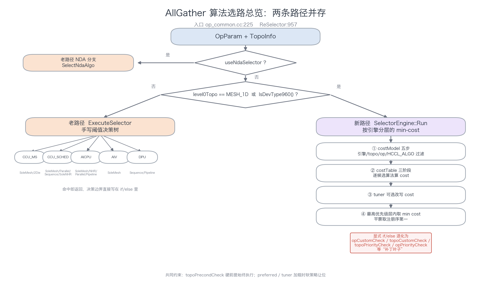

> AllGather 同时存在 `SelectorEngine`（cost model）与 `ExecuteSelector`（手写 if/else）两套选路

### 02｜老路径：引擎 × 拓扑

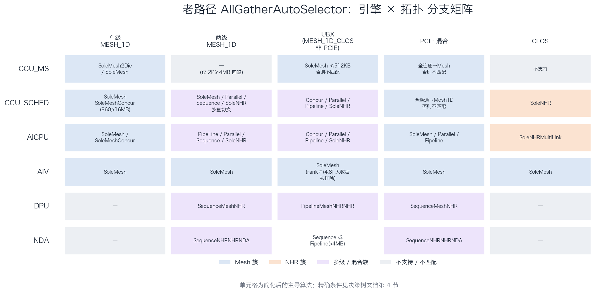

> 只有 `MESH_1D`/960 走新路径；CLOS / UBX / PCIE 混合仍由阈值树主导

### 03｜新路径管线

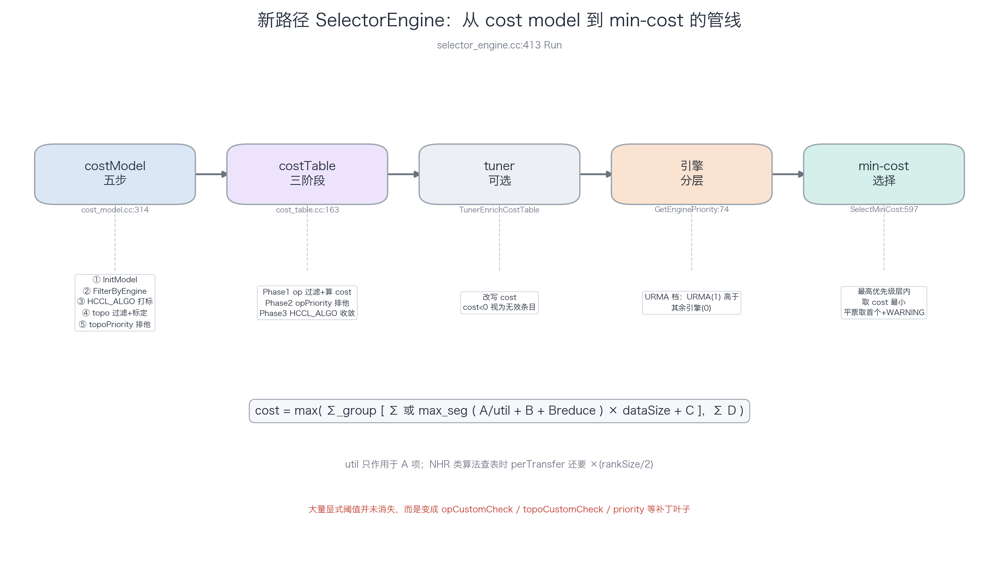

> 阈值没有消失，而是变成 `opCustomCheck` 等"补丁叶子"

### 04｜引擎优先级：`GetEnginePriority` 候选分层

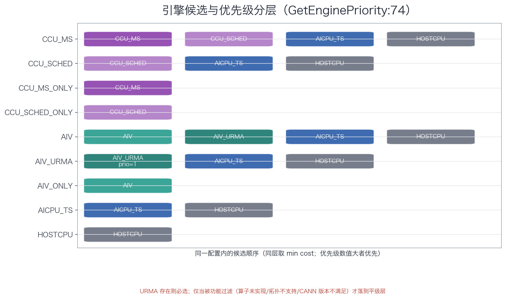

> 同层取 min cost；`AIV_URMA` 档 URMA 存在则必选

### 05｜util 阶梯与 AllGather 钳制

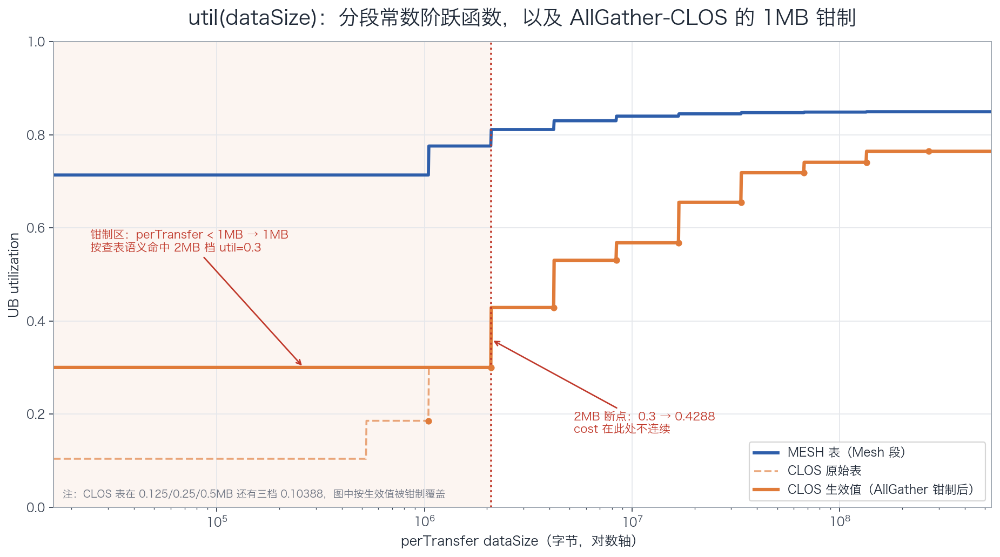

> 钳制后 CLOS 段在 `perTransfer < 2MB` 内 util 恒为 0.3，2MB 处跳到 0.4288

### 06｜16P 代价曲线：SoleNHR vs ParallelMeshNHR

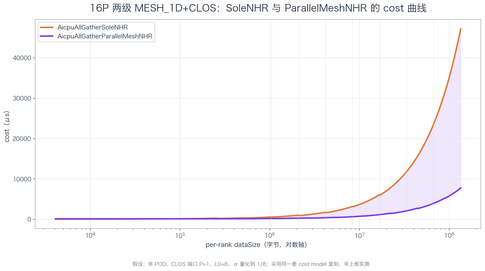

> `P=1` 时 16P 全程 Parallel 更便宜；SoleNHR 只在小数据段接近

### 07｜核心 corner case：64P、`P=1`、64KB

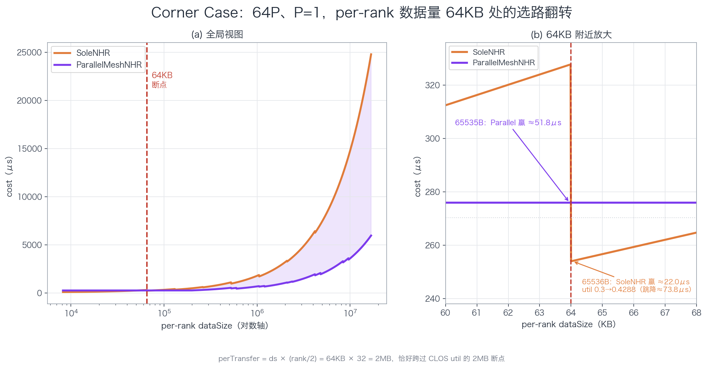

> 65535B→65536B，NHR util 0.3→0.4288，cost 跳降 ≈74µs，胜负翻转

### 08｜代价构成分解

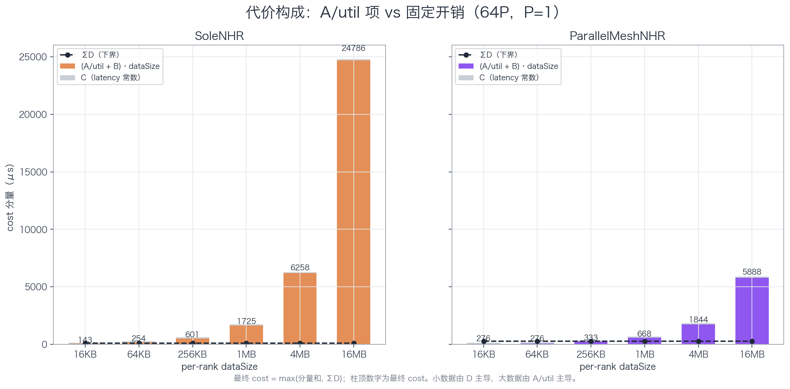

> 小数据由 D 主导，大数据由 A/util 主导；翻转点由 A/util 的阶跃触发

### 09｜决策区域热力图

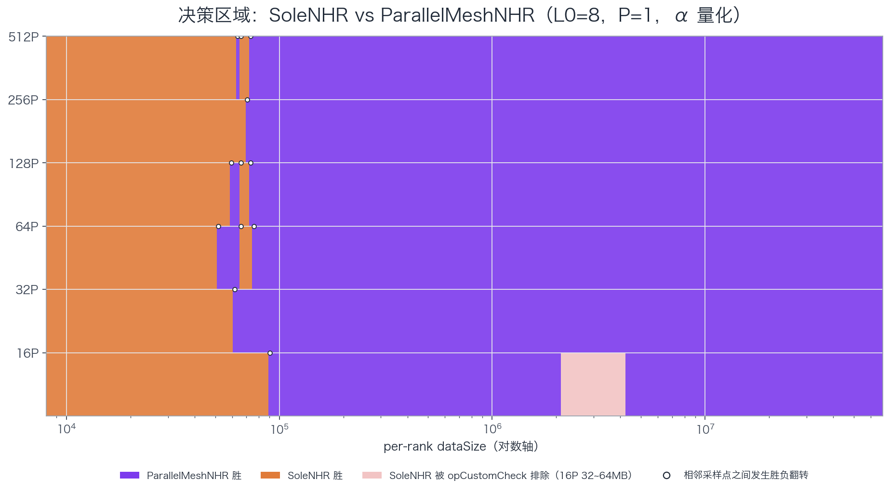

> 左上（小数据）NHR 胜，右下（大数据）Parallel 胜；16P 2~4MB 有硬排除红区

### 10｜flipflop 扫描

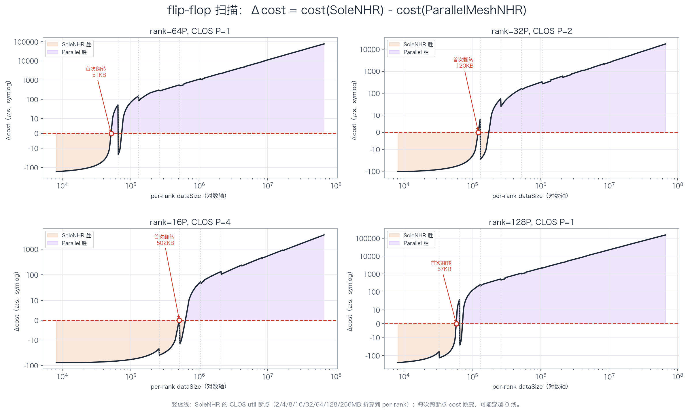

> 决策边界不是单阈值，而是"跳变带"；不同 rank/P 首次翻转点不同

### 11｜阈值标尺

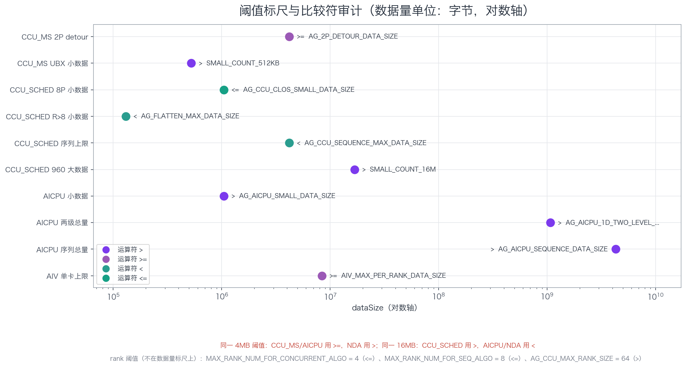

> 同一 4MB：`>=` 与 `>` 混用；同一 16MB：`>` 与 `<` 混用

### 12｜两级拓扑与 4 段数据比

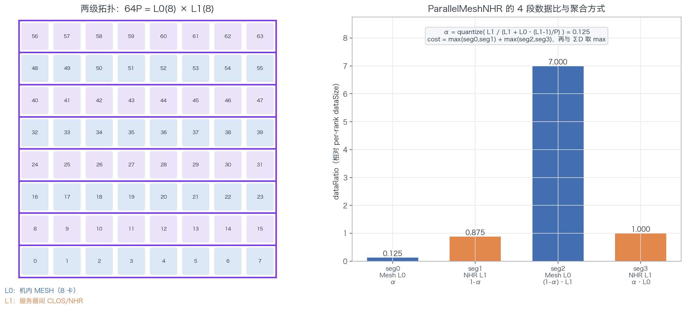

> `α` 由公式计算并量化到 1/8；4 段按 `max(seg0,seg1)+max(seg2,seg3)` 聚合

### 13｜代价公式映射

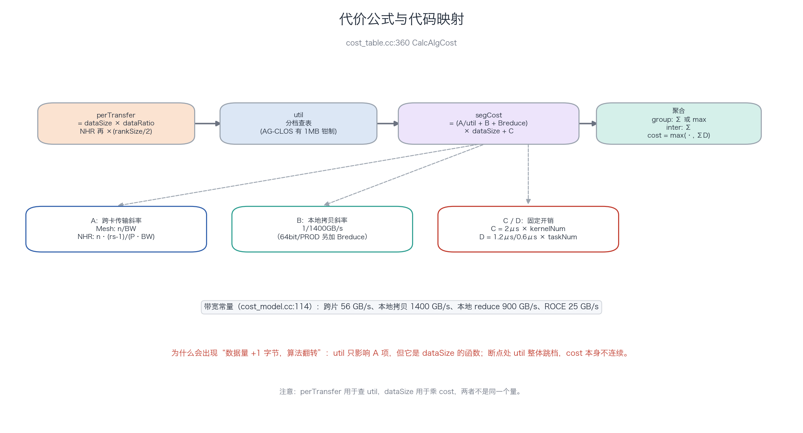

> `perTransfer` 用于查 util，`dataSize` 用于乘 cost，两者不是同一个量

### 14｜35 个唯一算法名：引擎 × 编排 × 链路

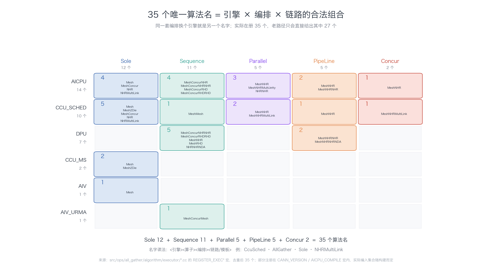

> 35 = AICPU 14 + CCU_SCHED 10 + DPU 7 + CCU_MS 2 + AIV 1 + AIV_URMA 1；同一编排换引擎就是另一个名字

### 15｜算法全景：35 个注册算法 = 老路径 27 + 新路径独占 8

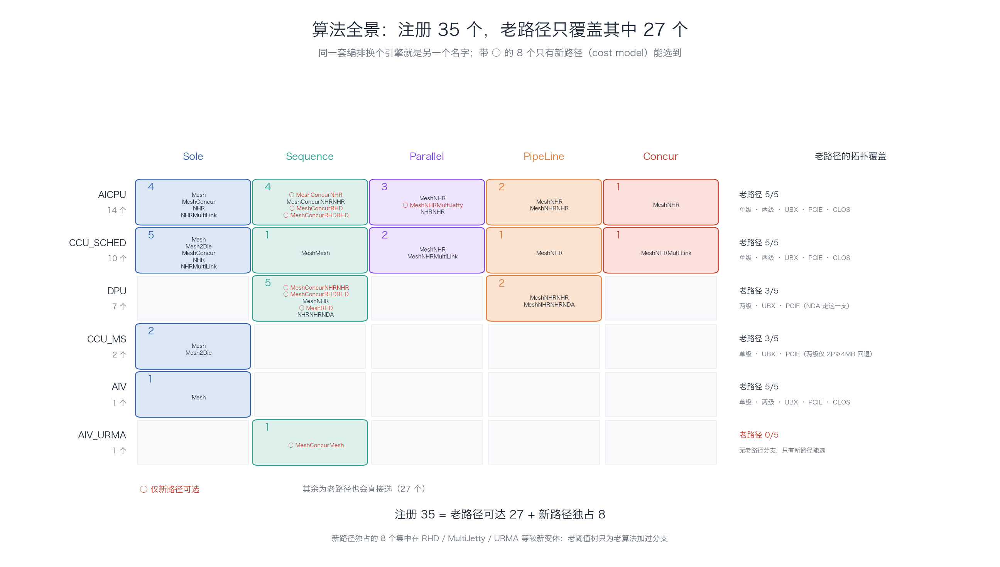

> 每个格子列出该「引擎 × 编排」下的算法；带 ○ 的 8 个只有新路径能选到，右列是老路径的拓扑覆盖

---

## 2. 代价模型复刻说明

复刻来源：

- `src/ops/op_common/selector/cost_table.cc:360 CalcAlgCost`
- `src/ops/op_common/selector/cost_table.cc:437-505` util 表与 `QueryUbUtil`
- `src/ops/op_common/selector/cost_model.cc:114` 带宽常量
- `src/ops/op_common/selector/cost_model.cc:555/584` Mesh / NHR 系数
- `src/ops/all_gather/algorithm/template/aicpu/ins_temp_all_gather_nhr.cc:16` NHR 系数
- `src/ops/all_gather/algorithm/template/aicpu/ins_temp_all_gather_mesh_1D.cc:16` Mesh 系数
- `src/ops/all_gather/algorithm/executor/ins_v2_all_gather_parallel_executor.cc:52` Parallel 4 段

核心公式：

```text
perTransfer = dataSize × dataRatio          (NHR 再 × rankSize/2)
util        = QueryUbUtil(netType, perTransfer, engine, algoType, opType)
segCost     = (A/util + B) × dataSize + C
cost        = max( Σ_group [Σ 或 max segCost], Σ D )
```

查表语义：`util` = 第一个 `upperBound > perTransfer` 的档位；恰好等于断点时落到下一档。
AllGather + CLOS 且 `perTransfer < 1MB` 时钳到 1MB，按查表语义命中 2MB 档（0.3），
因此**生效 util 在 `perTransfer < 2MB` 内恒为 0.3**。

### 假设与边界

- 非 POD；
- 单端口向量，CLOS 端口数 `P` 在图中作为参数（默认 1）；
- 两级拓扑 `L0 = 8` 卡/服务器；
- `α = quantize(L1 / (L1 + L0·(L1−1)/P))`，量化到 `1/8`；
- 只比较 `AicpuAllGatherSoleNHR` 与 `AicpuAllGatherParallelMeshNHR` 两个核心候选；
- 未计入 cclBuffer 容量、dtype、in-place 等其它过滤条件。

因此图上的具体数值和翻转点用于**研讨与定位**，真实选路需以 `[CalcAlgCost]` /
`[SelectorEngine] SelectMinCost` 日志为准。

---

## 3. 核心 corner case：64P、P=1、64KB

场景：64P 两级拓扑（`L0=8`，`L1=8`），CLOS 端口 `P=1`，候选为
`AicpuAllGatherSoleNHR` 与 `AicpuAllGatherParallelMeshNHR`。

`SoleNHR` 查 util 时 `perTransfer = per-rank dataSize × (rank/2) = ds × 32`。
当且仅当 `ds = 65536B（64KB）` 时，`perTransfer` 恰好等于 2MB，跨过 CLOS util 的 2MB 断点。

| per-rank dataSize | SoleNHR | ParallelMeshNHR | 胜者 |
|---|---|---|---|
| 65535B | 327.8µs | 276.0µs | Parallel（领先 51.8µs） |
| 65536B | 254.0µs | 276.0µs | **SoleNHR**（领先 22.0µs） |

- `SoleNHR` 的 cost 在 1 字节内**向下跳 73.8µs**（util 0.3→0.4288，`A/util` 变小）；
- 选路从 Parallel 翻到 SoleNHR，呈现"数据量变大、反而选了更偏小数据的算法"的非单调行为；
- 机制不是浮点误差，而是 `util` 只作用于 `A` 项且按 `dataSize` 整体换档，`cost(dataSize)` 本身不连续。

同类翻转点（来自 `corner_case_scan.csv`）：

| rank | CLOS P | per-rank 断点 | 翻转方向 | NHR cost 跳变量级 |
|---|---|---|---|---|
| 16P | 4 | 512KB | Parallel → SoleNHR | ≈16µs |
| 32P | 2 | 128KB | Parallel → SoleNHR | ≈36µs |
| 32P | 8 | 1MB | Parallel → SoleNHR | ≈17µs |
| 64P | 1 | 64KB | Parallel → SoleNHR | ≈74µs |
| 128P | 1 | 64KB | Parallel → SoleNHR | ≈66µs |
| 256P | 1 | 64KB | Parallel → SoleNHR | ≈37µs |
| 512P | 1 | 64KB | Parallel → SoleNHR | ≈140µs |

> 这些是"模型层面的翻转点"。实际是否翻转，还取决于端口组、POD、CANN 版本、cclBuffer、
> dtype 以及其它候选算法（PipeLine / Sequence）是否参与竞争。建议把它们作为**必测边界**，
> 用日志确认，而不是直接当作线上结论。

---

## 4. 复现

```bash
cd docs/实战复盘/03-研讨笔记/allgather-selector-算法选择策略研究
python3 generate_charts.py
```

依赖：`matplotlib`、`numpy`（本机 Python 3.9 已验证）。
脚本同时输出 `corner_case_scan.csv`，列出所有在 util 断点处发生胜负翻转的参数组合。

---

## 5. 与文字分析的关系

- `allgather-selector-decision-tree.md`：完整决策树、老路径分支表、阈值表、代码行号索引；
- 本目录：把决策树和 cost model 的"形状"可视化，便于在研讨中快速对齐；
- 两者使用同一套代码事实，图表中的假设以本页第 2 节为准。
