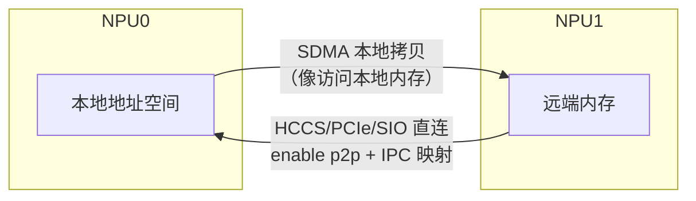

# HCCS / PCIe / SIO：片间直连内存语义通信

> **深度参考** · 前置阅读：[源码课程单元 3｜数据面：原语与资源](/通信与昇腾/源码课程/03-data-plane.md)。本篇为参考手册体例，检索导向；事实基线见文首引用块。

> **内存语义**通信方式族（`COMM_PROTOCOL_HCCS=0`、`HCCS_ONLY=8`、`PCIE=2`、`SIO=3`）。Server 内 NPU 经**片间总线直连**，远端内存映射进本地地址空间，**直接本地拷贝**访问——像操作本地内存一样访问邻居卡。全部落在 **L0（Server 内）**，由 **P2P transport** 承载、**SDMA** 搬运。
>
> 事实来源（可信度：代码 > 仓内文档 > 社区资料）：
> `hcomm/include/hcomm_res_defs.h:120-130`（HCCS/PCIE/SIO/HCCS_ONLY 枚举）、`hcomm/src/legacy/ascend950/unified_platform/resource/transport/p2p_transport.{h,cc}`（`P2PTransport`）、`hcomm/src/legacy/ascend950/unified_platform/resource/transport/aicpu/p2p_transport_lite_impl.{h,cc}`（`P2PTransportLiteImpl`）、`hcomm/src/legacy/ascend950/framework/topo/topo_addr_info/src/hal.h`（DCMI 链路类型探测）、`hcomm/src/legacy/ascend910/algorithm/pub_inc/common.h`（标卡判定/910_93 拓扑）、`hccl/docs/zh/user_guide/concepts.md`（HCCS/SDMA/PCIe 术语）、`shmem/docs/glossary.md`（SIO 术语）。

---

## 1. 四种直连协议

| 协议 | 值 | 全称 / 说明 | 语义 | 典型场景 |
| --- | --- | --- | --- | --- |
| `COMM_PROTOCOL_HCCS` | 0 | Huawei Cache Coherence System，华为缓存一致性系统，用于 CPU/NPU 间高速互联 | 内存语义 | Server 内卡间直连（L0） |
| `COMM_PROTOCOL_PCIE` | 2 | Peripheral Component Interconnect Express，串行外设扩展总线 | 内存语义 | **标卡卡间唯一通路**（L0） |
| `COMM_PROTOCOL_SIO` | 3 | Serial I/O Link，昇腾 A3 片内**两个物理 Die 之间**的高速互联通路 | 内存语义 | 910_93 场景、A3 Die 间（L0） |
| `COMM_PROTOCOL_HCCS_ONLY` | 8 | **一卡双 Die 使用 HCCS**（Die 间互联） | 内存语义 | A3 一卡双 Die（L0，Die 间） |

> 全部为**内存语义**、全部落在 **L0**、拓扑类型均为 **`1DMESH`**（Device 间直连全互联）。详见 [../networking/server_internal.md](/通信与昇腾/参考手册/组网形态/server_internal.md)。

---

## 2. 内存语义与 SDMA 搬运


> 图源：`hcomm/docs/zh/comm_op_dev_guide/prog_models_concepts/figures/memory_semantic_model.png`

| 维度 | 说明 |
| --- | --- |
| **通信语义** | 内存语义：远端内存映射进本地地址空间，直接本地拷贝 |
| **通道实体** | 映射内存——Channel 仅表示"内存映射已启用"，**不承载数据** |
| **搬运硬件** | **SDMA**（System Direct Memory Access，系统直接内存访问，允许外围设备直接访问系统内存而无需 CPU 干预） |
| **同步方式** | ThreadNotify（同一通信实体内，Notify 寄存器 / Device 内存）；P2P 用 **IPC notify** |
| **主力引擎** | AIV（低时延）、AICPU_TS |



---

## 3. P2P Transport

### 3.1 `P2PTransport`（内存语义传输）

`hcomm/src/legacy/ascend950/unified_platform/resource/transport/p2p_transport.h`（继承 `BaseMemTransport`）：

状态机：

```cpp
MAKE_ENUM(P2PStatus, INIT, P2P_ENABLING, SOCKET_OK, SEND_PID, RECV_PID, GRANT,
          SEND_DATA, RECV_DATA, SEND_DATA_SIZE, RECV_DATA_SIZE)
```


| 关键成员 / 接口 | 说明 |
| --- | --- |
| `TriggerEnableP2P()` | 触发 enable p2p；**自环链路（对端即本设备）不支持**，返回 false 跳过 |
| `IsP2PEnabled()` | 查询 p2p 是否已使能 |
| `p2pEnableStarted_` | enable p2p 是否成功下发（与 manager 引用计数对应，失败不置位） |
| `localDeviceLogicId_` | 触发 enable p2p 的本地逻辑 device id（供析构对称 disable） |
| `rmtNotifyVec`（`IpcRemoteNotify`） | 远端 IPC notify |
| `rmtBufferVec`（`RemoteIpcRmaBuffer`） | 远端 IPC RMA buffer |
| `Read`/`Write`/`ReadReduce`/`WriteReduce` | 数据面操作（override 自 `BaseMemTransport`） |
| `Post(index, stream)` | notify record |
| `GetRemoteMems(...)` | 远端内存查询 |

> **IPC 机制**：P2P 通过交换进程 PID + GRANT 授权，用 **IPC（Inter-Process Communication）** 把对端 Device 内存映射进本端进程地址空间（`IpcRemoteNotify`/`RemoteIpcRmaBuffer`），之后 SDMA 本地拷贝即完成跨卡搬运。

### 3.2 `P2PTransportLiteImpl`（AICPU 轻量传输）

`hcomm/src/legacy/ascend950/unified_platform/resource/transport/aicpu/p2p_transport_lite_impl.h`（继承 `BaseTransportLiteImpl`）：

| 内部结构 | 说明 |
| --- | --- |
| `RmtP2PNotifyLite { addr, size, id }` | 远端 P2P notify |
| `P2PBufLite { addr, size }` | P2P buffer（本地/远端） |
| 接口 | `Read`、`ReadReduce`、`BatchTransfer`、`Post`、`Wait`、`WaitWithTimeout`、`BuildLocRmaBufferLite` |

---

## 4. 链路类型探测（DCMI）

L0 算法自动选择依赖 **DCMI 驱动探测的链路类型**（`hcomm/src/legacy/ascend950/framework/topo/topo_addr_info/src/hal.h:113-125`，详见 [../networking/server_internal.md §3.2](/通信与昇腾/参考手册/组网形态/server_internal.md)）：

```c
DCMI_TOPO_TYPE_SELF = 0,   // 同一设备
DCMI_TOPO_TYPE_SYS,        // 跨 NUMA/系统
DCMI_TOPO_TYPE_PHB,        // 经 PCIe Host Bridge
DCMI_TOPO_TYPE_HCCS,       // HCCS 直连
DCMI_TOPO_TYPE_PXB,        // 经多个 PCIe Switch
DCMI_TOPO_TYPE_PIX,        // 经单个 PCIe Switch
DCMI_TOPO_TYPE_SIO,        // SIO 链路
DCMI_TOPO_TYPE_HCCS_SW,    // HCCS Switch
DCMI_TOPO_TYPE_UB,         // 灵衢总线（网卡与 NPU 亲和）
```

| 判定 | 依据 |
| --- | --- |
| **标卡**（`IsStandardCard()`） | HCCS / HCCS_SW / SIO 三类卡间直连链路数**均为 0** → 仅 PCIe 通路 |
| **910_93 双环** | HCCS_SW 数 = 2×SIO 数 → `NP_DOUBLE_RING`，否则 `NP_SINGLE_RING` |

---

## 5. 各协议的组网与算法落点

| 协议 | 组网形态 | L0 算法 | 详见 |
| --- | --- | --- | --- |
| **HCCS / HCCS_ONLY** | Server 内 8 卡（A3 为 16 rank）直连全互联；A3 一卡双 Die 经 HCCS_ONLY | 8 卡 `8P_RING`、910B `NP_MESH`、950 Mesh 族、A3 `SoleMesh2Die`/`SequenceMesh2Die` | [../networking/server_internal.md](/通信与昇腾/参考手册/组网形态/server_internal.md)、[../networking/ub_superpod.md](/通信与昇腾/参考手册/组网形态/ub_superpod.md) |
| **PCIe** | 标卡卡间唯一通路 | 2 卡 `2P_MESH`（非 910B）/ 1 卡或 3~8 卡 `NP_SINGLE_RING` | [../networking/board_form_factor.md](/通信与昇腾/参考手册/组网形态/board_form_factor.md) |
| **SIO** | 910_93 场景、A3 片内双 Die | `NP_DOUBLE_RING`（HCCS_SW=2×SIO）/ `NP_SINGLE_RING` | [../networking/server_internal.md](/通信与昇腾/参考手册/组网形态/server_internal.md) |

> **标卡引擎约束**：标卡（PCIe）环境配置 CCU_MS **直接拦截报错**；CCU_SCHED 遇 PCIe 链路域回退 AICPU_TS（>8 卡再回退 AIV）。详见 [../algorithms/algo_selector.md §3](/通信与昇腾/参考手册/算法参考/algo_selector.md)。

---

## 6. 对称内存（HCCS 场景）

Atlas A3 的 HCCS 场景支持对称内存（`HcclCommSymWinRegister.md`）：用户经 `aclrtReserveMemAddress`（预留虚拟内存）+ `aclrtMallocPhysical`（申请物理内存）+ `aclrtMapMem`（建立映射）后，将虚拟内存注册为对称内存——**通过提前预留相同大小、相同布局的虚拟地址实现对称**。


> 图源：`hcomm/docs/zh/api_ref/comm_mgr_c/figures/symmetric_memory.png`。仅支持超节点内 AI Server 间 **HCCS 链路 SDMA 通信**，不支持 RoCE RDMA（即不支持 `HCCL_INTER_HCCS_DISABLE=TRUE`）；仅支持 AllGather/ReduceScatter/AllReduce/AlltoAll。详见 [symmetric_mem.md](/通信与昇腾/参考手册/协议与传输/symmetric_mem.md)。

---

## 7. 与其他通信方式的关系

| 对比项 | HCCS/PCIe/SIO | [UB_MEM](/通信与昇腾/参考手册/协议与传输/ub_mem.md) | [RoCE](/通信与昇腾/参考手册/协议与传输/roce_rdma.md) |
| --- | --- | --- | --- |
| **语义** | 内存语义 | 内存语义 | 网络语义 |
| **链路** | 片间总线直连 | UB 总线 | 以太经交换机 |
| **通道实体** | 映射内存（IPC） | 映射内存（token） | QP |
| **搬运硬件** | SDMA | UB 引擎 | RDMA 网卡 |
| **层级** | L0 | L0 | L1/L2 |
| **transport** | `P2PTransport` | `UbMemTransport` | `RoceTransportLiteImpl` |

---

## 8. 代码落点

| 组件 | 路径 |
| --- | --- |
| **P2P 传输** | `hcomm/src/legacy/ascend950/unified_platform/resource/transport/p2p_transport.{h,cc}` |
| **P2P 轻量传输（AICPU）** | `hcomm/src/legacy/ascend950/unified_platform/resource/transport/aicpu/p2p_transport_lite_impl.{h,cc}` |
| **IPC notify / buffer** | `hcomm/src/legacy/ascend950/unified_platform/resource/notify/ipc_remote_notify.*`、`resource/buffer/`（`RemoteIpcRmaBuffer`/`LocalIpcRmaBuffer`） |
| **链路类型探测** | `hcomm/src/legacy/ascend950/framework/topo/topo_addr_info/src/hal.h:113-125` |
| **标卡判定 / 910_93 拓扑** | `hcomm/src/legacy/ascend910/algorithm/pub_inc/common.h:325-338`、`hcomm/src/legacy/ascend910/framework/communicator/impl/hccl_communicator_host.cc` |
| **协议枚举** | `hcomm/include/hcomm_res_defs.h:120-130` |

---

## 9. 参考资料

- `hcomm/docs/zh/comm_op_dev_guide/prog_models_concepts/comm_model.md`：内存语义通信模型
- `hccl/docs/zh/user_guide/concepts.md`：HCCS/SDMA/PCIe/PCIe-SW 术语
- `hccl/docs/zh/user_guide/cluster_info_config/rank_table_config_a5.md`：拓扑文件 `protocols=HCCS`、`link_type=PEER2PEER`
- `shmem/docs/glossary.md`：HCCS / SIO / SDMA 术语
- 关联：[README.md](/通信与昇腾/参考手册/协议与传输/)（通信方式总览）、[ub_mem.md](/通信与昇腾/参考手册/协议与传输/ub_mem.md)、[symmetric_mem.md](/通信与昇腾/参考手册/协议与传输/symmetric_mem.md)、[../networking/server_internal.md](/通信与昇腾/参考手册/组网形态/server_internal.md)、[../networking/board_form_factor.md](/通信与昇腾/参考手册/组网形态/board_form_factor.md)

