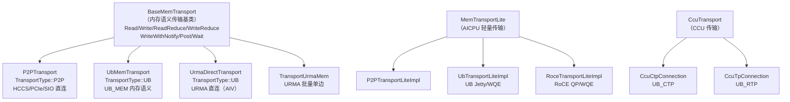

# comm：通信方式

> **深度参考** · 前置阅读：[源码课程单元 3｜数据面：原语与资源](/通信与昇腾/源码课程/03-data-plane.md)。本篇为参考手册体例，检索导向；事实基线见文首引用块。

> **数据怎么搬**。通信方式（协议 + 传输实现）决定了通信实体之间**以何种语义、经何种硬件通路**搬运数据与同步。本目录与 [networking/](/通信与昇腾/参考手册/组网形态/)（卡怎么连）、[engine/](/通信与昇腾/参考手册/通信引擎/)（谁在搬数据）平级，三者共同构成集群基础设施层。
>
> 通信方式与引擎正交：同一引擎可走多种协议（如 AICPU_TS 可走 RoCE 或 UB），同一协议也可被多引擎使用（如 URMA 被 CCU 与 AIV 使用）。协议在**组网中的层级落点**见 [../04_昇腾集群组网总览.md §6](/通信与昇腾/参考手册/总览/cluster-topology.md)，协议在**分级通信中的差异**见 [../03_L0L1L2分级通信实现原理.md §2](/通信与昇腾/参考手册/总览/l0l1l2-principle.md)。
>
> 事实来源（可信度：代码 > 仓内文档 > 社区资料）：
> `hcomm/include/hcomm_res_defs.h`（`CommProtocol` 枚举）、`hcomm/include/hcomm_channel.h`（Channel 接口）、`hcomm/src/legacy/ascend950/unified_platform/resource/transport/`（传输实现）、`hcomm/src/legacy/ascend950/unified_platform/external_system/orion_adapter_hccp.h`（HCCP/Jetty/QP 适配）、`hcomm/src/legacy/ascend910/platform/remote_access/`（RoCE 远端访问）、`hcomm/docs/zh/comm_op_dev_guide/prog_models_concepts/comm_model.md`（通信模型权威）、`shmem/docs/glossary.md`（对称内存术语）。

---

## 1. 两大通信语义

HCCL 的通信模型分为**网络语义**与**内存语义**两类（`comm_model.md`）：

| | 网络语义 | 内存语义 |
| --- | --- | --- |
| **核心对象** | Channel（通信通道） | 通信设备 + 映射内存 |
| **操作方式** | Write / Read / Notify | 本地拷贝（像操作本地内存） |
| **通信模型** | 单边操作、双边操作（需两端配合） | 单边操作（只需一端发起） |
| **适用协议** | RoCE、UB（CTP/RTP/UBoE） | UB_MEM、HCCS、PCIe、SIO |
| **Channel 含义** | 真正的数据通道，关联 1~N 个 QP/Jetty，建链时 QP 建链 | 仅表示"两对象间内存映射已启用"，**不承载数据** |
| **典型层级** | L1 / L2（Server 间 / 超节点间） | L0（Server 内） |
| **详见** | [roce_rdma.md](/通信与昇腾/参考手册/协议与传输/roce_rdma.md)、[ub_network.md](/通信与昇腾/参考手册/协议与传输/ub_network.md) | [ub_mem.md](/通信与昇腾/参考手册/协议与传输/ub_mem.md)、[hccs_pcie.md](/通信与昇腾/参考手册/协议与传输/hccs_pcie.md) |

 

> 图源：`hcomm/docs/zh/comm_op_dev_guide/prog_models_concepts/figures/semantic_communication.png`、`memory_semantic_model.png`。选择哪种语义**取决于底层协议与场景需求**。

---

## 2. 协议枚举全量（`CommProtocol`）

`hcomm/include/hcomm_res_defs.h:118-133`：

| 值 | 枚举 | 说明 | 语义 | 典型层级 | 详见 |
| --- | --- | --- | --- | --- | --- |
| 0 | `COMM_PROTOCOL_HCCS` | Huawei Cache Coherence System 片间高速互联 | **内存语义** | L0 | [hccs_pcie.md](/通信与昇腾/参考手册/协议与传输/hccs_pcie.md) |
| 1 | `COMM_PROTOCOL_ROCE` | RDMA over Converged Ethernet（v2） | **网络语义** | L1 / L2 | [roce_rdma.md](/通信与昇腾/参考手册/协议与传输/roce_rdma.md) |
| 2 | `COMM_PROTOCOL_PCIE` | PCIe 主机链路（标卡卡间唯一通路） | 内存语义 | L0 | [hccs_pcie.md](/通信与昇腾/参考手册/协议与传输/hccs_pcie.md) |
| 3 | `COMM_PROTOCOL_SIO` | SIO 链路（910_93 场景，A3 片内双 Die 互联） | 内存语义 | L0 | [hccs_pcie.md](/通信与昇腾/参考手册/协议与传输/hccs_pcie.md) |
| 4 | `COMM_PROTOCOL_UB_CTP` | 灵衢统一总线 CTP（旧名 `UBC_CTP`/`UBC_TP`） | 网络语义 | L0 / L1 | [ub_network.md](/通信与昇腾/参考手册/协议与传输/ub_network.md) |
| 5 | `COMM_PROTOCOL_UBC_TP` | 华为统一总线 UBC_TP | 网络语义 | L0 / L1 | [ub_network.md](/通信与昇腾/参考手册/协议与传输/ub_network.md) |
| 6 | `COMM_PROTOCOL_UB_MEM` | UB 内存语义 | **内存语义** | L0 | [ub_mem.md](/通信与昇腾/参考手册/协议与传输/ub_mem.md) |
| 7 | `COMM_PROTOCOL_UBOE` | UB over Ethernet | 网络语义 | L1 / L2 | [ub_network.md](/通信与昇腾/参考手册/协议与传输/ub_network.md) |
| 8 | `COMM_PROTOCOL_HCCS_ONLY` | 一卡双 Die 使用 HCCS | 内存语义 | L0（Die 间） | [hccs_pcie.md](/通信与昇腾/参考手册/协议与传输/hccs_pcie.md) |
| 9 | `COMM_PROTOCOL_UB_RTP` | 灵衢统一总线 RTP（旧名 `UBG`） | 网络语义 | L1 / L2 | [ub_network.md](/通信与昇腾/参考手册/协议与传输/ub_network.md) |

> 拓扑文件 `protocols` 字段可取值：`UB_CTP`、`UB_RTP`、`ROCE`、`HCCS`、`TCP`、`UB_MEM`、`UBOE`（`rank_table_config_a5.md:74`）。

另有两个**跨协议的硬件通路/内存模型**（不在 `CommProtocol` 枚举内，但属通信方式范畴）：

| 名称 | 说明 | 详见 |
| --- | --- | --- |
| **URMA** | Unified Remote Memory Access，统一远端内存访问——基于 UB 总线的硬件数据通路，CCU/AIV 经其搬运 | [urma.md](/通信与昇腾/参考手册/协议与传输/urma.md) |
| **对称内存** | Symmetric Memory，各 rank 全局可见、无需显式地址交换的内存模型（shmem / SymWin） | [symmetric_mem.md](/通信与昇腾/参考手册/协议与传输/symmetric_mem.md) |

---

## 3. 传输实现：TransportType 与类层次

950 平台的传输类型枚举（`hcomm/src/legacy/ascend950/unified_platform/resource/transport/aicpu/mem_transport_common.h:18`）：

```cpp
MAKE_ENUM(TransportType, P2P, UB, ROCE, UBoE)
MAKE_ENUM(TransportNotifyType, NORMAL, COUNT)
```

传输类层次（`resource/transport/`）：



| 传输类 | TransportType | 协议 / 语义 | 引擎 | 头文件 |
| --- | --- | --- | --- | --- |
| `P2PTransport` / `P2PTransportLiteImpl` | P2P | HCCS/PCIe/SIO · 内存语义 | AICPU_TS/AIV | `resource/transport/p2p_transport.h`、`aicpu/p2p_transport_lite_impl.h` |
| `UbMemTransport` | UB | UB_MEM · 内存语义 | AICPU_TS | `resource/transport/ub_mem_transport.h` |
| `UbMemoryTransport` | UB | UB_MEM · 内存语义 | AIV | `aiv/ub_memory_transport.h` |
| `UrmaDirectTransport` | UB | URMA · 内存语义 | AIV | `aiv/urma_direct_transport.h` |
| `TransportUrmaMem` | — | URMA 批量单边 | AICPU_TS | `resource/transport/transport_urma_mem.h` |
| `UbTransportLiteImpl` | UB | UB_CTP/RTP/UBoE · 网络语义 | AICPU_TS | `aicpu/ub_transport_lite_impl.h` |
| `RoceTransportLiteImpl` | ROCE | RoCE · 网络语义 | AICPU_TS | `aicpu/roce_transport_lite_impl.h` |
| `CcuTransport` | — | UB_CTP/RTP · 网络语义 | CCU | `resource/ccu_transport/ccu_transport.cpp` |

---

## 4. 核心对象：Endpoint / Channel / CommMem

基础通信的四个原语概念（`architecture-brief.md` §2.3）：

| 概念 | 一句话解释 | 对应硬件 |
| --- | --- | --- |
| **通信设备 Endpoint** | 网络通信的逻辑接口，含协议与地址 | NPU 网口 / Host NIC |
| **通信通道 Channel** | 两端通信设备间的数据通道（含同步 Notify） | RoCE QP / UB Jetty 连接 |
| **通信内存 CommMem** | 注册到通信域、可被 Endpoint 访问的内存段 | NPU 片上内存 / Host 内存 |
| **通信引擎 CommEngine** | 执行通信任务的模块（见 [engine/](/通信与昇腾/参考手册/通信引擎/)） | AICPU_TS / CCU / AIV |

> **组合关系**：Channel = 两端通信设备 + 通信协议 + N 个 Notify。


> 图源：`hcomm/docs/zh/comm_op_dev_guide/prog_models_concepts/figures/hccl_communication_model.png`


> 图源：`hccl/docs/zh/architecture/diagrams/base_comm_model.excalidraw.svg`

### 4.1 Channel 内部结构（按协议）

| 协议 | Channel 内部 | 图 |
| --- | --- | --- |
| **RoCE** | 1~N 个 **QP**（Queue Pair）+ N 个 **Notify** |  |
| **CCU（UB）** | N 个 **Notify**（同步寄存器）+ N 个 **Variable**（通用寄存器） |  |

> RoCE Channel 建链时对应 QP 建链；CCU Channel 额外支持 Variable（与对端同步寄存器数据），是 CCU 相对 RoCE 的增强。详见 [roce_rdma.md](/通信与昇腾/参考手册/协议与传输/roce_rdma.md)、[ccu.md](/通信与昇腾/参考手册/通信引擎/ccu.md)。

---

## 5. HCCP：协议适配层

**HCCP**（Huawei Collective Communication adaptive Protocol，集合通信适配协议）提供跨 NPU 设备通信能力，**向上屏蔽具体通信协议差异**（`concepts.md`）。代码落点：

| 平台 | 适配器 | 路径 |
| --- | --- | --- |
| **950** | `orion_adapter_hccp.{h,cc}` | `hcomm/src/legacy/ascend950/unified_platform/external_system/` |
| **910** | `adapter_hccp.cc` | `hcomm/src/legacy/ascend910/platform/common/adapter/` |

HCCP 统一管理 RoCE 的 QP/CQ/MR 与 UB 的 Jetty/JFC/TP，向上层传输提供一致的建链、内存注册、WQE 下发接口（详见 [roce_rdma.md](/通信与昇腾/参考手册/协议与传输/roce_rdma.md)、[ub_network.md](/通信与昇腾/参考手册/协议与传输/ub_network.md)）。

---

## 6. 协议 × 语义 × 层级 × 引擎映射

| 协议 | 语义 | 典型层级 | 通道实体 | 搬运硬件 | 主力引擎 | 文档 |
| --- | --- | --- | --- | --- | --- | --- |
| HCCS / HCCS_ONLY | 内存 | L0 | 映射内存 | SDMA / 片间直连 | AIV、AICPU_TS | [hccs_pcie.md](/通信与昇腾/参考手册/协议与传输/hccs_pcie.md) |
| PCIe | 内存 | L0（标卡） | 映射内存 | SDMA | AICPU_TS | [hccs_pcie.md](/通信与昇腾/参考手册/协议与传输/hccs_pcie.md) |
| SIO | 内存 | L0（910_93/A3 Die 间） | 映射内存 | SDMA | AICPU_TS | [hccs_pcie.md](/通信与昇腾/参考手册/协议与传输/hccs_pcie.md) |
| UB_MEM | 内存 | L0 | 映射内存（token） | UB 引擎 | AIV、AICPU_TS | [ub_mem.md](/通信与昇腾/参考手册/协议与传输/ub_mem.md) |
| URMA | 内存 | L0 / L1 | WQE + token | UB 引擎（硬化） | CCU、AIV | [urma.md](/通信与昇腾/参考手册/协议与传输/urma.md) |
| RoCE(v2) | 网络 | L1 / L2 | QP | RDMA 网卡 | AICPU_TS、Host CPU_TS | [roce_rdma.md](/通信与昇腾/参考手册/协议与传输/roce_rdma.md) |
| UB_CTP / UB_RTP / UBoE | 网络 | L0 / L1 / L2 | Jetty | UB 网卡 | AICPU_TS、CCU | [ub_network.md](/通信与昇腾/参考手册/协议与传输/ub_network.md) |
| 对称内存 | 内存（全局可见） | L0 / L1 | SymWin / 对称堆 | URMA/UB_MEM/HCCS/RDMA | AIV、AICPU | [symmetric_mem.md](/通信与昇腾/参考手册/协议与传输/symmetric_mem.md) |

---

## 7. 文档索引

| 文档 | 通信方式 | 一句话 |
| --- | --- | --- |
| [ub_mem.md](/通信与昇腾/参考手册/协议与传输/ub_mem.md) | **UB_MEM** | UB 内存语义：远端内存经 token/memKey 导入本地地址空间，直接本地拷贝；L0 主力，AIV/AICPU_TS |
| [urma.md](/通信与昇腾/参考手册/协议与传输/urma.md) | **URMA** | 统一远端内存访问：基于 UB 总线的硬化数据通路，CCU/AIV 直接组装 WQE 搬运；token 移位、AiRMAWQ/CQ |
| [roce_rdma.md](/通信与昇腾/参考手册/协议与传输/roce_rdma.md) | **RoCE / RDMA** | 以太 RDMA(v2) 网络语义：QP/CQ/MR/WR，WQE 下发 + notify；L1/L2 主力，AICPU_TS/Host CPU_TS |
| [hccs_pcie.md](/通信与昇腾/参考手册/协议与传输/hccs_pcie.md) | **HCCS / PCIe / SIO** | 片间直连内存语义：P2P transport、IPC notify、enable p2p、SDMA 搬运；L0，含一卡双 Die HCCS_ONLY |
| [ub_network.md](/通信与昇腾/参考手册/协议与传输/ub_network.md) | **UB_CTP / UB_RTP / UBoE** | UB 网络语义：Jetty/JFC/TP，HCCP 适配，EID 寻址；L0/L1/L2，AICPU_TS/CCU |
| [symmetric_mem.md](/通信与昇腾/参考手册/协议与传输/symmetric_mem.md) | **对称内存** | 各 rank 全局可见、无需地址交换的内存模型：shmem 库（PE/team/RMA/AMO）+ HCCL SymWin；零拷贝 |

---

## 8. 参考资料

**代码（最高可信度）**

- `hcomm/include/hcomm_res_defs.h`：`CommProtocol`（:118-133）、`CommAddrType`、`EndpointLocType`、`CommMemType`
- `hcomm/include/hcomm_channel.h`、`hcomm/include/hcomm_res.h`：Channel 与资源接口
- `hcomm/include/hccl/hccl_sym_win.h`：对称内存窗口（`HcclSymWinGetPeerPointer`/`HcclSymWinGetRemoteAddr`）
- `hcomm/src/legacy/ascend950/unified_platform/resource/transport/`：`base_mem_transport.*`、`p2p_transport.*`、`ub_mem_transport.*`、`transport_urma_mem.*`、`aicpu/`（lite 传输）
- `hcomm/src/legacy/ascend950/unified_platform/aiv/`：`ub_memory_transport.*`、`urma_direct_transport.*`
- `hcomm/src/legacy/ascend950/unified_platform/resource/ccu_transport/`：`ccu_transport.cpp`、`ccu_jetty.cpp`、`ccu_connection.cpp`
- `hcomm/src/legacy/ascend950/unified_platform/external_system/orion_adapter_hccp.{h,cc}`：HCCP/Jetty/QP/TP 适配
- `hcomm/src/legacy/ascend910/platform/remote_access/`：`comm_remote_access.*`、`remote_access_impl.*`、`transport_remote_access.*`（RoCE 远端访问）
- `hcomm/src/legacy/ascend910/platform/common/adapter/`：`adapter_hccp.cc`、`adapter_verbs.cc`（RDMA verbs）

**仓内文档**

- `hcomm/docs/zh/comm_op_dev_guide/prog_models_concepts/comm_model.md`：网络语义/内存语义/CCU 通信模型（本文主要来源）
- `hcomm/docs/zh/architecture/architecture-brief.md` §2.3：基础通信、内存语义 vs 网络语义原语
- `hcomm/docs/zh/api_ref/comm_mgr_c/HcclCommSymWinRegister.md`：对称内存窗口注册
- `hccl/docs/zh/user_guide/concepts.md`：术语（HCCS/HCCP/QP/SDMA/RDMA/RoCE）
- `shmem/docs/glossary.md`：对称内存术语（UBMEM/URMA/SDMA/UDMA/RDMA/MTE、D2D/D2H/H2D、gm2gm/ub2gm）

**社区资料**

- 昇腾社区（hiascend.com）、灵衢 UB 官网（unifiedbus.com）——UB/RoCE 协议公开资料，与本地仓同源（站点需 JS 渲染无法直接抓取，以本地仓为准）

