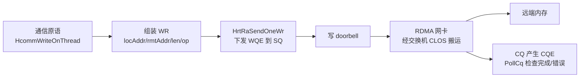

# RoCE / RDMA：以太网络语义通信

> **深度参考** · 前置阅读：[源码课程单元 3｜数据面：原语与资源](/通信与昇腾/源码课程/03-data-plane.md)。本篇为参考手册体例，检索导向；事实基线见文首引用块。

> **网络语义**通信方式（`COMM_PROTOCOL_ROCE = 1`）。RoCE（RDMA over Converged Ethernet，v2）承载在融合以太网上，经交换机 CLOS 胖树互联，是 **L1（Server 间）/ L2（超节点间）的主力**。核心对象是 **Channel（关联 1~N 个 QP）**，操作方式为 **Write / Read / Notify**，数据以 **WQE 下发到 RDMA 网卡**搬运。
>
> 事实来源（可信度：代码 > 仓内文档 > 社区资料）：
> `hcomm/include/hcomm_res_defs.h:121`（`COMM_PROTOCOL_ROCE`）、`hcomm/src/legacy/ascend950/unified_platform/resource/transport/aicpu/roce_transport_lite_impl.{h,cc}`（950 RoCE 传输）、`hcomm/src/legacy/ascend910/platform/remote_access/`（910 远端访问）、`hcomm/src/legacy/ascend910/platform/common/adapter/{adapter_hccp.cc,adapter_verbs.cc}`（HCCP/verbs 适配）、`hcomm/src/legacy/ascend950/unified_platform/external_system/orion_adapter_hccp.h`（QP/CQ/MR/WR 接口）、`hccl/docs/zh/user_guide/concepts.md`（QP/RDMA/RoCE 术语）、`hccl/docs/zh/user_guide/perf_analysis/typical_op_behavior.md`（RDMASend Profiling）。

---

## 1. 定位

| 维度 | 说明 |
| --- | --- |
| **协议枚举** | `COMM_PROTOCOL_ROCE = 1` |
| **通信语义** | **网络语义**（Channel + Write/Read/Notify） |
| **典型层级** | L1（Server 间）/ L2（超节点间） |
| **通道实体** | **QP**（Queue Pair）+ Notify |
| **搬运硬件** | RDMA 网卡（WQE 下发） |
| **主力引擎** | AICPU_TS（大数据量）、Host CPU_TS（A2） |
| **TransportType** | `ROCE` |
| **拓扑类型** | `CLOS`（交换机胖树，所有节点可互通） |

> **术语**（`concepts.md`）：**RDMA**（Remote Direct Memory Access）直接将数据从一台机器内存传输到另一台，无需双方操作系统介入；**RoCE** 即跨越以太网的 RDMA；**QP**（Queue Pair）是 RDMA 的核心通信单元，由发送队列（SQ）和接收队列（RQ）组成。

---

## 2. 网络语义通信模型


> 图源：`hcomm/docs/zh/comm_op_dev_guide/prog_models_concepts/figures/semantic_communication.png`

网络语义下，用户使用 **Channel** 读写远端通信对象内存或与远端同步。Channel 内部结构（RoCE 场景）：


> 图源：`hcomm/docs/zh/comm_op_dev_guide/prog_models_concepts/figures/roce_channel_model.png`

| Channel 组成 | 说明 |
| --- | --- |
| **Channel** | 本地与远端通信的入口，本端 Channel 与远端 Channel **一对一关联** |
| **QP（1~N 个）** | Channel 关联一个或多个 QP 实例，与远端 Channel 的 QP 对应，**Channel 建立时对应 QP 建链** |
| **Notify（N 个）** | 用于通信对象间同步；本端可向远端某 Notify（序号指定）发同步信号，也可基于某 Notify 等待远端信号 |

---

## 3. QP / CQ / MR / WR（HCCP 适配）

RoCE 的建链、内存注册、数据下发统一经 **HCCP** 适配层（`orion_adapter_hccp.h`，屏蔽 verbs 细节）：

### 3.1 RDMA 上下文与 QP

| 接口 | 作用 |
| --- | --- |
| `HrtRaRdmaInit(netMode, in)` | 初始化 RDMA 上下文，返回 `RdmaHandle` |
| `HrtRaQpCreate(rdmaHandle, flag, qpMode)` | 创建 QP（`QP_FLAG_RC=0` 即 RC 可靠连接） |
| `HrtRaQpConnectAsync(qpHandle, fdHandle)` | 异步建链 |
| `HrtRaCreateQpWithCq(...)` | 创建 QP + CQ（含 sendChannel/recvChannel） |
| `HrtGetQpNum(qpHandle)` | 获取 QPN |

QP 模式（`orion_adapter_hccp.h:327-331`）：

| 常量 | 值 | 说明 |
| --- | --- | --- |
| `QP_FLAG_RC` | 0 | RC（可靠连接），1=UD，其它预留 |
| `OFFLINE_QP_MODE` | 1 | 下沉模式的 QP(80) |
| `OPBASE_QP_MODE` | 2 | 单算子模式的 QP(80) |
| `OFFLINE_QP_MODE_EXT` | 3 | 下沉模式(81) QP |
| `OPBASE_QP_MODE_EXT` | 4 | 单算子模式(81) QP |

### 3.2 内存注册（MR）

```cpp
struct RaMrInfo {
    void* addr;              // MR 起始地址
    unsigned long long size; // MR 大小
    int access;              // 访问权限（ra_access_flags）
    unsigned int lkey;       // 本地访问 key
};
void HrtRaMrReg(QpHandle qpHandle, RaMrInfo& info);   // 注册
void HrtRaMrDereg(QpHandle qpHandle, RaMrInfo& info); // 解注册
```

### 3.3 数据下发（WR / WQE）

```cpp
struct HRaSendWr {
    uint64_t locAddr;  // 本地 buffer 地址
    uint32_t len;      // 长度
    uint64_t rmtAddr;  // 远端目的地址
    uint32_t op;       // RDMA 操作：RDMA_WRITE:0
    int sendFlag;      // ra_send_flags
};
RaSendWrResp HrtRaSendOneWr(QpHandle qpHandle, HRaSendWr& in);
```

`RaSendWrResp` 返回 `sqIndex`/`wqeIndex`/`dbIndex`/`dbInfo`——即 WQE 在 SQ 中的位置与 doorbell 内容。



---

## 4. 950 传输实现：`RoceTransportLiteImpl`

`hcomm/src/legacy/ascend950/unified_platform/resource/transport/aicpu/roce_transport_lite_impl.h`（继承 `BaseTransportLiteImpl`）：

| 类别 | 接口 |
| --- | --- |
| **Buffer 构造** | `BuildLocRmaBufferLite(addr, size, rmaBufferLite)` |
| **RMA 数据传输** | `Read`、`Write`、`WriteReduce`、`WriteWithNotify`、`WriteReduceWithNotify` |
| **同步 / Notify** | `Fence`、`Post(index, stream)`、`WaitWithTimeout(index, stream, timeout)` |
| **错误上报** | `PollCq(numEntries, timeOut, errList)` |
| **连接** | `RdmaConnLiteV2`（`connVec_`）、`NotifyLite`（`localNotifies_`） |

> 内部资源：`remoteNotifies_`（远端 notify）、`locBufferVec_`/`rmtBufferVec_`（本地/远端 buffer）、`notifyValueBuffer_`（notify 值 buffer）。`SetTaskExceptionEnable` 控制任务异常上报开关。

---

## 5. 910 远端访问：`CommRemoteAccess`

`hcomm/src/legacy/ascend910/platform/remote_access/`（A2 的 RoCE 路径）：

| 类 / 接口 | 作用 |
| --- | --- |
| `RemoteAccessImpl::Init(rank, addrInfos, rankTable)` | 初始化远端访问 |
| `RemoteAccessImpl::RemoteRead(addrInfos, stream)` | 远端读 |
| `RemoteAccessImpl::RemoteWrite(addrInfos, stream)` | 远端写 |
| `CommRemoteAccess` | 管理 rank 间 RDMA 连接：`CreateInterServerLinks`（Server 间）、`CreateInterClientLinks`（client 间）、`GetTransportByRank(dstRank)` |
| `TransportRemoteAccess` | 单条远端访问传输 |

建链流程（`comm_remote_access.h`）：`CommRemoteInitRa`（初始化 RA）→ `PrepareSocket` + `AddSocketWhiteList`（白名单）→ `GetRaSocket` → `CreateLinks`（`CalcLinksRelation`/`CalcLinksNum`）→ `InitDestTransport`。

> **网卡部署位置** `NICDeployment`：0=host，1=device。**默认约束**：每个 server 的 rank 数必须相同（`rankNumPerServer_`）。

---

## 6. Profiling 实测形态

L1 数据面在 Profiling 中表现为 **RDMASend + notify 组合**（`typical_op_behavior.md`，详见 [../03_L0L1L2分级通信实现原理.md §5](/通信与昇腾/参考手册/总览/l0l1l2-principle.md)）：


> 图源：`hccl/docs/zh/user_guide/perf_analysis/figures/inter_allreduce.png`。机间前/尾同步 = `RDMASend(notify record)` + `notify wait`；机间数据通信 = `RDMASend(数据)` + `RDMASend(notify)` + `notify wait`。

`RDMASend(数据通信)` 任务详情可获取**本端、对端、数据量及带宽**：


> 图源：`hccl/docs/zh/user_guide/perf_analysis/figures/rdma_send.png`

---

## 7. CLOS 软件适配

RoCE 经交换机 CLOS 组网，软件需适配（详见 [../networking/roce_cluster.md](/通信与昇腾/参考手册/组网形态/roce_cluster.md)）：

| 适配 | 说明 |
| --- | --- |
| **多端口 / 多 Jetty** | 每卡多网口，`MultiJetty`/`MultiLink` 算法名后缀（见 [../networking/multi_plane.md](/通信与昇腾/参考手册/组网形态/multi_plane.md)） |
| **Z 轴绕路** | 交换机拥塞时绕路：`detour_rules.cc`/`detour_service.cc`（hcomm rank_graph_builder）+ `*_Z_axis_detour` 模板 |
| **多 QP** | `HCCL_RDMA_QPS_PER_CONNECTION`、`HCCL_MULTI_QP_THRESHOLD` 控制每连接 QP 数 |
| **负载均衡** | `QpInfo.lbValue`（支持负载均衡 lbmax>0 的网卡才更新） |

---

## 8. RDMA 调优环境变量

| 环境变量 | 作用 |
| --- | --- |
| `HCCL_RDMA_TC` | Traffic Class（流量类别，QoS） |
| `HCCL_RDMA_SL` | Service Level（服务等级） |
| `HCCL_RDMA_RETRY_CNT` | RDMA 重试次数 |
| `HCCL_RDMA_TIMEOUT` | RDMA 超时 |
| `HCCL_RDMA_QPS_PER_CONNECTION` | 每连接 QP 数 |
| `HCCL_MULTI_QP_THRESHOLD` | 多 QP 阈值 |
| `HCCL_RDMA_PCIE_DIRECT_POST_NOSTRICT` | PCIe 直发非严格模式 |
| `HCCL_RDMA_QP_PORT_CONFIG_PATH` | QP 端口配置路径 |
| `HCCL_IF_IP` / `HCCL_SOCKET_IFNAME` | 网卡 IP / 网口名 |

> QP 属性 `trafficClass`/`serviceLevel`/`retryCnt`/`retryInterval`/`udpSport` 在 `QpInfo`（`orion_adapter_hccp.h:150-207`）中承载。

---

## 9. 代码落点

| 组件 | 路径 |
| --- | --- |
| **950 RoCE 传输** | `hcomm/src/legacy/ascend950/unified_platform/resource/transport/aicpu/roce_transport_lite_impl.{h,cc}` |
| **950 RDMA 连接** | `hcomm/src/legacy/ascend950/unified_platform/resource/connection/rdma_conn_lite_v2.*` |
| **910 远端访问** | `hcomm/src/legacy/ascend910/platform/remote_access/`：`comm_remote_access.*`、`remote_access_impl.*`、`transport_remote_access.*` |
| **HCCP 适配（950）** | `hcomm/src/legacy/ascend950/unified_platform/external_system/orion_adapter_hccp.{h,cc}` |
| **HCCP 适配（910）** | `hcomm/src/legacy/ascend910/platform/common/adapter/adapter_hccp.cc` |
| **verbs 适配（910）** | `hcomm/src/legacy/ascend910/platform/common/adapter/adapter_verbs.cc`（`ibv_qp`/`ibv_cq`/`ibv_srq`） |
| **协议枚举** | `hcomm/include/hcomm_res_defs.h:121` |

---

## 10. 参考资料

- `hcomm/docs/zh/comm_op_dev_guide/prog_models_concepts/comm_model.md`：网络语义通信模型、RoCE Channel 模型
- `hccl/docs/zh/user_guide/concepts.md`：QP/RDMA/RoCE/SDMA 术语
- `hccl/docs/zh/user_guide/perf_analysis/typical_op_behavior.md`：RDMASend Profiling 形态
- `hccl/docs/zh/user_guide/hccl_env/`：`HCCL_RDMA_*` 系列调优环境变量
- `hccl/docs/zh/user_guide/fault_diagnosis/`：RDMA 建链/链路故障诊断错误码
- 关联：[README.md](/通信与昇腾/参考手册/协议与传输/)（通信方式总览）、[ub_network.md](/通信与昇腾/参考手册/协议与传输/ub_network.md)（UB 网络语义对比）、[../networking/roce_cluster.md](/通信与昇腾/参考手册/组网形态/roce_cluster.md)（RoCE 组网）、[../engine/aicpu_ts.md](/通信与昇腾/参考手册/通信引擎/aicpu_ts.md)

