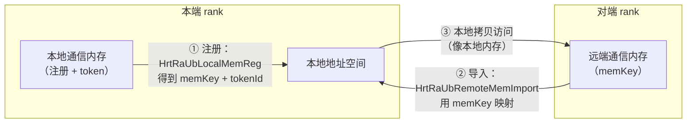
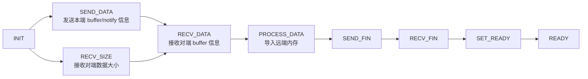

# UB_MEM：UB 内存语义通信

> **深度参考** · 前置阅读：[源码课程单元 3｜数据面：原语与资源](/通信与昇腾/源码课程/03-data-plane.md)。本篇为参考手册体例，检索导向；事实基线见文首引用块。

> **内存语义**通信方式（`COMM_PROTOCOL_UB_MEM = 6`）。远端对象的通信内存经 **token/memKey 导入**映射到本地进程地址空间，通信算子开发者**直接使用本地内存拷贝操作**访问远端通信内存——像操作本地内存一样访问邻居卡。**L0（Server 内）主力**之一。
>
> 事实来源（可信度：代码 > 仓内文档 > 社区资料）：
> `hcomm/include/hcomm_res_defs.h:128`（`COMM_PROTOCOL_UB_MEM`）、`hcomm/src/legacy/ascend950/unified_platform/resource/transport/ub_mem_transport.{h,cc}`（AICPU_TS 侧 `UbMemTransport`）、`hcomm/src/legacy/ascend950/unified_platform/aiv/ub_memory_transport.{h,cc}`（AIV 侧 `UbMemoryTransport`）、`hcomm/src/legacy/ascend950/unified_platform/resource/buffer/local_ub_rma_buffer.*`、`hcomm/src/legacy/ascend950/unified_platform/external_system/orion_adapter_hccp.h`（UB 内存注册/导入接口）、`hcomm/docs/zh/comm_op_dev_guide/prog_models_concepts/comm_model.md`（内存语义通信模型）。

---

## 1. 定位

| 维度 | 说明 |
| --- | --- |
| **协议枚举** | `COMM_PROTOCOL_UB_MEM = 6` |
| **通信语义** | **内存语义**（远端内存映射进本地地址空间，本地拷贝） |
| **典型层级** | L0（Server 内） |
| **通道实体** | 映射内存——Channel 仅表示"内存映射已启用"，**不承载数据** |
| **搬运硬件** | UB 引擎（灵衢总线） |
| **主力引擎** | AIV（`UbMemoryTransport`）、AICPU_TS（`UbMemTransport`） |
| **TransportType** | `UB` |
| **拓扑文件 protocols** | `UB_MEM` |

> 内存语义 vs 网络语义的核心差异：内存语义下 **Channel 的建立表示两个通信对象之间的内存映射功能被启用，不用于通信对象间的通信**；数据面通信使用的网络口由内存映射机制决定（`comm_model.md`）。


> 图源：`hcomm/docs/zh/comm_op_dev_guide/prog_models_concepts/figures/memory_semantic_model.png`

---

## 2. 内存语义通信模型

`comm_model.md` 内存语义通信模型：

- **Endpoint**：与其他通信对象通信时的网络逻辑口。内存语义下，创建 Channel 使用的 Endpoint 用于**控制面建链**，数据面通信不一定使用该 Endpoint。
- **Channel**：本端与远端建立的通信通道。内存语义场景下 Channel 的建立表示**两对象间内存映射被启用**，不用于通信。创建时本端注册的内存信息与远端交换并做内存映射；控制面提供基于 Channel 查询远端内存在本端映射后地址与大小的接口。



---

## 3. token / memKey 机制

UB_MEM 的远端内存访问基于 **token + memKey**（`orion_adapter_hccp.h`）：

| 接口 | 作用 |
| --- | --- |
| `RaUbAllocTokenIdHandle(rdmaHandle)` | 分配 TokenId 句柄 |
| `HrtRaUbLocalMemReg(handle, {addr, size, tokenValue, tokenIdHandle, nonPin})` | 注册本地内存，返回 `LocMemHandle` + `key[HRT_UB_MEM_KEY_MAX_LEN]` + `tokenId` + `targetSegVa` |
| `HrtRaUbRemoteMemImport(handle, key, keyLen, tokenValue)` | 用对端 memKey 导入远端内存，返回 `RemMemHandle` + `targetSegVa` |
| `HrtRaUbLocalMemUnreg` / `HrtRaUbRemoteMemUnimport` | 解注册 / 解导入 |

> **nonPin 字段**：`1` = 寄存器（notify 和 cntNotify、CCU）；`0` = Memory（rtMalloc）。`HRT_UB_MEM_KEY_MAX_LEN = 64`（UB 最大 memKey 长度）。

---

## 4. AICPU_TS 侧：`UbMemTransport`

`hcomm/src/legacy/ascend950/unified_platform/resource/transport/ub_mem_transport.h`（继承 `BaseMemTransport`，`TransportType::UB`）。

### 4.1 状态机

```cpp
MAKE_ENUM(UbStatus, INIT, RECV_SIZE, SEND_DATA, RECV_DATA, SEND_FIN, RECV_FIN, PROCESS_DATA, SET_READY, READY)
```



### 4.2 资源向量

| 成员 | 说明 |
| --- | --- |
| `rmtNotifyVec` | 远端普通 notify（`RemoteUbRmaBuffer`） |
| `rmtBufferVec` | 远端 buffer |
| `rmtCntNotifyVec` | 远端 **cnt Notify**（计数 notify，`GetRmtCntNotifyDesc` 注释"仅 UB 支持"） |
| `locBufferVec` | 本端 buffer（`LocalUbRmaBuffer`） |
| `drainNotify_` / `drainBuffer_` / `rmtDrainBuffer_` | drain 资源（通道排空：notify 作 read 落点，常量 1 内存供远端读取） |

### 4.3 数据面操作（override 自 `BaseMemTransport`）

| 操作 | 接口 |
| --- | --- |
| 读 / 写 | `Read` / `Write` |
| 带归约读 / 写 | `ReadReduce` / `WriteReduce` |
| 带 notify 写 | `WriteWithNotify` / `WriteReduceWithNotify` |
| 同步 | `Post(index, stream)` / `Wait(index, stream, timeout)` |
| 远端内存查询 | `GetRemoteMems(memNum, remoteMem, memInfos)` |

> drain 机制：`BuildDrainResource()` 创建一个常量值为 1 的 `DevBuffer`（`NORMAL_NOTIFY_VAL`）供远端读取，配合 `drainNotify_` 实现通道排空（`HcommChannelDrainOnThread`）。

---

## 5. AIV 侧：`UbMemoryTransport`

`hcomm/src/legacy/ascend950/unified_platform/aiv/ub_memory_transport.h`（AIV 引擎专用，基于 IPC 对称内存映射）。

### 5.1 CclBufferInfo（握手交换的内存信息）

```cpp
struct CclBufferInfo {
    uint64_t addr{0};       // 内存地址
    uint32_t size{0};       // 大小
    uint32_t tokenId{0};    // token ID
    uint32_t tokenValue{0}; // token 值
};
```

### 5.2 状态机

```cpp
MAKE_ENUM(UBTransportStatus, INIT, SOCKET_OK, SEND_MEM_INFO, RECV_MEM_INFO,
          RECV_MEM_INFO_PROCESS, SEND_NAME, RECV_NAME, CONNECT_FAILED, SOCKET_TIMEOUT, READY)
```

### 5.3 对算子开发暴露的接口

| 接口 | 作用 |
| --- | --- |
| `GetLocMemBuffer(bufIndex)` | 获取本端 `LocalIpcRmaBuffer` |
| `GetRmtMemBuffer(bufIndex)` | 获取远端 `RemoteIpcRmaBuffer` |
| `GetRmtHandshakeMsg()` / `GetLocalHandshakeMsg()` | 握手消息 |
| `GetRmtOpAcceState()` / `GetLocalOpAcceState()` | 对端/本端加速状态（默认 `AcceleratorState::AIV`） |

> AIV 侧 UB_MEM 通过**提前预留相同大小、相同布局的虚拟地址**实现对称内存（见 [symmetric_mem.md](/通信与昇腾/参考手册/协议与传输/symmetric_mem.md) 的 AIV + UB Memory 场景）。

---

## 6. 与其他通信方式的关系

| 对比项 | UB_MEM | [URMA](/通信与昇腾/参考手册/协议与传输/urma.md) | [UB 网络语义](/通信与昇腾/参考手册/协议与传输/ub_network.md) |
| --- | --- | --- | --- |
| **语义** | 内存语义 | 内存语义（硬化） | 网络语义 |
| **协议** | `UB_MEM=6` | 基于 UB 总线 | `UB_CTP=4`/`UB_RTP=9`/`UBOE=7` |
| **访问方式** | 本地拷贝映射内存 | 直接组装 WQE 搬运 | Channel Write/Read/Notify |
| **通道实体** | 映射内存 | WQE + token | Jetty |
| **主力引擎** | AIV、AICPU_TS | CCU、AIV | AICPU_TS、CCU |

---

## 7. 代码落点

| 组件 | 路径 |
| --- | --- |
| **AICPU_TS 传输** | `hcomm/src/legacy/ascend950/unified_platform/resource/transport/ub_mem_transport.{h,cc}` |
| **AIV 传输** | `hcomm/src/legacy/ascend950/unified_platform/aiv/ub_memory_transport.{h,cc}` |
| **本地 UB RMA buffer** | `hcomm/src/legacy/ascend950/unified_platform/resource/buffer/local_ub_rma_buffer.{h,cc}` |
| **远端 RMA buffer** | `hcomm/src/legacy/ascend950/unified_platform/resource/buffer/remote_rma_buffer.{h,cc}` |
| **UB notify** | `hcomm/src/legacy/ascend950/unified_platform/resource/notify/ub_local_notify.{h,cc}` |
| **HCCP UB 内存注册/导入** | `hcomm/src/legacy/ascend950/unified_platform/external_system/orion_adapter_hccp.{h,cc}`（`HrtRaUbLocalMemReg`/`HrtRaUbRemoteMemImport`） |
| **协议枚举** | `hcomm/include/hcomm_res_defs.h:128` |

---

## 8. 参考资料

- `hcomm/docs/zh/comm_op_dev_guide/prog_models_concepts/comm_model.md`：内存语义通信模型
- `hcomm/docs/zh/architecture/architecture-brief.md` §2.3.1：内存语义原语 vs 网络语义原语
- `hccl/docs/zh/user_guide/cluster_info_config/rank_table_config_a5.md`：拓扑文件 `protocols=UB_MEM`
- `shmem/docs/glossary.md`：`UBMEM`/`UBmem` 术语（华为新一代互联协议，提供内存语义通信）
- 关联：[README.md](/通信与昇腾/参考手册/协议与传输/)（通信方式总览）、[urma.md](/通信与昇腾/参考手册/协议与传输/urma.md)、[hccs_pcie.md](/通信与昇腾/参考手册/协议与传输/hccs_pcie.md)、[symmetric_mem.md](/通信与昇腾/参考手册/协议与传输/symmetric_mem.md)、[../engine/aiv.md](/通信与昇腾/参考手册/通信引擎/aiv.md)

