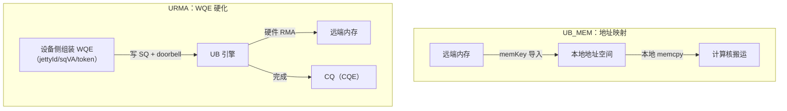
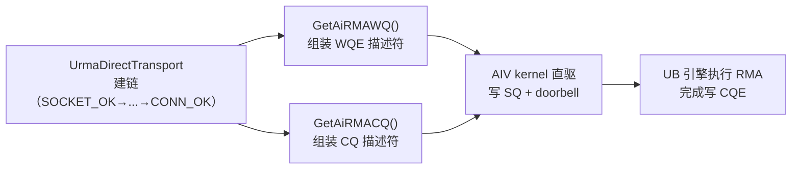

# URMA：统一远端内存访问

> **深度参考** · 前置阅读：[源码课程单元 3｜数据面：原语与资源](/通信与昇腾/源码课程/03-数据面-原语与资源.md)。本篇为参考手册体例，检索导向；事实基线见文首引用块。

> **URMA（Unified Remote Memory Access，统一远端内存访问）**——基于 UB 总线的**硬化数据通路**，提供类似本地访问语义的远程内存操作能力。CCU 执行指令流、AIV 直接组装 WQE，均经 URMA 完成跨 NPU 数据搬运。它是 [UB_MEM](/通信与昇腾/参考手册/协议与传输/ub_mem.md)（软件地址映射）之外的另一条内存语义通路：**由设备侧直接构造 WQE 交给 UB 引擎执行 RMA**，而非把远端内存映射进本地地址空间。
>
> 事实来源（可信度：代码 > 仓内文档 > 社区资料）：
> `hcomm/src/legacy/ascend950/common/types/mc2_type.h:228-251`（`HcclAiRMAWQ`/`HcclAiRMACQ`）、`hcomm/src/legacy/ascend950/unified_platform/aiv/urma_direct_transport.{h,cc}`（AIV URMA 直连）、`hcomm/src/legacy/ascend950/unified_platform/resource/transport/transport_urma_mem.{h,cc}`（批量单边）、`hcomm/src/legacy/ascend950/unified_platform/resource/connection/dev_ub_connection.h`（`SetWqInfo`/`SetCqInfo`）、`hcomm/src/legacy/ascend950/unified_platform/external_system/orion_adapter_hccp.h:57`（`URMA_TOKEN_ID_RIGHT_SHIFT`）、`hcomm/include/hccl/hccl_sym_win.h:36`（`HcclSymWinGetRemoteAddr` for URMA）、`hcomm/docs/zh/comm_op_dev_guide/prog_models_concepts/comm_engine.md`（CCU 经 URMA 搬运）、`shmem/docs/glossary.md`（URMA 术语）。

---

## 1. 定位

| 维度 | 说明 |
| --- | --- |
| **全称** | Unified Remote Memory Access，统一远端内存访问 |
| **底层** | 基于 **UB 总线**（灵衢），提供类似本地访问语义的远程内存操作 |
| **通信语义** | 内存语义（硬化通路，设备侧直接组装 WQE） |
| **典型层级** | L0 / L1 |
| **通道实体** | WQE（Work Queue Element）+ token |
| **搬运硬件** | UB 引擎 |
| **主力引擎** | **CCU**（执行指令流经 URMA 搬运）、**AIV**（`UrmaDirectTransport` 直接组装 WQE） |
| **TransportType** | `UB` |

> `shmem/docs/glossary.md`：**URMA = Unified Remote Memory Access，华为新一代互联协议，基于 UB 总线，提供类似本地访问语义的远程内存操作能力。**

---

## 2. URMA vs UB_MEM：两条内存语义通路

| 对比项 | [UB_MEM](/通信与昇腾/参考手册/协议与传输/ub_mem.md) | **URMA** |
| --- | --- | --- |
| **机理** | 远端内存经 token/memKey **映射进本地地址空间**，本地拷贝访问 | 设备侧**直接组装 WQE** 交 UB 引擎执行 RMA |
| **谁发起搬运** | 计算核（AIV）做本地 memcpy | UB 引擎按 WQE 硬件搬运 |
| **核心对象** | 映射内存 + token | WQE/CQ + token |
| **典型引擎** | AIV、AICPU_TS | **CCU**、AIV |
| **优势** | 编程简单（像本地内存） | 硬化、低时延、不占计算核（CCU 场景） |



---

## 3. WQE / CQ 结构

URMA 的核心是 **WQ（Work Queue）** 与 **CQ（Completion Queue）**。设备侧 kernel 通过 `HcclAiRMAWQ`/`HcclAiRMACQ` 描述符驱动 UB 引擎（`mc2_type.h:228-251`）：

### 3.1 `HcclAiRMAWQ`（发送队列描述符）

| 字段 | 类型 | 说明 |
| --- | --- | --- |
| `jettyId` | u32 | UB Jetty ID（见 [ub_network.md](/通信与昇腾/参考手册/协议与传输/UB网络.md)） |
| `sqVA` | u64 | Send Queue 虚拟地址 |
| `wqeSize` | u32 | WQE 大小（`WQE_SIZE = 64`） |
| `sqDepth` | u32 | SQ 深度 |
| `headAddr` / `tailAddr` | u64 | 队列头/尾指针地址（**AIV 无依赖**） |
| `dbAddr` | u64 | doorbell 地址 |
| `tp_id` | u32 | TP（Transport）ID |
| `rmtEid[16]` | uint8_t | 远端 EID（Endpoint ID，UB 寻址） |
| `rmtObjId` | uint32_t | 远端 token ID（rmtTokenID） |
| `rmtTokenValue` | uint32_t | 远端 token 值 |
| `localTokenId` | uint32_t | 本地 token ID |

### 3.2 `HcclAiRMACQ`（完成队列描述符）

| 字段 | 类型 | 说明 |
| --- | --- | --- |
| `jfcId` | u32 | JFC（Jetty Flow Control）ID |
| `cqVA` | u64 | Completion Queue 虚拟地址 |
| `cqeSize` | u32 | CQE 大小 |
| `cqDepth` | u32 | CQ 深度 |
| `headAddr` / `tailAddr` | u64 | 队列头/尾指针地址 |
| `dbAddr` | u64 | doorbell 地址 |

> WQ/CQ 经 `HcclCombinOpParam`（`mc2_type.h:253-273`）的 `wq[MAX_RANK_NUM]`/`cq[MAX_RANK_NUM]` 数组传递给 device kernel；CCU 场景额外携带 `xnAddr`（XN/Variable 寄存器）、`ckeAddr`（CKE/Event 寄存器）、`msAddr`（片上 MS）。

---

## 4. token 移位约束

`orion_adapter_hccp.h:57`：

```cpp
// 适配URMA，直接组装WQE的TOKENID需要进行移位，包括CCU与AICPU
constexpr u32 URMA_TOKEN_ID_RIGHT_SHIFT = 8;
```

> **要点**：URMA 直接组装 WQE 时，TOKENID 需右移 8 位——**CCU 与 AICPU 两条路径都遵循此约束**。token 用于标识远端内存对象（`rmtObjId` = 远端 tokenID，`rmtTokenValue` = 远端 token 值），是 URMA 远端寻址的凭证。

---

## 5. AIV 侧：`UrmaDirectTransport`

`hcomm/src/legacy/ascend950/unified_platform/aiv/urma_direct_transport.{h,cc}`（继承 `BaseMemTransport`，`TransportType::UB`）。

### 5.1 状态机

```cpp
MAKE_ENUM(UrmaStatus, INIT, SOCKET_OK, SEND_DATA, RECV_DATA, SEND_FIN, RECV_FIN, PROCESS_DATA, CONN_OK)
```

### 5.2 WQ/CQ 获取（供 AIV kernel 直驱）

| 接口 | 作用 |
| --- | --- |
| `GetAiRMAWQ()` | 返回 `HcclAiRMAWQ`：置 `wqeSize=64`，经 `DevUbCtpConnection::SetWqInfo(wq)` 填充 jetty/sq 信息，再从本地 buffer 取 `localTokenId`、从远端 buffer 取 `rmtObjId`/`rmtTokenValue` |
| `GetAiRMACQ()` | 返回 `HcclAiRMACQ`：经 `DevUbCtpConnection::SetCqInfo(cq)` 填充 jfc/cq 信息 |
| `GetRmtBuffer()` | 返回远端 `RemoteUbRmaBuffer`（`rmtBufferVec[2]`，`RMT_BUFFER_VEC_SIZE=3`） |



> AIV 预处理器 `aiv_ins_preprocessor.h` 的 `GetWqs()`/`GetCqs()`、传输管理器 `mem_transport_manager.h` 的 `GetUrmaWqs()`/`GetUrmaCqs()` 负责把 WQ/CQ 批量注入 AIV kernel 参数。

---

## 6. 批量单边：`TransportUrmaMem`

`hcomm/src/legacy/ascend950/unified_platform/resource/transport/transport_urma_mem.h`——封装批量单边操作（one-sided）：

| 要素 | 说明 |
| --- | --- |
| `BatchBufferSlice(oneSideDescs, descNum, localRmaBufferSlice, remoteRmaBufferSlice)` | 把 `HcclOneSideOpDesc` 数组切分为本地/远端 RMA buffer slice |
| `MAX_DESC_NUM = 64` | 批量操作描述符个数上限 |
| `RmaOpMem { void* addr; u64 size; }` | 单边操作内存描述 |
| 依赖 | `BaseMemTransport` + `RmaBufferMgr`（远端 HCCL Buffer 管理） |

---

## 7. CCU 经 URMA 搬运

CCU 引擎的数据搬运全部经 URMA（`comm_engine.md` CCU 执行流程第 3 步："CCU 执行对应的指令流，并利用 URMA 完成数据搬运"）：


> 图源：`hcomm/docs/zh/comm_op_dev_guide/prog_models_concepts/figures/ccu_communication.png`

CCU 的数据搬运能力（本地内存↔CcuBuffer↔远端内存）底层即 URMA WQE：


> 图源：`hcomm/docs/zh/comm_op_dev_guide/prog_models_concepts/figures/ccu_datacopy.png`。CCU 的 Jetty 模式为 `HrtJettyMode::CCU_CCUM_CACHE`，JFC 模式为 `HrtUbJfcMode::CCU_POLL`（`ccu_jetty.cpp:32-34`），详见 [../engine/ccu.md §13](/通信与昇腾/参考手册/通信引擎/ccu.md)。

---

## 8. URMA 与对称内存

URMA 是对称内存（[symmetric_mem.md](/通信与昇腾/参考手册/协议与传输/对称内存.md)）的关键支撑通路。`hccl_sym_win.h:36`：

```c
// Get remote symmetric memory pointer (for URMA).
extern HcclResult HcclSymWinGetRemoteAddr(HcclCommSymWindow winHandle, size_t offset, uint32_t peerRank, void** ptr);
```

对称内存的 URMA 场景（`HcclCommSymWinRegister.md`，950PR&950DT）：

| 引擎 + 协议 | 说明 |
| --- | --- |
| **AIV + URMA** | 用户将已申请的 Device 内存注册为对称内存窗口，需配合 `HcclTeamCreate` 使用 |
| **AICPU + URMA** | 注册仅完成本端登记；跨 rank 内存注册、memHandle 交换、远端内存信息更新在 UB/URMA 通信通道创建时完成；远端信息更新完成前不应调用 `HcclSymWinGetRemoteAddr` |

> URMA 场景**不要求对称组网**，但所有参与 rank 输入的 size 须一致。

---

## 9. 代码落点

| 组件 | 路径 |
| --- | --- |
| **WQ/CQ 结构** | `hcomm/src/legacy/ascend950/common/types/mc2_type.h:228-273`（`HcclAiRMAWQ`/`HcclAiRMACQ`/`HcclCombinOpParam`） |
| **AIV URMA 直连** | `hcomm/src/legacy/ascend950/unified_platform/aiv/urma_direct_transport.{h,cc}` |
| **批量单边** | `hcomm/src/legacy/ascend950/unified_platform/resource/transport/transport_urma_mem.{h,cc}` |
| **UB 连接（WQ/CQ 填充）** | `hcomm/src/legacy/ascend950/unified_platform/resource/connection/dev_ub_connection.h`、`host_ub_connection.h` |
| **token 移位常量** | `hcomm/src/legacy/ascend950/unified_platform/external_system/orion_adapter_hccp.h:57` |
| **对称内存远端地址** | `hcomm/include/hccl/hccl_sym_win.h:36`（`HcclSymWinGetRemoteAddr`） |
| **AIV WQ/CQ 注入** | `hcomm/src/legacy/ascend950/framework/aiv/aiv_ins_preprocessor.h`、`framework/resource_manager/transport/mem_transport_manager.h` |

---

## 10. 参考资料

- `hcomm/docs/zh/comm_op_dev_guide/prog_models_concepts/comm_engine.md`：CCU 经 URMA 搬运数据
- `hcomm/docs/zh/comm_op_dev_guide/prog_models_concepts/CCU_models_concepts.md`：CCU 数据搬运能力
- `hcomm/docs/zh/api_ref/comm_mgr_c/HcclCommSymWinRegister.md`：URMA 对称内存场景
- `shmem/docs/glossary.md`：URMA / UBMEM / SDMA / UDMA / RDMA 术语
- 关联：[README.md](/通信与昇腾/参考手册/协议与传输/)（通信方式总览）、[ub_mem.md](/通信与昇腾/参考手册/协议与传输/ub_mem.md)、[ub_network.md](/通信与昇腾/参考手册/协议与传输/UB网络.md)（Jetty/JFC）、[symmetric_mem.md](/通信与昇腾/参考手册/协议与传输/对称内存.md)、[../engine/ccu.md](/通信与昇腾/参考手册/通信引擎/ccu.md)、[../engine/aiv.md](/通信与昇腾/参考手册/通信引擎/aiv.md)

