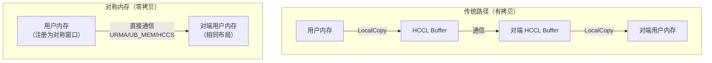
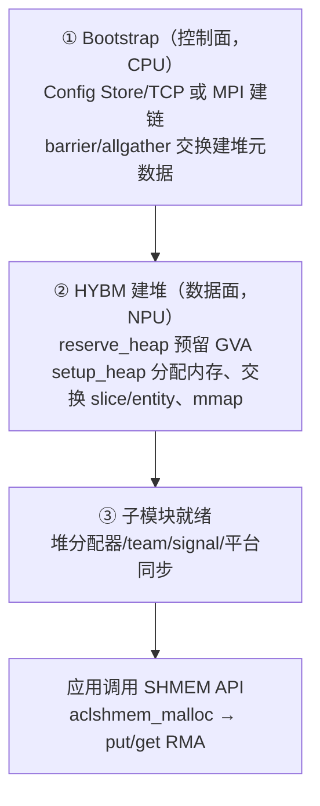

# 对称内存（Symmetric Memory）

> **深度参考** · 前置阅读：[源码课程单元 3｜数据面：原语与资源](/通信与昇腾/源码课程/03-数据面-原语与资源.md)。本篇为参考手册体例，检索导向；事实基线见文首引用块。

> **对称内存**是一种内存管理模型：允许并行处理单元（每个 rank/PE）以**"全局可见"但"无需显式地址交换"**的方式访问彼此的内存。各 rank 按相同规则分配等长堆，同序同大小的分配得到**相同堆内偏移**，从而可直接用偏移寻址对端内存。它是**零拷贝**通信的基础——HCCL 可直接对业务内存操作，无需经中间缓冲区（HCCL Buffer）。
>
> 本文覆盖两套对称内存能力：**HCCL SymWin**（`hcomm` 仓，供 HCCL 集合通信算子零拷贝）与 **SHMEM 库**（`shmem` 仓，OpenSHMEM 风格的独立分布式内存通信加速库）。
>
> 事实来源（可信度：代码 > 仓内文档 > 社区资料）：
> `hcomm/include/hccl/hccl_sym_win.h`（`HcclSymWinGetPeerPointer`/`HcclSymWinGetRemoteAddr`）、`hcomm/docs/zh/api_ref/comm_mgr_c/HcclCommSymWinRegister.md`（注册权威口径）、`hcomm/include/hccl/hccl_comm.h`（`HcclTeamCreate`/`HcclTeamGetLsaTeam`）、`shmem/include/shmem.h`（对外 API）、`shmem/docs/glossary.md`（术语）、`shmem/docs/principles/init_finalize.md`（初始化与对称堆）、`shmem/README.md`（通信通路与引擎）。

---

## 1. 概念与价值

| 概念 | 说明 |
| --- | --- |
| **对称内存** | 各 rank 全局可见、无需显式地址交换即可访问彼此内存的模型 |
| **对称堆（Symmetric Heap）** | 各 PE 各有一块等长堆；同序同大小的 `malloc` 得到相同堆内偏移 |
| **PE / rank** | 参与对称内存的进程；`my_pe` 为本 PE 编号（从 0 起），`n_pes` 为总数 |
| **零拷贝** | 直接对业务传入内存操作，**无需经 HCCL Buffer 中转**，减少内存拷贝开销 |

---

## 2. HCCL SymWin：集合通信算子零拷贝

HCCL 提供对称内存窗口（SymWin）API，将业务内存注册为对称内存，使支持的集合通信算子直接使用（`HcclCommSymWinRegister.md`）。

### 2.1 API

| 接口 | 作用 | 头文件 |
| --- | --- | --- |
| `HcclCommSymWinRegister(comm, addr, size, winHandle, flag)` | 注册对称内存窗口（flag 当前仅支持 1） | `hccl_comm.h` |
| `HcclCommSymWinDeregister(winHandle)` | 解注册 | `hccl_comm.h` |
| `HcclCommSymWinGet(...)` | 根据本地地址查询窗口及偏移 | `hccl_comm.h` |
| `HcclSymWinGetPeerPointer(winHandle, offset, peerRank, ptr)` | 获取对端对称内存指针 | `hccl_sym_win.h:33` |
| `HcclSymWinGetRemoteAddr(winHandle, offset, peerRank, ptr)` | 获取远端对称内存指针（**for URMA**） | `hccl_sym_win.h:44` |

> 集合通信算子通过 sendBuff/recvBuff **自动查找**对应的对称内存窗口及窗口内偏移，并内部使用对端内存信息——用户**无需显式调用** `HcclCommSymWinGet`/`HcclSymWinGetRemoteAddr`。

### 2.2 支持场景（按产品 × 引擎 × 协议）

| 产品 | 引擎 + 协议 | 说明 |
| --- | --- | --- |
| **950PR&950DT** | **AIV + URMA** | 将已申请 Device 内存注册为对称窗口，需配合 `HcclTeamCreate` 使用 |
| **950PR&950DT** | **AICPU + URMA** | 注册仅完成本端登记；跨 rank 内存注册、memHandle 交换、远端内存信息更新在 UB/URMA 通道创建时完成（集合通信算子内部触发）；远端信息更新完成前不应调用 `HcclSymWinGetRemoteAddr` |
| **950PR&950DT** | **AIV + UB Memory** | 申请虚拟+物理内存并映射后注册；通过提前预留相同大小、相同布局的虚拟地址实现对称（需 LSA WorldTeam 成员同时调用） |
| **Atlas A3** | **HCCS** | `aclrtReserveMemAddress`（预留虚拟）+ `aclrtMallocPhysical`（物理）+ `aclrtMapMem`（映射）后注册；仅超节点内 AI Server 间 HCCS 链路 **SDMA** 通信，不支持 RoCE RDMA |

> 图源：`hcomm/docs/zh/api_ref/comm_mgr_c/figures/symmetric_memory.png`。A3 HCCS 场景：为每个 rank 申请虚拟内存（heap_size），通信域总虚拟内存 = heap_size × rank_size；**每个 rank 虚拟地址布局相同**；不同 rank 的物理地址映射到各 rank 对应位置的虚拟地址，实现对其他 rank 内存的访问。

### 2.3 约束

| 约束 | 说明 |
| --- | --- |
| **对称组网** | A3 HCCS 场景仅支持对称组网（每 Server 内卡数相同）；URMA 场景不要求对称组网，但所有 rank 输入的 size 须一致 |
| **预留大小** | A3 HCCS 经 `HcclCommConfig.hcclSymWinMaxMemSizePerRank` 设置每 rank 预留大小（默认 **16GB**），总虚拟对称内存 = rankSize × 该值 |
| **支持算子** | A3 HCCS：AllGather/ReduceScatter/AllReduce/AlltoAll；950 AICPU+URMA：ReduceScatter/AllReduce/AllGather/Broadcast/AlltoAll/AlltoAllVC |
| **并发** | 不支持多线程并发调用注册接口 |
| **LSA Team** | UB Memory 场景需同一通信域内所有 **LSA WorldTeam** 成员同时调用，注册次序与物理内存大小须一致（`HcclTeamGetLsaTeam`） |

---

## 3. SHMEM 库：OpenSHMEM 风格分布式内存通信

`shmem` 仓是**基于对称内存的昇腾分布式内存通信加速库**，提供 OpenSHMEM 风格的编程模型（独立于 HCCL，可被 PyTorch 等框架集成替代 MPI）。

### 3.1 双侧接口体系

| 侧 | 职责 | 头文件目录 |
| --- | --- | --- |
| **Host 侧** | 初始化、内存堆管理、通信域（Team）创建、全局同步 | `shmem/include/host/`（init/mem/team/data_plane） |
| **Device 侧** | 远程内存访问（RMA）、设备级同步、通信域操作 | `shmem/include/device/`（gm2gm/ub2gm/team） |

### 3.2 通信语义

| 缩写 | 全称 | 说明 |
| --- | --- | --- |
| **RMA** | Remote Memory Access | 一侧 PE 主动访问另一侧对称内存（put/get 单边操作） |
| **AMO** | Atomic Memory Operation | 远端/本端原子操作（atomic add/fetch/swap/compare-swap） |
| **SO** | Signal Operation | 信号变量/操作（put-with-signal、signal wait/op） |
| **CC** | Collective Communication | 集合通信（Barrier/Allgather/Allreduce） |
| **MO** | Memory Ordering | 内存保序（quiet/fence） |

### 3.3 通信引擎与数据通路

> 图源：`shmem/docs/images/dma.png`（以 910A3 为例，覆盖 Host 侧与 Device 侧不同传输引擎）。

| 引擎 | 说明 | 通路 |
| --- | --- | --- |
| **MTE** | Memory Transfer Engine，芯片级内存传输引擎（AICore 侧） | D2D、D2H、H2D、D2rH、rH2D |
| **xDMA** | 高速直接内存访问引擎（SDMA/UDMA 统称） | 主机内 / 主机间 |
| **RDMA** | 远程直接内存访问 | 跨节点（RoCE） |

数据面接口分两类通路：

| 通路 | 说明 | 接口 |
| --- | --- | --- |
| **gm2gm** | AICore 驱动的 Global Memory 到 Global Memory | `aclshmem_put_*`/`aclshmem_amo_*`（高阶）、`aclshmemx_*`（低阶 engine） |
| **ub2gm** | AICore 驱动的 UB 到 Global Memory | 同上 |

> **高阶接口**（`gm2gm/`、`host/data_plane/`）：屏蔽底层引擎细节，内部自动管理 buffer 与同步，使用默认 buffer 不支持并发。**低阶接口**（`engine/`，如 `aclshmemx_udma_*`、`aclshmemx_roce_*`）：直接暴露底层传输引擎语义，需调用方自管 buffer 与同步，支持并发。

### 3.4 传输后端

`shmem/src/host/transport/` 实现 **RDMA / SDMA / UDMA** 三种传输后端；`shmem/src/host/entity/` 管理 **HYBM（Hybrid Memory，混合内存）**——entity 为内存域句柄、slice 为物理内存、GVA 为预留虚拟地址。

### 3.5 初始化与对称堆

`shmem/docs/principles/init_finalize.md`——各 PE 对称调用 `aclshmemx_init_attr` 初始化：

| 初始化模式 | 说明 |
| --- | --- |
| **UID 模式** | 无 MPI，rank 0 生成 uniqueid 并广播（`aclshmemx_get_uniqueid`） |
| **MPI 模式** | `comm_args` 为 `MPI_Comm*`（nullptr 即 `MPI_COMM_WORLD`） |
| **Default 模式** | 已知 rank 0 地址（`attr.ip_port = "tcp://rank0_host:port"`） |

> 对称堆建好后，同序同大小 `aclshmem_malloc` 得到相同堆内偏移，即可进行 `aclshmem_putmem`/`aclshmem_getmem` 等 RMA。Team（`ACLSHMEM_TEAM_WORLD` 为默认全局通信域）限定同步与通信范围；`quiet`/`fence`/`barrier`/`sync` 提供完成与保序语义。

### 3.6 同步

> 图源：`shmem/docs/images/notifywait.png`。SHMEM 默认启用 **TLS** 加密保护跨设备数据传输（`aclshmemx_set_conf_store_tls` 可接口级关闭）。

---

## 4. 对称内存 × 引擎 × 协议

对称内存是**内存模型**，底层可由多种引擎与协议承载：

| 承载通路 | 引擎 | 协议 | 产品 |
| --- | --- | --- | --- |
| **URMA** | AIV / AICPU | 基于 UB 总线（见 [urma.md](/通信与昇腾/参考手册/协议与传输/urma.md)） | 950PR&950DT |
| **UB Memory** | AIV | UB_MEM（见 [ub_mem.md](/通信与昇腾/参考手册/协议与传输/ub_mem.md)） | 950PR&950DT |
| **HCCS + SDMA** | — | HCCS（见 [hccs_pcie.md](/通信与昇腾/参考手册/协议与传输/hccs_pcie.md)） | Atlas A3 |
| **RDMA / xDMA / MTE** | AICore（SHMEM 库） | RoCE / UB | SHMEM 库（A2/A3/950） |

---

## 5. 代码落点

| 组件 | 路径 |
| --- | --- |
| **HCCL SymWin API** | `hcomm/include/hccl/hccl_sym_win.h`（`HcclSymWinGetPeerPointer`/`HcclSymWinGetRemoteAddr`）、`hcomm/include/hccl/hccl_comm.h`（`HcclCommSymWinRegister`/`Deregister`/`Get`、`HcclTeamCreate`/`HcclTeamGetLsaTeam`） |
| **HCCL Team / 对称窗口类型** | `hcomm/docs/zh/api_ref/comm_opdev/datatype_definition/HcclCommSymWindow.md`、`HcclTeamCreateDesc.md` |
| **SHMEM 对外 API** | `shmem/include/shmem.h`、`shmem/include/host/`、`shmem/include/device/`（gm2gm/ub2gm/team） |
| **SHMEM 传输后端** | `shmem/src/host/transport/`（RDMA/SDMA/UDMA） |
| **SHMEM 内存实体** | `shmem/src/host/entity/`（HYBM）、`shmem/src/host/mem/` |
| **SHMEM 同步/Team** | `shmem/src/host/sync/`（barrier/p2p/order）、`shmem/src/host/team/` |
| **SHMEM 初始化** | `shmem/src/host/init/`、`shmem/src/host/bootstrap/` |

---

## 6. 参考资料

- `hcomm/docs/zh/api_ref/comm_mgr_c/HcclCommSymWinRegister.md`：对称内存窗口注册（场景/约束/示例，本文 §2 主要来源）
- `hcomm/docs/zh/api_ref/comm_mgr_c/{HcclCommSymWinDeregister,HcclCommSymWinGet,HcclSymWinGetPeerPointer,HcclSymWinGetRemoteAddr}.md`：SymWin 配套 API
- `hcomm/docs/zh/api_ref/comm_mgr_c/{symmetric_mem.md,zero_copy.md}`：对称内存与零拷贝（占位）
- `shmem/README.md`：SHMEM 特性、通信通路、代码结构
- `shmem/docs/glossary.md`：对称内存术语（PE/Team/RMA/AMO/SO/CC/MO、MTE/SDMA/UDMA/RDMA、D2D/gm2gm/ub2gm）
- `shmem/docs/principles/init_finalize.md`：初始化与对称堆建立流程
- 关联：[README.md](/通信与昇腾/参考手册/协议与传输/)（通信方式总览）、[urma.md](/通信与昇腾/参考手册/协议与传输/urma.md)、[ub_mem.md](/通信与昇腾/参考手册/协议与传输/ub_mem.md)、[hccs_pcie.md](/通信与昇腾/参考手册/协议与传输/hccs_pcie.md)、[../engine/aiv.md](/通信与昇腾/参考手册/通信引擎/aiv.md)

