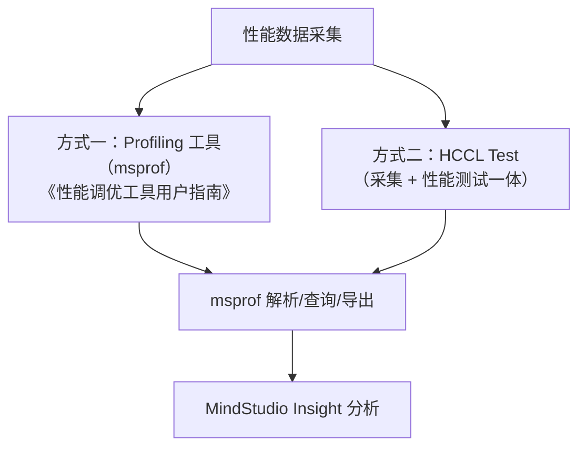
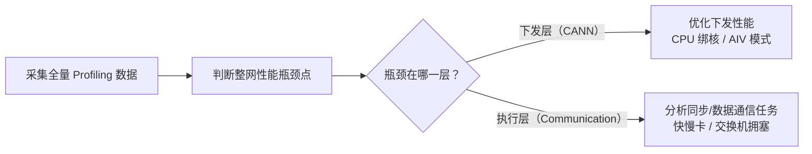

# 性能数据采集与分析

> **深度参考** · 前置阅读：[CANN 常用命令速查（Profiling 节）](/通信与昇腾/CANN常用命令.md)。本篇为参考手册体例，检索导向；事实基线见文首引用块。

> Profiling 分析的第一步是采集**全量 rank** 的数据，再按流程判断瓶颈、分阶段优化。
>
> 事实来源：`hccl/docs/zh/user_guide/perf_analysis/perf_data_collect.md`、`analysis_flow.md`、`perf_data_analysis.md`。

---

## 1. 为什么需要全量采集

集合通信是通信域内的**全局协同行为**，只通过一个 rank 的 Profiling 数据往往难以分析集合通信性能问题——需采集**全量 rank** 的 Profiling 数据才能精确定位瓶颈所在。

---

## 2. 两种采集方式



### 2.1 方式一：Profiling 工具

参考《性能调优工具用户指南》采集 Profiling 性能数据（msprof）。

### 2.2 方式二：HCCL Test

使用 HCCL Test 进行 Profiling 数据采集和性能测试（《HCCL 性能测试工具用户指南》，cann/oam-tools 仓 hccl_test）：

```bash
# "1" 开启 Profiling，"0" 关闭（默认 0）
export HCCL_TEST_PROFILING=1
# 指定 Profiling 数据存放路径（默认 /var/log/npu/profiling）
export HCCL_TEST_PROFILING_PATH=/home/profiling
```

> 开启 `HCCL_TEST_PROFILING` 后，HCCL Test 执行完成会在 `HCCL_TEST_PROFILING_PATH` 目录生成 Profiling 数据。

---

## 3. 数据解析

采集到全量 Profiling 数据后，用 msprof 命令解析、查询与导出（《性能调优工具用户指南》"使用 msprof 命令解析、查询与导出性能数据"章节），再用 **MindStudio Insight** 工具分析。

> 要显示具体通信任务编排信息（notify 同步任务 + memcpy 拷贝任务），需至少采集 **level 1** 级别的 Profiling 数据（见 [README.md §2](/通信与昇腾/参考手册/性能分析/)）。

---

## 4. 分析流程



| 瓶颈层 | 现象 | 优化方向 |
| --- | --- | --- |
| **下发层** | device 等待下发、出现空泡、利用率下降 | CPU 绑核（防切核损耗）；切 AIV 模式（`HCCL_OP_EXPANSION_MODE=AIV`，注意支持场景有限、多通信域并发会抢核死锁） |
| **执行层** | notify wait 过长、带宽不足 | 见 [slowfast_congestion.md](/通信与昇腾/参考手册/性能分析/慢快与拥塞.md)（快慢卡、交换机拥塞） |

> 更多性能调优案例参考《性能问题通用定位指南》的"TopN 性能问题的解决方案 > 通信问题优化方案"章节。

---

## 5. 参考资料

- `hccl/docs/zh/user_guide/perf_analysis/perf_data_collect.md`：性能数据采集（本文主要来源）
- `hccl/docs/zh/user_guide/perf_analysis/analysis_flow.md`：分析流程
- `hccl/docs/zh/user_guide/perf_analysis/profiling_op_behavior.md`：通信算子下发/执行、同步/数据通信任务
- 《性能调优工具用户指南》、《MindStudio Insight 工具用户指南》、《HCCL 性能测试工具用户指南》
- 关联：[README.md](/通信与昇腾/参考手册/性能分析/)、[slowfast_congestion.md](/通信与昇腾/参考手册/性能分析/慢快与拥塞.md)、[../engine/aiv.md](/通信与昇腾/参考手册/通信引擎/aiv.md)（AIV 模式）

