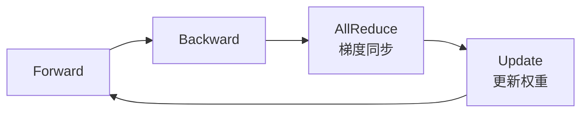
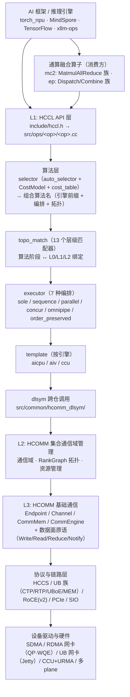

# HCCL 集合通信概述

> **深度参考** · 前置阅读：[《昇腾与 HCCL》第 0 章｜认识昇腾与 CANN](/通信与昇腾/00-ascend-cann.md)。本篇为参考手册体例，检索导向；事实基线见文首引用块。

> 本文基于 `hccl/docs/zh/architecture/architecture-brief.md`（官方架构简介，两仓共享同一套架构模型）、`hccl/AGENTS.md`（架构约束权威口径）与 `hccl`/`hcomm` 两仓源码整理。
> **阅读顺序建议**：本文（是什么/在哪一层）→ [02 算子与算法总览](/通信与昇腾/参考手册/总览/ops-algos-overview.md)（有什么）→ [03 L0/L1/L2 分级通信实现原理](/通信与昇腾/参考手册/总览/l0l1l2-principle.md)（怎么实现）→ [networking/](/通信与昇腾/参考手册/组网形态/)（物理组网）/ [algorithms/](/通信与昇腾/参考手册/算法参考/)（通信编排）/ [operators/](/通信与昇腾/参考手册/算子参考/)（算子细节）。

## 1. 什么是 HCCL

**HCCL（Huawei Collective Communication Library，华为集合通信库）** 是昇腾 NPU 集群的高性能集合通信库，提供单机多卡以及多机多卡间的数据并行、模型并行集合通信方案。它位于 AI 框架与硬件驱动之间的 CANN 软件栈中层：

- **向上**：为框架（PyTorch/torch_npu、MindSpore、TensorFlow、推理引擎）与通算融合算子（见 ../mc2/、../ep/）提供集合通信原语
- **向下**：通过 **HCOMM 通信基础库**（独立仓 `cann/hcomm`）编排 HCCS/UB/RoCE 等链路与 AICPU/AIV/CCU 执行资源

> **软件组成**：**HCCL = HCCL 集合通信算子库（`cann/hccl`）+ HCOMM 通信基础库（`cann/hcomm`）**。两仓通过 **`dlsym` 动态加载解耦**，可独立编译、独立版本演进。

## 2. HCCL 在 CANN 架构中的位置


> 图源：`hccl/docs/zh/architecture/figures/cann-hccl-architecture.png`

## 3. 为什么需要集合通信

大模型训练与推理 = 多卡协同，**通信是扩展瓶颈**：



| 侧 | 通信需求 |
| --- | --- |
| **训练侧** | 数据并行下每张 NPU 处理不同样本，迭代后需 **AllReduce 同步梯度**；模型/专家并行还依赖 **AllGather、ReduceScatter、AlltoAll** 协同 |
| **推理侧** | 大模型推理同样需要张量并行/专家并行协同，**通信时延直接影响首字时延与吞吐** |
| **集合通信的价值** | 让所有节点**并行、高效、有序**地交换数据，大幅减少同步开销 |

## 4. HCCL 核心能力

| 维度 | 能力 |
| --- | --- |
| **集合通信原语** | AllReduce、Broadcast、AllGather、AllGatherV、ReduceScatter、ReduceScatterV、Reduce、Scatter、AlltoAll/AlltoAllV/AlltoAllVC、Send、Recv、BatchSendRecv、Barrier（**13 个算子目录**，见 [02 总览](/通信与昇腾/参考手册/总览/ops-algos-overview.md)） |
| **通信算法** | **4 种基础拓扑算法**：Ring、Mesh、RHD(Halving-Doubling)、Star<br/>**自研算法**：NHR、NHR_V1、NB、AHC/AHC_BROKE、Pipeline、Pairwise<br/>**特殊算法**：分组 Full Mesh、NHR-HCF、CP<br/>见 [algorithms/](/通信与昇腾/参考手册/算法参考/) |
| **算法编排** | 执行器编排方式 **7 种**：Sole / Sequence / Parallel / Concur / PipeLine(OmniPipe) / StrictOrdered（+ omnipipe），见 [algorithms/combination.md](/通信与昇腾/参考手册/算法参考/combination.md) |
| **主要通信协议** | UB_CTP、UB_RTP、UBoE、RoCE(v2)、HCCS、UB_MEM（+ PCIE、SIO、HCCS_ONLY、UBC_TP），见 [03 §2.1](/通信与昇腾/参考手册/总览/l0l1l2-principle.md) |
| **通信引擎** | AICPU_TS、Host CPU_TS、AIV、CCU（CCU_MS / CCU_SCHED 两模式） |
| **通信语义** | 内存语义（HCCS/UB_MEM）+ 网络语义（RoCE/UB） |
| **执行模式** | **单算子模式**（`HcclXxx` API 直调）+ **图模式**（`op_graph/` 注册进 GE / Ascend IR / aclgraph） |
| **扩展能力** | 通信算子自定义开发（`src/algo_plugin/` 算法插件机制 + Tuner 插件；`include/hccl_mc2.h` MC2 自定义算子框架） |
| **应用场景** | 大模型训练（数据/模型/专家并行）与推理（TP/PP/EP）的集合通信 |

## 5. 集合通信模型：三个核心概念

| 术语 | 一句话解释 | 主要对应硬件 |
| --- | --- | --- |
| **集合通信域** | 集合通信执行的上下文，管理参与通信的实体和资源 | 多个 NPU 组成 |
| **Rank** | 集合通信域中的成员，拥有唯一 Rank ID（从 0 开始） | 一个 NPU（**A3 例外：一个 Die**） |
| **RankGraph** | Rank 间的通信关系图，描述"谁和谁怎么连" | 网络拓扑 |


> 图源：`hccl/docs/zh/architecture/diagrams/coll_comm_model.excalidraw.svg`。RankGraph 的 Node/Endpoint/Edge/Link/netLayer/Fabric/TopoInstance 详解见 [04_昇腾集群组网总览.md](/通信与昇腾/参考手册/总览/cluster-topology.md)。

## 6. 基础通信模型：四个原语概念

集合通信的基础是四个**原语概念**——构成所有通信操作的基本元素：

| 概念 | 一句话解释 | 主要对应硬件 |
| --- | --- | --- |
| **通信设备（Endpoint）** | 网络通信的逻辑接口，包含协议与地址 | NPU 网口 / Host NIC |
| **通信通道（Channel）** | 两端通信设备间的数据通道（含同步 Notify） | RoCE QP / UB Jetty 连接 |
| **通信内存（CommMem）** | 注册到通信域、可被通信设备访问的内存段 | NPU 片上内存 / Host 内存 |
| **通信引擎（CommEngine）** | 执行通信任务的模块，含 Thread 与线程调度器，驱动通信硬件搬移数据 | AICPU_TS、CCU、AIV |

> **组合关系**：**Channel = 两端通信设备 + 通信协议 + N 个 Notify**


> 图源：`hccl/docs/zh/architecture/diagrams/base_comm_model.excalidraw.svg`、`hcomm/docs/zh/comm_op_dev_guide/prog_models_concepts/figures/hccl_communication_model.png`

### 6.1 内存语义 vs 网络语义

| | 网络语义原语 | 内存语义原语 |
| --- | --- | --- |
| **核心对象** | Channel（通信通道） | 通信设备 + 映射内存 |
| **操作方式** | Write / Read / Notify | 本地拷贝（像操作本地内存） |
| **通信模型** | 单边操作、双边操作（需两端配合） | 单边操作（只需一端发起） |
| **适用协议** | RoCE、UB | UB_MEM、HCCS |

 

> 选择哪种语义**取决于底层协议与场景需求**。

## 7. 通信引擎

通信引擎是通信实体中**执行通信任务的核心模块**：向上接收**通信资源**（Endpoint/Channel/CommMem）与**通信任务编排**下发的任务，向下通过**线程执行调度器**驱动**通信硬件**完成数据搬移。


| 通信引擎 | Thread 抽象 | 介绍 | 特点 | 适用场景 |
| --- | --- | --- | --- | --- |
| **AICPU_TS** | NPU Stream | AICPU 运行通信 Kernel 并下发通信 Task 描述符，TS 调度到硬件执行 | 不占计算核，Task 描述符下发 | 大数据量通信 |
| **CPU_TS** | NPU Stream | Host CPU 运行通信逻辑，TS 调度下发 | 不占计算核，下发开销大 | Atlas A2 专用 |
| **AIV** | AICore Block | Vector Core 直接执行通信算子 | 低延迟，占 Vector 核 | 小数据低延迟 |
| **CCU** | Mission | 硬化通信单元，微码执行 | 硬化调度，微码执行 | 专用硬件通信 |

> **同一集合通信域默认只用一种引擎**；算子开发者通过算法选择器自动选择引擎。
>
> **一句话**：通信引擎 = Thread（执行上下文）+ 线程调度器（调度执行）；AICPU_TS 引擎即由 **AICPU 运行通信 Kernel、TS 调度 Task** 协同完成。

各引擎的任务执行流程详见 [03_L0L1L2分级通信实现原理.md §4](/通信与昇腾/参考手册/总览/l0l1l2-principle.md)。

## 8. 同步机制

| 同步方式 | 场景 | 说明 | 接口原型 |
| --- | --- | --- | --- |
| **ThreadNotify** | 同一通信实体内 | Thread 向同通信实体内另一个 Thread 发送/等待同步信号 | `ThreadNotifyRecord` / `ThreadNotifyWait` |
| **ChannelNotify** | 不同通信实体间 | Thread 通过 Channel 上的 notify 及 Channel 数据通道向远端通信实体的 Thread 发送/等待同步信号 | `ChannelNotifyRecord` / `ChannelNotifyWait` |


> **层级对应**：L0（Server 内）主要用 ThreadNotify，L1/L2（跨 Server/超节点）用 ChannelNotify——见 [03 §3.2](/通信与昇腾/参考手册/总览/l0l1l2-principle.md)。

## 9. 软件分层逻辑

### 9.1 三层架构

| 软件层次 | 职责 | 代码仓位置 |
| --- | --- | --- |
| **HCCL 集合通信算子**（coll_comm_ops，L1） | 算子入口 → 算法选择 → 算法执行 | `hccl` |
| **HCOMM 集合通信域管理**（HCCM，L2） | 通信域 + 拓扑管理 + 资源管理 | `hcomm` / `coll_communicator_mgr` |
| **HCOMM 基础通信**（L3） | 资源管理 + 通信原语执行 | `hcomm` / `base_comm` |


**依赖方向自上而下**：`coll_comm_ops`（HCCL）→ `coll_communicator_mgr` → `base_comm`（后两者在 HCOMM 仓）。

### 9.2 对外 API 分层关系


| 层次 | 接口 | 面向 | 职责概述 |
| --- | --- | --- | --- |
| **L1** | HCCL 算子（`hccl.h`） | AI 框架适配层 | 提供 AllReduce 等标准集合通信算子入口 |
| **L2-comm** | HCOMM 集合通信域管理中的通信域（`hccl_comm.h`） | 框架适配层 | 通信域创建 |
| **L2-res-rank_graph** | HCOMM 集合通信域管理（`hccl_res.h` / `hccl_channel.h` / `hccl_rank_graph.h`） | **算子开发者** | 拓扑查询、资源（Thread/Channel）获取 |
| **L3-prim** | HCOMM 基础通信原语（`hcomm_primitives.h`） | **算子开发者、通信库开发者** | 数据搬运（Write/Read/Reduce）+ 同步（Notify） |
| **L3-res** | HCOMM 基础通信资源（`hcomm_res.h`） | 通信库开发者 | 通信设备/通道/内存等基础资源的获取与管理 |

- **L2-res-rank_graph + L3-prim 是新开放的算子编程接口**，专门面向自定义通信算子开发
- **L3-res + L3-prim 是通信库开发接口**，专门面向集合通信库等开发

| 层次 | 头文件 | 面向 |
| --- | --- | --- |
| L1 算子 | `hccl/include/hccl.h` | AI 框架适配层（AllReduce/Broadcast/AllGather/ReduceScatter/AlltoAll/Send/Recv 等） |
| MC2 自定义算子 | `hccl/include/hccl_mc2.h` | 自定义通信算子开发者（`KfcOpArgs`/`OpResCtx` 等） |

> `include/` 变更需**向后兼容**。

### 9.3 软件架构约束（硬性，不可违反）

| 约束 | 说明 |
| --- | --- |
| **分层依赖方向** | 上层依赖下层，下层不能反向依赖上层：`base_comm` ↛ `coll_communicator_mgr` ↛ `coll_comm_ops`。HCCL 不得被 HCOMM 反向依赖；HCCL 算子通过 dlsym 调 HCOMM，不得要求 HCOMM 反向 include HCCL 头 |
| **控制面/数据面分离** | 资源管理、拓扑查询属**控制面**；数据搬运（Write/Read/Reduce）与同步（Notify）属**数据面**；两层接口**独立演进、互不耦合**。HCCL 算子属数据面消费方，不得在算子层引入对 HCOMM 控制面内部实现的耦合 |
| **HCCL 与 HCOMM 解耦** | HCCL 算子通过 **`dlsym` 动态加载** HCOMM 接口，两仓可独立编译、独立版本演进。HCCL 不得 `#include` HCOMM 私有头；不得引入对 `cann/hcomm` 的编译期硬依赖；跨仓调用走 `hccl/src/common/hcomm_dlsym/` 的符号表 + `dlsym` |
| **新算子落标准结构** | 官方新算子落 `hccl/src/ops/<op>/`；社区贡献的试验性新算子落 `experimental/ops/<op>/`（结构与 `src` 一致，不保证兼容性、不编入商用版本）。均按 `selector` + `algorithm/{executor,template}` 组织 |
| **legacy 不持续演进** | `hcomm/src/legacy/` 仅用于历史版本兼容（`ascend910` = A2&A3、`ascend950` = A5 旧流程），不承接新特性；新能力一律落在标准目录 |

## 10. 目录结构（与软件架构对应）

### 10.1 HCCL 仓

```text
hccl
├── src                              # HCCL 算子源码目录
│   ├── common                       # 通用逻辑：类型定义、日志、alg_type/alg_parse/alg_env_config、
│   │                                #   adapter_acl、param_check、sal、hcomm_dlsym、op_graph、utils、hccl_mc2
│   └── ops                          # HCCL 算子实现
│       ├── all_gather               # AllGather 算子实现
│       ├── all_gather_v             # AllGatherV 算子实现
│       ├── all_reduce               # AllReduce 算子实现
│       ├── all_to_all_v             # AlltoAll、AlltoAllV、AlltoAllVC 算子实现
│       ├── batch_send_recv          # BatchSendRecv 算子实现
│       ├── broadcast                # Broadcast 算子实现
│       ├── barrier                  # Barrier 算子实现
│       ├── recv / send              # Recv / Send 算子实现
│       ├── reduce                   # Reduce 算子实现
│       ├── reduce_scatter           # ReduceScatter 算子实现
│       ├── reduce_scatter_v         # ReduceScatterV 算子实现
│       ├── scatter                  # Scatter 算子实现
│       ├── interface_graph_mode     # 图模式资源计算接口
│       └── op_common                # 算子通用组件
│           ├── algorithm            # 算法层
│           │   ├── executor         # 算法执行器（+ channel/ + registry/）
│           │   ├── template         # 算法模板（aicpu/aiv/ccu/dpu + registry/ + wrapper/）
│           │   └── topo_match       # 算法执行阶段拓扑层级匹配（13 个匹配器）
│           ├── selector             # 算法选择、CostModel 等选择逻辑
│           ├── topo_info            # 公共拓扑信息生成、转换与 Rank 映射
│           └── inc                  # 公共头文件（alg_param.h 等）
├── include                          # HCCL 对外头文件：hccl.h（算子 API）、hccl_mc2.h（MC2 框架）
├── experimental                     # 社区贡献的试验性代码目录（不保证兼容性，不编入商用版本）
├── examples                         # 示例代码（01_point_to_point / 02_collectives）
├── test                             # ut / st
├── docs                             # 资料文档（zh / en，含 architecture、api_ref、user_guide、rfcs）
└── build.sh                         # 一键编译脚本
```

### 10.2 HCOMM 仓

```text
hcomm
├── src
│   ├── base_comm                    # 基础通信层（L3）
│   │   ├── common                   # 基础通信层公共基础功能（protocol_utils.h 等）
│   │   ├── primitives               # 基础通信原语（aicpu/ + api_c_adpt/ + ccu/ + nic_plugin/）
│   │   ├── resources                # 基础通信资源（endpoint_pairs/channels、comm_engine_res、
│   │   │                            #   ccu/ccu_transport、southbound_adpt/hccp、hccp/）
│   │   ├── config_mgr               # 配置管理（base_config.h：UB/UBoE 超时等）
│   │   └── dfx                      # 维测
│   ├── coll_communicator_mgr        # 集合通信域管理（L2，HCCM）
│   │   ├── api_c_adpt               # C 接口适配
│   │   ├── common                   # 集合通信层公共基础功能
│   │   ├── communicator             # 通信域
│   │   ├── rank_graph               # 拓扑管理（phy_topo/ + rank_graph_builder/ + net_instance +
│   │   │                            #   rank_table_info/ + topo_info/）
│   │   ├── rank_info_detect         # rank 信息探测
│   │   ├── config_mgr               # 配置管理
│   │   ├── resource_mgr             # 资源管理
│   │   ├── team                     # 团队/分组
│   │   └── dfx                      # 维测
│   └── legacy                       # 历史版本兼容目录（不持续演进）
│       ├── ascend910                # A2 & A3 兼容代码（algorithm/base/alg_template/ 下
│       │                            #   ★ Ring/Mesh/RHD/Star/NHR/NHR_V1/NB/AHC/Pipeline/Pairwise
│       │                            #   全部经典算法模板都在此）
│       └── ascend950                # A5 旧流程兼容代码（common/types/ + framework/topo/ +
│                                    #   unified_platform/）
├── include                          # 对外头文件：hcomm_primitives.h、hcomm_res.h、hcomm_res_defs.h、
│                                    #   hcomm_channel.h、hcomm_team_defs.h、hccl/、ccu/
├── pkg_inc                          # 包间接口头文件（hcomm/ + hccl/ + legacy/ + ccu/）
├── experimental                     # 社区贡献的试验性代码（含 cluster_link_diag 集群链路诊断）
├── python                           # Python 接口
└── docs                             # 资料文档（含 comm_op_dev_guide 通信算子开发指南：
                                     #   aicpu/aiv/ccu 三套开发流程 + prog_models_concepts）
```

### 10.3 两条算法实现路径（重要）

| 路径 | 位置 | 覆盖产品 | 特征 |
| --- | --- | --- | --- |
| **经典算法路径** | `hcomm/src/legacy/ascend910/algorithm/base/alg_template/` | 910 / A2 / A3 | **Ring、Mesh、RHD、Star、NHR、NHR_V1、NB、AHC、AHC_BROKE、Pipeline、Pairwise 全部算法模板都在此**；按算子分目录（`temp_all_reduce/` 21 个、`temp_reduce_scatter/` 27 个、`temp_all_gather/` 23 个、`temp_broadcast/` 9 个、`temp_scatter/` 8 个、`temp_alltoallv/` 8 个、`temp_alltoall/` 4 个、`temp_reduce/` 3 个、`temp_gather/` 3 个、`temp_send_recv/` 1 个） |
| **执行器编排路径** | `hccl/src/ops/*/algorithm/{executor,template}/` | 950PR&950DT（A5） | 以 **Mesh1D（120 文件）+ NHR（110 文件）** 为主力，靠 **7 种执行器编排**（Sole/Sequence/Parallel/Concur/OmniPipe/StrictOrdered）组合出 38 个 AllReduce 算法名等；三引擎模板齐全（aicpu/aiv/ccu，含 mem2mem 114 文件、omnipipe 87 文件、2die 36 文件、multi_jetty 20 文件） |

> 这一分工是理解 HCCL 代码的关键：**在 hccl 仓找不到 AHC/RHD/Star 的模板文件**——它们在 hcomm 的 legacy 目录；反之 **950 的 CCU/AIV 模板与执行器编排只在 hccl 仓**。

## 11. 端到端调用链



要点：

1. **算子层**（`hccl/src/ops/`）：每个算子一个目录（`<op>.cc` 主流程 + `selector/` 算法选择 + `algorithm/executor|template` 执行器与载体模板 + `op_graph/` 图模式注册）
2. **算法层**：`HcclAlgoType`（`src/common/alg_type.h`）**13 种算法枚举** + **三层拓扑组合**（`AlgTypeLevel0/1/2`）
3. **选择器**：`selector/<op>_auto_selector.cc` 按数据量/rank 数/拓扑自动选算法；`alg_env_config`/`alg_parse` 支持环境变量（`HCCL_ALGO` 等）显式覆盖
4. **算法插件**：`src/algo_plugin/` + `op_common/selector/inc/hccl_tuner_plugin.h`（RFC 0002）
5. **跨仓解耦**：HCCL 通过 `dlsym` 调 HCOMM，**无编译期硬依赖**
6. **hcomm**：通信域/拓扑/资源管理（L2）+ 通信原语执行（L3）+ **legacy 目录承载全部经典算法模板**

## 12. 执行模式与通信域创建

### 12.1 两种执行模式

| 模式 | 说明 | 代码落点 |
| --- | --- | --- |
| **单算子模式** | `HcclXxx` API 直调 | `hccl/src/ops/<op>/<op>.cc` |
| **图模式** | 注册进 GE / Ascend IR / aclgraph | `hccl/src/ops/<op>/op_graph/<op>_proto.cc`（**Scatter、BatchSendRecv、Barrier 无 op_graph**） |

> 同一个通信域内**不支持图模式通信和单算子通信混合执行**。

### 12.2 通信域创建的四种方式


> 图源：`hccl/docs/zh/user_guide/figures/hccl_operation_flow.png`

| 方式 | 接口 | 场景 |
| --- | --- | --- |
| **基于 rank table** | `HcclCommInitClusterInfo` / `HcclCommInitClusterInfoConfig` | 多机，有完整集群信息配置文件 |
| **基于 root 节点信息** | `HcclGetRootInfo` + `HcclCommInitRootInfo` / `HcclCommInitRootInfoConfig`（另有 `*Scalable` 变体） | 多机，无 rank table 文件 |
| **单机批量创建** | `HcclCommInitAll` | 单机，一个进程统一创建多卡通信域（一卡一线程） |
| **子通信域切分** | `HcclCreateSubCommConfig` | 基于已有通信域切分，**无需 socket 建链与 rank 信息交换**，可用于业务故障下的快速通信域创建。**不支持嵌套切分** |

销毁：`HcclCommDestroy`。

### 12.3 通用约束

- 多个通信域下的所有通信算子在每个 Device 上需**串行下发**，不允许乱序、多线程并发下发，也不支持线程重入
- 同一 Device 上，同一通信域内所有通信算子的下发线程需使用**相同的 Context**
- 同一通信域内**不支持图模式与单算子模式混合执行**
- 同一 NPU 上需**串行创建**多个通信域
- 多线程调用集合通信 API 时，需确保不同线程中调用的**前后时间差不超过建链超时等待时间**（`HCCL_CONNECT_TIMEOUT`，默认 **120s**）

## 13. 与上层通算融合的关系

MC2 通算融合算子（MatmulAllReduce 等）在 GE 图模式中消费 hccl 的通信能力与 `moe_distribute_base` 跨仓契约；hccl 的 AllToAllv 是 EP Dispatch/Combine 的通信内核（详见 ../ep/01_专家并行通信概述.md）。

| 上层目录 | 内容 |
| --- | --- |
| ../mc2/ | 通算融合算子（MatmulAllReduce 族、AllGatherMatmul 族、AlltoAll 融合族、FFN/Attention 融合族、Engram 族） |
| ../ep/ | 专家并行通信算子（MoeDistributeDispatch/Combine 族、MoeEpDispatch/Combine 族、MegaMoe） |

## 14. 参考资料

**仓内文档（本文主要来源）**

- `hccl/docs/zh/architecture/architecture-brief.md`：**官方架构简介**——集合通信模型、RankGraph、基础通信、通信引擎、同步机制、软件分层、API 分层、架构约束
- `hccl/AGENTS.md`：仓库定位、目录结构、**架构约束（硬性）**、构建与测试、编码规范
- `hcomm/docs/zh/architecture/architecture-brief.md`、`overview.md`、`base_comm/`、`coll_comm/`：HCOMM 侧同源架构文档
- `hccl/docs/zh/api_ref/comm_op_interface/`：13 个 API 的参数与约束（`collective_comm.md`、`p2p_comm.md`、`data_type_def.md`）
- `hcomm/docs/zh/api_ref/comm_mgr_c/`：通信域管理 C 接口（含 `HcclBarrier`、`symmetric_mem.md`、`zero_copy.md`）
- `hcomm/docs/zh/api_ref/comm_opdev/`：通信算子开发接口（`control_plane_api/` 控制面 + `data_plane_api/` 数据面）
- `hcomm/docs/zh/comm_op_dev_guide/`：**通信算子开发指南**——`aicpu_comm_op_dev/`、`aiv_comm_op_dev/`、`ccu_comm_op_dev/` 三套流程 + `prog_models_concepts/`（通信模型/引擎/并发模型/拓扑模型/CCU 概念）
- `hccl/docs/zh/user_guide/`：`concepts.md`、`api_comm_impl.md`、`constraints.md`、`quick_start.md`、`framework_integration.md`、`coll_algo_intro/`、`cluster_info_config/`、`hccl_env/`、`perf_analysis/`、`fault_diagnosis/`、`comm_ops_support_list/`
- `hccl/docs/zh/rfcs/`：`0001-add-batch-invariant-reducescatter.md`、`0002-HCCL-ALGO-Plugin.md`、`0003-executor-template-refactor.md`
- `hccl/README.md`、`hcomm/README.md`：仓库说明

**本 wiki**

- [02_HCCL算子与算法总览.md](/通信与昇腾/参考手册/总览/ops-algos-overview.md)：算子与算法总览
- [03_L0L1L2分级通信实现原理.md](/通信与昇腾/参考手册/总览/l0l1l2-principle.md)：**分级通信实现原理（本文的实现篇）**
- [networking/](/通信与昇腾/参考手册/组网形态/)：组网（物理层）
- [algorithms/](/通信与昇腾/参考手册/算法参考/)：算法与编排（逻辑层）
- [operators/](/通信与昇腾/参考手册/算子参考/)：算子（语义层）

