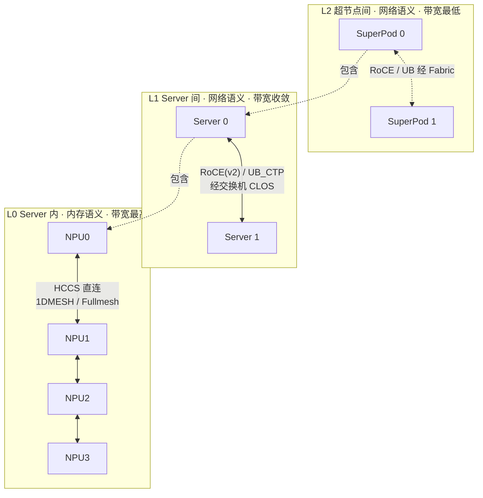
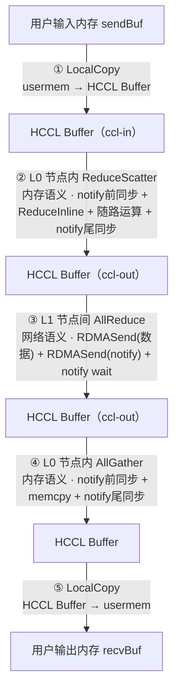
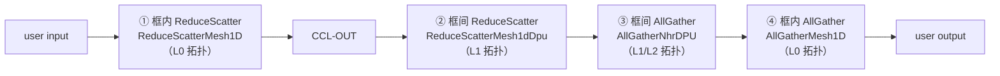
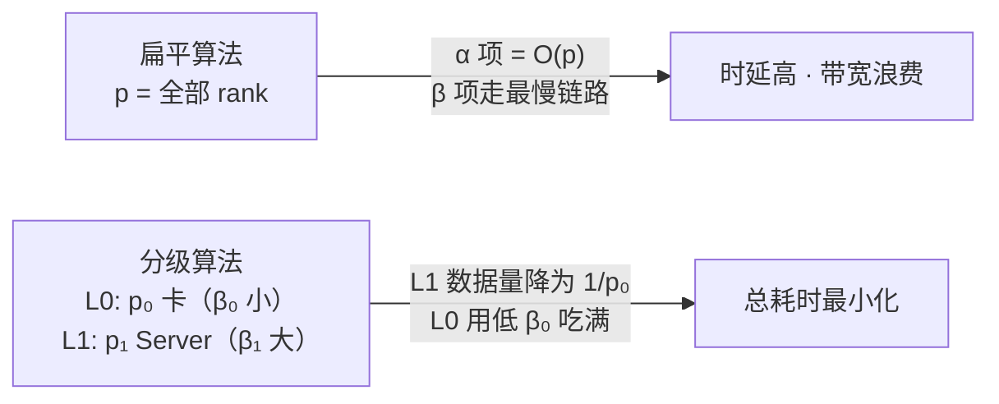
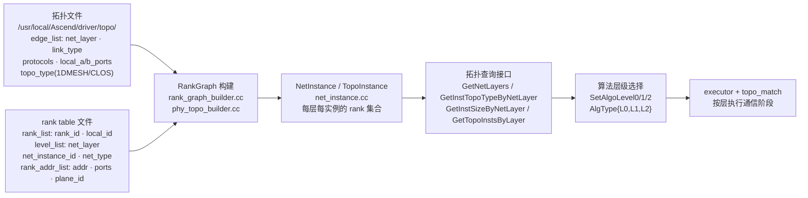
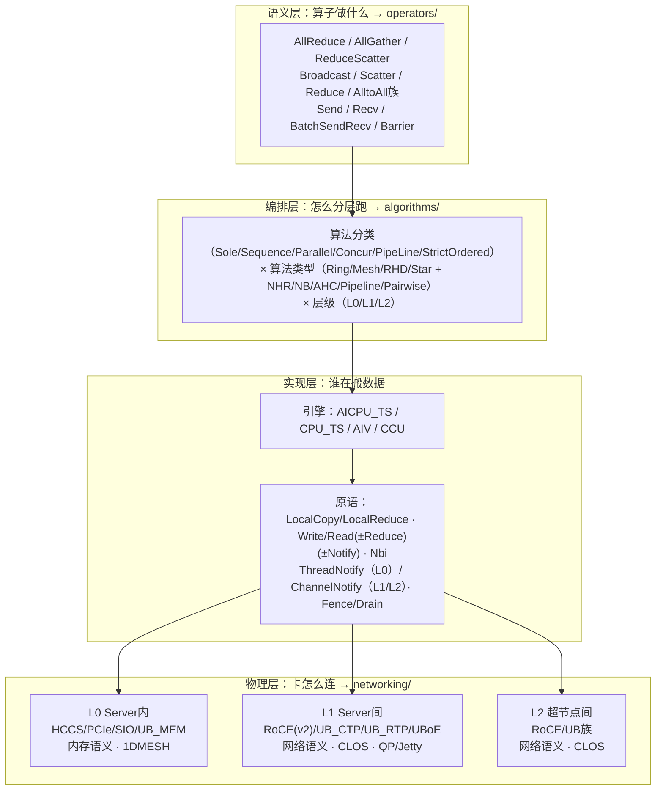

# L0 / L1 / L2 分级通信实现原理

> **深度参考** · 前置阅读：[《集合通信》第 5 章｜拓扑、分层与重叠](/通信与昇腾/05-topology-hierarchical-overlap.md)。本篇为参考手册体例，检索导向；事实基线见文首引用块。

> 本文是 communication 篇的**实现原理主干**：把「组网（物理链路）→ 算法（通信编排）→ 算子（通信语义）」三条线在 **L0/L1/L2 三个网络层级**上贯通，回答"一次集合通信在硬件上究竟怎么跑完"。
>
> 事实来源（可信度：代码 > 仓内文档 > 社区资料）：
> `hcomm/include/hcomm_res_defs.h`（协议/引擎枚举）、`hcomm/include/hcomm_primitives.h`（数据面原语）、`hcomm/src/coll_communicator_mgr/rank_graph/`（RankGraph 与 netLayer）、`hccl/src/common/alg_type.h`（三层算法枚举）、`hccl/src/ops/op_common/inc/alg_param.h`（加速模式与层级字段）、`hccl/src/ops/op_common/algorithm/topo_match/`（层级拓扑匹配）、`hccl/docs/zh/user_guide/coll_algo_intro/`（分级通信权威表与耗时模型）、`hccl/docs/zh/user_guide/perf_analysis/typical_op_behavior.md`（Profiling 任务对应）、`hccl/docs/zh/user_guide/cluster_info_config/rank_table_config_a5.md`（net_layer/topo_type/plane_id 配置）。

---

## 1. L0/L1/L2 是什么：netLayer 三级网络层级

HCCL 用 **netLayer** 对集群做分层抽象，**通信质量逐层递增而递减**（层号越小越快）。层级不是固定的三层——拓扑文件里 `net_layer` 取值范围为 **[0,7]**（`rank_table_config_a5.md:72`），但工程上绝大多数集群落在 L0/L1/L2 三层：

| 层级 | 物理范围 | 典型链路 | 典型协议 | 通信语义 | 相对带宽 |
| --- | --- | --- | --- | --- | --- |
| **L0** | Server 内（节点内） | HCCS 直连 / PCIe / SIO | HCCS、UB_MEM、UB_CTP、PCIE、SIO | **内存语义**为主 | 最高 |
| **L1** | Server 间（节点间） | 网卡经交换机 Fabric | RoCE(v2)、UB_CTP、UB_RTP、UBoE | **网络语义** | 中（存在带宽收敛） |
| **L2** | 超节点间（SuperPod 间） | 跨超节点 Fabric | RoCE(v2)、UB 族 | **网络语义** | 最低 |



> **一句话**：L0 是"像访问本地内存一样访问邻居卡"，L1/L2 是"通过网卡发消息给远端卡"。这个差异决定了下面所有实现选择。

### 1.1 层级在代码中的三处落点

| 落点 | 代码位置 | 作用 |
| --- | --- | --- |
| **拓扑建模** | `hcomm/src/coll_communicator_mgr/rank_graph/`：`edge_info.h:34 netLayer`、`rank_level_info.h:35 netLayer`、`rank_graph_v2.h:28-40`（`GetNetLayers`/`GetInstTopoTypeByNetLayer`/`GetInstSizeByNetLayer`/`GetTopoInstsByLayer`） | 描述"每层有哪些 rank、什么拓扑类型、多大实例" |
| **算法选择** | `hccl/src/common/alg_type.h:36-73`：`AlgTypeLevel0/1/2` 三套独立枚举，组合成 `TagAlgType` | 决定"每层用什么算法" |
| **执行编排** | `hccl/src/ops/op_common/algorithm/topo_match/`（13 个匹配器）+ `hccl/src/ops/op_common/topo_info/physical_level*.cc` | 决定"按什么顺序、切多少块跑完各层" |

`alg_param.h` 中的层级容量常量：

```cpp
constexpr u32 HCCL_LOGIC_TOPO_LEVEL_NUM = 4;   // 逻辑拓扑最多 4 级（alg_param.h:43）
constexpr u32 PHYSICAL_LEVEL_NUM_LIMIT  = 10;  // 物理层级上限 10（alg_param.h:46）
```

### 1.2 层级拓扑匹配器（topo_match）全景

`hccl/src/ops/op_common/algorithm/topo_match/` 是"算法阶段 ↔ 拓扑层级"的绑定层，文件名即匹配形态：

| 匹配器 | 适用层级形态 |
| --- | --- |
| `topo_match_one_level` / `topo_match_1d` | 单层（纯 L0 单机场景） |
| `topo_match_two_level` | 两级（L0 + L1，最常见） |
| `topo_match_three_level` / `topo_match_3_level` | 三级（L0 + L1 + L2，超节点集群） |
| `topo_match_multilevel` / `topo_match_nlevel` | 任意多级 |
| `topo_match_concurrent`(+`_v2`) | 并发编排（Concur 执行器） |
| `topo_match_squeeze_2d` | 2D 压缩（Parallel/OmniPipe 两维切分） |
| `topo_match_pcie_mix` | PCIe 混合链路（标卡场景） |
| `topo_match_ubx` / `topo_match_ubx_1d` | UBX（UB 交换）组网 |

---

## 2. 三层实现差异总矩阵

这是本文最核心的一张表——**同一个算子在不同层级，用的协议、语义、引擎、原语、算法全都不同**：

> 下表的**协议与传输实现**（UB_MEM/URMA/RoCE/HCCS/UB 网络语义/对称内存）详见 [comm/](/通信与昇腾/参考手册/协议与传输/)；**引擎**详见 [engine/](/通信与昇腾/参考手册/通信引擎/)。

| 维度 | **L0（Server 内）** | **L1（Server 间）** | **L2（超节点间）** |
| --- | --- | --- | --- |
| **物理链路** | HCCS 片间总线 / PCIe / SIO | RDMA 网卡 → 交换机 Fabric | 跨超节点 Fabric |
| **协议枚举**<br/>（`hcomm_res_defs.h:118-133`） | `COMM_PROTOCOL_HCCS=0`、`PCIE=2`、`SIO=3`、`UB_MEM=6`、`HCCS_ONLY=8`（一卡双 Die） | `COMM_PROTOCOL_ROCE=1`、`UB_CTP=4`、`UB_RTP=9`、`UBOE=7` | 同 L1（RoCE / UB 族） |
| **通信语义** | **内存语义**：远端内存映射进本地地址空间，直接本地拷贝 | **网络语义**：Channel + Write/Read/Notify | **网络语义** |
| **通道实体** | 映射内存（Channel 仅表示"映射已启用"，不承载数据） | **RoCE QP** / **UB Jetty** | RoCE QP / UB Jetty |
| **数据搬运硬件** | SDMA / 片间直连 | RDMA 网卡（WQE 下发） | RDMA 网卡 |
| **同步方式** | Notify 寄存器 / Device 内存 | `ChannelNotifyRecord/Wait`（随路 notify） | 同 L1 |
| **主力引擎** | AIV（低时延）、CCU（950 硬化）、AICPU_TS | AICPU_TS（大数据量）、CPU_TS（A2） | AICPU_TS（`HCCL_OP_EXPANSION_MODE=AI_CPU`） |
| **可选算法**<br/>（`alg_type.h`） | Ring 系（8P/4P/NP 单双环）、Mesh 系（1P/2P/4P/NP）、HD、Star、Pairwise | Ring、HD、Pipeline、NHR、NHR_V1、NB、AHC、AHC_BROKE、Star | Ring、HD、NHR、NB |
| **可否配置** | **不可配**（`HCCL_ALGO` 的 level0 仅支持 NA） | 可配（`HCCL_ALGO` level1） | 可配（`HCCL_ALGO` level2） |
| **默认策略** | 按硬件拓扑自动选择 | 自适应（Server 数 / 数据量 / 产品形态） | 自适应（仅 Atlas A3） |
| **典型拓扑类型** | `1DMESH`（Device 直连全互联） | `CLOS`（交换机胖树，所有节点可互通） | `CLOS` |

### 2.1 协议枚举全量（`hcomm/include/hcomm_res_defs.h:118-133`）

| 值 | 枚举 | 说明 | 语义 | 常见层级 |
| --- | --- | --- | --- | --- |
| 0 | `COMM_PROTOCOL_HCCS` | Huawei Cache Coherence System 片间高速互联 | 内存语义 | L0 |
| 1 | `COMM_PROTOCOL_ROCE` | RDMA over Converged Ethernet（v2） | 网络语义 | L1 / L2 |
| 2 | `COMM_PROTOCOL_PCIE` | PCIe 主机链路（标卡卡间唯一通路） | 内存语义 | L0 |
| 3 | `COMM_PROTOCOL_SIO` | SIO 链路（910_93 场景） | 内存语义 | L0 |
| 4 | `COMM_PROTOCOL_UB_CTP` | 灵衢统一总线 CTP（旧名 `UBC_CTP`/`UBC_TP`） | 网络语义 | L0 / L1 |
| 6 | `COMM_PROTOCOL_UB_MEM` | UB 内存语义 | 内存语义 | L0 |
| 7 | `COMM_PROTOCOL_UBOE` | UB over Ethernet | 网络语义 | L1 / L2 |
| 8 | `COMM_PROTOCOL_HCCS_ONLY` | 一卡双 Die 使用 HCCS | 内存语义 | L0（Die 间） |
| 9 | `COMM_PROTOCOL_UB_RTP` | 灵衢统一总线 RTP（旧名 `UBG`） | 网络语义 | L1 / L2 |

> 拓扑文件中 `protocols` 字段可取值：`UB_CTP`、`UB_RTP`、`ROCE`、`HCCS`、`TCP`、`UB_MEM`、`UBOE`（`rank_table_config_a5.md:74`）。

### 2.2 内存语义 vs 网络语义（实现分叉点）

| | 网络语义原语 | 内存语义原语 |
| --- | --- | --- |
| **核心对象** | Channel（通信通道） | 通信设备 + 映射内存 |
| **操作方式** | Write / Read / Notify | 本地拷贝（像操作本地内存） |
| **通信模型** | 单边操作、双边操作（需两端配合） | 单边操作（只需一端发起） |
| **适用协议** | RoCE、UB | UB_MEM、HCCS |
| **Channel 含义** | 真正的数据通道，关联 1~N 个 QP，建链时 QP 建链 | 仅表示"两对象间内存映射已启用"，**不用于通信** |

 

> 图源：`hccl/docs/zh/architecture/diagrams/semantic_communication.png`、`memory_semantic_model.png`

RoCE 场景的 Channel 内部结构（QP + Notify）：


> 图源：`hcomm/docs/zh/comm_op_dev_guide/prog_models_concepts/figures/roce_channel_model.png`

---

## 3. 数据面原语：三层共用的"通信指令集"

无论哪一层，最终都落到 `hcomm/include/hcomm_primitives.h`（600 行）暴露的数据面原语上。这是 **L3-prim 层接口**，也是自定义通信算子的编程入口。

### 3.1 原语分类

| 类别 | 关键 API | 语义 | 主要用在 |
| --- | --- | --- | --- |
| **本地操作** | `HcommLocalCopyOnThread`、`HcommLocalReduceOnThread` | 本地内存拷贝 / 本地归约 | 各层的数据搬运与随路归约 |
| **网络写** | `HcommWriteOnThread`、`HcommWriteReduceOnThread`、`HcommWriteWithNotifyOnThread`、`HcommWriteReduceWithNotifyOnThread` | 写远端内存（可带归约 / 带 notify） | L1/L2 网络语义 |
| **网络读** | `HcommReadOnThread`、`HcommReadReduceOnThread` | 读远端内存（可带归约） | L1/L2 网络语义 |
| **非阻塞** | `HcommWriteNbi(OnThread)`、`HcommReadNbi(OnThread)`、`HcommWriteWithNotifyNbi(OnThread)` | Nbi = Non-Blocking Issue，下发即返回 | 流水/并发编排 |
| **批量** | `HcommBatchTransferOnThread` | 一次提交多笔传输 | AlltoAll 族、BatchSendRecv |
| **线程内同步** | `HcommThreadNotifyRecordOnThread`、`HcommThreadNotifyWaitOnThread` | 同一通信实体内 Thread 间同步 | L0 多 Thread 协作 |
| **跨实体同步** | `HcommChannelNotifyRecord(OnThread)`、`HcommChannelNotifyWait(OnThread)` | 经 Channel 向远端 Thread 发/等同步信号 | L1/L2 前后同步 |
| **Aclrt 同步** | `HcommAclrtNotifyRecordOnThread`、`HcommAclrtNotifyWaitOnThread` | 与 aclrt stream 侧同步 | 与计算流对齐 |
| **序保证** | `HcommFenceOnThread`、`HcommChannelFence(OnThread)`、`HcommChannelDrainOnThread` | 内存序栅栏 / 通道排空 | 保序与完成语义 |
| **批处理模式** | `HcommBatchModeStart/End`、`HcommAcquireComm`/`HcommReleaseComm` | 批量下发窗口 | 降低下发开销 |
| **AICPU Task Cache** | `HcommAicpuTsTaskCacheLookup/Start/End/Execute/Clear` | 复用首次展开结果，省展开开销 | AICPU_TS 引擎（`AICPU_CacheDisable` 可关） |

### 3.2 同步机制：ThreadNotify vs ChannelNotify

| 同步方式 | 场景 | 说明 | 接口 |
| --- | --- | --- | --- |
| **ThreadNotify** | 同一通信实体内 | Thread 向同实体内另一 Thread 发/等同步信号 | `ThreadNotifyRecord` / `ThreadNotifyWait` |
| **ChannelNotify** | 不同通信实体间 | 经 Channel 上的 notify 与数据通道向远端 Thread 发/等信号 | `ChannelNotifyRecord` / `ChannelNotifyWait` |


> **L0 用 ThreadNotify（近，寄存器/内存级），L1/L2 用 ChannelNotify（远，随路 notify 消息）** —— 这是分级实现最直接的代码差异。

---

## 4. 通信引擎：谁在真正搬数据

引擎决定"通信逻辑跑在哪种核上、用什么调度器"。**同一通信域默认只用一种引擎**，由算法选择器自动选定。

> 本节为引擎概览；各引擎的执行模型、编程接口、资源与约束详见 [engine/](/通信与昇腾/参考手册/通信引擎/)（[AICPU_TS](/通信与昇腾/参考手册/通信引擎/aicpu_ts.md)、[CCU](/通信与昇腾/参考手册/通信引擎/ccu.md)、[AIV](/通信与昇腾/参考手册/通信引擎/aiv.md)、[Host CPU_TS](/通信与昇腾/参考手册/通信引擎/host_cpu_ts.md)）。协议与传输实现详见 [comm/](/通信与昇腾/参考手册/协议与传输/)。

### 4.1 四种引擎对比（`hcomm/docs/zh/comm_op_dev_guide/prog_models_concepts/comm_engine.md`）

| 引擎 | Thread 抽象 | 优势 | 约束 | 适用场景 | 支持产品 |
| --- | --- | --- | --- | --- | --- |
| **AICPU_TS** | NPU Stream | 不占计算核，通信效率高 | 静态开销大，小数据量不友好 | 大数据高带宽（**L1/L2 主力**） | 950PR&950DT、Atlas A3 |
| **Host CPU_TS** | NPU Stream | 不占计算核 | 下发开销大，随任务数线性增加 | — | Atlas A2 专用 |
| **AIV** | AICore Block（Vector Core） | 低时延 | 占 Vector 计算核，与计算算子抢资源 | 小数据低时延（**L0 主力**） | 950PR&950DT、A3（仅超节点内）、A2（仅单机） |
| **CCU** | Mission | 高带宽低时延，少占计算核与访存带宽 | 受片上资源限制，通信域数量有限 | 高带宽低时延（**L0/L1**） | 950PR&950DT |

引擎枚举（`hcomm_res_defs.h:106-114`）：`COMM_ENGINE_CPU=0`、`CPU_TS=1`、`AICPU=2`、`AICPU_TS=3`、`AIV=4`、`CCU=5`。

通信域粒度加速模式（`hccl/src/ops/op_common/inc/alg_param.h:133-145`，由 `HCCL_OP_EXPANSION_MODE` 配置）：

```cpp
enum class OpExecuteConfig {
    DEFAULT = 0, HOSTCPU_TS = 1, AICPU_TS = 2, AIV = 3, AIV_ONLY = 4,
    CCU_MS = 5, CCU_SCHED = 6, AICPU = 7, HOSTCPU = 8, CCU_FAIL
};
```

### 4.2 各引擎任务执行流程

**AICPU_TS**（Task 描述符下发，不占计算核）：


1. Host 提交 AICPU Kernel 至任务队列 → 2. TS 调度器分发至 AICPU 执行 → 3. AICPU 提交通信 Task 描述符至 TS 队列 → 4. TS 将通信 Task 分发至执行器

**Host CPU_TS**（Atlas A2 专用）：


**AIV**（Vector Core 直接执行）：


1. Host 提交 AIV Kernel → 2. 调度器发送至 Vector Core → 3. Vector Core 利用不同协议完成数据搬运

**CCU**（专用集合通信加速单元，位于 IO Die）：


1. Host 下发 CCU 指令序列至 CCU 指令空间 + 提交 CCU Kernel → 2. 调度至 CCU 执行 → 3. CCU 执行指令流，利用 **URMA**（Unified Remote Memory Access）完成数据搬运

CCU 两种模式（`HCCL_OP_EXPANSION_MODE.md`）：

| 模式 | 数据通路 | 特点 | 支持算子 |
| --- | --- | --- | --- |
| **CCU_MS** | 经 **CcuBuffer** 中转（片上小容量高速缓冲） | 节省内存读写带宽；CCU 资源不足自动回退 AI_CPU；Ascend 950PR 不支持 | Broadcast/Reduce/AllReduce/ReduceScatter/AllGather（**仅单机**） |
| **CCU_SCHED** | CCU 作调度器，向 UB 引擎下发 **UB WQE**，片上内存→片上内存直传 | 不使用 CcuBuffer；单机 AR/RS/Reduce 数据量超阈值自动回退 AI_CPU | 全算子；RSV/AGV 仅单 Server |


> 图源：`hcomm/docs/zh/comm_op_dev_guide/prog_models_concepts/figures/CCU_communication_model.png`。CCU 通信模型与网络语义通信模型类似，**区别是支持将本地 CcuBuffer 数据写到通信对端内存，或读取通信对端内存到本地 CcuBuffer**。

CCU 在 Ascend 950 中的位置与内部架构：


CCU 场景的 Channel 内部结构（**Notify 对应 CCU 同步寄存器，Variable 对应 CCU 通用寄存器**）：


> 图源：`hcomm/docs/zh/comm_op_dev_guide/prog_models_concepts/figures/`。CCU 的 Channel 可包含多个 **Notify** 实例（用于向对端某个 Notify 发送/等待同步信号）与多个 **Variable** 实例（用于与对端同步 Variable 中的数据）——Variable 是 CCU 相对 RoCE Channel 的额外能力。

### 4.3 并发模型：Thread 在不同引擎下的实体


| 引擎 | 并发实体 | 同步实现 |
| --- | --- | --- |
| AICPU_TS / Host CPU_TS | **Stream** | NPU Notify 寄存器 |
| AIV | **Vector Core** | Device 内存 |
| CCU | **Mission** | CCU 同步寄存器（Notify）+ 通用寄存器（Variable） |

`Thread` 是对"并发实体 + 同步资源"的统一封装抽象——**这是 HCCL 能用同一套算法模板跑在四种引擎上的关键**。

---

## 5. 端到端数据流：一次 AllReduce 的完整生命周期

以 **Atlas A2 双机 AllReduce**（L0 + L1 两级拓扑）为例，这是 `hccl/docs/zh/user_guide/perf_analysis/typical_op_behavior.md` 的 Profiling 实测口径：


> 图源：`hccl/docs/zh/user_guide/perf_analysis/figures/allreduce_task.png`



各阶段 Profiling 任务对应：

| 阶段 | 层级 | Profiling 中看到的任务 | 说明 |
| --- | --- | --- | --- |
| ① 输入搬运 | — | `usermem_to_hcclbuffer` | 用户内存 → HCCL Buffer |
| ② 节点内 RS | **L0** | `reducescatter_task`：notify 前同步 + ReduceInline 内存拷贝 + 随路运算 + notify 尾同步 | 内存语义，无 RDMA |
| ③ 节点间 AR | **L1** | `inter_allreduce`：`RDMASend(notify record)` + `notify wait` = 机间前/尾同步；`RDMASend(数据通信)` + `RDMASend(notify)` + `notify wait` = 机间数据通信 | notify 与数据均以 RDMASend 下发 WQE |
| ④ 节点内 AG | **L0** | `inner_allgather`：notify 前同步 + memcpy + notify 尾同步 | 内存语义 |
| ⑤ 输出搬运 | — | `hcclbuffer_to_usermem` | HCCL Buffer → 用户内存 |

**① 用户输入内存 → HCCL Buffer**：


**② L0 节点内 ReduceScatter**（notify 前同步 + ReduceInline + 随路运算 + notify 尾同步）：


**③ L1 节点间 AllReduce**（RDMA + notify）：


在 `RDMASend(数据通信)` 任务的详细信息中可获取该任务的**本端、对端、数据量及带宽信息**：


**④ L0 节点内 AllGather**（notify 前同步 + memcpy + notify 尾同步）：


**⑤ HCCL Buffer → 用户输出内存**：


> 图源：`hccl/docs/zh/user_guide/perf_analysis/figures/`

### 5.2 算子下发与执行的两段开销


> 图源：`hccl/docs/zh/user_guide/perf_analysis/figures/comm_op_dispatch.png`、`comm_op_execution.png`。通信算子的 Profiling 分为**下发**与**执行**两段——AICPU_TS 引擎的"通信静态开销较大，对小数据量通信场景不友好"即体现在下发段；这也是 AICPU Task Cache（`HcommAicpuTsTaskCache*`，复用首次展开结果）与 `AICPU_CacheDisable` 开关存在的原因。

### 5.1 为什么是"先 L0 RS → 再 L1 AR → 再 L0 AG"

AllReduce 的输出是**完整归约结果**，因此拆解为 RS + AG 两阶段时**不必严格遵循 RS/AG 语义**，可以把大数据量阶段放在带宽更高的 L0：

| 阶段 | 层级 | 每卡跨 Server 数据量 | 理由 |
| --- | --- | --- | --- |
| Server 内 ReduceScatter | L0 | — | 先把本 Server 的 N 份数据归约成 1 份，**跨机数据量降为 1/N** |
| Server 间 AllReduce | L1 | 最小 | 只在 Server 间交换已归约的分片，最贵的链路只跑最少数据 |
| Server 内 AllGather | L0 | — | 把结果在 Server 内广播回去，用高带宽链路 |

这就是**分级通信的本质：让通信任务编排与网络拓扑亲和，最大化利用链路能力**。

---

## 6. 各算子的 L0/L1/L2 分级编排表

Atlas A2 单算子模式（两级拓扑）权威编排（`hccl/docs/zh/user_guide/coll_algo_intro/algo_intro.md`）：

| 算子 | 阶段一 | 阶段二 | 阶段三 | 编排逻辑 |
| --- | --- | --- | --- | --- |
| **ReduceScatter** | Server 间 RS | Server 内 RS | — | 先层间后层内：保证 Server 间数据块**连续** |
| **ReduceScatterV** | Server 间 RSV | Server 内 RSV | — | 同上 |
| **AllGather** | Server 内 AG | Server 间 AG | — | 先层内后层间：保证 Server 间数据块**连续** |
| **AllGatherV** | Server 内 AGV | Server 间 AGV | — | 同上 |
| **AllReduce** | Server 内 RS | Server 间 AR | Server 内 AG | 大数据量阶段放高带宽的 Server 内 |
| **Scatter** | Server 间 Scatter | Server 内 Scatter | — | 先层间后层内 |
| **Broadcast** | Server 内 Scatter | Server 间 Broadcast | Server 内 AG | root 先在 Server 内散开，再跨机广播，再机内聚合 |
| **Reduce** | Server 内 RS | Server 间 Reduce | Server 内 Gather | 结果仅发 root（Gather 非 AllGather） |
| **AlltoAll / V / VC** | Server 内 A2A | Server 间 A2A | — | 两级各自全交换 |


> 图源：`hccl/docs/zh/user_guide/coll_algo_intro/figures/`

### 6.1 三级拓扑（L0+L1+L2）的编排扩展

Atlas A3 超节点集群为三级拓扑，950 系列的 **Sequence 执行器**是其四级实例（`hccl/src/ops/all_reduce/algorithm/executor/ins_v2_all_reduce_sequence_executor.cc`）：



CCL Buffer 对半分为 **ccl-in / ccl-out** 两区：ccl-in 作模板工作缓冲，ccl-out 作阶段间传递缓冲，阶段间数据交接全部通过 `BufferType::HCCL_BUFFER` 显式声明。

三级执行器实现在：`ins_v2_all_reduce_sequence_executor_aicpu_3level.cc`、`ins_v2_all_gather_sequence_executor_3level.cc`、`ins_v2_reduce_scatter_sequence_executor_3level.cc`、`reduce_sequence_executor_aicpu_3level.cc`、`scatter_sequence_aicpu_executor_3level.cc`。

---

## 7. 各层默认算法选择规则（代码口径）

### 7.1 L0：按硬件拓扑自动选择（不可配）

`GetDefaultAlgoLevel0Module`（`hccl/src/ops/scatter/scatter.cc`）：

| 每聚合域卡数 / 条件 | 默认算法（`alg_type.h` 枚举） |
| --- | --- |
| 8 卡 | `ALG_LEVEL0_8P_RING`（节点内 4 个固定 stream） |
| 4 卡 | `ALG_LEVEL0_4P_MESH`（节点内 3 个固定 stream） |
| 2 卡 / 1 卡 | `ALG_LEVEL0_NP_SINGLE_RING` |
| 其他 | `ALG_LEVEL0_WHOLE_RING`（与 L1/L2 共同组成大环） |
| 910B（HCCS 使能、非多 Module 异卡数） | `ALG_LEVEL0_NP_MESH`（服务器内 3~8p 组 Mesh） |
| 910_93（HCCS_SW 数 = 2×SIO 数） | `ALG_LEVEL0_NP_DOUBLE_RING`，否则 `NP_SINGLE_RING` |
| 标卡（PCIe，无 HCCS/SIO 直连） | 2 卡：910B 用 `NP_SINGLE_RING`、其余 `2P_MESH`；1 卡或 3~8 卡：`NP_SINGLE_RING` |

L0 形状细分（`alg_param.h:156-167`）：

```cpp
enum class Level0Shape    { CLOS = 0, MESH_1D = 1, MESH_1D_CLOS = 2 };
enum class Level0MeshType { NOT_MESH = 0, SINGLE_DIE = 1, TWO_DIE_REGULAR = 2, TWO_DIE_NOT_REGULAR = 3 };
```

> Atlas A3 每个 NPU 含 **2 个 Device（2 个 Die）**，每个 Device 为一个 rank——`TWO_DIE_REGULAR/NOT_REGULAR` 即描述这一形态，对应 `SoleMesh2Die`、`SequenceMesh2Die` 等算法名。

### 7.2 L1：自适应选择（可配）

`GetDefaultAlgoLevel1V1`：

| Server 数 | 默认算法 |
| --- | --- |
| ≥ 8（`HCCL_INTER_SERVER_RING_ALGO_MAX_SUPPORT_SERVER_NUM=8`） | **H-D_R**（RHD） |
| 2 的整数次幂（非 1） | **H-D_R** |
| 非 2 的整数次幂（含 1） | **Ring** |
| 910_93 的 H-D_R 结果 | 替换为 **NHR** |

**Scatter 特殊约束**：Server 间仅支持 Ring/NHR/NB，其余算法重定向为 Ring（`scatter.cc:652`）。

### 7.3 L2：自适应选择（仅 Atlas A3，可配）

- 可配算法：**Ring、H-D_R、NHR、NB**（+ AG/RS 的 Pipeline，仅单算子模式且开启零拷贝）
- 默认：代码 default 分支选 **NHR**（`scatter.cc` `SetAlgoLevel2` 注释"Level2默认选择NHR算法"）
- **AHC 联动**：L1 配置 AHC 时 L2 自动采用 AHC，显式配置不生效
- 需 AI_CPU 展开模式（`HCCL_OP_EXPANSION_MODE`）；全部算法支持确定性计算
- **NHR-HCF**（最大公约数）：超节点间 Server 数不一致但 Server 内卡数一致时默认生效，不可配置

### 7.4 算法名 = 引擎前缀 + 编排 + 拓扑

selector 输出的算法名自带引擎信息，可直接反推该算法跑在哪种引擎上：

| 前缀 | 引擎 | 示例 |
| --- | --- | --- |
| `Aicpu*` | AICPU_TS | `AicpuAllReduceParallelMeshNHR`、`AicpuAllReduceSoleNHR` |
| `Aiv*` | AIV（Vector Core） | `AivAllReduceSoleMeshOneShot`、`AivAllGatherSoleMesh` |
| `CcuMS*` | CCU_MS（CcuBuffer 中转） | `CcuMSAllReduceSoleMesh2Die`、`CcuMSAllReducePipeLineMeshNHR` |
| `CcuSched*` | CCU_SCHED（UB WQE 调度） | `CcuSchedAllReduceParallelMeshNHR`、`CcuSchedAllGatherSoleNHR` |

各算子可选算法名数量（`hccl/src/ops/*/selector/*.cc` 实测统计）——**直接反映算子实现复杂度**：

| 算子 | 算法名数 | 算子 | 算法名数 |
| --- | --- | --- | --- |
| AllReduce | **38** | Broadcast | 19 |
| ReduceScatter | **33** | Scatter | 15 |
| AlltoAll 族 | **29** | Send / Recv | 3 |
| AllGather | **27** | AllGatherV / ReduceScatterV | 2 |
| Reduce | 20 | BatchSendRecv / Barrier | 2 |

---

## 8. 耗时模型：为什么这样分层

HCCL 采用 **α–β 模型（Hockney）** 评估算法耗时：

| 变量 | 含义 | 单位 | 由什么决定 |
| --- | --- | --- | --- |
| **α** | 节点间固定时延 | s | 通信硬件设备与底层软件栈 |
| **β** | 每 Byte 数据传输耗时 | s/Byte | 通信链路能力 |
| **n** | 节点间通信数据大小 | Byte | 通信算法 |
| **γ** | 每 Byte 归约计算耗时 | s/Byte | 计算硬件能力 |
| **p** | 通信域节点个数 | — | 影响通信步数 |

单步传输并归约 n Byte 的耗时：**D = α + nβ + nγ**

分级通信的收益来源：



- **减少 α 项**：L1/L2 用对数复杂度算法（RHD/NHR/NB，步数 ⌈log₂p⌉）而非线性（Ring，p−1 步）
- **减少 β 项**：先在 L0 归约，把跨机数据量压到 1/p₀；L0 内部用 Mesh（O(1) 步）吃满 HCCS 双向带宽
- **减少 γ 项**：归约尽量放在算力近数据的一侧（随路运算 / ReduceInline）

各算法的完整耗时公式见 [algorithms/](/通信与昇腾/参考手册/算法参考/) 各篇。

---

## 9. 层级信息的来源：从配置文件到 RankGraph

L0/L1/L2 的划分不是软件猜的，而是**由集群配置显式描述**（详见 [networking/](/通信与昇腾/参考手册/组网形态/)）：



关键字段映射：

| 配置字段 | 文件 | RankGraph 概念 | 层级含义 |
| --- | --- | --- | --- |
| `net_layer` | 拓扑文件 edge_list / rank table level_list | **netLayer** | 0=Server 内，1=Server 间，2+=超节点间 |
| `link_type` | 拓扑文件 | Edge 类型 | `PEER2PEER`（直连，L0）/ `PEER2NET`（经网络，L1+） |
| `protocols` | 拓扑文件 | Link 协议 | 决定内存语义 or 网络语义 |
| `topo_type` | 拓扑文件 | **TopoInstance 类型** | `1DMESH`（Device 直连全互联）/ `CLOS`（交换机胖树，默认） |
| `topo_instance_id` | 拓扑文件 | **TopoInstance** | 同层内的拓扑实例编号 |
| `local_a_ports` | 拓扑文件 | **Endpoint** | 格式 `Die ID/端口ID`，如 `"1/0"` = Die1 的 0 号端口 |
| `net_instance_id` | rank table | **NetInstance** | 如 `az0-rack0-pod0`（L0）、`az0`（L1）——命名即层级语义 |
| `plane_id` | rank table | 多平面 | 网络平面 ID，默认 `0`，见 [networking/multi_plane.md](/通信与昇腾/参考手册/组网形态/multi_plane.md) |
| `position` | 拓扑文件 | Endpoint 位置 | `HOST` / `DEVICE`（默认） |

`PhysicalLevelView`（`alg_param.h`）区分本 rank 对层级的可见性——这是 RankGraph 两组接口的能力差异，无法互相推导：

| 视图 | 含义 |
| --- | --- |
| `LOCAL` | 只知道当前 rank 所在的那一块；`instSizeListByLayer` 恒为空（`GetTopoInstsByLayer` 视角） |
| `GLOBAL` | 知道该 netLayer 的完整分区；`instSizeListByLayer` 非空（`GetInstSizeListByLayer` 视角） |

---

## 10. 可靠性：层级相关的容错机制

| 机制 | 作用层级 | 说明 |
| --- | --- | --- |
| **算子重执行** | L1 / L2 | `HCCL_OP_RETRY_ENABLE="L0:0,L1:1,L2:1"`——按层级独立开关；L2 代表通信域物理范围为超节点间 |
| **借轨通信** | L2（超节点间） | Device 网卡（RDMA 链路）故障时，借用**同一 NPU 内另一个 Die 的网卡**（`backup_device_ip`）继续通信。约束：仅 `HCCL_OP_EXPANSION_MODE=AI_CPU` + 开启重执行时生效；两 Die 须互为主备且都在业务可见范围；同一 NPU 仅支持一次借轨且不支持回切；借轨后物理带宽减半 |
| **CCU 资源回退** | L0 | CCU 资源不足时自动切换 AI_CPU 模式；`CCU_SCHED` 遇 PCIe 链路域回退 `AICPU_TS`（>8 卡再回退 AIV） |
| **保序回退** | 全层 | `DETERMINISTIC_STRICT` 模式不支持 CCU_MS / CCU_SCHED，回退 AICPU（`all_reduce_auto_selector.cc:54-57`、`:199-202`） |
| **多平面冗余** | L1 / L2 | 单平面链路/交换机故障不影响其余平面，通信降级不中断 |


> 图源：`hccl/docs/zh/user_guide/cluster_info_config/figures/comm_connect_a5_example.png`（A5 通信连接示例）

---

## 11. 一页速查



| 想知道 | 看哪里 |
| --- | --- |
| 卡怎么连、层级怎么划分 | [04_昇腾集群组网总览.md](/通信与昇腾/参考手册/总览/cluster-topology.md)、[networking/](/通信与昇腾/参考手册/组网形态/) |
| **谁在搬数据**（引擎细节） | [engine/](/通信与昇腾/参考手册/通信引擎/)（AICPU_TS/CCU/AIV/Host CPU_TS） |
| **数据怎么搬**（协议与传输细节） | [comm/](/通信与昇腾/参考手册/协议与传输/)（UB_MEM/URMA/RoCE/HCCS/UB 网络语义/对称内存） |
| 每层用什么算法、怎么选 | [algorithms/algo_level_matrix.md](/通信与昇腾/参考手册/算法参考/algo_level_matrix.md) |
| 算法怎么编排（Sole/Sequence/Parallel/Concur） | [algorithms/combination.md](/通信与昇腾/参考手册/算法参考/combination.md) |
| 单个算法的原理与耗时公式 | [algorithms/](/通信与昇腾/参考手册/算法参考/) 各篇 |
| 算子语义、原型、约束 | [operators/](/通信与昇腾/参考手册/算子参考/) 各篇 |
| 引擎/原语/协议概览 | 本文 §2–§4 |
| 端到端数据流与 Profiling 对应 | 本文 §5 |

---

## 12. 参考资料

**代码（最高可信度）**

- `hcomm/include/hcomm_res_defs.h`：`CommEngine`（:106-114）、`CommProtocol`（:118-133）、`CommAddrType`、`EndpointLocType` 枚举
- `hcomm/include/hcomm_primitives.h`：数据面原语全量 API（600 行）
- `hcomm/include/hcomm_channel.h`、`hcomm/include/hcomm_res.h`：Channel 与资源接口
- `hcomm/include/hccl/hccl_rank_graph.h`：`CommTopo` 枚举（CLOS/1DMESH/910_93/310P/A2AXSERVER/CUSTOM）与层级查询接口
- `hcomm/src/coll_communicator_mgr/rank_graph/`：`rank_graph_v2.h`（netLayer 查询）、`phy_topo/`、`rank_graph_builder/`、`net_instance.h`
- `hcomm/src/base_comm/primitives/`：原语实现（`api_c_adpt/`、`aicpu/task_cache/`、`ccu/`）
- `hcomm/src/base_comm/resources/endpoint_pairs/channels/channel.h`：Channel 与引擎/协议组合枚举
- `hccl/src/common/alg_type.h`：`AlgTypeLevel0/1/2` 三层算法枚举与 `TagAlgType`
- `hccl/src/ops/op_common/inc/alg_param.h`：`OpExecuteConfig`（:133）、`Level0Shape`/`Level0MeshType`（:156）、`HCCL_LOGIC_TOPO_LEVEL_NUM`（:43）、层级字段（:253-264）
- `hccl/src/ops/op_common/algorithm/topo_match/`：15 个文件：13 个层级拓扑匹配器 + 2 个基类
- `hccl/src/ops/*/selector/*_auto_selector.cc`：引擎前缀算法名与回退逻辑

**仓内文档**

- `hccl/docs/zh/architecture/architecture-brief.md`：集合通信模型、RankGraph、基础通信、通信引擎、同步机制、API 分层
- `hccl/docs/zh/user_guide/coll_algo_intro/algo_intro.md`：分级通信权威编排表 + α–β 耗时模型
- `hccl/docs/zh/user_guide/coll_algo_intro/hierarchical_comm_principle.md`：RS/AG/AR 分级流程图解
- `hccl/docs/zh/user_guide/perf_analysis/typical_op_behavior.md`：AllReduce Profiling 任务对应（本文 §5 主要来源）
- `hccl/docs/zh/user_guide/cluster_info_config/rank_table_config_a5.md`：拓扑文件与 rank table 的 net_layer/topo_type/plane_id 字段
- `hccl/docs/zh/user_guide/hccl_env/HCCL_OP_EXPANSION_MODE.md`：引擎展开模式与 CCU_MS/CCU_SCHED
- `hccl/docs/zh/user_guide/hccl_env/HCCL_OP_RETRY_ENABLE.md`、`cluster_info_config/rank_table_config_a3.md`：重执行与借轨通信
- `hcomm/docs/zh/comm_op_dev_guide/prog_models_concepts/`：`comm_model.md`、`comm_engine.md`、`concurrency_model.md`、`topology_model.md`、`CCU_models_concepts.md`

