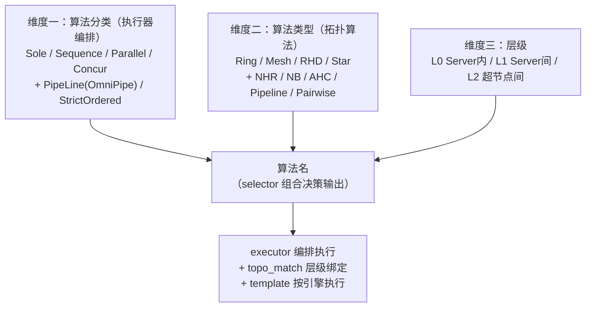
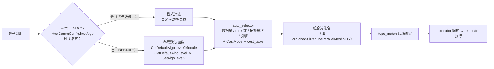
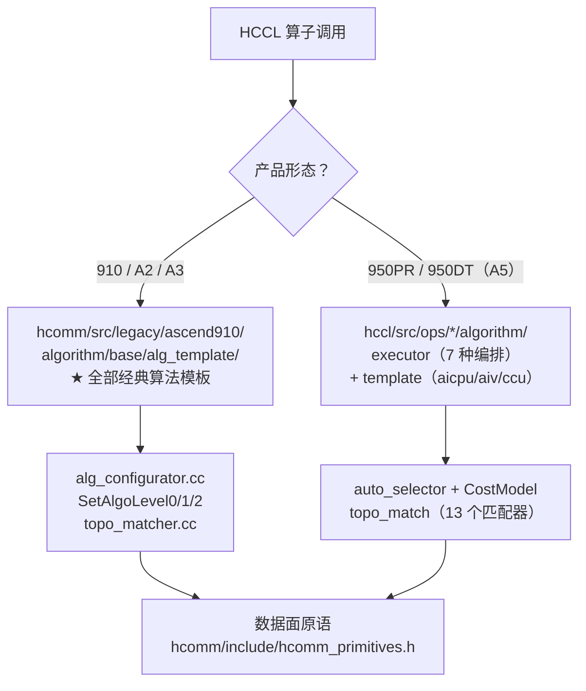
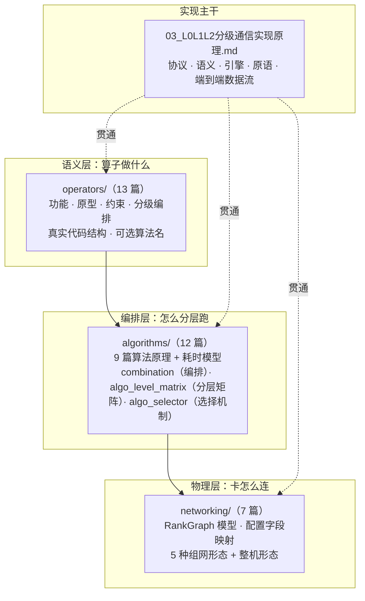

# HCCL 算子与算法总览

> **深度参考** · 前置阅读：[《集合通信》第 1 章｜Collective 语义与代价模型](/通信与昇腾/01-Collective语义与代价模型.md)。本篇为参考手册体例，检索导向；事实基线见文首引用块。

盘点 `hccl` 仓的通信算子（API 层）与通信算法（算法层），并给出**算子 × 算法 × 引擎 × 层级**的全景对照。

> 阅读本文前建议先看 [01_HCCL集合通信概述.md](/通信与昇腾/参考手册/总览/HCCL概述.md)（架构分层）；实现细节见 [03_L0L1L2分级通信实现原理.md](/通信与昇腾/参考手册/总览/L0-L1-L2分级原理.md)。

通信引擎按组网与负载自动选择：


---

## 1. 算子总览（API 层，`hccl/src/ops/`）

13 个算子目录承载 **15 个对外 API**（hccl `api_ref/comm_op_interface/` 14 个 + hcomm `api_ref/comm_mgr_c/HcclBarrier`）（`all_to_all_v` 一个目录承载 3 个 API）。

### 1.1 归约类

| 算子 | API | 功能 | 关键参数 |
| --- | --- | --- | --- |
| [all_reduce](/通信与昇腾/参考手册/算子参考/all_reduce.md) | `HcclAllReduce` | 全 rank 归约后结果发到**所有**节点（梯度同步主力） | `count`, `dataType`, `op` |
| [reduce](/通信与昇腾/参考手册/算子参考/reduce.md) | `HcclReduce` | 归约后结果**只发 root** | `count`, `dataType`, `op`, **`root`** |
| [reduce_scatter](/通信与昇腾/参考手册/算子参考/reduce_scatter.md) | `HcclReduceScatter` | 归约 + 按编号散布（每卡收自己那段，输出为输入的 1/rankSize） | **`recvCount`**, `dataType`, `op` |
| [reduce_scatter_v](/通信与昇腾/参考手册/算子参考/reduce_scatter_v.md) | `HcclReduceScatterV` | 变长版 ReduceScatter（同 rank 各编号段可不等长，**跨 rank 同编号须等长**） | **`sendCounts`**, **`sendDispls`**, `recvCount`, `op` |

### 1.2 聚合/分发类

| 算子 | API | 功能 | 关键参数 |
| --- | --- | --- | --- |
| [all_gather](/通信与昇腾/参考手册/算子参考/all_gather.md) | `HcclAllGather` | 按 rank id 升序拼接，结果发到所有节点 | **`sendCount`**, `dataType` |
| [all_gather_v](/通信与昇腾/参考手册/算子参考/all_gather_v.md) | `HcclAllGatherV` | 变长聚合（各 rank 输入量可不同） | `sendCount`, **`recvCounts`**, **`recvDispls`** |
| [broadcast](/通信与昇腾/参考手册/算子参考/broadcast.md) | `HcclBroadcast` | root 数据广播到所有 rank（**单一 `buf`，原地语义**） | **`buf`**, `count`, `root` |
| [scatter](/通信与昇腾/参考手册/算子参考/scatter.md) | `HcclScatter` | root 数据均分散布（**非 root 的 sendBuf 可为空**） | `sendBuf`, `recvBuf`, **`recvCount`**, `root` |

### 1.3 交换与点对点类

| 算子 | API | 功能 | 关键参数 |
| --- | --- | --- | --- |
| [all_to_all_v](/通信与昇腾/参考手册/算子参考/all_to_all_v.md) | `HcclAlltoAll` | 全交换（**定长**）：按维度切分重排 | `sendCount`, `sendType`, `recvCount`, `recvType` |
| | `HcclAlltoAllV` | 全交换（**变长**，本端视角） | **`sendCounts`**, **`sdispls`**, **`recvCounts`**, **`rdispls`** |
| | `HcclAlltoAllVC` | 全交换（变长，**全局矩阵**） | **`sendCountMatrix`** |
| [send](/通信与昇腾/参考手册/算子参考/send.md) | `HcclSend` | 点对点发送（**同步阻塞，须与 Recv 配对**） | `count`, `dataType`, **`destRank`** |
| [recv](/通信与昇腾/参考手册/算子参考/recv.md) | `HcclRecv` | 点对点接收 | `count`, `dataType`, **`srcRank`** |
| [batch_send_recv](/通信与昇腾/参考手册/算子参考/batch_send_recv.md) | `HcclBatchSendRecv` | **异步批量**点对点（卡内收发不互相阻塞，双工并发） | **`HcclSendRecvItem[]`**, `itemNum` |
| [barrier](/通信与昇腾/参考手册/算子参考/barrier.md) | `HcclBarrier` | 全卡同步栅栏（**无数据负载**；API 文档在 hcomm 仓） | 仅 `comm`, `stream` |

### 1.4 算子结构对比（代码实测）

| 算子 | 执行器数 | aicpu 模板 | aiv 模板 | ccu 模板 | 特殊模板 | op_graph | selector 数 | 算法名数 |
| --- | --- | --- | --- | --- | --- | --- | --- | --- |
| **all_reduce** | **11** | 9 | 2 (+5 kernel) | 8 (+10 kernel) | — | ✅ | 1 | **38** |
| **reduce_scatter** | **9** | **12** | 1 (+7 kernel) | 10 (+11 kernel) | — | ✅ | 1 | **33** |
| **all_to_all_v** | 6 | 4 | 2 (+5 kernel) | 9 (+9 kernel) | **`hier/` 分级阶段注册表** | ✅ | **3** | **29** |
| **all_gather** | 8 | 7 | 1 (+3 kernel) | 9 (+9 kernel) | — | ✅ | 1 | **27** |
| **reduce** | 7 | 6 | 1 (+2 kernel) | 6 (+7 kernel) | **★ omnipipe_3d** | ✅ | 1 | 20 |
| **broadcast** | 7 | 6 | 1 (+2 kernel) | 3 (+3 kernel) | scatter/allgather 阶段模板 | ✅ | 1 | 19 |
| **scatter** | **7 + 5 旧式** | 7 | 1 (+2 kernel) | 4 (+4 kernel) | **★ 顶层 6 个算法模板** | **❌** | 1 | 15 |
| **send** | 4 | — | kernel only | — | **★ `host_nic/`** | ✅ | 1 | 4 |
| **recv** | 4 | — | kernel only | — | **★ `host_nic/`** | ✅ | 1 | 4 |
| **barrier** | 2 | 3 | — | — | — | **❌** | 1 | 2 |
| **batch_send_recv** | 2 | — | — | — | **★ 仅顶层 dpu 模板** | **❌** | 1 | 2 |
| **all_gather_v** | **1** | 1 | — | 1 (+1 kernel) | — | ✅ | 1 | **2** |
| **reduce_scatter_v** | **1** | 1 | — | 1 (+1 kernel) | — | ✅ | 1 | **2** |

> **复杂度落差极大**：AllReduce（11 执行器 / 38 算法名）↔ AllGatherV（1 执行器 / 2 算法名）。变长语义（V 系列）显著提高分层算法的实现成本，因此只有 Sole 编排。

---

## 2. 算法总览（算法层）

### 2.1 4 种基础拓扑算法

| 算法 | 枚举 | 通信模式 | 复杂度 | 一句话 | 详见 |
| --- | --- | --- | --- | --- | --- |
| **Ring** | `HCCL_ALGO_TYPE_RING` | 首尾相连分块轮转 | 线性 O(p−1) | 带宽满载、抗拥塞，大消息首选 | [ring.md](/通信与昇腾/参考手册/算法参考/ring.md) |
| **Mesh / FullMesh** | `HCCL_ALGO_TYPE_FULLMESH` | 两两直连一步直达 | **O(1)** | 并发多路 HCCS，双工双向带宽同时利用，小消息低时延 | [fullmesh.md](/通信与昇腾/参考手册/算法参考/fullmesh.md) |
| **RHD / HDR** | `HCCL_ALGO_TYPE_HDR` | 递归折半-倍增配对 | 对数 ⌈log₂p⌉ | 2·log₂(N) 步；**非 2 幂引入额外通信量** | [hdr.md](/通信与昇腾/参考手册/算法参考/RHD递归倍增.md) |
| **Star** | `ALG_LEVEL0_NP_STAR` / `ALG_LEVEL1_STAR` | 根 rank 汇聚分发 | **1 步** | 有根算子一步直达（$\alpha+\beta n$）；根为热点 | [star.md](/通信与昇腾/参考手册/算法参考/star.md) |

### 2.2 自研扩展算法

| 算法 | 枚举 | 核心机制 | 适用 | 详见 |
| --- | --- | --- | --- | --- |
| **NHR** | `HCCL_ALGO_TYPE_NHR` / `NHR_V1` | **N 个节点构建 N 棵生成树** + 数据片重排聚合发送；流量集中在物理相近节点 | Server 数较多且 Pipeline 不适用；**950 的唯一自适应算法** | [nhr.md](/通信与昇腾/参考手册/算法参考/nhr.md) |
| **NB** | `HCCL_ALGO_TYPE_NB` | **动态调整步长的多重环状结构**；非 2 幂无额外数据量增长 | Server 数较多且 Pipeline 不适用 | [nb.md](/通信与昇腾/参考手册/算法参考/nb.md) |
| **AHC** | `HCCL_ALGO_TYPE_AHC` / `AHC_BROKE` | 分组 + **LCM 切片** + **"逻辑同号卡"**非对称拼接 | **仅 RS/AG/AR**；多层对称或非对称分布；**层间带宽收敛时收益更好**（仅 A3） | [ahc.md](/通信与昇腾/参考手册/算法参考/ahc.md) |
| **Pipeline** | `HCCL_ALGO_TYPE_PIPELINE` | **并发使用 Server 内与 Server 间链路**（细粒度分级流水） | 数据量大、每机多卡；A2 下不支持确定性计算 | [pipeline.md](/通信与昇腾/参考手册/算法参考/pipeline.md) |
| **Pairwise** | `HCCL_ALGO_TYPE_PAIRWISE` | **Mesh 的分步执行版本**：每步只从 1 个节点收、向 1 个节点发 | **仅 AlltoAll/V/VC**；规避"一打多" | [pairwise.md](/通信与昇腾/参考手册/算法参考/pairwise.md) |

### 2.3 特殊算法（不可配置）

| 算法 | 产品 | 说明 |
| --- | --- | --- |
| **分组 Full Mesh** | 仅 Atlas A3 的 AlltoAll 族 | 集群规模较大时以一定并发度**分多组**完成：超节点内并发度高、时延小；超节点间并发度低（避免一打多） |
| **NHR-HCF** | 仅 Atlas A3 | 超节点间 **Server 数不一致但 Server 内卡数一致**时默认生效；按 Server 数的**最大公约数**切分为多个对称逻辑超节点 |
| **CP** | 仅 Atlas A2 的 AlltoAllV（单算子模式） | 不支持时**回退 Pairwise** |

### 2.4 编排与选择机制文档

| 文档 | 内容 |
| --- | --- |
| [algorithms/算法组合.md](/通信与昇腾/参考手册/算法参考/算法组合.md) | **算法分类与组合**：执行器编排（Sole/Sequence/Parallel/Concur/PipeLine/StrictOrdered）× 算法类型 × 层级 → selector 算法名；含各编排的执行语义、线程模型、变体与 `HCCL_ALGO` 语法 |
| [algorithms/分层矩阵.md](/通信与昇腾/参考手册/算法参考/分层矩阵.md) | **各算子分层算法选择矩阵**：L0/L1/L2 默认选择、各算法特点、按产品的算子支持度、分级通信编排表 |
| [algorithms/algo_selector.md](/通信与昇腾/参考手册/算法参考/algo_selector.md) | **`HcclAlgoType` 全枚举（13 值）与自动选择机制**：选择流程、优先级、引擎回退规则、**算法 × 算子实现矩阵**、selector 组件构成 |

---

## 3. 算法方案 = 三维组合



**算法名自带完整信息**：

```
CcuSched AllReduce Parallel Mesh NHR
└──┬───┘ └───┬────┘ └───┬───┘ └┬─┘ └┬┘
 引擎      算子      编排方式  L0拓扑 L1算法
```

| 前缀 | 引擎（`OpExecuteConfig`） | 数据通路 |
| --- | --- | --- |
| `Aicpu*` | `AICPU_TS = 2` | AICPU 下发 Task 描述符，TS 调度 |
| `Aiv*` | `AIV = 3` / `AIV_ONLY = 4` | Vector Core 直接执行 |
| `CcuMS*` | `CCU_MS = 5` | CCU + **CcuBuffer** 中转（仅单机） |
| `CcuSched*` | `CCU_SCHED = 6` | CCU 作调度器下发 **UB WQE**，片上内存直传 |
| `Dpu*` | `HOSTCPU = 8` | Host CPU 侧 DPU 路径（Send/Recv/BatchSendRecv/Barrier） |

---

## 4. 算法选择机制



| 机制 | 说明 |
| --- | --- |
| **默认（DEFAULT）** | `selector/<op>_auto_selector` 按数据量、rank 数、三层拓扑（L0 节点内 × L1/L2 节点间）自动选算法与拓扑组合 |
| **显式覆盖** | 环境变量经 `alg_env_config`/`alg_parse` 指定（`HCCL_ALGO` 等）；**`HcclCommConfig` 的 `hcclAlgo`（通信域粒度）优先于环境变量** |
| **插件** | `src/算法插件.md/` 自定义算法插件 + `op_common/selector/inc/hccl_tuner_plugin.h`（RFC 0002） |
| **组合机制** | 算法分类（执行器编排）× 算法类型 × 层级三维组合，详见 [algorithms/算法组合.md](/通信与昇腾/参考手册/算法参考/算法组合.md) |
| **分层矩阵** | 各算子 L0/L1/L2 默认选择与分级编排，详见 [algorithms/分层矩阵.md](/通信与昇腾/参考手册/算法参考/分层矩阵.md) |
| **引擎回退** | 保序模式不支持 CCU_MS/CCU_SCHED → 回退 AICPU；CCU 资源不足 → AI_CPU；CCU_SCHED 大数据量 → AI_CPU；标卡 CCU_MS → 拦截报错；Scatter 的 L1 非 Ring/NHR/NB → Ring |

### 4.1 `HCCL_ALGO` 配置语法

```bash
# 950 系列：ExecutorType{level算法} 显式组合
export HCCL_ALGO="sequence{mesh,nhr}"              # Sequence 编排：level0=Mesh, level1=NHR
export HCCL_ALGO="parallel{mesh,nhr}"
export HCCL_ALGO="not(parallel{mesh,nhr})"         # 禁用 mesh+nhr 的 Parallel 组合
export HCCL_ALGO="sole{mesh}"                      # name 简写等价 sole{name}

# A2/A3/910 系列：level0 固定 NA，仅配 level1/level2 算法
export HCCL_ALGO="level0:NA;level1:NHR"
export HCCL_ALGO="allreduce=level0:NA;level1:ring" # 按算子配置
```

`alg_parse.cc` 支持 **7 种 ExecutorType**：`sole` / `sequence` / `parallel` / `pipeline` / `concur` / `strictordered` / `omnipipe`；引擎前缀映射：`{"aicpu","Aicpu"}, {"aiv","Aiv"}, {"dpu","Dpu"}, {"ccums","CcuMS"}, {"ccusched","CcuSched"}`（`alg_parse.cc:23`）。

---

## 5. 两条算法实现路径（重要）

| | **经典算法路径** | **执行器编排路径** |
| --- | --- | --- |
| **位置** | `hcomm/src/legacy/ascend910/algorithm/base/alg_template/` | `hccl/src/ops/*/algorithm/{executor,template}/` |
| **覆盖产品** | 910 / Atlas A2 / Atlas A3 | Ascend 950PR&950DT（A5） |
| **算法覆盖** | **Ring、Mesh、RHD、Star、NHR、NHR_V1、NB、AHC、AHC_BROKE、Pipeline、Pairwise 全部** | 以 **Mesh1D + NHR** 为主力，靠执行器编排组合 |
| **组织方式** | 按算子分目录（`temp_all_reduce/` 等），每算法一个模板文件 | 按引擎分目录（`aicpu/`、`aiv/`、`ccu/`），执行器负责编排 |
| **模板数量** | 107 个（10 个算子目录） | mesh_1D 120 / mem2mem 114 / nhr 110 / omnipipe 87 / 2die 36 / multi_jetty 20 |
| **legacy 定位** | **历史兼容，不持续演进**（不承接新特性） | 新能力一律落此 |



> **实践提示**：在 `hccl` 仓找不到 AHC / RHD / Star / NB 的模板文件是**正常的**——它们在 `hcomm/src/legacy/ascend910/`。反之 950 的 CCU/AIV 模板与执行器编排只在 `hccl` 仓。

---

## 6. 层级 × 算法 × 产品支持度速查

| 算法 | L0 | L1 | L2 | 950PR&950DT | Atlas A3 | Atlas A2 | Atlas 训练系列 |
| --- | --- | --- | --- | --- | --- | --- | --- |
| **Mesh** | ✅（主力，自动选） | —（950 有 `Mesh1dDpu` 框间模板） | — | ✅ | ✅ | ✅ | ✅ |
| **Ring** | ✅ `8P_RING`/`4P_RING`/`NP_SINGLE_RING`/`NP_DOUBLE_RING` | ✅ | ✅ | —（NHR 接管） | ✅ | ✅ | ✅ |
| **RHD (H-D_R)** | ✅ `NP_HD` | ✅（≥8 或 2 幂时默认） | ✅ | — | —（NHR/ring 接管） | ✅ | ✅ |
| **Star** | ✅ `NP_STAR`（枚举） | ✅（枚举） | — | — | — | ✅（Broadcast/Gather） | ✅（Broadcast/Gather） |
| **NHR** | —（950 有 `NhrDPU` 阶段模板） | ✅ | ✅（**default**） | ✅（**唯一自适应算法**） | ✅ | ✅ | ✅ |
| **NHR_V1** | — | ✅ | — | — | — | ✅（逐步停用） | ✅（逐步停用） |
| **NB** | — | ✅ | ✅ | — | ✅ | ✅ | ✅ |
| **AHC / AHC_BROKE** | — | ✅ | ✅（随 L1 联动） | — | ✅（**仅 RS/AG/AR**） | — | — |
| **Pipeline** | —（作流水内层） | ✅ | ✅（仅 AG/RS，单算子 + 零拷贝） | — | — | ✅（AR/AG/AGV/RS/A2A 族） | — |
| **Pairwise** | ✅ `ALG_LEVEL0_PAIRWISE` | ✅（AlltoAll 族） | — | — | ✅（AlltoAll 族） | ✅（AlltoAll 族） | — |
| **分组 Full Mesh** | — | ✅ | ✅ | — | ✅（**仅 AlltoAll 族，不可配**） | — | — |
| **NHR-HCF** | — | — | ✅ | — | ✅（**非对称超节点默认，不可配**） | — | — |
| **CP** | — | ✅ | — | — | — | ✅（**仅 AlltoAllV 单算子**，回退 Pairwise） | — |

详见 [algorithms/分层矩阵.md](/通信与昇腾/参考手册/算法参考/分层矩阵.md)。

---

## 7. 查阅路径

| 信息 | 位置 |
| --- | --- |
| **架构与分层** | `hccl/docs/zh/architecture/architecture-brief.md`、`hccl/AGENTS.md` §3 |
| **API 参数/约束/示例** | `hccl/docs/zh/api_ref/comm_op_interface/Hccl*.md` |
| **通信域管理 API** | `hcomm/docs/zh/api_ref/comm_mgr_c/`（含 `HcclBarrier`、对称内存、零拷贝） |
| **算子开发接口** | `hcomm/docs/zh/api_ref/comm_opdev/`（控制面 + 数据面） |
| **算子开发指南** | `hcomm/docs/zh/comm_op_dev_guide/`（aicpu/aiv/ccu 三套流程 + 编程模型概念） |
| **算法原理与耗时模型** | `hccl/docs/zh/user_guide/coll_algo_intro/`（11 篇 + 17 张原理图） |
| **分级通信编排表** | `hccl/docs/zh/user_guide/coll_algo_intro/algo_intro.md`、`hierarchical_comm_principle.md` |
| **算法枚举与拓扑** | `hccl/src/common/alg_type.h`（`HcclAlgoType` 13 值 + `AlgTypeLevel0/1/2`） |
| **算法名解析** | `hccl/src/common/alg_parse.cc`（7 种 ExecutorType + 5 种引擎前缀）、`alg_env_config.cc` |
| **算子源码（950）** | `hccl/src/ops/<op>/`（`<op>.cc` + `selector/` + `algorithm/{executor,template}` + `op_graph/`） |
| **算法模板（910/A2/A3）** | `hcomm/src/legacy/ascend910/algorithm/base/alg_template/temp_<op>/` |
| **公共组件** | `hccl/src/ops/op_common/`（`algorithm/{executor,template,topo_match}` + `selector/` + `topo_info/` + `inc/alg_param.h`） |
| **数据面原语** | `hcomm/include/hcomm_primitives.h`（600 行） |
| **协议/引擎枚举** | `hcomm/include/hcomm_res_defs.h`（`CommProtocol` :118-133、`CommEngine` :106-114） |
| **拓扑查询接口** | `hcomm/include/hccl/hccl_rank_graph.h`（`CommTopo` + `GetNetLayers` 等） |
| **组网配置** | `hccl/docs/zh/user_guide/cluster_info_config/`（A2/A3/A5/910/300I Duo 五套） |
| **环境变量** | `hccl/docs/zh/user_guide/hccl_env/`（40+ 篇，含 `HCCL_ALGO`、`HCCL_OP_EXPANSION_MODE`、算法支持度列表） |
| **性能分析** | `hccl/docs/zh/user_guide/perf_analysis/`（`typical_op_behavior.md` 是 L0/L1/L2 数据流的实测口径） |
| **故障诊断** | `hccl/docs/zh/user_guide/fault_diagnosis/`（30+ 篇，按错误码组织） |
| **设计提案** | `hccl/docs/zh/rfcs/`（0001 保序 RS、0002 算法插件、0003 执行器模板重构） |
| **算子支持列表** | `hccl/docs/zh/user_guide/comm_ops_support_list/`（按产品） |

---

## 8. 本 wiki 的三层阅读路径



| 想知道 | 看哪里 |
| --- | --- |
| HCCL 是什么、在 CANN 哪一层、API 如何分层 | [01_HCCL集合通信概述.md](/通信与昇腾/参考手册/总览/HCCL概述.md) |
| 有哪些算子和算法、怎么选 | 本文 |
| 一次通信在硬件上怎么跑完（L0/L1/L2） | [03_L0L1L2分级通信实现原理.md](/通信与昇腾/参考手册/总览/L0-L1-L2分级原理.md) |
| 卡怎么连、层级怎么划分、配置文件怎么写 | [networking/](/通信与昇腾/参考手册/组网形态/) |
| 某个算法的原理、耗时公式、适用场景 | [algorithms/](/通信与昇腾/参考手册/算法参考/) 各篇 |
| 某个算子的语义、约束、真实代码结构 | [operators/](/通信与昇腾/参考手册/算子参考/) 各篇 |

