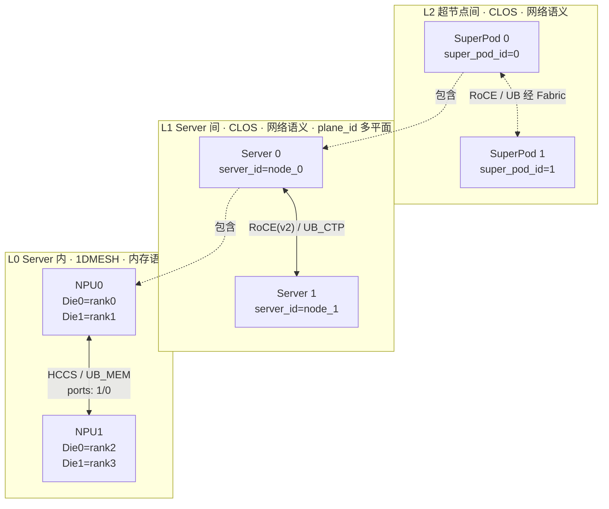

# 昇腾集群组网总览

> **深度参考** · 前置阅读：[《集合通信》第 5 章｜拓扑、分层与重叠](/通信与昇腾/05-拓扑、分层与重叠.md)。本篇为参考手册体例，检索导向；事实基线见文首引用块。

> 本文是**集群基础设施层的总入口**（与 [networking/](/通信与昇腾/参考手册/组网形态/)、[engine/](/通信与昇腾/参考手册/通信引擎/)、[comm/](/通信与昇腾/参考手册/协议与传输/) 三个子目录平级）：从**物理组网形态**到 **RankGraph 软件建模**，再到**配置文件字段映射**与**协议/语义/算法的对应关系**。
>
> 向下分流三条线：**卡怎么连** → [networking/](/通信与昇腾/参考手册/组网形态/)；**谁在搬数据（引擎）** → [engine/](/通信与昇腾/参考手册/通信引擎/)；**数据怎么搬（协议与传输）** → [comm/](/通信与昇腾/参考手册/协议与传输/)。
>
> 事实来源（可信度：代码 > 仓内文档 > 社区资料）：
> `hcomm/include/hccl/hccl_rank_graph.h`（`CommTopo` 枚举与层级查询接口）、`hcomm/include/hcomm_res_defs.h`（`CommProtocol`/`EndpointLocType`）、`hcomm/src/coll_communicator_mgr/rank_graph/`（RankGraph 实现）、`hccl/src/ops/op_common/inc/alg_param.h`（层级字段与容量常量）、`hccl/docs/zh/architecture/architecture-brief.md`（RankGraph 概念权威口径）、`hccl/docs/zh/user_guide/concepts.md`（典型组网与术语）、`hccl/docs/zh/user_guide/cluster_info_config/`（A2/A3/A5/910/300I Duo 五套 rank table 与拓扑文件配置）。

---

## 1. 基本概念（官方口径）


> 图源：`hccl/docs/zh/user_guide/figures/typical_network.png`

| 概念 | 说明 |
| --- | --- |
| **AI Server** | 又称计算节点，通常是 **8 卡或 16 卡**的昇腾 NPU 设备组成的服务器形态的统称 |
| **AI 集群** | 多个 AI Server 通过交换设备互联后用于分布式训练或推理的系统。**若 AI Server 间通过灵衢总线交换设备进行连接，组成的组网称之为超节点组网** |
| **通信成员（rank）** | 参与通信的最小逻辑实体，每个 rank 分配一个唯一标识 |
| **通信域** | 一组通信成员的组合，描述通信范围。一个计算任务可创建多个通信域，通信成员也可加入多个通信域 |
| **通信算子** | 在通信域内完成通信任务的算子；集合通信指所有成员一起参与的通信操作 |
| **通信算法** | 针对不同网络拓扑、数据量、硬件资源等场景，通信算子通常采用不同的通信算法实现 |

### 1.1 三个核心概念的关系

| 术语 | 一句话解释 | 主要对应硬件 |
| --- | --- | --- |
| **集合通信域** | 集合通信执行的上下文，管理参与通信的实体和资源 | 多个 NPU 组成 |
| **Rank** | 集合通信域中的成员，拥有唯一 Rank ID（从 0 开始） | 一个 NPU（**A3 例外：一个 Die**） |
| **RankGraph** | Rank 间的通信关系图，描述"谁和谁怎么连" | 网络拓扑 |


> 图源：`hccl/docs/zh/architecture/diagrams/coll_comm_model.excalidraw.svg`

---

## 2. RankGraph 分层拓扑模型

RankGraph 使用**图（Graph）**对通信域内不同 Rank 间的连接关系建模，并引入**拓扑层级抽象**以适配大规模集群的分级结构。

| 概念 | 一句话解释 | 好理解的类比 |
| --- | --- | --- |
| **Node** | 图中的节点，分为**通信实体**和 **Fabric**（交换/路由抽象） | 通信实体 = 带网口的 NPU；Fabric = 交换机组 |
| **Endpoint** | Node 的通信设备（**逻辑概念**），一个 Node 可有多个 Endpoint；一个 Endpoint 映射一个物理端口（可为 Bonding 口，硬件控制，软件不感知），一个物理端口可被多个 Endpoint 共享 | NPU 上的网卡口，一个 NPU 可有多个网口；Bonding 口对软件透明 |
| **Edge** | Node 间的连接关系，两端是 Endpoint（**对应 NCCL 的 Link**） | 网线，两端插在不同 NPU 的网口上 |
| **Link** | 从 Edge 中提取的两个通信实体间**可建链信息**（含两端 Endpoint + 协议），**对应 NCCL 的 Path** | 两个 NPU 之间可建链的路径描述 |
| **netLayer** | 拓扑层级，**通信质量逐层增加而递减**；Server 内为 Layer0（如 HCCS 直连），Server 间为 Layer1（如 RoCE 经交换机） | Server 内 8 卡 HCCS 直连最快（Layer0），跨 Server 经交换机较慢（Layer1） |
| **Fabric** | 对网络交换/路由组的抽象，**与它相连的通信实体两两互通**。同一个网络层次不存在相连的两个 Fabric | 一台交换机让所有插在上面的 NPU 互相通信 |
| **TopoInstance** | 每层内的拓扑实例 | 同机房内 8 个 NPU 卡组成一个 1DMesh 实例 |

> **层级要点**：集群天然分层（Layer），每层内有拓扑实例（TopoInstance），通信质量逐层增加而递减。拓扑类型包括 **Fullmesh、1DMesh、CLOS、Ring** 等。
>
> **递进关系**：**Edge 描述"谁和谁连" → Link 描述"怎么建链" → Channel 描述"怎么通信"**。Channel 基于 Link 实例化，是真正可用的数据通道。
>
> ⚠️ **与 NCCL 的命名差异**：RankGraph 的 Edge/Link 与 NCCL 的 Link/Path **名称对应不同**（RankGraph Edge = NCCL Link，RankGraph Link = NCCL Path）。


> 图源：`hccl/docs/zh/architecture/diagrams/topo_concepts.excalidraw.svg`


> 图源：`hcomm/docs/zh/comm_op_dev_guide/prog_models_concepts/figures/topo_model.png`。示例中拓扑分为 **Layer 0 和 Layer 1 两级**，内部包含两个 Layer 0 拓扑实例；每一层级的网络拓扑具备自己的拓扑类型（如 Fullmesh、Clos）。

### 2.1 为什么需要拓扑查询接口（控制面）

`hcomm/docs/zh/comm_op_dev_guide/prog_models_concepts/topology_model.md` 给出两个原因：

1. **建链必需**：算子控制面实现需要为数据面创建 Channel，那么**不同 rank 是否互连、以及通过哪些 Endpoint 互连**，是创建 Channel 必备的信息
2. **性能适配**：不同集群可能具有不同的连接关系，**算子实现的性能好坏与拓扑连接强相关**。为了算子能够适配不同拓扑形态且具有较好性能，需要感知拓扑连接关系

### 2.2 拓扑类型枚举（`CommTopo`）

`hcomm/include/hccl/hccl_rank_graph.h:39-45`：

| 值 | 枚举 | 说明 |
| --- | --- | --- |
| -1 | `COMM_TOPO_RESERVED` | 保留拓扑 |
| 0 | `COMM_TOPO_CLOS` | **CLOS 互联拓扑**（所有节点均可通，如通过交换机连接的胖树结构）——配置文件默认值 |
| 1 | `COMM_TOPO_1DMESH` | **1DMesh 互联拓扑**（Device 和 Device 之间直连，全互联拓扑） |
| 2 | `COMM_TOPO_910_93` | 910_93 互联拓扑（**带 SIO**） |
| 3 | `COMM_TOPO_310P` | 310P 互联拓扑 |
| 4 | `COMM_TOPO_A2AXSERVER` | A2_AX_SERVER |
| 5 | `COMM_TOPO_CUSTOM` | 自定义 |

950 legacy 侧的对应枚举（`hcomm/src/legacy/ascend950/common/types/topo_common_types.h:38`）：

```cpp
MAKE_ENUM(TopoType, CLOS, MESH_1D, MESH_2D, A3_SERVER, A2_AX_SERVER, TOPO_TYPE_RESERVED)
```

hccl 侧的 L0 形状细分（`hccl/src/ops/op_common/inc/alg_param.h:156-167`）：

```cpp
enum class Level0Shape    { CLOS = 0, MESH_1D = 1, MESH_1D_CLOS = 2 };
enum class Level0MeshType { NOT_MESH = 0, SINGLE_DIE = 1, TWO_DIE_REGULAR = 2, TWO_DIE_NOT_REGULAR = 3 };
```

### 2.3 层级查询接口（`rank_graph_v2.h`）

| 接口 | 作用 |
| --- | --- |
| `GetNetLayers(uint32_t **netLayers, uint32_t *netLayerNum)` | 获取通信域内全部网络层次 |
| `GetInstTopoTypeByNetLayer(netLayer, CommTopo *topoType)` | 获取某层的拓扑类型 |
| `GetInstSizeByNetLayer(netLayer, uint32_t *rankNum)` | 获取某层实例的 rank 数 |
| `GetInstRanksByNetLayer(netLayer, uint32_t **rankList, uint32_t *rankNum)` | 获取本 rank 所在层实例的成员列表 |
| `GetInstSizeListByNetLayer(netLayer, uint32_t **instSizeList, uint32_t *listSize)` | 获取该层**全部** NetInstance 的大小（分区布局） |
| `GetLinks(netLayer, srcRank, dstRank, CommLink **linkList, uint32_t *listSize)` | 获取两 rank 间某层的可建链信息 |
| `GetTopoInstsByLayer(netLayer, uint32_t **topoInsts, uint32_t *topoInstNum)` | 获取某层的拓扑实例 |
| `GetRanksByTopoInst(netLayer, topoInstId, uint32_t **ranks, uint32_t *rankNum)` | 获取某拓扑实例的 rank 集合 |
| `GetEndpointNum` / `GetEndpointDesc(netLayer, topoInstId, ...)` | 获取某拓扑实例的 Endpoint 数量与描述 |

> **两组接口的能力差异（无法互相推导）**——`hccl/src/ops/op_common/inc/alg_param.h` 的 `PhysicalLevelView` 注释原文：
> - `GetInstSizeListByLayer` 看得到**兄弟 NetInstance**（`GLOBAL` 视图，`instSizeListByLayer` 非空）
> - `GetTopoInstsByLayer` 只看得到**本 rank 所在的那一个**（`LOCAL` 视图，`instSizeListByLayer` 恒为空）

---

## 3. 组网信息如何进入软件栈

```mermaid
flowchart LR
    subgraph CFG["配置来源"]
        T["拓扑文件<br/>/usr/local/Ascend/driver/topo/<br/>（出厂自动配置，用户无需手工配置）<br/>peer_list · edge_list"]
        RT["rank table 文件<br/>（用户构造）<br/>rank_list · level_list"]
        ENV["环境变量<br/>HCCL_IF_IP · HCCL_SOCKET_IFNAME<br/>HCCL_INTER_HCCS_DISABLE · HCCL_INTRA_ROCE_ENABLE<br/>HCCL_INTRA_PCIE_ENABLE · HCCL_LOGIC_SUPERPOD_ID"]
    end
    CFG --> DET["rank_info_detect /<br/>phy_topo_builder.cc<br/>物理拓扑构建"]
    DET --> RG["RankGraph 构建<br/>rank_graph_builder.cc<br/>（+ detour_rules / detour_service 绕路规则<br/>+ updater_for_64_plus_1 非对称超节点）"]
    RG --> NI["NetInstance / TopoInstance<br/>net_instance.cc<br/>每层每实例的 rank 集合"]
    NI --> Q["拓扑查询接口<br/>GetNetLayers / GetInstTopoTypeByNetLayer<br/>GetLinks / GetEndpointDesc"]
    Q --> TI["hccl: topo_info/<br/>topo.cc · topo_host.cc<br/>physical_level_build.cc<br/>physical_level_normalize.cc"]
    TI --> ALG["算法层级选择<br/>SetAlgoLevel0/1/2<br/>AlgType{L0,L1,L2}"]
    ALG --> TM["topo_match 层级绑定<br/>one_level / two_level / three_level<br/>nlevel / squeeze_2d / pcie_mix / ubx"]
    TM --> EX["executor 编排执行"]
```



### 3.1 层级容量常量（`hccl/src/ops/op_common/inc/alg_param.h`）

```cpp
constexpr u32 HCCL_LOGIC_TOPO_LEVEL_NUM = 4;   // :43 HCCL 逻辑拓扑层级最多 4 级
constexpr u32 PHYSICAL_LEVEL_NUM_LIMIT  = 10;  // :46 物理层级上限 10
constexpr u32 TOPO_LEVEL_NUM_1 = 1;            // :104
constexpr u32 TOPO_LEVEL_NUM_2 = 2;            // :105
constexpr u32 TOPO_LEVEL_NUM_3 = 3;            // :106
```

配置文件侧的对应约束：`net_layer` 取值范围 **[0,7]**，`level_list` 数组长度**不能超过 8**，`rank_addr_list` 数组长度**不能超过 24**（每个 Die 需单独配置）。

### 3.2 层级相关的拓扑字段（`alg_param.h:253-264`）

| 字段 | 说明 |
| --- | --- |
| `serverIdx` | Server 在 ranktable 中的自然顺序 |
| `superPodIdx` | SuperPod 在 ranktable 中的自然顺序 |
| `moduleIdx` | moduleId |
| `serverNum` | 服务器数量 |
| `superPodNum` | 超节点数量 |
| `moduleNum` | **A2 A+X 场景 moduleNum 可能与 serverNum 不符** |
| `serverNumPerSuperPod` | 每个超节点的服务器个数 |
| `deviceNumPerModule` | A2 每个 module 的卡数 |
| `multiSuperPodDiffServerNumMode` | **超节点间 Server 数不一致**（触发 NHR-HCF） |
| `multiModuleDiffDeviceNumMode` / `isDiffDeviceModule` | 多 Module 异卡数模式 |
| `localRanks` / `localRank` / `localRankSize` | 本层可见 rank 集合与本地 rank 编号 |

---

## 4. 配置文件字段 ↔ RankGraph 概念映射

这是组网篇最实用的一张表——**配置文件里的每个字段对应 RankGraph 的哪个概念**：

### 4.1 拓扑文件（`edge_list`，描述物理连接）

| 字段 | RankGraph 概念 | 取值与说明 |
| --- | --- | --- |
| `net_layer` | **netLayer** | 必选，[0,7]。0 = Server 内连接，1 = Server 间连接，2+ = 更高层级 |
| `link_type` | **Edge 类型** | 必选。`PEER2PEER`（NPU 直连，典型 L0）/ `PEER2NET`（经网络，典型 L1+） |
| `protocols` | **Link 协议** | 必选，列表。`UB_CTP`、`UB_RTP`、`ROCE`、`HCCS`、`TCP`、`UB_MEM`、`UBOE`——**决定内存语义 or 网络语义** |
| `local_a` / `local_b` | **Node（通信实体）** | 必选，链路两端 NPU 的物理 ID，须存在于 `peer_list` 中 |
| `local_a_ports` / `local_b_ports` | **Endpoint** | 必选，格式 **`Die ID/端口ID`**（如 `"1/0"` = Die1 的 0 号端口），长度 1~32，最多 16 个端口 |
| `topo_instance_id` | **TopoInstance** | 可选，[0, UINT32_MAX] |
| `topo_type` | **TopoInstance 类型** | 可选。`CLOS`（**默认值**，所有节点均可通，如交换机连接的胖树）/ `1DMESH`（Device 间直连，全互联） |
| `position` | **Endpoint 位置** | 可选。`HOST` / `DEVICE`（**默认值**） |
| `peer_count` / `peer_list[].local_id` | Node 集合 | 当前 AI Server 包含的 NPU 个数（[1,65]）与 NPU 物理 ID（[0,64]） |
| `edge_count` | Edge 数量 | [0, UINT32_MAX] |

### 4.2 rank table 文件（`level_list`，描述逻辑层级归属）

| 字段 | RankGraph 概念 | 取值与说明 |
| --- | --- | --- |
| `rank_id` | **Rank** | 必选，全局唯一，[0, NPU总数−1]，从 0 开始。**建议按 NPU 物理连接顺序排序**（物理连接较近的编排在一起），否则可能影响性能 |
| `local_id` | Node 在 Server 内的标识 | 必选，NPU 在当前 AI Server 中的唯一标识，[0,64] |
| `device_id` | 物理 ID | 必选，NPU 物理 ID，[0,64] |
| `net_layer` | **netLayer** | 必选，[0,7]，**需从 0 开始编号，以升序形式排列** |
| `net_instance_id` | **NetInstance** | 必选，用户自定义，**同一 net_layer 下保持唯一**，长度 ≤1024。示例：`az0-rack0-pod0`（L0）、`az0`（L1）、`superpod_0_0`（L0）、`cluster`（L3 Host 侧）——**命名本身体现层级语义** |
| `net_type` | 网络类型 | 必选。**`net_layer=0` 时仅支持 `TOPO_FILE_DESC`**（通过拓扑文件描述）；非 0 时支持 `CLOS`（所有节点均可互通，如交换机连接的胖树）或 `TOPO_FILE_DESC` |
| `net_attr` | — | 可选，**预留字段** |
| `rank_addr_list[].addr_type` | Endpoint 地址类型 | 必选。`EID`（通过 HCCN TOOL 查询获取）/ `IPv4` / `IPv6`（**后两者只用于 Host 网卡场景**，在 Host 通过 `ifconfig -a` 获取，需配置和 NPU 只有一跳 PCIE-SW 连接的网卡） |
| `rank_addr_list[].addr` | Endpoint 地址 | 必选，字符串，长度 1~256 |
| `rank_addr_list[].ports` | **Endpoint** | 必选，`Die ID/端口ID` 格式。**一个端口在同一个网络层次下只能映射到一个地址**；最多 16 个端口 |
| `rank_addr_list[].plane_id` | **多平面** | 可选，网络平面 ID，**默认值 `"0"`**。见 [multi_plane.md](/通信与昇腾/参考手册/组网形态/多平面网络.md) |
| `device_port` / `host_port` | 通信端口 | 可选，[1,65535]（[1,1023] 为系统保留端口应避免）。**单卡多进程场景建议配置且各进程不同**，否则可能因端口冲突运行失败 |

### 4.3 五套 rank table 版本对比

| 产品 | version | 顶层结构 | 层级表达能力 | 详见 |
| --- | --- | --- | --- | --- |
| **Atlas A2** | `1.0` | `server_count` + `server_list[server_id, device[device_id, device_ip, device_port, rank_id]]` | **隐式两级**（Server 内 / Server 间由 server_id 划分） | [server_internal.md](/通信与昇腾/参考手册/组网形态/单机内部.md)、[roce_cluster.md](/通信与昇腾/参考手册/组网形态/RoCE集群.md) |
| **Atlas A3** | `1.2` | A2 结构 + `host_ip`、`super_device_id`、`backup_device_ip/port` + **`super_pod_list[super_pod_id, server_list]`** | **显式三级**（超节点由 `super_pod_list` 描述） | [ub_superpod.md](/通信与昇腾/参考手册/组网形态/UB超节点.md) |
| **Ascend 950PR&950DT** | `2.0` | **拓扑文件 + rank table 双文件**：`rank_count` + `rank_list[rank_id, local_id, device_id, device_port, host_port, level_list[...]]` | **显式任意级**（`level_list` 逐层描述，最多 8 层，含 `plane_id`） | 本文 §4.1-§4.2 |
| **Atlas 训练系列（910）** | — | `rank_table_config_910.md` | 隐式 | — |
| **Atlas 300I Duo** | — | `rank_table_config_300i_duo.md` | 单 Server | [board_form_factor.md](/通信与昇腾/参考手册/组网形态/整机形态.md) |

> **演进主线**：A2（v1.0，Server 粒度）→ A3（v1.2，**增加超节点粒度**）→ 950（v2.0，**增加任意网络层次 + 多平面 + 拓扑文件分离**）。配置模型的演进与硬件组网能力的演进严格对应。

### 4.4 A3 特有字段

| 字段 | 说明 |
| --- | --- |
| `super_device_id` | 可选（**若不配置该字段，会采用"AI Server 模式"**）。AI 处理器在**超节点系统中的物理 ID**，为超节点系统中 NPU 唯一标识。查询：`npu-smi info -t spod-info -i id -c chip_id`，回显中的 **SDID** 即为此值 |
| `super_pod_list` | 超节点列表：`super_pod_id`（超节点唯一标识）+ `server_list[server_id]`（与顶层 `server_list` 的 `server_id` 对应） |
| `host_ip` | 可选。AI Server 的 Host IP。**开启 HCCL 重执行特性时必须配置**，否则重执行失效走无重执行流程 |
| `backup_device_ip` / `backup_device_port` | 可选。**借轨通信**用：Device 网卡故障（RDMA 链路故障）时借用**同一 NPU 内另一个 Die 的网卡**。约束见 [ub_superpod.md](/通信与昇腾/参考手册/组网形态/UB超节点.md) |

> ⚠️ **A3 的 rank 粒度**：针对 Atlas A3 系列产品，**每个 NPU 包含 2 个 Device（即两个 Die），每个 Device 为一个 rank**。因此"A3 的 8 卡 Server"实际是 **16 个 rank**——这直接影响 `Level0MeshType::TWO_DIE_REGULAR/TWO_DIE_NOT_REGULAR` 的判定与 `SoleMesh2Die`/`SequenceMesh2Die` 等算法的选择。

> ⚠️ **A3 多超节点配置顺序**：通信域初始化时，如果组网中存在多个超节点，**请将属于同一超节点内的 AI Server 信息配置在一起**。假设有两个超节点标识为 "0" 和 "1"，请先配置 "0" 中的 AI Server 信息，再配置 "1" 中的，**不支持交叉配置**。

### 4.5 rank_id 编排的通用约束

| 约束 | 说明 |
| --- | --- |
| **按物理连接顺序排序** | 建议 rank_id 按 Device/NPU 物理连接顺序排序，将物理连接上较近的编排在一起，**否则可能对性能造成影响**（算法的"物理位置相近节点间流量最大"假设依赖此编排，见 [algorithms/nhr.md](/通信与昇腾/参考手册/算法参考/nhr.md)） |
| **不支持跨 Server 交叉配置** | 正例：server1 的 rank_id 集合为 {0,1,2,3}，server2 为 {4,5,6,7}。<br/>反例：server1 为 {0,1,2,7}，server2 为 {3,4,5,6} |

---

## 5. 昇腾集群的典型组网形态

按物理互联与协议，归纳为 5 种组网（每种一篇详述）：

| 组网 | 层级 / 协议 | 拓扑类型 | 一句话 |
| --- | --- | --- | --- |
| [单服务器组网](/通信与昇腾/参考手册/组网形态/单机内部.md) | **L0** · HCCS / UB_MEM / PCIe / SIO | `1DMESH` | Server 内 8 卡（A3 为 16 rank）直连全互联，**内存语义** |
| [服务器间 RoCE 组网](/通信与昇腾/参考手册/组网形态/RoCE集群.md) | **L1** · RoCE(v2) | `CLOS` | 跨 Server 以太 RDMA，经交换机胖树，**网络语义 QP** |
| [UB 超节点组网](/通信与昇腾/参考手册/组网形态/UB超节点.md) | **L1 + L2** · UB_CTP / UB_RTP / UBoE | `CLOS` | 超节点内多 Server 以灵衢总线对等互联；超节点间为 L2 |
| [多平面组网](/通信与昇腾/参考手册/组网形态/多平面网络.md) | 跨层 · `plane_id` | `CLOS` | 每卡多网口形成多个对等平面，带宽聚合与故障隔离 |
| [层次化混合组网](/通信与昇腾/参考手册/组网形态/层次化混合组网.md) | **L0 × L1 × L2** 组合 | 混合 | Module→Server→SuperPod→AZ 多级嵌套，HCCL 三层拓扑组合 |

另一维度是**整机形态**（与组网拓扑**正交**：组网描述"卡怎么连"，形态描述"卡装在什么整机里"）：

| 整机形态 | 说明 |
| --- | --- |
| 天成 POD / A+K Server / A+X Server / PCIE 标卡 / 装备 / EVB | 由硬件 **Mainboard ID** bit[7:5] 解析为 `HcclMainboardId`，影响标卡专属算法分支与引擎约束，详见 [board_form_factor.md](/通信与昇腾/参考手册/组网形态/整机形态.md) |



---

## 6. 协议与通信语义对组网的映射

> 本节给出协议在组网中的**层级落点**；各协议的**传输实现细节**（token/WQE/QP/Jetty、transport 类）见 [comm/](/通信与昇腾/参考手册/协议与传输/)，承载协议的**执行引擎**见 [engine/](/通信与昇腾/参考手册/通信引擎/)。

### 6.1 协议枚举全量（`hcomm/include/hcomm_res_defs.h:118-133`）

| 值 | 枚举 | 说明 | 语义 | 典型层级 | 详见 |
| --- | --- | --- | --- | --- | --- |
| 0 | `COMM_PROTOCOL_HCCS` | Huawei Cache Coherence System 片间高速互联 | **内存语义** | L0 | [comm/hccs_pcie.md](/通信与昇腾/参考手册/协议与传输/hccs_pcie.md) |
| 1 | `COMM_PROTOCOL_ROCE` | RDMA over Converged Ethernet（v2） | **网络语义** | L1 / L2 | [comm/roce_rdma.md](/通信与昇腾/参考手册/协议与传输/roce_rdma.md) |
| 2 | `COMM_PROTOCOL_PCIE` | PCIe 主机链路（标卡卡间唯一通路） | 内存语义 | L0 | [comm/hccs_pcie.md](/通信与昇腾/参考手册/协议与传输/hccs_pcie.md) |
| 3 | `COMM_PROTOCOL_SIO` | SIO 链路（910_93 场景，`COMM_TOPO_910_93` 带 SIO） | 内存语义 | L0 | [comm/hccs_pcie.md](/通信与昇腾/参考手册/协议与传输/hccs_pcie.md) |
| 4 | `COMM_PROTOCOL_UB_CTP` | 灵衢统一总线 CTP（旧名 `UBC_CTP` / `UBC_TP`） | 网络语义 | L0 / L1 | [comm/UB网络.md](/通信与昇腾/参考手册/协议与传输/UB网络.md) |
| 6 | `COMM_PROTOCOL_UB_MEM` | UB 内存语义 | **内存语义** | L0 | [comm/ub_mem.md](/通信与昇腾/参考手册/协议与传输/ub_mem.md) |
| 7 | `COMM_PROTOCOL_UBOE` | UB over Ethernet | 网络语义 | L1 / L2 | [comm/UB网络.md](/通信与昇腾/参考手册/协议与传输/UB网络.md) |
| 8 | `COMM_PROTOCOL_HCCS_ONLY` | **一卡双 Die 使用 HCCS** | 内存语义 | L0（Die 间） | [comm/hccs_pcie.md](/通信与昇腾/参考手册/协议与传输/hccs_pcie.md) |
| 9 | `COMM_PROTOCOL_UB_RTP` | 灵衢统一总线 RTP（旧名 `UBG`） | 网络语义 | L1 / L2 | [comm/UB网络.md](/通信与昇腾/参考手册/协议与传输/UB网络.md) |

> 另有跨协议的硬化通路 **URMA**（统一远端内存访问，CCU/AIV 经其搬运）与**对称内存**内存模型，见 [comm/urma.md](/通信与昇腾/参考手册/协议与传输/urma.md)、[comm/对称内存.md](/通信与昇腾/参考手册/协议与传输/对称内存.md)。

### 6.2 语义决定实现方式

| | 网络语义原语 | 内存语义原语 |
| --- | --- | --- |
| **核心对象** | Channel（通信通道） | 通信设备 + 映射内存 |
| **操作方式** | Write / Read / Notify | 本地拷贝（像操作本地内存） |
| **通信模型** | 单边操作、双边操作（需两端配合） | 单边操作（只需一端发起） |
| **适用协议** | RoCE、UB | UB_MEM、HCCS |
| **典型组网** | [roce_cluster.md](/通信与昇腾/参考手册/组网形态/RoCE集群.md)、[ub_superpod.md](/通信与昇腾/参考手册/组网形态/UB超节点.md) | [server_internal.md](/通信与昇腾/参考手册/组网形态/单机内部.md) |

 

> 选择哪种语义**取决于底层协议与场景需求**。详见 [03_L0L1L2分级通信实现原理.md §2.2](/通信与昇腾/参考手册/总览/L0-L1-L2分级原理.md)。

### 6.3 链路类型枚举（DFX 侧，`hcomm/src/base_comm/resources/comm_engine_res/threads/res_pub.h:99-174`）

`DfxLinkTypeVal`：`LINK_HCCS = 1`、`LINK_HCCS_SW = 5` 等——用于链路级故障定位与日志。910_93 的 L0 算法判定即依赖 **HCCS_SW 数与 SIO 数的比例**（HCCS_SW 数 = 2×SIO 数 → `NP_DOUBLE_RING`，否则 `NP_SINGLE_RING`）。

---

## 7. 组网 → 算法的映射总表

| 组网形态 | 生效层级 | 各层典型算法 | 主力引擎 | 见组网篇 |
| --- | --- | --- | --- | --- |
| 单服务器（8 卡 HCCS） | 仅 **L0** | `8P_RING` / 910B `NP_MESH` / 950 Mesh 族（OneShot/TwoShot/2Die） | AIV（低时延）、CCU（950）、AICPU_TS | [server_internal.md](/通信与昇腾/参考手册/组网形态/单机内部.md) |
| 服务器间 RoCE 集群 | **L0 + L1** | L0 按卡数自动；L1 默认 H-D_R（≥8 或 2 幂）/ Ring（非 2 幂），可配 NHR/NB/Pipeline/Pairwise/AHC | AICPU_TS（L1 大数据量）、CPU_TS（A2） | [roce_cluster.md](/通信与昇腾/参考手册/组网形态/RoCE集群.md) |
| UB 超节点（A3） | **L0 + L1 + L2** | L2 Ring/H-D_R/NHR/NB（AI_CPU 展开模式），default→NHR；**NHR-HCF** 处理非对称超节点；**AHC** 处理层次带宽收敛 | AICPU_TS | [ub_superpod.md](/通信与昇腾/参考手册/组网形态/UB超节点.md) |
| 950 UB 直连 | **L0 + L1**（Mesh × NHR 组合） | `ParallelMeshNHR`、`PipeLineMeshNHR`、`ConcurMeshNHRMultiLink`、`SoleMesh2Die` | **CCU**（CCU_MS / CCU_SCHED） | [ub_superpod.md](/通信与昇腾/参考手册/组网形态/UB超节点.md) |
| 多平面 | 跨层 | 多 Jetty / 多 Link 并发：`*MultiJetty`、`*MultiLink`、`ConcurMeshNHRMultiLink` | CCU_SCHED、AICPU_TS | [multi_plane.md](/通信与昇腾/参考手册/组网形态/多平面网络.md) |
| 标卡（PCIe） | 仅 **L0** | `NP_SINGLE_RING`（1 卡或 3~8 卡）/ `2P_MESH`（2 卡非 910B） | AICPU_TS（CCU_MS 被拦截报错） | [board_form_factor.md](/通信与昇腾/参考手册/组网形态/整机形态.md) |

详见 [algorithms/分层矩阵.md](/通信与昇腾/参考手册/算法参考/分层矩阵.md)。

---

## 8. 组网相关的可靠性机制

| 机制 | 作用层级 | 说明 |
| --- | --- | --- |
| **借轨通信** | L2（超节点间） | Device 网卡故障时借用同一 NPU 内另一 Die 的网卡（`backup_device_ip`）。仅 `HCCL_OP_EXPANSION_MODE=AI_CPU` + 开启重执行时生效；两 Die 须互为主备且都在业务可见范围；**同一 NPU 仅支持一次借轨且不支持回切**；借轨后物理带宽减半 |
| **算子重执行** | L0 / L1 / L2 独立开关 | `HCCL_OP_RETRY_ENABLE="L0:0,L1:1,L2:1"` |
| **多平面冗余** | L1 / L2 | 单平面链路/交换机故障不影响其余平面，通信降级不中断 |
| **CLOS Z 轴绕路** | L1 | `detour_rules.cc` / `detour_service.cc`（hcomm rank_graph_builder）+ `*_Z_axis_detour` 模板（hccl）——交换机拥塞时绕路 |
| **Server 内链路切换** | L0 | `HCCL_INTRA_ROCE_ENABLE=1` + `HCCL_INTRA_PCIE_ENABLE=0`：Server 内改走 **RoCE 环路**（Atlas 200T A2 Box16 异构子框 EI0010 建链失败的处置） |
| **禁用 HCCS** | L0 | `HCCL_INTER_HCCS_DISABLE=TRUE`：超节点内改用 RDMA 通信（此时 `device_ip` 必须配置） |
| **集群链路诊断** | 全层 | hcomm `experimental/cluster_link_diag`；RFC 0001 拓扑感知的分层分域网络探测（L1 链路级 / L2 路径级指标） |

---

## 9. 参考资料

**代码（最高可信度）**

- `hcomm/include/hccl/hccl_rank_graph.h`：`CommTopo` 枚举（:39-45）与层级查询接口
- `hcomm/include/hcomm_res_defs.h`：`CommProtocol`（:118-133）、`CommAddrType`、`EndpointLocType`
- `hcomm/src/coll_communicator_mgr/rank_graph/`：`rank_graph_v2.h`（netLayer 查询接口）、`rank_graph_base.h`、`phy_topo/phy_topo.h`（`AddTopoGraph`/`GetTopoGraph`/`IsNetLayerExisted`）、`phy_topo_builder/`、`rank_graph_builder/`（含 `detour_rules.cc`、`detour_service.cc`、`updater_for_64_plus_1.cc`）、`net_instance.h`、`topo_info/edge_info.h:34`、`rank_table_info/rank_level_info.h:35`
- `hcomm/src/legacy/ascend950/common/types/topo_common_types.h:38`：`TopoType` 枚举
- `hcomm/src/legacy/ascend910/algorithm/pub_inc/common.h:325-338`：`TopoType`（`TOPO_TYPE_8P_RING`/`4P_MESH`/`NP_SINGLE_RING`/`NP_MESH`/`NP_DOUBLE_RING`/`HETEROG`/`ES_MESH` 等 12 值）
- `hccl/src/ops/op_common/inc/alg_param.h`：层级容量常量（:43,46,104-106）、`Level0Shape`/`Level0MeshType`（:156-167）、`NetLayerDetails`/`TopoInstDetails`/`PhysicalLevelView`/`PhysicalSourceRef`/`PhysicalLevelInfo`、层级字段（:253-264）
- `hccl/src/ops/op_common/topo_info/`：`topo.cc`、`topo_host.cc`、`physical_level.h`、`physical_level_build.cc`、`physical_level_normalize.cc`
- `hccl/src/ops/op_common/algorithm/topo_match/`：15 个文件：13 个层级拓扑匹配器 + 2 个基类

**仓内文档**

- `hccl/docs/zh/architecture/architecture-brief.md` §2.1-§2.3：集合通信模型、RankGraph 拓扑模型、基础通信（本文 §1-§2 主要来源）
- `hccl/docs/zh/user_guide/concepts.md`：典型通信组网图与基本概念、术语缩略语（HCCS/HCCP/QP/SDMA/RDMA/RoCE/TS/CCU）
- `hccl/docs/zh/user_guide/cluster_info_config/`：`rank_table_config_a2.md`（v1.0）、`rank_table_config_a3.md`（v1.2，超节点 + 借轨）、`rank_table_config_a5.md`（v2.0，**拓扑文件 + 多平面**）、`rank_table_config_910.md`、`rank_table_config_300i_duo.md`、`env_config_info.md`
- `hccl/docs/zh/user_guide/api_comm_impl.md`：通信域创建的四种方式（rank table / rootInfo / InitAll / 子通信域切分）
- `hcomm/docs/zh/comm_op_dev_guide/prog_models_concepts/topology_model.md`：拓扑模型与查询接口的必要性
- `hcomm/docs/zh/api_ref/comm_opdev/control_plane_api/topo_info_query/`：拓扑信息查询控制面 API
- `hcomm/docs/zh/rfcs/0001-topology-based-ccl-monitor.md`：拓扑感知的分层分域网络探测与链路级故障定位
- `hccl/docs/zh/user_guide/fault_diagnosis/`：`topo_detect_timeout_EI0015.md`、`cluster_info_nego_troubleshooting.md`、`debug_thinking.md`（日志关键字 `server`/`superPodId`/`useSuperPodMode`/`isStandardCard`）

**社区资料**

- 昇腾社区（hiascend.com）硬件安装与组网指南章节——其公开组网/架构图与本地仓同源（社区站点需 JS 渲染无法直接抓取）

