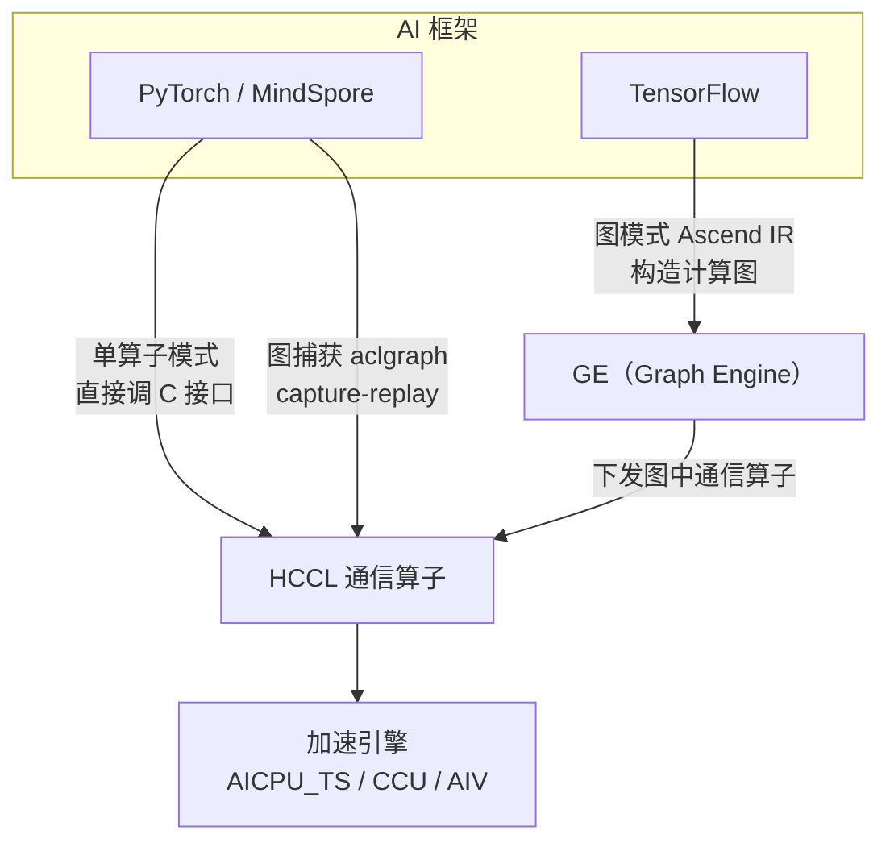
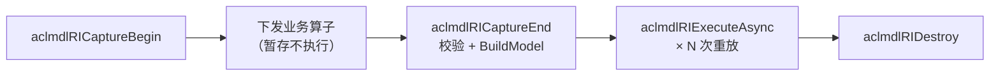

# execution：执行模式与框架集成

> **深度参考** · 前置阅读：[源码课程单元 11｜实战与第一个算子](/通信与昇腾/源码课程/11-examples-first-op.md)。本篇为参考手册体例，检索导向；事实基线见文首引用块。

> HCCL 向上对接 AI 框架，向下使能昇腾 NPU。AI 框架有**三种编程执行形态**——单算子模式、图模式（Ascend IR）、图捕获模式（aclgraph），HCCL 提供对应的工作方式。本目录描述这三种执行模式与主流框架（PyTorch/MindSpore/TensorFlow）的集成。
>
> 事实来源（可信度：代码 > 仓内文档 > 社区资料）：
> `hccl/docs/zh/user_guide/framework_integration.md`（框架集成权威）、`hcomm/docs/zh/aclgraph/aclgraph_introduction.md`（ACL Graph 原理）、`hccl/src/ops/interface_graph_mode/`（图模式资源计算）、`hccl/src/common/framework/tf_plugin/`（TensorFlow 插件）、`hccl/docs/zh/user_guide/api_comm_impl.md`（C/Python 接口分工）。

---

## 1. HCCL 在系统中的位置

> 图源：`hccl/docs/zh/user_guide/figures/hccl_location.png`。HCCL 介于 AI 框架与硬件驱动之间，承上启下。

---

## 2. 三种执行形态对比

AI 框架主要有三种编程执行形态，HCCL 提供对应工作方式（`framework_integration.md`）：

| 执行形态 | 调用方式 | 下发路径 | 适用场景 |
| --- | --- | --- | --- |
| **单算子模式** | AI 框架**直接调用 HCCL C 接口** | 通信算子直接下发到加速引擎执行 | 通用，PyTorch/MindSpore 默认 |
| **图模式（Ascend IR）** | AI 框架用 Ascend 算子 IR 构造计算图 | 经 **GE（Graph Engine）** 将图中通信算子下发给加速引擎 | 静态图、TensorFlow 分布式优化 |
| **图捕获模式（aclgraph）** | AI 框架直接调用 HCCL C 接口（捕获—重放） | 捕获整段 DAG，一次性重放 | 小算子密集推理、通信密集训练 |

> **关键约束**：同一个通信域内**不支持图模式通信与单算子通信混合执行**（见 [../communicator/README.md §6](/通信与昇腾/参考手册/通信域/)）。

---

## 3. C 接口 vs Python 接口

| 语言 | 用途 | 对应执行形态 |
| --- | --- | --- |
| **C 接口** | 实现单算子模式下的框架适配 | 单算子模式、图捕获（aclgraph） |
| **Python 接口** | 实现图模式下的框架适配 | 图模式（Ascend IR），**当前仅用于 TensorFlow 网络在 AI 处理器执行分布式优化** |

---

## 4. 主流框架集成

`framework_integration.md`：

| 框架 | 集成方式 | 说明 |
| --- | --- | --- |
| **PyTorch** | 集成到 **TorchNPU** | 指定 HCCL 为分布式后端，直接用框架原生通信 API（`torch.distributed`） |
| **MindSpore** | 集成到 **MindSpore 框架代码** | 指定 HCCL 为分布式后端，用框架原生通信 API |
| **TensorFlow** | 经 **TF Adapter** 适配插件对接 | 详见《TensorFlow 模型迁移指南》 |

> 针对 PyTorch/MindSpore，HCCL 调用已集成到框架代码中，开发者**无需直接调用 HCCL API**，指定 HCCL 后端即可。详见 [framework_integration.md](/通信与昇腾/参考手册/执行模式/framework_integration.md)。

---

## 5. 图捕获模式（aclgraph）要点

aclgraph 是 CANN Runtime 提供的"**捕获—重放**"机制（对应 CUDA Graph），把"一次下发一次执行"变为"一次捕获多次重放"，摊销 Host 调度开销。详见 [aclgraph.md](/通信与昇腾/参考手册/执行模式/aclgraph.md)。

> **对照 Eager 模式**：Eager 下"1 算子 = 1 次 dispatch 开销"；ACL Graph 把整段流程压缩为 **1 次 capture + N 次 1-syscall replay**。

---

## 6. 文档索引

| 文档 | 内容 |
| --- | --- |
| [aclgraph.md](/通信与昇腾/参考手册/执行模式/aclgraph.md) | **ACL Graph 图捕获**：捕获生命周期、HCCL 协同约束（跨流捕获/同步原语/销毁顺序）、任务更新（原地/重捕获）、**多 stream 拓扑**（model_ri 只含控制面 3 层）、已知失败模式 |
| [framework_integration.md](/通信与昇腾/参考手册/执行模式/framework_integration.md) | **框架集成**：PyTorch(TorchNPU)/MindSpore/TensorFlow(TF Adapter) 对接方式、GE 图模式下发、示例代码 |

---

## 7. 参考资料

- `hccl/docs/zh/user_guide/framework_integration.md`：主流框架集成（本文主要来源）
- `hcomm/docs/zh/aclgraph/aclgraph_introduction.md`：ACL Graph 介绍（捕获生命周期、多 stream 拓扑、失败模式）
- `hccl/docs/zh/user_guide/api_comm_impl.md`：C/Python 接口分工
- `hccl/src/ops/interface_graph_mode/`：图模式资源计算（`calc_resource_graph_mode.cc`）
- `hccl/src/common/framework/tf_plugin/`：TensorFlow 适配插件
- cann/runtime 仓：`docs/zh/dev_guide/04_ACL-Graph.md`、`example/2_advanced_features/model_ri/`（ACL Graph 实现与示例）
- 关联：[README.md](/通信与昇腾/参考手册/执行模式/)、[../communicator/](/通信与昇腾/参考手册/通信域/)（通信域管理）、[../engine/aicpu_ts.md](/通信与昇腾/参考手册/通信引擎/aicpu_ts.md)（图模式并发图 ≤6 约束）

