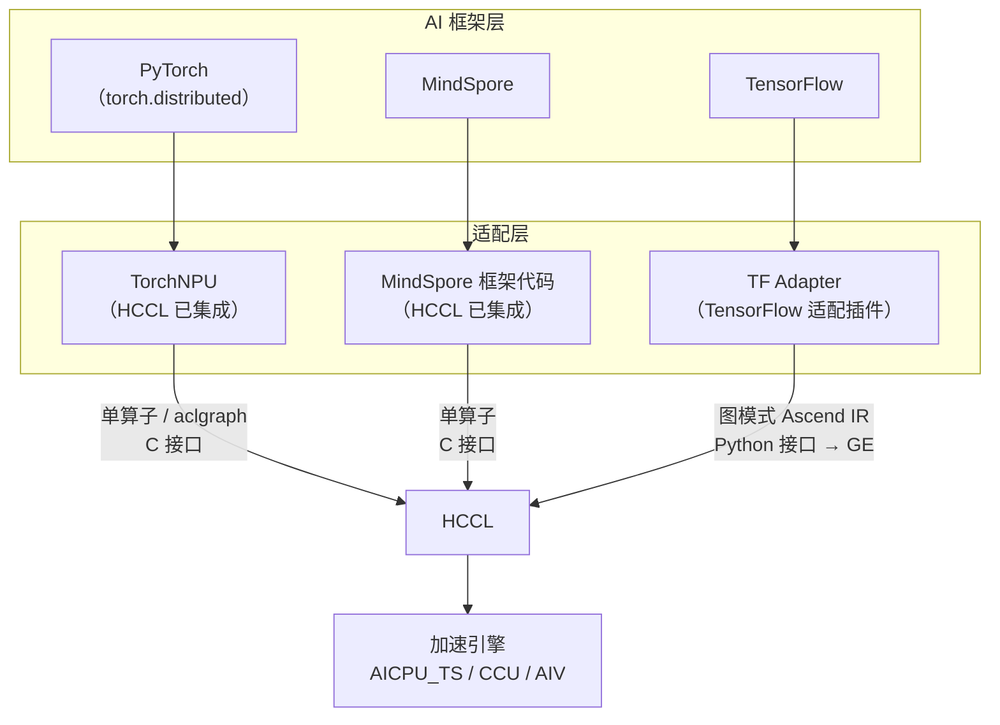
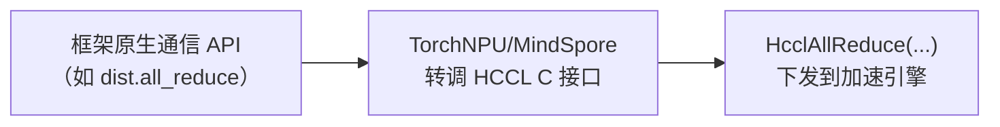
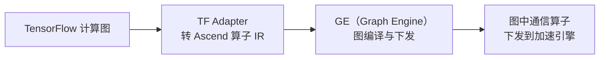

# 主流框架集成

> **深度参考** · 前置阅读：[源码课程单元 11｜实战与第一个算子](/通信与昇腾/源码课程/11-实战与第一个算子.md)。本篇为参考手册体例，检索导向；事实基线见文首引用块。

> HCCL 向上支持多种 AI 框架，向下实现多款昇腾 AI 处理器之间的高效互联。针对 PyTorch、MindSpore、TensorFlow，HCCL 的调用已集成到框架/适配插件中——开发者指定 HCCL 为分布式后端，直接用框架原生通信 API 即可实现分布式能力。
>
> 事实来源：`hccl/docs/zh/user_guide/框架集成.md`（框架集成权威）、`hccl/src/common/framework/tf_plugin/`（TensorFlow 插件）、`hccl/docs/zh/user_guide/api_comm_impl.md`（C/Python 接口分工）。

---

## 1. 集成总览

---

## 2. 三大框架对接方式

| 框架 | 对接载体 | 执行形态 | 开发者视角 |
| --- | --- | --- | --- |
| **PyTorch** | **TorchNPU**（HCCL 调用已集成） | 单算子模式 / 图捕获（aclgraph） | 指定 HCCL 为分布式后端，直接用 `torch.distributed` 原生通信 API |
| **MindSpore** | **MindSpore 框架代码**（HCCL 调用已集成） | 单算子模式 | 指定 HCCL 为分布式后端，用框架原生通信 API |
| **TensorFlow** | **TF Adapter** 适配插件 | 图模式（Ascend IR） | 经《TensorFlow 模型迁移指南》对接 |

> PyTorch/MindSpore 场景下，开发者**无需直接调用 HCCL C API**——框架已封装。仅自定义通信算子或特殊场景才直接调 HCCL 接口。

---

## 3. 两种下发路径

### 3.1 单算子模式 / 图捕获（C 接口直调）

AI 框架直接调用 HCCL 的 C 语言接口，下发通信算子到加速引擎执行。

### 3.2 图模式（Ascend IR，经 GE）

AI 框架使用 Ascend 算子 IR 将模型计算过程构造成一张图，通过 **GE（Graph Engine）** 将图中的通信算子下发给加速引擎执行。

> 图模式详细介绍见《图开发指南》（cann/ge 仓），Ascend IR 定义见《算子库接口参考》的"Ascend IR 算子规格说明"。Python 接口当前仅用于实现 TensorFlow 网络在 AI 处理器执行分布式优化。

---

## 4. C 接口 vs Python 接口分工

| 语言接口 | 用途 | 执行形态 |
| --- | --- | --- |
| **C 接口** | 单算子模式下的框架适配，实现分布式能力 | 单算子、图捕获（aclgraph） |
| **Python 接口** | 图模式下的框架适配 | 图模式（Ascend IR），**当前仅用于 TensorFlow** |

---

## 5. 示例代码

| 场景 | 示例位置 |
| --- | --- |
| PyTorch 框架调用 | `hccl/examples/03_ai_framework/01_pytorch` |
| TensorFlow 框架调用 | `hccl/examples/03_ai_framework/02_tensorflow` |
| 通信域管理 | `hcomm/examples/01_communicators/`（one_device_per_process / rank_table / per_pthread） |
| 点对点通信 | `hccl/examples/01_point_to_point/`（send_recv / batch_send_recv_ring） |
| 集合通信 | `hccl/examples/02_collectives/`（allreduce / broadcast / allgather / reduce_scatter / reduce / alltoall / alltoallv / alltoallvc / scatter） |

---

## 6. 参考资料

- `hccl/docs/zh/user_guide/框架集成.md`：主流框架集成（本文主要来源）
- `hccl/docs/zh/user_guide/api_comm_impl.md`：C/Python 接口分工、通信域管理、集合/点对点通信
- `hccl/src/common/framework/tf_plugin/`：TensorFlow 适配插件
- cann/ge 仓：《图开发指南》`docs/zh/user_guides/graph_dev/README.md`
- 《TorchNPU 产品文档》、MindSpore 官网、《TensorFlow 模型迁移指南》
- 关联：[README.md](/通信与昇腾/参考手册/执行模式/)（执行模式总览）、[aclgraph.md](/通信与昇腾/参考手册/执行模式/ACL-Graph图捕获.md)（图捕获）、[../communicator/创建方式.md](/通信与昇腾/参考手册/通信域/创建方式.md)（通信域创建）

