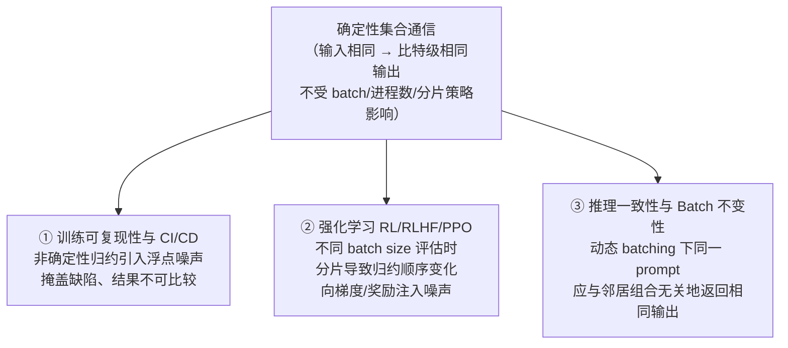
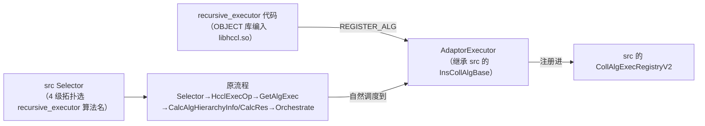

# MC2 自定义算子框架与 RFC 设计演进

> **深度参考** · 前置阅读：[源码课程单元 10｜MC2 框架与官方样例](/通信与昇腾/源码课程/10-MC2框架与官方样例.md)。本篇为参考手册体例，检索导向；事实基线见文首引用块。

> 本文两部分：**① MC2 自定义通信算子框架**（`hccl_mc2.h`，开发通算融合自定义算子的接口）；**② RFC 设计演进**（HCCL 重大架构提案 0001/0002/0003）。
>
> 事实来源：`hccl/include/hccl_mc2.h`（MC2 框架接口）、`hccl/src/common/hccl_mc2.cc`、`hccl/docs/zh/rfcs/`（0001 BIRS、0002 ALGO Plugin、0003 executor-template-refactor、INDEX.md）。

---

## 1. MC2 自定义通信算子框架

`hccl/include/hccl_mc2.h` 是 HCCL 面向**自定义通信算子**（通算融合，MC2 = Multi-Channel v2）的开发接口，是 ../../mc2/ 通算融合算子的底层框架。核心是 **KfcOpArgs**（算子参数）+ **OpResCtx**（算子资源上下文）。

### 1.1 接口

| 接口 | 作用 |
| --- | --- |
| `HcclKfcAllocOpArgs(void** opArgs)` | 分配 `HcclOpArgs` 内存 |
| `HcclKfcFreeOpArgs(void* opArgs)` | 释放 `HcclOpArgs` 内存 |
| `HcclKfcOpArgsSetSrcDataType(opArgs, srcDataType)` | 设置源数据类型 |
| `HcclKfcOpArgsSetDstDataType(opArgs, dstDataType)` | 设置目的数据类型 |
| `HcclKfcOpArgsSetReduceType(opArgs, reduceType)` | 设置归约类型 |
| `HcclKfcOpArgsSetCount(opArgs, count)` | 设置数据量 |
| `HcclKfcOpArgsSetAlgConfig(opArgs, algConfig)` | 设置算法配置 |
| `HcclKfcOpArgsSetCommEngine(opArgs, commEngine)` | 设置通信引擎 |
| `HcclCreateOpResCtx(comm, opType, opArgs, opResCtx)` | 创建通信算子资源上下文 `OpResCtx` |

### 1.2 开发流程


> MC2 模式下算法选择仅用**优先级 18** 的选择器（见 [algo_plugin.md §2](/通信与昇腾/参考手册/扩展机制/算法插件.md)）。MC2 算子清单（MatmulAllReduce、AllGatherMatmul、AlltoAll 融合族等）详见 ../../mc2/。

---

## 2. RFC 设计演进

`hccl/docs/zh/rfcs/` 记录 HCCL 重大架构提案。取号流程：查 INDEX → 登记最小未用编号（reserved）→ 取号 PR → 撰写 RFC 文档 PR → 合入后 accepted（编号永不重用）。

| 编号 | 标题 | 状态 | 领域 |
| --- | --- | --- | --- |
| **0001** | BIRS（Batchsize Invariant ReduceScatter）for A3 | accepted | 确定性算法 |
| **0002** | HCCL-ALGO-Plugin | — | 扩展框架（见 [algo_plugin.md](/通信与昇腾/参考手册/扩展机制/算法插件.md)） |
| **0003** | 集合通信 Executor 统一算法结构方案 | — | 架构重构 |

---

### 2.1 RFC 0001：BIRS（批大小不变的 ReduceScatter）

**BIRS（Batchsize Invariant ReduceScatter）** 是面向 **Ascend A3** 服务器拓扑的新型**批大小不变**的 ReduceScatter 算法。

| 维度 | 说明 |
| --- | --- |
| **核心特性** | 保证**确定性归约顺序**（比特级可重现）的前提下，更充分利用 **SIO + HCCS 混合互连**带宽 |
| **性能** | 大消息场景相比现有 **RHD（Recursive Halving-Doubling）最高提升 25%**（算子执行时间，不含下发开销） |
| **起始** | 2026-04-24，PR cann/hccl#657，Issue cann/hcomm#139 + cann/hccl#96 |

**为什么需要确定性集合通信**（业界硬性约束）：



| 场景 | 业界实践 |
| --- | --- |
| **训练可复现/CI-CD** | Picard(2021) 证明仅随机种子变化就能产生统计显著离群值；确定性保证失败测试每次重跑以相同方式失败 |
| **RL/RLHF/PPO** | verl 提供 `full_determinism` 并设 `HCCL_DETERMINISTIC=1`；DeepSpeed-Chat 要求确定性归约 |
| **推理 Batch 不变性** | vLLM 指出非确定性 all-reduce（如 NCCL）导致同一 prompt 因 batch 邻居不同产生不同 logits；SGLang 提供 `--enable-deterministic-inference` |

> BIRS 与确定性计算（`HCCL_DETERMINISTIC=2` 保序）配合，详见 [../reference/可靠性与安全.md](/通信与昇腾/参考手册/运行与约束/可靠性与安全.md)。

---

### 2.2 RFC 0002：HCCL-ALGO-Plugin

自定义算法扩展框架（dlopen 动态库、零侵入接入选择/执行流程）。**完整内容见 [algo_plugin.md](/通信与昇腾/参考手册/扩展机制/算法插件.md)**。

---

### 2.3 RFC 0003：Executor 统一算法结构方案

针对**四层组网拓扑**新增需求，重构 HCCL 算法执行结构，解决旧架构代码膨胀问题。

**旧架构问题**（多层拓扑/并行切分/复合算子增加导致）：

| 问题 | 说明 |
| --- | --- |
| 算法字符串命名 | 无法从统一结构看出算法由哪些阶段组成及串并行关系 |
| Executor 类型双重职责 | 同时表达算法结构和执行机制，每增一种组合需新增类（**全仓 50+ 执行器类**） |
| Template 三重职责 | 同时承担本地拷贝、通信计划生成和执行，Mesh/NHR 逻辑难复用 |
| 多层 Sequence 缺契约 | 前一阶段产生哪些 Rank 数据、下一阶段读哪些数据无显式契约，只能靠 repeatNum/repeatStride 推导 |
| 内存布局描述复杂 | Input/Output 与 CCL Buffer 布局需 inputSliceStride/outputSliceStride/inputRepeatStride/outputRepeatStride 多字段 |
| 复合算法难复用 | AllReduce TwoShot 表现为专用大 Template，难复用 ReduceScatter/AllGather |

**直接触发**：四层组网拓扑新增第 4 层（跨 super-pod 互联层）：

```text
2 层：server 内 Mesh(L0) + 跨 server NHR(L1)
3 层：server 内 Mesh(L0) + 跨 server NHR(L1) + 跨 super-pod NHR(L2)
4 层：server 内 Mesh(L0) + 跨 server NHR(L1) + 跨 super-pod NHR(L2) + 跨 super-pod 互联(L3) ← 新增
```

> 旧架构下适配四层 = 每算子新增 4 层编排执行器且与 3 层大量重复（前 3 阶段完全相同），工作量线性膨胀：6 算子 ×（Sequence+Parallel+OmniPipe 变体）≈ 12-18 个新执行器类，每个 300-500 行。

**重构方案**（四个核心抽象）：

| 抽象 | 职责 |
| --- | --- |
| **`HcclAlgorithm`** | 静态算法描述（递归算法树描述 Sequence/Parallel/OmniPipe 组合） |
| **`OpsExecutor`** | 通用解释器 |
| **Template** | 单层执行单元 |
| **CommPlanner** | 通信计划生成器 |

- 通过 `ranksForInputData`/`ranksForOutputData` 传递逻辑数据归属
- 建立 `Input → CCL Buffer → ... → CCL Buffer → Output` 的统一内存与数据流模型

**插件式零侵入接入**：



> 落地目录 `experimental/ops/op_common/recursive_executor/`；src 侧除 Selector 的 4 级拓扑分支外**零改动**。起始 2026-08-12，PR cann/hccl#2572，Issue cann/hccl#607。

---

## 3. 参考资料

- `hccl/include/hccl_mc2.h`、`hccl/src/common/hccl_mc2.cc`：MC2 自定义算子框架
- `hccl/docs/zh/rfcs/0001-add-batch-invariant-reducescatter.md`：BIRS 算法（确定性集合通信动机）
- `hccl/docs/zh/rfcs/0002-HCCL-ALGO-Plugin.md`：算法插件框架
- `hccl/docs/zh/rfcs/0003-executor-template-refactor.md`：Executor 统一算法结构方案
- `hccl/docs/zh/rfcs/INDEX.md`、`README.md`：RFC 登记索引与流程
- 关联：[README.md](/通信与昇腾/参考手册/扩展机制/)（扩展机制总览）、[algo_plugin.md](/通信与昇腾/参考手册/扩展机制/算法插件.md)、../../mc2/（通算融合算子）、[../algorithms/算法组合.md](/通信与昇腾/参考手册/算法参考/算法组合.md)（执行器编排）、[../reference/可靠性与安全.md](/通信与昇腾/参考手册/运行与约束/可靠性与安全.md)（确定性计算）

